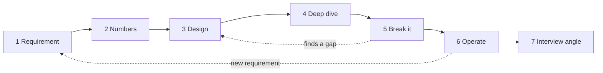

# 00 — How to use this course

> **The requirement.** *What does a system designer in 2026 have to know that one in 2016 did not?* The
> classical toolkit is still in use: caches, replicas, shards, queues, consensus. It still runs the world and
> it still comes up in every interview. But in ten years the workloads changed (a chat request can occupy a GPU
> for twenty seconds), the constraints changed (cost, energy and regulation are now design inputs, not
> afterthoughts), and the threats changed (attacks now come through your dependencies). A course that teaches
> only the classics leaves you unprepared for the new work. A course that teaches only the new material leaves
> you without foundations. This course does both, through one repeatable method.

## In one minute

This course teaches system design as **reasoning from requirements**, not as memorising boxes. Every chapter
opens with one concrete, quantified requirement. It then walks the same seven steps, the **requirement loop**:
state the requirement, turn it into numbers, design, go deep on the hardest part, break it on purpose, operate
it (SLOs, cost, energy), and finally rehearse how it is asked in interviews. The building blocks (load
balancers, caches, queues, GPUs, vector indexes) appear *because* a requirement needs them, so you always know
why each box is in the diagram. A fictional product, **Lumen**, grows through the course from one server to a
global, GPU-backed, multi-tenant AI service and then an agent platform, and the labs build pieces of it on your
laptop. You can read everything in order, take the **practitioner** path straight to modern requirements and AI
systems, take the **interview** path, or take the **agentic-systems** path to designing applications in which models
call tools and act. Sections are marked **[Core]** for everyone, **[Deep]** for senior engineers, and
**[Frontier]** for 2024–2026 state of the art.

## Why this matters now

Most system design material was shaped by the web and mobile era. Its canonical problems are URL shorteners,
news feeds, chat, and video. Those problems are still in this course, because their lessons still apply. What
that material tends to under-teach is listed below, with evidence, in [What changed, 2016 → 2026](#what-changed-in-system-design-2016--2026-core):
serving large language models, GPU economics, energy, regulation, software supply chains, and platform
engineering. The second gap is **practice**. Reading about a saturation point is not the same as watching
latency bend upwards on your own machine when utilisation passes 80%. So this course ships labs that run locally
with Docker Compose or kind, at no cost, and each lab records honestly whether it was actually run.

## Core ideas [Core]

### The course map

The course has 55 units in six parts: 34 chapters (00–33), 17 case studies and 4 interview units. Every part has its own directory.

| Part | Directory | Units | What it gives you |
|---|---|---|---|
| 0 — Orientation | [`course/00-orientation/`](./) | 00, 01 | The method, and the numbers every design needs |
| I — Classical foundations | [`course/01-foundations/`](../01-foundations/) | 02–13 | Requests, scaling, caching, storage, replication, sharding, async, consensus, APIs, reliability, observability, data |
| II — Modern requirements | [`course/02-modern-requirements/`](../02-modern-requirements/) | 14–20 | Platforms, multi-region and edge, cost, energy, security, privacy and sovereignty, streaming |
| III — AI-native systems | [`course/03-ai-systems/`](../03-ai-systems/) | 21–33 | LLM inference, serving at scale, GPUs, retrieval, agents, LLM gateways, ML platforms, AI governance, then five agentic chapters: architectures, context and memory, security, observing and evaluating, the agent runtime |
| IV — Case studies | [`course/04-case-studies/`](../04-case-studies/) | C01–C17 | Nine classical (C01–C08, C14), five AI-era (C09–C13) and three agentic (C15–C17) problems, solved end to end |
| V — Interview track | [`course/05-interview/`](../05-interview/) | I01–I04 | The interview playbook, cheat sheets, question bank, ML/LLM interviews |

Each unit has up to three companions with the same file name in other folders: a text-first slide outline in
[`slides/`](../../slides/), exercises with reasoned answers in [`exercises/`](../../exercises/), and, where
listed, a runnable lab in [`labs/`](../../labs/).

Part III closes with five chapters on agentic systems, which build on chapter 25's tool calling, MCP and sandboxed
execution: [29 — Agent architectures and orchestration](../03-ai-systems/29-agent-architectures-orchestration.md),
[30 — Context engineering and agent memory](../03-ai-systems/30-context-engineering-memory.md),
[31 — Securing agentic systems](../03-ai-systems/31-securing-agentic-systems.md),
[32 — Observing and evaluating agents](../03-ai-systems/32-observing-evaluating-agents.md) and
[33 — Agent platform runtime](../03-ai-systems/33-agent-platform-runtime.md). Part IV closes with three agentic cases:
[C15 — Customer-support agent platform](../04-case-studies/C15-support-agent-platform.md),
[C16 — Deep-research multi-agent system](../04-case-studies/C16-deep-research-agents.md) and
[C17 — Enterprise workflow-automation agent](../04-case-studies/C17-workflow-automation-agent.md). None of these
units has a built lab yet; labs for 30, 32 and 33 are planned.

Part III is the centre of gravity. Parts I and II build the tools that Part III applies to AI workloads:
queueing, batching, caching, routing, autoscaling and cost per unit of work. AI serving is treated as a
system-design workload, not as a separate topic.

**Out of scope: training systems.** Part III covers inference and serving, GPU infrastructure, retrieval, agents
(architectures, context and memory, security, evaluation and runtime), gateways and governance. Chapter 27 ([SYSDESIGN-27](../03-ai-systems/27-ml-platforms.md)) covers ML platforms,
including fine-tuning pipelines (LoRA and QLoRA, model registries, evaluation gates), at the systems level. The course
does not teach large-scale pre-training or post-training systems, such as distributed-training parallelism in depth,
reinforcement-learning post-training loops or corpus-scale data pipelines. Training appears only as memory,
checkpoint and failure arithmetic in [SYSDESIGN-23](../03-ai-systems/23-gpu-infrastructure.md) and 27.

### The requirement loop

Every chapter and every case study walks the same loop. Here is what each step means and what it produces.



*Diagram: seven steps in a row (Requirement, Numbers, Design, Deep dive, Break it, Operate, Interview angle),
with two feedback arrows: breaking the design sends you back to Design, and operating it produces new
Requirements.*

1. **Requirement.** One sentence with a number, a population and a condition. "Serve 6,000 requests/s at
   p99 < 300 ms and survive the loss of one zone", not "make it scalable". If you can't write the sentence, you
   don't yet know what you are designing. *Produces:* the requirement line at the top of each chapter.
2. **Numbers.** Turn the requirement into rates, sizes and budgets: requests/s at peak, concurrency (Little's
   law), storage per year, bandwidth, error budget, tokens/s, cost per request. Every number is either sourced or
   labelled as an assumption. *Produces:* a worked estimate that a reviewer can argue with line by line. This is
   the subject of [SYSDESIGN-01](01-requirements-to-numbers.md).
3. **Design.** The simplest architecture that meets the numbers, where every component answers the question
   *"why is this box here?"* with a requirement. *Produces:* a diagram and a trade-off table (option, wins when,
   costs, example systems).
4. **Deep dive.** The one or two places where the design is hard: the algorithm, the data structure, the
   protocol, the paper. This is where seniority shows. *Produces:* the [Deep] sections.
5. **Break it.** Fail it on purpose: kill a node, add latency, overload it, make a key hot, expire a
   certificate. Ask what users see and how you would know. A design that has not been broken has not been
   designed. *Produces:* the failure-mode table and most of the labs.
6. **Operate.** What it takes to run the design day to day: SLIs and SLOs, alerts, deploys, capacity, **cost**
   and **energy**. A design that meets its latency target at three times the budget has failed its requirements.
   *Produces:* the "Failure modes and operations" and "Cost and energy" sections.
7. **Interview angle.** How the topic is asked, a model answer outline, red flags, and follow-ups. The course's
   interview framework, **CLARIFY → QUANTIFY → SKETCH → DEEPEN → STRESS → WRAP**, maps onto the loop: CLARIFY is
   step 1, QUANTIFY step 2, SKETCH step 3, DEEPEN step 4, STRESS steps 5–6, and WRAP summarises the trade-offs.
   It is defined in full in I01.

The loop is not a waterfall. Breaking a design usually sends you back to redesign. Operating it usually reveals
a requirement nobody wrote down ("deploys must not drop requests"). Expect to go round more than once.

### Depth markers

Sections carry one of three markers:

| Marker | Who it is for | What you will find |
|---|---|---|
| **[Core]** | Everyone, including beginners and interview candidates | Definitions, mechanisms, the standard design, worked numbers |
| **[Deep]** | Senior engineers and anyone who wants the *why* | Internals, mathematics, edge cases, the original papers |
| **[Frontier]** | Practitioners working on current systems | 2024–2026 state of the art, always marked "as of 2026-11" with versions, because it will change |

A first pass through the course can read only [Core]. Interview candidates targeting senior or staff levels
should read [Deep]. [Frontier] sections are the first to go out of date, and they say so.

### The running example: Lumen

**Lumen** is a fictional product used throughout the labs and many examples. It has no connection to any real
company, and all its numbers are invented assumptions, labelled as such. Lumen is an **AI-assisted knowledge and
chat service**. Teams upload documents, search them, and ask questions answered by a language model, with
citations back to the source passages. Later in the course, agents act on connected tools. Its domains are
`example.com` and `example.org`.

Lumen grows in stages. Each stage raises the requirement that the next part of the course answers.

| Stage | Lumen at this point | Requirement that pushes it on | Units |
|---|---|---|---|
| 0 | One server, one database, a launch date | "Will one server survive launch day?" | 01–03 |
| 1 | Three stateless replicas, a cache, a primary and replicas, sharded document metadata, async indexing | "Reads are 50× writes and the database is melting" | 04–08 |
| 2 | Streaming APIs, rate limits, leader election for indexers, SLO alerts, a data lake and search index | "Deploy 20 times a day and know within 5 minutes when users hurt" | 09–13 |
| 3 | Kubernetes platform, EU and US regions, cost model, carbon-aware batch jobs, zero trust, GDPR and AI Act controls, change-data-capture pipelines | "EU data stays in the EU, cost per active user halves, and every artefact is signed" | 14–20 |
| 4 | vLLM fleet on GPUs, retrieval with vector indexes, agents in sandboxes, an LLM gateway, an ML platform, guardrails and audit | "2,000 concurrent chat streams with time to first token under 1 s, at a known cost per 1,000 tokens" | 21–28 |
| 5 | An agent platform for 2,000 tenants: workflows and agent teams, managed context and memory, brokered tool access, agent traces and evals, a queued multi-tenant runtime | "240,000 agent runs a day: no run lost, no side effect duplicated, a hard cost cap on every run" | 29–33 |
| Cases | Lumen reappears where the problem fits (LLM chat, enterprise RAG, coding agents), and as Lumen Support, Lumen Research and Lumen Flow in the agentic cases | One prompt each | C09–C11, C15–C17 |

Lumen is a *teaching device*, not a case study of a real system. When the course cites how a real system works
(DynamoDB, Maglev, vLLM), it cites a published source.

### Four learning paths

Choose the path that matches your goal. Unit codes link to the canonical files. Every path is prerequisite-closed:
each unit appears after the units its front matter lists as prerequisites, or the path tells you to read those
prerequisites' [Core] sections first. Units marked *(Core)* need only their [Core] sections; read the others in
full. Case studies have no depth markers, so a case in a path is always read in full.

**Path A — Learner (full course, beginner → advanced).** Read in order, doing every lab, and slot case studies
in where their prerequisites are complete:

1. Orientation: [00](00-how-to-use-this-course.md) → [01](01-requirements-to-numbers.md)
2. Foundations: [02](../01-foundations/02-anatomy-of-a-request.md) → [03](../01-foundations/03-scaling-compute.md) →
   [04](../01-foundations/04-caching.md) → [05](../01-foundations/05-choosing-storage.md) →
   [06](../01-foundations/06-replication-consistency.md) → [07](../01-foundations/07-partitioning-sharding.md) →
   [08](../01-foundations/08-async-event-driven.md) → [09](../01-foundations/09-coordination-consensus.md) →
   [10](../01-foundations/10-apis-communication.md)
3. First cases: [C01](../04-case-studies/C01-url-shortener-rate-limiter.md) → [C02](../04-case-studies/C02-news-feed.md) →
   [C03](../04-case-studies/C03-chat-presence.md) → [C06](../04-case-studies/C06-payments-ledger.md) →
   [C07](../04-case-studies/C07-distributed-kv-store.md)
4. Foundations, continued: [11](../01-foundations/11-reliability-engineering.md) →
   [12](../01-foundations/12-observability.md) → [13](../01-foundations/13-data-at-scale.md)
   → case [C08](../04-case-studies/C08-web-crawler-search.md)
5. Modern requirements: [14](../02-modern-requirements/14-cloud-native-platforms.md) →
   [15](../02-modern-requirements/15-multi-region-edge.md) → [16](../02-modern-requirements/16-cost-as-requirement.md) →
   [17](../02-modern-requirements/17-energy-carbon-aware.md) → [18](../02-modern-requirements/18-security-by-design.md) →
   [19](../02-modern-requirements/19-privacy-compliance-sovereignty.md) → [20](../02-modern-requirements/20-real-time-streaming.md)
   → cases [C04](../04-case-studies/C04-video-streaming.md) (needs 13 and 16),
   [C05](../04-case-studies/C05-ride-hailing-proximity.md) (needs 20), [C14](../04-case-studies/C14-global-flash-sale.md)
6. AI-native systems: [21](../03-ai-systems/21-llm-inference-anatomy.md) → [22](../03-ai-systems/22-serving-llms-at-scale.md) →
   [23](../03-ai-systems/23-gpu-infrastructure.md) → [24](../03-ai-systems/24-retrieval-vector-systems.md) →
   [25](../03-ai-systems/25-agentic-systems.md) → [26](../03-ai-systems/26-llm-gateways-llmops.md) →
   [27](../03-ai-systems/27-ml-platforms.md) → [28](../03-ai-systems/28-ai-trust-safety-governance.md)
7. Agentic systems: [29](../03-ai-systems/29-agent-architectures-orchestration.md) → [30](../03-ai-systems/30-context-engineering-memory.md) →
   [31](../03-ai-systems/31-securing-agentic-systems.md) → [32](../03-ai-systems/32-observing-evaluating-agents.md) →
   [33](../03-ai-systems/33-agent-platform-runtime.md)
8. AI-era cases: [C09](../04-case-studies/C09-llm-chat-service.md) → [C10](../04-case-studies/C10-enterprise-rag-assistant.md) →
   [C11](../04-case-studies/C11-coding-agent-platform.md) → [C12](../04-case-studies/C12-realtime-fraud-recsys.md) (needs 27) →
   [C13](../04-case-studies/C13-gpu-cluster-telemetry.md)
9. Agentic cases: [C15](../04-case-studies/C15-support-agent-platform.md) (needs C06 and C10) →
   [C16](../04-case-studies/C16-deep-research-agents.md) (needs C08 and C11) → [C17](../04-case-studies/C17-workflow-automation-agent.md)
10. Finish with [I01](../05-interview/I01-interview-playbook.md), even if you are not interviewing: it is the
    method compressed into 45 minutes.

**Path B — Practitioner (working engineer; you know the classics and want the new requirements, AI first).** Skim
[00](00-how-to-use-this-course.md), do [01](01-requirements-to-numbers.md) properly (the numbers matter everywhere). Path B assumes you already know
[02](../01-foundations/02-anatomy-of-a-request.md) *(Core)*, [03](../01-foundations/03-scaling-compute.md) *(Core)*, [04](../01-foundations/04-caching.md) *(Core)*,
[05](../01-foundations/05-choosing-storage.md) *(Core)*, [06](../01-foundations/06-replication-consistency.md) *(Core)*,
[07](../01-foundations/07-partitioning-sharding.md) *(Core)*, [08](../01-foundations/08-async-event-driven.md) *(Core)*,
[09](../01-foundations/09-coordination-consensus.md) *(Core)*, [10](../01-foundations/10-apis-communication.md) *(Core)* and
[13](../01-foundations/13-data-at-scale.md) *(Core)*: if one of them is unfamiliar, read its [Core] sections before step 1. Then:

1. Operations core: [11](../01-foundations/11-reliability-engineering.md) → [12](../01-foundations/12-observability.md)
2. Modern requirements: [14](../02-modern-requirements/14-cloud-native-platforms.md) →
   [16](../02-modern-requirements/16-cost-as-requirement.md) → [17](../02-modern-requirements/17-energy-carbon-aware.md) →
   [18](../02-modern-requirements/18-security-by-design.md) → [15](../02-modern-requirements/15-multi-region-edge.md) →
   [19](../02-modern-requirements/19-privacy-compliance-sovereignty.md) (after 15, which it builds on) →
   [20](../02-modern-requirements/20-real-time-streaming.md)
3. AI-native systems, all of Part III in order: [21](../03-ai-systems/21-llm-inference-anatomy.md) →
   [22](../03-ai-systems/22-serving-llms-at-scale.md) → [23](../03-ai-systems/23-gpu-infrastructure.md) →
   [24](../03-ai-systems/24-retrieval-vector-systems.md) → [25](../03-ai-systems/25-agentic-systems.md) →
   [26](../03-ai-systems/26-llm-gateways-llmops.md) → [27](../03-ai-systems/27-ml-platforms.md) →
   [28](../03-ai-systems/28-ai-trust-safety-governance.md), then the agentic chapters [29](../03-ai-systems/29-agent-architectures-orchestration.md) →
   [30](../03-ai-systems/30-context-engineering-memory.md) → [31](../03-ai-systems/31-securing-agentic-systems.md) →
   [32](../03-ai-systems/32-observing-evaluating-agents.md) → [33](../03-ai-systems/33-agent-platform-runtime.md)
4. AI-era cases: [C09](../04-case-studies/C09-llm-chat-service.md) → [C10](../04-case-studies/C10-enterprise-rag-assistant.md) →
   [C11](../04-case-studies/C11-coding-agent-platform.md) → [C13](../04-case-studies/C13-gpu-cluster-telemetry.md)
5. Agentic cases, after the two classical cases they build on: [C06](../04-case-studies/C06-payments-ledger.md) (idempotency and
   exactly-once effects, which agents that move money need) → [C08](../04-case-studies/C08-web-crawler-search.md) (fetching the open web at
   scale, which research agents do) → [C15](../04-case-studies/C15-support-agent-platform.md) →
   [C16](../04-case-studies/C16-deep-research-agents.md) → [C17](../04-case-studies/C17-workflow-automation-agent.md)
6. Do labs L01, L03, L12, L14, L16, L21, L22, L25 and L26 at minimum.

**Path C — Interview candidate.** Learn the numbers and the playbook first, then the topics most often asked, then
practise on cases.

1. Method: [00](00-how-to-use-this-course.md) (this page) → [01](01-requirements-to-numbers.md) →
   [I01](../05-interview/I01-interview-playbook.md) → [I02](../05-interview/I02-numbers-cheat-sheets.md) §§1–9 (the classical
   numbers; §§10–14 come after 21)
2. High-frequency topics: [02](../01-foundations/02-anatomy-of-a-request.md) *(Core)* →
   [03](../01-foundations/03-scaling-compute.md) → [04](../01-foundations/04-caching.md) →
   [05](../01-foundations/05-choosing-storage.md) → [06](../01-foundations/06-replication-consistency.md) →
   [07](../01-foundations/07-partitioning-sharding.md) → [08](../01-foundations/08-async-event-driven.md) →
   [09](../01-foundations/09-coordination-consensus.md) *(Core)* → [10](../01-foundations/10-apis-communication.md) →
   [11](../01-foundations/11-reliability-engineering.md)
3. Classical cases, in roughly the order interviewers use them: [C01](../04-case-studies/C01-url-shortener-rate-limiter.md) →
   [C02](../04-case-studies/C02-news-feed.md) → [C03](../04-case-studies/C03-chat-presence.md) →
   [C06](../04-case-studies/C06-payments-ledger.md) → [C07](../04-case-studies/C07-distributed-kv-store.md) →
   [C14](../04-case-studies/C14-global-flash-sale.md)
4. Operations, data and platforms, which the remaining cases and the AI round build on:
   [12](../01-foundations/12-observability.md) *(Core)* → [13](../01-foundations/13-data-at-scale.md) *(Core)* →
   [14](../02-modern-requirements/14-cloud-native-platforms.md) *(Core)* →
   [16](../02-modern-requirements/16-cost-as-requirement.md) *(Core)* →
   [20](../02-modern-requirements/20-real-time-streaming.md) *(Core)*, then cases
   [C08](../04-case-studies/C08-web-crawler-search.md) → [C04](../04-case-studies/C04-video-streaming.md) →
   [C05](../04-case-studies/C05-ride-hailing-proximity.md)
5. The AI round, now common at many companies: [21](../03-ai-systems/21-llm-inference-anatomy.md) →
   [I02](../05-interview/I02-numbers-cheat-sheets.md) §§10–14 → [22](../03-ai-systems/22-serving-llms-at-scale.md) →
   [23](../03-ai-systems/23-gpu-infrastructure.md) *(Core)* → [24](../03-ai-systems/24-retrieval-vector-systems.md) →
   [26](../03-ai-systems/26-llm-gateways-llmops.md) → [27](../03-ai-systems/27-ml-platforms.md) *(Core)* →
   case [C09](../04-case-studies/C09-llm-chat-service.md)
6. RAG, agents and governance: [15](../02-modern-requirements/15-multi-region-edge.md) *(Core)* →
   [18](../02-modern-requirements/18-security-by-design.md) *(Core)* →
   [19](../02-modern-requirements/19-privacy-compliance-sovereignty.md) *(Core)* →
   [25](../03-ai-systems/25-agentic-systems.md) *(Core)* → [28](../03-ai-systems/28-ai-trust-safety-governance.md) *(Core)* →
   case [C10](../04-case-studies/C10-enterprise-rag-assistant.md) → [I04](../05-interview/I04-ml-llm-interviews.md)
7. The agentic round: re-read [I01 §17](../05-interview/I01-interview-playbook.md#17-when-the-prompt-is-agentic), then
   [29](../03-ai-systems/29-agent-architectures-orchestration.md) *(Core)* → [31](../03-ai-systems/31-securing-agentic-systems.md) *(Core)* →
   [32](../03-ai-systems/32-observing-evaluating-agents.md) *(Core)* → [33](../03-ai-systems/33-agent-platform-runtime.md) *(Core)* →
   case [C15](../04-case-studies/C15-support-agent-platform.md), the support agent that issues refunds, which is the prompt §17 opens with
8. Mock interviews with [I03](../05-interview/I03-question-bank-rubrics.md). Senior and staff candidates add the
   [Deep] sections of [11](../01-foundations/11-reliability-engineering.md), [12](../01-foundations/12-observability.md),
   [15](../02-modern-requirements/15-multi-region-edge.md), [16](../02-modern-requirements/16-cost-as-requirement.md) and
   [18](../02-modern-requirements/18-security-by-design.md): operations, geography, cost and security are where senior
   answers differ from mid-level ones.

**Path D — Agentic systems (you will design, review or run applications in which models call tools and act).** The
shortest prerequisite-closed route to chapters 29–33 and cases C15–C17. It reads the agent spine in full and the
classical units underneath it at [Core] depth. It leaves out 16, 17, 20, 23, 27 and the cases nothing in the route
needs.

1. Method: [00](00-how-to-use-this-course.md) → [01](01-requirements-to-numbers.md)
2. Foundations, at [Core] depth except 08 and 10, which agent runtimes are built from (durable, idempotent work and
   API contracts): [02](../01-foundations/02-anatomy-of-a-request.md) *(Core)* → [03](../01-foundations/03-scaling-compute.md) *(Core)* →
   [04](../01-foundations/04-caching.md) *(Core)* → [05](../01-foundations/05-choosing-storage.md) *(Core)* →
   [06](../01-foundations/06-replication-consistency.md) *(Core)* → [07](../01-foundations/07-partitioning-sharding.md) *(Core)* →
   [08](../01-foundations/08-async-event-driven.md) → [09](../01-foundations/09-coordination-consensus.md) *(Core)* →
   [10](../01-foundations/10-apis-communication.md) → [11](../01-foundations/11-reliability-engineering.md) *(Core)* →
   [12](../01-foundations/12-observability.md) *(Core)* → [13](../01-foundations/13-data-at-scale.md) *(Core)*, then cases
   [C06](../04-case-studies/C06-payments-ledger.md) → [C08](../04-case-studies/C08-web-crawler-search.md)
3. Platform, security and regulation: [14](../02-modern-requirements/14-cloud-native-platforms.md) *(Core)* →
   [15](../02-modern-requirements/15-multi-region-edge.md) *(Core)* → [18](../02-modern-requirements/18-security-by-design.md) →
   [19](../02-modern-requirements/19-privacy-compliance-sovereignty.md) *(Core)*
4. AI foundations: [21](../03-ai-systems/21-llm-inference-anatomy.md) → [22](../03-ai-systems/22-serving-llms-at-scale.md) *(Core)* →
   [24](../03-ai-systems/24-retrieval-vector-systems.md) → [25](../03-ai-systems/25-agentic-systems.md) →
   [26](../03-ai-systems/26-llm-gateways-llmops.md) → [28](../03-ai-systems/28-ai-trust-safety-governance.md)
5. AI-era cases: [C09](../04-case-studies/C09-llm-chat-service.md) → [C10](../04-case-studies/C10-enterprise-rag-assistant.md) →
   [C11](../04-case-studies/C11-coding-agent-platform.md)
6. The agentic chapters: [29](../03-ai-systems/29-agent-architectures-orchestration.md) → [30](../03-ai-systems/30-context-engineering-memory.md) →
   [31](../03-ai-systems/31-securing-agentic-systems.md) → [32](../03-ai-systems/32-observing-evaluating-agents.md) →
   [33](../03-ai-systems/33-agent-platform-runtime.md)
7. Agentic cases: [C15](../04-case-studies/C15-support-agent-platform.md) → [C16](../04-case-studies/C16-deep-research-agents.md) →
   [C17](../04-case-studies/C17-workflow-automation-agent.md)
8. Interview angle: [I01 §17](../05-interview/I01-interview-playbook.md#17-when-the-prompt-is-agentic), how to answer
   an agentic prompt in 45 minutes. Do labs L24, L25 and L26 at minimum.

### How a chapter is built

Every chapter uses the same skeleton, so you always know where to look:

- **The requirement**, then **In one minute** (intuition without jargon), then **Why this matters now**.
- **Core ideas**, **Numbers that matter** (a worked estimate), **Design choices and trade-offs** (tables of
  option / wins when / costs / example systems).
- **Deep dive**, **Frontier**, **Failure modes and operations**, **Cost and energy**.
- **Interview angle**, **Common mistakes**, **Check yourself**, **Lab**, **Further reading**, **References**.

Diagrams are Mermaid, with a one-line text alternative under each. Nothing is conveyed by colour alone.

### How evidence works in this course

- **Every non-obvious claim has a numbered reference**, preferring primary sources: papers, RFCs,
  specifications, official versioned documentation, upstream repositories, and public postmortems. Blogs are
  used for leads and perspective, not as proof.
- **Every number is sourced or labelled as an assumption.** Worked examples list their assumptions in a table,
  so you can change one and recompute.
- **Fast-moving facts carry a date and a version**, for example "(as of 2026-11, vLLM v0.34.0)". When you read
  this later, treat such claims as starting points to re-check.
- **Labs state their test status** in one of three labels: *illustrative* (a sketch, not run), *syntax-reviewed*
  (configuration validated, not run end to end), or *runtime-tested* (run on a stated date, host and versions,
  with the observed output summarised). A lab never claims more than was actually done.

## What changed in system design, 2016 → 2026 [Core]

Six shifts, each with evidence. They are the reason Parts II and III exist.

### 1. A new dominant workload: LLM inference

In 2016 the Transformer architecture did not exist yet. It was published in June 2017 [1]. ChatGPT launched on
30 November 2022 [2]. By 2026, serving language models is a mainstream system-design problem with its own
physics. A request has a compute-heavy *prefill* phase and a memory-bandwidth-bound *decode* phase, it carries
per-request state (the KV cache) that occupies scarce GPU memory, and its latency is measured as time to first
token and time per output token. The research systems that defined how this is served are system-design papers.
vLLM's PagedAttention (SOSP 2023) borrowed virtual-memory paging from operating systems to manage KV-cache
memory, and reported 2–4× higher throughput than the systems it compared against at the same latency [3]. The
open-source serving stacks move fast: vLLM's latest release is v0.34.0, published 16 November 2026 (as of
2026-11) [4]. *Covered in:* 21, 22, 26, C09.

### 2. GPUs and accelerators became first-class infrastructure

The unit of capacity for AI workloads is an accelerator whose memory bandwidth and power dwarf those of 2016
hardware:

| GPU (vendor datasheets) | Year | Memory bandwidth | Max power |
|---|---|---|---|
| NVIDIA Tesla P100 (SXM2) | 2016 | 732 GB/s (HBM2) [5] | 300 W [5] |
| NVIDIA H100 (SXM) | 2022 | 3.35 TB/s [6] | Up to 700 W (configurable) [6] |
| NVIDIA DGX B200 system (8 Blackwell GPUs) | 2024 | 64 TB/s total HBM3e, ≈ 8 TB/s per GPU (64 ÷ 8, our arithmetic) [7] | ≈ 14.3 kW for the whole system [7] |

Per-GPU memory bandwidth grew about 11× from P100 to Blackwell. Because decoding is limited by memory bandwidth,
that number, not peak FLOPS, often bounds tokens per second. Power per device more than doubled from P100 to
H100. Scheduling, topology (NVLink, InfiniBand), sharing (MIG, time-slicing) and cost per token are now
architectural concerns. *Covered in:* 21, 22, 23, C13.

### 3. Cost and energy became design requirements

The cloud turned capacity into a monthly bill that engineers can read, so cost became a measurable,
per-request property of a design. Energy followed. The International Energy Agency estimates data centres used
about **415 TWh in 2024, around 1.5% of global electricity**, and projects about **945 TWh by 2030** [8].
Facility efficiency has stopped improving on average. The Uptime Institute reports that industry-average PUE
fell from 2.5 in 2007 to 1.98 in 2011 and 1.65 by 2014, and that since 2020 it has been "stuck in the 1.55 to 1.59
band" [9]. Further gains
must come from the workload itself: utilisation, batching, scheduling work when and where the electricity is
cleaner, and not computing what you don't need. *Covered in:* 16, 17, and the "Cost and energy" section of every
chapter.

### 4. Regulation became an architectural input

In 2016, data protection was mostly a legal team's concern. In 2026 it determines where data may be stored,
how long it lives, how it is erased from replicas and backups, and what an AI system must log.

| Instrument | Key dates | Design consequence |
|---|---|---|
| GDPR | In force 24 May 2016; applies since **25 May 2018** [10] | Residency, retention, erasure across distributed copies, purpose limitation |
| NIS2 Directive | Member States had to transpose it by **17 October 2024** [11] | Security risk management and incident reporting for essential and important entities |
| Data Act | In force 11 January 2024; applies from **12 September 2025** [12] | Data access and portability for connected products; cloud switching |
| Cyber Resilience Act | In force 10 December 2024; reporting obligations from **11 September 2026**; main obligations from **11 December 2027** [13] | Security requirements and vulnerability handling for products with digital elements |
| AI Act, Regulation (EU) 2024/1689 | In force 1 August 2024; prohibitions from 2 February 2025; general-purpose AI obligations from 2 August 2025; applicable from 2 August 2026, with exceptions [14] | Risk classification, logging, transparency and human oversight as system requirements |
| AI Omnibus (Digital Omnibus on AI), Regulation (EU) 2026/1744 | In force 27 July 2026. High-risk obligations for Annex III systems from **2 December 2027**, for Annex I systems from **2 August 2028** [14][15] | Shifts the high-risk timeline; designs should still plan for those controls |

*(as of 2026-11; check the Official Journal for later amendments.)* *Covered in:* 19, 28, C10.

### 5. The software supply chain became an attack surface

A run of incidents moved supply-chain security from niche to mandatory. CISA issued Emergency Directive 21-01
on the SolarWinds Orion compromise on 13 December 2020 [16]. The US Executive Order 14028, *Improving the
Nation's Cybersecurity*, was signed on 12 May 2021 [17]. The Log4j vulnerability CVE-2021-44228 ("Log4Shell")
was published on 10 December 2021 [18]. SLSA v1.0, a framework for build provenance, was finalised on 19 April
2023 [19]. In March 2024, malicious code was discovered in the upstream release tarballs of the `xz` compression
library, starting with version 5.6.0 (CVE-2024-3094) [20]. Designs now include signed artefacts, provenance,
software bills of materials, and dependency policies as components of the system, not as paperwork.
*Covered in:* 18, 31, C11.

### 6. Platforms replaced hand-built infrastructure

Kubernetes 1.0 was released on 21 July 2015 [21], so in 2016 it was barely a year old. In 2026 its latest minor
release is 1.37 [22], and the industry's attention has moved from "can we run containers?" to **platform
engineering**: internal platforms that give product teams paved roads for deploys, observability, security
and cost. The CNCF's *Platforms White Paper* (v1.0, announced April 2023) describes this shift [23]. For system designers this
changes the vocabulary. Autoscaling, rollouts, service identity and policy are assumed capabilities of the
platform, and designs are expected to use them rather than reinvent them. *Covered in:* 03, 14, 18.

### Also changed: the request path itself

HTTP/3 over QUIC was standardised in 2021–2022, and as of November 2026 W3Techs reports that 41.2% of websites
support it [24]. TLS 1.3 (2018) halved handshake round trips. Encrypted Client Hello became RFC 9849 in March 2026 [25].
These are covered in [SYSDESIGN-02](../01-foundations/02-anatomy-of-a-request.md).

### What did *not* change

The speed of light in fibre, the shape of the queueing curve, Little's law, the CAP trade-off, the cost of a
cross-region round trip, and the fact that every component eventually fails. These are why Part I is still
here, and why most new systems are old ideas applied to new constraints. PagedAttention is virtual memory.
KV-aware routing is consistent hashing with a new key. Token-based rate limiting is a token bucket counting a
different thing.

## Numbers that matter

### Time budget for each path

**Method.** The front matter of every unit states its time (`estimated_time`), and the table adds those values. A
unit read in full counts its reading time plus any stated setup or hands-on time. A unit read at [Core] depth counts
half its reading time (an assumption). A lab counts only when the path asks for it. Exercises and mock interviews
with no stated duration add nothing. Reading only §17 of I01 counts as 0.5 h (§17 is about 1,450 of I01's 12,000
words, so ≈ 12% of its 2.5 h, rounded up). No agentic unit has a built lab yet (labs for 30, 32 and 33 are
planned), so they add no lab time.

| Path | Units | Time, summed from front matter |
|---|---|---|
| A — Learner | 34 chapters, 17 cases and I01, with all 17 labs | 104.75 h (chapters: 103 h reading + 1.75 h setup and hands-on) + 35.5 h (cases: 14 × 2 h + 3 × 2.5 h) + 26 h (labs) + 2.5 h (I01) = 168.75 h ≈ **169 h** |
| B — Practitioner | 24 chapters in full, 9 cases and 9 labs; 02–10 and 13 assumed known | 73.75 h (chapters) + 19 h (cases: 7 × 2 h + 2 × 2.5 h) + 14 h (labs) = 106.75 h ≈ **107 h**, plus up to 15.25 h (half of 30.5 h) if you need the [Core] background |
| C — Interview | 14 chapters in full, 18 at [Core] depth, 12 cases and 4 interview units | 42.75 h (full) + 27 h (half of 54 h) + 25.5 h (cases: 9 × 2 h + 3 × 2.5 h) + 9 h (I01–I04) = 104.25 h ≈ **104 h**, plus mock interviews |
| D — Agentic systems | 15 chapters in full, 14 at [Core] depth, 8 cases, I01 §17 and 3 labs | 45.75 h (full) + 22 h (half of 44 h) + 17 h (cases: 6 × 2 h + 2 × 2.5 h) + 0.5 h (I01 §17) + 5.5 h (labs) = 90.75 h ≈ **91 h** |

At five hours a week, Path D fits in about four months (≈ 18 weeks), Paths B and C in about five (≈ 21 weeks) and
Path A in about eight (≈ 34 weeks). If time is short, read
[Core] sections only and roughly halve these estimates.

### Lab footprint

The labs are designed for a laptop: Docker Engine with Compose, and kind for the Kubernetes labs. Most run in
under 2 GB of RAM. The LLM labs use small models on CPU by default, and a GPU is optional. Every lab uses its own
Compose project name (`sd-<code>`) and its own host-port range, so labs don't collide with each other. Cost is
€0 locally. Any lab that offers an optional cloud variant says so and states the cost.

## Design choices and trade-offs

Choosing how to study is itself a trade-off:

| Choice | Wins when | Costs |
|---|---|---|
| Path A, in order | You are building foundations, or you want the whole picture | Time; the AI material comes late |
| Path B, modern first | You already run production systems | Gaps in foundations surface later; follow the back-links |
| Path C, interview first | An interview is weeks away | Breadth before depth; return for [Deep] afterwards |
| Path D, agentic first | You must design, review or run an agent product soon | Foundations only at [Core] depth; cost, energy, streaming, GPUs and ML platforms (16, 17, 20, 23, 27) are left out |
| [Core] only | First pass, or limited time | You'll know *what*, but less *why* |
| Labs skipped | Reading on a phone | You lose the most memorable lesson in each unit: seeing the number yourself |

## Deep dive [Deep]

### The loop on a small feature

To show the method end to end, here is the loop applied to one Lumen feature: *"answers show citations that
link to the exact source passage"*.

1. **Requirement.** "Every answer includes at least one citation. A citation link opens the cited passage within
   500 ms at p95. Citations never point to a document the user cannot access."
2. **Numbers.** 4 million answers a day × 3 citations each = 12 million citation records a day. At about 200 bytes
   each, that is ≈ 2.4 GB/day, ≈ 0.9 TB/year (assumptions: citation count and record size). Click-through on
   citations is unknown, so assume 10% of answers get one click: ≈ 400,000 passage fetches/day, about 5/s on
   average and perhaps 25/s at peak. This is small.
3. **Design.** Store citations with the answer (document ID, version, passage offsets). Serve passages from the
   document store through the same authorisation check as a normal document read. The numbers say no cache is
   needed yet.
4. **Deep dive.** Document *versions*. If a document is edited after the answer was generated, its offsets now
   point to different text. The options are to pin citations to an immutable document version (storage cost),
   to re-anchor by text fingerprint (complexity), or to show "source changed" (honesty). This choice leads into
   SYSDESIGN-05 and SYSDESIGN-24.
5. **Break it.** The user loses access to the document after the answer was generated. A tenant deletes a
   document under a GDPR erasure request: does the citation leak a deleted passage? Retrieval returns a passage
   the user could not see. Each of these is a real failure class (SYSDESIGN-19, SYSDESIGN-28).
6. **Operate.** SLI: fraction of citation clicks that render the right passage within 500 ms. Audit-log citation
   access for regulated tenants. Cost: negligible next to generation.
7. **Interview angle.** "How do you make RAG answers verifiable?" A strong answer covers immutable versions,
   authorisation at read time (not only at index time), and erasure propagation.

Notice how much of the value came from steps 4 and 5. The first design was obvious. The deep dive and the
breakage produced the decisions that matter.

### Why requirement-driven and not topic-driven

A topic-ordered course ("caching", then "queues", then "sharding") teaches each tool well, but it leaves the
hardest skill implicit: knowing *when* a tool is needed and when it is overkill. Opening each chapter with a
requirement makes that skill explicit and practised. The cost is that some topics appear in several places
(caching shows up in 02, 04, 22 and 24). The course accepts that cost and cross-links each appearance.

## Frontier [Frontier]

*(as of 2026-11)*

Frontier sections are the most perishable content in the course. The policy:

- They name versions and dates, for example "vLLM v0.34.0 (released 16 November 2026)" [4].
- They describe mechanisms, which age slowly, ahead of products, which age fast.
- They are reviewed when a unit's `last_reviewed` date is updated. A Frontier claim older than a year should be
  treated as history until re-checked.

If you are reading this long after 2026-11, start each Frontier section by checking the cited release notes,
specifications or regulations for changes.

## Failure modes and operations

How courses like this one fail their readers, and the countermeasure built in here:

| Failure | Symptom | Countermeasure in this course |
|---|---|---|
| Memorising architectures | You can draw the "standard" diagram but not defend a single box | Every component is introduced by a requirement; exercises ask "why is this box here?" |
| Skipping the numbers | Designs that are 100× over- or under-provisioned | Every chapter has a worked estimate with labelled assumptions |
| Never breaking anything | Surprise at the first real outage | Failure-mode tables and labs that kill, slow and overload things |
| Stale facts | Confidently quoting 2019 limits in 2026 | Dated, versioned Frontier claims; references with access dates |
| Interview-only preparation | Passing the interview, struggling in the job | The interview angle is one step of seven, not the whole loop |

## Cost and energy

- **Local labs cost €0** beyond your own electricity. They are built from open-source images, pinned to explicit
  versions.
- **No lab requires a cloud account.** Where a cloud comparison is useful, it is optional, and its cost is
  stated up front.
- **Cost and energy appear in every chapter**, because they are now requirements (shifts 3 and 6 above), not
  because they are fashionable. Expect each design to end with "what does one request cost, and what does it
  consume?"

## Interview angle

**How it is asked.** Nobody asks "explain the requirement loop". But the loop *is* the shape of a good interview
answer. Interviewers grade whether you clarify before designing, quantify before choosing technologies, justify
every component, go deep on the hard part, and anticipate failure. The course framework, **CLARIFY → QUANTIFY →
SKETCH → DEEPEN → STRESS → WRAP**, is the loop compressed into 45–60 minutes:

| Interview step | Loop step | Typical time in 45 min |
|---|---|---|
| CLARIFY | Requirement | 5 min |
| QUANTIFY | Numbers | 5 min |
| SKETCH | Design | 10 min |
| DEEPEN | Deep dive | 15 min |
| STRESS | Break it + Operate | 7 min |
| WRAP | Interview angle: summary and trade-offs | 3 min |

(The timing is the course's recommendation, developed in I01.)

**Red flags the loop prevents.** Jumping straight to a diagram. Naming technologies before requirements. Not
knowing how much traffic you are designing for. Never mentioning failure, cost or operations.

**Model answer outline for "how do you approach a design question?"**

1. "I'd first pin down the requirements, functional and non-functional, with numbers."
2. "Then a quick estimate: peak load, storage, concurrency. That tells me which problems are real."
3. "Then the simplest design that meets them, with a reason for every component."
4. "Then the hardest part in depth, and how it fails and how we'd know."
5. "And I'd close with the trade-offs I made and what I'd revisit at 10× scale."

## Common mistakes

- Starting with Part III without Part 0. The AI chapters rely on Little's law, utilisation and tail latency
  from SYSDESIGN-01.
- Starting the agentic chapters (29–33) without 25 and 26. They assume tool calling, MCP, sandboxes and the LLM
  gateway, and the agentic cases also lean on the classical cases C06 and C08.
- Reading [Frontier] as settled fact. It is dated for a reason.
- Treating Lumen's numbers as industry benchmarks. They are labelled assumptions for practice.
- Skipping "Break it" because the design "obviously works".
- Doing the interview path only, then meeting a production incident with no operations background.

## Check yourself

1. Name the seven steps of the requirement loop, and say what each one produces.
2. Which interview step covers both "Break it" and "Operate"?
3. You are a backend engineer with five years' experience and you want to work on LLM serving. Which path, and
   which three units first?
4. What does a lab marked *syntax-reviewed* promise, and what does it not promise?
5. Give two of the six 2016 → 2026 shifts, each with one dated piece of evidence.

The full set, with answers, is in [exercises/00-how-to-use-this-course.md](../../exercises/00-how-to-use-this-course.md).

## Lab

No lab for this unit. Before lab L01, check your toolchain:

```bash
docker --version          # Docker Engine (labs were tested with 29.x)
docker compose version    # Compose v2+ (labs were tested with v5.x)
kind --version            # only needed for the Kubernetes labs
```

Then continue with [SYSDESIGN-01](01-requirements-to-numbers.md) and its lab, L01.

## Further reading

- B. Beyer et al. (eds.), *Site Reliability Engineering* (2016), ch. 3–4: the origin of SLOs and error budgets
  as most teams use them. Read it before SYSDESIGN-01. https://sre.google/sre-book/table-of-contents/
- W. Kwon et al., *Efficient Memory Management for Large Language Model Serving with PagedAttention* (SOSP 2023):
  the clearest example of a classical systems idea transforming an AI workload [3].
- IEA, *Energy and AI* (2025): the evidence base for treating energy as a requirement [8].
- CNCF TAG App Delivery, *Platforms White Paper* (2023): what platform engineering means, in vendor-neutral
  terms [23].
- European Commission, *AI Act* policy page: the current timeline, kept up to date [14].

## References

[1] A. Vaswani et al., *Attention Is All You Need*, arXiv:1706.03762, June 2017 (NeurIPS 2017). https://arxiv.org/abs/1706.03762 (accessed 2026-11)
[2] OpenAI, *Introducing ChatGPT*, 30 November 2022. https://openai.com/index/chatgpt/ (unverified as of 2026-11: the page blocked automated fetching, so the date was checked only through search-engine extracts and secondary reports)
[3] W. Kwon, Z. Li, S. Zhuang, Y. Sheng, L. Zheng, C. H. Yu, J. E. Gonzalez, H. Zhang, I. Stoica, *Efficient Memory Management for Large Language Model Serving with PagedAttention*, Proc. ACM SOSP 2023; arXiv:2309.06180. https://arxiv.org/abs/2309.06180 (accessed 2026-11)
[4] vLLM project, *Release v0.34.0*, GitHub, 16 November 2026. https://github.com/vllm-project/vllm/releases/tag/v0.34.0 (accessed 2026-11)
[5] NVIDIA, *NVIDIA Tesla P100 Data Sheet* (732 GB/s HBM2; 300 W max power). https://images.nvidia.com/content/tesla/pdf/nvidia-tesla-p100-datasheet.pdf (accessed 2026-11)
[6] NVIDIA, *NVIDIA H100 Tensor Core GPU* product page (H100 SXM: 3.35 TB/s; up to 700 W, configurable). https://www.nvidia.com/en-us/data-center/h100/ (accessed 2026-11)
[7] NVIDIA, *NVIDIA DGX B200* product page (8 Blackwell GPUs; 1,440 GB total GPU memory; 64 TB/s HBM3e bandwidth; ≈ 14.3 kW max). https://www.nvidia.com/en-us/data-center/dgx-b200/ (accessed 2026-11)
[8] International Energy Agency, *Energy and AI*, 10 April 2025, Executive summary. https://www.iea.org/reports/energy-and-ai/executive-summary (accessed 2026-11; publication date from the report landing page https://www.iea.org/reports/energy-and-ai)
[9] Uptime Institute, *Global PUEs — are they going anywhere?*, Uptime Institute Journal, 4 December 2023. https://journal.uptimeinstitute.com/global-pues-are-they-going-anywhere/ (accessed 2026-11)
[10] European Commission, *Legal framework of EU data protection* (GDPR in force 24 May 2016, applies since 25 May 2018). https://commission.europa.eu/law/law-topic/data-protection/legal-framework-eu-data-protection_en (accessed 2026-11)
[11] European Commission, *NIS2 Directive* policy page. https://digital-strategy.ec.europa.eu/en/policies/nis2-directive (accessed 2026-11)
[12] European Commission, *Data Act* policy page. https://digital-strategy.ec.europa.eu/en/policies/data-act (accessed 2026-11)
[13] European Commission, *Cyber Resilience Act* policy page. https://digital-strategy.ec.europa.eu/en/policies/cyber-resilience-act (accessed 2026-11)
[14] European Commission, *AI Act — Regulatory framework for AI* policy page. https://digital-strategy.ec.europa.eu/en/policies/regulatory-framework-ai (accessed 2026-11)
[15] Regulation (EU) 2026/1744 (the AI Omnibus, amending the AI Act), Official Journal of the EU, L series, OJ:L_202601744 (the Commission page [14] links to this OJ reference). https://eur-lex.europa.eu/eli/reg/2026/1744/oj/eng (accessed 2026-11; EUR-Lex blocked automated fetching, so the OJ publication date of 24 July 2026 is unverified against the primary text as of 2026-11 and rests on secondary legal commentary; the in-force and application dates in the table are confirmed by [14])
[16] CISA, *Emergency Directive 21-01: Mitigate SolarWinds Orion Code Compromise*, 13 December 2020 (since closed). https://www.cisa.gov/news-events/directives/ed-21-01-mitigate-solarwinds-orion-code-compromise (accessed 2026-11)
[17] Executive Order 14028, *Improving the Nation's Cybersecurity*, 12 May 2021, published in the Federal Register on 17 May 2021. https://www.federalregister.gov/documents/2021/05/17/2021-10460/improving-the-nations-cybersecurity (accessed 2026-11)
[18] NIST National Vulnerability Database, *CVE-2021-44228*, published 10 December 2021. https://nvd.nist.gov/vuln/detail/CVE-2021-44228 (accessed 2026-11)
[19] SLSA project, *SLSA v1.0 is now final!*, 19 April 2023. https://slsa.dev/blog/2023/04/slsa-v1-final (accessed 2026-11)
[20] NIST National Vulnerability Database, *CVE-2024-3094*, published 29 March 2024. https://nvd.nist.gov/vuln/detail/CVE-2024-3094 (accessed 2026-11)
[21] Kubernetes blog, *10 Years of Kubernetes*, 6 June 2024 (v1.0 released 21 July 2015). https://kubernetes.io/blog/2024/06/06/10-years-of-kubernetes/ (accessed 2026-11)
[22] Kubernetes, *Releases*. https://kubernetes.io/releases/ (accessed 2026-11)
[23] CNCF TAG App Delivery, *Platforms White Paper*, v1.0 (PDF `platforms-def-v1.0.pdf`). https://tag-app-delivery.cncf.io/whitepapers/platforms/ (accessed 2026-11); announced in J. Gavant and A. Bangser, *Announcing a white paper on platforms for cloud native computing*, CNCF blog, 11 April 2023. https://www.cncf.io/blog/2023/04/11/announcing-a-white-paper-on-platforms-for-cloud-native-computing/ (accessed 2026-11)
[24] W3Techs, *Usage statistics of HTTP/3 for websites*, November 2026 (41.2% read on 2026-11-20). https://w3techs.com/technologies/details/ce-http3 (accessed 2026-11)
[25] E. Rescorla, K. Oku, N. Sullivan, C. A. Wood, RFC 9849, *TLS Encrypted Client Hello*, March 2026. https://www.rfc-editor.org/info/rfc9849 (accessed 2026-11)
