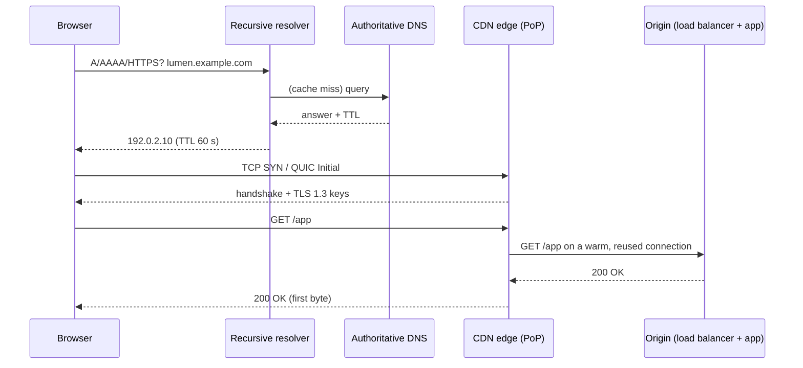

# 02 — Anatomy of a request

> **The requirement.** Lumen's web app must show a first-time visitor anywhere in Europe the first byte of its
> app shell within **200 ms at p75**, and a returning visitor within **100 ms**. The origin runs in one region.
> The difficulty is not CPU. It is round trips. Before a new client can send a single byte of HTTP it has to
> resolve a name, open a transport connection and agree keys. Each of those steps costs at least one round
> trip, and the speed of light sets the price of each round trip. You meet this requirement by deciding where
> handshakes end, how many happen, and how often they can be skipped.

## In one minute

A request is a conversation, and every conversation has to start with introductions. First the client asks the
Domain Name System where `lumen.example.com` lives. Then it opens a TCP connection with a three-message
handshake, or a QUIC connection over UDP. Then it agrees encryption keys with TLS 1.3. Only after all that does
it send `GET /`. Each of these steps costs one or more round trips, and a round trip has a hard floor set by
distance: light in optical fibre covers roughly 200 km per millisecond. So the main lever for latency is
**fewer round trips over shorter distances**. Reuse connections so you pay the handshakes once. Use protocols
that merge handshakes (QUIC folds transport and TLS into one round trip). Terminate handshakes at an edge
location close to the user, and let that edge keep warm connections to your origin. Everything else in this
chapter (TTLs, anycast, HTTP/2 multiplexing, 0-RTT) is a variation on that idea.

## Why this matters now

Three things changed in the last few years.

- **HTTP/3 is mainstream.** QUIC was standardised as RFC 9000 in May 2021 and HTTP/3 as RFC 9114 in June 2022
  [8][10]. As of November 2026, W3Techs reports that 41.2% of all websites support HTTP/3 [20]. Cloudflare
  reports that 21% of the requests it served in 2025 used HTTP/3, 50% HTTP/2 and 29% HTTP/1.x [21]. You can no
  longer treat "the web runs on TCP" as true by default.
- **TLS 1.3 is the baseline, and it keeps changing.** TLS 1.3 (RFC 8446, August 2018) cut the full handshake to
  one round trip [6]. Encrypted Client Hello, which hides the hostname that used to travel in clear text,
  became RFC 9849 in March 2026 [7]. Cloudflare reports that post-quantum key agreement protected 52% of
  human-generated web traffic it saw by early December 2025, up from 29% at the start of that year [21].
  Each of these changes affects handshake size, middlebox behaviour, and what your load balancer can see.
- **The edge is where requests end.** CDNs no longer just cache images. They terminate TLS, run code, and hold
  long-lived connections to origins. As a result, a request's "first hop" is usually a machine you don't own,
  in a city you didn't choose.

## Core ideas [Core]

### The whole journey on one page



*Diagram: a browser resolves the name through a recursive resolver, connects and handshakes with a nearby CDN
edge, then sends the request; the edge forwards it to the origin over an already-open connection and relays
the response.*

Keep this picture in mind. The rest of the chapter zooms into each arrow.

### DNS: turning a name into an address

DNS is a distributed, hierarchical, heavily cached database (RFC 1034 and RFC 1035, 1987) [1][2]. The parts
you design around:

- **Stub resolver.** This is the client library in the operating system or browser. It asks one recursive
  resolver and caches the answer itself.
- **Recursive resolver.** This is run by an ISP, an enterprise, or a public service. On a cache miss it walks
  the hierarchy: root servers, then the `.com` servers, then the authoritative servers for `example.com`. It
  caches every answer for that record's **TTL** (time to live, in seconds).
- **Authoritative server.** This is where you, the operator, publish records: `A` (IPv4), `AAAA` (IPv6),
  `CNAME` (alias), and the newer `HTTPS`/`SVCB` records. RFC 9460 (November 2023) lets one DNS answer say "this
  service speaks HTTP/3, here are its addresses and parameters" [4].

**TTL is a trade-off between latency and agility.** A long TTL (hours) means almost every lookup is a cache hit
close to the user, and your authoritative servers see little load. But a change, such as moving traffic away
from a failed region, takes up to one TTL to reach everyone, and in practice longer, because some resolvers and
clients ignore or stretch TTLs. A short TTL (30–60 s) makes failover fast, at the price of more queries and
more cold lookups on the critical path. Two refinements matter in design reviews:

- **Negative caching.** "This name does not exist" is cached too. Its TTL is the minimum of the SOA record's
  TTL and its MINIMUM field (RFC 2308) [3]. If you publish a record seconds after clients first asked for it,
  some of them will keep seeing "no such name" until that negative TTL expires.
- **Serve-stale.** RFC 8767 lets a resolver keep answering with expired data when the authoritative servers are
  unreachable. It suggests a maximum stale period of 1–3 days and a 30-second TTL on stale answers [5]. This is
  a resilience feature for clients. It also means a record you deleted can outlive its TTL during an outage.

DNS can also do coarse load balancing. Return several addresses (clients pick one), or return different answers
by location (**GeoDNS**). GeoDNS sees the resolver's location, not the user's, unless the resolver forwards a
truncated client subnet (EDNS Client Subnet, RFC 7871). DNS is a poor *fast* failover mechanism, because you
don't control the caches.

### TCP: a reliable byte stream, at the price of a handshake

TCP (now specified in RFC 9293, August 2022, which obsoletes RFC 793) [11] gives you an ordered, reliable byte
stream. Opening a connection takes a **three-way handshake**: SYN, SYN-ACK, ACK. The client can send data with
its ACK, so a new connection costs **one round trip** before the first request byte leaves.

Two TCP behaviours shape latency far more than people expect:

1. **Slow start.** A new connection does not know the path's capacity, so it starts with a small *congestion
   window* and roughly doubles it every round trip until it sees loss. RFC 6928 (Experimental, 2013) raised the
   common initial window to 10 segments [12]. With a typical 1,460-byte maximum segment size that is about
   **14.6 KB** in the first flight. A response bigger than that needs extra round trips, even on a fast link.
2. **Head-of-line blocking.** TCP delivers bytes in order. If one packet is lost, every byte behind it waits for
   the retransmission, even bytes that belong to an unrelated HTTP response multiplexed on the same connection.

TCP Fast Open (RFC 7413, Experimental) lets a repeat client put data in the SYN [13]. Middleboxes and replay
concerns have limited its use. On today's web, QUIC fills the role Fast Open was meant to play.

### TLS 1.3: one round trip to a secret

TLS 1.2 needed two round trips for a full handshake. TLS 1.3 needs **one**. The client guesses the key-agreement
group and sends its key share in the first message, and the server can answer with its key share, certificate
and `Finished` in one flight [6]. The handshake also encrypts more of itself: the certificate is no longer
visible to observers on the path.

**0-RTT (early data).** A client that has talked to this server before can send application data in its very
first flight, using a key from a previous session. That saves a full round trip. The catch is in RFC 8446
§2.3: "There are no guarantees of non-replay between connections" [6]. An attacker who captures the first
flight can resend it. The rule is therefore: **accept 0-RTT only for requests that are safe to replay**
(idempotent `GET`s with no side effects). RFC 8470 gives HTTP servers a `425 Too Early` status for refusing
early data they consider unsafe [14].

**What the server sees, and what an observer sees.** Before ECH, the hostname travelled in clear text in the
Server Name Indication (SNI) extension. Load balancers used it to route TLS connections without decrypting them,
and so did network filters. Encrypted Client Hello (RFC 9849, March 2026) encrypts the inner ClientHello,
including SNI, under a key the server publishes in DNS (the `ech` parameter of its `HTTPS` record, specified in RFC 9848) [7][27]. This matters for
designs that route on SNI at layer 4. With ECH, only the party that holds the ECH key can read the real name.

### HTTP/1.1, HTTP/2, HTTP/3

All three share the same semantics: methods, status codes, headers and caching (RFC 9110 and RFC 9111) [15].
What differs is how messages travel.

| Version | Transport | Concurrency per connection | Header compression | Where it hurts |
|---|---|---|---|---|
| HTTP/1.1 | TCP (+TLS) | One request at a time per connection (pipelining is effectively unused), so browsers open about six connections per host | None | Many connections means many handshakes, and slow start on each |
| HTTP/2 (RFC 9113, 2022) | One TCP (+TLS) connection | Many concurrent streams, multiplexed as frames | HPACK (RFC 7541) | One lost TCP packet stalls every stream (TCP head-of-line blocking) |
| HTTP/3 (RFC 9114, 2022) | QUIC over UDP, TLS 1.3 built in | Many streams, independent at the transport level | QPACK (RFC 9204) | UDP is blocked or throttled on some networks; higher CPU cost per byte in today's stacks |

RFC 9113 obsoletes both RFC 7540 and RFC 8740 [9]. The practical step from HTTP/1.1 to HTTP/2 is **one
connection instead of six**: one handshake, one congestion window that grows quickly, and no per-host
connection limit. The step from HTTP/2 to HTTP/3 is **removing TCP's head-of-line blocking and merging the
handshakes**.

### QUIC: transport and TLS in one handshake

QUIC (RFC 9000, with TLS integration in RFC 9001 and loss recovery in RFC 9002) runs in user space over UDP
[8]. Three properties matter for system design:

1. **Combined handshake.** The QUIC handshake *carries* the TLS 1.3 handshake, so a new connection is ready
   after **one** round trip (TCP + TLS 1.3 needs two). With resumption, 0-RTT works as in TLS 1.3, with the same
   replay caveat.
2. **Independent streams.** A lost packet only delays the streams whose data it carried.
3. **Connection IDs and migration.** A QUIC connection is identified by connection IDs, not by the
   (source IP, source port, destination IP, destination port) 4-tuple. When a phone moves from Wi-Fi to cellular,
   the connection can migrate to the new path (RFC 9000 §9) instead of starting over [8]. The flip side is that
   your layer-4 load balancer can no longer route on the 4-tuple alone. It has to route on the connection ID,
   or a migrated connection lands on a server that has never seen it.

Clients learn that a server speaks HTTP/3 in one of two ways. One is an `Alt-Svc` response header on an earlier
TCP connection (RFC 7838). The faster one is the DNS `HTTPS` record (RFC 9460), which lets the first connection
already use QUIC [4]. Browsers race QUIC against TCP and fall back when UDP is blocked. This is the same "Happy
Eyeballs" idea that RFC 8305 applies to IPv6 versus IPv4 [16].

### Connection reuse: the cheapest optimisation there is

Every protocol above has a fixed cost per connection (handshakes, slow start, TLS crypto) and a near-zero cost
per extra request on that connection. So the first rule of request latency is:
**keep connections open and reuse them.**

- Clients keep **keep-alive** connections (HTTP/1.1) or one multiplexed connection (HTTP/2 and HTTP/3) per origin.
- Proxies and services keep **connection pools** to their upstreams. A service that opens a new TLS connection
  to its database or to another service on every request pays the handshake each time, and can exhaust
  ephemeral ports through sockets stuck in `TIME_WAIT`.
- **Idle timeouts must nest.** Every hop closes idle connections after some timeout. If an upstream closes an
  idle connection while the proxy in front of it believes the connection is still usable, the proxy's next
  request hits a dead socket, and the client gets a `502`. AWS documents this for its Application Load
  Balancer, whose idle timeout defaults to 60 s: it recommends that the application's idle timeout be *larger*
  than the load balancer's, because otherwise, if the application closes the connection while the load balancer
  still considers it open, "the load balancer sends an HTTP 502 Bad Gateway error to the client" [17]. The
  general rule is that each hop's idle timeout should be longer than the timeout of the hop in front of it.

### Proxies: the boxes between client and code

A **forward proxy** acts for clients (a corporate egress proxy). A **reverse proxy** acts for servers. It is
the first thing your traffic hits: nginx, HAProxy, Envoy, a cloud load balancer, or a CDN edge. Reverse
proxies earn their place in a design because they:

- **terminate TLS**, so certificates and crypto live in one place;
- **route** by host, path, header or SNI to different backends;
- **buffer** slow clients, so a phone on a weak link uploading a file ties up a cheap proxy connection, not an
  expensive application worker;
- **pool** upstream connections and multiplex many client connections onto few backend ones;
- **retry, time out, rate-limit and shed load** (see SYSDESIGN-03, SYSDESIGN-10 and SYSDESIGN-11).

Once a proxy terminates the connection, the backend sees the *proxy's* address. Original client information
travels in the `Forwarded` header (RFC 7239) or the conventional `X-Forwarded-For`. For layer-4 proxies that
don't parse HTTP, it travels in the PROXY protocol header [18]. Trust these headers only when they were set by
proxies you control. Otherwise anyone can spoof their client IP.

Layer-4 versus layer-7 proxies are covered in depth in
[SYSDESIGN-03](03-scaling-compute.md#l4-vs-l7-load-balancing).

### The CDN edge

A content delivery network runs many **points of presence (PoPs)** close to users. For Lumen, an edge does
three jobs:

1. **Cache** static assets (the JavaScript bundle, fonts, images) and, when allowed, whole responses. Freshness
   is controlled by `Cache-Control` (`max-age` and `s-maxage` in RFC 9111 [15], `stale-while-revalidate` in
   RFC 5861 [26]). Caching gets its own chapter: [SYSDESIGN-04](04-caching.md).
2. **Terminate connections near the user**, even for responses it cannot cache. The expensive handshakes then
   run over a 10–20 ms path instead of a 100 ms one.
3. **Carry requests to the origin over warm connections**, which are already open, past slow start, and often
   on the CDN's own backbone. Many CDNs add a mid-tier "shield" cache so that only one location fetches a
   missing object from the origin.

### Anycast: one address, many places

With **anycast**, the same IP prefix is announced through BGP from many locations. Internet routing delivers
each packet to the "nearest" announcement as the routing system sees it. That is BGP path selection, which need
not match geography or latency (RFC 4786 §3) [19]. DNS root and recursive services and most CDNs use anycast. Compared with GeoDNS:

- **Anycast** reacts at routing speed. Withdraw the announcement from a failing PoP and traffic shifts within
  seconds to minutes, with no DNS cache in the way. Its weaknesses: you can't steer individual users, and a
  route change in the middle of a TCP connection can send packets to a PoP that has never seen that
  connection.
- **GeoDNS** gives fine control over which users go where (by country, or to keep data in a jurisdiction). It
  is only as fast as the TTLs that resolvers actually honour.

Large providers often combine the two: anycast for DNS and the edge, GeoDNS or the edge's own routing to
choose the origin region.

## Numbers that matter

All latency arithmetic starts from one physical fact: light in optical fibre travels at about two-thirds of
its speed in vacuum, roughly **200,000 km/s, or 5 µs per km** (one paper measures 204,000 km/s for typical fibre [22]). A round trip over 1,000 km of fibre
therefore costs at least **10 ms** before any router, queue or retransmission adds to it. Real paths are
longer than great-circle distance, so measured RTTs are higher. Use measured RTTs when you have them. The
worked example below states its RTTs as assumptions.

### Worked example: Lumen's first-byte budget

**Assumptions** (labelled; replace them with your own measurements):

- User to nearest CDN edge: RTT = **20 ms** (fixed broadband within a few hundred km of a PoP).
- User or edge to origin region: RTT = **60 ms** (the same continent, distant city).
- DNS: cached at the recursive resolver = **15 ms** (one client-to-resolver round trip). Fully cold = **80 ms**.
- Server time to the first byte of the app shell = **30 ms**.

Count the round trips and add them up.

| Scenario | DNS | Transport | TLS | Request → first byte | Total TTFB |
|---|---|---|---|---|---|
| A. Direct to origin, TCP + TLS 1.3, cold DNS | 80 | 60 (SYN/SYN-ACK) | 60 (1-RTT) | 60 + 30 | **290 ms** |
| B. Direct to origin, TCP + TLS 1.3, resolver-cached DNS | 15 | 60 | 60 | 90 | **225 ms** |
| C. Direct to origin, QUIC (HTTP/3), resolver-cached DNS | 15 | 60 (QUIC + TLS together) | — | 90 | **165 ms** |
| D. Via edge, TCP + TLS 1.3 at the edge, edge holds a warm connection to the origin | 15 | 20 | 20 | 20 + 60 + 30 | **165 ms** |
| E. Via edge, HTTP/3 at the edge, warm edge-to-origin | 15 | 20 (combined) | — | 110 | **145 ms** |
| F. Returning user, connection still open (any version) | 0 | 0 | 0 | 20 + 60 + 30 | **110 ms** |
| G. Returning user, app shell cached at the edge | 0 | 0 | 0 | 20 + ~1 | **≈ 21 ms** |

Read the table as a design argument:

- **A and B fail the 200 ms first-visit target.** The client pays two long round trips of handshakes before it
  sends anything.
- **C and D both pass**, by different routes. C cuts a round trip (QUIC merges handshakes). D shortens each
  round trip (handshakes run against a nearby edge). **E** does both.
- **The 100 ms returning-user target is not met by connection reuse alone (F = 110 ms)**, because the request
  still has to cross to the origin. You need the app shell **cached at the edge (G)**, or an origin in more
  regions (SYSDESIGN-15). That is the real conclusion of this exercise: *the requirement forces a caching
  decision, not a protocol decision.*

### Worked example: why a 100 KB response costs extra round trips

With an initial congestion window of 10 segments × 1,460 bytes ≈ 14.6 KB, and the window doubling each round
trip (an idealised slow start with no loss), the server can send:

- round trip 1: 14.6 KB (cumulative 14.6 KB)
- round trip 2: 29.2 KB (cumulative 43.8 KB)
- round trip 3: 58.4 KB (cumulative 102.2 KB)

A 100 KB uncached response therefore needs **three round trips of data transfer** on a new connection, which is
**two more than a 14 KB response**. At a 60 ms RTT that is 120 ms of extra time, even on a gigabit link. Two
remedies follow. Keep the critical first response under about 14 KB (a known front-end rule of thumb that comes
from this arithmetic). Or send it over a connection whose window has already grown, which is what a warm
edge-to-origin connection gives you.

### Bandwidth-delay product

To keep a path full, the sender needs **bandwidth × RTT** bytes in flight. At 1 Gbit/s and 60 ms that is
1 × 10⁹ / 8 × 0.060 ≈ **7.5 MB**. Socket buffers smaller than this cap throughput no matter how fast the link
is. This is why long-distance bulk transfers often need tuned buffers or several parallel connections.

## Design choices and trade-offs

| Decision | Option | Wins when | Costs | Example systems |
|---|---|---|---|---|
| DNS TTL | Long (≥ 1 h) | Stable addresses; you want few lookups | Slow failover; stale records outlive changes | Static marketing sites |
| | Short (30–60 s) | You fail over or shift traffic through DNS | More queries; more cold lookups; some resolvers clamp TTLs | Cloud load balancer hostnames |
| Global steering | GeoDNS | You need per-country control (data residency) or weighted shifts | Bound by resolver caches; sees the resolver's location, not the user's | Managed DNS traffic policies |
| | Anycast | Fast, automatic nearest-PoP routing; DDoS absorption | Little per-user control; possible mid-connection reroutes | Public DNS resolvers, CDNs |
| Protocol at the edge | HTTP/2 only | Simple; universally supported | TCP head-of-line blocking on lossy mobile links | Most internal APIs |
| | HTTP/3 + HTTP/2 fallback | Mobile users, lossy networks, first-visit latency | UDP-capable infrastructure; QUIC-aware L4 balancing; more CPU per byte | Major CDNs and browsers |
| TLS termination | At the edge | Lowest handshake latency; one place for certificates | The edge sees plaintext (trust and compliance question); re-encrypt to origin | CDN-fronted apps |
| | At the origin only | End-to-end control; simple trust model | Every handshake crosses the long path | Regulated back ends, mTLS-only APIs |
| 0-RTT | Enabled for safe methods | Returning users on high-RTT paths | Replay risk; must reject non-idempotent early data (`425 Too Early`) | Static and read-mostly sites |
| | Disabled | Any state-changing API | One extra RTT on resumption | Payment APIs |

## Deep dive [Deep]

### Where the round trips go, protocol by protocol

| Stack | New connection, before the first request byte | Resumed connection (session ticket) |
|---|---|---|
| TCP + TLS 1.2 | 1 (TCP) + 2 (TLS) = **3 RTT** | 1 + 1 = 2 RTT |
| TCP + TLS 1.3 | 1 + 1 = **2 RTT** | 1 + 0 (with 0-RTT data) = 1 RTT |
| QUIC (TLS 1.3 inside) | **1 RTT** | **0 RTT** (early data, replay caveat) |

These are counts *before the request is sent*. Add one RTT for the request and response themselves, plus any
slow-start rounds for large bodies.

### Head-of-line blocking, precisely

HTTP/2 removed *application-level* head-of-line blocking (responses no longer queue behind each other), but it
kept *transport-level* blocking. A single lost TCP segment holds up delivery of all later bytes on the
connection, whichever stream they belong to. On a clean wired path this rarely matters. On a lossy mobile path,
one connection carrying everything can, by this reasoning, do worse than HTTP/1.1's six connections, because one
loss stalls all traffic instead of one sixth of it (a mechanism argument, not a measurement: test on your own
traffic). QUIC fixes this by doing ordering per stream, but QPACK then has to be
designed so that header compression does not reintroduce cross-stream blocking. That is why RFC 9204 exists
instead of a reuse of HPACK [10].

### QUIC is not free

QUIC runs in user space, encrypts every payload and protects the packet number and some header bits (connection
IDs stay visible so load balancers can route; RFC 9001 §5.4) [8], and can't use TCP's mature kernel and NIC offloads to
the same degree. A WWW 2024 study measured that on fast links (hundreds of Mbit/s and above), the
UDP + QUIC + HTTP/3 stack delivered up to **45.2% lower data rates** than TCP + TLS + HTTP/2 in the client
configurations it tested. It attributes the gap to high receiver-side processing overhead [23]. The lesson is not
"QUIC is slow". QUIC buys latency on lossy, high-RTT, mobile paths and costs CPU on fast, clean ones. Measure on
your own traffic mix.

### Load balancing QUIC

A layer-4 balancer that hashes the UDP 4-tuple breaks QUIC's migration, and NAT rebinding changes the 4-tuple
even when the client never moves. QUIC lets the server choose the connection IDs that the client puts in later
packets, so a deployment can encode routing information in them, and a QUIC-aware balancer can then route on
the connection ID. The IETF QUIC-LB work describes such schemes. This is one reason HTTP/3 deployments tend to
sit behind purpose-built edges rather than generic UDP load balancers.

### DNS failure is availability failure

Two public postmortems show DNS acting as a single point of failure:

- On **4 October 2021**, a command run during backbone maintenance disconnected all of Facebook's data centres.
  Its DNS servers are designed to withdraw their BGP anycast announcements when they lose contact with the data
  centres, and they did. Meta's write-up states: "our DNS servers became unreachable even though they were
  still operational" [24]. A health-based self-protection rule, applied everywhere at once, removed the service
  from the internet.
- On **19–20 October 2025**, AWS reported that "a latent race condition in the DynamoDB DNS management system
  … resulted in an incorrect empty DNS record" for the regional DynamoDB endpoint in us-east-1, with elevated
  error rates from 11:48 PM to 2:40 AM PDT and longer knock-on effects in other services [25].

Design lessons: treat DNS automation as production code, with guardrails against publishing empty or
mass-changed answers. Health-based withdrawal needs a "don't withdraw the last one" rule. And clients and
resolvers that serve stale data (RFC 8767) turn a DNS outage into degraded freshness instead of total failure.

### What `curl` can tell you

`curl -w` prints the timestamps of each phase, which makes this chapter's budget measurable:

```bash
curl -so /dev/null -w 'dns=%{time_namelookup} connect=%{time_connect} tls=%{time_appconnect} \
ttfb=%{time_starttransfer} total=%{time_total}\n' https://example.com/
```

The values are cumulative seconds from the start. `connect − dns` is the TCP handshake (about one RTT) and
`tls − connect` is the TLS handshake. Builds of curl with HTTP/3 support accept `--http3` so you can compare.
The exercises use this.

## Frontier [Frontier]

*(as of 2026-11)*

- **Encrypted Client Hello (RFC 9849, March 2026)** [7]. Designs that route TLS by SNI at layer 4 must either
  hold the ECH keys (and act as the "client-facing server") or move routing to layer 7. Network-level filtering
  by hostname stops working for ECH-enabled traffic.
- **HTTPS/SVCB DNS records (RFC 9460)** [4] let the first connection use HTTP/3, and RFC 9848 lets them carry ECH configuration [27].
  DNS becomes part of protocol negotiation, which raises the stakes of DNS correctness.
- **Post-quantum key agreement.** Hybrid key exchange (a classical curve combined with ML-KEM, the lattice-based
  KEM standardised by NIST as FIPS 203 in August 2024 [28]) is now enabled by default in major browsers and at large edges. By
  Cloudflare's measurement it protected 52% of human web traffic by December 2025 [21]. Its key shares are
  larger than classical ones and can push a ClientHello beyond one packet, which exposes middleboxes that
  mishandle fragmented handshakes. If your clients sit behind old enterprise proxies, test this.
- **HTTP/3 as a default**, not an experiment: 41.2% of websites support it [20]. Expect UDP/443 to be part of
  every edge design review. Plan for clients whose networks block it.

## Failure modes and operations

| Failure | Symptom | Detect with (SLI or signal) | Mitigate |
|---|---|---|---|
| Stale or wrong DNS after a change | Some users still reach the old target long after a "60 s" change | Per-target traffic still non-zero after 2× TTL; synthetic lookups from several networks | Lower TTLs *before* the migration; keep the old target serving for a few hours |
| Empty or bad DNS publish (automation bug) | Sudden total failure for new connections; existing connections survive | Synthetic DNS probes; alert on record-set size changes | Guardrails (refuse empty answers), staged publishes, serve-stale resolvers |
| Keep-alive timeout inversion | Low-rate, random `502`s, often right after idle periods | 502 rate per upstream; LB logs showing "connection reset by upstream" | Upstream idle timeout > proxy idle timeout at every hop |
| Certificate expiry | Instant handshake failures for every client | Days-to-expiry metric; external TLS probes | Automated issuance (ACME), alerts at 30, 14 and 7 days, no manual certificates |
| UDP/443 blocked or throttled | HTTP/3 users slow, then fall back to TCP; regional anomalies | HTTP/3 vs HTTP/2 share by network; handshake failure rate | Always serve HTTP/2 on TCP; let clients race and fall back |
| Connection storm after a proxy restart or deploy | CPU spike from TLS handshakes; latency spike for everyone | New connections/s; handshake CPU; TTFB p99 | Graceful drains (SYSDESIGN-03), session resumption, staggered restarts |
| Ephemeral port exhaustion on a proxy or client | `EADDRNOTAVAIL` / connect errors under load | Sockets in `TIME_WAIT`; connect error rate | Connection pooling; more source IPs; reuse connections instead of opening new ones |

The SLI to watch is **time to first byte by phase**: DNS, connect, TLS, server. Real-user monitoring in the
browser (the Navigation Timing API exposes these phases) shows the distribution actual users experience.
Synthetic probes show the floor.

## Cost and energy

- **Handshakes cost CPU, and reuse removes them.** Public-key operations dominate a full TLS handshake. A fleet
  that reuses connections and resumes sessions performs far fewer of them per request. That shows up directly as
  fewer cores at the edge and on the origin. Don't quote an exact cost per handshake without measuring it on
  your hardware, ciphers and certificate type (`openssl speed` gives a first number).
- **Egress is usually the bigger bill.** A CDN cache hit is a byte your origin did not send across a paid
  network boundary. Cache hit ratio is a cost metric as much as a latency metric (SYSDESIGN-04, SYSDESIGN-16).
- **Fewer round trips means less radio time.** On mobile devices, every extra round trip keeps the radio in a
  high-power state for longer. Merged handshakes and connection reuse therefore save battery as well as time.
  The size of the saving depends on the radio technology and the operating system, so measure it rather than
  quoting a figure.

## Interview angle

**How it is asked.** "What happens when you type a URL and press Enter?" is the classic form. A stronger variant
is "users in Australia say our site is slow; walk me through why and what you'd change". It tests whether you
reason in round trips and distances, not in buzzwords.

**Model answer outline** (CLARIFY → QUANTIFY → SKETCH → DEEPEN → STRESS → WRAP):

1. **CLARIFY:** first visit or returning? Static or dynamic content? Where are the users, and where is the origin?
2. **QUANTIFY:** state the RTTs (an assumption if unknown) and count round trips per phase: DNS, TCP, TLS, request.
   For example: "Sydney to a US origin is a long-haul path; at about 150 ms RTT, the two handshake round trips
   alone cost about 300 ms."
3. **SKETCH:** client → anycast edge (TLS 1.3 / HTTP/3 terminated) → warm pooled connection → origin LB → app.
4. **DEEPEN:** pick one: 0-RTT and replay safety, HTTP/2 vs HTTP/3 head-of-line blocking, or DNS TTL vs
   failover speed.
5. **STRESS and WRAP:** what breaks (DNS automation, keep-alive mismatch, UDP blocked) and how you'd see it
   (phase-level TTFB from real users). Close with the one change that buys the most: edge caching of the shell.

**Red flags.** Saying "use a CDN" without explaining *which* round trips it removes. Saying "HTTP/3 is always
faster". Treating DNS failover as instant. Enabling 0-RTT for `POST`.

**Likely follow-ups.** Why does a QUIC load balancer need connection IDs? How would you move traffic off a
region in 60 seconds, and what makes it slower in practice? What does the backend lose when TLS terminates at
the edge, and how do you get the client IP back safely?

## Common mistakes

- Counting bandwidth and forgetting round trips. Most web latency is RTT × number of round trips, not size ÷
  bandwidth.
- Setting a 30-second DNS TTL on the day of a migration. Caches still hold the old, longer TTL. Lower the TTL at
  least one old-TTL period in advance.
- Opening a new connection per request between services ("it's internal, it's fast"). You pay the handshakes,
  slow start and `TIME_WAIT` on every call.
- Proxy idle timeout longer than the upstream's, which produces occasional unexplained `502`s.
- Trusting `X-Forwarded-For` from the internet.
- Assuming HTTP/3 removes the need for HTTP/2. Some networks will always block UDP.
- Measuring latency from a laptop next to the server and calling it user latency.

## Check yourself

1. How many round trips does a brand-new HTTPS request over TCP + TLS 1.3 cost before the response's first
   byte, and how many over QUIC?
2. Why must 0-RTT early data be restricted to replay-safe requests? Which RFC section says so?
3. Your DNS TTL is 300 s. You fail over by changing the record. Why can some users take much longer than 5
   minutes to move?
4. A 50 KB HTML response on a new connection with a 14.6 KB initial window: how many round trips of data
   transfer does it need?
5. What breaks if a layer-4 load balancer routes QUIC packets by 4-tuple hash?

The full set, with answers, is in [exercises/02-anatomy-of-a-request.md](../../exercises/02-anatomy-of-a-request.md).

## Lab

No dedicated compose lab for this unit. Exercise 9 in the exercises file is a hands-on measurement with
`curl -w` against public `example.com` endpoints. The load-balancing half of the request path is the subject of
lab L03 in [SYSDESIGN-03](03-scaling-compute.md#lab).

## Further reading

- RFC 8446, *TLS 1.3*, §2 (overview) and §8 (0-RTT and anti-replay): the clearest statement of what 0-RTT does
  and does not guarantee [6].
- RFC 9000, *QUIC*, §5 (connections) and §9 (migration): connection IDs and why they matter to load balancers [8].
- RFC 9114, *HTTP/3*: how HTTP maps onto QUIC streams [10].
- Meta, *More details about the October 4 outage* (2021): a short, honest postmortem about DNS and BGP [24].
- AWS, *Summary of the Amazon DynamoDB Service Disruption in us-east-1* (October 2025): DNS automation as a
  failure source [25].
- Zhang et al., *QUIC is not Quick Enough over Fast Internet*, WWW 2024: a measured counterweight to "HTTP/3 is
  always faster" [23].

## References

[1] P. Mockapetris, RFC 1034, *Domain Names — Concepts and Facilities*, 1987. https://www.rfc-editor.org/rfc/rfc1034 (accessed 2026-11)
[2] P. Mockapetris, RFC 1035, *Domain Names — Implementation and Specification*, 1987. https://www.rfc-editor.org/rfc/rfc1035 (accessed 2026-11)
[3] M. Andrews, RFC 2308, *Negative Caching of DNS Queries (DNS NCACHE)*, 1998, §5. https://www.rfc-editor.org/rfc/rfc2308.html (accessed 2026-11)
[4] B. Schwartz, M. Bishop, E. Nygren, RFC 9460, *Service Binding and Parameter Specification via the DNS (SVCB and HTTPS Resource Records)*, November 2023. https://www.rfc-editor.org/info/rfc9460 (accessed 2026-11)
[5] D. Lawrence, W. Kumari, P. Sood, RFC 8767, *Serving Stale Data to Improve DNS Resiliency*, March 2020, §4–5. https://www.rfc-editor.org/rfc/rfc8767.html (accessed 2026-11)
[6] E. Rescorla, RFC 8446, *The Transport Layer Security (TLS) Protocol Version 1.3*, August 2018, §2.3, §8, Appendix E.5. https://www.rfc-editor.org/rfc/rfc8446.html (accessed 2026-11)
[7] E. Rescorla, K. Oku, N. Sullivan, C. A. Wood, RFC 9849, *TLS Encrypted Client Hello*, March 2026. https://www.rfc-editor.org/info/rfc9849 (accessed 2026-11)
[8] J. Iyengar, M. Thomson (eds.), RFC 9000, *QUIC: A UDP-Based Multiplexed and Secure Transport*, May 2021, §9 (connection migration); M. Thomson, S. Turner, RFC 9001, *Using TLS to Secure QUIC*, May 2021; J. Iyengar, I. Swett, RFC 9002, *QUIC Loss Detection and Congestion Control*, May 2021. https://www.rfc-editor.org/rfc/rfc9000.html (accessed 2026-11)
[9] M. Thomson, C. Benfield (eds.), RFC 9113, *HTTP/2*, June 2022 (obsoletes RFC 7540 and RFC 8740). https://www.rfc-editor.org/rfc/rfc9113.html (accessed 2026-11)
[10] M. Bishop (ed.), RFC 9114, *HTTP/3*, June 2022; C. Krasic, M. Bishop, A. Frindell, RFC 9204, *QPACK: Field Compression for HTTP/3*, June 2022. https://www.rfc-editor.org/rfc/rfc9114.html (accessed 2026-11)
[11] W. Eddy (ed.), RFC 9293, *Transmission Control Protocol (TCP)*, August 2022 (obsoletes RFC 793). https://www.rfc-editor.org/rfc/rfc9293.html (accessed 2026-11)
[12] J. Chu, N. Dukkipati, Y. Cheng, M. Mathis, RFC 6928, *Increasing TCP's Initial Window*, April 2013 (Experimental). https://www.rfc-editor.org/info/rfc6928 (accessed 2026-11)
[13] Y. Cheng, J. Chu, S. Radhakrishnan, A. Jain, RFC 7413, *TCP Fast Open*, December 2014 (Experimental). https://www.rfc-editor.org/info/rfc7413 (accessed 2026-11)
[14] M. Thomson, M. Nottingham, W. Tarreau, RFC 8470, *Using Early Data in HTTP*, September 2018. https://www.rfc-editor.org/info/rfc8470 (accessed 2026-11)
[15] R. Fielding, M. Nottingham, J. Reschke (eds.), RFC 9110, *HTTP Semantics*, June 2022; RFC 9111, *HTTP Caching*, June 2022. https://www.rfc-editor.org/info/rfc9110 (accessed 2026-11)
[16] D. Schinazi, T. Pauly, RFC 8305, *Happy Eyeballs Version 2: Better Connectivity Using Concurrency*, December 2017. https://www.rfc-editor.org/info/rfc8305 (accessed 2026-11)
[17] Amazon Web Services, *Edit attributes for your Application Load Balancer — Connection idle timeout*, Elastic Load Balancing documentation. https://docs.aws.amazon.com/elasticloadbalancing/latest/application/edit-load-balancer-attributes.html (accessed 2026-11)
[18] A. Petersson, M. Nilsson, RFC 7239, *Forwarded HTTP Extension*, June 2014, https://www.rfc-editor.org/info/rfc7239 ; W. Tarreau, *The PROXY protocol*, HAProxy Technologies, https://www.haproxy.org/download/3.4/doc/proxy-protocol.txt (accessed 2026-11)
[19] J. Abley, K. Lindqvist, RFC 4786, *Operation of Anycast Services* (BCP 126), December 2006. https://www.rfc-editor.org/info/rfc4786 (accessed 2026-11)
[20] W3Techs, *Usage statistics of HTTP/3 for websites*, November 2026 (41.2% read on 2026-11-20). https://w3techs.com/technologies/details/ce-http3 (accessed 2026-11)
[21] Cloudflare, *The 2025 Cloudflare Radar Year in Review*, December 2025. https://blog.cloudflare.com/radar-2025-year-in-review/ (accessed 2026-11)
[22] I. N. Bozkurt, W. Aqeel, D. Bhattacherjee, B. Chandrasekaran, P. B. Godfrey, G. Laughlin, B. M. Maggs, A. Singla, *Dissecting Latency in the Internet's Fiber Infrastructure*, arXiv:1811.10737, 2018 (speed of light in fibre ≈ 2/3 c ≈ 204,000 km/s, stated in the paper's text). https://arxiv.org/pdf/1811.10737 (accessed 2026-11)
[23] X. Zhang, S. Jin, Y. He, A. Hassan, Z. M. Mao, F. Qian, Z.-L. Zhang, *QUIC is not Quick Enough over Fast Internet*, Proc. ACM Web Conference (WWW) 2024, pp. 2713–2722; arXiv:2310.09423. https://arxiv.org/abs/2310.09423 (accessed 2026-11)
[24] S. Janardhan, *More details about the October 4 outage*, Engineering at Meta, 5 October 2021. https://engineering.fb.com/2021/10/05/networking-traffic/outage-details/ (accessed 2026-11)
[25] Amazon Web Services, *Summary of the Amazon DynamoDB Service Disruption in the Northern Virginia (US-EAST-1) Region*, October 2025. https://aws.amazon.com/message/101925/ (accessed 2026-11)
[26] M. Nottingham, RFC 5861, *HTTP Cache-Control Extensions for Stale Content*, May 2010 (§3 defines `stale-while-revalidate`). https://www.rfc-editor.org/info/rfc5861 (accessed 2026-11)
[27] B. Schwartz, M. Bishop, E. Nygren, RFC 9848, *Bootstrapping TLS Encrypted ClientHello with DNS Service Bindings*, March 2026. https://www.rfc-editor.org/info/rfc9848 (accessed 2026-11)
[28] NIST, FIPS 203, *Module-Lattice-Based Key-Encapsulation Mechanism Standard*, 13 August 2024. https://csrc.nist.gov/pubs/fips/203/final (accessed 2026-11)
