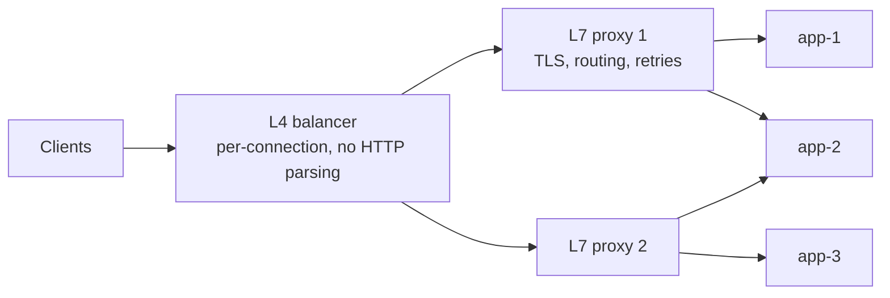
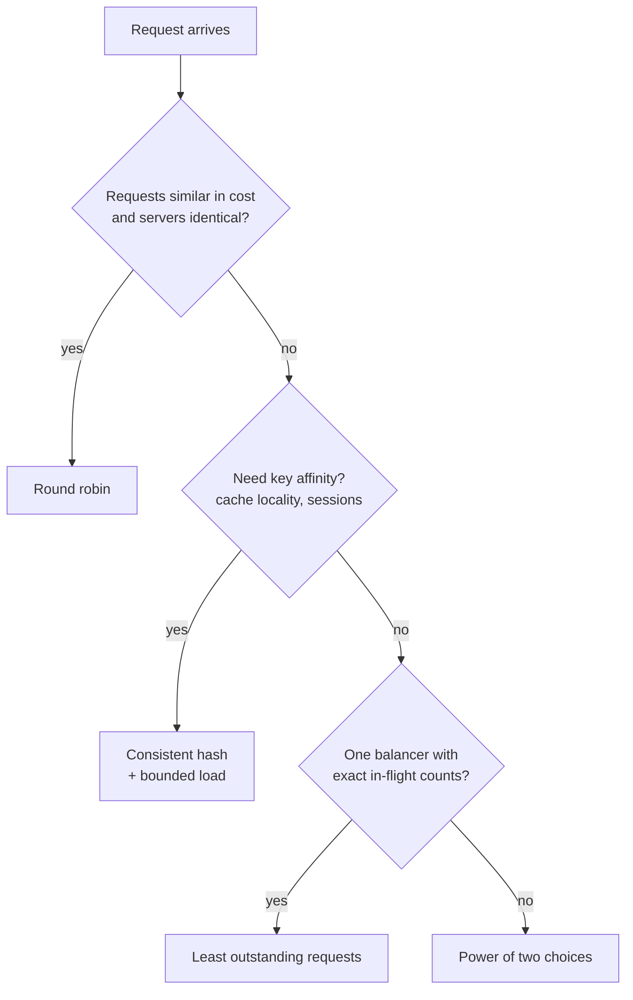
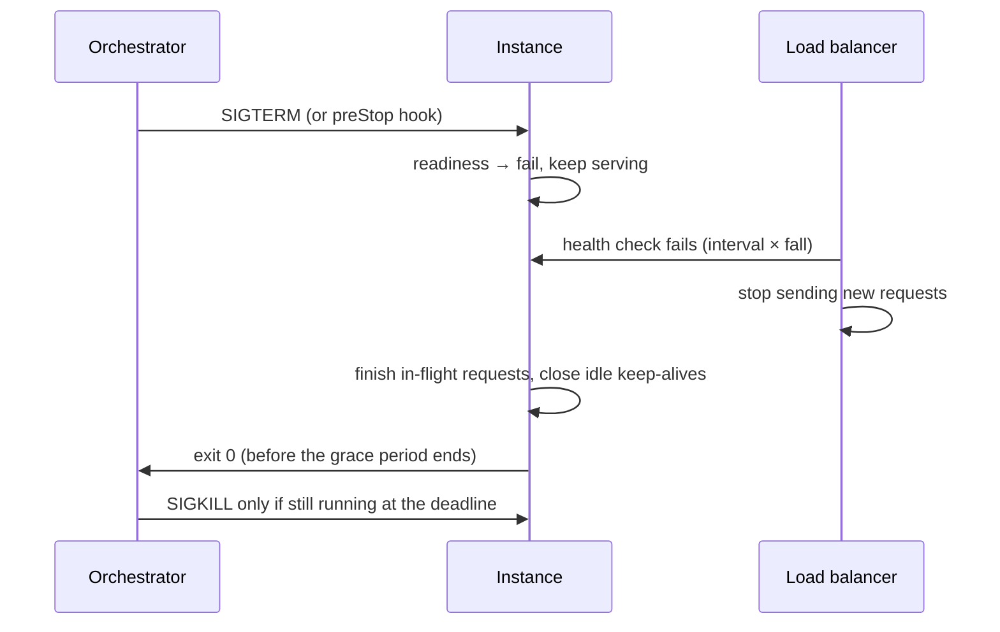

# 03 — Scaling compute

> **The requirement.** Lumen's API must serve **6,000 requests/s at peak with p99 < 300 ms**. It must survive the
> loss of **any one instance or any one availability zone** with no user-visible errors, and the team deploys
> **20 times a day** without dropping a request. One server cannot do this. Even if a big enough one existed,
> it would be a single point of failure, and every deploy would be an outage. So you need many servers, and
> then something has to decide which server gets each request. That decision is made thousands of times a
> second, with partial information, while servers come and go. Making it well is what this chapter is about.

## In one minute

You can make a service faster by buying a bigger machine (**scaling up**) or by running more copies of it
(**scaling out**). Scaling up is simple, but it has a ceiling, the price rises steeply near the top, and it still
leaves you with one machine that can fail. Scaling out needs one property from your code: any copy must be able
to handle any request. That means **no state that matters lives only inside one copy**. Sessions, uploads and
caches you can't afford to lose go to a shared store. In front of the copies sits a **load balancer**. It picks
a healthy copy for each connection or request, using a rule: take turns, pick the least busy, or (the clever,
cheap one) **look at two at random and take the less busy**. It checks copies' health, stops sending to the ones
being shut down, and lets an **autoscaler** add or remove copies as traffic changes. Most incidents in this
area come from coordination at scale. Everybody retries at once, everybody picks the same "least loaded"
server, or the autoscaler chases its own tail.

## Why this matters now

- **Scaling out is the default packaging.** Containers and Kubernetes made "run N identical replicas behind a
  Service" the starting point rather than an advanced pattern. The current Kubernetes minor release is 1.37
  (as of 2026-11) [11]. Its HorizontalPodAutoscaler is the reactive autoscaler most engineers meet first [10].
- **Vertical scaling is back for some workloads.** A large language model must fit in GPU memory, so the unit
  of scale is a whole multi-GPU node, and "add one more replica" is a coarse, expensive step. Kubernetes made
  in-place Pod resize (changing CPU and memory without a restart) stable in v1.35 [12]. Both trends make
  scale-up versus scale-out a live decision again (SYSDESIGN-22, SYSDESIGN-23).
- **Requests stopped being uniform.** A chat completion can take 50 ms or 50 s depending on how many tokens it
  generates. "Take turns" balancing assumes requests cost about the same. LLM traffic breaks that assumption,
  which pushes the field towards load-aware and cache-aware routing (see Frontier).

## Core ideas [Core]

### Scale up or scale out

| | Scale up (vertical) | Scale out (horizontal) |
|---|---|---|
| What you do | Bigger CPU, more RAM, faster disk, a bigger GPU | More identical instances behind a balancer |
| Code changes | Usually none | The service must be stateless, or its state must be partitioned |
| Ceiling | The largest machine you can buy | Shared dependencies (the database, a lock, the balancer itself) |
| Failure | One machine: everything fails together | One of N: lose 1/N of capacity |
| Cost curve | Steep near the top of the range | Roughly linear, until coordination overhead bites |
| Deploys | Restarting means downtime, unless you also have a second machine | Rolling, one instance at a time |

Scaling out is not free either. Adding instances adds **coordination**: contention on shared locks and
databases, and crosstalk between nodes that keep each other consistent. Neil Gunther's *Universal Scalability
Law* captures this with two parameters. It models the relative capacity of N nodes as

> C(N) = N / (1 + α(N − 1) + βN(N − 1))

where α is the contention (serialised) fraction and β the cost of keeping nodes coherent [8]. With β > 0,
capacity reaches a peak and then *falls* as you add nodes. Teams who have added servers and watched throughput
drop have met the β term. The practical lesson: **measure throughput at 1, 2, 4 and 8 instances before you
promise linear scaling** (SYSDESIGN-01 shows how to measure one instance's saturation point).

### Statelessness, and where the state goes

A service is **stateless** when any instance can serve any request, because nothing a later request needs
lives only in one instance's memory or disk. "Stateless" doesn't mean the system has no state. It means state
lives in a place built for it:

| State | Where it should live | Why |
|---|---|---|
| Login session | Shared session store (for example Redis), *or* a signed token the client carries (a JWT, RFC 7519) | Any instance can validate it; a dead instance loses nothing |
| Uploaded file, half-finished | Object storage with multipart upload | Survives instance loss; resumable |
| Long-running job progress | Queue or workflow engine (SYSDESIGN-08) | Another worker can pick it up |
| Cache | Local memory is fine (soft state), as long as a miss is just slower, not wrong | Losing it costs only performance |
| WebSocket connection | Inherently on one instance, so keep the *subscription* state in a shared store and plan for reconnects | Connections die during deploys |

Moving session data to a shared store is called **session externalisation**. Its alternative is **sticky
sessions**: the balancer pins each client to one instance, using a cookie or a hash of the client IP. Stickiness
is sometimes the right call (an in-memory cache that is expensive to warm, a WebSocket). But it has three costs
you should name in a design review:

1. **Uneven load.** A few heavy clients pinned to one instance make it hot, while its siblings idle.
2. **Failure loses sessions.** When the pinned instance dies, its users are logged out or lose work.
3. **Deploys and scale-in get slow**, because you must wait for sticky sessions to drain before an instance can go.

Signed tokens remove the session store from the request path, but they move the problem to **revocation**. A
token valid for an hour stays valid for an hour unless you also keep a deny-list, which is shared state again.

### L4 vs L7 load balancing

A load balancer works at one of two layers.

- **Layer 4 (transport).** It sees IP addresses, ports and TCP/UDP packets. It picks a backend **per connection**
  and then forwards bytes. It never parses HTTP. That makes it fast and protocol-agnostic. It is often built
  into the kernel (IPVS, eBPF/XDP) or into software that runs across many machines. Google's Maglev, for
  example, uses consistent hashing so that every Maglev machine sends a given connection to the same backend
  [5]. An L4 balancer can pass TLS through untouched.
- **Layer 7 (application).** It terminates the client connection, parses HTTP (or gRPC), and picks a backend
  **per request**. It can route by host, path or header, retry an idempotent request on another backend, add
  headers, enforce rate limits, and balance individual HTTP/2 streams. The price: it must terminate TLS (it
  holds keys and sees plaintext), it uses more CPU per request, and it is one more full proxy hop.

*Diagram: clients reach an L4 balancer, which spreads connections across two L7 proxies; each proxy spreads
individual requests across the application instances.*

The two-tier shape above is common at scale. L4 spreads connections across a fleet of L7 proxies, and the
proxies make per-request decisions. One trap catches everyone once: **HTTP/2 and gRPC multiplex many requests on
one long-lived connection, so an L4 balancer balances connections, not load.** If ten client pods each open one
gRPC connection to a three-replica service through an L4 balancer, the split of connections, and hence of load,
can be badly uneven, and it stays that way until the connections reset. Use an L7 proxy, or client-side load
balancing that knows about streams.

Client-side balancing (the client library or a sidecar proxy picks the backend from a service-discovery list)
removes the central hop entirely. Service meshes (SYSDESIGN-10) do this with a proxy next to each workload.

### Balancing algorithms

Every algorithm answers one question: **given the request in hand, which backend?** The answers differ in what
they need to know.

1. **Round robin.** Take turns. It needs no load information and is perfectly fair when requests cost the same
   and servers are identical. **Weighted round robin** gives larger servers more turns. It fails when request
   costs vary or one server slows down: that server keeps getting its full share and its queue grows.
2. **Least connections / least outstanding requests.** Send to the backend with the fewest requests in flight.
   This adapts automatically to slow servers and expensive requests, because a slow server accumulates
   in-flight requests and stops being chosen. It needs an accurate, current count, which a single proxy has for
   its own traffic. With many independent proxies, each knows only its own share.
3. **Random.** Pick uniformly. No state at all, and statistically fair over many requests. In the short term,
   some backends get unlucky clusters.
4. **Power of two choices (P2C).** Pick **two** backends at random and send to the less loaded of the two. This
   one simple change makes the most-loaded server dramatically less loaded than with pure random. Classic
   analysis of throwing n balls into n bins (Azar, Broder, Karlin and Upfal, 1999) puts the maximum load at about
   ln n / ln ln n with one random choice, and about **ln ln n / ln 2 + O(1)** with two [2]. Mitzenmacher showed
   that the same exponential improvement holds in the dynamic, queueing setting that load balancers live in
   [1]. Going from two choices to three helps only by a constant factor. Most of the benefit comes from the
   second choice. Envoy's least-request balancer uses P2C by default when weights are equal (`choice_count`
   defaults to 2) [6]. HAProxy offers it as `balance random(2)` [7]. NGINX offers it as `random two least_conn`
   [9].
5. **Hash-based (affinity).** Hash a key (client IP, user ID, URL, session cookie) to pick the backend, so the
   same key always lands on the same backend. That is useful for cache locality and for sticky sessions. Naïve
   `hash mod N` reshuffles almost every key when N changes, so use **consistent hashing** (below).
6. **Latency-aware.** Weight backends by recently observed response times (for example an exponentially
   weighted moving average). This reacts to slow servers even when connection counts look equal. It needs care,
   because a server that fails fast looks attractively "quick".

*Diagram: a decision tree. Uniform requests on identical servers: round robin. Key affinity needed: consistent
hashing with bounded load. Otherwise least outstanding requests when one balancer sees everything, or power of
two choices when many balancers each see part of the traffic.*

### Why "always pick the least loaded" can backfire

If many balancers (or many clients) see the same slightly stale load report and all choose the single least
loaded server, they all send to it at once. It goes from least loaded to most loaded in one reporting interval,
and then the herd moves to the next one. Mitzenmacher analysed exactly this setting ("How useful is old
information?", 2000). With stale information, deterministic "pick the minimum" can perform worse than random,
while the randomised two-choice rule stays robust [3]. That is the deep reason P2C is everywhere. **The
randomness is what keeps independent decision-makers from stampeding together.**

### Consistent hashing for affinity

With `server = hash(key) mod N`, removing one of N servers changes the result for most keys: the fraction that
stays put is only about 1/N. Every cache behind the balancer goes cold at once. **Consistent hashing** (Karger et
al., 1997) [4] places servers and keys on the same hash ring. Each key belongs to the next server clockwise.
Removing a server moves only *its* keys, about 1/N of the total, to its neighbour. Adding a server takes about
1/N from its neighbours. Virtual nodes (many points per server) even out the arcs.

Pure consistent hashing has a load problem: a popular key, or an unlucky arc, can overload one server.
**Consistent hashing with bounded loads** (Mirrokni, Thorup and Zadimoghaddam, SODA 2018) caps each server at
(1 + ε) times the average load and spills overflow to the next server on the ring [4]. HAProxy implements this as
`hash-balance-factor`. With a factor of 150, "no server will be allowed to have a load more than 1.5 times the
average" [7]. Partitioning *data* with consistent hashing is the subject of SYSDESIGN-07. Here it is about
routing *requests* for locality.

### Health checks

A balancer must stop sending to instances that can't serve. Two mechanisms are used together:

- **Active checks.** The balancer probes each instance, for example `GET /health` every second, and marks it
  down after `fall` consecutive failures and up again after `rise` successes. Detection time ≈ interval × fall.
  Open-source HAProxy and Envoy have active checks. In NGINX, active health checks are part of the commercial
  subscription [9].
- **Passive checks (outlier detection).** The balancer watches real traffic and ejects an instance that returns
  errors or times out. This is faster for hard failures and needs no extra probes. It can only react after users
  have already seen errors.

The hard part is deciding what "healthy" means.

- **Liveness vs readiness.** Kubernetes separates "the process is stuck, restart it" (liveness) from "don't send
  me traffic right now" (readiness). A readiness check fails during start-up, warm-up and shutdown. A liveness
  check should fail only when a restart would help.
- **Shallow vs deep.** A shallow check ("the process answers HTTP") misses a broken database connection. A deep
  check ("I can query the database") has the opposite problem: when the shared database blips, *every* instance
  fails its check at once, and the balancer removes the whole fleet. **Don't make health depend on a
  dependency that all instances share.** Report dependency trouble through errors and metrics instead.
- **Fail open.** When most instances look unhealthy, the health checks themselves are the likeliest culprit.
  Envoy has a *panic threshold* (default 50%). If fewer than half of the hosts are healthy, it "will disregard
  health status and balance either amongst all hosts or no hosts", depending on configuration [6]. Sending
  traffic to possibly-sick servers beats sending it nowhere.

### Connection draining and graceful shutdown

Deploys remove instances on purpose, twenty times a day here. A clean removal follows a fixed order:

*Diagram: the orchestrator signals the instance, which fails its readiness check but keeps serving; the
balancer notices and stops sending new work; the instance finishes in-flight requests and exits before the
deadline, after which it would be killed.*

Concrete defaults to know:

- Kubernetes gives a Pod `terminationGracePeriodSeconds`, **30 s by default**, between the termination signal
  and the forced kill [13]. EndpointSlices mark a terminating Pod with `terminating: true`. `ready` means
  "serving and not terminating", so ordinary Service traffic stops going to it [14]. Endpoint removal and the
  signal to the container happen *concurrently*. A short `preStop` delay gives proxies time to see the change
  before the application stops accepting connections.
- AWS Elastic Load Balancing waits **300 s by default** before it completes deregistration of a target, and lets
  in-flight requests finish during that time [15]. This is why "a deploy takes forever" is often a drain timeout
  nobody tuned.
- **Long-lived connections need active help.** A keep-alive or HTTP/2 connection carries new requests until
  someone closes it. During drain, the server should send `Connection: close` (HTTP/1.1) or `GOAWAY`
  (HTTP/2, HTTP/3). WebSocket clients need a reconnect path with jitter (see thundering herds).

New instances need the opposite treatment. A cold instance (empty caches, an unwarmed JIT, a fresh connection
pool) that receives its full share immediately can be overwhelmed. Least-connections makes this *worse*,
because the newcomer has zero connections and wins every comparison. **Slow start** ramps a new instance's
weight up over a window. HAProxy calls it `slowstart` and AWS ALB calls it slow start mode [7][15].

### Autoscaling

An autoscaler changes the number of instances to keep a metric near a target.

**Reactive (target tracking).** The Kubernetes HPA computes

> desiredReplicas = ceil(currentReplicas × currentMetricValue / desiredMetricValue)

It evaluates this every **15 s** by default, ignores changes within a **0.1 tolerance** (10%), and uses a
**300 s downscale stabilisation window**: it scales down only to the highest recommendation of the last five
minutes, to avoid flapping [10]. Since v1.37 the tolerance can be set per HPA (the field first appeared in
v1.33) [10].

**Predictive.** These autoscalers forecast load from history and scale *before* it arrives. AWS EC2 Auto Scaling
predictive scaling needs at least 24 hours of data, looks at up to 14 days, forecasts the next 48 hours, and
updates every 6 hours [16]. Google Compute Engine's predictive autoscaling needs 3 days of CPU-based autoscaling
history, uses up to 3 weeks, and works with CPU utilisation only [17]. Predictive scaling helps with daily
cycles whose ramp is faster than your scale-up lag. It can't foresee a launch or an outage elsewhere that sends
traffic your way, so keep reactive scaling underneath it.

**Scheduled.** "Add 30% at 08:45 on weekdays." It is crude, effective for known events, and a good safety net.

**Choosing the metric.** CPU is a convenient proxy, but it is not the thing users feel. Prefer a metric close to
saturation for *your* bottleneck:

| Workload | Better scaling signal | Why |
|---|---|---|
| CPU-bound stateless API | CPU utilisation, or requests/s per instance | They track work done |
| I/O-bound API (waits on databases and services) | In-flight requests (concurrency) per instance | CPU stays low while queues grow |
| Queue workers | Queue depth, or age of the oldest message | That is directly the backlog |
| LLM inference | Queue length, KV-cache utilisation, tokens/s | GPUs look "100% busy" all the time (SYSDESIGN-22) |

Scaling the pods is half the story. When the cluster runs out of nodes, a node autoscaler must add machines,
which takes minutes. The chain "metric window → autoscaler period → scheduling → node start-up → image pull →
application warm-up" is your real **scale-up lag**, and headroom must cover the traffic growth during that lag.

### Thundering herds

A **thundering herd** is many actors doing the same thing at the same moment because the same event woke them
all. Variants you will meet:

- **Synchronised retries.** A dependency blips, every client retries immediately, and the recovering service
  receives several times its normal load. That keeps it down.
- **Reconnect storms.** A proxy restarts and 100,000 WebSocket clients reconnect in the same second, each doing
  a full TLS handshake.
- **Cache expiry stampedes.** A hot cache key expires and every request misses together (SYSDESIGN-04).
- **Cold-start herds.** A new instance with zero connections attracts all least-connection traffic.
- **Cron alignment.** Every job scheduled at `0 * * * *`.

The standard defences:

1. **Exponential backoff with jitter.** Randomise retry delays so retries spread out instead of arriving in
   waves. Marc Brooker's AWS analysis compares "full", "equal" and "decorrelated" jitter and shows that
   un-jittered exponential backoff still clusters [18].
2. **Retry budgets.** Google's SRE book describes a per-request cap of three attempts and a per-client budget
   that allows retries only while they are under 10% of requests. Under sustained failure that keeps
   amplification near 1.1× instead of nearly 3× [19].
3. **Retry at one layer only.** If every layer of a five-deep call chain retries three times, a failure at the
   bottom becomes 3⁵ = 243 attempts. The SRE book's advice is to retry only in the layer directly above the
   one that rejected the request [19].
4. **Client-side adaptive throttling.** Clients track how many requests they sent versus how many were accepted
   (the book suggests a factor K = 2), and reject requests locally once requests exceed K × accepts [19].
5. **Slow start and staggered work.** Ramp new instances, add jitter to reconnects and cron schedules, and
   coalesce identical in-flight requests.

These defences recur in SYSDESIGN-11 (reliability). They belong here because the balancer and the autoscaler
are where herds land.

## Numbers that matter

### Worked example: how many instances does Lumen's API need?

**Assumptions** (labelled; the first one is the number you measure in lab L01):

- One instance sustains **400 requests/s with p99 < 300 ms** in a load test (measured knee, not theoretical
  capacity).
- Peak traffic is **6,000 requests/s**.
- Three availability zones. The requirement is to survive the loss of one zone.
- Traffic can grow **2× in 10 minutes** (a push notification goes out). Scale-up lag is **90 s**: 15 s metric
  window + 15 s HPA period + 60 s for start-up and readiness.

**Step 1 — steady state.** 6,000 / 400 = **15 instances** carry peak load at the knee.

**Step 2 — zone loss.** If one of three zones fails, the other two must carry everything. Each zone therefore
needs 15 / 2 = 7.5 → **8 instances**, so 24 in total. The rule is: with Z zones that must survive one zone
failure, provision Z / (Z − 1) of steady-state need. That is 1.5× for three zones and 1.33× for four. Note that
this extra capacity is idle in normal operation: average utilisation at peak is 15/24 ≈ 63% of the knee.

**Step 3 — scale-up lag.** During the 90 s lag, traffic growing 2× per 10 min grows by a factor of
2^(90/600) ≈ **1.11**. So the fleet must hold about 11% headroom above current load *at all times*, or the p99
target breaks before new instances arrive. With the zone-loss reserve already giving 37% headroom, this
requirement is met. If you remove the zone reserve by relying on cross-region failover instead, you must add
the 11% back.

**Step 4 — deploys.** A rolling deploy that takes one instance per zone out at a time (3 of 24) removes 12.5% of
capacity. That fits inside the headroom. Taking 25% at a time during peak would not, once you also allow for a
zone failure in the middle of a deploy.

**Answer: 24 instances at peak, 8 per zone, with autoscaling allowed to go higher but never below 8 per zone
during business hours.**

### Worked example: how fast do health checks find a dead instance?

HAProxy with `inter 1s fall 2`: a dead instance is marked down after about **2 s** (two failed probes, plus up
to one interval of phase offset, so at most about 3 s). At 6,000 requests/s spread over 24 instances (250
requests/s each), up to 3 s of detection lets roughly **500–750 requests** reach the dead instance. If the
balancer retries failed *connections* elsewhere (HAProxy's `retries` with `option redispatch`), most of those
are saved, because a refused connection never reached the server, so the request is safe to resend. A request
that was *in flight* on the dead instance can't be retried blindly unless it is idempotent. That is why
idempotency keys matter (SYSDESIGN-08). Lab L03 measures exactly this window.

### Worked example: consistent vs modulo hashing

With 3 backends and modulo hashing, removing one moves about **2/3 of keys** (only about 1/N = 1/3 stay put).
With a consistent-hash ring, only the removed backend's keys move, about **1/3**. At 300 backends the gap is
dramatic: a modulo hash moves about 99.7% of keys, and a consistent hash about 0.3%. Lab L03, experiment 5,
measures both on HAProxy.

## Design choices and trade-offs

| Option | Wins when | Costs | Example systems |
|---|---|---|---|
| DNS round robin | Coarse spread across regions or edges; no box in the path | Slow to react (TTL); clients stick to stale answers; no health awareness | Multi-region front doors (with health-checked DNS) |
| L4 balancer (IPVS, eBPF, Maglev-style) | Very high packet rates; TLS passthrough; non-HTTP protocols | Per-connection only; blind to HTTP; imbalance with long-lived HTTP/2/gRPC | Maglev [5], cloud network load balancers, Linux IPVS |
| L7 proxy (Envoy, HAProxy, NGINX) | Per-request balancing, routing, retries, observability | TLS termination and keys at the proxy; CPU per request; one more hop | Edge and ingress proxies, API gateways |
| Client-side / mesh | No central hop; per-request load awareness inside the cluster | Logic in every client or sidecar; consistent configuration is hard | gRPC client balancing, service meshes |

| Algorithm | Wins when | Costs |
|---|---|---|
| Round robin | Uniform requests, identical servers | Blind to slow servers |
| Least outstanding requests | One balancer sees all traffic; costs vary | Needs accurate counts; herds onto cold instances without slow start |
| Power of two choices | Many balancers; partial or stale information | Slightly worse than ideal least-loaded with perfect information |
| Consistent hash (+ bounded load) | Cache locality, affinity | Hot keys; needs a load bound to stay balanced |

| Autoscaling | Wins when | Costs |
|---|---|---|
| Reactive (HPA, target tracking) | Unpredictable load; easy to reason about | Always behind by the scale-up lag; can oscillate |
| Predictive | Strong daily or weekly patterns with fast ramps | Needs history; wrong on novel events; vendor-specific |
| Scheduled | Known events (launches, business hours) | Manual; drifts from reality |
| Over-provision | Tight SLOs with fast ramps; small fleets | Paying for idle capacity (and its idle energy) |

## Deep dive [Deep]

### Why two choices is exponentially better than one

The intuition: with one random choice, the most loaded bin gets there by being unlucky repeatedly, and with n
bins there is always some bin that unlucky. With two choices, a bin only gets a new ball if *both* sampled bins
are at least that loaded. The fraction of bins with load ≥ i then falls *doubly exponentially* in i (roughly
squaring at each level), so the maximum is reached after only about log log n levels [2]. Mitzenmacher's dynamic
analysis (servers as queues, Poisson arrivals) shows the analogous result for the expected time in system. With
d ≥ 2 choices, the fraction of queues with at least i jobs falls doubly exponentially, compared with only
exponentially for random assignment [1].

For a design review, the consequences are:

- P2C needs **no shared state between balancers**. Each one uses its own view of in-flight requests.
- It is **robust to staleness**, because two random samples rarely both hit the server that everyone else just
  piled onto [3].
- It costs **two lookups per request**, and nothing global.

### Subsetting: not every client should talk to every server

With thousands of clients and thousands of servers, a full mesh of connections means millions of mostly idle
connections, each with memory, keep-alive traffic and health-check cost. Google's SRE book describes
**deterministic subsetting**. Each client connects to a fixed-size subset of backends, chosen so that every
backend gets about the same number of clients, and subsets reshuffle minimally when clients or backends change
[20]. Subset size is a trade-off. Too small, and a client's subset may all be slow or down at once. Too large,
and you are back to the mesh.

### Balancing heterogeneous work

Round robin assumes each request costs the same. When costs vary (a search that scans a large index next to one
that hits a cache), equal *counts* produce unequal *load*. Least-outstanding-requests and P2C use in-flight count
as a proxy for queued work, and that proxy is good when requests are mostly I/O wait. When per-request cost is
predictable from the request itself (number of tokens to generate, image size), cost-aware routing that weighs
requests by estimated work does better. That is precisely the direction LLM routers have taken.

### Tail latency and the balancer

A balancer can *reduce* tail latency by avoiding slow servers, and by **hedging**: sending a second copy of a
slow request to another server after a short delay. In *The Tail at Scale*, Dean and Barroso report a Google
benchmark that read 1,000 keys spread over 100 servers. Hedging after 10 ms cut the 99.9th-percentile latency
from 1,800 ms to 74 ms while sending only 2% more requests [21]. Hedging is safe only for idempotent reads, and
it must be capped, or it becomes a retry storm. SYSDESIGN-01 develops the tail-latency arithmetic.

### Oscillation: when the autoscaler and the balancer fight

A reactive autoscaler is a feedback controller with a delay, and delayed feedback loops oscillate. The pattern:
load rises, the scaler adds instances, they become ready *after* the peak, utilisation falls below target, the
scaler removes instances, and load (or the next daily wave) arrives to an under-provisioned fleet. The HPA's
tolerance band and its five-minute downscale stabilisation window [10] exist to damp this. A further cause is
scaling on a metric that *your own scaling changes*. Average latency improves as you add instances, so a scaler
that targets latency removes instances and makes latency worse. Prefer metrics that measure **demand per
instance** (requests/s, concurrency) over metrics that measure **outcome** (latency).

## Frontier [Frontier]

*(as of 2026-11)*

- **Inference-aware routing.** The Kubernetes Gateway API Inference Extension, an official Kubernetes project
  driven by WG-Serving and SIG-Network, turns an ext-proc-capable gateway into an "inference gateway". Its
  Endpoint Picker chooses model-server endpoints (grouped in an `InferencePool`) using metrics and capabilities
  reported by the servers, such as prefix-cache status and LoRA adapter availability [22]. This is P2C and
  consistent hashing reinvented for a workload where *which* server has your prompt prefix cached matters more
  than how many connections it holds. SYSDESIGN-22 covers KV-cache-aware routing in depth.
- **Per-HPA tolerance (stable in Kubernetes v1.37)** [10] lets latency-sensitive services react to smaller
  changes than the 10% cluster default, and lets bursty ones ignore noise.
- **In-place Pod resize (stable since v1.35)** [12] makes "scale up first, then out" a practical pattern for
  services whose start-up is expensive.
- **Load balancing for long, uneven requests.** Streaming responses (token streams, SSE) hold connections for
  seconds to minutes. Connection-count balancing, drain timeouts and autoscaling signals all need revisiting
  when a single request can last longer than a deploy step.

## Failure modes and operations

| Failure | Symptom | Detect with | Mitigate |
|---|---|---|---|
| One slow instance (noisy neighbour, bad disk, GC) | p99 rises; one backend's latency is an outlier | Per-backend latency and in-flight count | Least-request or P2C; outlier ejection |
| Deep health check on a shared dependency | Whole fleet marked down at once | Healthy-host count drops to ~0 | Shallow readiness; panic threshold / fail open |
| Instance killed mid-request | Burst of 502/503 for interval × fall seconds | Error rate per backend; LB retry counters | Connection retries with redispatch; graceful drain; idempotency |
| Deploy without draining | Errors at every deploy step | Error spikes aligned with rollout events | preStop delay; readiness fail first; `Connection: close` / `GOAWAY` |
| L4 imbalance with HTTP/2 or gRPC | One replica hot, the others idle | Requests/s per replica skewed | L7 or client-side balancing; periodic connection recycling |
| Cold-start herd | New instances overwhelmed right after scale-out | Latency on new instances vs old | Slow start; warm-up before readiness |
| Retry storm | Load multiplies during partial outages | Ratio of attempts to unique requests | Jittered backoff, retry budgets, one retry layer |
| Autoscaler oscillation | Replica count saw-tooth; periodic SLO misses | Replica count vs load over time | Stabilisation windows; demand-based metrics; predictive or scheduled baseline |
| Proxy keeps backend IPs resolved at start-up | After containers or VMs are recreated, a server entry points at a recycled IP, sometimes a *different* healthy replica, so health checks pass while traffic goes to the wrong place | Backend identity in responses or logs vs the balancer's view | Re-resolve names (for example HAProxy `resolvers`), or use service discovery or EndpointSlices instead of static names |
| Balancer as a single point of failure | Everything fails together | Synthetic probes through each balancer | Redundant balancers (anycast, or VRRP pairs), managed LBs across zones |

The SLIs worth a dashboard: **per-backend requests/s, in-flight requests, p99 latency and error rate**;
**healthy-host count** per pool; **retries per request**; **replica count against demand**. Most balancing
problems are visible only per backend. Fleet averages hide them.

## Cost and energy

- **Zone redundancy is a cost line.** The worked example's 24 instances against 15 for raw load is 60% extra
  spend, bought for zone-failure tolerance. Making that trade explicit (and asking whether four zones at 1.33×
  is cheaper) is part of design. SYSDESIGN-16 builds the full cost model.
- **Idle servers still draw power.** Barroso and Hölzle observed that servers are rarely fully idle or fully
  busy, yet even an idle server consumed about half its peak power, which motivated their call for
  "energy-proportional" hardware [23]. Autoscaling that removes idle instances saves money *and* energy, but only
  if the freed machines are actually powered down or reused, not just left idle.
- **Over-provisioning versus SLO risk** is the real dial. Every percent of headroom buys protection against
  scale-up lag and failures, and costs money and energy all day. Measure your scale-up lag, then buy exactly
  the headroom it requires.

## Interview angle

**How it is asked.** "How would you scale this service to 10× traffic?" "What happens when one of your servers
dies?" "How does your load balancer decide?" Every system-design interview reaches this layer within the first
15 minutes.

**Model answer outline** (CLARIFY → QUANTIFY → SKETCH → DEEPEN → STRESS → WRAP):

1. **CLARIFY:** peak requests/s, latency SLO, failure tolerance (instance? zone? region?), and whether the
   service holds state.
2. **QUANTIFY:** per-instance capacity at the SLO (measured, not guessed) → instances for peak → zone reserve
   Z/(Z−1) → headroom for scale-up lag.
3. **SKETCH:** clients → L4/anycast front → L7 proxies → stateless app replicas across zones; sessions in a shared
   store; autoscaler on demand per instance.
4. **DEEPEN:** choose the algorithm and justify it: P2C for many proxies, consistent hashing with bounded load for
   cache locality. Explain the herd problem with "least loaded".
5. **STRESS and WRAP:** instance death (detection window, connection retries, idempotency), deploys (drain
   sequence), a retry storm (jitter, budgets). Close with the SLIs you'd watch per backend.

**Red flags.** "Add more servers" with no word about state. Sticky sessions as the default. Deep health checks on
the database. No mention of draining. Autoscaling on latency. "The load balancer is a box": who balances the
balancer?

**Likely follow-ups.** Why does gRPC need L7 balancing? How long until a dead instance stops receiving traffic,
and what happens to requests in that window? How would you route LLM requests whose cost varies 1,000×?

## Common mistakes

- Treating stateless as "the code has no variables". The test is whether killing any instance at any moment loses
  anything that matters.
- Using `hash mod N` for affinity, then watching every cache go cold during a scale event.
- Health checks that test a shared dependency, so a database blip removes the entire fleet.
- Removing instances with SIGKILL, or with a grace period shorter than the drain plus the longest request.
- Least-connections without slow start, so every new instance is flattened on arrival.
- Retrying at every layer, without jitter, without a budget.
- Scaling on average CPU for an I/O-bound service whose queue grows while CPU sits at 20%.
- Load-testing one instance and assuming N instances give N× (the USL's β term says otherwise).

## Check yourself

1. Why does an L4 balancer distribute gRPC load poorly, and what are two fixes?
2. With 100 backends, roughly what fraction of keys move when one is removed, under modulo hashing and under
   consistent hashing?
3. Why is "power of two choices" preferred over "pick the least loaded" when there are many balancers?
4. Your HAProxy uses `inter 2s fall 3`. What is the worst-case time before a dead backend stops receiving new
   requests?
5. Three zones, steady-state need 30 instances, and you must survive one zone failure: how many instances, and
   at what normal utilisation?

The full set, with answers, is in [exercises/03-scaling-compute.md](../../exercises/03-scaling-compute.md).

## Lab

**Lab L03 — load balancing** ([labs/03-scaling-compute/](../../labs/03-scaling-compute/README.md)). HAProxy 3.4
sits in front of three replicas of a small Python service with a known service time. One HAProxy exposes five
frontends: round robin, least connections, power of two choices, consistent hash and modulo hash. You drive
open-model load with k6 and then (1) compare the algorithms when one replica is three times slower, (2) kill a
replica mid-load with and without connection retries, (3) stop a replica gracefully with and without draining,
and (4) measure how many keys move under consistent versus modulo hashing. Each experiment checks a number from
this chapter against a measurement. In the recorded run (2026-11-20, a shared and busy host):

- With one replica three times slower, round robin's p99 reached 11.5 s, while least connections and P2C kept it
  at 0.23–0.26 s.
- Killing a replica produced 87 errors without retries. With connection retries it produced zero errors, but the
  p99 rose to about 1.07 s, because retries trade errors for latency.
- A drained stop produced zero errors.
- Removing one of three replicas moved 109 of 300 keys (exactly that replica's keys) under consistent hashing,
  and 199 of 300 under modulo hashing.

Testing also surfaced two real failure modes that the shipped config now guards against: a fleet-wide
health-check timeout during host overload, and stale backend IPs after container recreation. Both are recorded
in the lab README.

## Further reading

- M. Mitzenmacher, *The Power of Two Choices in Randomized Load Balancing* (IEEE TPDS 2001): the dynamic analysis
  behind P2C [1].
- M. Mitzenmacher, *How Useful Is Old Information?* (IEEE TPDS 2000): why stale "least loaded" herds and
  randomisation saves you [3].
- D. Eisenbud et al., *Maglev: A Fast and Reliable Software Network Load Balancer* (NSDI 2016): L4 balancing at
  Google scale with consistent hashing [5].
- Google SRE book, chapters 20–22 (*Load Balancing in the Datacenter*, *Handling Overload*, *Addressing Cascading
  Failures*): subsetting, retry budgets and adaptive throttling from operational experience [19][20].
- Kubernetes documentation, *Horizontal Pod Autoscaling*: the exact algorithm and its damping knobs [10].
- M. Brooker, *Exponential Backoff and Jitter* (AWS Architecture Blog, 2015): a short simulation-based argument
  for jitter [18].

## References

[1] M. Mitzenmacher, *The Power of Two Choices in Randomized Load Balancing*, IEEE Transactions on Parallel and Distributed Systems 12(10):1094–1104, October 2001. https://www.eecs.harvard.edu/~michaelm/postscripts/tpds2001.pdf (accessed 2026-11)
[2] Y. Azar, A. Z. Broder, A. R. Karlin, E. Upfal, *Balanced Allocations*, SIAM Journal on Computing 29(1):180–200, 1999. https://homes.cs.washington.edu/~karlin/papers/AzarBKU99.pdf (accessed 2026-11)
[3] M. Mitzenmacher, *How Useful Is Old Information?*, IEEE Transactions on Parallel and Distributed Systems 11(1):6–20, January 2000. https://doi.org/10.1109/71.824633 (accessed 2026-11)
[4] D. Karger, E. Lehman, T. Leighton, R. Panigrahy, M. Levine, D. Lewin, *Consistent Hashing and Random Trees*, Proc. STOC 1997, pp. 654–663, https://doi.org/10.1145/258533.258660 ; V. Mirrokni, M. Thorup, M. Zadimoghaddam, *Consistent Hashing with Bounded Loads*, Proc. SODA 2018, pp. 587–604, arXiv:1608.01350, https://arxiv.org/abs/1608.01350 (accessed 2026-11)
[5] D. E. Eisenbud et al., *Maglev: A Fast and Reliable Software Network Load Balancer*, Proc. USENIX NSDI 2016, pp. 523–535. https://www.usenix.org/conference/nsdi16/technical-sessions/presentation/eisenbud (accessed 2026-11)
[6] Envoy project, *Supported load balancers* and *Panic threshold*, Envoy documentation (latest). https://www.envoyproxy.io/docs/envoy/latest/intro/arch_overview/upstream/load_balancing/load_balancers and https://www.envoyproxy.io/docs/envoy/latest/intro/arch_overview/upstream/load_balancing/panic_threshold (accessed 2026-11)
[7] HAProxy, *Configuration Manual*, version 3.4 (`balance random(<draws>)`, `hash-type`, `hash-balance-factor`, `slowstart`, environment variables). https://git.haproxy.org/?p=haproxy-3.4.git;a=blob_plain;f=doc/configuration.txt (accessed 2026-11)
[8] N. J. Gunther, *Guerrilla Capacity Planning: A Tactical Approach to Planning for Highly Scalable Applications and Services*, Springer, 2007 (Universal Scalability Law). https://doi.org/10.1007/978-3-540-31010-5 (accessed 2026-11)
[9] NGINX, *Module ngx_http_upstream_module* (`random [two [method]]`, `least_conn`) and *Module ngx_http_upstream_hc_module* ("available as part of our commercial subscription"). https://nginx.org/en/docs/http/ngx_http_upstream_module.html and https://nginx.org/en/docs/http/ngx_http_upstream_hc_module.html (accessed 2026-11)
[10] Kubernetes, *Horizontal Pod Autoscaling* (algorithm, 15 s sync period, 0.1 tolerance, 300 s downscale stabilisation; per-HPA tolerance stable since v1.37). https://kubernetes.io/docs/concepts/workloads/autoscaling/horizontal-pod-autoscale/ (accessed 2026-11)
[11] Kubernetes, *Releases* (latest minor 1.37). https://kubernetes.io/releases/ (accessed 2026-11)
[12] Kubernetes blog, *Kubernetes 1.35: In-Place Pod Resize Graduates to Stable*, 19 December 2025. https://kubernetes.io/blog/2025/12/19/kubernetes-v1-35-in-place-pod-resize-ga/ (accessed 2026-11)
[13] Kubernetes, *Pod termination* (default `terminationGracePeriodSeconds` 30 s). https://kubernetes.io/docs/concepts/workloads/pods/pod-termination/ (accessed 2026-11)
[14] Kubernetes, *EndpointSlices — Conditions* (ready, serving, terminating). https://kubernetes.io/docs/concepts/services-networking/endpoint-slices/ (accessed 2026-11)
[15] Amazon Web Services, *Edit target group attributes for your Application Load Balancer* (deregistration delay default 300 s; slow start mode). https://docs.aws.amazon.com/elasticloadbalancing/latest/application/edit-target-group-attributes.html (accessed 2026-11)
[16] Amazon Web Services, *Predictive scaling for Amazon EC2 Auto Scaling*. https://docs.aws.amazon.com/autoscaling/ec2/userguide/ec2-auto-scaling-predictive-scaling.html (accessed 2026-11)
[17] Google Cloud, *Scaling based on predictions* (Compute Engine predictive autoscaling). https://docs.cloud.google.com/compute/docs/autoscaler/predictive-autoscaling (accessed 2026-11)
[18] M. Brooker, *Exponential Backoff And Jitter*, AWS Architecture Blog, 4 March 2015. https://aws.amazon.com/blogs/architecture/exponential-backoff-and-jitter/ (accessed 2026-11)
[19] *Handling Overload*, in B. Beyer, C. Jones, J. Petoff, N. R. Murphy (eds.), *Site Reliability Engineering*, O'Reilly, 2016, ch. 21; and *Addressing Cascading Failures*, ch. 22. https://sre.google/sre-book/handling-overload/ and https://sre.google/sre-book/addressing-cascading-failures/ (accessed 2026-11)
[20] *Load Balancing in the Datacenter*, in *Site Reliability Engineering*, O'Reilly, 2016, ch. 20 (subsetting). https://sre.google/sre-book/load-balancing-datacenter/ (accessed 2026-11)
[21] J. Dean, L. A. Barroso, *The Tail at Scale*, Communications of the ACM 56(2):74–80, February 2013. https://www.barroso.org/publications/TheTailAtScale.pdf (accessed 2026-11)
[22] Kubernetes SIGs, *Gateway API Inference Extension*. https://gateway-api-inference-extension.sigs.k8s.io/ (accessed 2026-11)
[23] L. A. Barroso, U. Hölzle, *The Case for Energy-Proportional Computing*, IEEE Computer 40(12):33–37, December 2007. https://doi.org/10.1109/MC.2007.443 (accessed 2026-11)
