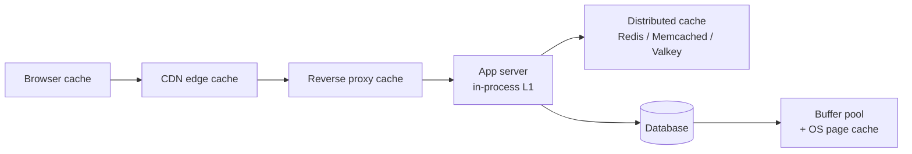
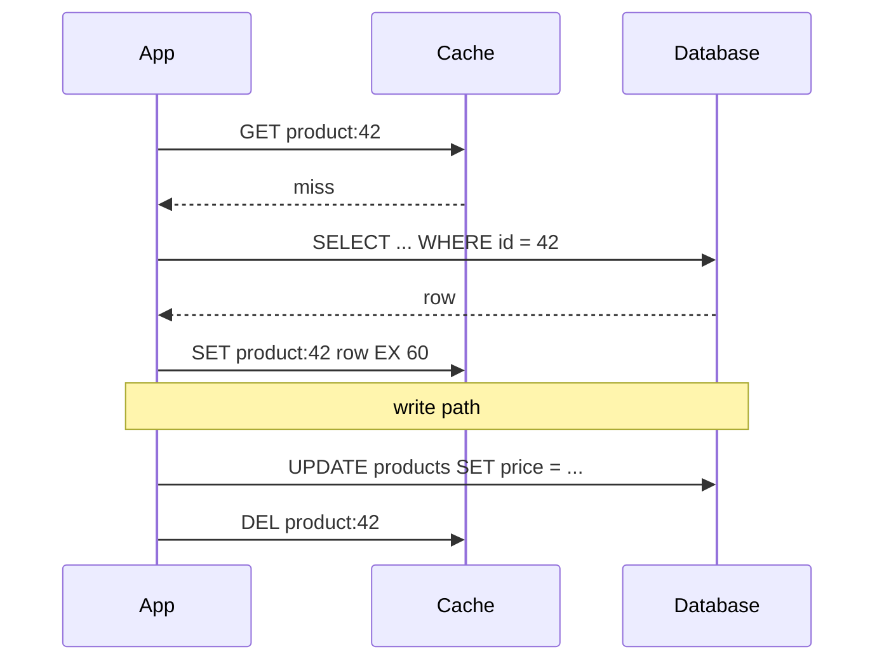
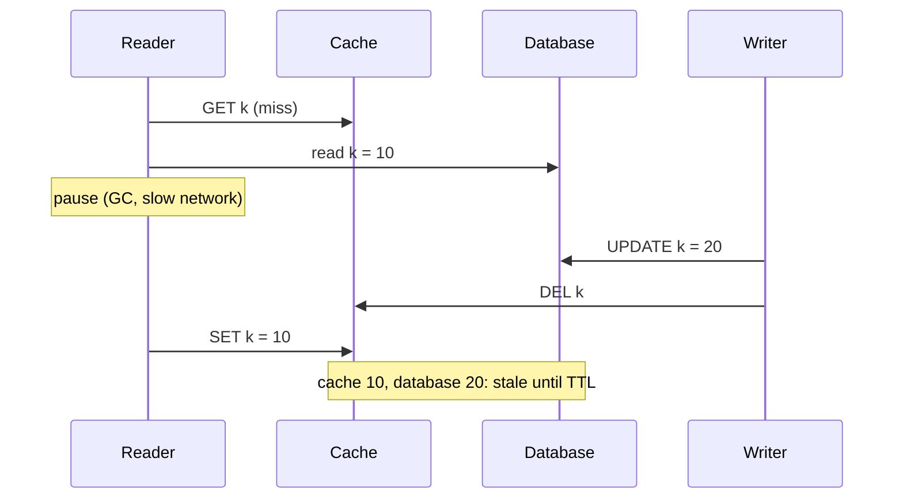

# 04 — Caching everywhere

> **The requirement.** Lumen's public product and documentation pages peak at **50,000 reads/s**. The Postgres
> primary behind them handles roughly **5,000 of these queries per second** before latency climbs (an assumption
> you would measure with a saturation test, see SYSDESIGN-01). The product team wants **p99 < 50 ms** and promises
> customers that a price shown on the site is **never more than 60 s old**. A tenfold gap between demand and
> capacity, a tail-latency target and a freshness bound: the three forces every cache design trades against each other.

## In one minute

A cache is a smaller, faster copy of data that lives closer to whoever needs it. When the copy is there (a *hit*) you
skip the slow trip; when it is not (a *miss*) you pay for the slow trip and usually keep the answer for next time.
Caches work because real traffic is lopsided: a small set of items gets most of the requests. They fail in three
predictable ways. The copy can be **wrong** (stale after the source changed), it can be **missing at the worst
moment** (many requests miss the same item at once and flatten the source), and it can be **too popular** (one item so
hot that the cache node holding it saturates). Almost every caching technique in this chapter is an answer to one of
those three failures. The design question is never "should we cache?" but "what staleness can we tolerate, what
happens when the cache is empty, and who keeps the copy honest?"

## Why this matters now

Caching is an old idea (CPU caches, the OS page cache, database buffer pools), but three things changed in 2023–2026:

- **The most expensive cache in the industry is now on a GPU.** LLM serving keeps a *KV cache* of attention keys and
  values per token in GPU memory, and engines such as vLLM reuse it across requests that share a prompt prefix
  ("prefix caching") [16]. The same questions apply: cache key, eviction, isolation between tenants. See
  [SYSDESIGN-21](../03-ai-systems/21-llm-inference-anatomy.md) and [SYSDESIGN-22](../03-ai-systems/22-serving-llms-at-scale.md).
- **Semantic caches** return a stored LLM answer for a *similar* (not identical) question, trading exactness for cost.
  That turns a cache hit into a correctness decision ([SYSDESIGN-26](../03-ai-systems/26-llm-gateways-llmops.md)).
- **The cache software landscape split.** Redis changed its licence in 2024 (7.4 onwards under RSALv2/SSPLv1), the
  Linux Foundation's **Valkey** fork started from Redis 7.2.4 under BSD-3-Clause, and Redis 8 (May 2025) added AGPLv3
  as an option [13][14]. Choosing a cache is now also a licensing and supply-chain decision (as of 2026-11: Redis 8.10,
  Valkey 9.2).
- **Eviction research moved again.** The authors of two simple FIFO-based policies (S3-FIFO, SOSP 2023; SIEVE, NSDI
  2024) report that they match or beat LRU-family policies on large collections of production traces while being
  easier to make concurrent [8][9].

## Core ideas [Core]

### Where caches live

Every request in [SYSDESIGN-02](02-anatomy-of-a-request.md) crosses several caches, each with a different owner,
key and invalidation story:

*Diagram: a request passes the browser cache, CDN edge, reverse proxy and the app's in-process cache before reaching
the distributed cache or the database, which itself caches pages in its buffer pool and the OS page cache.*

| Layer | Typical key | Who invalidates | Freshness tool |
|---|---|---|---|
| Browser | URL + `Vary` headers | the origin, via headers only | `Cache-Control: max-age`, `ETag` revalidation |
| CDN / reverse proxy | normalised URL + selected headers | origin headers, purge API, surrogate keys | `s-maxage`, `stale-while-revalidate`, purge |
| In-process (L1) | object id | each app instance, independently | short TTL, pub/sub invalidation |
| Distributed cache | application-defined string | the application | TTL, delete-on-write, CDC |
| DB buffer pool | page id | the database (always coherent) | none needed: it is the source |

The lower layers are *coherent* by construction: the buffer pool is the database. The upper layers are *copies*
somebody must keep honest. This chapter is mostly about the copies.

### The arithmetic of a hit ratio

Let `h` be the hit ratio, `t_hit` and `t_miss` the latencies of a hit and a miss, and `λ` the request rate:

- mean latency ≈ `h · t_hit + (1 − h) · t_miss`
- load on the source = `(1 − h) · λ`
- **tail latency is set by the misses.** If more than 1 % of requests miss, the p99 is a miss latency, no matter
  how fast the hits are.

That last point is the one most designs miss. A cache with a 95 % hit ratio improves the *mean* dramatically and the
*p99* not at all. Lab L04 shows exactly this.

Hit ratio depends on the **popularity distribution**. Web, social and catalogue workloads are often modelled with a
Zipf-like distribution, in which the item of rank `r` is requested with probability proportional to `1/r^s`.
The YCSB benchmark uses a Zipfian generator with constant 0.99 by default [20]. With `s` near 1, caching the top
few per cent of items captures a large share of requests, which is why caches with a fraction of the data work at all.

### Five read/write patterns

| Pattern | Read path | Write path | Wins when | Costs |
|---|---|---|---|---|
| **Cache-aside** (look-aside) | app checks cache; on miss reads DB and fills cache | app writes DB, then **deletes** the key | general purpose; cache failure degrades to slower, not broken | app owns the logic; stale-set race (Deep dive) |
| **Read-through** | cache library/proxy loads from DB on miss | (paired with one of the write patterns) | many services share one loading policy | cache must know the data source; coupling |
| **Write-through** | as read-through | write goes to cache, cache synchronously writes DB | read-after-write must hit fresh data | every write pays both latencies; caches data nobody reads |
| **Write-back** (write-behind) | as read-through | write goes to cache, DB written asynchronously later | write bursts, counters, buffering | **data loss** if the cache dies before flush; ordering |
| **Write-around** | as cache-aside | write goes straight to DB; cache filled only on read | write-once-read-rarely data (logs, uploads) | first read after write always misses |

Cache-aside is the default for a reason. Facebook described its memcache tier as a "demand-filled look-aside cache"
in which writes go to the database and then *delete* the cached key, chosen "because deletes are idempotent" [1].
A delete can be retried safely and reordered harmlessly; a `set` carrying a value cannot.

*Diagram: on a read miss the app loads the row from the database and sets it in the cache with a 60 s TTL; on a
write the app updates the database first and then deletes the cache key.*

Write-back deserves a warning label. It is how CPU caches and many storage controllers work, and it is the right
choice for things such as view counters, where losing a few seconds of increments is acceptable. For anything with
money or user intent in it, a write acknowledged only by a cache is a write you may lose.

### TTLs: a freshness budget, not a performance knob

A **time-to-live** bounds how long a copy can be wrong when every other invalidation mechanism fails. Read the
requirement again: "never more than 60 s stale". That is a TTL of at most 60 s *as the safety net*, with explicit
invalidation doing the real work. Three rules:

1. **Every cached entry gets a TTL**, even if you also invalidate explicitly. Invalidation messages get lost; TTLs do
   not.
2. **Add jitter.** If a deploy or a bulk load fills a million keys at once with the same TTL, they also expire at
   once (an *avalanche*). `ttl = base × (1 + uniform(0, 0.1))` spreads the expiry.
3. **TTL bounds staleness only for entries filled after the last write.** The stale-set race below can plant a stale
   value whose TTL starts *after* the write, so the worst-case staleness is "TTL after the race", not "TTL after the
   write".

### Eviction: what to forget when memory is full

A cache is smaller than its data, so it must pick victims. The classical policies:

- **LRU** (least recently used) evicts the item untouched for longest. Simple and good for recency-heavy traffic, but
  a single large scan of one-off items flushes the whole hot set ("scan pollution").
- **LFU** (least frequently used) keeps items with high access counts. Resists scans, but needs aging, or yesterday's
  hot item squats forever.
- **LRU-K** [5] ranks by the time of the K-th most recent access, separating "seen once" from "seen repeatedly".
  **ARC** [6] keeps two LRU lists (seen once, seen at least twice) plus "ghost" lists of recently evicted keys, and
  adapts the split between them online; the paper shows it is scan-resistant with constant time per request.
- **TinyLFU / W-TinyLFU** [7] adds an **admission** decision: a newcomer replaces the eviction victim only if a compact
  frequency sketch says the newcomer is more popular. The "W" variant puts a small LRU window in front so bursts of
  new items get a chance. W-TinyLFU is the policy of the Java Caffeine cache [7][12].
- **FIFO family (S3-FIFO, SIEVE)** [8][9]: demote most new objects quickly ("quick demotion"; S3-FIFO inserts them
  into a small probationary FIFO first); keep a tiny per-object access marker (a one-bit "visited" flag in SIEVE, a
  two-bit capped counter in S3-FIFO) instead of moving items on every hit ("lazy promotion").
  Because hits do not reorder a list, they need no lock. SIEVE's authors evaluate it on 1,559 traces, report
  miss ratios up to 63.2 % lower than ARC, and integrate it into five production cache libraries with fewer than 20
  changed lines on average [9].

Eviction answers *who leaves*; **admission** answers *who gets in*. Most production problems with LRU (scans, crawlers,
one-off batch jobs) are admission problems. In lab L04, a 3 MB Redis cache over 20,000 Zipf-distributed keys held a 78.6 %
(LRU) vs 80.6 % (LFU) hit ratio on reads alone; when half the operations were one-touch writes (a crawler), LRU fell to
63.9 % and LFU kept 70.5 %.

Redis implements *approximated* LRU and LFU: it samples `maxmemory-samples` keys (default 5) and evicts the best
candidate among them, plus a pool of good candidates; LFU uses a logarithmic (Morris) counter with decay, available
since Redis 4.0 [10]. As of Redis 8.6 there is also an LRM (least recently *modified*) policy [10].

## Numbers that matter

Work the requirement through. Everything marked **(A)** is an assumption to replace with measurements.

**1. Required hit ratio.** Demand λ = 50,000 reads/s. The database's safe capacity for this query is 5,000 q/s (A),
and you want 50 % headroom for failover and spikes, so the miss budget is 2,500 q/s.
`(1 − h) · 50,000 ≤ 2,500` → **h ≥ 95 %.**

**2. Can a 95 % hit ratio meet p99 < 50 ms?** No, by the tail rule above: 5 % misses means the p99 *is* a miss.
Either misses must be fast (a miss path of DB query + cache set under 50 ms, plausible if the query takes 10–20 ms
(A)), or the hit ratio for the requests that matter must exceed 99 %. In practice you need both: a miss path that fits
the SLO, and a hit ratio high enough that the p99.9 is not a pile-up behind a cold key.

**3. Memory.** Suppose 2 million products, 1 KB serialised each (A). The Zipf shape (s ≈ 0.99) means the hottest 10 %
(200,000 items, about 200 MB of values) carry the bulk of the traffic. Key and per-entry overhead in Redis is tens of
bytes per key (measure with `MEMORY USAGE`), so plan roughly 250–300 MB and size the cache node at 2× that for
fragmentation and growth. Caching *everything* would be 2–3 GB: still small. Memory is rarely the constraint for a
catalogue; for user-specific data (sessions, feeds) it often is.

**4. Network.** 47,500 hits/s × 1 KB ≈ 47.5 MB/s ≈ 380 Mbit/s of cache egress. One 10 Gbit/s NIC handles it, but a
single **hot key** does not spread: if one product page is 5 % of traffic, that is 2,500 reads/s on one key, on one
cache shard. Fine for one node; not fine if the item is a 500 KB blob (2,500 × 500 KB = 1.25 GB/s).

**5. Staleness.** TTL 60 s satisfies the promise as a backstop. Explicit invalidation on price change narrows typical
staleness to the time between DB commit and the delete (milliseconds) plus any replication lag if the cache is filled
from a replica ([SYSDESIGN-06](06-replication-consistency.md)).

**6. What the lab measured.** In L04 (Zipf 0.99 over 100,000 items, a database call made to take about 20 ms), three
successive cache-aside runs reached hit ratios of 61 %, 73 % and 77 %, cutting database calls from 20,000 to 4,563 and
the median latency from 21 ms to about 1 ms, while the **p99 stayed at 33–35 ms**, i.e. at miss latency, above the
no-cache p99 of 23 ms because a miss also pays the cache round trips. The long tail of 100,000 items is why the hit
ratio climbs slowly: that is the Zipf shape, measured. Full output in the
[lab README](../../labs/04-caching/README.md).

## Design choices and trade-offs

| Decision | Option | Wins when | Costs | Example systems |
|---|---|---|---|---|
| Where | In-process L1 | microsecond reads, very hot keys | N copies to invalidate; memory per instance | Caffeine, Guava, `functools.lru_cache` |
| | Distributed cache | shared across instances, large working set | network hop; a new tier to operate | Memcached, Redis, Valkey |
| | CDN / HTTP cache | public, cacheable responses; global users | only HTTP semantics; purge latency | Fastly, Cloudflare, CloudFront, Akamai |
| Write pattern | Cache-aside + delete | most read-heavy data | stale-set race; app complexity | Facebook memcache [1] |
| | Write-through | read-after-write must be fresh in cache | double write latency | cache libraries with loaders |
| | Write-back | counters, burst absorption | loss on crash | CPU caches, metrics aggregation |
| Invalidation | TTL only | staleness of minutes is fine | stale up to TTL | static assets, recommendations |
| | Delete on write (app) | a few write paths you control | missed paths stay stale | cache-aside apps |
| | CDC-driven delete | many writers, DB is the source of truth | extra pipeline; lag | Facebook mcsqueal [1], Debezium-based |
| | Versioned keys | immutable content | old versions linger until evicted | asset fingerprints `app.3f2a.js` |
| Eviction | LRU (approx.) | recency-dominated | scan pollution | Redis `allkeys-lru` |
| | LFU / W-TinyLFU | frequency-dominated, scans present | sketch memory, tuning | Redis `allkeys-lfu`, Caffeine |
| Product | Memcached | simple strings, multithreaded, big RAM | no persistence or data types | — |
| | Redis / Valkey | data structures, Lua, replication, cluster | single-threaded command execution per shard | — |

**Redis vs Memcached vs Valkey, briefly.** Memcached is a multithreaded, slab-allocated, string-only cache [4][15]: nothing
to configure except memory and threads, horizontally scaled by client-side hashing. Redis adds data structures
(hashes, sorted sets, streams), Lua scripting, replication and Redis Cluster, which shards the keyspace into 16,384
hash slots [11]. Command execution is single-threaded per process (I/O threading exists for network work), so one hot
key is bounded by one core. Valkey is wire-compatible with Redis 7.2 and has since diverged in features; check the
specific commands you need [14]. For a *pure* cache of strings at very high throughput per node, Memcached remains
a fine choice; for anything that needs atomic operations on structures (rate-limit counters, leaderboards, leases),
pick Redis or Valkey.

## Deep dive [Deep]

### Cache consistency: the stale-set race

Cache-aside with delete-on-write still has a window. Two clients, one key:

*Diagram: a reader misses and reads the old value 10; a writer updates the database to 20 and deletes the key; the
reader then sets the old value 10, which stays wrong until the TTL expires.*

The reader's `SET` arrives after the writer's `DEL`, so the delete protected nothing. Lab L04's `race` experiment
reproduces this exact interleaving and prints `cache=10.00 DB=20.00 → STALE until TTL`.

Mitigations, from weakest to strongest:

1. **Short TTL** bounds the damage. Always do this.
2. **Delayed double delete**: delete again a few hundred ms after the write. Narrows the window; does not close it.
3. **Leases** (Facebook) [1]: on a miss, the cache hands the client a 64-bit lease token. The client's later `set`
   must present the token, and a `delete` on that key invalidates outstanding tokens. The stale reader's `set` is
   rejected. In L04 the same interleaving with a lease prints `REJECTED (lease invalidated) → consistent`. Leases
   are a form of load-link/store-conditional, as the paper notes.
4. **Versioned sets**: store `(version, value)` and only accept a set whose version is newer (a compare-and-set in a
   Lua script or `WATCH`/`MULTI`). Requires the source to expose a version (a row version column, an LSN).
5. **Invalidate from the commit log**: tail the database's replication log or CDC stream and delete keys from there,
   as Facebook's `mcsqueal` daemons did with the MySQL commit log [1]. Every write path is covered, including ones
   the application team forgot, and deletes are ordered by commit.

**Caches and replicas.** If misses are filled from a read replica, a fill can read data older than the delete that
just happened on the primary, which re-plants staleness. Facebook's multi-region design used **remote markers**: a
write from a non-master region sets a marker so subsequent reads go to the master region until replication catches
up [1]. The general lesson: a cache filled from a lagging replica inherits the replica's anomalies (read-your-writes,
monotonic reads), see [SYSDESIGN-06](06-replication-consistency.md).

What consistency does a cache-aside cache give? None stronger than **eventual** with a staleness bound of
`TTL + race window`, unless you add leases/versions (which close the stale-set race) and serve your own writes from
the source (read-your-writes). Facebook's paper is candid that it treats "the probability of reading transient stale
data as a parameter to be tuned" [1].

### Stampedes (thundering herd, dogpile)

When a hot key expires, every request that arrives before someone refills it misses. If refilling takes 200 ms and the
key gets 2,000 requests/s, about 400 requests go to the database for the same row, each of which also takes longer
because the database is now busy: positive feedback. The defences:

- **Lock / lease per key.** The first misser takes a short-lived lock (`SET lock:k 1 NX PX 2000`) and recomputes;
  others wait briefly and re-read, or serve the stale value. Facebook's leases also throttle: a server returns a lease
  token only once every 10 s per key and tells other clients to wait; on a set of keys prone to herds, peak database
  query rate fell from 17K/s to 1.3K/s [1].
- **Request coalescing** ("single-flight"). Inside one process (or one CDN node), concurrent misses for the same key
  share one in-flight fetch. CDNs call this collapsed forwarding or request collapsing.
- **Serve stale while revalidating.** Keep the expired value and return it while one background refresh runs. In HTTP
  this is `stale-while-revalidate` (RFC 5861) [18].
- **Probabilistic early expiration (XFetch)** [2]. Each reader independently decides to refresh *before* expiry with a
  probability that rises as expiry approaches. With `Δ` = how long the last recomputation took, `β > 0` a tuning
  constant (default 1) and `rand()` uniform in (0, 1], a reader recomputes if

  `now − Δ · β · ln(rand()) ≥ expiry`

  Since `ln(rand()) ≤ 0`, the left side is "now plus an exponentially distributed head start of mean `Δ·β`". Far
  from expiry, the probability is negligible; within a few `Δ` of expiry, one of the many readers almost surely fires
  first and refreshes while everyone else still gets hits. Vattani, Chierichetti and Lowenstein prove that this
  exponential choice is optimal within their model and needs no coordination at all [2]. Raise `β` to refresh earlier
  (fewer misses, more recomputation).

XFetch and locks compose: XFetch makes a refresh happen early, a lock makes it happen once. Under very high request
rates XFetch alone can trigger several overlapping early refreshes. In lab L04 (50 clients, TTL 2 s, 100 ms
recompute), naive refill recomputed 45 times per expiry with up to 50 in parallel; a lock with re-check recomputed
about once per expiry but pushed the p99 to 204 ms (waiters block); XFetch had zero hard misses and a 34 ms p99, at the
cost of about 4 early refreshes per TTL.

### Negative caching and cache penetration

If a request asks for a key that does not exist, cache-aside misses, queries the database, finds nothing, caches
nothing and repeats forever. A crawler or an attacker iterating random ids bypasses the cache entirely (*cache
penetration*). Fixes:

- **Cache the absence** with a short TTL: store a tombstone `product:999999 → NOT_FOUND` for, say, 30 s. DNS
  standardised this as negative caching in RFC 2308 [19].
- **Bloom filter in front**: keep a Bloom filter of all existing ids; a "definitely not present" answer skips both
  cache and database. False positives cost one wasted lookup; false negatives cannot happen if the filter is
  maintained on insert.
- **Be careful caching errors.** A cached `500` or timeout turns a transient blip into a minutes-long outage. Cache
  "not found" (a fact about the data), not "failed" (a fact about the moment); if you must cache failures, use
  seconds, not minutes.

### Hot keys

A Zipf workload always has a hottest key, and the hottest key always lands on exactly one cache shard. Detection:
per-key request sampling (Redis `--hotkeys` with an LFU policy, or client-side sampling) and per-shard CPU/network
skew. Mitigations:

- **Local L1 cache** for the top keys with a very short TTL (1–5 s): the shard sees one request per app instance per
  TTL instead of every request.
- **Replicate the hot key**: store `k#0 … k#(n−1)` on different shards and read a random copy. Writes must update or
  delete all copies.
- **Read replicas of the cache shard** (Redis replicas), accepting replica lag.
- **Split the value**: if the hot item is large, cache its parts separately so not every request needs every byte.

Consistent hashing itself was invented to relieve hot spots in distributed web caches [3]. Partitioning-level
hot keys and key salting are covered in [SYSDESIGN-07](07-partitioning-sharding.md).

### HTTP and CDN caching

HTTP caching is specified in **RFC 9111** [17]. The directives you will actually use:

| Directive | Meaning |
|---|---|
| `Cache-Control: max-age=60` | any cache may reuse the response for 60 s |
| `s-maxage=300` | shared caches (CDN, proxy) use 300 s; overrides `max-age` for them |
| `private` | only the user's browser may store it (personalised pages) |
| `no-store` | nobody stores it (secrets, banking) |
| `no-cache` | store it, but revalidate with the origin before every reuse (`ETag` / `If-None-Match`) |
| `stale-while-revalidate=30` | after expiry, serve stale for up to 30 s while refreshing in the background (RFC 5861) [18] |
| `stale-if-error=600` | if the origin errors, serve stale for up to 600 s (RFC 5861) [18] |
| `CDN-Cache-Control` | the same directives, targeted at CDNs only (RFC 9213) [21] |

**The cache key is the design.** By default a CDN keys on method + scheme + host + path + query string, plus any
request headers named in `Vary`. Every mistake here is either a correctness bug or a hit-ratio bug:

- *Too broad* (headers that change the response are not in the key): user A's personalised page served to user B, or
  a response poisoned through an unkeyed header such as `X-Forwarded-Host` (*web cache poisoning*). Personalised
  responses must be `private` or keyed on something that identifies the variant.
- *Too narrow*: `Vary: User-Agent` creates thousands of variants of one page; unsorted or tracking query parameters
  (`?utm_source=…`) fragment the key. Normalise: sort parameters, drop tracking ones, key on a coarse device class
  rather than the full user agent.

**Invalidation at the edge.** Purging by URL does not scale when one product appears on hundreds of pages. Many CDNs
support *surrogate keys* (cache tags): the origin labels each response with tags such as `product-42`, and one purge
call invalidates every response carrying the tag. Purges propagate in seconds, not instantly, so for the 60 s promise
set `s-maxage` ≤ 60 and use purge to do better than the bound, never as the only mechanism.

**Tiered caching / origin shield.** With hundreds of edge locations, each one missing independently multiplies origin
load. A shield (a designated mid-tier cache) collapses those misses into one origin fetch per object.

**Observability.** RFC 9211 defines a `Cache-Status` response header in which each cache on the path reports hit or
miss and why [22]. Log it; your hit ratio by URL pattern is the single most useful CDN metric.

### Warm-up, cold starts and the cache that became the database

A cache that has absorbed 95 % of reads for a year has quietly become *load-bearing*: the database is now sized for 5 %
of traffic. Restart the cache cluster and the database receives 20× its normal load. Facebook described "cold cluster
warmup": a new cluster's clients fill misses from a *warm* cluster's cache instead of the database until hit rates
stabilise [1]. Equivalent tactics: restart cache nodes one at a time, pre-load the top-N keys from an access log, and
make sure the database has admission control (connection limits, load shedding; see
[SYSDESIGN-11](11-reliability-engineering.md)) so a cold cache produces slow pages, not a dead database.

## Frontier [Frontier]

*(as of 2026-11)*

**KV cache and prefix caching in LLM serving.** During generation, a transformer stores the attention keys and values
of every previous token so it does not recompute them; this *KV cache* lives in GPU memory and is the dominant memory
consumer at high concurrency ([SYSDESIGN-21](../03-ai-systems/21-llm-inference-anatomy.md)). vLLM's automatic prefix
caching divides it into fixed-size blocks and gives each full block a hash computed from the parent block's hash, the
block's own tokens and extra inputs such as LoRA ids or a per-tenant `cache_salt`; a new request whose prompt starts
with the same tokens reuses those blocks instead of recomputing the prefill, and freed blocks are evicted LRU-first [16].
Every classical idea reappears: the **cache key** is a hash chain (so identical text after a different prefix is a
different key), **isolation** is a salt in the key (otherwise tenants could infer each other's prompts from timing),
and since v0.11 the default hash is SHA-256 to avoid collisions [16] (vLLM v0.34.0 is current as of 2026-11).
Design implication: put the stable part of a prompt (system prompt, tool definitions, shared documents) *first* and
the variable part last, or the prefix never matches. KV-aware routing, which sends a request to the replica that
already holds its prefix, is consistent hashing with a cache-affinity twist ([SYSDESIGN-22](../03-ai-systems/22-serving-llms-at-scale.md)).

**Semantic caching.** An exact-match cache on LLM prompts rarely hits, because users phrase the same question
differently. A semantic cache embeds the prompt, searches a vector index for a previous prompt within a similarity
threshold and returns that answer. The trade-off is unusual: a looser threshold raises the hit ratio *and* the
probability of returning an answer to a different question. Treat the threshold as a quality parameter evaluated
offline, scope entries by tenant and by permissions, and never semantic-cache answers that depend on user-specific
data. Details and evaluation in [SYSDESIGN-26](../03-ai-systems/26-llm-gateways-llmops.md) and vector search in
[SYSDESIGN-24](../03-ai-systems/24-retrieval-vector-systems.md).

**Simpler, more concurrent eviction.** S3-FIFO and SIEVE [8][9] argue that "quick demotion" of new objects plus
"lazy promotion" beats elaborate recency tracking on large, modern trace sets, and is cheaper under multi-threading.
Expect library defaults to keep shifting; measure on your own traces (cache simulators such as libCacheSim, from the
same group, replay traces against many policies).

**Licensing as a design input.** With Redis under RSALv2/SSPLv1/AGPLv3 and Valkey under BSD-3-Clause [13][14],
managed services and Linux distributions have taken different sides. For a design review, record which one you
chose and why, as you would any other supply-chain dependency ([SYSDESIGN-18](../02-modern-requirements/18-security-by-design.md)).

## Failure modes and operations

| Failure | Symptom | SLI to watch | Mitigation |
|---|---|---|---|
| Stampede on a hot key | periodic DB spikes aligned with TTL | DB QPS per query fingerprint; miss bursts | lease/lock, coalescing, XFetch, stale-while-revalidate |
| Avalanche (mass expiry) | DB spike minutes after a deploy or bulk load | miss ratio over time | TTL jitter, staggered warm-up |
| Cold cache after restart | DB overload, timeouts | hit ratio, DB saturation | rolling restarts, warm from peer cache [1], admission control |
| Penetration (absent keys) | DB load with high miss ratio but no hit-ratio recovery | misses returning "not found" | negative caching, Bloom filter, rate limit per client |
| Stale data | users see old prices | staleness probe: write a canary, read it back via cache | leases/versioned sets, CDC invalidation, shorter TTL |
| Hot key | one cache shard at 100 % CPU or NIC | per-shard skew, top-key sampling | L1 cache, key replication |
| Eviction storm | hit ratio collapses after data growth | `evicted_keys` rate, `used_memory` vs `maxmemory` | right-size memory, better admission (LFU/TinyLFU) |
| Cache poisoning (HTTP) | wrong content served to many users | anomaly in responses per cache key | key on every varying header, strip unkeyed headers |

Operational rules: alert on **hit ratio and miss rate by keyspace**, not just "cache is up"; dashboard p99 split by
hit vs miss; load-test with the cache *flushed*, because that is the state you will be in during the incident; and
document whether each service can survive without the cache (if not, the cache is a database and needs replication and
backups like one).

## Cost and energy

Caching is usually the cheapest capacity you can buy: a hit costs a memory lookup and a small network transfer,
while a miss costs a query that may touch disk, take locks and consume a database core. The comparison to make in a
design review is concrete: *cost of cache nodes* versus *cost of the extra database replicas* (and their licences)
you would need for the same miss load. Two caveats keep this honest. First, DRAM is not free: caching cold data
"just in case" wastes memory you pay for every hour; let eviction statistics tell you the working set. Second, CDN
egress is billed per GB in most commercial plans, so a CDN raises the bill for content nobody re-reads and lowers it
for popular content; price your own traffic using [SYSDESIGN-16](../02-modern-requirements/16-cost-as-requirement.md).
Energy follows the same shape: serving from memory near the user avoids repeated work in the database and on the
network, which is the energy-efficiency argument of [SYSDESIGN-17](../02-modern-requirements/17-energy-carbon-aware.md);
for LLMs, a prefix-cache hit skips GPU prefill compute entirely, which is the largest per-request saving available.

## Interview angle

Caching comes up in nearly every design interview, usually as "the database is the bottleneck, what do you do?"
Use the course framework:

- **CLARIFY** the freshness requirement ("can a price be 60 s stale?") and read/write ratio before drawing a cache.
- **QUANTIFY** the hit ratio you need: `(1 − h) · λ ≤ backend capacity`. Say out loud that p99 is set by misses.
- **SKETCH** cache-aside with delete-on-write and a TTL as the default; name where the cache sits (L1, distributed, CDN).
- **DEEPEN** on one failure: stampede (leases, XFetch), or the stale-set race (leases, versioned sets, CDC).
- **STRESS**: "what if the cache cluster restarts?" (cold start, warm-up, admission control); "what if one key is
  10 % of traffic?" (L1, replication).
- **WRAP** with the consistency you are offering (eventual, bounded by TTL) and the metric you would alert on.

**Model answer outline (5 lines).** (1) Put Redis in cache-aside mode in front of Postgres; writes update the DB then
delete the key; TTL 60 s with jitter. (2) Need ≥ 95 % hit ratio for the DB to keep 50 % headroom; Zipf traffic makes
that realistic with the top 10 % cached. (3) p99 is a miss, so keep the miss path under SLO and add stampede protection
(lease + stale-while-revalidate). (4) Invalidate via CDC from the DB log so every write path is covered. (5) CDN in
front for anonymous pages with `s-maxage=60`, surrogate-key purge on price change.

**Red flags.** "Cache everything forever"; write-back for orders or payments; no TTL; no answer to "what happens when
the cache is empty?"; claiming a cache gives strong consistency.

**Follow-ups to expect.** Why delete instead of update on write? How do you handle a celebrity key? How would you
detect stale reads? LRU vs LFU? What goes in the CDN cache key?

## Common mistakes

- Measuring only the mean latency improvement and declaring victory while the p99 is unchanged.
- Updating (`SET`) the cache on write instead of deleting it, which creates write-write races between concurrent
  updaters.
- No TTL "because we invalidate explicitly": one missed code path makes data permanently stale.
- Caching errors and timeouts for as long as successes.
- Filling misses from a lagging read replica right after a write (re-plants stale data).
- A personalised response cached publicly at the CDN because `Cache-Control: private` was missing.
- Treating the cache as optional while the database is sized assuming 95 % of reads never arrive.
- Using one Redis instance for both cache data (evictable) and durable state (not evictable).

## Check yourself

1. A service has 20,000 reads/s and a backend that safely handles 1,000 reads/s. What minimum hit ratio do you need,
   and why does that still not guarantee the p99?
2. Draw the stale-set race for cache-aside. Which single mechanism closes it, and how?
3. Why does XFetch need `Δ`, the recomputation time, and what happens if you set `β` very large?
4. Give two reasons a CDN hit ratio can be low even though the content is public and popular.
5. In vLLM prefix caching, why does the block hash include the parent block's hash?

Full exercises with answers: [exercises/04-caching.md](../../exercises/04-caching.md).

## Lab

**[L04 — Cache in front of Postgres](../../labs/04-caching/README.md).** A Docker Compose stack (Postgres 18,
Redis 8, a Python bench) runs four experiments: no cache vs cache-aside on a Zipf workload (hit ratio, p50/p99,
database calls), `allkeys-lru` vs `allkeys-lfu` under memory pressure with and without a one-touch scan, a hot-key
stampede under naive refill vs a lock vs XFetch, and the stale-set race with and without a lease token.

## Further reading

- Nishtala et al., *Scaling Memcache at Facebook* (NSDI 2013) [1]: the single best paper on caches as a distributed
  system: leases, invalidation from the commit log, regions, cold clusters.
- Vattani, Chierichetti, Lowenstein, *Optimal Probabilistic Cache Stampede Prevention* (VLDB 2015) [2]: XFetch and its
  proof; short and readable.
- Megiddo and Modha, *ARC* (FAST 2003) [6]: adaptive recency/frequency, ghost lists, scan resistance.
- Einziger, Friedman, Manes, *TinyLFU* (ACM ToS 2017) [7]: admission policies and frequency sketches.
- Zhang et al., *SIEVE is Simpler than LRU* (NSDI 2024) [9]: the modern counterpoint.
- RFC 9111 *HTTP Caching* [17] and RFC 5861 [18]: what CDNs and browsers actually implement.
- vLLM design docs, *Automatic Prefix Caching* [16]: caching ideas applied to GPU memory.

## References

1. R. Nishtala et al., "Scaling Memcache at Facebook," NSDI 2013. https://www.usenix.org/conference/nsdi13/technical-sessions/presentation/nishtala (accessed 2026-11)
2. A. Vattani, F. Chierichetti, K. Lowenstein, "Optimal Probabilistic Cache Stampede Prevention," PVLDB 8(8):886–897, 2015. DOI 10.14778/2757807.2757813. https://www.vldb.org/pvldb/vol8/p886-vattani.pdf (accessed 2026-11)
3. D. Karger et al., "Consistent Hashing and Random Trees: Distributed Caching Protocols for Relieving Hot Spots on the World Wide Web," STOC 1997. https://dl.acm.org/doi/10.1145/258533.258660 (accessed 2026-11)
4. Memcached project, "memcached: a distributed memory object caching system." https://memcached.org/ (accessed 2026-11)
5. E. O'Neil, P. O'Neil, G. Weikum, "The LRU-K Page Replacement Algorithm for Database Disk Buffering," SIGMOD 1993. https://dl.acm.org/doi/10.1145/170035.170081 (accessed 2026-11)
6. N. Megiddo, D. Modha, "ARC: A Self-Tuning, Low Overhead Replacement Cache," FAST 2003. https://www.usenix.org/conference/fast-03/arc-self-tuning-low-overhead-replacement-cache (accessed 2026-11)
7. G. Einziger, R. Friedman, B. Manes, "TinyLFU: A Highly Efficient Cache Admission Policy," ACM Transactions on Storage 13(4), 2017, DOI 10.1145/3149371; preprint arXiv:1512.00727. https://arxiv.org/abs/1512.00727 (accessed 2026-11)
8. J. Yang, Y. Zhang, Z. Qiu, Y. Yue, R. Vinayak, "FIFO Queues Are All You Need for Cache Eviction," SOSP 2023. https://dl.acm.org/doi/10.1145/3600006.3613147 (accessed 2026-11)
9. Y. Zhang, J. Yang, Y. Yue, Y. Vigfusson, K. V. Rashmi, "SIEVE is Simpler than LRU: an Efficient Turn-Key Eviction Algorithm for Web Caches," NSDI 2024. https://www.usenix.org/conference/nsdi24/presentation/zhang-yazhuo (accessed 2026-11)
10. Redis documentation, "Key eviction." https://redis.io/docs/latest/develop/reference/eviction/ (accessed 2026-11)
11. Redis documentation, "Redis cluster specification." https://redis.io/docs/latest/operate/oss_and_stack/reference/cluster-spec/ (accessed 2026-11)
12. B. Manes, Caffeine wiki, "Efficiency." https://github.com/ben-manes/caffeine/wiki/Efficiency (accessed 2026-11)
13. Redis Ltd., "Licenses" (RSALv2, SSPLv1 and, from Redis 8, AGPLv3). https://redis.io/legal/licenses/ (accessed 2026-11)
14. Valkey project (Linux Foundation), releases. https://github.com/valkey-io/valkey/releases (accessed 2026-11; 9.2.0 published 2026-11-19)
15. Memcached documentation, "Performance" (worker threads, slab classes). https://docs.memcached.org/serverguide/performance/ (accessed 2026-11)
16. vLLM documentation, "Automatic Prefix Caching" (design). https://docs.vllm.ai/en/latest/design/prefix_caching.html (accessed 2026-11; vLLM v0.34.0)
17. R. Fielding, M. Nottingham, J. Reschke, "HTTP Caching," RFC 9111, 2022. https://www.rfc-editor.org/rfc/rfc9111 (accessed 2026-11)
18. M. Nottingham, "HTTP Cache-Control Extensions for Stale Content," RFC 5861, 2010. https://www.rfc-editor.org/rfc/rfc5861 (accessed 2026-11)
19. M. Andrews, "Negative Caching of DNS Queries (DNS NCACHE)," RFC 2308, 1998. https://www.rfc-editor.org/rfc/rfc2308 (accessed 2026-11)
20. B. Cooper et al., "Benchmarking Cloud Serving Systems with YCSB," SoCC 2010; YCSB `ZipfianGenerator` (constant 0.99). https://github.com/brianfrankcooper/YCSB/blob/master/core/src/main/java/site/ycsb/generator/ZipfianGenerator.java (accessed 2026-11)
21. S. Ludin, M. Nottingham, Y. Wu, "Targeted HTTP Cache Control," RFC 9213, 2022. https://www.rfc-editor.org/rfc/rfc9213 (accessed 2026-11)
22. M. Nottingham, "The Cache-Status HTTP Response Header Field," RFC 9211, 2022. https://www.rfc-editor.org/rfc/rfc9211 (accessed 2026-11)
