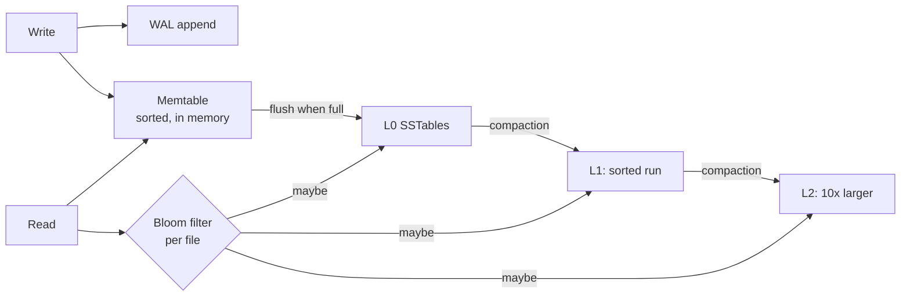
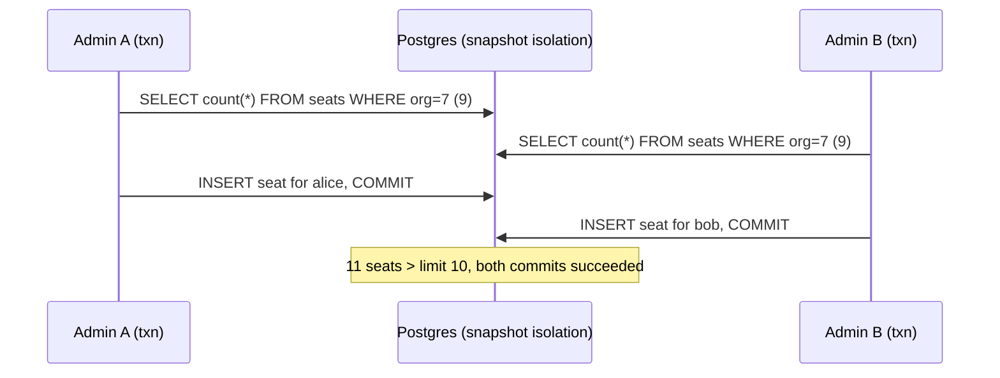
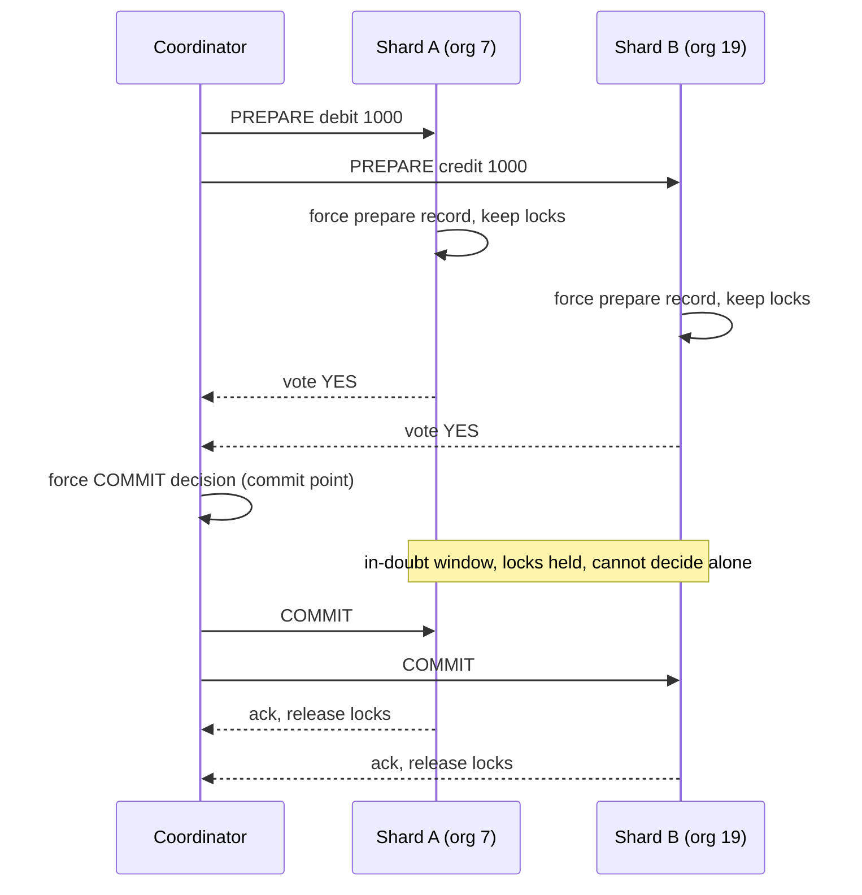

# 05 — Choosing storage

> **The requirement.** Lumen now has five kinds of data: **billing** (invoices, seats, payments: a lost or
> double-counted invoice is a legal problem), **chat history** (append-heavy, 20,000 message writes/s at peak, always
> read as "the last 50 messages of conversation X"), **sessions** (tiny, hot, disposable), **usage metrics** (per-tenant
> token counts every few seconds, queried by time range) and **document embeddings** for retrieval. The platform team
> has three engineers and wants to run *as few database products as possible*. Each workload pulls toward a different
> engine; operations pulls toward one. That tension is this chapter.

## In one minute

A database is two decisions glued together: a **data model** (how you describe and query data: tables, documents,
keys, graphs, vectors) and a **storage engine** (how bytes are laid out on disk so that some operations are cheap and
others are not). Start from the *access patterns* (which queries, how often, how fresh, how big), not from a product
name. Two engine families dominate: **B-trees**, which update pages in place and make reads predictable, and
**LSM-trees**, which append and merge in the background and make writes cheap. On top sits the promise that matters
most for money: **transactions**, and the isolation level that decides which concurrency bugs the database prevents
for you and which ones you must prevent yourself. A good storage design names the workload, the model, the engine, the
isolation level and the reason. "We use Postgres" is a product, not a design; "billing in Postgres at SERIALIZABLE
because seat limits are a write-skew hazard" is a design.

## Why this matters now

- **"Just use Postgres" became a serious position.** Extensions turned one engine into a relational store, document
  store (JSONB), full-text index, time-series store and vector index (pgvector, 0.8.7 as of 2026-11 [15]).
  PostgreSQL 18 (released 2025-09-25) added an asynchronous I/O subsystem and a built-in `uuidv7()` [14].
- **Serverless and disaggregated databases are mainstream.** Neon separates stateless Postgres compute from a
  storage layer of WAL "safekeepers" (Paxos quorum) and "pageservers" backed by object storage [16]; Databricks agreed
  to acquire Neon in May 2025 [17]. Amazon Aurora DSQL, a distributed PostgreSQL-compatible service using snapshot
  isolation and optimistic concurrency control, became generally available on 2025-05-27 [18][19].
- **Object storage is becoming the disk.** Engines such as SlateDB ("an OSS embedded key-value database and
  LSM-engine built on object storage" [20]) put the LSM-tree's immutable files directly on S3-compatible storage, trading
  latency for near-zero operational state. This is the LSM idea taken to its logical end.
- **Vector search moved into general-purpose databases**, which changes the "do we need a separate vector database?"
  question from yes to "measure first" ([SYSDESIGN-24](../03-ai-systems/24-retrieval-vector-systems.md)).

## Core ideas [Core]

### Access patterns first

Before choosing, write down for each workload: the **queries** (point lookup by key? range by time? join across
entities? similarity search?), **read/write ratio**, **size and growth**, **latency** target, **consistency** need
(must a read see the last write? must two writes be atomic?) and **retention**. Lumen's five workloads, filled in:

| Workload | Dominant queries | Writes | Consistency need | Shape |
|---|---|---|---|---|
| Billing | joins across org, seat, invoice; aggregates | low (tens/s) | ACID, serializable invariants | relational |
| Chat history | "last N messages of conversation C" | very high (20k/s), append-only | per-conversation order, read-your-writes | partitioned log / wide-column |
| Sessions | get/set by session id | high, overwrite | lose-able | key-value with TTL |
| Usage metrics | sum by tenant over time range | high, append | approximate OK, no lost billing totals | time-series |
| Embeddings | top-k nearest vectors with filters | moderate | eventual OK | vector index |

### Data models

| Model | Unit of data | Strong at | Weak at | Examples |
|---|---|---|---|---|
| **Relational** | rows in tables with schema | joins, constraints, ad-hoc queries, transactions | horizontal write scaling (single node by default) | PostgreSQL, MySQL, SQL Server |
| **Key-value** | opaque value by key | very fast get/put, simple scaling | anything that is not a key lookup | Redis/Valkey, DynamoDB (also document), etcd, RocksDB |
| **Document** | self-contained JSON-like tree | data read and written as a whole (an order with its lines) | many-to-many relationships, cross-document joins | MongoDB, Couchbase, Postgres JSONB |
| **Wide-column** | rows grouped by partition key, sorted by clustering key | huge write volume, per-partition range scans | ad-hoc queries, cross-partition joins | Cassandra, ScyllaDB, Bigtable, HBase |
| **Graph** | vertices and edges with properties | multi-hop traversals (friends of friends, fraud rings) | bulk analytics over everything | Neo4j, Neptune, Postgres + recursive CTEs |
| **Time-series** | (series, timestamp, value) | append, downsampling, time-range aggregates, retention | updates, random access | Prometheus, InfluxDB, TimescaleDB, ClickHouse |
| **Vector** | embedding + metadata | approximate nearest neighbour (ANN) search | exact queries, transactions | pgvector, Qdrant, Milvus, Weaviate |
| **Search** | inverted index over tokens | full-text relevance, faceting | being the system of record | Elasticsearch, OpenSearch ([SYSDESIGN-13](13-data-at-scale.md)) |

The **document vs relational** debate is mostly about *locality versus flexibility*. A document keeps everything a
screen needs in one place, so one read serves it; a normalised schema stores each fact once, so one write updates it.
Workloads that are tree-shaped (an order and its lines) suit documents; workloads with many-to-many links (users,
orgs, permissions) suit relations. Modern relational engines blur the line with JSON columns, and document stores have
added multi-document transactions; choose by the dominant access pattern, not by the label.

### Storage engines: B-tree vs LSM-tree

**B-tree** (Bayer and McCreight, 1972 [1]). Data lives in fixed-size pages (8 KB in PostgreSQL, 16 KB in InnoDB)
arranged as a balanced tree; a lookup walks root → internal pages → leaf, typically 3–4 levels for billions of rows
because each page holds hundreds of keys. Updates modify the leaf page *in place*; to survive crashes, the change is
first appended to a **write-ahead log (WAL)**, and dirty pages are flushed later. Reads are predictable (one path down
the tree), range scans are cheap (leaves are ordered), but every random write eventually rewrites a whole page.

**LSM-tree** (O'Neil, Cheng, Gawlick and O'Neil, 1996 [2]). The paper's insight was an algorithm that "defers and
batches index changes": writes go to the WAL and an in-memory sorted structure (the **memtable**, the paper's C0 component). When
the memtable fills, it is written out sequentially as an immutable sorted file (an **SSTable**). Background
**compaction** merges files into larger, sorted levels, discarding overwritten and deleted (tombstoned) entries. Reads
must check the memtable and possibly several files, so engines keep a **Bloom filter** per file to skip files that
cannot contain the key.

*Diagram: writes go to a WAL and an in-memory memtable, which is flushed to level-0 files and compacted into
progressively larger sorted levels; reads check the memtable, then use per-file Bloom filters to decide which files
to search.*

### The three amplifications

RocksDB's tuning guide defines them precisely [3]:

- **Write amplification (WA):** bytes written to storage ÷ bytes written by the application.
- **Read amplification (RA):** disk reads per query.
- **Space amplification (SA):** bytes on disk ÷ logical data size.

You cannot minimise all three. Athanassoulis et al. formalised this as the **RUM conjecture**: an access method that
optimises two of read, update and memory (space) overheads pays in the third [4]. B-trees favour reads (low RA) and pay
on writes (a 100-byte update dirties an 8 KB page: WA can be high for random writes) and space (pages are partly
empty after splits). LSM-trees favour writes (sequential, batched) and pay on reads (several files) and in
compaction's background write amplification.

## Numbers that matter

**Chat history, sized.** 20,000 messages/s at peak, 500 bytes each including metadata (A = assumption):

- Ingest: 20,000 × 500 B = **10 MB/s**. At a 30 % average-to-peak ratio (A), about 260 GB/day of raw data,
  ~95 TB/year before replication.
- With replication factor 3 ([SYSDESIGN-06](06-replication-consistency.md)): ~285 TB/year on disk before
  compression and before indexes.

That is one number that ends the "one Postgres box" option for chat at peak scale, unless you partition it
([SYSDESIGN-07](07-partitioning-sharding.md)) or keep only recent months hot and move the rest to object storage
([SYSDESIGN-13](13-data-at-scale.md)).

**LSM write amplification, estimated.** RocksDB's guide works an example with leveled compaction, a 10× size ratio
between levels and a 500 GB database: total WA ≈ 1 (flush to L0) + 2 (L0→L1) + 10 + 10 + 10 = **33** [3]. So 10 MB/s of chat
ingest becomes roughly 330 MB/s of device writes in the worst case: fine for NVMe throughput, but it is the number that
decides SSD endurance ("high write amplification also decreases flash lifetime" [3]) and why tiered/universal
compaction exists (lower WA, higher space and read amplification [3]).

**B-tree depth, estimated.** With 8 KB pages and ~16-byte index entries, a page holds a few hundred keys (A: 400).
Depth for 10^9 rows: log₄₀₀(10^9) ≈ 3.5, so **4 page reads** worst case; the root and internal levels are almost
always cached, so a point lookup costs about **one** disk read. That is why B-tree point lookups are predictable.

**Bloom filter sizing.** With `m/n` bits per key and the optimal number of hash functions, the false-positive rate is
about `0.6185^(m/n)` (Bloom 1970 [5], standard derivation): 10 bits/key → ≈ 1 %. So an LSM read that would otherwise
probe 6 levels probes ~1 file plus 6 × 1 % wasted probes: low RA for point lookups, at 10 bits of memory per key.

**Billing transaction rate.** Tens of writes per second fits any relational database on one node. Billing's hard
part is not scale; it is invariants under concurrency, which is the Deep dive below.

## Design choices and trade-offs

**Engine choice.**

| Option | Wins when | Costs | Example systems |
|---|---|---|---|
| B-tree, in-place pages | read-heavy, point + range reads, transactions | random-write WA, page splits, vacuum/bloat in MVCC engines | PostgreSQL, InnoDB, SQL Server, LMDB |
| LSM, leveled compaction | write-heavy, mostly point reads | compaction WA (~10× per level), write stalls if compaction falls behind | RocksDB (default), Cassandra LCS, ScyllaDB |
| LSM, tiered/universal | very write-heavy, append | higher space and read amplification | Cassandra STCS, RocksDB universal |
| Column store | analytical scans, compression | slow point updates | ClickHouse, Parquet files, DuckDB |
| LSM on object storage | elastic, low-ops, latency-tolerant | higher, variable latency; request costs | SlateDB [20], several serverless engines |

**Decision framework for Lumen.**

| Workload | Choice | Why | When to revisit |
|---|---|---|---|
| Billing | **PostgreSQL**, `SERIALIZABLE` for seat/invoice transactions | ACID, constraints, write-skew protection; low volume | never "outgrow" it on volume; maybe on multi-region writes |
| Chat history | **Postgres, partitioned by conversation id and time** first; wide-column (Cassandra/ScyllaDB) or DynamoDB if a single primary can't absorb peak | access pattern is "partition key + sorted range", which both serve | when write volume exceeds one primary even after batching |
| Sessions | **Redis/Valkey** with TTL | disposable, hot, simple KV | if sessions become durable (then a DB table) |
| Usage metrics | **Postgres + time partitioning** (or TimescaleDB); billing totals derived in the billing DB | time-range aggregates; avoid a new product | when cardinality or retention outgrows it (ClickHouse) |
| Embeddings | **pgvector** in Postgres | filter + vector in one query, one backup story | when recall/latency at your vector count fails measured targets ([SYSDESIGN-24](../03-ai-systems/24-retrieval-vector-systems.md)) |

The design starts with **two** products (Postgres and Redis) and names the measurable trigger for adding a third.
That is the defensible version of "Postgres for everything": not a slogan, a staged plan with exit criteria.

## Indexes [Core]

An index is a second, redundant data structure that makes some reads cheap and every write more expensive.

- **Primary vs secondary.** In InnoDB, the table *is* a B-tree clustered on the primary key, and secondary indexes
  store the primary key; in PostgreSQL, the table is an unordered heap and every index points to a tuple location. So
  a random UUIDv4 primary key scatters inserts across InnoDB's clustered tree, which is one reason time-ordered ids
  (UUIDv7, now built into PostgreSQL 18 [14]) are popular.
- **Composite indexes follow the leftmost prefix.** An index on `(conversation_id, created_at)` serves "messages of C
  ordered by time" and "messages of C after T", but not "all messages after T".
- **Covering indexes** (`INCLUDE` columns) answer a query from the index alone.
- **Partial indexes** (`WHERE status = 'open'`) index only the rows a hot query touches.
- **Specialised indexes**: GIN (JSONB, arrays, full text), BRIN (huge, naturally ordered tables like time-series:
  tiny, block-range summaries), GiST (geometric, ranges), HNSW/IVFFlat (vectors via pgvector).
- **The write cost is linear.** Each index adds an extra structure to update on every insert, and an extra B-tree
  page to dirty on random keys. Five indexes on the chat table can multiply its write cost several times; index what
  queries need and drop what `pg_stat_user_indexes` says is never used.

## Transactions and isolation [Core]

**ACID** in one line each: **atomic** (all or nothing, via the WAL/undo), **consistent** (constraints hold, which is
partly *your* job), **isolated** (concurrent transactions do not see each other's partial work, to a degree set by the
isolation level), **durable** (committed means on stable storage, via WAL `fsync` and, in replicated systems, a
quorum).

### Anomalies, named

Berenson et al. showed in 1995 that the ANSI SQL-92 definitions of isolation levels, written as "phenomena" to
avoid, were ambiguous and failed to characterise real implementations, and introduced **snapshot isolation** [6].
Using their names, with Lumen examples:

| Code | Anomaly | Lumen example |
|---|---|---|
| P0 | **Dirty write**: overwrite another transaction's uncommitted write | two admins' half-finished seat changes interleave |
| P1 | **Dirty read**: read uncommitted data that later rolls back | invoice shows a payment that was rolled back |
| P4 | **Lost update**: read-modify-write races, one update vanishes | two requests add 1 credit each; balance rises by 1 |
| P2 | **Fuzzy / non-repeatable read**: same row read twice, different values | a report reads an invoice total twice mid-update |
| A5A | **Read skew**: see part of another transaction's changes | transfer between two orgs seen half-done; totals don't sum |
| A5B | **Write skew**: two transactions read overlapping data, write *different* rows, together break an invariant | two admins each check "9 of 10 seats used" and each add one: 11 seats |
| P3 | **Phantom**: a predicate query returns different rows when re-run | "count seats WHERE org = X" changes under you |

### Levels, and what real databases mean by them

| Level | Prevents | Still allows | Notes |
|---|---|---|---|
| Read uncommitted | P0 | everything else | PostgreSQL treats it as read committed [7] |
| **Read committed** | P0, P1 | P4, P2, A5A, A5B, P3 | **PostgreSQL's default** [7]; each statement sees a fresh snapshot |
| Repeatable read / **Snapshot isolation** | + P2, A5A, (P3 for reads) | **A5B write skew** | PostgreSQL's REPEATABLE READ is snapshot isolation; a concurrent update of the same row aborts the later transaction [7] |
| **Serializable** | all of the above | nothing (as if one-at-a-time) | PostgreSQL implements Serializable Snapshot Isolation (SSI) since 9.1 [8] |

Two traps make this table dangerous to memorise blindly:

- **Names lie across vendors.** MySQL InnoDB's default REPEATABLE READ is not snapshot isolation; Jepsen's 2023
  analysis of MySQL 8.0.34 found it permits lost updates and other anomalies and satisfies neither Adya's nor the
  ANSI definition of repeatable read [9]. Oracle's "serializable" has historically been snapshot isolation [8], which
  permits write skew [6]. Always test the anomaly you care about, on the version you run.
- **Snapshot isolation is not serializable.** The seat-limit example is the canonical write skew: both transactions
  read a consistent snapshot showing 9 seats, both insert a *different* row, no row-level conflict exists, both
  commit.

*Diagram: two admins each count 9 seats under snapshot isolation, each insert a different seat row and both commit,
leaving 11 seats against a limit of 10.*

Fixes, in order of preference: run the transaction at **SERIALIZABLE** and retry on serialization failure (SQLSTATE
`40001`); or **materialise the conflict** by locking a row both transactions must touch (`SELECT ... FROM orgs WHERE
id = 7 FOR UPDATE`); or enforce the invariant with a constraint the database checks (a counter column with a `CHECK`,
or an exclusion constraint). Whatever you choose, *retries must be safe*, which means idempotent request handling
([SYSDESIGN-08](08-async-event-driven.md)).

### MVCC

Most modern engines implement isolation with **multi-version concurrency control**: writers create new row versions
instead of overwriting; each transaction reads the versions visible in its snapshot; readers never block writers.
PostgreSQL keeps old versions in the table heap (tracked by `xmin`/`xmax` transaction ids) and reclaims them with
**VACUUM**; InnoDB and Oracle keep old versions in an undo log. The operational consequence is the same: a
**long-running transaction pins old versions**, causing bloat in PostgreSQL or a growing undo history in InnoDB.
PostgreSQL additionally uses 32-bit transaction ids and must "freeze" old rows to avoid **transaction-id wraparound**;
autovacuum normally handles this, and a database that cannot vacuum will eventually refuse writes to protect itself [10].

## Deep dive [Deep]

### Inside a B-tree write

An `INSERT` into a PostgreSQL table with three indexes: append a WAL record; place the tuple in a heap page with free
space; insert a key into each of three index B-trees (each possibly splitting a full leaf page, which propagates a key
upward); mark pages dirty; at commit, `fsync` the WAL (group commit batches many transactions into one flush). The
dirty pages are written later by the checkpointer. After a checkpoint, PostgreSQL logs the *full page* on its first
modification (`full_page_writes`) to protect against torn pages: one reason write volume spikes right after
checkpoints. Durability is therefore "WAL on stable storage", and its cost is one synchronous flush per commit group.

### Compaction strategies and their failure mode

**Leveled** compaction keeps each level as one sorted run, about 10× the previous; a key exists in at most one file
per level, so reads are cheap and space amplification is low, but each byte is rewritten roughly once per level
(the ~10 per level in the WA estimate above). **Tiered** (size-tiered/universal) merges similar-sized runs only when
enough accumulate: fewer rewrites, but several overlapping runs per tier (higher RA) and temporary doubling of space
during big merges (higher SA) [3]. The characteristic LSM failure is **compaction debt**: if ingest outruns compaction,
L0 files pile up, reads slow down, and the engine throttles or stalls writes to recover. Monitor pending compaction
bytes and L0 file count the way you monitor replication lag.

**Deletes are writes.** In an LSM a delete is a tombstone that must survive until compaction pushes it past every older
version of the key. Workloads that delete heavily (queues on Cassandra are the classic anti-pattern) accumulate
tombstones that every read must skip.

### How SERIALIZABLE works without locking everything

Two-phase locking (2PL) gives serializability by holding read and write locks to commit, including predicate/range
locks against phantoms; correct, but readers block writers. PostgreSQL's **SSI** keeps snapshot isolation's
non-blocking reads and tracks *read-write antidependencies* between concurrent transactions; building on an
earlier result by Fekete et al. that every non-serializable SI execution contains a "dangerous structure" of two
consecutive antidependency edges, Cahill, Röhm and Fekete abort one transaction in any such structure, which is
sufficient for serializability [11]. Ports and Grittner describe the PostgreSQL
implementation (SIREAD locks that never block, false positives accepted for performance) [8]. The cost model for
designers: SERIALIZABLE in PostgreSQL rarely blocks, but it **aborts** some transactions under contention, so the
application must retry, and long read-write transactions raise the abort rate.

### NewSQL and distributed SQL

When one relational primary cannot hold the data or the write rate, or must accept writes in several regions,
distributed SQL systems partition tables into ranges, replicate each range with consensus, and run distributed
transactions across ranges:

| System | Partitioning | Replication | Transactions | Notes |
|---|---|---|---|---|
| Google Spanner [12] | directories (key ranges) in tablets | Paxos per tablet | 2PC over Paxos groups; TrueTime commit wait | external consistency (linearizable transactions) |
| CockroachDB [13] | ranges (~64 MiB in the 2020 paper; 512 MiB default maximum today, see [SYSDESIGN-07](07-partitioning-sharding.md)) | Raft per range | serializable by default | PostgreSQL wire protocol |
| TiDB [21] | regions in TiKV | Raft | percolator-style, SI / optimistic or pessimistic | MySQL wire protocol |
| YugabyteDB [22] | tablets | Raft | snapshot (repeatable read), serializable, read committed | PostgreSQL-compatible query layer |
| Aurora DSQL [18][19] | managed | multi-AZ / multi-Region | snapshot isolation, optimistic (commit-time conflicts, SQLSTATE 40001) | serverless, PostgreSQL-compatible |

The physics does not change: a write that must be durable in a quorum spanning regions pays at least one inter-region
round trip, and a distributed transaction touching several ranges pays a commit protocol on top. Distributed SQL
removes *manual sharding*, not latency. Use it when you need horizontal write scale *with* SQL transactions, or
multi-region writes with strong consistency; do not use it to fix a slow query on 50 GB of data. Partitioning
mechanics are in [SYSDESIGN-07](07-partitioning-sharding.md), replication and consensus in
[SYSDESIGN-06](06-replication-consistency.md) and [SYSDESIGN-09](09-coordination-consensus.md). The commit
protocol itself is the next section.

## Distributed transactions and atomic commit [Deep]

**The requirement, sharpened.** Lumen's billing outgrows one primary and is split by organisation. An enterprise
customer now moves 1,000 credits from org 7 (shard A) to its sister org 19 (shard B). The debit and the credit must
both happen or neither may: a crash between them either destroys credits or prints them. Each shard already gives
you ACID locally; what is missing is **atomic commit**, an agreement among several independent participants on one
outcome for one transaction.

### Atomic commit is not consensus

The two problems sound alike and are easy to confuse. **Consensus** (Raft, Paxos,
[SYSDESIGN-09](09-coordination-consensus.md)) lets a group of *replicas of the same data* agree on a value; a
majority is enough, and any proposed value is acceptable. **Atomic commit** lets *participants holding different
data* agree on commit or abort; *every* participant must vote yes for a commit, and one "no" forces an abort. The
MIT 6.5840 notes put it bluntly: "Raft and two-phase commit solve different problems", and 2PC on its own "does not
help availability", because every participant must be up [26]. Real systems need both: consensus to keep each
participant available, atomic commit to tie the participants together.

### Two-phase commit (2PC)

A **coordinator** (often the service or node that started the transaction) runs two rounds:

1. **Prepare.** It asks each participant to prepare. A participant that can commit makes its changes durable
   in a *prepared* state (a forced write to its log), keeps its locks, and votes **yes**. From that moment it has
   given up the right to abort on its own. A participant that cannot commit votes **no** and aborts.
2. **Commit or abort.** If every vote is yes, the coordinator writes the decision to its own log (this write is the
   **commit point**) and sends commit; otherwise it sends abort. Participants apply the outcome, release their
   locks and acknowledge.

*Diagram: the coordinator asks both shards to prepare; each forces a prepare record and votes yes while holding its
locks; the coordinator forces the commit decision and then tells both shards to commit. Between voting yes and
hearing the decision, each shard is in doubt.*

In the failure-free case the cost is two message round trips plus a forced log write on every participant and on
the coordinator. The real cost is in the failure case.

### The blocking problem

Skeen's 1981 paper states the problem with a three-site example: if the coordinator fails while sending commit
messages and the site that received one also fails, a third site that voted yes "has no way of determining the
status of the transaction" and "can not safely proceed"; it is **blocked** until a failed site recovers, and "locks
must be held on the database while the transaction is blocked" [24]. It cannot abort (another participant may already
have committed) and it cannot commit (another participant may have voted no) [26]. The notes summarise it as "TC
crash can cause indefinite blocking, WITH LOCKS HELD" [26].

You can see the prepared state directly in PostgreSQL. `PREPARE TRANSACTION` stores the transaction's state on disk
so it can still be committed after a crash, and the transaction "continues to hold whatever locks it held" [29]. The
documentation warns that leaving transactions prepared "will interfere with the ability of `VACUUM` to reclaim
storage", in extreme cases forcing a shutdown to prevent transaction-id wraparound (the MVCC hazard above), and says
that unless you are writing a transaction manager you "probably shouldn't be using" it; without one, keep
`max_prepared_transactions` at zero [29]. That is the in-doubt window made operational: a forgotten prepared
transaction is a lock and a vacuum blocker that nobody owns. If you do run 2PC across databases, the coordinator's
decision log is the only authority for resolving an in-doubt transaction (`COMMIT PREPARED` or `ROLLBACK PREPARED`
after reading it); an operator who guesses breaks atomicity.

That transaction manager usually speaks **XA**. The X/Open XA specification (1991) defines "the bidirectional
interface between a transaction manager and a resource manager": an external transaction manager drives databases and
queues (the resource managers) through two-phase commit "with presumed rollback", calling `xa_prepare` on each and
then `xa_commit` or `xa_rollback` [30]. `PREPARE TRANSACTION` is the database half of such a protocol; the PostgreSQL
manual notes that standards such as X/Open XA cover the transaction-manager side, but "the SQL side of those systems is
not standardized" [29]. XA also names the escape hatch operators reach for: a prepared resource manager may take a
**heuristic** decision, committing or rolling back on its own, which "may leave them in an inconsistent state" and
must be reported back to the transaction manager [30]. XA fits inside one operator's estate (an application server, a
database and a broker in one data centre). It is rarely used across services, because every participant must expose
an XA resource and accept being held in doubt by someone else's coordinator.

### Why three-phase commit did not end the story

Skeen's answer was a **nonblocking** protocol: add an intermediate (buffer) state so that no site can be uncertain
while another has already committed, which became known as three-phase commit (3PC) [24]. The guarantee rests on two
stated assumptions: point-to-point communication between operational sites always works ("the network never
fails"), and the network detects a failed site, for example by a timeout, "and can reliably report this" [24].
Neither holds in the systems this course designs: networks partition, and a timeout cannot tell a dead node from a
slow one ([SYSDESIGN-09](09-coordination-consensus.md)). Quorum-based variants let a connected quorum make progress after a
failure, but Keidar and Dolev showed that when failures cascade a quorum "can later become connected and still remain
blocked"; their E3PC removes that case so that "a connected quorum never blocks" [25]. In practice, the industry
took a different route.

### Commit over consensus: Paxos Commit, Spanner, CockroachDB

The blocking comes from one machine (the coordinator) being the only holder of the decision. Gray and Lamport's
**Paxos Commit** runs Paxos on each participant's vote: with 2F+1 coordinators it "makes progress if at least F+1 of
them are working", costs one extra message delay in its basic form (none in the "Faster Paxos Commit" variant, at the
price of more messages), has "the same stable-storage write delay" as Two-Phase Commit, and contains classic 2PC as the special case F = 0 [23]. The engineering form of the same idea:
make every participant *and* the coordinator a replicated state machine, then run 2PC among those groups [26]. A
prepared vote or a commit decision is then a consensus-replicated log entry, and a new leader can finish what a
crashed one started.

**Spanner** [12] does exactly this. The client buffers writes and, at commit, picks one participant group as
coordinator. Each other participant leader takes write locks, chooses a prepare timestamp, logs a prepare record
*through Paxos* and reports the timestamp. The coordinator leader picks a commit timestamp no lower than every prepare
timestamp and above `TT.now().latest`, logs the commit record through Paxos, waits out the clock uncertainty (commit
wait, expected to last at least twice the average uncertainty bound, which the paper reports as a sawtooth between
about 1 and 7 ms), and only then lets every participant apply at that single timestamp and release locks [12]. The authors'
position is worth quoting: "it is better to have application programmers deal with performance problems due to
overuse of transactions as bottlenecks arise, rather than always coding around the lack of transactions. Running
two-phase commit over Paxos mitigates the availability problems" [12]. Their scalability experiment (3 zones, 25
servers each, 2012 hardware) measured mean commit latencies of 17.0 ms with one participant, 42.7 ms with 50 and
150.5 ms with 200 (99th percentiles 75.0, 93.7 and 320.3 ms); they judged up to 50 participants reasonable [12].

**CockroachDB** [13][28] replicates every range with Raft and writes **write intents**, described as "a combination
of a replicated lock and a replicated provisional value", plus a **transaction record** whose status is PENDING,
STAGING, COMMITTED or ABORTED. Its **parallel commits** protocol marks the record STAGING together with the list of
in-flight writes; the transaction is implicitly committed once all those writes have reached consensus, which "cuts
the commit latency of a transaction in half, from two rounds of consensus down to one" [28]. Coordinator failure no
longer blocks forever: the gateway heartbeats the transaction record, and a transaction whose heartbeats stop is
moved to ABORTED, so other transactions that meet its intents can clean them up, while a STAGING record left by a crashed coordinator is resolved
by a status-recovery procedure [28]. Timestamps come from hybrid logical clocks; a read that meets a value inside its
clock-uncertainty window must move its timestamp forward, and a pushed transaction must refresh its reads or retry
[28]. The default isolation is SERIALIZABLE, with READ COMMITTED also available [28].

### Percolator: a commit protocol with no coordinator state

Bigtable offered only single-row transactions, so Google's incremental indexer **Percolator** built multi-row
snapshot-isolation transactions in the client library [27]. A central **timestamp oracle** hands out strictly
increasing timestamps (batched, "around 2 million timestamps per second from a single machine"). At commit, the
client *prewrites* a lock on every cell it changes and designates one lock as the **primary**; every other lock
records where the primary lives. It then takes a commit timestamp and commits the primary in a single-row Bigtable
transaction: that row write is the commit point. Secondary cells are committed afterwards. If a client dies, the
next transaction that trips over one of its locks checks the primary: if the primary has committed it rolls the
secondary forward, otherwise it rolls it back [27]. The decision therefore lives in replicated storage, not in a
coordinator's memory, at the price of lazy cleanup and no global deadlock detector, which the authors accept because
indexing does not need OLTP-level latency [27]. They measured roughly a factor of four write overhead relative to raw
Bigtable on their worst-case benchmark (a single-cell write plus commit), and the incremental pipeline cut average document processing latency by a factor of 100 compared with the
batch system it replaced [27]. TiDB's transaction model is Percolator-style [21].

### Calvin: agree on the order first, then skip the vote

Every protocol above agrees on the outcome *after* executing the transaction, while participants hold locks. Thomson
et al.'s **Calvin** (SIGMOD 2012) moves the agreement *before* execution [31]. A sequencing layer collects transaction
requests in 10-millisecond epochs, replicates each batch (optionally through Paxos), and every partition's scheduler
executes the merged batches in the same deterministic order under a deterministic locking protocol. Because all nodes
"reach an agreement regarding what transactions to attempt and in what order", Calvin "is able to completely eschew
distributed commit protocols"; a node failure cannot abort a planned transaction, since a replica running the same plan,
or a replay of the input history, reproduces its effects [31]. The price is generality and latency: the locking
protocol needs every transaction's read and write sets in advance, so a transaction that must read to learn what it
writes first runs a "reconnaissance query" and is restarted if that set has changed by the time it executes; and no
transaction is ordered until its epoch's batch has been replicated [31]. The authors report half a million TPC-C
transactions per second on commodity machines in the Amazon cloud (2012) [31]. The three commit paths, side by side:
Spanner keeps 2PC and replicates the prepare and commit records through Paxos; Percolator stores the decision in a
primary lock in replicated storage; Calvin replicates the *inputs* and has no vote to lose.

### Isolation across shards

Atomic commit decides *whether* a transaction's writes become visible together; it says nothing about what concurrent
readers see. A report that reads org 7 on shard A after the transfer commits and org 19 on shard B a moment before
sees the credits nowhere: read skew (A5A above) across shards. Preventing it needs a snapshot that is consistent
*across* shards, which is why distributed databases attach timestamps to commits: Spanner reads at a timestamp and is
externally consistent [12]; Percolator reads at its start timestamp and waits on or cleans up locks from earlier
commits [27]; CockroachDB uses hybrid-logical-clock timestamps with an uncertainty window [28]. Snapshot isolation
across shards still permits write skew; the Percolator paper says so of its own design [27]. Application-level
sharding that runs independent local transactions per shard (Vitess and Citus without their cross-shard modes, see
[SYSDESIGN-07](07-partitioning-sharding.md)) gives per-shard isolation only: cross-shard reads must tolerate skew or
go through a single place.

### Choosing: local transaction, distributed transaction, or saga

| Where the invariant lives | Use | Why | Cost |
|---|---|---|---|
| One database or one shard | a local transaction | the cheapest atomicity you will ever get | none beyond this chapter's isolation choices |
| Several shards of *one* distributed SQL system | its built-in transaction (2PC over consensus) | the system owns every participant and replicates the coordinator | at least one extra consensus round per commit; contention aborts and retries |
| A database plus a message broker | transactional outbox ([SYSDESIGN-08](08-async-event-driven.md)) | publish "if and only if" the commit happened, without 2PC | at-least-once delivery, so consumers deduplicate |
| Several services, owners or external APIs (payments, email) | a saga with compensations ([SYSDESIGN-08](08-async-event-driven.md)) | no shared commit protocol exists, and holding remote locks across teams is unacceptable | intermediate states are visible, and compensations must be designed and idempotent |
| Several services that must hold a resource until all agree (seats, stock, credit) | try-confirm/cancel (TCC) [32] | each participant reserves on *try* and cancels by itself on timeout, so a lost coordinator leaves nothing blocked | gives up isolation (reservations are visible); a confirm that arrives after a timeout needs human reconciliation |

Two rules follow. First, **design the need away when you can**: co-locate data that changes together (shard billing by
an *account family* so orgs 7 and 19 land on one shard), and most "distributed" transactions become local. Second,
**use 2PC only inside one system that owns all participants and makes its coordinator highly available.** Across
organisational or vendor boundaries, a participant you do not operate can leave you in doubt indefinitely; use a
saga, and model "reserve, then confirm or cancel" steps explicitly when a resource must be held during the workflow.

That last pattern has a name, **try-confirm/cancel (TCC)**. Pardon and Pautasso describe it for REST services: each
participant exposes a *try* that creates a reservation with its own timeout, then accepts an idempotent *confirm* or
*cancel*; if it hears nothing in time it "will cancel autonomously", so a crashed coordinator leaves the transaction
cancelled by default instead of blocked [32]. It targets applications "where atomicity is a necessity, while isolation
is not" [32]. It does not escape the trade-off of this section: "As with every two-phase commit solution, heuristics
are needed to deal with timeouts", and a confirm that arrives after a participant has already cancelled can violate
atomicity, at which point "human intervention is required to reconcile the state across all sites" [32]. Size the
reservation timeout well above the slowest expected workflow, and monitor late confirms as an error.

## Frontier [Frontier]

*(as of 2026-11)*

PostgreSQL 19 was released on 2026-11-19 [33]. The PostgreSQL behaviour quoted in this chapter comes from the 18
manual; re-check it against 19 before relying on it.

**Postgres-as-everything, honestly assessed.** One PostgreSQL 18 cluster can serve relational data, JSONB documents,
full-text search, time-partitioned metrics, a job queue (`SELECT ... FOR UPDATE SKIP LOCKED`), and vector search with
pgvector (HNSW and IVFFlat indexes; 0.8.7 current [15]). The wins are real: one backup and restore story, one
security model, one connection pool, transactional consistency between a document and its embedding, and one set of
skills. The limits are also real: one primary takes all writes; vacuum, connection count and buffer cache are shared,
so a heavy vector index build or an analytics query competes with billing; extensions vary in maturity and in support
on managed services. The disciplined version: separate *clusters* (or at least separate databases with resource
limits) for workloads with different blast radius, even if they run the same engine.

**Serverless databases.** "Serverless" here means compute that scales with load (including to zero) on top of a
shared durable storage layer, billed per use. Neon's architecture [16] is a clean example: stateless Postgres compute
streams WAL to a Paxos quorum of safekeepers (a commit is durable once a quorum acknowledges), pageservers materialise
pages from WAL on demand, and object storage holds long-term history. Consequences: fast database branching (copy-on-
write over shared history), scale-to-zero (with a cold-start latency on first query), and a new failure domain (the
storage service). Aurora DSQL [18] takes the distributed route: optimistic concurrency means no lock waits or deadlocks,
but conflicting transactions fail at commit and must be retried [19]; AWS's own guidance is to choose random primary
keys and avoid hot keys [19], which is partitioning advice in disguise.

**Object-storage-backed engines.** S3-class storage offers very high durability and elastic capacity at low cost per
GB, with high per-request latency (tens of milliseconds) and per-request pricing. LSM-trees fit it naturally because
SSTables are immutable files: write them once, read them many times. SlateDB [20] is an embedded LSM engine designed
for this; serverless Postgres layers use object storage as the bottom tier [16]; lakehouse table formats do the same
for analytics ([SYSDESIGN-13](13-data-at-scale.md)). Design implication: these systems batch writes (latency in the
tens to hundreds of milliseconds is normal) and depend on a local cache for reads, so they suit logs, metrics and
cold data better than interactive OLTP.

## Failure modes and operations

| Failure | Engine | Symptom | Detect | Mitigate |
|---|---|---|---|---|
| Table/index bloat | Postgres (MVCC) | growing size, slower scans | dead tuples, `pg_stat_user_tables` | tune autovacuum; avoid long transactions |
| Transaction-id wraparound risk | Postgres | warnings, then refused writes [10] | `age(datfrozenxid)` | keep autovacuum healthy; alert on age |
| Long-running transaction | any MVCC | bloat, replication conflicts, undo growth | oldest `xact_start` | statement/idle-in-transaction timeouts |
| Compaction debt / write stall | LSM | p99 write latency spikes, throttling | pending compaction bytes, L0 file count | provision I/O headroom, rate-limit ingest, tune compaction |
| Tombstone overload | LSM (Cassandra) | slow reads on deleted ranges | tombstones scanned per read | do not model queues as tables; TTL by partition |
| Hot row lock contention | any | throughput collapse on one row (a global counter) | lock waits | shard the counter, batch increments, move to cache + periodic flush |
| Serialization failures | SSI/OCC | `40001` errors | error rate | retries with backoff, shorter transactions |
| Connection exhaustion | Postgres | "too many clients" | active connections | a connection pooler (PgBouncer), fewer, longer-lived connections |
| Disk full | any | writes fail, possibly crash | free space trend | alerts at 70/85 %, retention, separate WAL volume |

Two rules of operations hold for every engine: **backups you have not restored are not backups** (test restores on a
schedule and measure the time), and **schema changes are deployments** (online migrations, expand/contract, never a
blocking `ALTER` on a hot table during peak; the full procedure is in
[SYSDESIGN-14](../02-modern-requirements/14-cloud-native-platforms.md#changing-a-live-system-safely-core)).
A third, for anything that uses two-phase commit: **alert on prepared transactions older than a few minutes**
(`pg_prepared_xacts`), because each one holds locks and blocks vacuum [29].

## Cost and energy

Storage cost has three meters: **capacity** (GB-month, multiplied by replication factor and by every index),
**I/O** (provisioned IOPS or per-request charges on object storage) and **compute** (the instance, mostly idle for
low-volume workloads, which is where serverless pricing helps). Amplification is a cost multiplier: WA consumes device
endurance and I/O budget, SA is billed directly as GB. For Lumen's chat data at ~95 TB/year raw, compression ratio and
retention policy dominate the bill; moving messages older than 90 days to object storage in a columnar format typically
costs a fraction of keeping them on replicated block storage. Price your own provider's numbers with
[SYSDESIGN-16](../02-modern-requirements/16-cost-as-requirement.md). Energy follows bytes moved and stored: fewer
indexes, less amplification and colder tiers for cold data reduce both bill and footprint
([SYSDESIGN-17](../02-modern-requirements/17-energy-carbon-aware.md)).

## Interview angle

"Which database would you use?" is asked in every design interview, and the weak answer names a product. Structure it:

- **CLARIFY** the access patterns per entity: point vs range vs join vs search; read/write ratio; consistency.
- **QUANTIFY** size, growth and write rate (the chat estimate above takes 30 seconds and changes the answer).
- **SKETCH** one store per *distinct* access pattern, defaulting to a relational database for anything with
  invariants or money.
- **DEEPEN** on the engine (LSM for the write-heavy store, and why) or the isolation level (write skew in the
  invariant you protect).
- **STRESS**: what happens at 10× writes? (partition, see 07); what if a transaction conflicts? (retries, idempotency).
- **WRAP** with the decision table: workload → model → engine → why → trigger to revisit.

**Model answer outline.** (1) Billing in PostgreSQL, serializable for seat/credit invariants, idempotency keys on
payment writes. (2) Chat messages keyed by `(conversation_id, created_at)`; partitioned Postgres first, wide-column store
at higher scale, because the access pattern is partition-plus-range. (3) Sessions in Redis with TTL. (4) Metrics in a
time-partitioned table with retention and roll-ups. (5) Embeddings in pgvector until measured recall/latency says
otherwise.

**Red flags.** "NoSQL because it scales" without an access pattern; MongoDB vs Postgres as a matter of taste; not
knowing your database's default isolation level; claiming snapshot isolation is serializable; a separate database
product per microservice with no operations plan; proposing 2PC across services or vendors; confusing consensus with
atomic commit.

**Follow-ups.** Why is an LSM faster for writes? What is write amplification? Explain write skew and how you would
prevent it. When would you choose a distributed SQL database? What does an index cost? Why does 2PC block, and what
does Spanner change? Why can you not 2PC a payment provider (and what do you use instead)?

## Common mistakes

- Choosing a database by popularity instead of by access pattern and consistency need.
- Assuming the default isolation level prevents lost updates (PostgreSQL READ COMMITTED does not; neither does MySQL's
  default in all cases [9]).
- Read-modify-write in application code (`SELECT balance`, compute, `UPDATE`) without `FOR UPDATE`, an atomic
  `UPDATE ... SET balance = balance + 1`, or SERIALIZABLE.
- Indexing every column "for speed" and wondering why writes slowed down.
- Using an LSM-backed store as a queue (tombstones) or a B-tree store with random UUIDv4 clustered keys at high insert
  rates.
- Long transactions holding snapshots open (bloat, replication conflicts).
- Adopting distributed SQL to fix a single slow query.
- Never testing restore.

## Check yourself

1. Lumen's chat table receives 20,000 inserts/s. Give two reasons an LSM-based store handles this more comfortably
   than a B-tree store, and one thing you pay for it.
2. Two transactions under PostgreSQL REPEATABLE READ each check a seat count and insert a seat. What anomaly is this,
   and name two fixes.
3. Why can MVCC make a long-running analytics query harmful to an OLTP workload in PostgreSQL?
4. Name a measurable trigger that would make you move embeddings out of pgvector.
5. In two-phase commit, why may a participant that voted yes neither commit nor abort on its own, and what removes
   that blocking in Spanner and CockroachDB?

Full exercises with answers: [exercises/05-choosing-storage.md](../../exercises/05-choosing-storage.md).

## Lab

No lab for this unit. Lab L04 ([caching](../../labs/04-caching/README.md)) and L06
([replication](../../labs/06-replication-consistency/README.md)) both run PostgreSQL 18; you can reproduce the
write-skew example from this chapter in either stack with two `psql` sessions (Exercise 5).

## Further reading

- O'Neil et al., *The Log-Structured Merge-Tree* (Acta Informatica, 1996) [2]: the original argument for deferring and
  batching index writes.
- Berenson et al., *A Critique of ANSI SQL Isolation Levels* (SIGMOD 1995) [6]: the anomaly vocabulary everyone uses.
- Ports and Grittner, *Serializable Snapshot Isolation in PostgreSQL* (VLDB 2012) [8]: how serializability became
  cheap enough to use.
- RocksDB Tuning Guide [3]: amplification, compaction, and the trade-offs, from practitioners.
- Athanassoulis et al., *Designing Access Methods: The RUM Conjecture* (EDBT 2016) [4]: why there is no perfect engine.
- Jepsen, *MySQL 8.0.34* (2023) [9]: why you test isolation instead of trusting its name.
- PostgreSQL documentation, *Transaction Isolation* [7].
- Gray and Lamport, *Consensus on Transaction Commit* (TODS 2006) [23]: why 2PC blocks and how Paxos Commit
  generalises it; read with Spanner's Section 4 [12].

## References

1. R. Bayer, E. McCreight, "Organization and Maintenance of Large Ordered Indexes," Acta Informatica 1(3), 1972. https://doi.org/10.1007/BF00288683 (accessed 2026-11)
2. P. O'Neil, E. Cheng, D. Gawlick, E. O'Neil, "The Log-Structured Merge-Tree (LSM-Tree)," Acta Informatica 33(4), 1996. https://www.cs.umb.edu/~poneil/lsmtree.pdf (accessed 2026-11)
3. RocksDB wiki, "RocksDB Tuning Guide." https://github.com/facebook/rocksdb/wiki/RocksDB-Tuning-Guide (accessed 2026-11)
4. M. Athanassoulis et al., "Designing Access Methods: The RUM Conjecture," EDBT 2016. https://openproceedings.org/2016/conf/edbt/paper-12.pdf (accessed 2026-11)
5. B. H. Bloom, "Space/Time Trade-offs in Hash Coding with Allowable Errors," Communications of the ACM 13(7), 1970. https://doi.org/10.1145/362686.362692 (accessed 2026-11)
6. H. Berenson, P. Bernstein, J. Gray, J. Melton, E. O'Neil, P. O'Neil, "A Critique of ANSI SQL Isolation Levels," SIGMOD 1995; MSR-TR-95-51; arXiv:cs/0701157. https://arxiv.org/abs/cs/0701157 (accessed 2026-11)
7. PostgreSQL 18 documentation, "13.2 Transaction Isolation." https://www.postgresql.org/docs/18/transaction-iso.html (accessed 2026-11)
8. D. R. K. Ports, K. Grittner, "Serializable Snapshot Isolation in PostgreSQL," PVLDB 5(12), 2012. https://vldb.org/pvldb/vol5/p1850_danrkports_vldb2012.pdf (accessed 2026-11)
9. Jepsen, "MySQL 8.0.34," analysis, 2023-12-19. https://jepsen.io/analyses/mysql-8.0.34 (accessed 2026-11)
10. PostgreSQL 18 documentation, "24.1.5 Preventing Transaction ID Wraparound Failures." https://www.postgresql.org/docs/18/routine-vacuuming.html (accessed 2026-11)
11. M. J. Cahill, U. Röhm, A. D. Fekete, "Serializable Isolation for Snapshot Databases," SIGMOD 2008. https://doi.org/10.1145/1376616.1376690 (accessed 2026-11)
12. J. C. Corbett et al., "Spanner: Google's Globally-Distributed Database," OSDI 2012. https://www.usenix.org/conference/osdi12/technical-sessions/presentation/corbett (accessed 2026-11)
13. R. Taft et al., "CockroachDB: The Resilient Geo-Distributed SQL Database," SIGMOD 2020. https://doi.org/10.1145/3318464.3386134 (accessed 2026-11)
14. PostgreSQL Global Development Group, "PostgreSQL 18 Released!" 2025-09-25. https://www.postgresql.org/about/news/postgresql-18-released-3142/ (accessed 2026-11)
15. pgvector repository, tags (v0.8.7 latest as of 2026-11). https://github.com/pgvector/pgvector (accessed 2026-11)
16. Neon documentation, "The lakebase architecture" (architecture overview). https://neon.com/docs/introduction/architecture-overview (accessed 2026-11)
17. A. Ghodsi, A. Tavakoli-Shiraji, P. Wendell, R. Xin, M. Zaharia, "Databricks + Neon," Databricks blog, 2025-05-14. https://www.databricks.com/blog/databricks-neon (accessed 2026-11)
18. AWS, "Amazon Aurora DSQL is now generally available," 2025-05-27. https://aws.amazon.com/about-aws/whats-new/2025/05/amazon-aurora-dsql-generally-available/ (accessed 2026-11)
19. AWS, Aurora DSQL User Guide, "Concurrency control in Aurora DSQL." https://docs.aws.amazon.com/aurora-dsql/latest/userguide/working-with-concurrency-control.html (accessed 2026-11)
20. SlateDB project. https://slatedb.io/ (accessed 2026-11)
21. PingCAP, TiDB documentation, "TiDB Storage" (Regions, Raft, Percolator) and "TiDB Transaction Isolation Levels." https://docs.pingcap.com/tidb/stable/tidb-storage/ and https://docs.pingcap.com/tidb/stable/transaction-isolation-levels/ (accessed 2026-11)
22. Yugabyte, YugabyteDB documentation, "DocDB sharding layer," "Replication in DocDB" and "Transaction isolation levels." https://docs.yugabyte.com/stable/architecture/docdb-sharding/, https://docs.yugabyte.com/stable/architecture/docdb-replication/replication/ and https://docs.yugabyte.com/stable/architecture/transactions/isolation-levels/ (accessed 2026-11)
23. J. Gray, L. Lamport, "Consensus on Transaction Commit," ACM Transactions on Database Systems 31(1):133–160, 2006; preprint MSR-TR-2003-96, arXiv:cs/0408036. https://doi.org/10.1145/1132863.1132867 and https://arxiv.org/abs/cs/0408036 (accessed 2026-11)
24. D. Skeen, "Nonblocking Commit Protocols," SIGMOD 1981, pp. 133–142. https://doi.org/10.1145/582318.582339 ; scanned copy https://web.eecs.umich.edu/~manosk/assets/papers/Ske81.pdf (accessed 2026-11)
25. I. Keidar, D. Dolev, "Increasing the Resilience of Distributed and Replicated Database Systems," Journal of Computer and System Sciences 57(3):309–324, 1998. https://doi.org/10.1006/jcss.1998.1566 ; abstract https://people.csail.mit.edu/idish/Abstracts/jcss.html (accessed 2026-11)
26. MIT 6.5840 (Distributed Systems), "Lecture 11: Distributed Transactions," lecture notes, Spring 2026. https://pdos.csail.mit.edu/6.824/notes/l-2pc.txt (accessed 2026-11)
27. D. Peng, F. Dabek, "Large-scale Incremental Processing Using Distributed Transactions and Notifications," OSDI 2010. https://www.usenix.org/legacy/event/osdi10/tech/full_papers/Peng.pdf (accessed 2026-11)
28. Cockroach Labs, CockroachDB documentation, "Transaction Layer" (write intents, transaction records, parallel commits, HLC timestamps; docs v26.4 as of 2026-11). https://docs.cockroachlabs.com/docs/stable/architecture/transaction-layer (accessed 2026-11)
29. PostgreSQL 18 documentation, "PREPARE TRANSACTION." https://www.postgresql.org/docs/18/sql-prepare-transaction.html (accessed 2026-11)
30. X/Open Company Ltd., "Distributed Transaction Processing: The XA Specification," X/Open CAE Specification XO/CAE/91/300, December 1991 (now The Open Group, document C193, catalogued at https://publications.opengroup.org/c193, accessed 2026-11-20). https://pubs.opengroup.org/onlinepubs/009680699/toc.pdf (accessed 2026-11)
31. A. Thomson, T. Diamond, S.-C. Weng, K. Ren, P. Shao, D. J. Abadi, "Calvin: Fast Distributed Transactions for Partitioned Database Systems," SIGMOD 2012. https://doi.org/10.1145/2213836.2213838 ; author copy https://cs.yale.edu/homes/thomson/publications/calvin-sigmod12.pdf (accessed 2026-11)
32. G. Pardon, C. Pautasso, "Atomic Distributed Transactions: a RESTful Design," WWW '14 Companion (5th International Workshop on Web APIs and RESTful Design), 2014. https://doi.org/10.1145/2567948.2579221 ; https://archives.iw3c2.org/www2014/proceedings/companion/p943.pdf (accessed 2026-11)
33. PostgreSQL Global Development Group, "PostgreSQL 19 Released!" 2026-11-19. https://www.postgresql.org/about/news/postgresql-19-released-3449/ (accessed 2026-11-20)
