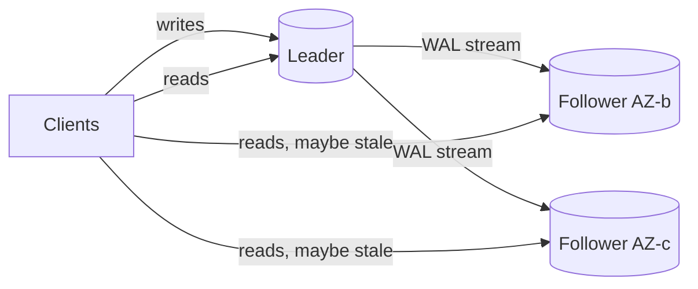
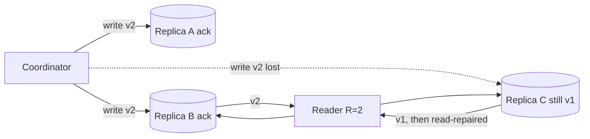
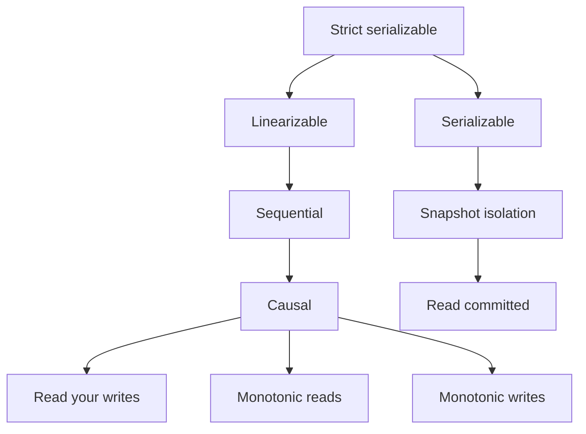

# 06 — Replication & consistency

> **The requirement.** Lumen's account and chat database runs in one region with three availability zones (AZs). The
> SLO says: lose **any one AZ** and (1) **no write that was acknowledged to a user is lost** (RPO = 0), (2) writes are
> unavailable for **less than 30 s** (RTO), and (3) a user who just sent a message **always sees it** when the page
> reloads, even if the read lands on another server. Three promises: durability, availability, and a consistency
> guarantee that sounds trivial and is not.

## In one minute

Replication means keeping copies of the same data on several machines, so that losing one machine loses no data and
stops no service, and so that reads can be served from more places. The difficulty is that copies are updated at
slightly different times. If you wait for every copy before saying "done", writes are slow and stop when a copy is
unreachable. If you do not wait, a copy can be behind, and a user can read a world in which their own message does not
exist yet. Every replication design picks a point on this line, and **consistency models** are the precise names for
what a reader is guaranteed to see. CAP is the famous, often misquoted, statement that during a network partition you
cannot have both the strongest consistency and full availability; PACELC adds the everyday version: even without a
partition, stronger consistency costs latency. Replication itself is easy; *failover* (deciding who is the leader now,
without ever having two) is where real systems lose data.

## Why this matters now

- **Multi-AZ is the default, and so are the trade-offs.** Managed databases offer synchronous standbys in another AZ
  with a checkbox; the latency of that checkbox and the behaviour when the standby is unreachable are design
  decisions, not defaults to accept unread.
- **Consistency claims are tested in public.** Jepsen's analyses repeatedly show databases violating the guarantees
  their documentation claims, especially around failover and isolation [16][17]. "Strongly consistent" in a data sheet
  is a hypothesis to check.
- **CRDTs left the lab.** Conflict-free replicated data types (Shapiro et al., 2011 [11]) underpin local-first and
  collaborative editing software, where every device is a replica that accepts writes offline [18].
- **Globally consistent databases are products** (Spanner, CockroachDB, Aurora DSQL multi-Region; see
  [SYSDESIGN-05](05-choosing-storage.md)), which moves the question from "is it possible?" to "is the latency worth
  it for this data?".

## Core ideas [Core]

### Why replicate, and what replication cannot do

Replication buys **durability** (a disk or machine dies, the data survives), **availability** (another copy serves
when one is down), **read scale** (spread reads over replicas) and **latency** (a copy near the user). It does *not*
protect against bad writes: a `DELETE` without `WHERE` replicates faithfully to every copy within milliseconds. Backups
and point-in-time recovery are a separate requirement ([SYSDESIGN-11](11-reliability-engineering.md)).

### Single-leader (primary / replica)

One node, the **leader** (primary), accepts all writes and streams a **replication log** to **followers**
(replicas, standbys), which apply it in the same order. Reads may go to the leader (fresh) or followers (possibly
stale). PostgreSQL's physical streaming replication ships WAL records; MySQL ships its binary log; logical
replication ships row changes (useful across versions and for change data capture, [SYSDESIGN-20](../02-modern-requirements/20-real-time-streaming.md)).

*Diagram: clients send all writes to the leader, which streams its write-ahead log to followers in two other zones;
reads go to the leader for freshness or to followers, which may be behind.*

**When does the leader say "committed"?** This is the durability/latency knob. PostgreSQL exposes it as
`synchronous_commit` together with `synchronous_standby_names` [1]:

| Setting | Commit returns after | Lose on leader crash | Latency added |
|---|---|---|---|
| `off` | WAL in memory (flushed shortly after) | last few hundred ms of commits | none |
| `local` | WAL flushed on the leader | everything not yet on a standby (async) | none |
| `remote_write` | standby has *written* WAL to its OS | only if standby's OS also crashes | one round trip |
| `on` (with sync standby) | standby has *flushed* WAL to disk | nothing acknowledged | round trip + standby fsync |
| `remote_apply` | standby has *applied* WAL (visible to reads) | nothing; and reads on that standby see it | + apply time |

Requirement (1), RPO = 0 across an AZ loss, needs at least one synchronous standby in another AZ (`on` or stronger).
Requirement (3) can be met with `remote_apply` (any read on that standby sees the write) or by routing a user's
reads to the leader. The price of synchronous replication is two-sided: every commit pays a round trip to the standby, and **if the
synchronous standby disappears, commits wait** (block) until it returns or an operator or HA tool changes the
configuration. Lab L06 shows the second cost directly: with the standby stopped, a commit did not return within 5 s,
and it completed only when the synchronous requirement was lifted. (The first cost is invisible on a laptop, where the
"other AZ" is microseconds away; the lab README explains how to add network delay.) Synchronous replication converts "possible data loss" into "possible
unavailability". Quorum commit (`ANY 1 (s1, s2)`) over two standbys in two AZs removes that single point: any one
standby acknowledging is enough.

### Replication lag and its anomalies

With asynchronous followers, a follower is some milliseconds (normally) or minutes (under load, after a network blip,
during a long replay) behind. Three anomalies follow, each with a session guarantee that prevents it (Terry et al.,
1994 [8]):

| Anomaly | What the user sees | Guarantee that prevents it | Typical fix |
|---|---|---|---|
| Missing own write | sends a message, reloads, it is gone | **Read-your-writes** | read own data from the leader for a while; or wait until the replica's replay position ≥ the write's LSN |
| Time going backwards | refreshes twice: message appears, then disappears | **Monotonic reads** | pin a user's session to one replica (sticky), or carry a "min LSN seen" token |
| Effect before cause | sees a reply before the question | **Consistent prefix** (causal order) | write causally related data to the same partition/leader; causal tokens |

The robust version of the read-your-writes fix is a **position token**: on write, return the commit's log position
(PostgreSQL: `pg_current_wal_lsn()`), keep it in the session, and on read pick a replica whose
`pg_last_wal_replay_lsn()` is at least that value, or fall back to the leader. Time-based rules ("read from the leader
for 10 s after a write") work until lag exceeds 10 s, which is exactly when you most need them to work.

### Multi-leader

Several nodes accept writes (typically one per region, or every offline device) and replicate to each other
asynchronously. Wins: local write latency in every region; writes continue during inter-region partitions; offline
clients. Cost: **write conflicts**: two leaders accept different updates to the same item concurrently, and the system
must converge. Options:

- **Last writer wins (LWW)**: attach a timestamp, keep the largest. Simple, and silently discards concurrent writes;
  with skewed clocks it can discard the *later* write ([SYSDESIGN-09](09-coordination-consensus.md) on clocks).
- **Detect and keep siblings**: track causality with version vectors, return all concurrent versions, let the
  application merge (Dynamo's shopping cart merged conflicting versions, so an "add to cart" was never lost but
  deleted items could resurface [3]).
- **Merge by construction**: CRDTs (Deep dive).
- **Avoid conflicts**: route all writes for one item to one "home" leader (per-user home region), turning
  multi-leader into "single-leader per key".

### Leaderless replication and quorums (Dynamo-style)

In the leaderless design of Amazon's Dynamo (DeCandia et al., SOSP 2007 [3]), any of the `N` replicas of a key can
accept a write. A coordinator sends each write to all `N` and waits for `W` acknowledgements; a read asks replicas
and waits for `R` replies, returning the newest version (and repairing stale replicas it saw, *read repair*).
If `R + W > N`, every read quorum overlaps every write quorum in at least one replica, so a read normally sees the
latest acknowledged write. Dynamo's "common (N, R, W) configuration" was (3, 2, 2) [3].

*Diagram: with N = 3 and W = 2 a write reaches replicas A and B but not C; a read with R = 2 asks B and C, gets v2 and
v1, returns v2 because the quorums overlap at B, and repairs C.*

Dynamo's other mechanisms handle failure without a leader [3]: **sloppy quorums** (if a home replica is down, write to
the next healthy node on the ring), **hinted handoff** (that node keeps the write with a hint and hands it back later),
**Merkle-tree anti-entropy** (replicas compare hash trees per key range to find and sync differences cheaply), and
**vector clocks** to detect concurrent versions. Dynamo reported that during a 24-hour profile of the shopping cart service, 99.94 %
of requests saw exactly one version [3]. Its SLA was stated at the 99.9th percentile (for example, a response within
300 ms for 99.9 % of requests) [3], an early, influential example of tail-latency SLOs.

Quorums are **not** linearizability. Even with `R + W > N`, sloppy quorums break the overlap (the `W` nodes may not
be among the "home" `N`), concurrent reads during a write can see the new value then the old one, and a failed write
that reached fewer than `W` nodes is neither committed nor rolled back. Abadi notes that Dynamo-style systems "cannot
achieve full consistency as defined by Gilbert and Lynch, even if R + W > N" [6]. Cassandra, ScyllaDB and Riak follow
this family; Cassandra exposes the knobs as consistency levels (`ONE`, `QUORUM`, `LOCAL_QUORUM`, `ALL`).

## Numbers that matter

**Synchronous replication latency.** A commit at `synchronous_commit = on` costs roughly: leader WAL fsync +
network RTT to the standby + standby fsync. Assume (A) intra-region inter-AZ RTT ≈ 1 ms and NVMe fsync ≈ 0.1–1 ms:
commit latency rises from about 1 ms to about 2–3 ms. For a user-facing write that is invisible; for a batch job doing
10,000 sequential single-row commits it is 10–20 extra seconds (batch them).

**Cross-region physics.** Light in fibre travels about 200,000 km/s, i.e. ~5 µs per km. A Frankfurt–Virginia
fibre path of roughly 7,000 km (A) gives ≥ 35 ms one way, ≥ 70 ms round trip, before any queueing or routing detours.
A synchronous cross-region commit therefore costs at least ~70 ms, and a consensus write that needs a majority
across three continents pays the RTT to the *second-closest* region. This is the arithmetic behind PACELC's "else
latency".

**Quorum availability.** If each replica is independently unavailable with probability `p = 0.01` (A), a write quorum
of 2 of 3 is available with probability `1 − [3p²(1 − p) + p³]` ≈ 1 − 0.000298 ≈ **99.97 %**, versus 99 % for a single
replica and ≈ 97.0 % for "all 3 must ack" (`(1 − p)³`). Correlated failures (one AZ hosting two replicas) destroy this
math, which is why placement across failure domains matters more than replica count.

**Lag under load.** Async lag ≈ bytes of WAL not yet replayed ÷ replay rate. On a laptop with an idle network it is
milliseconds; a replica replaying a large index build or blocked by a long query on the standby can fall minutes
behind. In lab L06, an artificial 2 s apply delay made a freshly inserted row invisible on the replica for about 2 s,
and `pg_stat_replication.replay_lag` reported the same delay (see the [lab README](../../labs/06-replication-consistency/README.md)
for the recorded output).

**Meeting Lumen's requirement.** RPO = 0 → one synchronous standby (quorum `ANY 1` of two, in two other AZs);
RTO < 30 s → automated failover by an HA manager that uses consensus to elect and fence (Deep dive);
read-your-writes → position tokens, with leader fallback.

## Design choices and trade-offs

| Topology | Wins when | Costs | Example systems |
|---|---|---|---|
| Single-leader, async followers | read scaling, simple ops | failover can lose recent writes; lag anomalies | PostgreSQL/MySQL replicas (default async) |
| Single-leader, sync / quorum standby | RPO = 0 within a region | commit latency; stalls if sync standbys are unavailable | PostgreSQL `synchronous_standby_names`, managed multi-AZ |
| Consensus-replicated log (Raft/Paxos) | automatic, safe leader election; RPO = 0 | majority round trip per write; ≥ 3 nodes | etcd, CockroachDB/TiKV ranges, Spanner, Neon safekeepers |
| Multi-leader | multi-region local writes, offline clients | conflicts and their resolution logic | CouchDB, active-active setups, local-first apps |
| Leaderless quorums | high write availability, no failover step | eventual consistency; repair machinery; not linearizable | Dynamo, Cassandra, ScyllaDB, Riak |

| Consistency choice | What readers get | Costs |
|---|---|---|
| Linearizable reads | latest committed value, always | read from leader/quorum (or leases); unavailable in a minority partition |
| Read-your-writes + monotonic reads | own writes visible, no time travel | session tokens or stickiness; mostly cheap |
| Causal | effects never before causes, across users | dependency metadata |
| Eventual | convergence "eventually", no ordering promise | cheapest; bugs surface as user confusion |

## CAP, precisely

**The statement.** Brewer conjectured in 2000 that a networked shared-data system cannot simultaneously guarantee
consistency, availability and partition tolerance [4]. Gilbert and Lynch proved a precise version in 2002 [5]: in an
asynchronous network model where messages can be lost, it is impossible to implement a read/write data object that
guarantees both **atomic (linearizable) consistency** and **availability**, where availability means *every request
received by a non-failing node must result in a response*.

**What it means in practice.** When the network partitions, a node that cannot reach its peers must either answer
(and risk returning stale data or accepting conflicting writes: **availability**) or refuse/wait (to preserve
linearizability: **consistency**). That is all.

**Misreadings to correct in interviews:**

1. *"Pick two of three."* Partitions are not optional in a distributed system; the real choice is what to do *during*
   one. Brewer himself called "2 of 3" misleading in his 2012 retrospective [7].
2. *"C means ACID consistency."* CAP's C is linearizability of a single object, not constraint preservation or
   serializable transactions.
3. *"A means high availability."* CAP's A is *every* non-failing node answering *every* request. A CP system that
   stays up on the majority side of a partition is still "highly available" in the SLO sense: Raft-based systems
   answer from the majority and refuse in the minority.
4. *"CAP describes normal operation."* It says nothing when there is no partition. Latency vs consistency, the
   everyday trade-off, is not in CAP at all (hence PACELC).
5. *"System X is CP" / "System Y is AP."* Most real systems offer neither guarantee in CAP's strict sense under all
   configurations, and many are tunable per request. Kleppmann argued for retiring the labels in favour of naming
   the consistency model and the failure behaviour [9].

**PACELC** (Abadi, 2012 [6]): **if** there is a **P**artition, trade **A**vailability against **C**onsistency;
**E**lse (normal operation), trade **L**atency against **C**onsistency. Abadi's own classifications: default Dynamo,
Cassandra and Riak are PA/EL; fully ACID systems such as VoltDB/H-Store and Megastore are PC/EC (as are BigTable and
HBase); PNUTS is PC/EL; MongoDB (in 2012) PA/EC [6]. The ELC half is the one you face every day: a synchronous standby,
a quorum read and a cross-region consensus write are all "pay latency for consistency".

## Consistency models

A **consistency model** is a contract about which values a read may return, given the history of writes. From
strongest to weakest for single objects (the hierarchy follows the Jepsen consistency map [10]):

- **Linearizable** (Herlihy and Wing, 1990 [12]): every operation appears to take effect atomically at one instant
  between its invocation and its response, and that order respects real time. "Behaves like a single copy." Needed for
  leader election, locks, uniqueness constraints, and "has this payment been processed?" checks.
- **Sequential** (Lamport, 1979 [13]): all processes see operations in one total order consistent with each process's
  own program order, but not necessarily with real time.
- **Causal**: operations that are causally related (I read your message, then reply) are seen by everyone in that
  order; concurrent operations may be seen in different orders.
- **Session guarantees** (Terry et al. [8]): read-your-writes, monotonic reads, monotonic writes, writes-follow-reads.
  Causal consistency implies all four.
- **Eventual**: if writes stop, replicas converge. No promise about what you read meanwhile.

For multi-object transactions the parallel ladder is serializable / snapshot isolation / read committed
([SYSDESIGN-05](05-choosing-storage.md)); **strict serializability** = serializable + real-time order, the
transactional analogue of linearizability (Spanner's external consistency [14]).

**Availability limits.** The Jepsen map records which models can be offered by every replica during a partition:
models at or stronger than sequential (and snapshot isolation, cursor stability) **cannot be totally available**;
causal and read-your-writes can be at most **sticky available** (available if a client keeps talking to the same
replica); weaker models (monotonic reads, monotonic writes, read committed) can be totally available [10]. This
is the practical, fine-grained version of CAP: Lumen's requirement (3), read-your-writes, does *not* require a
linearizable database, only session stickiness or position tokens.

*Diagram: strict serializable implies both linearizable and serializable; linearizable implies sequential, which
implies causal, which implies read-your-writes, monotonic reads and monotonic writes; serializable implies snapshot
isolation, which implies read committed.*

## Deep dive [Deep]

### Version vectors and concurrent writes

To merge replicas you must know whether two versions are *ordered* (one saw the other) or *concurrent* (neither did).
A **version vector** holds one counter per replica; version `a` happened before `b` if every counter in `a` is ≤ the
corresponding counter in `b` and at least one is smaller. If neither dominates, the writes are concurrent and both
must be kept or merged. Dynamo attached such vector clocks to each object and truncated them when they grew past a
threshold [3]. **Last-writer-wins** replaces this with one timestamp and is equivalent to declaring every concurrent
write except one lost.

### CRDTs: replicas that merge themselves

Shapiro, Preguiça, Baquero and Zawirski defined **conflict-free replicated data types** [11]: data types whose
replicas can be updated independently, without coordination, and are guaranteed to converge once they have received
the same updates (*strong eventual consistency*). Two equivalent styles:

- **State-based (CvRDT)**: replicas exchange full state and merge with a function that is commutative, associative and
  idempotent (a join in a semilattice), so order, duplication and redelivery do not matter.
- **Operation-based (CmRDT)**: replicas broadcast operations that commute, delivered reliably in causal order.

| CRDT | State | Merge | Use |
|---|---|---|---|
| G-Counter | one counter per replica | element-wise max; value = sum | likes, views |
| PN-Counter | two G-Counters (incr, decr) | merge each; value = P − N | stock adjustments (without a floor) |
| LWW-Register | (value, timestamp) | keep the larger timestamp | profile fields where losing a concurrent write is fine |
| OR-Set (observed-remove) | elements tagged with unique ids, plus removed tags | union of adds minus observed removes | carts, tags, membership: concurrent add wins over remove |
| Sequence CRDTs (RGA and others) | elements with unique ordered ids | interleave by ids | collaborative text editing |

Example: Lumen's "reactions" counter on a message, incremented in three regions. As a G-Counter each region increments
only its own slot: `{eu: 5, us: 3, ap: 1}`. Merging `{eu: 5, us: 3, ap: 1}` with `{eu: 4, us: 4, ap: 1}` gives
`{eu: 5, us: 4, ap: 1}` = 10 reactions, no matter in which order or how many times states are exchanged.

**The limit of CRDTs.** They converge, but they cannot enforce an invariant that needs global knowledge: "balance never
negative", "at most 10 seats", "username unique". Two replicas each see room for one more and each accept. Such
invariants need coordination (a single leader for that item, a consensus decision, or escrow: pre-allocating quotas
to replicas). CRDT metadata (per-replica counters, tombstones for removed elements) also grows and must be garbage
collected, which itself needs some coordination.

### Failover: where data is actually lost

Failover is a sequence: **detect** the leader is gone (missed heartbeats beyond a timeout), **choose** a new leader
(most up-to-date replica), **reconfigure** clients and other replicas, and **fence** the old leader so it can never
accept writes again. Each step has a classic failure:

- **Timeouts are guesses.** Too short and a GC pause or a congested link triggers a needless failover; too long and RTO
  suffers. A slow leader is indistinguishable from a dead one.
- **Async replication + failover = lost writes.** If the new leader was behind, the acknowledged writes it never
  received are gone (or, worse, resurface later and conflict). With RPO = 0 this is why the promoted standby must be a
  synchronous one.
- **Split brain.** If the old leader is alive but partitioned, and comes back without being fenced, two nodes accept
  writes. Lab L06 reproduces this: the stopped primary is restarted after the replica was promoted and both accept
  inserts. In the recorded run the old primary issued id 4 while the new one issued id 35 (PostgreSQL WAL-logs sequence
  values 32 ahead, so the replica inherited a higher starting point); the id ranges would collide after about 30 more
  inserts on the old primary, and the histories have already diverged.
- **Fencing** prevents it: STONITH ("shoot the other node in the head", e.g. power off via the hypervisor), revoking
  the old leader's network access or storage, or **fencing tokens**: every leadership term gets a monotonically
  increasing number, and storage rejects writes carrying an older term ([SYSDESIGN-09](09-coordination-consensus.md)).
- **The decision must itself be consensus.** HA managers such as Patroni (using etcd, Consul, ZooKeeper or Kubernetes
  as a distributed configuration store) [15] or Orchestrator (MySQL, with a Raft mode) exist to make "who is leader" a
  linearizable decision rather than a race between scripts.

**A public postmortem.** On 2018-10-21 a 43-second loss of connectivity between GitHub's US East Coast network hub
and its primary data centre led its MySQL failover tooling to promote primaries in the West Coast data centre; when
connectivity returned, both sites held writes the other lacked, so the original primaries could not safely be failed
back, and GitHub chose data integrity over availability, accepting 24 hours and 11 minutes of degraded service while it
reconciled [19]. The lesson is not "automation is bad"; it is that failover across failure domains with different
latency, and with writes accepted on both sides, is a consistency decision that must be designed, not inherited.

### Replicated logs and consensus, in one paragraph

Single-leader replication plus *safe* failover is, in the end, the problem of agreeing on one ordered log of writes
despite crashes: consensus. Raft and Multi-Paxos implement exactly that: a leader appends entries, an entry is
committed once a majority has it, and a new leader can only be elected by a majority that includes every committed
entry. This gives RPO = 0 and automatic failover by construction, at the price of a majority round trip per write.
Mechanics in [SYSDESIGN-09](09-coordination-consensus.md).

## Frontier [Frontier]

*(as of 2026-11)*

- **Local-first software** treats every device as a full replica that works offline and syncs via CRDTs, inverting the
  usual "server is the source of truth" model [18]. Open-source CRDT libraries (Automerge, Yjs and others) are used in
  production collaborative editors; the open problems are metadata size, schema evolution and authorisation on
  replicas you do not control.
- **Quantifying "eventual".** Probabilistically bounded staleness (PBS) models how stale a quorum read is likely to
  be for given N, R, W and latency distributions, turning "eventually consistent" into statements such as "99.9 % of reads are consistent 1.85 ms after
  the write" (one production latency profile on SSDs, against 45.5 ms on spinning disks) [20]. It is a good tool for arguing about R/W settings with numbers.
- **Strongly consistent multi-region as a service.** Spanner, CockroachDB and Aurora DSQL multi-Region clusters offer
  strong consistency across regions; the latency of a cross-region quorum (tens of ms, by the physics above) is now a
  pricing and placement question rather than an engineering project. Keep strongly consistent cross-region writes for
  data that needs them (balances, uniqueness) and replicate the rest asynchronously
  ([SYSDESIGN-15](../02-modern-requirements/15-multi-region-edge.md)).
- **Testing as a design activity.** Property-based fault-injection testing in the Jepsen style (and checkers such as
  Elle for transactional histories [17]) is increasingly run by vendors and users before adopting a database. If a
  guarantee matters, budget time to test it.

## Failure modes and operations

| Failure | Symptom | SLI / detection | Mitigation |
|---|---|---|---|
| Replication lag | users miss own writes; stale dashboards | `replay_lag`, bytes behind (`pg_wal_lsn_diff`) | position tokens; alert on lag; throttle heavy jobs |
| Sync standby down | writes hang | commit latency; waiting backends | quorum commit over ≥ 2 standbys; HA tool reconfigures |
| Failover loses writes | rows acknowledged then missing | reconcile counters; audit gaps | promote only sync/most-advanced replica; RPO = 0 config |
| Split brain | two writable leaders; duplicate ids | more than one node reporting `pg_is_in_recovery() = false` | fencing (STONITH, tokens), consensus-based HA |
| Inactive replication slot | primary disk fills with retained WAL | slot `restart_lsn` age; disk usage | `max_slot_wal_keep_size`; drop dead slots [1] |
| Divergent replicas (leaderless) | different answers from different replicas | read-repair rate; Merkle diff size | repair schedule; consistency level `QUORUM` |
| Conflict storms (multi-leader) | many siblings / overwritten data | conflict counters | home-region routing; CRDTs; smaller conflict domains |
| Cold standby after failover | slow queries post-promotion | p99 after failover | read traffic on standby to keep caches warm; pre-warm |

Practise failover. A failover path that runs once a year in an incident is untested code on the critical path; run it
in game days, measure RTO, and verify RPO by reconciling write counters before and after.

## Cost and energy

Replication multiplies **storage** by the replication factor (3× is common) and adds **network transfer** (in many
clouds, cross-AZ and cross-region transfer is billed per GB; check your provider's price list) and **compute** for
replicas. Synchronous replicas that only serve as failover targets are idle capacity; letting them serve reads (with
the staleness rules above) recovers some value. For energy, every extra replica is an always-on machine: choose the
replication factor from the durability and availability requirements, not by habit, and prefer erasure coding over
replication for cold, immutable data, where it gives similar durability at a fraction of the bytes
([SYSDESIGN-13](13-data-at-scale.md), [SYSDESIGN-17](../02-modern-requirements/17-energy-carbon-aware.md)).

## Interview angle

Replication shows up in every design ("how does the database survive a failure?") and as direct theory questions
("explain CAP").

- **CLARIFY** the RPO/RTO and which reads must be fresh (often only the user's own data).
- **QUANTIFY** the latency budget for writes; cross-AZ vs cross-region RTT decides whether synchronous is affordable.
- **SKETCH** a leader with a synchronous standby in another AZ and async read replicas.
- **DEEPEN** on read-your-writes (position tokens) or failover and fencing.
- **STRESS**: partition between AZs; standby down; the old leader comes back (split brain).
- **WRAP** naming the consistency model you provide per data type ("linearizable for balances via the leader,
  read-your-writes for chat, eventual for counters").

**Model answer outline.** (1) Postgres leader in AZ-a, two standbys in AZ-b and AZ-c, `synchronous_standby_names =
'ANY 1 (b, c)'` → RPO 0, one RTT per commit. (2) Patroni + etcd for election and fencing → RTO in seconds. (3) Reads
of other people's data from replicas; own writes via LSN token or leader. (4) CAP: on an AZ partition the minority side
refuses writes; we prefer that to divergence for chat and billing. (5) Counters (reactions) as CRDTs if we go
multi-region.

**Red flags.** "We'll use CAP and pick AP" without saying what happens to writes; quorums described as linearizable;
LWW for money; failover without fencing; synchronous replication without saying what happens when the standby dies.

**Follow-ups.** What happens if the synchronous standby is down? How does a client know a replica is fresh enough?
Why is R + W > N not enough for linearizability? Give an invariant a CRDT cannot maintain. How do you prevent split
brain?

## Common mistakes

- Treating replication as backup.
- Reading your own writes from an async replica and calling the bug "eventual consistency".
- Time-based staleness rules ("read leader for 5 s") instead of position-based ones.
- Assuming `R + W > N` gives linearizability; ignoring sloppy quorums.
- Using wall-clock last-writer-wins across machines with unsynchronised clocks.
- Automatic failover without fencing the old leader.
- Placing two of three replicas in the same failure domain.
- Saying a system "is CP" without naming the model, the operations and the failure behaviour.

## Check yourself

1. Which `synchronous_commit` level gives RPO = 0 for a single-AZ loss, and what is its availability cost?
2. A user sends a chat message and reloads; the page is served by an async replica. Name the anomaly and two fixes.
3. With N = 5, which (R, W) pairs give overlapping quorums? Which is best for a write-heavy workload?
4. State CAP precisely, with Gilbert and Lynch's definitions of C and A.
5. Why can a G-Counter merge in any order, and why can't a CRDT enforce "at most 10 seats"?

Full exercises with answers: [exercises/06-replication-consistency.md](../../exercises/06-replication-consistency.md).

## Lab

**[L06 — Replication lag, synchronous commit and failover](../../labs/06-replication-consistency/README.md).** A
PostgreSQL 18 primary and a streaming replica in Docker Compose. You will make a read-your-writes violation visible
with an apply delay, sample natural lag under `pgbench` load, compare commit throughput across `synchronous_commit`
levels, watch a synchronous commit block when the standby disappears, promote the replica, and then create a split
brain by restarting the old primary unfenced.

## Further reading

- DeCandia et al., *Dynamo* (SOSP 2007) [3]: quorums, sloppy quorums, hinted handoff, vector clocks, Merkle trees.
- Gilbert and Lynch, *Brewer's Conjecture…* (2002) [5] and Brewer, *CAP Twelve Years Later* (2012) [7]: the theorem and
  its author's own corrections.
- Abadi, *Consistency Tradeoffs in Modern Distributed Database System Design* (2012) [6]: PACELC.
- Jepsen, *Consistency Models* map [10]: definitions and availability classes in one place.
- Shapiro et al., *Conflict-free Replicated Data Types* (SSS 2011) [11].
- Terry et al., *Session Guarantees for Weakly Consistent Replicated Data* (1994) [8].
- GitHub, *October 21 post-incident analysis* (2018) [19]: failover across sites, told by the people who ran it.

## References

1. PostgreSQL 18 documentation, "19.5 Write Ahead Log" (synchronous_commit), "19.6 Replication" (synchronous_standby_names, max_slot_wal_keep_size) and "26.2 Log-Shipping Standby Servers." https://www.postgresql.org/docs/18/runtime-config-wal.html, https://www.postgresql.org/docs/18/runtime-config-replication.html and https://www.postgresql.org/docs/18/warm-standby.html (accessed 2026-11)
2. PostgreSQL 18 documentation, "27.2 The Cumulative Statistics System — pg_stat_replication." https://www.postgresql.org/docs/18/monitoring-stats.html (accessed 2026-11)
3. G. DeCandia et al., "Dynamo: Amazon's Highly Available Key-value Store," SOSP 2007. https://www.allthingsdistributed.com/files/amazon-dynamo-sosp2007.pdf (accessed 2026-11)
4. E. Brewer, "Towards Robust Distributed Systems," PODC 2000 keynote. https://people.eecs.berkeley.edu/~brewer/cs262b-2004/PODC-keynote.pdf (accessed 2026-11)
5. S. Gilbert, N. Lynch, "Brewer's Conjecture and the Feasibility of Consistent, Available, Partition-Tolerant Web Services," ACM SIGACT News 33(2), pp. 51–59, 2002. https://doi.org/10.1145/564585.564601 (accessed 2026-11)
6. D. Abadi, "Consistency Tradeoffs in Modern Distributed Database System Design: CAP Is Only Part of the Story," IEEE Computer 45(2), pp. 37–42, 2012. https://doi.org/10.1109/MC.2012.33; author copy https://www.cs.umd.edu/~abadi/papers/abadi-pacelc.pdf (accessed 2026-11)
7. E. Brewer, "CAP Twelve Years Later: How the 'Rules' Have Changed," IEEE Computer 45(2), pp. 23–29, 2012. https://doi.org/10.1109/MC.2012.37 (accessed 2026-11)
8. D. Terry, A. Demers, K. Petersen, M. Spreitzer, M. Theimer, B. Welch, "Session Guarantees for Weakly Consistent Replicated Data," Proc. 3rd Int. Conf. on Parallel and Distributed Information Systems (PDIS), 1994, pp. 140–149. https://doi.org/10.1109/PDIS.1994.331722 (accessed 2026-11)
9. M. Kleppmann, "Please stop calling databases CP or AP," 2015-05-11. https://martin.kleppmann.com/2015/05/11/please-stop-calling-databases-cp-or-ap.html (accessed 2026-11)
10. Jepsen, "Consistency Models." https://jepsen.io/consistency/models (accessed 2026-11)
11. M. Shapiro, N. Preguiça, C. Baquero, M. Zawirski, "Conflict-free Replicated Data Types," SSS 2011, LNCS 6976, pp. 386–400. https://doi.org/10.1007/978-3-642-24550-3_29 (accessed 2026-11)
12. M. Herlihy, J. Wing, "Linearizability: A Correctness Condition for Concurrent Objects," ACM TOPLAS 12(3), pp. 463–492, 1990. https://doi.org/10.1145/78969.78972 (accessed 2026-11)
13. L. Lamport, "How to Make a Multiprocessor Computer That Correctly Executes Multiprocess Programs," IEEE Transactions on Computers C-28(9), pp. 690–691, 1979. https://doi.org/10.1109/TC.1979.1675439 (accessed 2026-11)
14. J. C. Corbett et al., "Spanner: Google's Globally-Distributed Database," OSDI 2012. https://www.usenix.org/conference/osdi12/technical-sessions/presentation/corbett (accessed 2026-11)
15. Patroni documentation. https://patroni.readthedocs.io/ (accessed 2026-11)
16. Jepsen, analyses index. https://jepsen.io/analyses (accessed 2026-11)
17. Jepsen, "MySQL 8.0.34," 2023-12-19 (uses the Elle checker). https://jepsen.io/analyses/mysql-8.0.34 (accessed 2026-11)
18. M. Kleppmann, A. Wiggins, P. van Hardenberg, M. McGranaghan, "Local-First Software: You Own Your Data, in Spite of the Cloud," Onward! 2019. https://www.inkandswitch.com/local-first/ (accessed 2026-11)
19. GitHub, "October 21 post-incident analysis," 2018-10-30. https://github.blog/2018-10-30-oct21-post-incident-analysis/ (accessed 2026-11)
20. P. Bailis, S. Venkataraman, M. Franklin, J. Hellerstein, I. Stoica, "Probabilistically Bounded Staleness for Practical Partial Quorums," PVLDB 5(8), pp. 776–787, 2012. https://vldb.org/pvldb/vol5/p776_peterbailis_vldb2012.pdf (accessed 2026-11)
