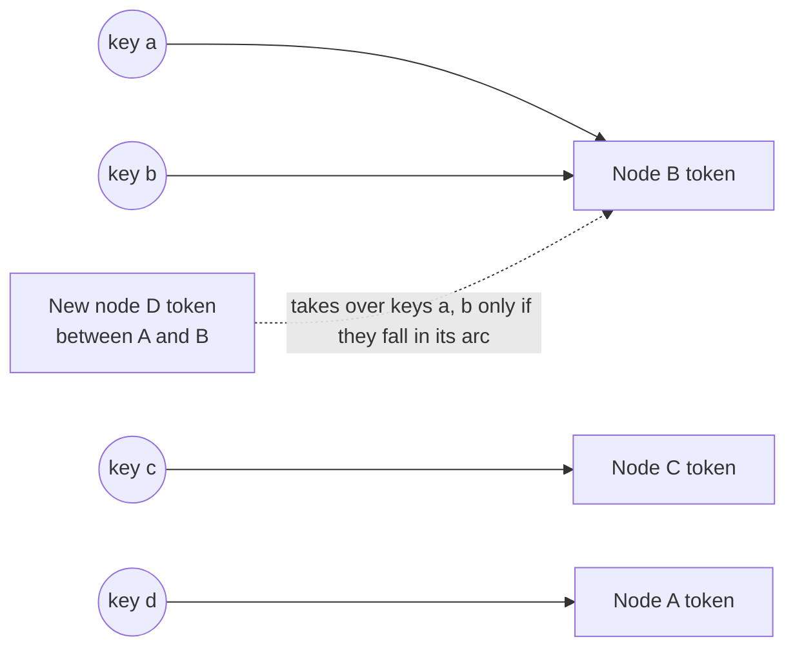
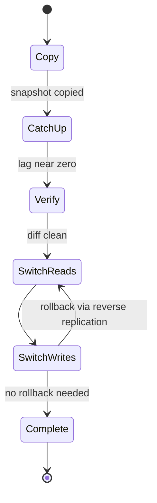

# 07 — Partitioning & sharding

> **The requirement.** Lumen's chat history (sized in [SYSDESIGN-05](05-choosing-storage.md)) is heading for
> **40 TB** and **20,000 writes/s** at peak. The plan is to start with **8 storage nodes** and grow to **64** without
> downtime. Product wants "the latest 50 messages of a conversation" to stay a **single-partition read**, and operations
> wants **no node above 1.25× the average load**, because the busiest node sets the cluster's capacity. One very large
> public community channel already produces a few hundred messages per second on its own.

## In one minute

When data or traffic no longer fits one machine, you split it: each **partition** (shard) holds a subset of the keys,
and each node holds some partitions. Two questions decide everything. **How do you map a key to a partition?** By
hashing the key (spreads load evenly, loses ordering) or by key ranges (keeps ordering, risks piling new keys on one
partition). **How do you move partitions when nodes come and go?** Naive `hash % n` reshuffles almost everything when
`n` changes; consistent hashing and its relatives move only the keys that must move. Then come the hard parts: a
single hot key that no hashing can spread, queries that are not by the partition key (secondary indexes), and moving
terabytes while the system serves traffic. Replication ([SYSDESIGN-06](06-replication-consistency.md)) and
partitioning are independent: every partition is usually also replicated.

## Why this matters now

- **Managed systems shard for you, until they don't.** DynamoDB, Spanner, CockroachDB and others split and move
  partitions automatically, yet each still has per-partition limits (DynamoDB documents 3,000 read units and 1,000 write
  units per second per partition [10]) and still punishes a bad partition key. Knowing the mechanics is how you choose
  the key.
- **Postgres and MySQL sharding layers matured.** Vitess (v24 as of 2026-11 [13]) and Citus (v14.3 [14]) turn MySQL and
  PostgreSQL into horizontally partitioned systems with online resharding workflows.
- **LLM serving reuses the idea.** Routing requests to the GPU replica that already holds their prompt prefix in its
  KV cache is consistent hashing with load bounds ([SYSDESIGN-22](../03-ai-systems/22-serving-llms-at-scale.md)), and
  the bounded-load variant [8] is exactly what such routers need.
- **Multi-tenant SaaS made tenant-based partitioning the default** for B2B products: co-locate a tenant's data for cheap
  joins, isolate noisy tenants, and place tenants by region for data residency
  ([SYSDESIGN-19](../02-modern-requirements/19-privacy-compliance-sovereignty.md)).

## Core ideas [Core]

### Partition key and partitioning scheme

The **partition key** is the attribute that decides placement. Choose it from the dominant access pattern: queries that
include the partition key go to one partition; queries that do not must ask all of them (*scatter-gather*). For chat,
"latest messages of conversation C" means the partition key is `conversation_id`.

| Scheme | Placement | Wins when | Costs | Examples |
|---|---|---|---|---|
| **Hash** | `hash(key)` → partition | point lookups, even load | range queries over the key become scatter-gather | Cassandra partitioner, DynamoDB, Redis Cluster slots |
| **Range** | sorted key ranges, one per partition | range scans, ordered iteration, prefix queries | monotonic keys (timestamps, sequences) hit one partition | Bigtable tablets [7], HBase regions, Spanner splits, CockroachDB ranges |
| **Compound** | hash on the first part, sort by the rest within the partition | "all items for X, ordered by time" | hot X still hot | Cassandra partition key + clustering columns; DynamoDB partition + sort key |
| **Directory / lookup** | a table maps key → partition | arbitrary placement (tenant moves, residency) | the directory is a dependency and a cache | Vitess lookup vindexes, tenant catalogues |

Lumen's chat table uses the **compound** pattern: partition by `hash(conversation_id)`, cluster by `created_at` inside
the partition. "Latest 50 messages" is one partition, read in order. "All messages from yesterday across all
conversations" is a scatter-gather, which is acceptable because it is an analytics query and belongs in the lakehouse
([SYSDESIGN-13](13-data-at-scale.md)).

### Why `hash % n` fails

With `partition = hash(key) mod n`, a key stays put when `n` grows to `n + 1` only if `hash mod n = hash mod (n+1)`,
which is true for about `1/(n+1)` of keys. So growing from 10 to 11 nodes moves about **10/11 ≈ 91 %** of all keys,
when only 1/11 ≈ 9 % *had* to move (to fill the new node). Lab L07 measures 90.9 % for modulo and about 9.1 % for each
consistent scheme on 100,000 keys.

### Consistent hashing

Karger et al. (1997) introduced consistent hashing for distributed web caches [1]: map both nodes and keys onto the
same circular hash space, and assign each key to the first node clockwise. Adding a node takes over only the arc
between it and its predecessor; removing one hands its arc to its successor. Keys elsewhere never move
(*monotonicity*), and the expected fraction that moves when a node joins is about 1/(n+1).

*Diagram: keys are assigned to the next node token clockwise on a ring; adding node D between A and B takes over only
the keys in the arc from A to D, previously owned by B, and no other key moves.*

**Virtual nodes.** With one token per node, arcs have very unequal lengths: lab L07 measures the busiest of 10 nodes at
**2.9× the mean** with one token per node. Giving each physical node many tokens (*virtual nodes*) averages this out:
the same run measures 1.44× with 8 tokens, 1.15× with 64 and 1.12× with 256. Virtual nodes also let a bigger machine
take more tokens and spread a failed node's load across many survivors instead of dumping it on one successor. Dynamo
lists exactly these advantages of virtual nodes [3]; Cassandra 4.0 defaults to 16 tokens per node (`num_tokens`) together with a
token-allocation algorithm that targets balance for a given replication factor [11].

### Rendezvous (highest random weight) hashing

Thaler and Ravishankar's **HRW** scheme (1998) [2]: for each key, compute `score = hash(node, key)` for every node and
pick the highest. All clients agree without coordination; when a node leaves, only its keys move (each to its
second-highest node); when one joins, it takes exactly the keys where it now scores highest. Balance is as good as
random assignment with no virtual nodes to tune (lab: max/mean 1.009 over 10 nodes), and picking the top `r` scores gives
`r` replica locations directly. Cost: **O(n) hashes per lookup**, fine for tens of nodes, wasteful for thousands
(hierarchical HRW or caching the result fixes that).

### Jump consistent hash

Lamping and Veach (2014) [4] give a few-line function that maps a 64-bit key to a bucket in `[0, n)` in O(log n) time
with **no memory** for a ring, and moves the minimum `1/(n+1)` of keys when `n` grows by one (lab: 9.08 %). The catch is
in the paper's own framing: buckets are *numbered*, so you can only add or remove the *last* bucket. That suits sharded
storage where shard ids are stable numbers and nodes are mapped to shards separately; it does not suit a cache
cluster where an arbitrary machine dies.

### Fixed partitions: decouple partitioning from placement

The scheme most production systems actually use is a two-level map: **key → one of P fixed partitions** (by hash),
then **partition → node** (by an assignment table). P is chosen much larger than the node count (for example 4,096
partitions for 8–64 nodes). Rebalancing moves whole partitions; the key → partition map never changes. Dynamo's
evolved "strategy 3" divided the hash space into Q equal partitions with Q/S tokens per node, precisely to decouple
partitioning from placement and make membership changes cheap [3]. Redis Cluster uses 16,384 hash slots [12];
Kafka topics have a partition count chosen at creation (it can be increased, which remaps keyed messages to
different partitions); Elasticsearch fixes an index's primary shard count at creation.
The cost: choose P too small and you cannot spread beyond P nodes; too large and per-partition overhead (files, Raft
groups, metadata) dominates.

## Numbers that matter

**Partition sizing.** 40 TB with 4,096 partitions → ~10 GB per partition. At 64 nodes, 64 partitions per node; at 8,
512. Moving one partition at a throttled 100 MB/s (A) takes ~100 s.

**Resize cost.** Growing from 8 to 9 nodes must move about 1/9 of the data: 40 TB / 9 ≈ **4.4 TB**. Throttled to 200 MB/s
of aggregate background copy (A, chosen to protect foreground latency), that is about 22,000 s ≈ **6 hours**. With
`hash % n` it would move ~8/9 ≈ 35.6 TB, about **2 days**, during which most keys live in the wrong place.

**Load per node.** 20,000 writes/s over 8 nodes = 2,500 writes/s per node on average; the requirement's 1.25× cap means
the busiest node must handle ≤ 3,125/s. With a single-token ring the busiest node could be ~3× average (lab) =
7,500/s: the design would need ~2.4× more capacity per node for the same traffic. Virtual nodes or fixed partitions are
not an optimisation here; they are the requirement.

**The hot conversation.** The large community channel writes 300 messages/s (A) into *one* partition key. No hash
function spreads a single key. If the storage engine sustains, say, 1,000 writes/s per partition (DynamoDB's documented
per-partition write limit is 1,000 write units/s for items up to 1 KB [10]), 300/s fits, but a viral event at 5× does
not. That calls for key salting (below).

**Scatter-gather tail.** A query that must ask all 64 partitions waits for the slowest. If each partition answers
within 10 ms with probability 99 % (A), all 64 do so with probability 0.99^64 ≈ 53 %: the fan-out query's median is
already in the single-partition tail. Partition-key-aligned queries are not a style preference; they are tail latency.

## Design choices and trade-offs

| Rebalancing approach | How it works | Wins when | Costs | Examples |
|---|---|---|---|---|
| Fixed P partitions, reassign | move whole partitions between nodes | predictable, simple metadata | P fixed up front | Redis Cluster, Kafka, Elasticsearch, Dynamo strategy 3 |
| Dynamic split/merge | split a range when too big or too hot; merge small ones | range-partitioned data of unknown distribution | split storms; metadata service | Bigtable, HBase, Spanner, CockroachDB (size- and load-based) |
| Tokens per node (vnodes) | each node owns many ring tokens | peer-to-peer clusters without a metadata master | streaming during joins; repair complexity | Cassandra, ScyllaDB, Riak |
| Directory | lookup table assigns each key or tenant | tenant moves, residency rules, uneven tenants | directory availability and caching | tenant catalogues, Vitess lookup vindexes |

| Request routing | How the client finds the partition | Costs | Examples |
|---|---|---|---|
| Smart client | client holds the partition map | map refresh on change; client libraries per language | Redis Cluster clients (`MOVED`/`ASK` redirects [12]), Cassandra drivers |
| Routing tier | proxies hold the map | an extra hop; the tier must scale | Vitess VTGate, MongoDB `mongos`, Citus coordinator |
| Any node forwards | contact any node; it forwards | extra hop inside the cluster | Cassandra coordinator, CockroachDB gateway |

Partition maps themselves usually live in a consensus store (ZooKeeper, etcd, or the system's own Raft group), because
"which node owns partition 17 now" must be agreed by everyone ([SYSDESIGN-09](09-coordination-consensus.md)).

## Deep dive [Deep]

### Secondary indexes: local vs global

Queries by anything other than the partition key need a secondary index, and partitioning forces a choice:

| | **Local** (document-partitioned) index | **Global** (term-partitioned) index |
|---|---|---|
| Where index entries live | with the rows they index, in the same partition | partitioned by the *indexed* value, independently |
| Write | one partition (cheap, can be synchronous) | the row's partition **and** the index partition(s): a distributed write |
| Read by indexed value | scatter-gather to all partitions | one (or few) partitions |
| Consistency | same as the row | usually **asynchronous**: DynamoDB updates GSIs "asynchronously, using an eventually consistent model" [15] |
| Examples | Cassandra secondary indexes, Elasticsearch per-shard indexes, DynamoDB LSIs | DynamoDB GSIs, Spanner and CockroachDB indexes (transactional, at write cost) |

For Lumen, "find messages by author" is rare and analytic: a local index (or none, served from the lakehouse) is
right. "Find conversation by invite code" is a point lookup on a different key: a small global index (or a separate
lookup table partitioned by invite code), accepting that a just-created invite might take a moment to be findable,
or writing it transactionally if the database supports it.

### Hot partitions and key salting

Skew has two causes: **uneven key frequency** (one celebrity, one viral channel, one huge tenant) and **unlucky
placement** (several warm keys on one node). Placement skew is solved by virtual nodes, fixed partitions or load-aware
rebalancing. Frequency skew is not: one key hashes to one place.

**Key salting (write sharding).** Append a suffix to the hot key: `channel:42#0 … channel:42#(S−1)`, choosing the suffix
at random or from a hash of something in the item (DynamoDB's guidance calls these random and calculated suffixes [10]).
Writes spread over S partitions. The bill comes on reads: "latest 50 messages of channel 42" must now read all S
sub-keys and merge by timestamp. So salt **only** the keys detected as hot, keep the salt count in metadata, and
prefer calculated suffixes when reads can target one sub-key.

In lab L07, with Zipf(1.1) request weights over 100,000 keys on 10 nodes, the hottest key alone carries 13.5 % of all
requests, more than the 10 % a perfectly even node would get; the busiest node sits at **1.93× the mean**. Salting the
10 hottest keys into 16 sub-keys each brings the busiest node to **1.19×**; salting into 64 did slightly worse (1.25×)
in the same run because the ring's own placement variance (64 vnodes) became the dominant term. Salting fixes frequency
skew; virtual nodes fix placement skew; you usually need both.

Other tools for hot keys: a cache in front (most hot keys are read-hot, [SYSDESIGN-04](04-caching.md)); load-based
splitting of a hot range into two (CockroachDB splits ranges on load as well as size [16]); and changing the data model
so the hot thing is not one row (append messages, do not update a "last message" field on the channel row).

### Monotonic keys and range partitioning

Range partitioning with keys that only grow (timestamps, auto-increment ids, UUIDv7) sends every new write to the last
range. Lab L07's range experiment sends 100 % of 100,000 new timestamp-keyed writes to one of 10 range partitions,
while a hash ring spreads them (busiest node 11.2 %). Remedies: prefix the key with something high-cardinality
(`conversation_id, timestamp` instead of `timestamp`); hash-shard the index (CockroachDB documents hash-sharded indexes for
sequential keys [18]); or accept it for append-only logs where one hot tail per partition is the design (Kafka partitions).
Note the tension with [SYSDESIGN-05](05-choosing-storage.md): time-ordered ids help B-tree locality on *one* node and
hurt range partitioning *across* nodes.

### Moving data while serving it: online resharding

Every online move follows the same shape, whatever the product:

1. **Create** the target partition(s) and start a **bulk copy** of a consistent snapshot.
2. **Stream changes** made since the snapshot (from the WAL/binlog/CDC) until the target is caught up.
3. **Verify** (row counts, checksums: Vitess runs VDiff before switching [13]).
4. **Switch reads**, then **switch writes**, with a brief write pause or buffering so no write is lost in flight
   (Vitess `SwitchTraffic` briefly stops writes on the source so replication catches up, and VTGate can buffer queries
   during the switch [13]).
5. Keep **reverse replication** running so you can roll back (Vitess `ReverseTraffic` [13]), then **complete** and
   delete the source.

*Diagram: an online reshard moves from copy to change catch-up, verification, switching reads, then switching writes;
from there it either completes or rolls back using reverse replication.*

Two things to plan explicitly: **throttling** (the copy competes with production I/O; rate-limit it and watch p99) and
**cross-partition operations during the move** (transactions spanning old and new owners; the system or the application
must route by the current map version).

### Distributed SQL: partitioning plus transactions

| System | Partition unit | Default partitioning | Replication | Cross-partition transactions |
|---|---|---|---|---|
| Spanner [5] | split (range) | range on primary key; interleaving co-locates child rows | Paxos group per split | 2PC across Paxos groups; TrueTime timestamps |
| CockroachDB [6] | range (default max 512 MiB [16]) | range on primary key; size- and load-based splits | Raft group per range; a leaseholder serves reads | serializable; distributed commit |
| Vitess [13] | shard (MySQL instance) | by keyspace id from a vindex (often hash) | MySQL replication | single-shard ACID; cross-shard by 2PC mode or avoided by design |
| Citus [14] | shard (Postgres table) | hash on a distribution column | Postgres replication / HA | coordinator-routed; co-located joins are local |

**Spanner's clocks.** Spanner gives externally consistent (strictly serializable) transactions across partitions by
assigning commit timestamps from **TrueTime**, an API returning an interval `[earliest, latest]` whose width the paper
reports as a sawtooth of roughly 1 to 7 ms in production; a transaction waits out the uncertainty ("commit wait")
before its effects become visible [5]. Physical clock uncertainty is paid for in latency, once per write.
[SYSDESIGN-09](09-coordination-consensus.md) covers clocks.

**Co-location is the design lever.** Citus documents placing "shards containing related rows of related tables
together on the same nodes" so joins run on one node [14]; Spanner's interleaved tables do the same. For a multi-tenant
SaaS, distribute every tenant-scoped table by `tenant_id` and almost every query becomes single-shard. Cross-shard
joins and transactions still work in these systems; they are simply the expensive path, and the schema should make
them rare.

## Frontier [Frontier]

*(as of 2026-11)*

- **Load-bounded consistent hashing in production routers.** Mirrokni, Thorup and Zadimoghaddam showed how to cap
  each node at `⌈c · m / n⌉` keys for a chosen `c = 1 + ε` by forwarding overflow to the next non-full node, with
  movement on membership change growing only by a factor of `O(1/ε²)` for `ε ≤ 1` [8]. This "affinity with a load cap"
  is what cache-aware request routers want, including LLM routers that prefer the replica holding a prompt's KV-cache
  prefix but must not overload it ([SYSDESIGN-22](../03-ai-systems/22-serving-llms-at-scale.md)).
- **Maglev-style lookup tables.** Google's Maglev load balancer builds a fixed-size lookup table with a
  permutation-based fill that gives near-perfect balance (backends' entry counts differ by at most one), deliberately
  favouring balance over minimal disruption while keeping disruption on backend changes small [9]; the pattern
  (precompute a big table, look up in O(1)) is common in L4 load balancers ([SYSDESIGN-03](03-scaling-compute.md)).
- **Sharding as a managed feature.** Serverless and distributed SQL services hide partitions entirely; the remaining
  design work is choosing keys that avoid hot spots (AWS's Aurora DSQL guidance is to "choose a random primary key" and
  avoid contention on single keys [17]) and keeping transactions single-partition where latency matters.
- **Tenant placement for sovereignty.** Directory-based partitioning by tenant and region is increasingly a compliance
  requirement, not only a performance one ([SYSDESIGN-19](../02-modern-requirements/19-privacy-compliance-sovereignty.md)).

## Failure modes and operations

| Failure | Symptom | Detect | Mitigate |
|---|---|---|---|
| Hot partition | one node saturated, others idle; throttling errors | per-partition QPS and CPU; top-key sampling | salting, split, cache, model change |
| Bad partition key | most queries scatter-gather | fraction of multi-partition queries; p99 of fan-out | re-key (a reshard), add a global index |
| Rebalance storm | latency spikes while data moves; cascading moves after a slow node is declared dead | bytes in flight; move queue | throttle; require human approval for large moves; longer failure-detection timeouts |
| Split storm | metadata service overloaded by rapid splits | split rate | split cooldowns, pre-splitting before bulk loads |
| Stale partition map | requests to the wrong node, redirects, errors | redirect rate (`MOVED`), routing errors | versioned maps, redirects with refresh |
| Resharding cutover loses writes | missing rows after switch | VDiff/checksums; reconcile counts | write pause/buffering at cutover, reverse replication for rollback |
| Fan-out amplification | one user request → N partition requests → tail latency | requests per query; p99 vs single-partition | partition-aligned queries, hedged requests, limit fan-out |
| Uneven tenant growth | one tenant outgrows a shard | per-tenant size and load | directory-based moves; give the whale its own shard |

Operational rule: **automatic rebalancing must be slower than failure detection is wrong**. A node that is merely slow,
declared dead, triggers moves that load the remaining nodes, which become slow, which triggers more moves. Rate-limit
rebalancing and keep a human in the loop for large moves.

## Cost and energy

Partitioning trades a single expensive big machine for many commodity ones; the cost lines that change are
**cross-partition traffic** (scatter-gather queries and distributed transactions cost network and CPU on every node),
**data movement** (every reshard copies terabytes; in the cloud, cross-AZ copies may be billed per GB), and
**imbalance** (you pay for the cluster sized by its *busiest* node: a 2× hot spot halves the useful capacity of every
other node). A balanced key design is therefore directly a cost and energy measure: fewer machines for the same peak,
less idle capacity drawing power ([SYSDESIGN-16](../02-modern-requirements/16-cost-as-requirement.md),
[SYSDESIGN-17](../02-modern-requirements/17-energy-carbon-aware.md)).

## Interview angle

"How would you shard this?" appears in almost every storage-heavy design (URL shortener, chat, feed, KV store; see
[C07](../04-case-studies/C07-distributed-kv-store.md)).

- **CLARIFY** the access patterns and which query must be single-partition.
- **QUANTIFY** data size, write rate and per-node capacity → number of nodes and partitions; compute resize cost.
- **SKETCH** the partition key (often compound: hash part + sort part), P fixed partitions, a routing tier or smart
  client, partition map in a consensus store.
- **DEEPEN** on consistent hashing / virtual nodes, or on the hot-key problem with salting.
- **STRESS**: add a node (what moves, how long), a celebrity key, a query by a non-key attribute (local vs global
  index), a reshard without downtime.
- **WRAP** with the trade-off: which queries became scatter-gather, and why that is acceptable.

**Model answer outline.** (1) Partition key `conversation_id`, clustering by `created_at` → latest messages are one
partition. (2) 4,096 hash partitions mapped to nodes by a metadata service; adding a node moves ~1/(n+1) of the data
partition by partition, throttled. (3) Hot channels detected by sampling and salted into S buckets; reads merge S
sub-keys. (4) Author lookups via async global index or the lakehouse. (5) Online reshard by copy → catch-up → verify →
switch with reverse replication.

**Red flags.** `hash % n` with no plan for growth; sharding before measuring that one node is insufficient; partition key
chosen from the entity id when every query is by another attribute; ignoring the hot key; "just add a node" without data
movement time.

**Follow-ups.** Why virtual nodes? Consistent vs rendezvous hashing? How do you shard a table with a monotonically
increasing key? What changes with a global secondary index? How does Redis Cluster route a key?

## Common mistakes

- Choosing the partition key before writing down the queries.
- Range-partitioning on a timestamp or sequence id and wondering why one node is hot.
- Using `hash % n` (or `hash % number_of_servers` in client code) for anything that will be resized.
- Too few fixed partitions to ever scale past them, or so many that per-partition overhead dominates.
- Salting every key "to be safe", making every read a fan-out.
- Global secondary indexes treated as strongly consistent when they are asynchronous.
- Automatic rebalancing with aggressive failure detection, creating rebalance storms.
- Sharding prematurely: a single well-tuned PostgreSQL node handles a great deal; partition when numbers say so.

## Check yourself

1. Growing a modulo-sharded cache from 4 to 5 nodes, roughly what fraction of keys move? With consistent hashing?
2. Why do virtual nodes improve balance, and what else do they buy when a node fails?
3. When would you choose jump hash over a ring, and when can you not use it?
4. A table is range-partitioned by `created_at`. What goes wrong at high insert rates, and give two fixes.
5. Compare the write path of a local and a global secondary index.

Full exercises with answers: [exercises/07-partitioning-sharding.md](../../exercises/07-partitioning-sharding.md).

## Lab

**[L07 — Consistent hashing and rebalancing, simulated](../../labs/07-partitioning-sharding/README.md).** A
dependency-free Python script (standard library only) implements modulo, ring with virtual nodes, rendezvous and jump
hashing, and measures key movement on resize, load balance versus virtual-node count, the effect of salting hot keys
under a Zipf workload, and range versus hash partitioning for monotonically increasing keys. Unit tests check the
monotonicity property.

## Further reading

- Karger et al., *Consistent Hashing and Random Trees* (STOC 1997) [1]: the original.
- DeCandia et al., *Dynamo* (SOSP 2007) [3], §4.2 and §6.2: virtual nodes and the three partitioning strategies.
- Lamping and Veach, *A Fast, Minimal Memory, Consistent Hash Algorithm* (2014) [4]: about five lines of code and a proof.
- Thaler and Ravishankar, *Using Name-Based Mappings to Increase Hit Rates* (1998) [2]: rendezvous hashing.
- Mirrokni, Thorup, Zadimoghaddam, *Consistent Hashing with Bounded Loads* (SODA 2018) [8].
- Corbett et al., *Spanner* (OSDI 2012) [5]: partitioning, Paxos and TrueTime together.
- Vitess docs, *Reshard* [13]: a production online-resharding workflow, step by step.

## References

1. D. Karger, E. Lehman, T. Leighton, R. Panigrahy, M. Levine, D. Lewin, "Consistent Hashing and Random Trees: Distributed Caching Protocols for Relieving Hot Spots on the World Wide Web," STOC 1997, pp. 654–663. https://doi.org/10.1145/258533.258660 (accessed 2026-11)
2. D. Thaler, C. Ravishankar, "Using Name-Based Mappings to Increase Hit Rates," IEEE/ACM Transactions on Networking 6(1):1–14, 1998. https://www.cs.ucr.edu/~ravi/Papers/Jrnl/HRW98.pdf (accessed 2026-11)
3. G. DeCandia et al., "Dynamo: Amazon's Highly Available Key-value Store," SOSP 2007. https://www.allthingsdistributed.com/files/amazon-dynamo-sosp2007.pdf (accessed 2026-11)
4. J. Lamping, E. Veach, "A Fast, Minimal Memory, Consistent Hash Algorithm," arXiv:1406.2294, 2014 (preprint). https://arxiv.org/abs/1406.2294 (accessed 2026-11)
5. J. C. Corbett et al., "Spanner: Google's Globally-Distributed Database," OSDI 2012. https://www.usenix.org/conference/osdi12/technical-sessions/presentation/corbett (accessed 2026-11)
6. R. Taft et al., "CockroachDB: The Resilient Geo-Distributed SQL Database," SIGMOD 2020, pp. 1493–1509. https://doi.org/10.1145/3318464.3386134 (accessed 2026-11)
7. F. Chang et al., "Bigtable: A Distributed Storage System for Structured Data," OSDI 2006. https://www.usenix.org/conference/osdi-06/bigtable-distributed-storage-system-structured-data (accessed 2026-11)
8. V. Mirrokni, M. Thorup, M. Zadimoghaddam, "Consistent Hashing with Bounded Loads," SODA 2018, pp. 587–604; arXiv:1608.01350. https://arxiv.org/abs/1608.01350 (accessed 2026-11)
9. D. E. Eisenbud et al., "Maglev: A Fast and Reliable Software Network Load Balancer," NSDI 2016. https://www.usenix.org/conference/nsdi16/technical-sessions/presentation/eisenbud (accessed 2026-11)
10. AWS, DynamoDB Developer Guide, "Best practices for designing and using partition keys effectively" (and "Using write sharding"). https://docs.aws.amazon.com/amazondynamodb/latest/developerguide/bp-partition-key-design.html (accessed 2026-11)
11. Apache Cassandra 4.0 documentation, "cassandra.yaml: num_tokens, allocate_tokens_for_local_replication_factor." https://cassandra.apache.org/doc/4.0/cassandra/configuration/cass_yaml_file.html (accessed 2026-11)
12. Redis documentation, "Redis cluster specification" (hash slots, MOVED and ASK redirections). https://redis.io/docs/latest/operate/oss_and_stack/reference/cluster-spec/ (accessed 2026-11)
13. Vitess documentation, "Reshard" (VReplication workflow; v24). https://vitess.io/docs/24.0/reference/vreplication/reshard/ (accessed 2026-11; release v24.0.5)
14. Citus documentation, "Concepts" (coordinator, workers, distribution column, co-location). https://docs.citusdata.com/en/stable/get_started/concepts.html (accessed 2026-11; release v14.3.0 per GitHub releases, 2026-10-23; the "stable" docs page is labelled Citus 13.0.1)
15. AWS, DynamoDB Developer Guide, "Using Global Secondary Indexes in DynamoDB." https://docs.aws.amazon.com/amazondynamodb/latest/developerguide/GSI.html (accessed 2026-11)
16. Cockroach Labs documentation, "Load-Based Splitting" and "Replication Controls" (`range_max_bytes` default 536870912 bytes = 512 MiB). https://docs.cockroachlabs.com/docs/stable/load-based-splitting and https://docs.cockroachlabs.com/docs/stable/configure-replication-zones (accessed 2026-11)
17. AWS, Aurora DSQL User Guide, "Concurrency control in Aurora DSQL." https://docs.aws.amazon.com/aurora-dsql/latest/userguide/working-with-concurrency-control.html (accessed 2026-11)
18. Cockroach Labs documentation, "Index Sequential Keys with Hash-sharded Indexes." https://docs.cockroachlabs.com/docs/stable/hash-sharded-indexes (accessed 2026-11)
