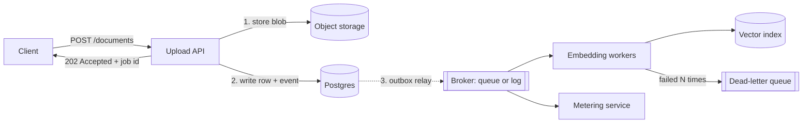
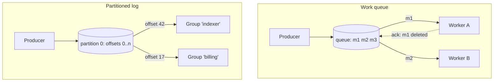
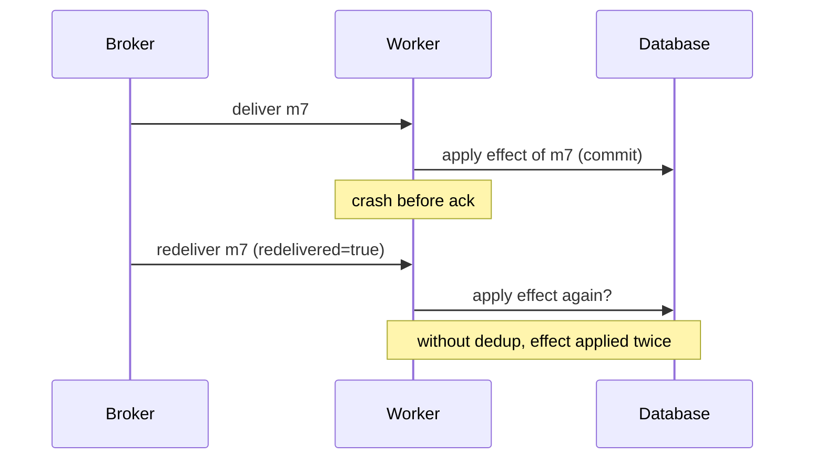
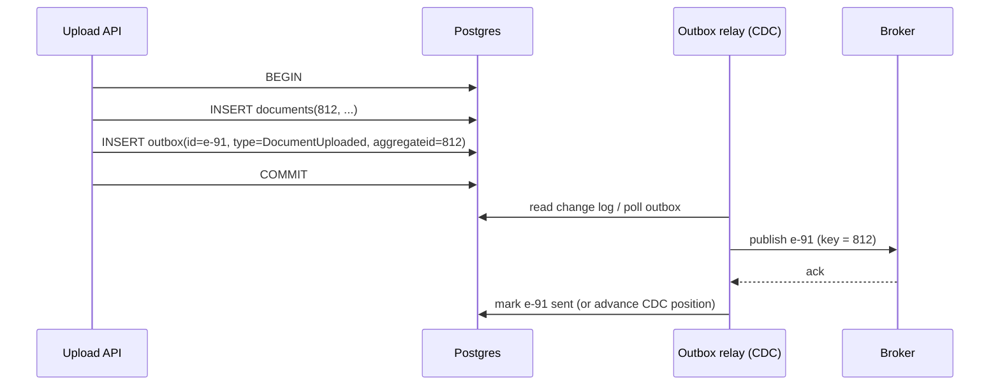
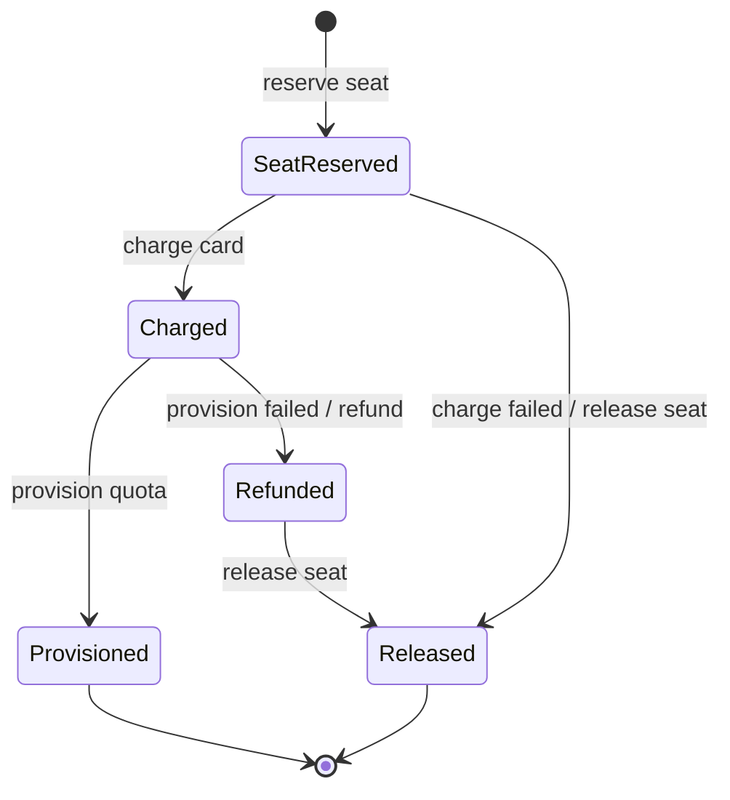

# 08 — Asynchronous & event-driven systems

> **The requirement.** Lumen, our fictional AI knowledge-and-chat product, lets tenants upload documents that are
> chunked, embedded and indexed for retrieval. At peak, uploads produce **2,000 ingest events per second**. The
> upload API must stay under **150 ms p99**, even though embedding a document takes seconds and the GPU-backed
> embedding fleet is sometimes unavailable for half an hour. Every upload must eventually be indexed exactly once
> in effect, and every upload is metered for billing, so a tenant must never be charged twice. Doing the work
> synchronously inside the HTTP request cannot meet the latency target, and the moment you hand work to another
> process you inherit the distributed-systems problems of loss, duplication and reordering.

## In one minute

When a piece of work is slow, bursty or likely to fail, you stop doing it while the user waits. You write a small
note, a **message**, into a durable buffer and return straight away. Workers read those notes at their own speed.
The buffer absorbs bursts and outages, and lets producers and consumers scale and fail independently. The cost is
that the network can lose acknowledgements, so a message can be delivered twice, delivered late, or delivered out of
order. Good asynchronous design accepts those facts. Consumers are built so that seeing the same message twice
does no harm, database changes and the messages describing them are written together, and multi-step business
processes are modelled as sagas that know how to undo themselves. This chapter shows how to do that deliberately.

## Why this matters now

The ideas are old. Sagas date from 1987 [16] and the case for at-least-once messaging with idempotent receivers was
made by Helland in 2007 [22]. Several things changed between 2023 and 2026 that put them back at the centre of
system design:

- **Kafka became ZooKeeper-free.** Apache Kafka 4.0 (March 2025) supports only KRaft mode, in which a Raft quorum of
  controllers manages cluster metadata. "ZooKeeper mode has been removed" [5][28]. As of 2026-11 the newest
  release is **Kafka 4.4.0** (22 October 2026) [6]. Running a log is now operationally simpler, so teams adopt one
  earlier.
- **Logs learned queue semantics.** KIP-932 "Queues for Kafka" adds *share groups*: consumers that share partitions,
  acknowledge records individually and have delivery counts. The Kafka 4.2.0 announcement calls it
  "production-ready" [7][8]. On the other side, RabbitMQ has offered append-only **streams** next to its queues for
  some time [11]. The line between "queue product" and "log product" is now about semantics, not vendors.
- **RabbitMQ 4.x made poison-message protection the default.** Since 4.0, quorum queues have a default delivery limit
  of 20. Since 4.3, only certain negative outcomes count towards that limit (details in the deep dive) [9]. Current
  series as of 2026-11: **RabbitMQ 4.4** (4.4.1, 16 November 2026) [12].
- **Durable execution went mainstream.** Engines such as Temporal record every step of a workflow in an event
  history and replay it after a crash [23]. Long-running sagas, AI-agent loops and ingestion pipelines are
  increasingly written as code on such an engine rather than hand-wired topics (see
  [SYSDESIGN-25](../03-ai-systems/25-agentic-systems.md)).
- **LLM work is often asynchronous by nature.** Major model providers sell asynchronous batch endpoints at half
  price with a 24-hour completion window (OpenAI: 50% cheaper, 24 h window, up to 50,000 requests per batch [26];
  Anthropic: 50% of standard prices, up to 100,000 requests or 256 MB per batch, results within 24 h [27]). Treating
  inference as a queued job, rather than a synchronous call, is now a cost lever as well as a reliability one.

## Core ideas [Core]

### Why the box is there: decoupling in time, rate and failure

A message buffer between a producer and a consumer gives you three kinds of decoupling.

1. **Time.** The consumer need not be up when the producer runs. Lumen's upload API can accept documents while the
   embedding fleet is being redeployed.
2. **Rate.** The producer can burst above the consumer's capacity for a while. The buffer holds the difference.
   Little's law ([SYSDESIGN-01](../00-orientation/01-requirements-to-numbers.md)) still applies: if arrivals exceed
   service capacity for long, the backlog grows without bound.
3. **Failure.** A crash in the consumer does not become an error page for the user. It becomes a delay.

What you give up is the synchronous answer. The API can only say "accepted" (HTTP 202 with a job ID), and any later
status must be polled, pushed (webhook, SSE, WebSocket — see
[SYSDESIGN-10](10-apis-communication.md)) or read from a status table.



*Diagram: the upload API stores the blob and a database row plus an event, replies 202 at once, and a relay moves the
event to a broker; embedding workers and a metering service consume it independently, and failing messages go to a
dead-letter queue.*

### Queues versus logs

These two abstractions are often mixed up. They answer different questions.

A **work queue** (RabbitMQ classic and quorum queues, Amazon SQS) hands out *tasks*. Each message is meant to be
processed by one consumer. The broker tracks per-message state (ready, unacknowledged, acknowledged) and deletes the
message once it is acknowledged. Adding consumers spreads the load, and the broker redelivers a message whose
consumer died. In SQS, a received message becomes invisible for a *visibility timeout* (30 seconds by default) and
reappears if it is not deleted in time [14].

A **log** (Apache Kafka, RabbitMQ streams, Amazon Kinesis, Apache Pulsar topics) is an append-only, ordered sequence
of records that consumers *read* without removing anything. The original Kafka paper by Kreps, Narkhede and Rao
(NetDB 2011) set out the design. Each partition is a logical log. A message is addressed by its offset. The broker
is "stateless" about consumers, because each consumer tracks how far it has read. Retention is time-based,
"typically 7 days". And because nothing is deleted on read, "a consumer can deliberately rewind back to an old
offset and re-consume data" [1]. Within a consumer group, each partition is consumed by exactly one consumer, which
makes "the position of a consumer in each partition … just a single integer" [2].



*Diagram: in a work queue each message goes to one worker and is deleted on acknowledgement; in a log, the records
stay and each consumer group keeps its own offset, so two groups read the same partition at different positions.*

| Property | Work queue | Log |
|---|---|---|
| Unit of state | per-message (ready / unacked) | per-consumer-group offset per partition |
| After consumption | deleted | retained until time or size limit |
| Fan-out to N independent consumers | one queue per consumer (exchange/topic copies) | free: each group reads the same data |
| Replay / reprocessing | not possible once acked | rewind the offset |
| Parallelism | add consumers freely | classic groups: bounded by partition count [1]; share groups relax this [7] |
| Ordering | roughly FIFO; lost with competing consumers and redelivery | strict within a partition only [1] |
| Per-message retry, delay, DLQ | native | must be built (retry topics) or use share groups / Streams DLQ handlers [7][8] |
| Typical fit | tasks, jobs, commands | event streams, change data, audit, analytics, replay |

The quick rule: if the message is a **command** ("embed document 812"), a queue is the natural fit. If it is a
**fact** ("document 812 was uploaded") that several teams will interpret in their own way, now and later, a log is
the natural fit.

### Publish/subscribe

Pub/sub separates *who sends* from *who receives*. A publisher writes to a topic or exchange, and every subscription
gets its own copy. In RabbitMQ, an exchange routes each message to every bound queue. In Kafka, every consumer group
reads the whole topic. In both cases the publisher does not know or care how many subscribers there are, which is
why adding a metering consumer to Lumen's ingest stream needs no change in the upload API. The risk is the mirror
image of that benefit. Nobody can see the full call graph, so a change to an event's schema can break consumers
the producer has never heard of. Treat event schemas as public APIs, with compatibility rules
([SYSDESIGN-10](10-apis-communication.md) covers schema evolution).

### Delivery semantics: what the guarantees actually mean

Every handoff consists of *do the work* and *record that it is done*. The order of those two steps decides the
guarantee [2]:

- **At-most-once.** Record first, then work. For example, commit the offset or ack, then process. A crash between
  the two loses the message. Kafka's documentation: "Messages may be lost but are never redelivered" [2].
- **At-least-once.** Work first, then record. A crash between the two causes redelivery and the work happens again.
  This is the default in Kafka [2] and the basis of RabbitMQ's acknowledgement model. Unacknowledged deliveries are
  requeued when a channel closes, and consumers "must be prepared to handle redeliveries" [10]. The 2011 Kafka paper
  stated plainly that "Kafka only guarantees at-least-once delivery" [1].
- **Exactly-once.** Not achievable as a *delivery* property between independent parties over a network that can
  lose acknowledgements. What systems offer is **exactly-once effects** (often called *effectively-once*) inside a
  boundary they control. The Kafka docs warn that many systems claiming exactly-once "don't hold up" under failures
  [2]. Amazon SQS FIFO queues, for instance, deduplicate *sends* that repeat within a 5-minute deduplication
  interval [15]. That is a bounded producer-side guarantee, not end-to-end exactly-once processing.



*Diagram: a worker commits the effect of message m7 and crashes before acknowledging; the broker redelivers m7 and,
without deduplication, the effect is applied a second time.*

The diagram shows the central lesson of the chapter. **At-least-once delivery is the only option that never loses
data, and it guarantees duplicates. So the receiver must be idempotent.** Helland makes the same argument at the
level of whole applications: most applications use at-least-once messaging, and recipients must make retried
messages harmless [22].

### Idempotency keys

An operation is **idempotent** if applying it twice has the same effect as applying it once. Some operations are
naturally idempotent ("set status = INDEXED", "upsert row with primary key K"). Others are not ("balance += 10",
"send an email", "call the GPU and bill tokens"). For those you add an **idempotency key**, a unique ID chosen by the
originator and carried with every retry, and the receiver remembers which keys it has already processed.

Stripe's API is a well-documented public example. Clients send an `Idempotency-Key` header. Stripe saves the status
code and body of the first request with that key, returns the saved result (even a 500) on retries, rejects a reuse
with different parameters, and lets keys be pruned after they are at least 24 hours old [29]. Three design points
follow for any idempotency-key scheme:

1. **The key must be generated before the first attempt** and reused on every retry. A key generated per attempt
   protects nothing.
2. **The dedup record and the effect must commit atomically**, or a crash between them reopens the window.
3. **Keys have a retention horizon.** Duplicates that arrive after the key is forgotten are not detected. Size the
   horizon to the longest plausible redelivery, including DLQ replays.

The HTTP side of idempotency keys (the IETF draft header, request fingerprints) belongs to
[SYSDESIGN-10](10-apis-communication.md). Here we focus on consumers.

### The dual-write problem and the transactional outbox

Lumen's upload API has to do two things: insert a `documents` row and publish a `DocumentUploaded` event. Writing to
the database and then publishing to the broker is a **dual write**, and it fails in both orders:

- DB commit, then publish, then crash before the publish: the row exists, no event is ever sent, and the document is
  never indexed.
- Publish, then DB commit, then the commit fails: the event describes a document that does not exist.

Two-phase commit across the database and the broker is rarely available and rarely worth it. The **transactional
outbox** closes the gap with a local transaction. In the *same* database transaction as the business change, insert
the event into an `outbox` table. A separate relay reads the outbox and publishes. In Richardson's description,
messages are sent "if and only if the database transaction commits", and no 2PC is needed [18]. The relay can poll
the table or tail the database's change log. Debezium's outbox event router does the latter and expects columns
such as `id`, `aggregatetype`, `aggregateid`, `type` and `payload` [19].



*Diagram: the API inserts the business row and the outbox event in one transaction; a relay reads the committed event
and publishes it to the broker keyed by document ID, then records its progress.*

Note what the outbox does *not* give you. The relay can crash after publishing and before recording progress, so
**the outbox is at-least-once** [18]. It moves the duplicate problem downstream, where the next piece handles it.

### The inbox: idempotent consumption

The **inbox** (also called a dedup table or processed-messages table) is the consumer-side twin of the outbox. In the
same local transaction that applies the effect, insert the message's ID into a table with a unique constraint. A
redelivered message violates the constraint. The consumer then knows the effect already happened, and simply
acknowledges. Lab L08 builds exactly this and shows the balance doubling when it is switched off.

Outbox plus inbox gives **end-to-end exactly-once effects** across services that only have at-least-once transport,
provided every side effect lives in a database that participates in the local transaction. Effects outside your
database (sending an email, calling a payment provider, calling a model API) need their own idempotency key passed to
the external system, or a status machine that records "about to call" and "called", with reconciliation.

### Ordering and partition keys

Global ordering does not scale. It requires a single sequencer. What systems provide is ordering **within a
partition** (Kafka [1]) or **within a message group** (SQS FIFO [14]). You choose a **partition key** so that the
events that need ordering relative to each other share a key:

- Key by `document_id` and all events for document 812 (uploaded → chunked → embedded → deleted) are processed in
  order. Different documents proceed in parallel.
- Key by `tenant_id` and one huge tenant becomes a hot partition, the same hot-key problem as in sharding
  ([SYSDESIGN-07](07-partitioning-sharding.md)).

Three subtleties trip people up:

1. **Retries reorder.** A queue consumer that requeues a failed message lets later messages overtake it. Strict
   per-key ordering and "retry later" conflict, and you must pick per use case: block the key, or park the message and
   accept reordering.
2. **Changing the partition count remaps keys** under hash partitioning, so ordering across the change is not
   guaranteed. Pick partition counts with headroom.
3. **Consumers must tolerate reordering anyway** when events come from several producers. Version numbers or
   per-aggregate sequence numbers let a consumer drop stale updates ("ignore version 4 if I already applied
   version 5").

### Backpressure, consumer lag and the dead-letter queue

**Backpressure** is any mechanism that slows a producer down when consumers cannot keep up, instead of letting
memory or latency blow up. Examples: RabbitMQ's prefetch (`basic.qos`) caps unacknowledged deliveries per channel,
and the broker "will stop delivering more messages on the channel until at least one of the outstanding ones is
acknowledged" [10]. Queue length limits can reject publishes. Kafka consumers pull, so a slow consumer slows only
itself [1], and the cost shows up as **consumer lag**: the gap between the newest offset in a partition and the
group's committed offset. In a work queue, the equivalent signal is queue depth plus the age of the oldest
message.

Lag in messages is less useful than **lag in time** ("the oldest unprocessed event is 9 minutes old"), because time
is what the SLO cares about. Alert on time-lag, and on its trend.

A **poison message** is one that fails every time, because of a malformed payload, a bug triggered by one input, or a
reference to data that will never exist. Under at-least-once delivery, a poison message is redelivered forever. It
burns capacity and, in an ordered partition, blocks everything behind it (head-of-line blocking). The defence is a
**delivery limit** plus a **dead-letter queue (DLQ)**: after N failed attempts, move the message aside with
diagnostic metadata, alert, and keep going. RabbitMQ records why a message was dead-lettered in the `x-death`
header (`rejected`, `expired`, `maxlen`, `delivery_limit`) [13]. SQS moves a message to its DLQ once it has been received
`maxReceiveCount` times without being deleted, and warns that a DLQ breaks strict FIFO ordering [4]. Kafka share groups archive a record once it reaches the delivery-attempt limit (5 by
default) [7].

A DLQ is only useful if someone owns it. You need an alert on DLQ depth, a runbook, and a **redrive** tool that
replays fixed messages into the main queue. Redrive is safe only because consumers are idempotent.

### Sagas: business transactions without distributed locks

Garcia-Molina and Salem introduced the **saga** in 1987 as a way to break a long-lived transaction into a sequence of
shorter transactions T1 … Tn, each with a **compensating transaction** C1 … Cn. The system guarantees that either all
Ti complete, or a prefix completes and the matching compensations run [16]. Microservices took up the idea because a
cross-service ACID transaction is usually off the table. A saga is "a reliably coordinated sequence of local
transactions" [17].

Take Lumen's "add a paid workspace seat": reserve a seat (Seats), charge the card (Billing), provision the index
quota (Retrieval). If provisioning fails, refund the charge and release the seat.

**Choreography.** Each service reacts to events and emits its own: `SeatReserved` → Billing charges →
`PaymentCaptured` → Retrieval provisions → `QuotaProvisioned` [17]. There is no central coordinator and coupling
is low, but the flow is implicit and spread across services, which makes it hard to see, test and change.
Compensation logic is spread out as well.

**Orchestration.** A coordinator, the orchestrator, tells each participant what to do and keeps the saga's state
[17]. The flow is explicit and in one place, timeouts and compensations are easy to reason about, and the
orchestrator becomes a component that must itself be durable. That last requirement is exactly what durable
execution engines provide.



*Diagram: saga state machine; each forward step either succeeds and moves on, or fails and triggers the compensations
of the completed steps in reverse order (refund, then release), ending in either Provisioned or Released.*

Sagas give up **isolation**. Other transactions can see intermediate states (a seat reserved but not yet paid for),
and concurrent sagas can cause anomalies, which Richardson suggests handling with "countermeasures" such as semantic
locks (a `PENDING` status) [17]. Compensations must themselves be idempotent and retryable. A refund that is
delivered twice must not refund twice.

### CQRS and event sourcing

**CQRS** (Command Query Responsibility Segregation, a term Fowler credits to Greg Young) uses different models for
updates and for reads [21]. Writes go to a normalised model that enforces invariants. Reads are served from one or
more denormalised projections built from the write side's events: a search index, a per-tenant dashboard table, a
vector index. Lumen already does this informally, because its vector index is a read model of the documents table.

**Event sourcing** goes further: the events *are* the source of truth. You "capture all changes to an application
state as a sequence of events" and derive current state by replaying them [20]. In exchange you get a full audit
trail, temporal queries ("what did the ACL look like last Tuesday?") and the ability to rebuild projections after a
bug fix [20]. The costs are real:

- **Schema evolution forever.** Events written years ago must still be readable (upcasters, versioned events).
- **Replays and side effects.** Replaying events must not resend emails. Fowler's answer is to put external systems
  behind gateways that can be disabled during replay [20].
- **Snapshots.** Replaying a long history on every load is slow, so snapshot periodically.
- **Eventual consistency for reads.** Projections lag the log, so read-your-writes needs care (wait for a version, or
  read from the write model).
- **Erasure.** Immutable logs conflict with "right to be forgotten". The usual techniques are crypto-shredding
  (per-subject encryption keys that are deleted) or keeping personal data out of events; see
  [SYSDESIGN-19](../02-modern-requirements/19-privacy-compliance-sovereignty.md).

Fowler warns that "for most systems CQRS adds risky complexity" and should be applied only to specific bounded
contexts [21]. Interviewers like to hear that caution.

## Numbers that matter

A worked estimate for the Lumen requirement. Every input is an **assumption** unless a source is cited.

**Inputs (assumptions).** Peak 2,000 events/s, average 1,000 events/s. Event size 2 KB (an ID, metadata and
pointers, never the document itself, which lives in object storage). Embedding takes 400 ms of worker time per
event on average. The embedding fleet may be down for 30 minutes. Log retention is 7 days (the paper's "typical" value
[1]; configurable). Replication factor 3.

**Throughput and partitions.** Peak bandwidth is 2,000 × 2 KB = 4 MB/s into the log, which is trivial for any
modern broker. Parallelism is the real constraint. One worker thread at 400 ms per event does 2.5 events/s, so
peak needs 2,000 / 2.5 = **800 concurrent workers**. With a classic Kafka consumer group, each partition goes to at
most one consumer in the group [1], so you need **≥ 800 partitions**, or a smaller number of partitions with an
internal worker pool per consumer (which then needs per-key ordering logic), or a share group or work queue, where
parallelism is not tied to partitions [7]. This is a good example of the queue-versus-log decision being driven by
numbers. Embedding *commands* belong in a queue-like structure. The *fact* "document uploaded" belongs in the log.

**Retention storage.** At an average of 1,000 events/s: 1,000 × 2 KB × 86,400 s × 7 days ≈ **1.2 TB** of logical
data; ×3 replication ≈ **3.6 TB** of broker disk. That is affordable, and it buys a week of replay.

**Backlog after a 30-minute outage.** Arrivals continue at, say, the 2,000/s peak: 2,000 × 1,800 s =
**3.6 M events** queued. If the fleet is sized for peak only, the backlog *never drains* while load stays at peak.
Spare capacity is what drains it. With 50% headroom (3,000/s capacity), the backlog drains at 1,000/s, so
3.6 M / 1,000 = **3,600 s = 1 hour**. Total staleness for the newest document at the end of the outage is about 1.5 h.
If the indexing-freshness SLO is "95% of documents searchable within 10 minutes", this outage breaks it for about
90 minutes. You either buy more headroom, prioritise fresh events (LIFO for the backlog, FIFO for live), or
autoscale on time-lag ([SYSDESIGN-03](03-scaling-compute.md)).

**Upload API latency.** The synchronous path is a blob upload (already done client-side with a pre-signed URL in a
typical design) plus one database transaction writing two rows (document + outbox). That is a single local commit,
typically a few milliseconds on a healthy primary (assumption; measure your own), which fits 150 ms p99 with a
large margin. The embedding latency has left the request path entirely.

**Dedup table size.** 1,000 events/s × 86,400 × 7 days ≈ 605 M inbox rows if you keep keys as long as the log.
At about 50 bytes per row plus index, that is around 30–60 GB (assumption). That is fine for one Postgres, but you
should partition the table by day and drop old partitions instead of running `DELETE`.

**LLM batch side-path.** Lumen re-summarises 1 M documents every night with a hosted model. At 50,000 requests per
OpenAI batch [26], that is 20 batches; at Anthropic's 100,000-request limit [27], 10 batches. Both bill at 50% of
synchronous prices and promise completion within 24 hours [26][27]. Submission, polling and result import are
naturally a queue-and-worker problem, with the batch's `custom_id` as the idempotency key for importing results.

## Design choices and trade-offs

| Option | Wins when | Costs | Example systems |
|---|---|---|---|
| Work queue (competing consumers) | discrete tasks; per-message retry, delay, priority, DLQ; elastic worker counts | no replay; weak ordering; one queue per subscriber for fan-out | RabbitMQ quorum queues [9], Amazon SQS [14] |
| Partitioned log | many independent consumers; replay; ordered per key; high throughput; event history | parallelism tied to partitions (classic groups); retry/DLQ is DIY | Apache Kafka [1][2], RabbitMQ streams [11] |
| Log with queue semantics | you already run Kafka and need per-record ack/retry without over-partitioning | newer feature; operational experience still building (as of 2026-11) | Kafka share groups, KIP-932 [7][8] |
| Outbox + CDC relay | atomic "state change + event" with no 2PC | relay infra; at-least-once publish; schema discipline | Debezium outbox router [19] |
| Inbox / dedup table | exactly-once effects on top of at-least-once transport | storage and retention for keys; must share a transaction with the effect | lab L08; Helland [22] |
| Kafka transactions (EOS) | consume-transform-produce entirely inside Kafka | only covers Kafka-to-Kafka; latency of commit markers; read_committed consumers | KIP-98 [3], Kafka Streams [2] |
| Choreographed saga | few steps, few teams, stable flow | implicit flow, hard to trace and change | event-driven microservices [17] |
| Orchestrated saga / durable execution | many steps, timeouts, human waits, compensations | orchestrator is critical infra; workflow code must be deterministic | Temporal [23], AWS Step Functions |
| Event sourcing + CQRS | audit, temporal queries, many read models | schema evolution, replay hazards, erasure, complexity [20][21] | ledgers, collaboration tools |

## Deep dive [Deep]

### How Kafka's exactly-once actually works

KIP-98 (shipped in Kafka 0.11.0.0 [2]) added two mechanisms [3]:

1. **Idempotent producer.** Each producer session gets a producer ID (PID). Each record carries a per-partition
   sequence number. The broker rejects a write whose sequence number is not exactly one greater than the last one
   it committed for that PID and partition, so a producer retry after a lost acknowledgement does not create a
   duplicate in the log [3]. Since Kafka 3.0 the producer defaults moved to `enable.idempotence=true` and `acks=all`
   (KIP-679, tracked as KAFKA-10619 [30]). Scope matters here: idempotence holds "within a single producer session",
   because a new producer instance gets a new PID [3].
2. **Transactions.** A producer with a stable `transactional.id` can write to several partitions atomically. Either
   all records commit or none do. A new instance with the same ID *fences* the old one by bumping an epoch. The
   decisive call is `sendOffsetsToTransaction`. It puts the consumer's offset commit *inside* the same transaction as
   the output records, so "read input, write output, advance input offset" becomes one atomic step [3].
   Consumers set `isolation.level=read_committed` to see only committed transactional data (the default is
   `read_uncommitted`) [2][3].

The boundary is the lesson. This is exactly-once **within Kafka**. As soon as the output is an external database,
the Kafka docs advise storing the consumed offset *in the same external system and transaction* as the output [2],
which is the inbox pattern in another form. And KIP-98 itself notes that a consumer cannot be guaranteed to consume
all messages of a committed transaction together [3].

### The idempotent consumer, carefully

A correct inbox consumer for a non-idempotent effect:

```text
on message m:
  BEGIN
    INSERT INTO inbox(message_id) VALUES (m.id)      -- unique constraint
      ON CONFLICT DO NOTHING  → if 0 rows: ROLLBACK; ack(m); return   -- duplicate
    apply effect (e.g. UPDATE accounts SET balance = balance + m.amount)
  COMMIT
  ack(m)          -- crash before this line ⇒ redelivery ⇒ duplicate path above
```

Edge cases worth naming in an interview:

- **Concurrent duplicates.** Two workers receive the same message at once (possible with SQS visibility-timeout
  expiry [14]). The unique constraint serialises them: one commits, the other hits the conflict.
- **Effect outside the DB.** If the effect is an HTTP call to a payment provider, the inbox cannot cover it. Pass a
  deterministic idempotency key, derived from `m.id`, to the provider [29]. Temporal recommends the same for
  Activities, for example combining the workflow run ID and activity ID [25].
- **Prefetch window.** A consumer crash redelivers *every* unacknowledged message it held, not only the one it was
  working on. In lab L08, with prefetch 10, one crash redelivered seven messages. All of them must hit the dedup
  path or be applied for the first time.
- **Key choice.** Use the *business* event ID set by the original producer (the outbox row's `id`), not a
  broker-assigned delivery ID. A broker ID changes when the relay re-publishes.
- **Ordering plus dedup.** Per-aggregate version numbers can replace the inbox when the effect is a state overwrite:
  "apply only if `m.version > current.version`" is idempotent *and* drops stale reorderings.

### Poison messages in RabbitMQ 4.x: what counts as a failure

Quorum queues are replicated with Raft (see [SYSDESIGN-09](09-coordination-consensus.md)) and track failed delivery
attempts in the `x-delivery-count` header. Since 4.0, the default delivery limit is 20, after which a message is
dropped or, if a dead-letter exchange is configured, dead-lettered [9]. RabbitMQ 4.3 refined *what counts*. The
limit is evaluated against `delivery-count`, which is incremented by `basic.reject` and by client crash or
connection loss, but **not** by `basic.nack` with requeue. Before 4.3, a `basic.nack` requeue did count [9].
Consumer code that relied on `nack(requeue=true)` to eventually dead-letter a poison message will, on 4.3+, loop
until something else intervenes. The documentation recommends `basic.reject` for that purpose, and recommends
configuring dead-lettering for all quorum queues [9]. Lab L08 uses `basic_reject` for exactly this reason.

There is a second subtlety: dead-lettering itself is **at-most-once by default** for quorum queues. At-least-once
dead-lettering must be enabled with `dead-letter-strategy=at-least-once` and `overflow=reject-publish`, at extra
memory and CPU cost, and may create duplicates at the target [9]. If losing a dead-lettered payment is unacceptable,
turn it on and make the DLQ consumer idempotent too.

### Retries: immediate, delayed, parked

Immediate requeue of a failing message is a tight loop. It hammers a struggling dependency and adds to the
retry-storm dynamics that [SYSDESIGN-11](11-reliability-engineering.md) studies. Better patterns:

- **Delayed retry tiers.** Move the message to `retry-1m`, `retry-10m`, `retry-1h` queues (TTL plus dead-letter back
  to the main queue), or Kafka retry topics consumed with a delay. Exponential spacing with jitter.
- **Classify errors.** Non-retryable errors (validation, schema) go to the DLQ immediately. Retryable ones
  (timeouts, 503s) are retried with backoff. Lab L08 shows both paths.
- **Ordered streams.** In a partition where order matters, a parked message breaks order for its key. Either stop the
  key (record "key blocked" and skip later events for it into a side queue), or design events as commutative or
  versioned so that order matters less.

### Sagas, more precisely

Garcia-Molina and Salem's guarantee is that a saga either runs T1 … Tn or T1 … Tj followed by Cj … C1 [16].
Practical rules follow from it:

- **Pivot step.** Order steps so that the hardest-to-compensate step (charging a card, sending an email) comes as late
  as possible, after the steps most likely to fail. Steps after the pivot should be retriable until they succeed,
  not compensable.
- **Compensations are business actions, not rollbacks.** A refund is a new ledger entry, not a deleted charge (see
  [C06](../04-case-studies/C06-payments-ledger.md)).
- **Timeouts are failures.** An orchestrator must decide what happens when a participant never answers. Usually it
  compensates after a deadline, and the participant must tolerate a late request that arrives after the
  compensation (idempotency plus state checks).
- **Semantic locks.** Mark entities `PENDING` while a saga is in flight so that concurrent sagas and readers can see
  the in-flight state [17].

### Durable execution

A durable execution engine turns an orchestrated saga into ordinary-looking code. Temporal records every workflow
decision in an **event history** that is "the source of truth". After a worker crash it "replays the Event History
step by step" through the workflow code, which therefore "has to make the same decisions when given the same
history", that is, it must be deterministic [23]. Side effects run in **Activities**. Their results are recorded in
the history, but Activities "may be executed multiple times", so Temporal tells you to make them idempotent [25].
The default Activity retry policy is exponential: initial interval 1 s, coefficient 2.0, maximum interval 100 × the
initial interval, unlimited attempts. Workflows themselves do not retry by default [24].

Under the hood this is the same toolkit as the rest of this chapter: an append-only history (event sourcing), task
queues to workers, timers, and idempotent side effects. The engine just packages it. The trade-offs: the engine is
critical infrastructure with its own persistence and scaling; workflow code is constrained by the determinism
requirement (no wall-clock reads, random numbers or direct I/O in workflow code); and versioning long-running
workflows needs explicit care.

## Frontier [Frontier]

*All statements in this section are as of 2026-11.*

- **ZooKeeper-free Kafka.** KIP-500 replaced ZooKeeper with a Raft-based controller quorum that manages a metadata
  log [28]. Kafka 4.0 removed ZooKeeper mode entirely, and clusters still in ZooKeeper mode must migrate to KRaft before
  upgrading to 4.x [5]. The current release is 4.4.0 (22 October 2026), with 4.3.2 and 4.2.2 as maintained patch
  lines [6]. For design discussions this means one system to operate instead of two, and controller failover handled
  by Raft (see [SYSDESIGN-09](09-coordination-consensus.md)).
- **Queues inside the log.** Kafka share groups (KIP-932) let more consumers than partitions read a topic, with
  per-record accept/release/reject, acquisition locks (30 s default) and a delivery-attempt limit (5 default)
  [7]. Kafka 4.2.0 declared the feature production-ready [8]. Kafka Streams in 4.2 also gained dead-letter-queue
  support in its exception handlers [8]. Expect designs that previously ran RabbitMQ *and* Kafka to consolidate.
  Check client-library support before you rely on it.
- **RabbitMQ 4.4.** Classic queue mirroring is gone (removed in 4.0), and quorum queues are the replicated
  queue type [9]. Streams provide log semantics, including super streams (partitioned) since 3.11 [11].
- **Durable execution as the default for long workflows.** Agent loops (plan, call tool, wait for a human, resume)
  are long-running, failure-prone and side-effecting, which is precisely the durable-execution use case. See
  [SYSDESIGN-25](../03-ai-systems/25-agentic-systems.md) and [C11](../04-case-studies/C11-coding-agent-platform.md).
- **Asynchronous inference as a product.** Provider batch APIs (50% discount, 24 h window, separate rate-limit
  pools in OpenAI's case [26]) mean any LLM workload without a human waiting, such as evaluations, backfills,
  re-embedding and nightly summaries, should be designed as queued batch jobs. The design questions are the ones in
  this chapter: idempotent result import (`custom_id`), partial failures inside a batch, expiry handling
  (Anthropic marks unprocessed requests `expired` after 24 h and does not bill them [27]), and backpressure against
  provider quotas.

## Failure modes and operations

| Failure | Symptom | Detect (SLI) | Mitigate |
|---|---|---|---|
| Lost event from dual write | entity exists, downstream never hears | reconciliation job: rows without matching downstream state | transactional outbox [18] |
| Duplicate effects | double charge, double email | dedup-hit counter; business reconciliation | inbox / idempotency keys [22][29] |
| Poison message | one message retried forever; partition stuck | redelivery-count histogram; per-key age | delivery limit + DLQ [9][13]; classify errors |
| DLQ ignored | silent data loss "with extra steps" | DLQ depth > 0 alert; oldest-DLQ-age | owner, runbook, redrive tool |
| Consumer lag growth | freshness SLO burn | time-lag (age of oldest unprocessed) | autoscale on lag; shed or prioritise; more partitions |
| Rebalance storms | throughput collapses, duplicate processing | rebalance rate; consumer session timeouts | tune session and poll timeouts; cooperative rebalancing; keep handlers short |
| Hot partition | one partition lags, others idle | per-partition lag skew | better key (add suffix / salt), split heavy tenants |
| Unbounded buffer | broker memory alarms, publishers blocked | broker memory and disk alarms; publish latency | prefetch, length limits, reject-publish overflow, producer backpressure [10] |
| Schema break | consumers crash on deploy | deserialisation-error rate | schema registry + compatibility checks |
| Retry storm through the queue | dependency overloaded by requeues | retry rate vs first-attempt rate | delayed retries, backoff + jitter, retry budget ([SYSDESIGN-11](11-reliability-engineering.md)) |

Operational habits that pay off:

- **Every async flow has an end-to-end SLO**, e.g. "p95 event age at the indexer < 2 min". Queue depth on its own
  is not an SLO.
- **Trace across the broker.** Propagate trace context in message headers so that a slow upload can be followed into
  the worker ([SYSDESIGN-12](12-observability.md)).
- **Practise replays** (consumer-group rewind, DLQ redrive) in staging; both rely on idempotent consumers.

## Cost and energy

- **Brokers are cheap compared with the work they buffer.** The 3.6 TB retention estimate above is a modest storage
  bill. The expensive part is the worker fleet, and the main cost lever asynchrony gives you is **sizing for average
  load plus drain headroom instead of for peak**. Being able to defer work is what makes that possible.
- **Deferral moves work in time,** which is also how carbon-aware scheduling works: run deferrable batch jobs when the
  grid is cleaner or GPUs are idle ([SYSDESIGN-17](../02-modern-requirements/17-energy-carbon-aware.md)).
- **Batch APIs halve hosted-inference cost** for work that can wait up to 24 h [26][27].
- **Duplicates cost money.** At-least-once delivery without an inbox means paying twice for GPU work on every
  redelivery. Dedup is a cost control as well as a correctness one.
- **Replication factor × retention** is the main storage knob for a log. Tiered storage (offloading old segments to
  object storage) is the usual way to keep long retention affordable; check your distribution's support.

## Interview angle

**How it is asked.** "Design a notification system", "design an order pipeline", "how do you make sure a payment is
processed exactly once?", "design a job scheduler", "our consumers are falling behind, what do you do?". Async
design is also a sub-question in nearly every large case study.

**Model answer outline using CLARIFY → QUANTIFY → SKETCH → DEEPEN → STRESS → WRAP:**

1. **CLARIFY:** Does the caller need the result now, or only acceptance? What ordering is needed, and per what key?
   What may never be lost, and what may never happen twice?
2. **QUANTIFY:** Peak events per second, processing time per event, giving the number of concurrent workers and
   partitions. Retention × rate × replication gives storage. Outage length × rate ÷ headroom gives drain time.
3. **SKETCH:** API → DB + outbox → relay → broker (queue for commands, log for facts) → idempotent consumers → DLQ.
4. **DEEPEN:** Pick one: delivery semantics and the inbox, the saga with compensations, or partition-key choice and
   hot keys.
5. **STRESS:** Consumer crash before ack, poison message, 30-minute downstream outage, hot tenant, schema change,
   replay. Name the SLI for each.
6. **WRAP:** Restate the guarantee precisely: "at-least-once transport, exactly-once effects via an outbox and an
   inbox; per-document ordering; DLQ with owner and redrive."

**Red flags.** Saying "we'll use Kafka, so it's exactly-once". Publishing to the broker after the DB commit with no
outbox. No DLQ, or a DLQ nobody watches. Expecting global ordering. Not knowing that parallelism in a classic Kafka
consumer group is capped by the partition count. Putting large payloads in messages instead of references.

**Likely follow-ups.** "What if the relay publishes twice?" (the inbox handles it). "How long do you keep
idempotency keys?" (longer than the maximum redelivery and replay horizon). "Orchestration or choreography?" (number
of steps, need for visibility and timeouts). "How do you reprocess a week of events after a bug fix?" (log replay
into a new projection, then swap).

## Common mistakes

- Treating "exactly-once" as a transport property instead of an end-to-end property of effects.
- Generating a fresh idempotency key on every retry.
- Committing the dedup record and the effect in separate transactions.
- Acking before processing (silent at-most-once).
- Using `nack(requeue=true)` in a tight loop and assuming the broker will eventually dead-letter it (on RabbitMQ
  4.3+ it will not count towards the limit [9]).
- Choosing `tenant_id` as the partition key for a multi-tenant system with a few huge tenants.
- Sizing consumers for peak with zero headroom, so backlogs never drain.
- Event sourcing a whole system because it sounds elegant [21].
- Compensations that are not idempotent, or that assume the forward step definitely happened.

## Check yourself

1. Your worker commits to Postgres and then crashes before acking. Under what conditions is the effect applied
   twice, and what single table prevents it?
2. Why does the transactional outbox still produce duplicates, and why is that acceptable?
3. A Kafka topic has 12 partitions and you start 20 consumers in one classic consumer group. How many do useful
   work?
4. What does Kafka's `sendOffsetsToTransaction` make atomic, and what does it *not* cover?
5. When would you pick an orchestrated saga over choreography?

Full set with answers: [exercises/08-async-event-driven.md](../../exercises/08-async-event-driven.md).

## Lab

**L08 — Queues, poison messages, DLQ and the idempotent consumer**
([labs/08-async-event-driven/](../../labs/08-async-event-driven/README.md)). A Docker Compose stack with RabbitMQ
4.4 (quorum queue with a delivery limit and a dead-letter exchange) and a small Python producer and consumer that
keeps a ledger in SQLite. You publish payments with idempotency keys, re-send a duplicate, make the consumer crash
after committing but before acknowledging, and inject both an unparseable message and an always-failing one. With
the inbox table switched on, the balance is correct. Switched off, you watch duplicates turn into a wrong balance.
The always-failing message is retried up to the limit and then dead-lettered with `reason=delivery_limit`. A final
experiment switches retries to `basic.nack` and shows the 4.3+ behaviour: the delivery count stays at 0 and the
message never dead-letters. The lab was run on 2026-11-19/20; observed results are recorded in its README.

## Further reading

- Kreps, Narkhede, Rao, *Kafka* (NetDB 2011) [1]: the original log-as-messaging design.
- Apache Kafka documentation, *Design — Message Delivery Semantics* [2], and KIP-98 [3]: what "exactly-once" means
  in Kafka and where it stops.
- Helland, *Life beyond Distributed Transactions: an Apostate's Opinion* (CIDR 2007) [22]: why at-least-once plus
  idempotence is the default for scalable applications.
- Garcia-Molina & Salem, *Sagas* (SIGMOD 1987) [16]: the original saga definition and compensations.
- RabbitMQ documentation, *Quorum Queues* [9] and *Dead Letter Exchanges* [13]: delivery limits, `x-death`, and
  the 4.3 delivery-count change.
- Richardson, *Transactional outbox* and *Saga* patterns [17][18]: concise pattern write-ups with known issues.
- Temporal documentation, *Workflows* and *Retry Policies* [23][24]: durable execution from the source.

## References

[1] J. Kreps, N. Narkhede, J. Rao, "Kafka: a Distributed Messaging System for Log Processing," NetDB 2011 (LinkedIn).
    https://people.csail.mit.edu/matei/courses/2015/6.S897/readings/kafka.pdf (accessed 2026-11)

[2] Apache Kafka, "Design — Message Delivery Semantics / Persistence," Kafka 4.4 documentation.
    https://kafka.apache.org/44/design/design/ (accessed 2026-11)

[3] Apache Kafka, "KIP-98 — Exactly Once Delivery and Transactional Messaging."
    https://cwiki.apache.org/confluence/display/KAFKA/KIP-98+-+Exactly+Once+Delivery+and+Transactional+Messaging
    (accessed 2026-11)

[4] Amazon Web Services, "Using dead-letter queues in Amazon SQS," SQS Developer Guide.
    https://docs.aws.amazon.com/AWSSimpleQueueService/latest/SQSDeveloperGuide/sqs-dead-letter-queues.html (accessed 2026-11)

[5] Apache Kafka, "Upgrading to 4.0" (upgrade notes, 4.0 documentation).
    https://kafka.apache.org/40/getting-started/upgrade/ (accessed 2026-11)

[6] Apache Kafka, "Download" (release list with dates). https://kafka.apache.org/community/downloads/ (accessed 2026-11)

[7] Apache Kafka, "KIP-932: Queues for Kafka." https://cwiki.apache.org/confluence/display/KAFKA/KIP-932%3A+Queues+for+Kafka
    (accessed 2026-11)

[8] Apache Kafka, "Apache Kafka 4.2.0 Release Announcement," 2026-02-17.
    https://kafka.apache.org/blog/2026/02/17/apache-kafka-4.2.0-release-announcement/ (accessed 2026-11)

[9] RabbitMQ, "Quorum Queues" (documentation, current series 4.4). https://www.rabbitmq.com/docs/quorum-queues
    (accessed 2026-11)

[10] RabbitMQ, "Consumer Acknowledgements and Publisher Confirms." https://www.rabbitmq.com/docs/confirms
    (accessed 2026-11)

[11] RabbitMQ, "Streams and Super Streams." https://www.rabbitmq.com/docs/streams (accessed 2026-11)

[12] RabbitMQ, "Release Information." https://www.rabbitmq.com/release-information (accessed 2026-11)

[13] RabbitMQ, "Dead Letter Exchanges." https://www.rabbitmq.com/docs/dlx (accessed 2026-11)

[14] Amazon Web Services, "Amazon SQS visibility timeout," SQS Developer Guide.
    https://docs.aws.amazon.com/AWSSimpleQueueService/latest/SQSDeveloperGuide/sqs-visibility-timeout.html (accessed 2026-11)

[15] Amazon Web Services, "Exactly-once processing in Amazon SQS," SQS Developer Guide.
    https://docs.aws.amazon.com/AWSSimpleQueueService/latest/SQSDeveloperGuide/FIFO-queues-exactly-once-processing.html
    (accessed 2026-11)

[16] H. Garcia-Molina, K. Salem, "Sagas," Proc. ACM SIGMOD 1987, pp. 249–259. https://doi.org/10.1145/38713.38742 ;
    technical report TR-070-87, Princeton University, 1987: https://www.cs.princeton.edu/research/techreps/598
    (accessed 2026-11)

[17] C. Richardson, "Pattern: Saga," microservices.io. https://microservices.io/patterns/data/saga.html (accessed 2026-11)

[18] C. Richardson, "Pattern: Transactional outbox," microservices.io.
    https://microservices.io/patterns/data/transactional-outbox.html (accessed 2026-11)

[19] Debezium, "Outbox Event Router," Debezium reference documentation (stable).
    https://debezium.io/documentation/reference/stable/transformations/outbox-event-router.html (accessed 2026-11)

[20] M. Fowler, "Event Sourcing," 2005. https://martinfowler.com/eaaDev/EventSourcing.html (accessed 2026-11)

[21] M. Fowler, "CQRS," 2011. https://martinfowler.com/bliki/CQRS.html (accessed 2026-11)

[22] P. Helland, "Life beyond Distributed Transactions: an Apostate's Opinion," CIDR 2007.
    https://ics.uci.edu/~cs223/papers/cidr07p15.pdf (accessed 2026-11)

[23] Temporal Technologies, "Temporal Workflow," Temporal documentation. https://docs.temporal.io/workflows (accessed 2026-11)

[24] Temporal Technologies, "Retry Policies," Temporal documentation. https://docs.temporal.io/encyclopedia/retry-policies
    (accessed 2026-11)

[25] Temporal Technologies, "Activity Definition," Temporal documentation. https://docs.temporal.io/activity-definition
    (accessed 2026-11)

[26] OpenAI, "Batch API" guide. https://developers.openai.com/api/docs/guides/batch (accessed 2026-11)

[27] Anthropic, "Batch processing" (Message Batches API). https://platform.claude.com/docs/en/build-with-claude/batch-processing
    (accessed 2026-11)

[28] Apache Kafka, "KIP-500: Replace ZooKeeper with a Self-Managed Metadata Quorum."
    https://cwiki.apache.org/confluence/display/KAFKA/KIP-500%3A+Replace+ZooKeeper+with+a+Self-Managed+Metadata+Quorum
    (accessed 2026-11)

[29] Stripe, "Idempotent requests," Stripe API reference. https://docs.stripe.com/api/idempotent_requests (accessed 2026-11)

[30] Apache Kafka JIRA, "KAFKA-10619: Producer will enable EOS by default" (KIP-679).
    https://issues.apache.org/jira/browse/KAFKA-10619 (accessed 2026-11)
