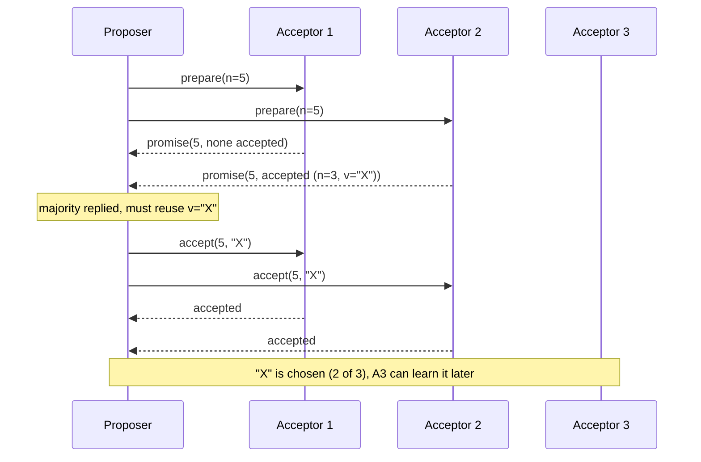
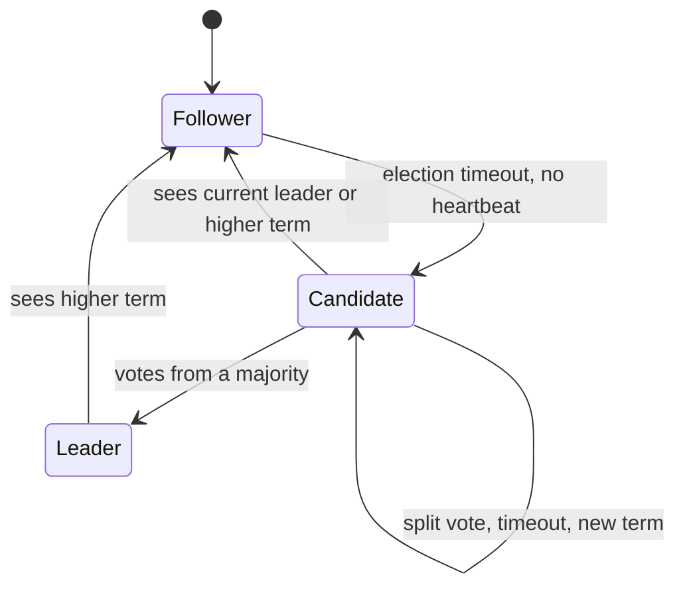
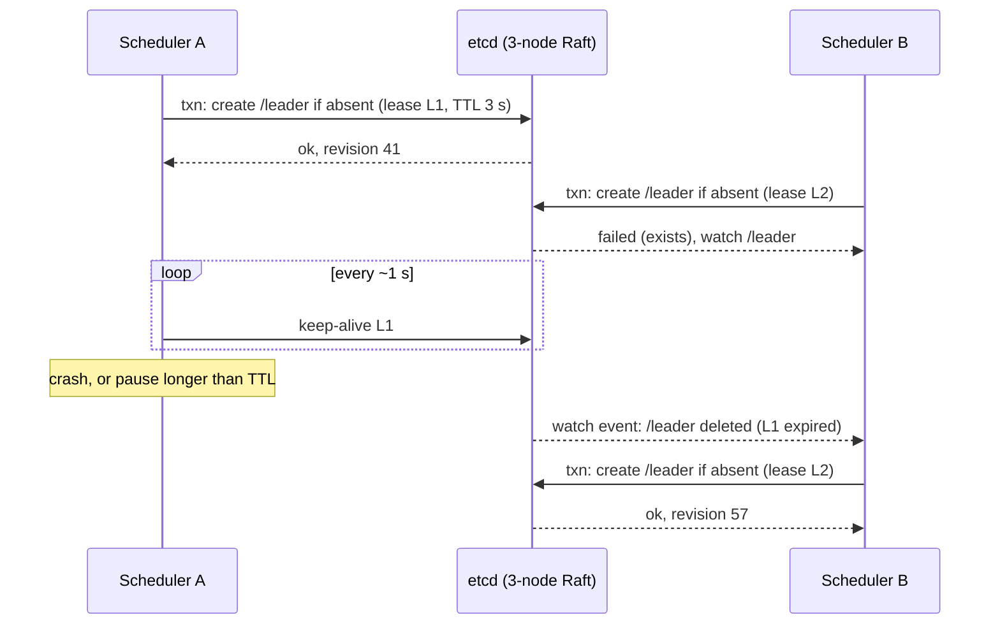
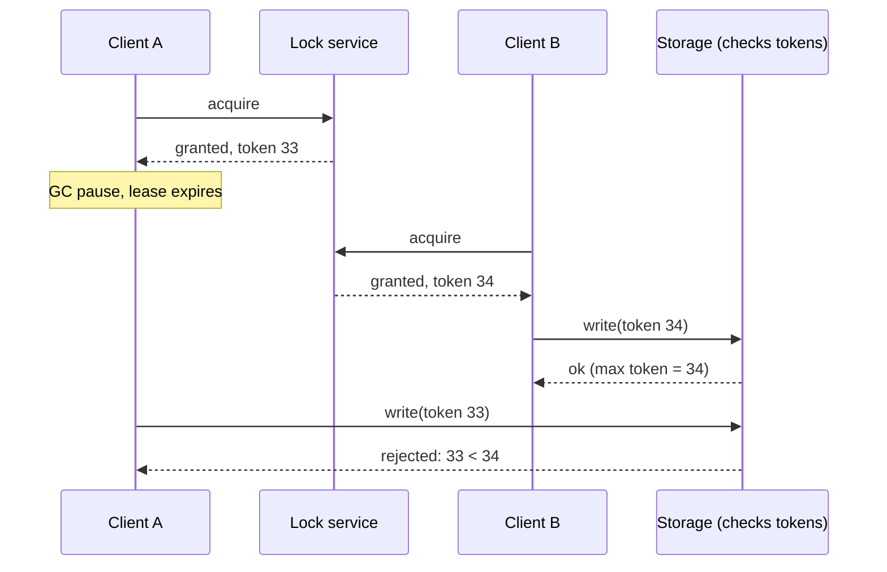
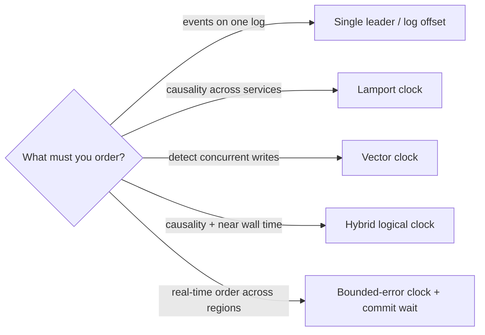

# 09 — Coordination & consensus

> **The requirement.** Lumen, the course's fictional AI knowledge-and-chat product, has two components that must
> never run twice at once: the **job scheduler** that hands document-indexing jobs to GPU workers, and the
> **ledger writer** that records per-tenant token usage for billing. Both run as three replicas, one per availability
> zone. If the active replica dies, another must take over in **under 5 seconds**. Two simultaneously active schedulers
> would double-bill GPU time; two ledger writers would corrupt balances. And every configuration change an operator
> was told "OK" for (a new tenant quota, a feature flag) must survive the loss of any one zone.
> This is hard because the machines cannot tell a dead peer from a slow one, their clocks disagree, and a process can
> freeze for seconds without knowing it.

## In one minute

Coordination is getting several computers to agree on something: who is in charge, what the current configuration
is, which request came first, or what the next ID is. With a single machine this is trivial; with several machines
connected by a network that can delay or lose messages, it is surprisingly hard. The core tool is a **consensus
protocol** such as Raft or Paxos: a small group of servers (usually three or five) that agree on an ordered log of
decisions as long as a majority of them can talk to each other. You rarely run consensus inside your own service.
Instead you lean on a coordination service built on it (etcd, ZooKeeper, Consul) for leader election, locks and
configuration. Two traps catch almost everyone. First, a lock or leadership "lease" can expire while its holder is
paused, so the protected resource must check a **fencing token**. Second, wall clocks lie, so ordering must come from
logical clocks, hybrid clocks or clocks with explicit error bounds. The same ideas give you collision-free unique IDs
and scalable failure detection.

## Why this matters now

Consensus moved from the research papers into the plumbing of nearly every platform team. Kubernetes stores all
cluster state in etcd, and an etcd cluster without a leader means "no new pods can be scheduled" [11]. Kubernetes'
own controllers pick their active replica with **Lease** objects [12]. Apache Kafka 4.0 removed ZooKeeper entirely and
"only supports KRaft mode", its built-in Raft-based metadata quorum [35]. The etcd-io/raft library is used by etcd,
CockroachDB, Dgraph and Docker Swarmkit [6]; TiKV runs its own Rust implementation, raft-rs [39].

Three other things shape how you design this today:

- **Clocks got better, but not perfect.** AWS announced in November 2023 that EC2 instances can synchronize "within
  microseconds of UTC" [25]. Bounded-error clocks, once a Google-only advantage (TrueTime [23]), are now something you
  can ask a cloud for. The error bound still matters, and so does what you do when it widens.
- **Time-ordered IDs became a standard.** RFC 9562 (May 2024) obsoleted RFC 4122 and defined UUIDv7. It says
  implementations SHOULD use UUIDv7 instead of v1 and v6 where possible [26]. PostgreSQL 18 ships a built-in
  `uuidv7()` function [29].
- **The "safe lock" myth got tested in public.** Jepsen's 2020 analysis of etcd 3.4.3 found that etcd locks did not
  guarantee mutual exclusion. With two-second lease TTLs and process pauses injected every five seconds, Jepsen
  reliably lost about 18% of acknowledged updates in its lock test, and recommended fencing with the lock key's
  revision [17]. Correct coordination is now a design skill that interviewers probe, not
  just a library call.

## Core ideas [Core]

### 1. Which coordination problems you actually have

Most systems need some of these, and each maps to a primitive:

| Problem | Example in Lumen | Primitive |
|---|---|---|
| Exactly one active instance | job scheduler, ledger writer | leader election (lease in a consensus store) |
| Mutual exclusion on a resource | re-index one tenant's corpus | lock + fencing token |
| Agreed configuration / membership | tenant quotas, shard map | linearizable key-value store with watches |
| Ordering of events | "was the ACL change before the query?" | logical or hybrid clocks, or a single log |
| Unique identifiers | message IDs, document IDs | UUIDv7 / ULID / Snowflake-style |
| Who is alive | GPU worker pool membership | heartbeats, gossip (SWIM), phi accrual |

Only the first three need **consensus**. The last three can usually be solved *without* it, and avoiding consensus
where you can is a good design instinct. Consensus is safe but costs latency and availability.

### 2. System models: what can go wrong

A protocol is only correct relative to a model of what the world may do to it.

- **Timing.** In a *synchronous* system, message delays and processing times have known upper bounds. In an
  *asynchronous* system there are no bounds at all. Real networks are *partially synchronous*: usually well behaved,
  sometimes arbitrarily slow (GC pauses, congested links, VM migration).
- **Failures.** *Crash-stop*: a node halts and never returns. *Crash-recovery*: it halts and may come back with its
  durable state. *Byzantine*: it may behave arbitrarily, including lying. Tolerating Byzantine faults needs more
  replicas; Lamport, Shostak and Pease's 1982 Byzantine Generals paper is the classic treatment [38]. Datacenter
  systems like etcd assume crash-recovery and non-Byzantine nodes. [SYSDESIGN-11](11-reliability-engineering.md)
  covers the full failure taxonomy, including gray failure.
- **Safety vs liveness.** *Safety* means nothing bad happens: two leaders never commit conflicting decisions.
  *Liveness* means something good eventually happens: a decision is reached. The design rule that runs through this
  whole chapter is **never trade safety for liveness**. Raft states it explicitly: safety "must not depend on timing";
  availability inevitably does [4].

### 3. Consensus and the replicated state machine

**Consensus** means getting a set of processes to agree on a value such that (1) they all decide the same value
(agreement), (2) the value was proposed by someone (validity), and (3) every correct process eventually decides
(termination). Run consensus repeatedly on "what is log entry *i*?" and you get a **replicated log**. Feed the same log
into identical deterministic state machines and every replica computes the same state. That is the
**replicated state machine**, the architecture behind etcd, ZooKeeper, Chubby and the per-shard groups of Spanner and
CockroachDB [4][14][15][23].

### 4. FLP: the impossibility you must be able to state

Fischer, Lynch and Paterson proved in 1985 that in a fully asynchronous system, "no consensus protocol is totally
correct in spite of one fault." Every deterministic protocol has an execution that never terminates, even if only one
process may crash [1]. The intuition is that the protocol cannot distinguish a crashed process from a very slow
one. An adversarial schedule can always delay the one message that would let the system decide.

What FLP does **not** say: it does not say consensus is useless or that it usually fails. Practical protocols escape
it by giving up guaranteed termination *only during periods of bad timing*. Raft and Paxos are always safe and make
progress once the network behaves for long enough for a leader to stay in contact with a majority. Randomized
election timeouts make it overwhelmingly likely that this happens quickly [4]. In an interview, the crisp version is
"FLP means we can't have safety, liveness and full asynchrony at once. We keep safety unconditionally and get
liveness under partial synchrony."

### 5. Quorums: why majorities, and why odd numbers

If every decision needs acknowledgement from a **majority** of *n* servers, any two majorities overlap in at least one
server. That overlap is how a new leader learns what an old leader committed. With *n* = 2*f* + 1 servers the
system tolerates *f* crashed or unreachable servers. The etcd FAQ tabulates the consequence [8]:

| Cluster size | Majority | Failures tolerated |
|---|---|---|
| 1 | 1 | 0 |
| 3 | 2 | 1 |
| 4 | 3 | 1 |
| 5 | 3 | 2 |
| 7 | 4 | 3 |

A fourth member buys no extra fault tolerance and adds a server that must be written to. That is why clusters are
odd-sized. Bigger is not free either: write performance suffers "because data must be replicated across more
machines", and the FAQ suggests no more than seven members [8]. Kubernetes recommends five etcd members for production
[11]; Chubby cells typically had five replicas [15].

### 6. Paxos in one page

Lamport's Paxos [2][3] has three roles: **proposers**, **acceptors** and **learners**. A value is *chosen* when a
majority of acceptors accept the same proposal. *Paxos Made Simple* describes two phases [3]:

1. **Prepare/promise.** A proposer picks a proposal number *n* and sends `prepare(n)` to a majority. An acceptor that
   has not promised a higher number promises to ignore proposals below *n*. It replies with the highest-numbered
   proposal it has already accepted, if any.
2. **Accept.** If the proposer hears back from a majority, it sends `accept(n, v)`. Here *v* is the value of the
   highest-numbered proposal reported in phase 1, or its own value if none was reported. Acceptors accept unless they
   have since promised a higher number.

The rule "adopt the highest previously accepted value" is what preserves safety: once a value may have been chosen,
every later proposal carries it forward. Two proposers can keep pre-empting each other with ever-higher numbers. This
is a live-lock, and Lamport notes it can happen; the fix is to elect a distinguished proposer [3]. Running one Paxos
instance per log slot with a stable leader that skips phase 1 for consecutive slots is **Multi-Paxos**. Multi-Paxos
is close to what Raft makes explicit.

*Diagram: a proposer sends prepare(5) to two of three acceptors; one reports an earlier accepted value "X", so the
proposer's accept phase must propose "X", which a majority accepts and is therefore chosen.*

### 7. Raft in depth

Ongaro and Ousterhout designed Raft (USENIX ATC 2014) explicitly for understandability [4]. It decomposes consensus
into leader election, log replication and safety, and it is the protocol most interviewers expect you to know.

**Server states and terms.** Every server is a **follower**, **candidate** or **leader**. Time is divided into
numbered **terms**, and each term has at most one leader. Terms act as a logical clock. Any message carrying a higher
term makes the receiver update its term, and a leader or candidate that sees one steps down to follower.

*Diagram: Raft server states. Followers become candidates on timeout; a candidate with a majority becomes leader; any
server that sees a higher term reverts to follower.*

**Leader election.** The leader sends periodic heartbeats, which are empty `AppendEntries` RPCs. A follower that hears
nothing for its **election timeout** increments its term, votes for itself and sends `RequestVote` to all servers.
Each server grants at most one vote per term, first come first served. Timeouts are randomized: the paper uses a range
such as 150–300 ms, so one server usually times out first and wins before the others start [4]. In the paper's
experiments, no randomization led to elections taking over 10 seconds because of repeated split votes. Adding just
5 ms of randomness brought the median downtime to 287 ms [4].

**The voting restriction.** A server refuses its vote if its own log is *more up to date* than the candidate's.
Up-to-date compares the term of the last entry first and the log length second [4]. Because a committed entry is on a
majority, and a winner needs a majority of votes, at least one voter holds every committed entry. That voter blocks
any candidate missing it. This is the key to **Leader Completeness**.

**Log replication.** Clients send commands to the leader. The leader appends each command to its log and replicates it
with `AppendEntries`. Every `AppendEntries` carries the index and term of the entry just before the new ones. A
follower rejects the RPC if its log has no entry with that index and term. On rejection the leader backs up and
retries until the logs agree, then overwrites the follower's conflicting suffix. This consistency check is what
guarantees the **Log Matching** property [4].

**The commit rule.** An entry is **committed** once the leader that created it has stored it on a majority. The leader
then applies it and answers the client. A subtle rule is the one interviewers love: **a leader only commits entries
from its current term by counting replicas.** Older-term entries become committed indirectly once a current-term
entry after them commits [4]. The paper's Figure 8 shows why. An old entry can sit on a majority and still be
overwritten by a later leader that never had it, if the old entry was never committed in its own term.

**The five safety properties** Raft guarantees [4]:

1. *Election Safety*: at most one leader per term.
2. *Leader Append-Only*: a leader never overwrites or deletes its own entries.
3. *Log Matching*: if two logs have an entry with the same index and term, they are identical up to that index.
4. *Leader Completeness*: a committed entry is present in the logs of all leaders of later terms.
5. *State Machine Safety*: no two servers ever apply different entries at the same index.

**Timing requirement.** Raft stays available if `broadcastTime ≪ electionTimeout ≪ MTBF` [4]. The paper estimates
broadcast time at 0.5–20 ms depending on storage, because RPC receivers persist to disk. It concludes that election
timeouts are "likely to be somewhere between 10ms and 500ms" [4]. etcd's defaults are a 100 ms heartbeat and a
1000 ms election timeout. Its tuning guide says the election timeout must be at least 10× the round-trip time [7].

**Membership changes.** You cannot switch every server from configuration C_old to C_new at the same instant. During a
naive switch, two disjoint majorities could each elect a leader. The Raft paper uses **joint consensus**: a transitional
configuration C_old,new in which decisions need separate majorities of *both* C_old and C_new. Once that is committed,
the leader moves to C_new [4]. Ongaro's dissertation also describes the simpler alternative of adding or removing
**one server at a time**. Any majority of the old and the new configuration then necessarily overlap [5]. The
etcd-io/raft library keeps the invariant that membership changes happen one node at a time, and also supports
joint consensus through `ConfChangeV2` [6]. Two operational corollaries from the etcd FAQ:
in a degraded three-member cluster, *remove the dead member before adding its replacement*, and etcd by default
rejects member additions that could cost the cluster its quorum [8].

**Disruptive servers and Pre-Vote.** A server that was partitioned away keeps timing out and incrementing its term.
When it reconnects, its high term forces a healthy leader to step down. The dissertation's **Pre-Vote** extension
(§9.6) makes a would-be candidate first ask whether it *could* win, without incrementing its term [5]. etcd exposes
this as `--pre-vote`, documented as enabled by default in current releases, "to prevent disruption when a node that
has been partitioned away rejoins the cluster" [9].

**Log compaction.** Logs cannot grow forever. Each server periodically snapshots its state machine and discards the
log prefix. A follower that has fallen too far behind receives an `InstallSnapshot` RPC [4].

### 8. Leader election as a service

You almost never implement Raft to elect *your* leader. Instead your replicas race to create a key in a consensus
store, and the key is attached to a **lease** (a TTL the holder must keep renewing):

1. Each replica tries an atomic "create key `/lumen/scheduler/leader` if absent", attached to its lease.
2. The winner is leader while it keeps its lease alive (`lease keep-alive` in etcd).
3. The others **watch** the key. When the lease expires or the leader deletes the key, they race again.

ZooKeeper builds the same recipe from **ephemeral** znodes, deleted when the client session ends, and **sequential**
znodes, which get a monotonically increasing counter appended. Each candidate creates an ephemeral sequential node,
and the lowest number leads [14][36]. Kubernetes control-plane components use Lease objects in `coordination.k8s.io`
for the same purpose. Since v1.33 an optional, beta *coordinated leader election* can also choose the leader with
version-skew constraints in mind during upgrades [12][13].

*Diagram: two schedulers race to create a leader key bound to a lease; A wins at revision 41 and renews; when A's
lease expires etcd notifies B through a watch, and B takes over at revision 57.*

### 9. Leases and fencing tokens: the part people get wrong

A lease guarantees that *the lock service* will not grant the lock to someone else before the TTL expires. It cannot
guarantee that *the holder* still knows whether its lease is valid. Kleppmann's example [16]: client 1 acquires a
lease, then hits a long stop-the-world GC pause. The lease expires and client 2 acquires it. Client 1 wakes up, still
believes it holds the lock, and writes, corrupting data. Checking the expiry just before writing does not help,
because the pause can fall between the check and the write [16].

The fix is a **fencing token**: a number that increases every time the lock is granted. The holder attaches it to every
write, and **the protected resource** remembers the highest token it has seen and rejects lower ones [16]. Chubby
called these *sequencers* [15]. In ZooKeeper you can use the zxid or znode version [16]. In etcd, the lock key's
revision is monotonic and suitable, which is exactly what Jepsen recommended [17].

*Diagram: client A gets token 33 then pauses; its lease expires and B gets token 34 and writes; when A wakes and
writes with token 33, storage rejects it because it has already seen 34.*

Two consequences for design. First, if the resource cannot check tokens (a legacy API, an email being sent), no lock
makes the operation safe. Make the operation idempotent instead
([SYSDESIGN-08](08-async-event-driven.md) covers idempotency keys). Second, Kleppmann's critique of Redlock follows
directly. Redlock issues no fencing tokens, and its safety depends on bounded network delay, bounded pauses and
well-behaved clocks [16]. In Jepsen's words, use locks to *reduce* concurrency for efficiency, and do not rely on the
lock alone for safety [17].

For Lumen, the ledger writer gets the etcd revision of its leader key as a token and stores `max_token` in the ledger
database itself. Every ledger transaction runs `UPDATE ... WHERE max_token <= :token`. A deposed writer's transactions
then fail.

### 10. Time and clocks

**Physical clocks.** Every machine has a quartz clock that drifts, disciplined by NTP. RFC 5905 describes NTPv4 clients
on fast LANs as typically "within a few hundred microseconds" and in general "within a few tens of milliseconds" [24].
Clocks can also *step*, jumping forwards or backwards on resynchronization. Use the **monotonic** clock to measure
durations and timeouts. Never compare wall-clock timestamps from two machines to decide which event came first unless
you know their error bound. Last-write-wins on raw wall clocks silently drops writes when a clock runs fast.

**Lamport clocks.** Lamport (1978) defined *happened-before* (→): *a* → *b* if they are on the same process in that
order, or *a* sends a message that *b* receives, or by transitivity [18]. A **Lamport clock** is a counter per process.
The rules are to increment it between events (IR1), stamp each message with it, and on receipt set it greater than
both its current value and the message's stamp (IR2) [18]. This guarantees *a* → *b* ⇒ C(*a*) < C(*b*). Breaking ties
by process ID gives a total order consistent with causality. The converse does not hold: C(*a*) < C(*b*) does not mean
*a* caused *b*.

**Vector clocks.** Described by Mattern [19], who notes that Fidge proposed the same idea independently, a vector
clock keeps one counter *per process*.
Comparing two vectors tells you whether *a* → *b*, *b* → *a*, or they are **concurrent**. This is what you need to
detect conflicting writes. Dynamo used vector clocks of (node, counter) pairs to detect divergent object versions and
hand them to the application to reconcile. To bound their size, it removed the oldest pair once the clock passed a
threshold ("say 10") [20]. The cost is size that grows with the number of writers.

**Hybrid logical clocks (HLC).** Kulkarni et al. (2014) combine both [21]. An HLC timestamp is a pair (*l*, *c*): *l*
tracks the largest physical time seen so far, and *c* is a logical counter that breaks ties. On a local or send event,
*l* := max(*l*, *pt*); if *l* did not change, *c* is incremented, otherwise *c* resets. On receive, *l* takes the max of
local, message and physical time, with *c* adjusted the same way [21]. HLC preserves the Lamport guarantee
(*a* → *b* ⇒ hlc(*a*) < hlc(*b*)), stays within the clock-synchronization error of physical time, and fits in a
64-bit NTP-format timestamp [21]. CockroachDB timestamps every transaction with an HLC. A node whose clock is out of
sync with at least half of the other nodes by 80% of the configured maximum offset crashes rather than risk anomalies
[22].

**TrueTime.** Spanner turns clock uncertainty into an API [23]. `TT.now()` returns an interval [earliest, latest]
guaranteed to contain the true time. Time masters with GPS receivers or atomic clocks keep the half-width ε small: in
the paper's production environment ε was a sawtooth from about 1 to 7 ms, so ε̄ was 4 ms most of the time [23]. To get
external consistency, a transaction's coordinator picks a commit timestamp *s* and then **commit-waits** until
`TT.after(s)` is true before making the write visible. The expected wait is at least 2ε̄, and it overlaps with Paxos
communication [23]. Spanner turns uncertainty into latency, which is why shrinking ε matters.

*Diagram: choosing a clock. Use a single log for one stream, Lamport clocks for causal order, vector clocks to detect
concurrency, HLC for causal order close to wall time, and a bounded-error clock with commit wait for real-time order
across regions.*

### 11. Unique IDs without coordination

Requirements to clarify first: globally unique? sortable by time? compact (64-bit fits a `BIGINT`)? unguessable? how
many per second? The common options:

- **Database sequence / auto-increment.** Simple, compact and strictly ordered, but a single point of coordination.
  It can be scaled by handing each application server a *range* of IDs at a time.
- **UUIDv4.** 122 random bits, no coordination, but random order fragments B-tree indexes.
- **UUIDv7** (RFC 9562). A 48-bit Unix-millisecond timestamp, 4 version bits, 12 bits `rand_a`, 2 variant bits and
  62 bits `rand_b`. The RFC offers methods to stay monotonic within a millisecond, such as a counter in `rand_a` or
  sub-millisecond precision [26]. IDs sort by creation time, so inserts land at the right edge of an index.
- **ULID.** 48-bit millisecond timestamp plus 80 random bits, written as 26 Crockford base32 characters. A monotonic
  mode increments the random part within a millisecond [27].
- **Snowflake-style 64-bit IDs.** Twitter's 2010 design uses a 41-bit millisecond timestamp on a custom epoch (about
  69 years), a 10-bit machine ID and a 12-bit per-machine sequence. The result is "roughly time ordered" and fits
  in 64 bits. It refuses to generate IDs if the clock moves backward [28]. The machine ID must be unique. That is a
  coordination problem, often solved once at startup with a lease in etcd or ZooKeeper.

### 12. Gossip and failure detection

Consensus groups are small. A pool of 2,000 GPU workers needs a different way to know who is alive.

- **All-to-all heartbeats** cost O(*n*²) messages: 2,000 workers each heartbeating the other 1,999 once a second is
  2,000 × 1,999 ≈ 4 million messages/s.
- **SWIM** (Das, Gupta, Motivala, DSN 2002) separates failure *detection* from membership *dissemination* [30]. Each
  protocol period, a member pings one random peer. If no ack arrives, it asks *k* other members to `ping-req` the target
  on its behalf, which filters out problems local to one link. A non-responding member is first marked *suspected*
  rather than dead. Membership updates are piggybacked on pings and acks, so they spread "infection-style". The
  result is a constant message load per member and expected detection time independent of group size [30].
  HashiCorp's memberlist library is based on SWIM [33].
- **Phi accrual detectors** (Hayashibara et al., SRDS 2004) output a continuous suspicion level instead of a yes/no
  [31]. From recent heartbeat inter-arrival times the detector computes φ = −log₁₀(P_later(t_now − T_last)), where
  P_later is the probability that a heartbeat arrives later than the time already waited [31]. φ = 1 roughly means a
  10% chance the suspicion is wrong, φ = 2 means 1%, and so on. Each application picks its own threshold [31]. Cassandra
  marks a host down at `phi_convict_threshold: 8` by default [32].

A failure detector can only ever say "suspected". You cannot distinguish dead from slow, which is FLP again. Use
detectors for *routing* decisions (stop sending work). Use consensus plus fencing for *safety* decisions (who may
write).

## Numbers that matter

All inputs are either sourced or labeled **assumption**.

**1. How many members, and where?** Lumen must survive the loss of one zone. Three members, one per zone, tolerate one
failure (table in §5, [8]). Five members placed 2-2-1 survive a whole zone loss (3 of 5 left) *or* any two member
failures, but not both at once: a two-member zone plus one more member leaves 2 of 5. Count the members one
correlated failure removes, add the independent failures, and check that a majority remains (exercise 1).

**2. Write latency.** A Raft write commits when the leader and enough followers to form a majority have appended and
fsynced it. For three members, that means the leader plus the faster follower.

- Assumption: inter-zone round trip 1 ms. etcd's FAQ target is WAL fsync p99 < 10 ms [8]; assume a healthy SSD at
  about 2 ms.
- Commit latency ≈ max(leader fsync, RTT + follower fsync) ≈ max(2, 1 + 2) ≈ **3 ms**, plus client-to-leader RTT.
- Spread the same three members across regions with an assumed 70 ms RTT, and every write costs **at least ~70 ms**.
  That is the cost of cross-region quorums ([SYSDESIGN-15](../02-modern-requirements/15-multi-region-edge.md)).

**3. Failover time.** For the scheduler (target < 5 s):

- etcd's own leader failover takes about one election timeout: the default is 1000 ms [7], plus randomization and one
  vote round trip. Expect **1–2 s**. The lab measures it on your laptop.
- The *application* leader lease is separate. With TTL = 3 s the typical failover is up to one TTL plus watch
  latency, about **3.3–3.6 s** (the lab saw 2.3–2.6 s with a 2 s TTL). If the etcd leader dies at the same moment,
  add one etcd election (about 1–2 s): the worst case is **4–5 s**, at the edge of the < 5 s target, not
  comfortably inside it. Shorter TTLs (2 s, keep-alive every 500 ms) buy margin but are revoked more often by
  pauses. Jepsen saw the most lock violations with 1–3 s TTLs, which is one more reason to fence [17].

**4. Commit wait.** With TrueTime's ε̄ ≈ 4 ms, the expected commit wait is at least 2ε̄ ≈ **8 ms** per read-write
transaction, overlapped with Paxos [23]. With an assumed cloud clock bound under 100 µs, the same rule would cost under 0.2 ms.
This is an *assumption*: AWS's announcement says only "within microseconds of UTC" and publishes no fixed bound
[25], so read the error bound your instance reports rather than trusting a constant.

**5. ID capacity.**

- Snowflake: 2¹² = 4,096 IDs per millisecond per machine ≈ **4.1 million IDs/s per machine**, 2¹⁰ = 1,024 machines.
  2⁴¹ ms ≈ 2.2 × 10¹² ms ≈ **69.7 years** of timestamps [28].
- UUIDv7 with purely random `rand_a` + `rand_b` has 74 random bits per millisecond. The birthday bound for *k* IDs
  generated in the same millisecond gives collision probability ≈ *k*² / 2⁷⁵. At *k* = 10⁶ IDs in one millisecond
  that is ≈ 10¹² / 3.8 × 10²² ≈ **3 × 10⁻¹¹**. It is negligible unless your generator's randomness is broken.

## Design choices and trade-offs

**Coordination substrate**

| Option | Wins when | Costs | Example systems |
|---|---|---|---|
| etcd (Raft, KV + leases + watch) | you need linearizable config, leader election and locks; you already run Kubernetes | small data (the store is meant for metadata); disk-latency sensitive | Kubernetes control plane [11] |
| ZooKeeper (Zab, znodes + watches) | mature JVM ecosystems; recipes (locks, barriers, queues) | reads are served locally and are not linearizable by default (use `sync`) [14]; extra cluster to run | Hadoop and HBase ecosystems; Kafka before 4.0 [35] |
| Embedded Raft library | your own database or broker; you need a per-shard log | you own correctness, testing, membership tooling | CockroachDB with etcd-io/raft [6]; TiKV with raft-rs [39]; Kafka KRaft [35] |
| Conditional writes in your existing DB | one leader, low churn, DB already highly available | leadership tied to DB availability; still needs fencing | `UPDATE … WHERE version = ?` lease rows |
| No coordination (CRDTs, idempotence) | merges are commutative; duplicates are harmless | not every invariant can be expressed this way | counters, sets ([SYSDESIGN-06](06-replication-consistency.md)) |

**Clocks**

| Clock | Gives you | Does not give you | Size |
|---|---|---|---|
| Wall clock (NTP) | human time, coarse ordering | safe cross-node ordering | 64 bits |
| Lamport | order consistent with causality | detection of concurrency | 1 counter |
| Vector | exact causality and concurrency | compactness | 1 counter per writer |
| HLC | causality + closeness to wall time | real-time order beyond the skew bound | 64 bits [21] |
| TrueTime-style interval | external consistency with commit wait | free lunch: latency ≈ 2ε | interval |

**Unique IDs**

| Scheme | Sortable | Size | Coordination | Watch out for |
|---|---|---|---|---|
| DB sequence (ranges) | yes | 64-bit | central allocator | allocator availability |
| UUIDv4 | no | 128-bit | none | index fragmentation |
| UUIDv7 | yes (ms) | 128-bit | none | leaks creation time |
| ULID | yes (ms) | 128-bit, 26 chars | none | monotonic mode is per generator |
| Snowflake-style | roughly | 64-bit | unique worker IDs | clock going backwards, worker-ID reuse |

## Deep dive [Deep]

### Why Raft refuses to commit old-term entries by counting

Take five servers S1–S5. In term 2, leader S1 replicates entry *e* (index 2) to S2 only, then crashes. S5 wins term 3
with votes from S3 and S4, whose logs are no less up to date than S5's. S5 appends a different entry at index 2 and
crashes before replicating it. S1 returns and wins term 4. It pushes *e* to S3, so *e* is now on a majority (S1, S2,
S3). If S1 declared *e* committed now and crashed, S5 could still win term 5. Its last entry has term 3, which is more
up to date than *e*'s term 2, so S2, S3 and S4 would vote for it. S5 would then overwrite *e* everywhere: a committed
entry lost. Raft therefore only declares *e* committed once an entry *from term 4* is on a majority. Any later winner
must then have a term-4 entry, which S5 does not [4]. When you explain this in an interview, the point to land is
that **"on a majority" is not the same as "committed"**. Commitment is tied to the current term.

### Linearizable reads are not free

Sending every read through the log is safe but slow. etcd-io/raft supports two optimizations [6]:

- **ReadIndex.** The leader records its commit index and confirms with a heartbeat round to a majority that it is
  still leader. It then serves the read once that index is applied. Followers can serve reads too by asking the leader
  for the read index. This costs one round trip and no disk write.
- **Lease-based reads.** The leader skips the round trip because it assumes no one else can be elected before its
  lease ends. This relies on bounded clock drift across machines [6]. It brings the clock assumption back into the
  safety argument.

In etcd's API the default range read is linearizable. A `serializable` read is answered from the member's local state
and may be stale, but it still works when quorum is lost. The lab demonstrates both.

### Pre-Vote, CheckQuorum and leadership transfer

Pre-Vote (§7) stops a rejoining server from inflating terms [5]. The complementary mechanism is for a leader that
cannot reach a majority to step down on its own: the etcd raft library lists "automatic stepping down when the leader
loses quorum" [6]. Without it, a leader isolated in a minority partition would keep believing it leads, although it
can no longer commit anything. **Leadership transfer** hands leadership to a chosen follower before maintenance, to
avoid a full election timeout [6].

### Paxos vs Raft, and leases at two levels

Both protocols use majority quorums and have the same fault tolerance. Raft forces a strong leader and lets only
up-to-date candidates win, so a new leader never has to fetch missing entries from others. Viewstamped Replication,
by contrast, needs extra mechanism for that [4]. Production Paxos variants (Multi-Paxos in Chubby and Spanner
[15][23]) fill in membership and compaction differently. For system design, treat Raft and Paxos as interchangeable
building blocks.

Leases appear *inside* consensus too. Spanner's Paxos leaders hold timed leases, 10 s by default, so they can serve
reads locally [23]. At both levels the discipline is the same. The holder must stop acting *before* the lease can have
expired from anyone else's point of view, with a margin for clock drift.

## Frontier [Frontier]

*(as of 2026-11)*

- **etcd v3.7** (July 2026) added a streaming `RangeStream` API for large reads and removed the last of the legacy
  v2 store; the server now bootstraps entirely from the v3 store [34]. The current patch release is v3.7.4 (2026-11),
  with v3.6.x and v3.5.x still receiving patches [37]. The lab pins v3.7.4.
- **Kafka without ZooKeeper.** Kafka 4.0 supports only KRaft, a Raft-based controller quorum. ZooKeeper-mode clusters
  must migrate to KRaft before upgrading [35]. Consensus moved *inside* the system that needed it, removing a separate
  coordination cluster to operate.
- **Coordinated leader election in Kubernetes** (beta since v1.33, off by default) chooses leaders deliberately for
  version-skew safety during upgrades, using LeaseCandidate objects [13].
- **Bounded-error clocks as a cloud service** (EC2 over NTP and a PTP hardware clock [25]) make TrueTime-style
  commit wait cheap. Safety still has to hold when the bound degrades.
- **UUIDv7 everywhere** [26][29]: the default for new schemas where exposing creation time is acceptable.

## Failure modes and operations

| Failure | What you see (SLI) | Mitigation |
|---|---|---|
| **Election storm / flapping leader**: slow disk or CPU starvation delays heartbeats | `etcd_server_leader_changes_seen_total` rising; "failed to send out heartbeat on time" warnings [8][10] | dedicated low-latency disks (WAL fsync p99 < 10 ms, backend commit p99 < 25 ms [8]); tune heartbeat/election to measured RTT [7] |
| **Quorum loss**: majority down or partitioned | `etcd_server_has_leader` = 0 on all members; `etcd_server_proposals_failed_total` up [10] | spread members across failure domains; alert before the second loss; documented snapshot-restore runbook |
| **Wrong membership change**: adding a member to a degraded cluster | quorum size rises, cluster stalls | remove dead member first; rely on etcd's default guard [8] |
| **Expired lease, paused holder** (GC, VM stall) | duplicate side effects; ledger anomalies | fencing tokens checked by the resource [16][17]; idempotent operations |
| **Clock step / skew** | negative durations; LWW losing writes; Snowflake generator refusing IDs [28] | monotonic clocks for timeouts; HLC or bounded clocks for ordering; alert on NTP offset |
| **Disruptive rejoining node** | term jumps, needless leader changes | Pre-Vote (default in current etcd [9]) |
| **Worker-ID reuse in Snowflake-style IDs** | duplicate primary keys | allocate worker IDs with a lease, never by hand |
| **False failure suspicion in gossip** | healthy nodes evicted and re-added | SWIM suspicion + indirect probes [30]; phi threshold tuned per environment [31][32] |

Operating rules: keep coordination data small, since etcd and ZooKeeper are for metadata. Monitor the disk, because
slow fsync is the usual cause of etcd instability [8]. Test failures, not just success: kill the leader and pause a
client past its TTL, as in the lab [17]. Back up and rehearse restores [11].

## Cost and energy

Coordination clusters are small (three or five modest machines with fast disks); their real cost is **what their
failure costs you**. Three levers move the bill:

- **5 vs 3 members:** about two-thirds more storage and replication traffic and a little more write latency [8], in
  exchange for surviving two failures.
- **Cross-region quorums:** an inter-region RTT on every write and transfer charges on every entry. Keep groups
  regional and replicate asynchronously across regions ([SYSDESIGN-15](../02-modern-requirements/15-multi-region-edge.md)).
- **Avoiding coordination:** idempotent, commutative designs skip quorum round trips, fsyncs and messages, which is
  also energy.

## Interview angle

Typical prompts: *"Design a distributed lock service"*, *"Design a unique ID generator"*, *"How do you ensure only
one instance of a cron job runs?"*, *"Explain Raft"*, *"What happens when the leader is partitioned?"* Walk the course
framework:

- **CLARIFY.** Is mutual exclusion needed for *correctness* or only for *efficiency*? Can the protected resource check
  a token? What failover time is acceptable? How many IDs per second, sortable, 64- or 128-bit?
- **QUANTIFY.** Number of failures to tolerate gives cluster size (2*f* + 1). RTT plus fsync gives write latency.
  Election timeout plus lease TTL gives failover time. Bits per field give ID capacity.
- **SKETCH.** Three or five etcd/ZooKeeper members across zones. Clients hold leases and watch keys. Resources check
  fencing tokens.
- **DEEPEN.** The Raft election and commit rule. Why fencing is needed (the GC-pause story). Linearizable vs
  serializable reads. Membership changes.
- **STRESS.** Leader partitioned into the minority, two of three down, clock jump, paused client, disk latency spike.
- **WRAP.** State the guarantees: safe under any timing, available while a majority is connected. Name the one
  remaining risk: resources that cannot check tokens need idempotent operations.

**Five-line model answer, "only one scheduler must run":**
1. Run three replicas; each tries to create `/scheduler/leader` in etcd bound to a 3 s lease and keeps it alive.
2. Non-leaders watch the key and contend when it disappears; failover ≈ TTL + watch latency (≈ 3.5 s, 4–5 s if etcd's own
   leader fails at the same moment, so fence rather than rely on the margin).
3. The leader passes the leader key's revision as a fencing token with every job assignment. Workers and the job
   table reject lower tokens.
4. etcd itself is a three-member Raft cluster across zones and tolerates one zone loss.
5. Job execution is idempotent (job ID as idempotency key), so a duplicate that slips past still has no effect.

**Red flags:** "Use Redis `SETNX` with a TTL, that's a lock" with no fencing. "Two nodes are enough for HA." "Compare
timestamps from different servers to order events." "Consensus is impossible because of FLP." Treating a failure
detector's verdict as certain.

**Follow-ups to expect:** Why odd cluster sizes? What does a leader in a minority partition do? Why can't you just
check that the lease is still valid before writing? How does Spanner get externally consistent timestamps? What breaks
in Snowflake when NTP steps the clock back?

## Common mistakes

- Treating a lease or lock as a correctness guarantee without a fencing token checked by the resource.
- Running an even number of members, or putting three members in two zones (losing the zone with two loses quorum).
- Putting large or high-churn data into etcd or ZooKeeper.
- Using wall-clock time for timeouts or for cross-node ordering.
- Assuming "replicated to a majority" means "committed" for an entry from an older term.
- Setting election timeouts close to the network RTT, which causes leader flapping [7].
- Using consensus where idempotence or CRDTs would do.

## Check yourself

1. A five-member etcd cluster is split 2 | 3 by a partition, and the old leader is on the 2-side. What happens on
   each side, and to clients writing to each side?
2. Why does Raft compare the *term* of the last log entry before comparing log length when granting votes?
3. Your lock service grants leases with a 10 s TTL, and the client checks remaining TTL before each write. Give a
   concrete schedule that still corrupts data, and the fix.
4. Lamport clock says C(*a*) = 7 and C(*b*) = 9. Can you conclude *a* happened before *b*? What clock would let you
   decide?
5. How many Snowflake IDs per second can 100 workers generate, and for how long before the timestamp field wraps?

Full set with answers: [exercises/09-coordination-consensus.md](../../exercises/09-coordination-consensus.md).

## Lab

**L09: Kill the leader** ([labs/09-coordination-consensus/](../../labs/09-coordination-consensus/README.md)). Start a
three-member etcd v3.7.4 cluster, SIGKILL the leader and time the new election and first write. Stop two of three
members and watch linearizable requests fail while serializable (possibly stale) reads answer. Finally, pause a
lock holder past its TTL: without fencing its stale write wins; with the etcd revision as a fencing token, the store
rejects it.

## Further reading

- Ongaro & Ousterhout, Raft (2014) [4]. Read §5 twice; Figure 2 is the whole protocol on one page.
- Ongaro's dissertation (2014) [5]. Single-server membership changes and Pre-Vote.
- Lamport, *Paxos Made Simple* (2001) [3]. The clearest statement of why the two phases are needed.
- Kleppmann, *How to do distributed locking* (2016) [16]. The fencing-token argument.
- Jepsen, *etcd 3.4.3* (2020) [17]. What actually happens to locks under pauses and partitions.
- Corbett et al., *Spanner* (2012) [23], §3. Clock uncertainty as an API.
- Das, Gupta & Motivala, *SWIM* (2002) [30]. Scalable membership.

## References

All URLs accessed 2026-11-20 unless noted.

1. M. J. Fischer, N. A. Lynch, M. S. Paterson. "Impossibility of Distributed Consensus with One Faulty Process."
   *Journal of the ACM* 32(2):374–382, 1985. https://doi.org/10.1145/3149.214121 (DOI returns HTTP 403 to scripts; bibliographic data checked via Crossref; full text:
   https://www.cs.princeton.edu/courses/archive/spring22/cos418/papers/flp.pdf)
2. L. Lamport. "The Part-Time Parliament." *ACM Transactions on Computer Systems* 16(2):133–169, 1998.
   https://www.microsoft.com/en-us/research/publication/part-time-parliament/
3. L. Lamport. "Paxos Made Simple." 2001. https://lamport.azurewebsites.net/pubs/paxos-simple.pdf
4. D. Ongaro, J. Ousterhout. "In Search of an Understandable Consensus Algorithm." USENIX ATC 2014, pp. 305–319.
   https://www.usenix.org/conference/atc14/technical-sessions/presentation/ongaro (extended version:
   https://raft.github.io/raft.pdf)
5. D. Ongaro. "Consensus: Bridging Theory and Practice." PhD dissertation, Stanford University, 2014.
   https://purl.stanford.edu/qr033xr6097 (PDF: https://github.com/ongardie/dissertation)
6. etcd-io/raft. README: features and notable users. https://github.com/etcd-io/raft (joint-consensus
   `ConfChangeV2` transitions: https://github.com/etcd-io/raft/blob/main/raftpb/raft.proto)
7. etcd documentation v3.6. "Tuning." https://etcd.io/docs/v3.6/tuning/
8. etcd documentation v3.6. "Frequently Asked Questions (FAQ)." https://etcd.io/docs/v3.6/faq/
9. etcd documentation v3.7. "Configuration options" (`--pre-vote`). https://etcd.io/docs/v3.7/op-guide/configuration/
10. etcd documentation v3.6. "Metrics." https://etcd.io/docs/v3.6/metrics/
11. Kubernetes documentation. "Operating etcd clusters for Kubernetes."
    https://kubernetes.io/docs/tasks/administer-cluster/configure-upgrade-etcd/
12. Kubernetes documentation. "Leases." https://kubernetes.io/docs/concepts/architecture/leases/
13. Kubernetes documentation. "Coordinated Leader Election."
    https://kubernetes.io/docs/concepts/cluster-administration/coordinated-leader-election/
14. P. Hunt, M. Konar, F. P. Junqueira, B. Reed. "ZooKeeper: Wait-free Coordination for Internet-scale Systems."
    USENIX ATC 2010. https://www.usenix.org/conference/usenix-atc-10/zookeeper-wait-free-coordination-internet-scale-systems
15. M. Burrows. "The Chubby lock service for loosely-coupled distributed systems." OSDI 2006.
    https://www.usenix.org/legacy/event/osdi06/tech/full_papers/burrows/burrows.pdf
16. M. Kleppmann. "How to do distributed locking." 8 February 2016.
    https://martin.kleppmann.com/2016/02/08/how-to-do-distributed-locking.html
17. Jepsen (K. Kingsbury). "etcd 3.4.3." 30 January 2020. https://jepsen.io/analyses/etcd-3.4.3
18. L. Lamport. "Time, Clocks, and the Ordering of Events in a Distributed System." *Communications of the ACM*
    21(7):558–565, 1978. https://doi.org/10.1145/359545.359563 (DOI returns HTTP 403 to scripts; bibliographic data checked via Crossref; PDF: https://lamport.azurewebsites.net/pubs/time-clocks.pdf)
19. F. Mattern. "Virtual Time and Global States of Distributed Systems." 1989.
    https://pages.cs.wisc.edu/~remzi/Classes/739/Fall2018/Papers/mattern89.pdf
20. G. DeCandia et al. "Dynamo: Amazon's Highly Available Key-value Store." SOSP 2007.
    https://www.allthingsdistributed.com/files/amazon-dynamo-sosp2007.pdf
21. S. Kulkarni, M. Demirbas, D. Madappa, B. Avva, M. Leone. "Logical Physical Clocks." OPODIS 2014, LNCS 8878.
    https://doi.org/10.1007/978-3-319-14472-6_2 (tech report: https://cse.buffalo.edu/tech-reports/2014-04.pdf)
22. Cockroach Labs. "Transaction Layer" (CockroachDB architecture docs, stable).
    https://docs.cockroachlabs.com/docs/stable/architecture/transaction-layer
23. J. C. Corbett et al. "Spanner: Google's Globally-Distributed Database." OSDI 2012.
    https://www.usenix.org/conference/osdi12/technical-sessions/presentation/corbett
24. D. Mills, J. Martin (Ed.), J. Burbank, W. Kasch. RFC 5905, "Network Time Protocol Version 4: Protocol and
    Algorithms Specification." June 2010. https://www.rfc-editor.org/rfc/rfc5905
25. AWS. "Amazon Time Sync Service now supports microsecond-accurate time." 16 November 2023.
    https://aws.amazon.com/about-aws/whats-new/2023/11/amazon-time-sync-service-microsecond-accurate-time
26. K. Davis, B. Peabody, P. Leach. RFC 9562, "Universally Unique IDentifiers (UUIDs)." May 2024.
    https://www.rfc-editor.org/rfc/rfc9562
27. ULID specification. https://github.com/ulid/spec
28. Twitter. Snowflake README (2010 branch; repository archived 2021).
    https://github.com/twitter-archive/snowflake/tree/snowflake-2010
29. PostgreSQL 18 documentation. "UUID Functions." https://www.postgresql.org/docs/18/functions-uuid.html
30. A. Das, I. Gupta, A. Motivala. "SWIM: Scalable Weakly-consistent Infection-style Process Group Membership
    Protocol." DSN 2002, pp. 303–312, doi:10.1109/DSN.2002.1028914.
    https://www.cs.cornell.edu/projects/Quicksilver/public_pdfs/SWIM.pdf
31. N. Hayashibara, X. Défago, R. Yared, T. Katayama. "The φ Accrual Failure Detector." SRDS 2004, pp. 66–78
    (JAIST tech report IS-RR-2004-010). https://dspace02.jaist.ac.jp/dspace/bitstream/10119/4784/1/IS-RR-2004-010.pdf
32. Apache Cassandra. `conf/cassandra.yaml` (trunk), `phi_convict_threshold`.
    https://github.com/apache/cassandra/blob/trunk/conf/cassandra.yaml
33. HashiCorp. memberlist. https://github.com/hashicorp/memberlist
34. etcd blog. "Announcing etcd v3.7.0." July 2026. https://etcd.io/blog/2026/announcing-etcd-3.7/
35. Apache Kafka 4.0 documentation. "Upgrading." https://kafka.apache.org/40/getting-started/upgrade/
36. Apache ZooKeeper. "ZooKeeper Recipes and Solutions." https://zookeeper.apache.org/doc/current/recipes.html
37. etcd-io/etcd. GitHub releases (v3.7.4, v3.6.17, v3.5.36, November 2026). https://github.com/etcd-io/etcd/releases
38. L. Lamport, R. Shostak, M. Pease. "The Byzantine Generals Problem." *ACM TOPLAS* 4(3):382–401, 1982.
    https://www.microsoft.com/en-us/research/publication/byzantine-generals-problem/
39. TiKV. raft-rs README ("This Raft implementation in Rust..."). https://github.com/tikv/raft-rs (accessed 2026-11-20)
