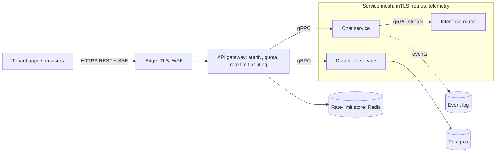
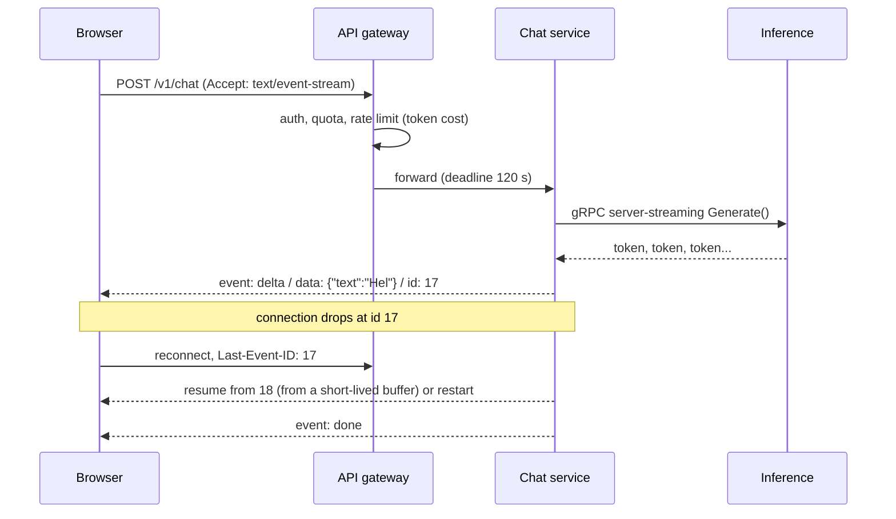
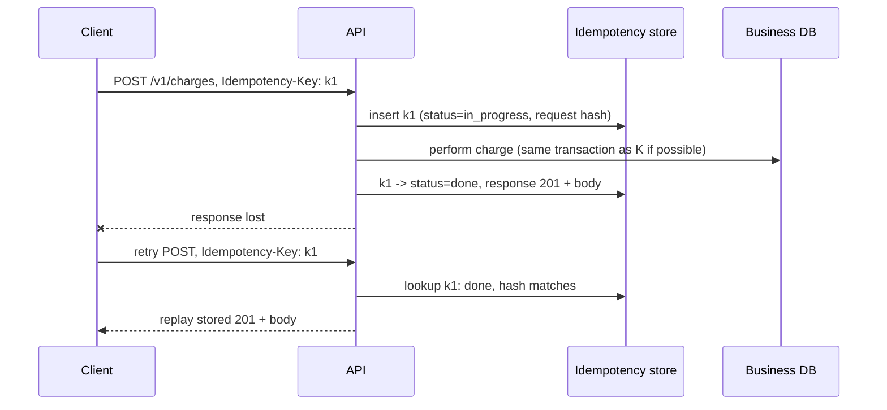
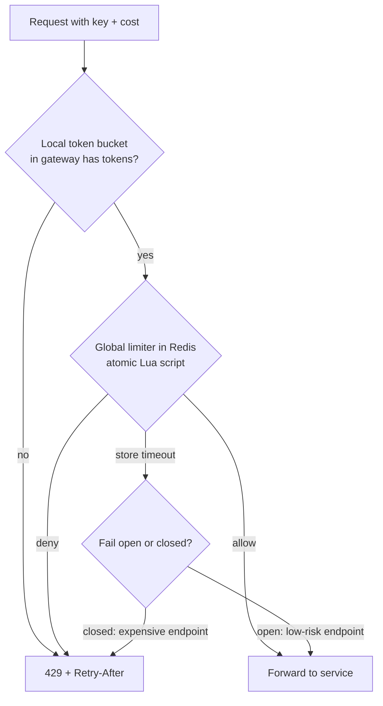

# 10 — APIs & communication

> **The requirement.** Lumen opens its platform: 3,000 tenant applications call the chat and document APIs. Chat
> answers are generated token by token and must start appearing in under a second; mobile clients on flaky
> networks retry aggressively; a single misbehaving tenant must not be able to starve the other 2,999; and the
> whole admission path (authentication, quota, rate limit) may add at most 2 ms at p99. Every one of those
> sentences is an API design decision, and most of them are invisible until they fail.

## In one minute

An API is a promise between two teams that do not deploy at the same time. Choosing *how* to talk — REST over
HTTP, gRPC over HTTP/2, GraphQL — is mostly a choice about who carries the cost of change and who can cache what.
Choosing *how long* a conversation lasts — one request, a stream of server events, a two-way socket — decides how
your load balancers, timeouts and autoscalers behave. Because networks fail halfway through requests, every write
API needs a way to be retried safely: an idempotency key turns "did my payment go through?" into a question the
server can answer. Because clients are not all polite, every public API needs admission control: a rate limiter
that decides, in a millisecond, whether this request gets in. And because you will change the API many times, you
need rules for evolving it without breaking the clients you cannot see. This chapter teaches each of those
decisions from the requirement backwards, then has you build and break five rate limiters in Redis.

## Why this matters now

Three things changed the API landscape between 2023 and 2026.

1. **Streaming went mainstream.** LLM APIs stream generated tokens to the client as they are produced. The two
   most widely used commercial LLM APIs both document server-sent events (SSE) as their streaming transport: the
   Anthropic Messages API streams with `"stream": true` over SSE with typed events such as `message_start` and
   `content_block_delta` [12], and OpenAI's Responses API streams over SSE with events such as
   `response.output_text.delta` [13] (both as of 2026-11). A transport that was a niche browser feature is now on
   the critical path of the most visible product category of the decade (see [SYSDESIGN-21](../03-ai-systems/21-llm-inference-anatomy.md)
   and [C09](../04-case-studies/C09-llm-chat-service.md)).
2. **Rate limits became cost controls.** When a single request can cost real GPU-seconds, limits are no longer
   only about protecting servers; they are about budget. LLM gateways limit *tokens* per minute, not just requests
   (see [SYSDESIGN-26](../03-ai-systems/26-llm-gateways-llmops.md)). The algorithms are the same ones in this
   chapter — a token bucket simply charges a variable cost.
3. **Standards caught up with practice.** The IETF HTTPAPI working group is standardizing patterns that every
   large API reinvented: the `Idempotency-Key` header (draft -08, October 2026, still an Internet-Draft) [18] and
   the `RateLimit` / `RateLimit-Policy` response fields (draft -11, May 2026, still an Internet-Draft) [28]. On the
   service-to-service side, Istio's sidecar-less *ambient mode* reached general availability in Istio 1.24
   (November 2024) [29], changing the cost model of a service mesh.

## Core ideas [Core]

### Where the API sits

Before choosing a protocol, locate the boundary. Lumen has three kinds:

*Diagram: public clients reach an edge and an API gateway over HTTPS (REST plus SSE); the gateway consults a Redis
rate-limit store and calls internal chat and document services over gRPC inside a service mesh; the chat service
streams from an inference router and publishes events to a log.*

- **Public (north–south) boundary.** Unknown clients, many languages, long-lived contracts, caching by
  intermediaries you do not control. Favors HTTP semantics everyone understands: REST/JSON, plus SSE for streams.
- **Internal (east–west) boundary.** Teams you know, a shared build system, strict latency budgets. Favors typed,
  binary, code-generated contracts: gRPC with protobuf.
- **Asynchronous boundary.** Work that does not need an answer now goes through a queue or log instead of an API
  call (covered in [SYSDESIGN-08](08-async-event-driven.md)).

The rest of the chapter is about making each boundary safe under retries, overload and change.

### REST: resources, verbs and the semantics you get for free

REST is an *architectural style*, defined in Roy Fielding's 2000 dissertation by a set of constraints:
client–server, stateless interactions, cacheable responses, a uniform interface, a layered system and optional
code-on-demand [1]. The uniform interface — resources named by URIs, manipulated through representations, with
self-descriptive messages — is what makes the web's intermediaries (CDNs, proxies, browser caches) work without
understanding your application.

In practice "REST API" means "JSON over HTTP with resource-shaped URLs", and the most valuable thing it buys you is
**HTTP's method semantics**, defined in RFC 9110 [2]:

| Method | Safe? | Idempotent? | Typical use |
|---|---|---|---|
| GET, HEAD, OPTIONS, TRACE | yes | yes | read |
| PUT | no | yes | create-or-replace at a known URI |
| DELETE | no | yes | remove |
| POST | no | **no** | create in a collection, trigger an action |
| PATCH | no | **no** (RFC 5789 [34]) | partial update |

RFC 9110 defines a method as *idempotent* if "the intended effect on the server of multiple identical requests
with that method is the same as the effect for a single such request", and lists PUT, DELETE and the safe methods
as idempotent [2, §9.2.2]. The practical consequence is enormous: proxies, client libraries and meshes may
**automatically retry** idempotent requests after a connection failure, and they must not retry POST without help.
That help is the idempotency key, below.

REST gives you universal tooling, HTTP caching (`Cache-Control`, `ETag`), readable payloads and OpenAPI schemas;
it costs chatty clients (five round trips per screen), over- and under-fetching, and text-encoding overhead.

### gRPC: typed RPC over HTTP/2

gRPC defines services and messages in protobuf, generates client and server stubs, and runs over HTTP/2 [5][6].
HTTP/2 (RFC 9113) multiplexes many concurrent streams over one TCP connection with binary framing and header
compression [3]. That fixes HTTP/1.1's application-layer head-of-line blocking — but RFC 9113 is explicit that
"TCP head-of-line blocking is not addressed by this protocol" [3]; one lost packet stalls every stream on the
connection until it is retransmitted. HTTP/3 (RFC 9114) moves to QUIC to remove that last layer [4] (see
[SYSDESIGN-02](02-anatomy-of-a-request.md)).

gRPC offers four method shapes: **unary**, **server streaming**, **client streaming** and **bidirectional
streaming** [5]. It also bakes in two operational features that REST leaves to convention:

- **Deadlines.** The client says how long it is willing to wait; when the deadline passes the call fails with
  `DEADLINE_EXCEEDED`, and servers can check how much time remains [5]. Propagating the *remaining* deadline to
  downstream calls is the single most useful habit for avoiding wasted work during overload
  ([SYSDESIGN-11](11-reliability-engineering.md)).
- **Cancellation.** Either side can cancel; "a cancellation terminates the RPC immediately so that no further work
  is done" — but changes already made are not rolled back [5].

The costs: browsers cannot speak native gRPC framing directly (you need gRPC-Web or a transcoding proxy), payloads
are not human-readable, and long-lived HTTP/2 connections defeat naive L4 load balancing — all requests on one
connection go to one backend, so you need L7 (per-request) balancing, client-side balancing, or a maximum connection age that forces periodic
reconnection ([SYSDESIGN-03](03-scaling-compute.md)).

### GraphQL: the client chooses the shape

GraphQL is a query language and runtime specified by the GraphQL Foundation; the specification is published in
dated editions, most recently September 2025 and September 2026 [7]. The server publishes a typed schema; the client
sends a query naming exactly the fields it wants, possibly across related objects, and gets exactly that shape
back. It solves over-fetching and the "five round trips per screen" problem at the cost of moving complexity to the
server:

- **The N+1 problem.** A naive resolver for `posts { author { name } }` issues one query for posts and one per
  post for its author. Batching layers such as DataLoader collect the keys requested in one tick and issue one
  batched fetch [8].
- **Cost control.** One query can ask for millions of nodes. Public GraphQL APIs therefore rate-limit by *computed
  query cost*, not by request count. GitHub's GraphQL API, for example, gives users 5,000 points per hour,
  requires `first`/`last` arguments of 1–100 on every connection, and rejects a single call that would return more
  than 500,000 nodes [9] (as of 2026-11).
- **Caching.** Queries usually go to one POST endpoint, so HTTP caches help little without persisted queries.

### The trade-off table

| Option | Wins when | Costs | Example systems |
|---|---|---|---|
| **REST/JSON over HTTP** | public APIs, many unknown clients, cacheable reads, long-lived contracts | chatty, over/under-fetching, weak typing unless OpenAPI is enforced | GitHub REST [15], Stripe [14][19] |
| **gRPC/protobuf over HTTP/2** | internal service-to-service, polyglot typed contracts, streaming, tight latency budgets | needs L7 balancing, browser needs a proxy, binary payloads harder to debug | gRPC ecosystem [5]; Envoy's rate-limit service API is gRPC [26] |
| **GraphQL** | many client types (web, mobile) composing data from many back ends; product teams iterating on screens | N+1 and cost control on the server; HTTP caching mostly lost; authorization per field | GitHub GraphQL API [9] |
| **Async messaging** | work that need not finish within the request; fan-out; smoothing bursts | eventual results; harder to debug; needs idempotent consumers | see [SYSDESIGN-08](08-async-event-driven.md) |

A common, defensible split: **REST at the edge, gRPC inside, events between bounded contexts**, with GraphQL as an
optional aggregation layer for first-party front ends.

### Streaming and push: four ways to get data to the client

| Mechanism | Direction | Transport | Reconnect / resume | Good for |
|---|---|---|---|---|
| **Polling / long polling** | client pulls | plain HTTP | trivial | low-frequency updates, maximum compatibility |
| **Server-sent events (SSE)** | server → client | one long HTTP response, `text/event-stream` | built in: client reconnects and sends `Last-Event-ID` [10] | token streaming, notifications, progress |
| **WebSockets** | both ways | HTTP Upgrade, then framed TCP (RFC 6455 [11]) | application-defined | chat, collaborative editing, games ([C03](../04-case-studies/C03-chat-presence.md)) |
| **gRPC streaming** | server, client or both | HTTP/2 streams | application-defined | internal streams (e.g. inference router → chat service) |

SSE is specified in the WHATWG HTML standard. The stream is UTF-8 text with the MIME type `text/event-stream`;
each event is a block of `event:`, `data:`, `id:` and `retry:` fields, and when the connection drops the browser's
`EventSource` reconnects and sends the last seen id in a `Last-Event-ID` header so the server can resume [10]. A
server can stop reconnection by answering HTTP 204 [10].

**Why SSE won for LLM tokens.** Token streaming is one-directional (the prompt is sent once, the answer streams
back), it is plain HTTP (so it passes through corporate proxies, CDNs and API gateways that already understand
HTTP), it works with ordinary authentication headers, and every HTTP client can read it line by line. WebSockets
would add a second protocol, a custom framing of messages, and gateway support for upgrades — for no benefit when
the client has nothing to say mid-stream. The streaming APIs of both major LLM providers are SSE [12][13].

*Diagram: a browser POSTs a chat request; the gateway admits it; the chat service consumes a gRPC server stream from
inference and relays each token as an SSE event with an id; after a drop the browser reconnects with Last-Event-ID
and the service resumes or restarts.*

Two operational consequences of long-lived streams that interviewers like to probe:

- **Timeouts and load balancers.** Every hop must allow a response that lasts minutes and must not buffer it.
  Proxies that buffer the whole response defeat streaming; idle timeouts shorter than the longest gap between
  tokens cut streams. Periodic comment lines or ping events keep connections warm (the Anthropic stream includes
  `ping` events [12]).
- **Capacity is measured in concurrent connections, not requests per second.** Twenty thousand open streams is
  twenty thousand sockets, buffers and goroutines/threads, regardless of how few new requests arrive per second.
  Draining a server for deployment now takes as long as the longest stream.

### Pagination: offset versus cursor

A list endpoint must never return an unbounded collection. Two strategies:

- **Offset/limit** (`?offset=200&limit=20`). Simple, allows "jump to page 50". But the database still has to
  produce and discard every skipped row, so deep pages get slower, and if rows are inserted between requests the
  client sees duplicates or misses items [17].
- **Cursor/keyset** (`?page_token=…`). The server returns an opaque token encoding the position of the last item
  (e.g. its sort key and id); the next query seeks directly to it with `WHERE (created_at, id) < (:c, :i) ORDER BY
  created_at DESC, id DESC LIMIT 20`, using the index. Cost is independent of depth and results do not drift [17].
  You lose random page access.

Google's API Improvement Proposal AIP-158 is a good contract to copy: optional `page_size` with a documented
default and maximum; an opaque, URL-safe `page_token` that must not be parseable by users; an empty
`next_page_token` as the *only* end-of-list signal; an optional, possibly estimated `total_size`; and the advice to
add pagination from day one because retrofitting it breaks clients [16].

### Idempotent APIs: making POST safe to retry

The network can fail after the server committed a write but before the client saw the response. The client cannot
tell "never arrived" from "succeeded, reply lost". Retrying a POST might create a second chat completion charge;
not retrying might lose the user's message. The fix is to let the client name the operation.

*Diagram: the client sends a POST with key k1; the API records k1 as in progress, performs the charge, stores the
response against k1; the response is lost; the retry with k1 finds the stored response and replays it without
charging again.*

The IETF draft `draft-ietf-httpapi-idempotency-key-header` (version -08, 22 October 2026; an active working-group
Internet-Draft, not an RFC) [18] standardizes the pattern:

- The header is `Idempotency-Key`, a Structured Field string (RFC 9651 [35]); a UUID or similar random value is
  recommended.
- The server publishes its idempotency policy, including key expiry, and may combine the key with a **fingerprint**
  of the payload.
- Error semantics: **400** if the key is required but missing; **422** if a key is reused with a *different*
  payload; **409** if a retry arrives while the original request is still being processed [18].

Stripe's production behavior, documented for its v1 API, is a concrete reference: keys up to 255 characters;
the status code and body of the first request are saved once execution begins — including 500 errors — and
replayed on retry; incoming parameters are compared to the original and mismatches error; keys may be pruned after
they are at least 24 hours old [19]. Brandur Leach's Postgres design shows the internals: a unique index on `(user_id, idempotency_key)`, a
`locked_at` column that turns concurrent duplicates into 409s, and *recovery points* so a retry resumes from the
last completed step [20].

The two design rules that make or break an idempotency layer:

1. **Record the key in the same transaction as the effect** whenever the effect is local. If you write the charge
   and the key in separate transactions, a crash between them recreates the original bug.
2. **For effects in other systems, pass a derived key downstream** (e.g. `k1:payment`), so the external system
   de-duplicates too [20]. Idempotency is end to end or it is not there.

### Rate limiting: deciding who gets in

A rate limiter answers one question per request — *admit or reject?* — against a policy such as "100 requests per
minute per API key" or "40,000 tokens per minute per tenant". When rejecting, HTTP has a dedicated status:
**429 Too Many Requests**, defined in RFC 6585, whose response "MAY include a Retry-After header indicating how long
to wait" [21]. The IETF `RateLimit` and `RateLimit-Policy` fields (draft -11) let servers advertise the policy and
remaining quota before clients hit the wall [28].

Six algorithms cover essentially every production limiter:

| Algorithm | State per key | Behavior | Burst at window edge? |
|---|---|---|---|
| **Fixed window counter** | 1 counter | count requests in `[k·W, (k+1)·W)`; reset at boundary | **yes — up to 2× limit** |
| **Sliding window log** | 1 timestamp per admitted request | admit if fewer than L timestamps in `(now−W, now]` | no (exact) |
| **Sliding window counter** | 2 counters | estimate = `prev · (W − elapsed)/W + cur` | mostly no (approximate) |
| **Token bucket** | tokens + last refill time | refill at rate r up to capacity b; each request spends tokens | allows up to b by design |
| **Leaky bucket (queue)** | a FIFO queue | requests drain at a constant rate; overflow dropped | no; output is smoothed |
| **GCRA** | 1 timestamp (TAT) | leaky-bucket-as-meter computed from a "theoretical arrival time" | allows a configured burst |

**Fixed window** is the simplest and has a famous flaw: with "10 per 10 s", a client can send 10 requests at
t = 9.9 s and 10 more at t = 10.0 s — twenty requests in a tenth of a second, all admitted. The lab reproduces this
exactly.

**Sliding window log** stores the timestamp of every admitted request (a Redis sorted set works well), drops those
older than W, and admits if fewer than L remain. It is exact, but memory grows with the limit: a 1,000-per-hour
limit can store 1,000 entries per client.

**Sliding window counter** keeps only the current and previous fixed-window counters and assumes the previous
window's requests were evenly spread. Cloudflare described this approximation in 2017 with the formula
`rate = prev × ((W − elapsed)/W) + cur`; on 400 million requests from 270,000 sources they measured about 0.003%
of requests wrongly allowed or limited and an average 6% difference between real and approximate rate [23]. Two
counters per key and near-exact behavior is why this is a common production choice.

**Token bucket** holds up to *b* tokens and refills at *r* tokens per second; a request spends one token (or a
variable cost — e.g. the number of LLM tokens it will generate). It deliberately allows bursts up to *b* while
enforcing *r* on average. It is the classic network policing primitive (RFC 2697's single-rate three-color marker
is built on token buckets with a committed burst size [36]) and the algorithm Stripe documented for its per-user
request limiter, implemented in Redis [22]. It needs no background refill process: refill is computed lazily from
the elapsed time on each request.

**Leaky bucket** as a *queue* drains a bounded FIFO at a constant rate: it shapes output instead of rejecting
early, at the cost of queueing delay. As a *meter* it is a token bucket viewed from the other side.

**GCRA (generic cell rate algorithm)** comes from ATM networking, where the ATM Forum recommended it for policing
cell rates [24]. Each key stores one number, the *theoretical arrival time* (TAT). With emission interval
T = W/L and burst tolerance, a request is allowed if `now ≥ TAT − burst·T`; on admission TAT advances by T. One
timestamp per key, no refill arithmetic, and the denial itself tells the client exactly how long to wait (a natural
`Retry-After`). Brandur Leach's 2015 write-up popularized it for API rate limiting and stresses using a single clock
source, such as the data store's, because the algorithm is entirely time-driven [24].

*Diagram: each request first passes a coarse local token bucket in the gateway, then a global limiter in Redis
executed as one atomic script; a denial returns 429 with Retry-After; if the store times out, a per-endpoint policy
decides whether to fail open (forward) or closed (reject).*

### Distributed rate limiting

One gateway can keep counters in memory. Thirty gateway replicas cannot — each would admit the full limit. The
standard answers:

1. **Central store with atomic operations.** Keep limiter state in Redis and execute the whole read-check-write as
   one Lua script. Redis "guarantees the script's atomic execution" and blocks other activity while it runs [25], so
   two gateways cannot both read "1 token left". All keys a script touches must be passed in `KEYS` for Redis
   Cluster compatibility [25]; shard by limiter key.
2. **Two-stage limiting.** Envoy's global rate limiting calls an external gRPC rate-limit service (the reference
   implementation is written in Go on Redis [26][27]) and recommends combining it with a local token bucket, which
   "can absorb very large bursts in load", so a coarse local limit runs first and the fine-grained global limit
   second [26].
3. **Quota leasing.** Instead of one round trip per request, each gateway leases a chunk of quota (e.g. 50 of a
   tenant's 1,000/minute) and reports usage periodically. Envoy also offers a quota-based mode of this kind for
   HTTP traffic [26]. You trade a little accuracy for far fewer remote calls.

The hard question is **what to do when the store is down**. Stripe's advice is to make limiter errors *fail open*
so a Redis outage does not take the API down, to dark-launch new limiters to see what they would block, and to keep
kill switches [22]. For endpoints where an unbounded burst costs real money (GPU inference), failing closed, or
falling back to a conservative local limit, may be the right call. Decide per endpoint and write it down.

The same post describes concurrent-request limiters and two load shedders alongside the request-rate limiter
[22]; load shedding is covered in [SYSDESIGN-11](11-reliability-engineering.md).

### API gateways and service meshes

An **API gateway** is the policy enforcement point at the north–south boundary: TLS termination, authentication,
request validation, rate limiting and quotas, routing and transcoding (e.g. REST → gRPC), and per-tenant
analytics. Its risk is becoming a monolith that every team must change; keep business logic out of it.

A **service mesh** applies the same ideas east–west, transparently: mTLS between services, retries and timeouts,
traffic splitting for canaries, and uniform telemetry. Linkerd runs a Rust micro-proxy, `linkerd2-proxy`, as a
sidecar in every pod, with destination, identity (a certificate authority for mTLS) and proxy-injector control
plane components [31]. Istio historically used Envoy sidecars and now also offers **ambient mode**: a per-node,
Rust-based **ztunnel** handles only L3/L4 (mTLS, L4 authorization and telemetry), and optional Envoy-based
**waypoint proxies** run outside application pods to provide L7 features only where needed [30]. Ambient mode
became generally available in Istio 1.24 [29]; the Istio documentation site shows release 1.32 as current (as of
2026-11) [30]. The design question a mesh answers is "where do cross-cutting network policies live?"; its cost is
another moving part on every request path, and — for sidecars — memory and CPU per pod.

## Numbers that matter

Assumptions are labelled **A**; sourced facts carry a reference. Work them, then change the assumptions.

**1. Admission-control budget.** Requirement: ≤ 2 ms p99 added. **A:** gateway to Redis round trip in the same
zone ≈ 0.3–0.5 ms at p50 and ≈ 1 ms at p99 under load; one atomic Lua script per request. One round trip fits; three
sequential round trips (auth cache + quota + rate limit) will not at p99. Design consequence: one script that checks
both the per-second limit and the per-day quota, plus a local token bucket so most denials never leave the gateway.

**2. Limiter throughput.** **A:** peak 60,000 requests/s across all tenants, one script call each → 60,000 Redis
script calls/s. **A:** budget 25,000 such calls/s per Redis primary for a short script (measure yours with
`redis-benchmark`; never assume). → 3 primaries minimum, 4–6 with headroom, sharded by tenant key. Quota leasing
(lease 50 requests at a time) would cut calls by up to 50× for well-behaved tenants.

**3. Limiter memory.** 3,000 tenants × 1,000 API keys each = 3 million keys (**A**).
- Sliding window counter: 2 small counters per key; lab L10 measured 46 bytes per counter key → 3 M × 2 × 46 B
  ≈ 0.3 GB (plus allocator overhead and replicas).
- Sliding window log with a limit of 1,000/hour: up to 1,000 sorted-set members per key. Lab L10 measured
  109,850 bytes for one key holding 1,000 entries (≈ 110 B per entry, Redis 8.10.3) versus 42–72 bytes for the
  counter, bucket and GCRA keys. If 10% of keys are busy (**A**), 300,000 × 110 KB ≈ 33 GB. The log is exact and
  expensive — reserve it for small limits.

**4. Streaming fan-out.** **A:** 20,000 concurrent chat streams × 40 tokens/s × ≈ 120 bytes per SSE event (JSON
delta plus field names) ≈ 96 MB/s ≈ 0.8 Gbit/s egress, sustained, before compression. Concurrency, not
requests per second, sizes this tier: at **A** 2,000 streams per gateway instance you need 10 instances plus
headroom for draining during deploys.

**5. Idempotency storage.** **A:** 5,000 idempotent POSTs/s, keys kept 24 h (Stripe's v1 minimum [19]), 1 KB stored
response each → 5,000 × 86,400 × 1 KB ≈ 432 GB. That is too much for Redis on a budget: store the key, a payload
hash and a *small* response (or a pointer to the created resource), in the primary database with a TTL-based purge.

**6. Offset pagination.** Page 5,000 at 20 per page: ≈ 100,000 rows produced and discarded [17]; keyset reads ≈ 20.

## Design choices and trade-offs

**Protocol per boundary**

| Boundary | Recommended default | Choose differently when |
|---|---|---|
| Public API | REST/JSON + OpenAPI; SSE for streams | many first-party UIs compose data from many services → add GraphQL for them |
| Browser ↔ chat UI | SSE for answers, plain POST for prompts | true two-way, low-latency interaction (collaborative cursor, voice) → WebSockets |
| Service ↔ service | gRPC with deadlines | a team or partner cannot adopt protobuf → REST |
| Long or fan-out work | async messages ([SYSDESIGN-08](08-async-event-driven.md)) | the caller truly needs the answer now |

**Rate-limit algorithm**

| Option | Wins when | Costs | Example systems |
|---|---|---|---|
| Token bucket | you want bursts allowed but an average enforced; variable cost per request (LLM tokens) | two fields per key; burst size is a product decision | Stripe request limiter [22]; Envoy local rate limit [26] |
| GCRA | you want a token-bucket policy with one stored value and an exact retry-after | less familiar to reviewers; needs one clock | Throttled (Go) [24] |
| Sliding window counter | "N per window" semantics that users understand, with small memory | approximate | Cloudflare [23] |
| Sliding window log | small limits that must be exact (e.g. 5 login attempts per 15 min) | memory ∝ limit | lab L10 |
| Fixed window | internal, coarse quotas (per day/month) where edge bursts do not matter | 2× burst at boundaries | lab L10 |
| Leaky bucket queue | you must smooth output to a fixed-rate downstream (e.g. SMS provider) | queueing delay; queue memory | traffic shaping |

**Versioning strategy**

| Option | Wins when | Costs | Example |
|---|---|---|---|
| Major version in path (`/v1/`) | rare, large breaking changes; simple routing | big-bang migrations; two code bases | Stripe keeps `/v1/` but rarely changes it [14] |
| Date-named versions, pinned per account, transformed at the edge | frequent small breaking changes; you want old clients to keep working forever | a transformation layer to maintain | Stripe: account pinned to the latest version on first request; `Stripe-Version` header override; responses walked back through "version change modules" [14] |
| Version header with support window | public API with a published deprecation policy | clients must send the header | GitHub `X-GitHub-Api-Version` (date-named; previous version supported ≥ 24 months; expired versions get 410) [15] |
| No versions, additive-only evolution | internal gRPC APIs under one build system | discipline; reviews | protobuf rules [32]; AIP-180 [33] |

## Deep dive [Deep]

### Atomicity is the whole limiter

The algorithms are easy; concurrency is where limiters fail. A token bucket written as "read tokens, compute,
write tokens" in the application takes two round trips. With 50 clients arriving together, many read the same
"10 tokens" before any write lands, and all of them are admitted. In lab L10's recorded run, the naive version admitted 50 of 50
concurrent clients against a capacity of 10, three trials out of three; the same algorithm as one Lua script
admitted exactly 10 each time. Three ways to get atomicity in Redis: a Lua script or
Redis Function (preferred), `MULTI`/`EXEC` with `WATCH` and retry (optimistic, costly under contention), or
algorithms built from single atomic commands (`INCR` + `EXPIRE` for fixed windows).

**Clocks.** Time-based algorithms are only as consistent as their clock. If 30 gateways pass their own `now`, a
gateway whose clock runs 200 ms fast refills buckets early. Options: read Redis `TIME` inside the script — allowed
since Redis replicates script *effects* rather than script source (the default since Redis 5.0; verbatim
replication was removed in 7.0) [25] — or keep gateways on disciplined clocks and accept small skew (see
[SYSDESIGN-09](09-coordination-consensus.md) for clock behavior).

**Hot keys.** A huge tenant lands on one shard: split its key into *n* sub-keys of limit/n, or lease it quota.

### Choosing the key and the cost

What you limit on matters as much as how. Per-IP limits punish users behind shared NAT and are easy to evade
from a botnet; per-API-key limits need authentication first; per-tenant limits need a hierarchy (tenant → project →
key) where a request must pass every level. For LLM APIs the natural cost is tokens: reserve `prompt + max_tokens`
on admission and refund the unused part when the stream ends — a token bucket with variable cost, exactly the
`cost` argument in the lab's script.

### Idempotency key edge cases

- **Concurrent duplicates.** Two retries arrive at once. Use a unique constraint on `(tenant, key)` and treat the
  insert as a lock; the loser gets 409 [18][20].
- **Same key, different body.** A client bug reuses keys. Store a hash of method, path and canonicalized body and
  return 422 on mismatch [18].
- **Failures.** Should a stored 500 be replayed? Stripe's v1 replays it [19]; an alternative is to release the key
  on failures that provably had no effect (validation errors), so the client can retry. Be explicit in the docs.
- **Expiry.** A retry after the key expired is treated as a new request [19]. Clients must not retry older
  operations blindly.

### Backward compatibility and schema evolution

Compatibility has three layers. Google's AIP-180 names them: **source** compatibility (code still compiles against
new generated stubs), **wire** compatibility (old clients still communicate correctly with new servers) and
**semantic** compatibility (behavior stays what reasonable developers expect) [33]. Breaking changes per AIP-180
include removing or renaming fields, changing a field's type (even to a wire-compatible one, because generated code
breaks), changing defaults, and adding required fields to requests [33]. GitHub's REST policy draws the same line
for JSON: removing or renaming fields, adding required parameters or changing types are breaking; adding optional
parameters, response fields or enum values is additive [15].

The protobuf rules from the official proto3 guide [32]:

- **Never change or reuse a field number.** Renumbering equals deleting and adding a field.
- **Deleting a field is safe only if you reserve its number** (`reserved 4, 9 to 11;`) **and its name**, so the
  number is never reused and JSON/text formats still parse.
- **Adding fields is safe;** old code ignores unknown fields, and proto3 preserves unknown fields when re-serializing
  in binary — but they are lost if you convert to JSON or copy field by field.
- **Some type changes are wire-compatible:** `int32`, `uint32`, `int64`, `uint64` and `bool` with each other
  (values may be truncated); `sint32` with `sint64`; `string` with `bytes` if the bytes are valid UTF-8.
- **Field numbers 1–15 take one byte to encode**, 16–2047 take two — reserve the low numbers for frequent fields.

The practical rule for any schema (protobuf, JSON, Avro): **be additive; new fields optional; readers tolerate
unknown fields and missing fields; never change meaning in place.** When meaning must change, add a new field or a
new version, run both, measure usage, then retire the old one with a published deadline.

## Frontier [Frontier]

As of 2026-11:

- **Token-aware rate limiting.** LLM gateways limit on tokens per minute and concurrent streams, often with a
  reservation-and-refund token bucket (see [SYSDESIGN-26](../03-ai-systems/26-llm-gateways-llmops.md)).
- **Standardized limiter and idempotency headers.** `RateLimit`/`RateLimit-Policy` (draft-ietf-httpapi-ratelimit-headers-11,
  23 May 2026; the HTTP directorate's early review of -10 was marked "Not ready") [28] and `Idempotency-Key`
  (draft -08) [18] are both still drafts; implement them, but treat the details as subject to change.
- **Sidecar-less meshes.** Istio ambient mode (GA since 1.24) [29] splits L4 (per-node ztunnel) from L7 (waypoint
  proxies) [30]; sidecar and ambient workloads can coexist in one mesh [30]. Linkerd continues with Rust sidecars,
  deployed as native sidecar containers by default since Linkerd 2.20 [31].
- **GraphQL specification editions** are now released on a regular dated cadence (September 2025, September 2026) [7].

## Failure modes and operations

| Failure | How it shows up | Detect (SLI) | Mitigate |
|---|---|---|---|
| Retry of non-idempotent POST | duplicate orders/charges after network blips | duplicate-key rate; reconciliation diffs | Idempotency-Key, unique constraints |
| Fixed-window edge burst | 2× load spikes at minute boundaries | per-second admitted rate around :00 | sliding counter, token bucket |
| Racy limiter | tenants exceed limits under concurrency | admitted > limit in audits | atomic scripts |
| Limiter store down | either total outage (fail closed) or no protection (fail open) | limiter error rate, latency | per-endpoint fail policy, local fallback bucket, kill switch [22] |
| Clients ignoring 429 | retry storms that keep the limiter hot | 429 rate per client; retries per request | `Retry-After`, jittered client backoff ([SYSDESIGN-11](11-reliability-engineering.md)) |
| Buffered or cut streams | tokens arrive in one lump; streams end at 60 s | time-to-first-byte vs time-to-first-token; stream completion rate | disable proxy buffering, align idle timeouts, ping events |
| Long-lived connection imbalance | new pods idle while old pods saturate | per-pod connection count and CPU skew | L7 balancing, max connection age |
| Deep offset pages | slow queries, DB CPU from crawlers | p99 latency by `offset` bucket | keyset pagination, cap offsets |
| Breaking schema change | client deserialization errors after deploy | error rate by client version | additive changes, reserved fields, contract tests |
| GraphQL abusive query | one request consumes seconds of CPU | query cost histogram | cost limits, depth/node limits, persisted queries [9] |

Operate limiters like a product: dark-launch new rules and log what they *would* reject before enforcing them,
expose remaining quota to clients, alert on sudden jumps in 429s per tenant (a client bug or an attack), and keep a
kill switch for each rule [22].

## Cost and energy

- **Rejected requests are the cheapest requests.** Every request denied at the gateway avoids downstream CPU,
  database I/O and — for Lumen — GPU-seconds. For LLM endpoints, token-based limits are the primary cost-control
  mechanism ([SYSDESIGN-16](../02-modern-requirements/16-cost-as-requirement.md)).
- **Encoding matters at scale.** Binary protobuf payloads are typically smaller and cheaper to parse than JSON; at
  internal fan-out volumes this shows up in CPU and cross-zone egress bills. Measure on your own payloads rather
  than quoting a ratio.
- **Meshes cost per pod.** Sidecars add a proxy's memory and CPU to every pod; ambient mode amortizes L4 per node and
  pays for L7 only where waypoints are deployed [30].
- **Streams cost by duration.** Shorter time-to-last-token directly cuts streaming-gateway capacity.

## Interview angle

**How it is asked.** "Design a rate limiter" (classic; see [C01](../04-case-studies/C01-url-shortener-rate-limiter.md)),
"design the API for X", "how would you make this payment endpoint safe to retry?", "REST or gRPC?", "how do you
stream ChatGPT-style responses?" ([C09](../04-case-studies/C09-llm-chat-service.md)).

**Model answer outline for "design a distributed rate limiter" (CLARIFY → QUANTIFY → SKETCH → DEEPEN → STRESS → WRAP):**

1. **CLARIFY** — limit on what key (user, API key, tenant, IP)? what unit (requests, tokens)? hard or soft? burst
   allowed? where enforced (gateway, service)? what happens when the limiter fails?
2. **QUANTIFY** — peak requests/s, number of keys, latency budget for the check; derive Redis calls/s and memory per
   algorithm (as in *Numbers that matter*).
3. **SKETCH** — gateway → local token bucket → Redis cluster sharded by key, one Lua script per check → 429 with
   `Retry-After` and `RateLimit` headers.
4. **DEEPEN** — pick the algorithm and justify it (token bucket or sliding counter; explain the fixed-window edge
   burst); atomicity via Lua; clock source; hot-key splitting; quota leasing.
5. **STRESS** — Redis down (fail open vs closed per endpoint), clients ignoring 429 (backoff, penalties), 10× tenants
   (shard count, memory), multi-region (local limits per region vs a global budget with periodic sync).
6. **WRAP** — summarize the choice, what you measured, and what you would monitor (429 rate, limiter latency,
   store errors).

**Red flags.** Fixed window without acknowledging the edge burst; read-then-write in application code; one global
Redis key for everything; no answer for limiter failure; returning 500 or 503 instead of 429 for rate-limited
clients; "just use WebSockets" for one-way token streaming without discussing proxies and gateways; POST retries
without idempotency.

**Follow-ups to expect.** "How do you limit LLM tokens when you don't know the output length?" (reserve
`max_tokens`, refund). "How do you resume a dropped stream?" (`Last-Event-ID` and a short buffer). "How do you remove
a protobuf field?" (stop using it, then `reserved` number and name). "Offset or cursor for an infinite feed?"
(cursor, and why).

## Common mistakes

- Treating "REST" as "any JSON over HTTP" and ignoring method semantics — e.g. a GET that changes state, which a
  crawler or prefetcher will happily trigger.
- Exposing offset pagination on large, frequently changing collections.
- Leaving proxy buffering on for SSE, or idle timeouts shorter than the longest token gap.
- Reusing protobuf field numbers or changing a field's meaning in place.

## Check yourself

1. Why may a proxy retry a PUT after a connection reset but not a POST? What would make the POST safe?
2. A client sends 10 requests at t = 59.9 s and 10 at t = 60.0 s against "10 per minute". What does each of fixed
   window, sliding log, sliding counter and token bucket (capacity 10) admit?
3. Why is SSE, not WebSockets, the usual transport for LLM token streaming? Name one case where you would choose
   WebSockets.
4. Your Redis-backed limiter times out. Which endpoints fail open and which fail closed, and why?
5. You need to delete field 7 from a protobuf message used by mobile apps you cannot force-upgrade. What exactly do
   you do?

Full set with answers: [exercises/10-apis-communication.md](../../exercises/10-apis-communication.md).

## Lab

**[L10 — rate limiter](../../labs/10-apis-communication/README.md).** A Docker Compose project (`sd-10`) with Redis
and a Python driver. Five algorithms — fixed window, sliding window log, sliding window counter, token bucket and
GCRA — run as atomic Lua scripts. The driver fires scripted bursts on a virtual clock and prints allowed/denied counts:
you will see the fixed window admit twice its limit across a boundary, compare burst behavior after idle, measure
per-key memory, and watch a naive read-then-write token bucket over-admit under 50 concurrent clients while the Lua
version holds the line.

## Further reading

- Fielding, *Architectural Styles and the Design of Network-based Software Architectures*, ch. 5 [1] — what REST
  actually constrains, from the source.
- RFC 9110 §9.2 [2] — safe and idempotent methods; the basis of every retry policy.
- gRPC core concepts [5] — method types, deadlines and cancellation in one page.
- Stripe, "Scaling your API with rate limiters" [22] — four limiter types and operational advice from production.
- Cloudflare, "How we built rate limiting capable of scaling to millions of domains" [23] — the sliding window
  counter with measured accuracy.
- Brandur Leach, "Rate Limiting, Cells, and GCRA" [24] and "Implementing Stripe-like Idempotency Keys in Postgres"
  [20] — the two best practical write-ups on their topics.
- draft-ietf-httpapi-idempotency-key-header [18] — where the industry pattern is being standardized.
- protobuf.dev, "Updating a message type" in the proto3 guide [32] and Google AIP-180 [33] — schema evolution rules.

## References

All URLs accessed 2026-11-19/20.

1. R. T. Fielding, *Architectural Styles and the Design of Network-based Software Architectures*, PhD dissertation,
   UC Irvine, 2000, ch. 5 "Representational State Transfer". https://ics.uci.edu/~fielding/pubs/dissertation/rest_arch_style.htm
2. R. Fielding, M. Nottingham, J. Reschke (eds.), *RFC 9110: HTTP Semantics*, IETF, 2022. https://www.rfc-editor.org/rfc/rfc9110.html
3. M. Thomson, C. Benfield (eds.), *RFC 9113: HTTP/2*, IETF, 2022. https://www.rfc-editor.org/rfc/rfc9113.html
4. M. Bishop (ed.), *RFC 9114: HTTP/3*, IETF, 2022. https://www.rfc-editor.org/rfc/rfc9114.html
5. gRPC Authors, "Core concepts, architecture and lifecycle". https://grpc.io/docs/what-is-grpc/core-concepts/
6. gRPC Authors, "gRPC over HTTP2" (PROTOCOL-HTTP2.md). https://github.com/grpc/grpc/blob/master/doc/PROTOCOL-HTTP2.md
7. GraphQL Foundation, *GraphQL Specification* (editions list; September 2025 and September 2026 editions). https://spec.graphql.org/ ; https://spec.graphql.org/September2025/ ; https://spec.graphql.org/September2026/
8. GraphQL Foundation, DataLoader. https://github.com/graphql/dataloader
9. GitHub Docs, "Rate limits and query limits for the GraphQL API". https://docs.github.com/en/graphql/overview/rate-limits-and-query-limits-for-the-graphql-api
10. WHATWG, *HTML Living Standard*, §9.2 "Server-sent events". https://html.spec.whatwg.org/multipage/server-sent-events.html
11. I. Fette, A. Melnikov, *RFC 6455: The WebSocket Protocol*, IETF, 2011. https://www.rfc-editor.org/rfc/rfc6455.html
12. Anthropic, "Streaming messages" (Claude API docs). https://platform.claude.com/docs/en/build-with-claude/streaming
13. OpenAI, "Streaming API responses". https://developers.openai.com/api/docs/guides/streaming-responses
14. B. Leach, "APIs as infrastructure: future-proofing Stripe with versioning", Stripe blog, 2017-08-05. https://stripe.com/blog/api-versioning
15. GitHub Docs, "API Versions" (REST API). https://docs.github.com/en/rest/about-the-rest-api/api-versions
16. Google, *AIP-158: Pagination*. https://google.aip.dev/158
17. M. Winand, "We need tool support for keyset pagination" (no-offset), Use The Index, Luke. https://use-the-index-luke.com/no-offset
18. J. Jena, S. Dalal, D. Tishkin, *The Idempotency-Key HTTP Header Field*, draft-ietf-httpapi-idempotency-key-header-08, IETF Internet-Draft (work in progress), 2026-10-22. https://datatracker.ietf.org/doc/draft-ietf-httpapi-idempotency-key-header/
19. Stripe, "Idempotent requests" (API reference). https://docs.stripe.com/api/idempotent_requests
20. B. Leach, "Implementing Stripe-like Idempotency Keys in Postgres", 2017-10-27. https://brandur.org/idempotency-keys
21. M. Nottingham, R. Fielding, *RFC 6585: Additional HTTP Status Codes*, IETF, 2012, §4 (429). https://www.rfc-editor.org/rfc/rfc6585.html
22. P. Tarjan, "Scaling your API with rate limiters", Stripe blog, 2017-03-30. https://stripe.com/blog/rate-limiters
23. Cloudflare, "How we built rate limiting capable of scaling to millions of domains", Cloudflare blog, 2017-06-07. https://blog.cloudflare.com/counting-things-a-lot-of-different-things/
24. B. Leach, "Rate Limiting, Cells, and GCRA", 2015-09-18. https://brandur.org/rate-limiting
25. Redis, "Scripting with Lua" (Redis docs). https://redis.io/docs/latest/develop/programmability/eval-intro/
26. Envoy Project, "Global rate limiting" (architecture overview). https://www.envoyproxy.io/docs/envoy/latest/intro/arch_overview/other_features/global_rate_limiting
27. Envoy Project, envoyproxy/ratelimit (reference rate-limit service, Go + Redis). https://github.com/envoyproxy/ratelimit
28. R. Polli, A. Martinez Ruiz, D. Miller, *RateLimit header fields for HTTP*, draft-ietf-httpapi-ratelimit-headers-11, IETF Internet-Draft (work in progress), 2026-05-23. https://datatracker.ietf.org/doc/draft-ietf-httpapi-ratelimit-headers/
29. Istio, "Fast, Secure, and Simple: Istio's Ambient Mode Reaches General Availability in v1.24", 2024-11. https://istio.io/latest/blog/2024/ambient-reaches-ga/
30. Istio, "Ambient mode overview" (docs, site version 1.32). https://istio.io/latest/docs/ambient/overview/
31. Linkerd, "Architecture" (2-edge docs). https://linkerd.io/2-edge/reference/architecture/
32. Protocol Buffers, "Language Guide (proto 3)" — Updating a Message Type, Reserved Fields. https://protobuf.dev/programming-guides/proto3/
33. Google, *AIP-180: Backwards compatibility*. https://google.aip.dev/180
34. L. Dusseault, J. Snell, *RFC 5789: PATCH Method for HTTP*, IETF, 2010. https://www.rfc-editor.org/rfc/rfc5789.html
35. M. Nottingham, P-H. Kamp, *RFC 9651: Structured Field Values for HTTP*, IETF, 2024. https://www.rfc-editor.org/rfc/rfc9651.html
36. J. Heinanen, R. Guerin, *RFC 2697: A Single Rate Three Color Marker*, IETF, 1999. https://www.rfc-editor.org/rfc/rfc2697.html
