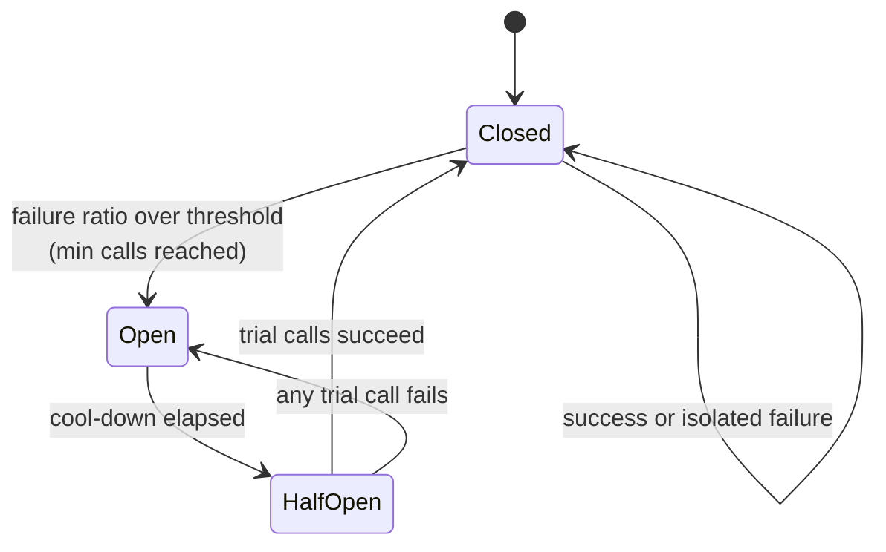
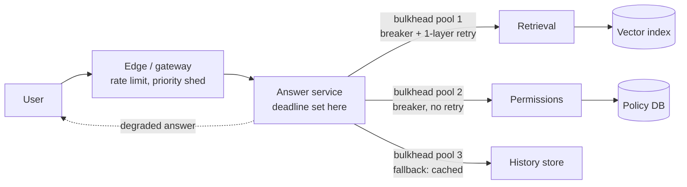
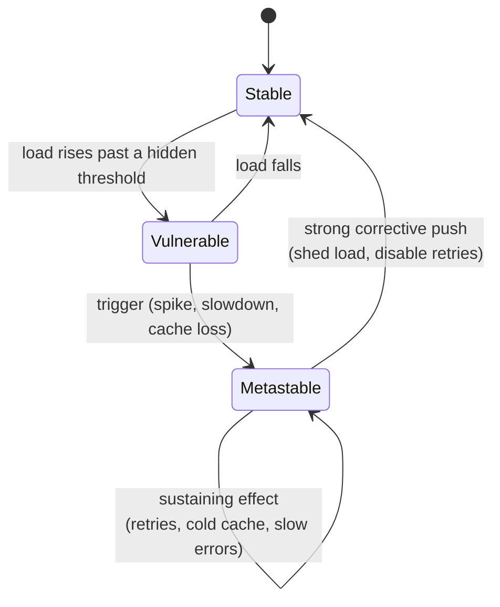

# 11 — Reliability engineering

> **The requirement.** Lumen's answer API (the non-generative part: auth, retrieval, permissions, conversation
> storage) must hold **99.95% monthly availability**, keep working **with no human action** when one availability
> zone (AZ) disappears, and **recover by itself within five minutes** after any dependency slowdown ends. The first
> two are classic redundancy problems. The third is the hard one: most large outages are not caused by the thing that
> broke, but by how the rest of the system *reacted* to it — retries, failovers and restarts that keep the system down
> long after the original fault is gone.

## In one minute

Everything you depend on will fail, and most of it will fail *partially*: slow instead of dead, wrong for some
callers and fine for others. Reliability engineering is the craft of deciding, in advance, how your system behaves
when that happens. You bound how long you wait (timeouts and deadlines), decide whether to try again and how politely
(retries with backoff, jitter and a budget), stop calling things that are clearly broken (circuit breakers), keep one
failure from eating every resource (bulkheads), refuse work you cannot finish in time (load shedding and admission
control), and serve something useful when the full answer is impossible (graceful degradation). Above that sit
redundancy across zones and regions and a disaster-recovery plan with explicit data-loss (RPO) and downtime (RTO)
targets. The surprising lesson of the last decade is that many of these mechanisms, used naively, *cause* outages:
retries that triple load, failovers that move a problem around, restarts that stampede a database. Good reliability
design is mostly about controlling feedback loops.

## Why this matters now

Three things changed between roughly 2016 and 2026.

- **Dependency graphs got deep and shared.** A single user action now crosses an API gateway, a mesh, a dozen
  services and several managed cloud services. Each hop is a place where a retry policy, a timeout or a pool can turn
  a small fault into a large one. The AWS us-east-1 event of October 2025 began with an empty DNS record for the
  regional DynamoDB endpoint and then spread to EC2 instance launches and Network Load Balancer health checks, with
  three distinct periods of customer impact over roughly 14.5 hours [21].
- **Configuration and control planes became global and fast.** In three widely felt incidents, a change that was
  propagated quickly to every location — a policy row replicated by Spanner within seconds at Google Cloud on
  12 June 2025 [23], a bot-management feature file regenerated every five minutes at Cloudflare on 18 November
  2025 [22], a content update to endpoint sensors at CrowdStrike on 19 July 2024 [24] — hit a latent bug everywhere
  at once. Redundancy does not help when every replica receives the same bad input.
- **Workloads got longer and more expensive per request.** LLM calls and agent steps take seconds to minutes and
  burn GPU time. A naive timeout-and-retry policy that was merely wasteful for a 20 ms database read becomes ruinous
  for a 30-second generation. LLM APIs routinely answer `429 Too Many Requests` with a `Retry-After` hint [25][26];
  clients that ignore it amplify the overload they are being warned about. (LLM-specific gateways are covered in
  SYSDESIGN-26.)

## Core ideas [Core]

### 1. A vocabulary of failure

Before choosing a defence you need to name the failure. The classical hierarchy, systematised by Cristian [1], orders
failure *semantics* from the most benign to the most general; each class includes the ones above it.

| Failure class | What the component does | Detectable by a heartbeat? | Typical cause |
|---|---|---|---|
| **Crash (fail-stop)** | Stops and stays stopped | Yes | Process kill, kernel panic, power loss |
| **Omission** | Silently drops some requests or replies | Sometimes | Full queue, packet loss, overloaded NIC |
| **Timing (performance)** | Answers correctly but too late (or too early) | Rarely | GC pause, noisy neighbour, disk retries |
| **Arbitrary (Byzantine)** | Returns wrong or inconsistent answers, possibly different ones to different callers | No | Memory corruption, bad config, bugs, malice [2] |

Lamport, Shostak and Pease showed that agreement in the presence of arbitrary (Byzantine) faults needs more than
two-thirds of participants to be correct when messages are unsigned [2] — which is why ordinary cloud services assume
crash faults and rely on other means (checksums, validation, staged rollout) for corruption.

**Gray failure** is the name Huang et al. gave to the failures that dominate in practice [3]: subtle faults such as
"severe performance degradation, random packet loss, flaky I/O, memory thrashing, capacity pressure, and non-fatal
exceptions". Their key insight is **differential observability**: the system's own failure detector believes the
component is healthy while at least one client observes it as unhealthy. A stuck request handler next to a working
heartbeat thread is the canonical example [3]. The practical consequence: **health checks must exercise the same
path users exercise**, and the strongest health signal is the error rate and latency seen by *callers*, not a
process's opinion of itself (see SYSDESIGN-12 for SLIs and probing).

Huang et al. also report a counter-intuitive effect: in a Clos data-centre network where a front-end request fans out
to *m* back ends across *n* core switches, the probability that a request touches any particular switch is
1 − ((n−1)/n)^m [3]. With 4 core switches and a fan-out of 40, that is 1 − 0.75^40 ≈ 0.99999: a single switch with
intermittent packet loss slows *nearly every* request. More redundancy made the gray failure more visible, not less.

### 2. Availability arithmetic

If a request must succeed at every one of *k* independent hard dependencies, its availability is the product:
A = A₁ × A₂ × … × A_k. Redundant replicas in parallel fail only if all fail: A = 1 − Π(1 − Aᵢ). Two facts follow,
and every design in this chapter is an attempt to escape the first and earn the second.

1. **Serial hard dependencies erode availability fast.** Six dependencies at 99.95% each give 99.70%.
2. **Parallel redundancy helps only to the extent failures are independent.** Two replicas at 99% each give 99.99%
   *if* they never fail together. A shared bad config push, a shared DNS name or a shared control plane makes them
   fail together, and the formula is fiction.

So reliability design has two halves: **turn hard dependencies into soft ones** (degrade instead of failing) and
**decorrelate the replicas** (separate zones, staged rollouts, independent control planes). Availability targets and
error budgets are introduced in [SYSDESIGN-01](../00-orientation/01-requirements-to-numbers.md).

### 3. Timeouts and deadlines

A call without a timeout is a promise to wait forever, and by Little's law (in-flight work = arrival rate × time in
system) a slow dependency silently converts into exhausted threads, sockets and memory upstream. Every remote call
needs a timeout; the question is the value.

- **Pick it from the dependency's latency distribution, not from intuition.** The Amazon Builders' Library approach
  is to decide an acceptable *false-timeout* rate (for example 0.1%) and set the timeout at the matching latency
  percentile (p99.9), with padding for clients that are far away [7]. The same article describes a 20 ms timeout that
  failed after deployments because connection setup counted against it [7] — measure what the timer actually covers.
- **Use deadlines, not independent per-hop timeouts.** Google's guidance is to set one absolute deadline at the top
  of the stack and pass the *remaining* budget down, so that if service A has a 30 s deadline and has spent 7 s
  before calling B, B gets 23 s [11]. Each hop checks the remaining budget before starting expensive work and gives
  up early when it is gone. gRPC and most service meshes carry deadlines natively (SYSDESIGN-10).
- **Beware bimodal latency.** The SRE book's worked example: with 1,000 front-end threads, if 5% of requests hang
  until a 100-second deadline, those requests occupy about 5,000 threads' worth of time, so only 19.6% of requests
  can be served — an 80.4% error rate instead of the 5% that "should" have failed [11]. Deadlines orders of
  magnitude above mean latency are usually harmful.

### 4. Retries: the most dangerous helpful thing

Retries turn transient failures into successes. They also turn overload into more overload. Three rules:

**Only retry what is safe to retry.** Reads are usually idempotent; writes need an idempotency key so a repeated
request has the same effect as one (the mechanism is covered in SYSDESIGN-08 and SYSDESIGN-10). Never retry a
`400`-class client error except `408`/`429`, and honour `Retry-After` when a server sends it — RFC 9110 defines it
as how long the client "ought to wait before making a follow-up request" [25], and RFC 6585 allows it on
`429 Too Many Requests` [26].

**Retry at one layer.** Attempts multiply through a call stack. With four attempts at each of three layers, one user
action can produce 4³ = 64 attempts on the database [11]; the Builders' Library gives a five-deep stack with three
retries per layer as a 243× load increase [7]. Pick the layer closest to the failing dependency (or the client, for
end-to-end retries) and make everything else fail fast.

**Space retries out with capped exponential backoff and jitter.** Without randomness, clients that failed together
retry together, in synchronised waves. Brooker's simulation on the AWS Architecture Blog compared no jitter,
"full jitter", "equal jitter" and "decorrelated jitter" and found exponential backoff *without* jitter the clear loser
on both total work and completion time [6]. Full jitter is the simplest good default:

```text
sleep = random_uniform(0, min(cap, base * 2 ** attempt))
```

**But backoff alone does not bound load.** In an *open* system, where new users keep arriving no matter how the
service is doing, backoff only delays the extra attempts; it does not remove them. Brooker's later note puts it as:
backoff "helps in the short term", and is "only valuable in the long term if it reduces total work" [8]. What bounds
the work is a **retry budget**:

- **Per request:** at most three attempts in Google's practice [10].
- **Per client:** retry only while retries are below 10% of requests; Google reports this cuts worst-case growth from
  "somewhere just below 3X" to "1.1x in the general case" [10].
- **In proxies:** Envoy's `RetryBudget` caps concurrent retries at a percentage of active requests — `budget_percent`
  defaults to 20% with `min_retry_concurrency` defaulting to 3 [12].
- **In SDKs:** the AWS SDKs have rate-limited retries with a local token bucket since 2016 [7].

The lab for this unit lets you watch each of these policies under the same trigger.

### 5. Circuit breakers

A circuit breaker wraps calls to a dependency, counts failures, and when they cross a threshold **opens**: callers fail
immediately without touching the dependency. After a cool-down it goes **half-open** and lets a few trial calls
through; success closes it, failure re-opens it. The pattern was popularised by Michael Nygard's *Release It!* [15]
and is described in Martin Fowler's well-known note [14].



*Diagram: a circuit breaker starts closed, opens when the failure ratio crosses a threshold, waits a cool-down, then
half-opens to test with a few calls; success closes it, failure opens it again.*

A breaker does three jobs: it stops wasting the caller's threads on a dead dependency, it removes load from a
struggling dependency so it can recover, and it gives the caller a fast, explicit signal to **fall back** (cached
data, a default, a degraded answer). Its failure mode is flapping on noisy signals; use a minimum call count, a
failure *ratio* over a window, and per-endpoint (not per-host-pool) breakers so one bad endpoint does not trip
everything.

### 6. Bulkheads

Ships are divided into watertight compartments so one breach does not sink the hull. In software, a **bulkhead**
gives each dependency, tenant or request class its *own* bounded pool of threads, connections or concurrency slots.
When the recommendations service hangs, it can exhaust only the 20 slots reserved for it, not the 400 that also serve
checkout. The SRE book suggests the same idea per client: cap any one client at, say, 25% of a server's threads [11].
Bulkheads trade some utilisation (reserved slots sit idle) for isolation. Cell-based architecture — whole copies of
the stack, each serving a slice of customers — is the bulkhead pattern at deployment scale (SYSDESIGN-15).

### 7. Load shedding and admission control

When offered load exceeds capacity, *something* will be dropped. The only choice is whether you drop it deliberately
and cheaply, or let queues grow until everything times out. Yanacek's Builders' Library article frames this as
**goodput versus throughput**: throughput counts all requests handled; goodput is the subset handled "without errors"
and fast enough to be useful [9]. A server that accepts every request can have high throughput and zero goodput,
because each response arrives after the client gave up.

Practical mechanisms, roughly from the edge inward:

- **Bound every queue, by length *and* age.** Hidden queues — in libraries, socket buffers, load-balancer surge
  queues — cause brownouts [9]. For steady traffic Google suggests keeping queues at 50% or less of the thread-pool
  size so that a server rejects early [11].
- **Reject cheaply and early.** A `503` costs microseconds; a request processed and then discarded costs full price.
- **Shed by priority.** Google tags requests `CRITICAL_PLUS`, `CRITICAL`, `SHEDDABLE_PLUS` and `SHEDDABLE` and sheds
  from the bottom [10]; Yanacek recommends prioritising load-balancer health checks and finishing in-progress work over
  starting new work [9].
- **Use the deadline.** If the caller's remaining budget is shorter than your queue wait plus service time, the work
  is already wasted — reject it now (the lab's `shed` scenario does exactly this).
- **Throttle at the client too.** Google's *adaptive throttling*: each client tracks `requests` and `accepts` over two
  minutes and rejects locally with probability max(0, (requests − K·accepts) / (requests + 1)); K = 2 is their
  preferred multiplier [10]. Clients stop sending work the backend is visibly refusing.
- **Adapt the limit.** Instead of a fixed concurrency limit, some proxies estimate it from latency: Envoy's adaptive
  concurrency filter compares sampled latency against a periodically measured minimum RTT and shrinks the allowed
  concurrency when latency rises [13].

*Admission control* is the general term for deciding, at the door, whether a unit of work is admitted at all; load
shedding is admission control under overload. Rate limiting (SYSDESIGN-10) is admission control per client identity.

### 8. Graceful degradation

The cheapest available request is the one you answer partially. For Lumen that might mean: answer from the cached
retrieval results when the vector index is slow; skip the re-ranker; serve conversation history read-only when the
write path is impaired; route generation to a smaller model when the GPU pool is saturated (SYSDESIGN-22). The SRE
book's advice applies: degradation modes should trigger rarely, be exercised deliberately (by running a few servers
near overload), be monitored, and be quick to disable [11]. Each degraded mode must be a *designed* product state —
the UI should say "results may be incomplete", not show a blank page.

### Where the mechanisms sit



*Diagram: a user request enters an edge that rate-limits and sheds by priority, then the answer service, which sets
the deadline and calls retrieval, permissions and history through separate bulkhead pools, each with its own circuit
breaker and retry rule, and can return a degraded answer.*

## Numbers that matter

A worked estimate for the Lumen requirement. Assumptions are labelled **(A)**.

**Error budget.** 99.95% over a 30-day month (43,200 minutes) allows 0.0005 × 43,200 = **21.6 minutes** of
unavailability.

**Serial dependencies.** **(A)** The answer path has six hard dependencies, each at 99.95%. Then
0.9995⁶ ≈ 0.99700, i.e. **≈ 129 minutes** of expected unavailability per month — six times the budget. Conclusion:
most of those six must become *soft* (degrade on failure) or be made more available than the product promise.

**Retry amplification.** **(A)** Three layers each make up to 4 attempts. Worst case 4³ = **64×** on the bottom
dependency [11]. With retries only at the edge (4 attempts) and a 10% per-client budget, the worst case drops toward
**1.1×** of normal load in steady state [10].

**Timeout.** **(A)** Retrieval's measured p99.9 is 180 ms on the day you look. With a 0.1% false-timeout target [7]
and 20 ms of padding, the timeout is **200 ms**. If the answer service's deadline is 1.5 s, it has spent 300 ms by
the time it calls retrieval, and wants 600 ms left for permissions and history, then retrieval's propagated deadline
is 1.5 − 0.3 − 0.6 = **0.6 s**, and the 200 ms timeout allows up to three attempts *only if* the deadline still has
room — check before each attempt.

**In-flight work under slowdown.** **(A)** At 2,000 requests/s and 50 ms per call, Little's law gives 100 calls in
flight. If the dependency slows to 2 s and nobody times out, in-flight calls grow toward 4,000 — far beyond a 400-slot
pool. That is how a slow dependency becomes a dead caller.

**Static stability across AZs.** To survive the loss of one of *N* zones without scaling up during the event (scaling
is a control-plane action that may itself be impaired [16][17]), the remaining N−1 zones must carry peak load.
Provision N/(N−1) of peak in total: **1.5× for three AZs**, **2× for two**. Equivalently, each zone runs at most
(N−1)/N ≈ **67% of its capacity** at peak with three AZs.

**DR targets.** **(A)** Lumen accepts losing at most 5 minutes of conversation writes (RPO = 5 min) and being down at
most 1 hour in a full regional disaster (RTO = 1 h). That excludes daily backups (RPO ≈ 24 h) and points at
continuous asynchronous replication plus a pilot-light or warm-standby region (see the table below).

## Design choices and trade-offs

### Resilience mechanisms

| Mechanism | Wins when | Costs | Example systems |
|---|---|---|---|
| Timeout + deadline propagation | Always; mandatory on every remote call | Tuning per dependency; false timeouts | gRPC deadlines; SRE book practice [11] |
| Retry (one layer, backoff + jitter) | Failures are transient and requests idempotent | Extra load; latency; needs idempotency | AWS SDK retry modes [7] |
| Retry budget / token bucket | Open systems; any deep call graph | A few transient errors surface to users | Google per-client 10% [10]; Envoy `RetryBudget` [12] |
| Circuit breaker | Dependency is hard-down or overloaded; a fallback exists | Flapping; must tune thresholds per endpoint | Nygard's pattern [15]; Envoy/Istio outlier detection |
| Bulkhead | Mixed dependencies or tenants share a process | Idle reserved capacity | Per-dependency pools; cells (SYSDESIGN-15) |
| Load shedding | Overload is possible (it always is) | Rejected users; priority design | Builders' Library [9]; criticality tiers [10] |
| Client-side adaptive throttling | Backends reject a lot; clients are many | Slight under-use at the edge of capacity | Google adaptive throttling [10] |
| Graceful degradation | A partial answer has value | Product work; rarely-exercised code paths | Cached/stale responses; smaller model fallback |
| Static stability (pre-provisioned spare) | AZ loss must be absorbed instantly | 1.5–2× capacity cost | AWS static-stability guidance [16] |

### Disaster-recovery strategies

The AWS DR whitepaper's four strategies are a convenient, vendor-neutral ladder [17]. RTO is "the maximum acceptable
delay between the interruption of service and restoration of service"; RPO is "the maximum acceptable amount of time
since the last data recovery point" [17].

| Strategy | What is running in the recovery site | RPO / RTO character | Cost |
|---|---|---|---|
| Backup and restore | Nothing; backups (and IaC) only | Bounded by backup interval / rebuild time | Lowest |
| Pilot light | Data replicated continuously; core infra deployed, app servers "switched off" | Low RPO; must switch on and scale before serving | Low |
| Warm standby | A scaled-down but fully functional copy that can take traffic immediately | Low RPO; must scale up | Medium |
| Multi-site active/active (or hot standby) | Full capacity in every site | Recovery time "near zero for most disasters" [17]; data corruption still needs backups | Highest |

Two points from the whitepaper are worth memorising. First, prefer **data-plane** operations for failover, because
control planes typically have lower availability goals [17]. Second, "automatically initiated failover based on health
checks or alarms should be used with caution", because a false alarm also costs RTO and RPO [17] — a lesson the
October 2025 AWS event repeated when automatic AZ DNS failover for NLB removed capacity and had to be disabled by
engineers [21]. Replication is not backup: continuous replication faithfully copies a corruption or a deletion, so
every strategy still needs point-in-time backups [17]. (Replication mechanics: SYSDESIGN-06; multi-region topology:
SYSDESIGN-15.)

## Deep dive [Deep]

### Metastable failures

Bronson, Aghayev, Charapko and Zhu named the pattern behind many "black swan" outages [4]. A **metastable failure**
occurs in an open system when a *trigger* pushes it into a bad state that **persists after the trigger is removed**,
held there by a *sustaining effect* — usually work amplification or a drop in efficiency.



*Diagram: a system moves from stable to vulnerable as load rises, a trigger tips a vulnerable system into the
metastable state, a sustaining effect keeps it there, and only a strong corrective action returns it to stable.*

Their retry example is worth working through [4]. A database answers in under 100 ms below 300 QPS and an order of
magnitude slower above it; the web tier retries once after 1 s. At 280 QPS everything is fine. A 10-second network
outage causes a retransmission surge; the database slows; every query now times out and is retried, so the database
sees **560 QPS** and never recovers. Goodput is zero until load falls below 150 QPS or retries are limited. Note the
uncomfortable part: the system was "healthy" at 280 QPS, yet it was already in the **vulnerable** state, because the
retry policy meant any trigger would double its load. Many production systems, the authors observe, run in the
vulnerable state all the time because it is more efficient [4].

The same paper's cache example is equally sharp: with a 90% hit-rate look-aside cache, the web tier can serve
3,000 QPS while the database sees only 300; lose the cache contents and the database faces a **10×** amplification it
cannot meet, its slow responses cause timeouts, the cache never refills, and the system stays down [4].

The follow-up study by Huang et al. at OSDI '22 examined public incident reports and found **22** metastable failures
across **11** organisations, and that at least **4 of 15** major AWS outages in the preceding decade were metastable
[5]. They extended the model with two kinds of trigger (load spikes and capacity drops) and two kinds of amplification
(workload amplification and capacity-degradation amplification) [5].

**How to design against it.** The defences are the mechanisms above, chosen to *break the loop*: retry budgets
(cap workload amplification), load shedding by deadline (stop serving work nobody waits for), warm or
request-coalescing caches (avoid cold-cache amplification, SYSDESIGN-04), cheap error paths (Bronson et al. note that
failure paths that log stack traces or do DNS lookups can sustain overload [4]), and load tests that go *past* the
knee to see whether goodput plateaus or collapses [9]. The lab reproduces the retry loop on a laptop.

### Reading three postmortems through this lens

**AWS, 7 December 2021 (us-east-1).** An automated scaling activity triggered "unexpected behavior" in many internal
clients, causing a connection surge onto devices between two networks. Latency and errors there caused "even more
connection attempts and retries", producing "persistent congestion" [20]. Clients that normally back off did not,
because "a latent issue prevented these clients from adequately backing off" [20]. The congestion also degraded the
real-time monitoring operators needed — a reminder that your observability must not share fate with the thing it
observes (SYSDESIGN-12). Trigger: scaling activity. Sustaining effect: retries without effective backoff.

**Google Cloud, 12 June 2025.** A new quota-policy check in Service Control "did not have appropriate error handling
nor was it feature flag protected" [23]. A policy change with blank fields replicated globally within seconds and
crashed the binary everywhere. The kill switch rolled out in about 40 minutes, but in us-central1 restarting tasks
overloaded the backing Spanner table because Service Control "did not have the appropriate randomized exponential
backoff implemented" [23], stretching recovery there to roughly 2 h 40 min. Two lessons in one incident: guard new
code paths with flags, and treat *recovery itself* as a load event that needs backoff and throttling.

**AWS, 19–20 October 2025 (us-east-1).** A latent race between two DNS "Enactors" let an older plan overwrite a newer
one; cleanup then deleted it, leaving an empty DNS record for the regional DynamoDB endpoint [21]. EC2's droplet
workflow manager, which depends on DynamoDB, lost leases; once DynamoDB recovered, re-establishing leases drove it into
what AWS calls "congestive collapse", resolved by throttling work and restarting hosts [21]. AWS's follow-ups include
a velocity control on automatic NLB failover and queue-based throttling for data propagation [21]. Trigger: DNS
record loss. Sustaining effects: a recovery backlog that exceeded capacity, and health-check-driven failover that
removed capacity.

### Retry budgets versus circuit breakers

Both cap amplification, and they fail differently. A breaker is *binary per dependency*: when open, even requests that
would have succeeded fail fast, which is fine for a hard-down dependency but wasteful for one at 70% success. A retry
budget is *proportional*: first attempts always go through, and only the extra attempts are rationed, so partial
outages degrade smoothly. Google's adaptive throttling is a third point on the spectrum: it rejects a *fraction* of
first attempts proportional to observed rejection [10]. In practice, combine a retry budget (always on) with a breaker
per endpoint (for hard-down cases) and a fallback (so "open" means "degraded", not "error").

## Frontier [Frontier]

*As of 2026-11.*

- **Configuration is code, and code needs staged rollout.** The recurring theme in the 2024–2025 incidents above is
  a fast global push of data or config that the receiving code was not hardened against. Remediations published by
  the vendors converge: Cloudflare commits to treating internally generated configuration files with the same
  validation as user input and to adding more global kill switches [22]; Google commits to feature-flag protection on
  critical binaries, failing open, and randomized exponential backoff [23]; CrowdStrike's root-cause analysis lists
  "Template Instances should have staged deployment" among its findings [24]. Design implication: every
  globally-propagated artefact needs schema validation, size limits, a canary stage, a kill switch, and a
  "last known good" fallback.
- **Velocity limits on automation.** Automated failover and health-check-driven removal are now treated as
  potential amplifiers; AWS's October 2025 follow-up adds a velocity control so NLB cannot remove too much capacity at
  once [21]. Expect "how fast may automation act?" to become a standard design question alongside "should it act?".
- **Adaptive concurrency instead of static limits.** Proxies such as Envoy ship latency-driven concurrency control
  [13]; the trend is to let the data plane discover safe concurrency rather than hard-code pool sizes.
- **Long, expensive requests (LLMs and agents).** Timeouts for generation must cover the *time to first token*
  separately from the stream; retries must be budgeted in tokens and money, not just attempts; and agent tool calls
  must be idempotent or deduplicated because orchestrators retry steps. Honouring `429` + `Retry-After` [25][26] is
  the minimum; gateways that route to a fallback model are the degradation path (SYSDESIGN-25, SYSDESIGN-26).

## Failure modes and operations

**Signals to watch (SLIs and diagnostics).**

| Signal | Why it matters | Alert on |
|---|---|---|
| Attempts per logical request (retry ratio) | The amplification factor itself | Sustained > 1.1 |
| Goodput vs throughput | Overload hides behind "high throughput" [9] | Goodput falling while throughput flat or rising |
| Queue length **and** oldest-item age | Hidden queues precede brownouts [9] | Age approaching caller timeouts |
| Shed / throttled rate by priority | Shedding should hit low priority first [10] | Any `CRITICAL` shedding |
| Breaker state changes | Flapping or long-open breakers | Open > N minutes; > K flips/hour |
| Caller-observed error rate per dependency | Detects gray failure the callee cannot see [3] | Divergence from the callee's own health |
| Saturation of each bulkhead pool | Isolation is working (or not) | Pool at 100% for > 1 min |

**Mitigation playbook for a suspected metastable state.** (1) Remove the trigger if it is still present. (2) Cut the
sustaining effect: disable or reduce retries via a runtime flag, open breakers manually, shed lower-priority traffic.
(3) Reduce offered load below the stable threshold, then ramp back up gradually. (4) Only then investigate the
trigger. Make each of these a pre-built, tested control — not a code change during an incident.

**Chaos engineering.** Chaos engineering is "the discipline of experimenting on a system in order to build confidence
in the system's capability to withstand turbulent conditions in production" [18]. An experiment defines a measurable
**steady state**, hypothesises it will hold in both a control and an experimental group, introduces real-world events
(crashed servers, severed connections, added latency), and tries to disprove the hypothesis; the advanced principles
add running in production, automating experiments continuously and **minimising blast radius** [18]. Netflix's account
of the practice is in Basiri et al. [19]. Start in staging with the lab's latency toxic; graduate to production only
with an automatic abort tied to the steady-state metric.

**DR drills and postmortems.** A DR plan that has not been exercised is a hypothesis. Restore backups on a schedule
and measure the actual RPO/RTO you achieve [17]. After every incident, write a blameless postmortem that names the
trigger *and* the sustaining effect; the public reports cited here [20]–[24] are good models of the genre.

## Cost and energy

- **Redundancy has a price tag you can compute.** Static stability for three AZs means paying for 1.5× peak capacity;
  active/active across two regions roughly doubles serving capacity and adds cross-region data transfer (SYSDESIGN-16).
  Pilot light and warm standby exist precisely because most workloads cannot justify that.
- **Retries and wasted work are real compute and energy.** Every timed-out request that the server still completed
  burned CPU (or GPU) for nothing — the lab counts these as `wasted`. For LLM serving, a retried 2,000-token
  generation is a measurable energy cost, not just latency (SYSDESIGN-17).
- **Degradation is a cost lever.** Serving a cached or smaller-model answer under load is both a reliability and a
  cost control; designing these modes up front avoids buying capacity for rare peaks.
- **Do the business math.** The AWS whitepaper's rule of thumb is blunt: if recovery costs more than the failure,
  don't build it unless a regulator requires it [17].

## Interview angle

Reliability shows up two ways: as a dedicated prompt ("design a rate limiter / payment service that never
double-charges / a system that survives a region failure") and, more often, as the **STRESS** step of every design.

Using the course framework:

- **CLARIFY** — availability target, which operations must never fail vs may degrade, RPO/RTO, blast-radius limits.
- **QUANTIFY** — error budget in minutes; serial-dependency availability; retry amplification; N/(N−1) headroom.
- **SKETCH** — draw where timeouts, retries (one layer), breakers, bulkheads and shedding sit.
- **DEEPEN** — pick one: deadline propagation, retry budget, or static stability across AZs.
- **STRESS** — "a dependency slows to 2 s for 5 minutes: walk me through what happens and how it recovers."
- **WRAP** — name the signals you would alert on and the DR strategy you chose and why.

**Five-line model answer to "how do you make service X resilient to a slow dependency?"**

1. Every call gets a timeout from the dependency's p99.9, inside a propagated end-to-end deadline.
2. Retries happen at one layer, only for idempotent calls, with capped exponential backoff, full jitter and a ~10% retry budget.
3. A per-endpoint circuit breaker plus a fallback turns "dependency down" into "feature degraded".
4. A bulkhead pool per dependency stops one slow dependency from exhausting shared threads; the server sheds by deadline and priority.
5. I'd verify it with a latency-injection experiment and alert on retry ratio, queue age and goodput.

**Red flags.** "We retry three times at every layer"; "we'll add more replicas" for a correlated failure;
timeouts of 30–60 s on a 50 ms call; no answer to "how does it recover after the trigger ends?"; automatic regional
failover with no discussion of false positives or data loss.

**Follow-ups to expect.** Why jitter? (desynchronise clients). Why not retry at every layer? (multiplicative
amplification). When is a breaker worse than a budget? (partial failures). What is the RPO of async replication?
(the replication lag at the moment of failure). How do you test any of this? (fault injection with a steady-state
hypothesis).

## Common mistakes

- Treating "the process is up" as "the service is healthy" — the gray-failure trap [3].
- No timeout, or a timeout far above the dependency's tail latency.
- Independent per-hop timeouts that add up to more than the user is willing to wait.
- Retrying non-idempotent operations, or retrying at several layers.
- Exponential backoff without jitter, or backoff with no budget in an open system.
- Unbounded queues (including the invisible ones in thread pools and load balancers).
- Fallbacks that were never exercised and fail when first needed.
- Recovery procedures (mass restarts, cache warm-ups, backlog replays) with no throttling — the GCP June 2025 lesson [23].
- Calling replication "backup" — it replicates deletions and corruption too [17].
- Automatic failover without hysteresis or velocity limits [21].

## Check yourself

1. A health-check endpoint returns `200` while 30% of user requests time out. Which failure class is this, and what
   would you change about the health check?
2. Three layers each retry twice (three attempts). What is the worst-case amplification at the bottom?
3. Why does exponential backoff alone not prevent a retry storm in an open system?
4. Your service runs in three AZs at 80% utilisation at peak. Is it statically stable to the loss of one AZ? Why not?
5. What distinguishes a metastable failure from an ordinary overload?

Full exercises with answers: [exercises/11-reliability-engineering.md](../../exercises/11-reliability-engineering.md).

## Lab

**L11 — retry storm** ([labs/11-reliability-engineering/](../../labs/11-reliability-engineering/README.md)). A
capacity-limited backend (4 workers × 20 ms ≈ 200 req/s) sits behind Toxiproxy; an open-loop client fleet sends
125 logical requests/s with a 200 ms timeout. A 5-second, +300 ms latency toxic is the trigger. Five client/server
policies run against the same trigger — no retries, naive retries, backoff with full jitter, backoff plus retry
budget plus circuit breaker, and server-side deadline shedding — and the fleet prints per-phase success rate,
backend request rate, amplification and wasted work, so you can see which configurations recover after the trigger
is removed and which stay down. In the recorded run (see the lab's *Test status*), `naive` and `backoff` stayed at 0%
success for the full 15 s after the trigger ended while the backend ran near capacity on wasted work; `budget`
recovered within the first 5 s; `shed` recovered more slowly because clients were still amplifying.

## Further reading

- Bronson et al., *Metastable Failures in Distributed Systems* (HotOS '21) [4] — the vocabulary for "why didn't it
  recover?".
- Huang et al., *Gray Failure* (HotOS '17) [3] — differential observability and why health checks lie.
- Google SRE book, chapters 21–22 [10][11] — overload handling and cascading failures, with concrete policies.
- Amazon Builders' Library: timeouts/retries/jitter [7] and load shedding [9] — production rules of thumb.
- Brooker, *What is Backoff For?* [8] — why budgets, not backoff, bound load.
- AWS, *Disaster Recovery of Workloads on AWS* [17] — a clear, vendor-neutral DR ladder.
- Principles of Chaos Engineering [18] — the experiment discipline in one page.

## References

1. F. Cristian, "Understanding fault-tolerant distributed systems," *Communications of the ACM* 34(2):56–78, 1991. https://doi.org/10.1145/102792.102801 (accessed 2026-11)
2. L. Lamport, R. Shostak, M. Pease, "The Byzantine Generals Problem," *ACM TOPLAS* 4(3):382–401, 1982. https://www.microsoft.com/en-us/research/publication/byzantine-generals-problem/ (accessed 2026-11)
3. P. Huang, C. Guo, L. Zhou, J. R. Lorch, Y. Dang, M. Chintalapati, R. Yao, "Gray Failure: The Achilles' Heel of Cloud-Scale Systems," HotOS '17, 2017. https://www.microsoft.com/en-us/research/publication/gray-failure-achilles-heel-cloud-scale-systems/ (accessed 2026-11)
4. N. Bronson, A. Aghayev, A. Charapko, T. Zhu, "Metastable Failures in Distributed Systems," HotOS '21, 2021. https://sigops.org/s/conferences/hotos/2021/papers/hotos21-s11-bronson.pdf (accessed 2026-11)
5. L. Huang, M. Magnusson, A. B. Muralikrishna, S. Estyak, R. Isaacs, A. Aghayev, T. Zhu, A. Charapko, "Metastable Failures in the Wild," OSDI '22, 2022. https://www.usenix.org/conference/osdi22/presentation/huang-lexiang (accessed 2026-11)
6. M. Brooker, "Exponential Backoff And Jitter," AWS Architecture Blog, 2015 (updated 2023). https://aws.amazon.com/blogs/architecture/exponential-backoff-and-jitter/ (accessed 2026-11)
7. M. Brooker, "Timeouts, retries, and backoff with jitter," Amazon Builders' Library. https://aws.amazon.com/builders-library/timeouts-retries-and-backoff-with-jitter/ (now served at builder.aws.com; accessed 2026-11)
8. M. Brooker, "What is Backoff For?," Marc's Blog, 2022. https://brooker.co.za/blog/2022/08/11/backoff.html (accessed 2026-11)
9. D. Yanacek, "Using load shedding to avoid overload," Amazon Builders' Library, 2019. https://aws.amazon.com/builders-library/using-load-shedding-to-avoid-overload/ (now served at builder.aws.com; accessed 2026-11)
10. A. Forero Cuervo, "Handling Overload," in *Site Reliability Engineering* (Google), ch. 21, 2016. https://sre.google/sre-book/handling-overload/ (accessed 2026-11)
11. M. Ulrich, "Addressing Cascading Failures," in *Site Reliability Engineering* (Google), ch. 22, 2016. https://sre.google/sre-book/addressing-cascading-failures/ (accessed 2026-11)
12. Envoy Proxy, `config.cluster.v3.CircuitBreakers.Thresholds.RetryBudget` API reference (latest). https://www.envoyproxy.io/docs/envoy/latest/api-v3/config/cluster/v3/circuit_breaker.proto (accessed 2026-11)
13. Envoy Proxy, "Adaptive Concurrency" HTTP filter documentation (latest). https://www.envoyproxy.io/docs/envoy/latest/configuration/http/http_filters/adaptive_concurrency_filter (accessed 2026-11)
14. M. Fowler, "CircuitBreaker," bliki, 6 March 2014. https://martinfowler.com/bliki/CircuitBreaker.html (accessed 2026-11)
15. M. T. Nygard, *Release It! Design and Deploy Production-Ready Software*, 2nd ed., Pragmatic Bookshelf, 2018. https://pragprog.com/titles/mnee2/release-it-second-edition/ (accessed 2026-11)
16. B. Weiss, M. Furr, "Static stability using Availability Zones," Amazon Builders' Library. https://aws.amazon.com/builders-library/static-stability-using-availability-zones/ (accessed 2026-11)
17. AWS, *Disaster Recovery of Workloads on AWS: Recovery in the Cloud* (whitepaper), sections "Business Continuity Plan" and "Disaster recovery options in the cloud." https://docs.aws.amazon.com/whitepapers/latest/disaster-recovery-workloads-on-aws/disaster-recovery-options-in-the-cloud.html (accessed 2026-11)
18. Principles of Chaos Engineering. https://principlesofchaos.org/ (accessed 2026-11)
19. A. Basiri, N. Behnam, R. de Rooij, L. Hochstein, L. Kosewski, J. Reynolds, C. Rosenthal, "Chaos Engineering," *IEEE Software* 33(3):35–41, 2016. https://doi.org/10.1109/MS.2016.60 (accessed 2026-11)
20. AWS, "Summary of the AWS Service Event in the Northern Virginia (US-EAST-1) Region" (7 December 2021). https://aws.amazon.com/message/12721/ (accessed 2026-11)
21. AWS, "Summary of the Amazon DynamoDB Service Disruption in the Northern Virginia (US-EAST-1) Region" (19–20 October 2025). https://aws.amazon.com/message/101925/ (accessed 2026-11)
22. Cloudflare, "Cloudflare outage on November 18, 2025." https://blog.cloudflare.com/18-november-2025-outage/ (accessed 2026-11)
23. Google Cloud Service Health, incident report for 12 June 2025 (Service Control). https://status.cloud.google.com/incidents/ow5i3PPK96RduMcb1SsW (accessed 2026-11)
24. CrowdStrike, "External Technical Root Cause Analysis — Channel File 291," 2024-08-06. https://www.crowdstrike.com/wp-content/uploads/2024/08/Channel-File-291-Incident-Root-Cause-Analysis-08.06.2024.pdf (accessed 2026-11)
25. R. Fielding, M. Nottingham, J. Reschke (eds.), RFC 9110 *HTTP Semantics*, §10.2.3 Retry-After, 2022. https://www.rfc-editor.org/rfc/rfc9110.html#name-retry-after (accessed 2026-11)
26. M. Nottingham, R. Fielding, RFC 6585 *Additional HTTP Status Codes*, §4 429 Too Many Requests, 2012. https://www.rfc-editor.org/rfc/rfc6585.html (accessed 2026-11)
27. Shopify, Toxiproxy (v2.13.0). https://github.com/Shopify/toxiproxy (accessed 2026-11)
