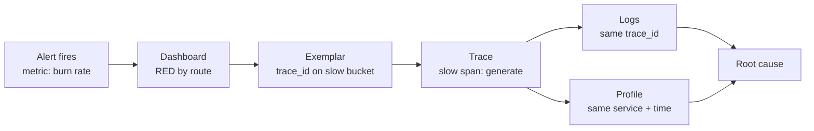
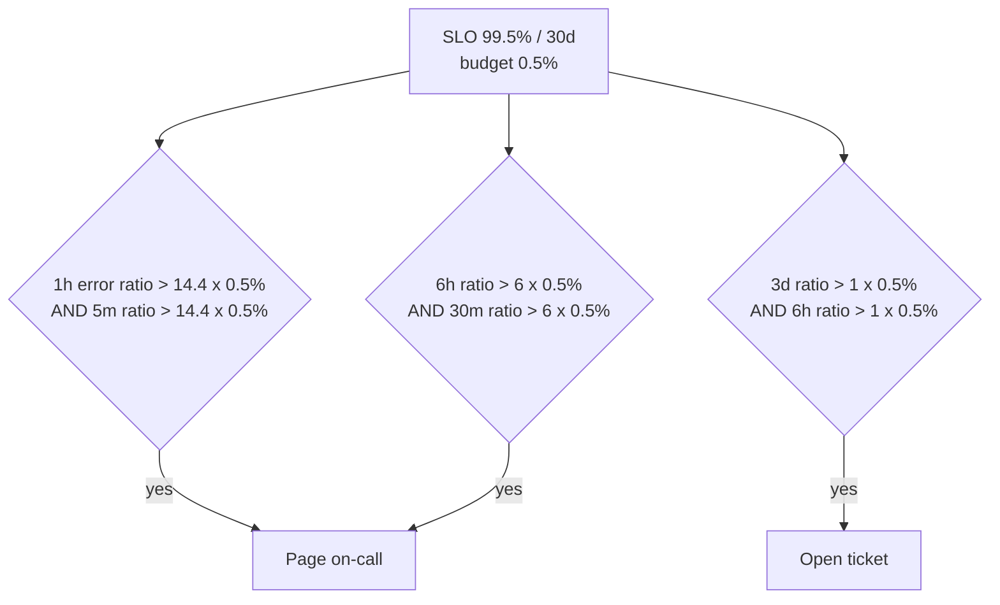
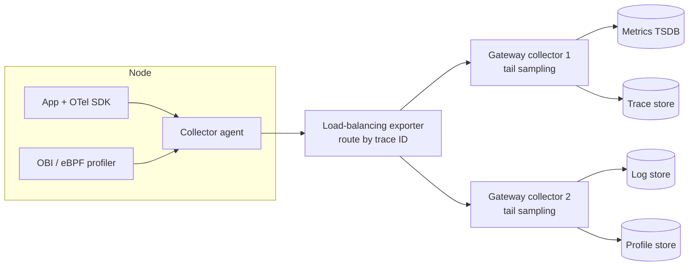
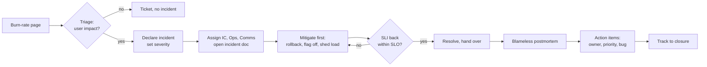

# 12 — Observability

> **The requirement.** Lumen's answer API has an availability SLO of 99.5% of requests over 30 days. The on-call
> engineer must be **paged within minutes** when the error budget is being spent fast enough to matter, must
> **not** be paged for a ten-second blip, and must be able to go from the page to the guilty span, log line or
> line of code in **under five minutes** — all for an observability bill that stays a small fraction of the
> infrastructure bill. This is hard because the three goals pull against each other: fast detection wants short
> windows, few false pages want long windows, and "find the guilty request" wants detail that is expensive to keep.

## In one minute

Monitoring answers questions you thought of in advance ("is CPU above 90%?"). Observability is the property of a
system that lets you answer questions you did *not* think of in advance, from the outside, using the telemetry it
emits. In practice that telemetry comes in four shapes. **Metrics** are cheap numbers aggregated over time — great
for alerting and trends, useless for "which user?". **Logs** are timestamped records of discrete events — rich, but
expensive at volume. **Traces** follow one request through many services so you can see where the time went.
**Profiles** show which *lines of code* burn CPU or memory. The craft is to emit each signal where it is cheapest
and most useful, link them with shared identifiers (trace IDs, resource attributes), alert only on what users feel
(SLOs and error-budget burn rate), and keep the bill under control by sampling and by refusing unbounded label
values. OpenTelemetry has become the vendor-neutral way to produce and ship all of this, and the chapter ends with
the human side: who is paged, how they run the incident, and what changes afterwards.

## Why this matters now

Three things changed between roughly 2019 and 2026.

1. **One instrumentation standard.** OpenTelemetry (OTel) merged OpenTracing and OpenCensus and is now the default way
   to instrument services. Its tracing, metrics and logs signals are stable at the API, SDK and protocol (OTLP)
   level; the metrics SDK is listed as "mixed" because some parts are still maturing; and **profiles** entered
   public **Alpha** in 2026, with the protocol still marked "development" on the status page (as of 2026-11) [1][2].
   Instrument once, send anywhere.
2. **Kernel-level, zero-code telemetry.** eBPF lets you observe programs from the kernel without changing them.
   OpenTelemetry eBPF Instrumentation (OBI, the former Grafana Beyla, donated in 2025) reached **v1.0.0 on
   2026-10-30** [3][4], and Elastic's eBPF whole-system profiler was accepted into OpenTelemetry in 2024 [5].
3. **New workloads with new signals.** LLM services care about time-to-first-token, tokens per request and cost
   per call — none of which classic HTTP metrics capture. OpenTelemetry's **GenAI semantic conventions** define
   names for them, but they are still **Development** status and moved to their own repository in 2026 (as of
   2026-11) [6]. Meanwhile telemetry bills grew to the point where observability cost is a design constraint in its
   own right.

## Core ideas [Core]

### Monitoring vs observability

A useful working definition: a system is *observable* to the degree that you can explain any internal state from its
outputs without shipping new code. Dashboards of pre-chosen metrics are monitoring; the ability to slice telemetry by
an attribute you did not anticipate ("only requests from tenant 381 on build 2.14 in eu-west") is observability.
Both are needed. Monitoring tells you *that* something is wrong; observability helps you find *what* and *why*.

### The four signals

| Signal | Unit of data | Cheap at scale? | Best for | Worst for |
|---|---|---|---|---|
| Metrics | a number per time series per interval | yes — cost scales with *series*, not traffic | alerting, SLOs, trends, capacity | per-request questions |
| Logs | one record per event | no — cost scales with traffic | rare events, audit, debugging context | aggregate trends |
| Traces | a tree of spans per request | only when sampled | latency breakdown across services | very long or batch workflows |
| Profiles | stack samples per process per interval | yes — fixed sampling rate | "which function burns the CPU?" | request-level causality |

**Metrics.** A time series is identified by a metric name plus a set of label (attribute) key–value pairs; each
unique combination is a separate series [7]. The main metric kinds are *counters* (monotonic: requests served),
*gauges* (instantaneous: queue depth), and *histograms* (a distribution: request latency in buckets). OpenTelemetry's
data model adds the notion of *temporality* — cumulative (running totals since start) or delta (change since last
export) — which matters when you convert between systems [8]. Histograms are the most important kind for latency:
averages hide tails, and you cannot average percentiles across instances, but you *can* add histogram buckets and
compute a percentile afterwards [30].

**Logs.** A log record is a timestamp, a severity, a body and attributes. *Structured* logs (key–value or JSON)
can be queried; free-text logs mostly cannot. OpenTelemetry deliberately did not invent a new logging API for
developers: it provides a **Logs Bridge API** so existing logging libraries feed into the OTel pipeline, and it
stamps each record with the active trace and span IDs so a log line links to its trace [9].

**Traces.** A trace is a tree (strictly, a directed acyclic graph) of *spans*. Each span has a name, start and end
time, a parent, attributes and a status. The idea was popularised by Google's Dapper paper [10]. Context crosses
process boundaries in a header; the W3C **Trace Context** Recommendation standardises it as `traceparent:
00-<32-hex trace-id>-<16-hex parent-id>-<flags>`, where the lowest flag bit says "sampled" [11].

**Profiles.** A profiler samples stack traces (for example 100 times per second) and aggregates them, usually shown
as a flame graph. *Continuous* profiling keeps doing this in production at low overhead, so you can compare "this
week vs last week" or "build 2.14 vs 2.13". Google described fleet-wide continuous profiling in 2010 [12].

*Diagram: the debugging path — an alert on a metric leads to a dashboard, an exemplar on a slow histogram bucket
links to a trace, and the trace links to its logs and to a profile for the same service and time window.*

### Correlation is the whole point

Four disconnected tools are four places to look. What makes them one system is **shared identity**:

- **Resource attributes** (`service.name`, `service.version`, `deployment.environment.name`, `k8s.pod.name`) are
  attached to every signal from a process, so "show me logs and profiles for the service that fired the alert" is
  a join on the same keys [13].
- **Trace context** (trace ID, span ID) goes into spans, into log records, and into **exemplars** — sample
  measurements attached to a metric data point that carry the trace ID of a request that contributed to it [8].
  An exemplar on the slowest histogram bucket is a direct link from "p99 is bad" to "here is one bad request".
- **Semantic conventions** make attribute names the same everywhere: an HTTP server span uses `http.route`,
  `http.request.method`, `http.response.status_code`, whatever language produced it [14].

### Choosing what to measure: golden signals, RED, USE

You cannot dashboard everything. Three short lists give you a starting set:

- **The four golden signals** (Google SRE book): latency, traffic, errors, saturation — for user-facing
  systems [15].
- **RED** (Tom Wilkie): for every *service*, measure **R**ate (requests per second), **E**rrors (failed requests per
  second) and **D**uration (latency distribution) [16]. RED is a service-centric subset of the golden signals and
  maps directly onto one histogram: the count gives rate, the count filtered by status gives errors, the buckets
  give duration.
- **USE** (Brendan Gregg): for every *resource* (CPU, memory, disk, NIC, connection pool, GPU), measure
  **U**tilisation, **S**aturation (queued work) and **E**rrors [17]. USE finds the bottleneck; RED tells you
  whether users care.

A rule of thumb that works in practice: RED on every service boundary, USE on every resource that can queue,
and an SLO on the two or three user journeys that matter.

### Cardinality: the metric that eats your budget

Every distinct combination of label values is a separate time series that must be indexed, stored and queried [7].
Series count is the product of the number of distinct values of each label:

`series ≈ Π (distinct values of label i) × buckets (for histograms)`

A histogram with 10 buckets plus `+Inf`, `_sum` and `_count` (13 series per label combination), 3 methods, 20
routes and 6 status codes is 13 × 3 × 20 × 6 = 4,680 series per instance. Add a `user.id` label with 1 million
users and the theoretical bound becomes 4.68 billion. That is a *cardinality explosion*. The Prometheus
documentation is explicit: do not use labels for user IDs, email addresses or other unbounded sets [7].
High-cardinality detail belongs in **traces and logs** (whose cost scales with sampled events, not with the number
of distinct values) — you get to ask "which user?" there.

### SLIs, SLOs and error budgets (recap)

SYSDESIGN-01 introduced SLIs and SLOs. Here we make them operational.

- **SLI**: good events / valid events, e.g. non-5xx answers / all answers, or answers faster than 300 ms / all
  answers.
- **SLO**: a target for the SLI over a window, e.g. 99.5% over 30 days.
- **Error budget**: 1 − SLO = 0.5% of requests may fail in 30 days. At 20 requests/s that is about
  0.005 × 20 × 86,400 × 30 ≈ 259,000 failed requests per month.
- **Burn rate**: how fast you spend budget relative to plan. Burn rate 1 means you will spend exactly the budget
  by the end of the window; burn rate 10 means you will spend it in 3 of 30 days [18].

### Alerting on SLOs: multi-window, multi-burn-rate

The Google SRE Workbook walks through six progressively better alerting strategies and recommends the last:
**multi-window, multi-burn-rate** alerts [18]. The idea in two steps:

1. **Alert on burn rate, not on raw error rate.** Fire when you are consuming budget at a rate that, if sustained,
   would hurt. For a 30-day SLO the Workbook's recommended starting points are: page at burn rate **14.4** over
   **1 hour** (2% of the monthly budget gone), page at **6** over **6 hours** (5% gone), and open a ticket at **1**
   over **3 days** (10% gone) [18].
2. **Add a short window to each long one** — the Workbook suggests **1/12** of the long window (5 minutes for 1
   hour, 30 minutes for 6 hours, 6 hours for 3 days). The alert fires only if *both* windows exceed the threshold.
   The long window gives precision (no paging for blips); the short window makes the alert *reset* quickly once the
   problem stops, instead of firing for another hour [18].

*Diagram: three alert conditions derived from one SLO; each requires both a long and a short window above the
burn-rate threshold; the first two page, the third opens a ticket.*

For our 99.5% SLO the fast-burn page fires when the error ratio exceeds 14.4 × 0.005 = **7.2%** in both the last
hour and the last five minutes. The lab implements the two paging rules (with every window divided by 12 so you can
watch them in minutes); the 3-day ticket rule is left out.

## Numbers that matter

Assumptions for Lumen's answer API (labelled; adjust to your system): 20 requests/s average, 4 instances, 3
services per request (gateway, answer, retrieval), 8 spans per trace on average, 500 bytes per span after
compression-friendly encoding, 2 log lines per request at 300 bytes each.

**Metrics.** One latency histogram with 10 explicit buckets → 13 series per label combination. Labels: method (2),
route (10), status class (5), instance (4) → 13 × 2 × 10 × 5 × 4 = **5,200 series**. With a 15 s scrape or export
interval that is 5,200 / 15 ≈ 347 samples/s. Prometheus-style TSDBs compress samples to roughly one to two bytes
each (the Gorilla paper reported an average of 1.37 bytes per data point [19]), so storage is tiny — tens of
megabytes per day. The danger is not volume but *series count*.

**Traces at 100%.** 20 req/s × 8 spans × 500 B = 80 KB/s ≈ **6.9 GB/day** before backend overhead.
At **10% head sampling** that is ≈ 0.69 GB/day; Dapper reported that a uniform 1/1024 rate still gave enough data
for high-volume services and that latency and throughput penalties at sampling rates below 1/16 were within experimental error [10].

**Logs.** 20 req/s × 2 × 300 B = 12 KB/s ≈ **1 GB/day** — more than sampled traces, and the first place a bill
grows when someone adds a debug line in a hot path.

**Error budget arithmetic** (99.5%, 30 days, 20 req/s):

| Burn rate | Error ratio | Time to exhaust 30-day budget | Budget used before a 1h-window alert can fire |
|---|---|---|---|
| 1 | 0.5% | 30 days | — |
| 6 | 3% | 5 days | — (6h window: 5%) |
| 14.4 | 7.2% | ≈ 2.08 days | 2% |
| 100 | 50% | 7.2 hours | reaches 2% after ≈ 8.6 minutes |
| 200 (total outage) | 100% | 3.6 hours | reaches 2% after ≈ 4.3 minutes |

Time to exhaust = 30 days / burn rate. Time for a 1-hour window to cross 14.4× during a sustained burn *b* is
roughly 60 min × 14.4 / *b* (the long window's average must rise to the threshold). This is why a total outage
pages in about four minutes with these rules, while a 10% error rate (burn rate 20) takes about 43 minutes
(60 × 14.4 / 20). A sustained rate below 7.2% never trips the fast rule at all: 7% errors is burn rate 14.0, so
only the 6-hour rule (3%) catches it, after about 6 h × 3 / 7 ≈ 2.6 hours. That is why the 6-hour rule exists.

**Latency SLI** example: if 99% of answers must be faster than 300 ms, put a histogram bucket boundary *at* 300 ms;
then "good" is exactly the `le="0.3"` bucket count and needs no interpolation.

## Design choices and trade-offs

### Pipeline architecture

| Option | Wins when | Costs | Example systems |
|---|---|---|---|
| SDK exports directly to backend | tiny deployments, demos | config in every app; no central sampling/redaction | OTLP from SDK to a SaaS endpoint |
| Collector as **agent** (per node / sidecar) | you need host metadata, local buffering, eBPF | one more process per node | OTel Collector DaemonSet, OBI |
| Collector as **gateway** (central pool) | tail sampling, redaction, routing to several backends, cost control | stateful for tail sampling; must be scaled and monitored | OTel Collector with `tail_sampling` |
| Agent + gateway | most production systems | two hops | common pattern in the OTel docs [20] |

*Diagram: apps and eBPF agents send OTLP to a per-node collector agent; a load-balancing exporter routes all spans of
a trace to the same gateway collector, which tail-samples and forwards each signal to its store.*

### Sampling

| Strategy | Decision made | Wins when | Costs |
|---|---|---|---|
| Head, probabilistic (trace-ID ratio) | at the root span, before anything is known | simple, cheap, consistent across services via the `sampled` flag | keeps 10% of errors too — rare failures may be missed |
| Head, rate-limited / adaptive | at the root, targeting N traces/s | low-traffic services keep more | sampling probability must be recorded for correct counts (Dapper did this [10]) |
| Tail | after the trace completes (or a timeout) | keep 100% of errors and slow traces, a small % of the rest | stateful; all spans of a trace must reach the same collector; memory for in-flight traces [21][22] |
| No trace sampling, aggregate to metrics | span metrics computed before sampling | accurate RED even with aggressive sampling | must be computed *before* the sampler |

The OpenTelemetry Collector's tail-sampling processor (beta for traces, as of 2026-11) states that all spans of a
trace **must** reach the same collector instance; the load-balancing exporter routes by trace ID for exactly this
reason [21][22]. Its defaults wait 30 s (`decision_wait`) and hold 50,000 traces (`num_traces`) in memory [21].
A key consequence: if you tail-sample, compute your RED metrics from spans *before* sampling (or from the SDK's own
metrics), otherwise your error rate is wrong.

### Storage backends

| Option | Wins when | Costs | Examples |
|---|---|---|---|
| Pull-based TSDB | metrics, alerting close to the data | cardinality limits per node | Prometheus |
| Horizontally scaled metrics on object storage | long retention, multi-tenant | more components | Mimir, Thanos, Cortex |
| Index-light log store (labels only) | cheap high-volume logs | full-text search is slower | Loki |
| Full-text indexed log store | ad-hoc search over log bodies | index cost ≈ data size | Elasticsearch, OpenSearch |
| Trace store on object storage | cheap retention, lookup by trace ID | search by attribute needs extra indexing | Tempo, Jaeger with a columnar backend |
| Columnar "wide event" store | arbitrary slicing on high-cardinality fields | query cost; schema discipline | ClickHouse-based stacks, Honeycomb-style backends |

The last row reflects an influential school of thought: emit one wide, structured event per unit of work with many
fields, and derive metrics from it at query time (the argument of Majors, Fong-Jones and Miranda [23]). It trades metric cheapness for flexibility. Most teams end
up with a hybrid: metrics for alerting, wide events or traces for investigation.

### Push vs pull for metrics

Prometheus *pulls* (scrapes) targets; OTLP *pushes*. Pull gives you a free liveness signal (`up == 0`) and keeps
load control on the server side; push works through NAT and for short-lived jobs. Prometheus 3 accepts OTLP pushes
natively (`--web.enable-otlp-receiver`) [29], which is what the lab uses.

## Deep dive [Deep]

### Histograms: explicit buckets, native and exponential

Classic (explicit-bucket) histograms force you to choose boundaries in advance; quantiles are interpolated within a
bucket, so the error is bounded by the bucket width. OpenTelemetry's **exponential histogram** and Prometheus's
**native histograms** use buckets whose boundaries grow geometrically by a configurable factor, giving bounded
*relative* error across many orders of magnitude in one series [8]. Prometheus made native histograms a stable
(opt-in) feature in **v3.8.0** (2025-11-28) and made the old feature flag a no-op in v3.9.0 [24]. The trade-off:
better resolution and fewer series, but every component on the path (SDK, collector, storage, query) must support
them.

Two rules that prevent wrong answers:

- **Never average percentiles.** The mean of four instances' p99 values is not the fleet p99. Sum the buckets, then
  compute `histogram_quantile`.
- **Put a bucket boundary at your SLO threshold**, so the latency SLI is an exact count, not an interpolation.

### Burn-rate math, precisely

Let the SLO be *s* (e.g. 0.995) over period *T* (30 days). Budget fraction *B* = 1 − *s*. Observed error ratio
over window *w* is *e(w)*. Burn rate *r(w)* = *e(w)* / *B*. If the alert fires when *r*(long) > *k*, the fraction of
the period's budget consumed by the time it can fire is *k* × *w*long / *T*. With *k* = 14.4, *w* = 1 h, *T* = 720 h:
14.4 / 720 = **2%** — the Workbook's number [18]. Choosing *k* is choosing "how much budget may I lose before a human
is woken".

Low-traffic services break this math: at 10 requests per hour, one failure is a 10% hourly error ratio, a 100× burn rate on
a 99.9% SLO (10% / 0.1%; the Workbook's text says 1,000×, which does not follow from its own numbers), and it
consumes 13.9% of the 30-day budget [18].
The Workbook's suggestions — synthetic traffic, grouping small services, or making the product tolerate single
failures — apply; so does requiring a minimum request count in the alert expression.

### Tail sampling under load

A gateway collector doing tail sampling holds every in-flight trace for `decision_wait`. Memory ≈ spans/s ×
decision_wait × bytes/span. At 2,000 spans/s × 30 s × 1 KB in memory ≈ 60 MB — fine; at 200,000 spans/s it is
6 GB per replica, which is why tail-sampling tiers need horizontal scaling, back-pressure and their own dashboards.
When the trace ID router changes membership (a gateway replica added or removed), spans of in-flight traces can
land on different replicas and be sampled inconsistently; consistent hashing (SYSDESIGN-07) limits but does not
remove the effect.

### Context propagation pitfalls

- **Async boundaries.** Queues and thread pools drop context unless instrumented. For a message queue, put the
  `traceparent` in message headers and decide whether the consumer span is a *child* (synchronous feel) or a
  *link* (batch consumers processing many messages) — OTel span links exist for the second case.
- **Untrusted inbound headers.** A public edge should not blindly honour `traceparent` from the internet (cost
  attacks via forced sampling, and trace-ID collisions). Start a new trace at the edge, or keep the inbound one only
  as a link.
- **Baggage** propagates key–values across services; it is convenient for tenant IDs and dangerous for anything
  sensitive, because it is sent to every downstream — including third parties.

### Continuous profiling and eBPF

eBPF lets small verified programs run in the Linux kernel on events such as function entry, network packets or
timer ticks [25]. For observability this gives:

- **Zero-code RED metrics and spans** by observing HTTP/gRPC traffic at the socket or library level (OBI) [4].
- **Whole-system CPU profiling** across languages by sampling stacks from the kernel and unwinding them, without
  restarting processes (the OTel eBPF profiler) [5].

Limits to state in a design review: it is Linux-only, needs elevated privileges (often `CAP_BPF`/`CAP_SYS_ADMIN` or a
privileged DaemonSet), payload visibility for encrypted traffic depends on hooking TLS libraries, and auto-generated
spans know nothing about your business logic ("which tenant?", "which retrieval strategy?"). Use eBPF for coverage
and SDK instrumentation for meaning.

### Logs: structure, levels and sampling

Logs scale with traffic. Practical controls: structured JSON with a fixed schema; trace IDs in every line; INFO
logs sampled or turned into metrics at high volume; ERROR logs kept; and **dynamic log levels** so you can raise
verbosity for one service for 15 minutes without a deploy. Redact personal data at the collector, not in every app
(SYSDESIGN-19).

## Frontier [Frontier]

**GenAI telemetry (as of 2026-11).** OpenTelemetry's GenAI semantic conventions define spans for inference,
embeddings, tool execution and agent invocation, each with its own duration metric. On the client side, model calls
are measured with `gen_ai.client.inference.duration`, streaming latency with `gen_ai.client.inference.time_to_first_chunk`
(also recorded per call as the span attribute `gen_ai.response.time_to_first_chunk`), tools with
`gen_ai.execute_tool.duration` and agents with `gen_ai.invoke_agent.duration` (in-process) or
`gen_ai.client.invoke_agent.duration` (remote). The generic `gen_ai.client.operation.duration` still exists, but the
conventions say it SHOULD NOT be reported for inference, embeddings, tool or agent operations. Model servers report
`gen_ai.server.time_to_first_token` and `gen_ai.server.time_per_output_token`. Token counters are
`gen_ai.client.inference.usage.input_tokens` / `.output_tokens` (plus `.cache_read.input_tokens`,
`.cache_write.input_tokens` and `.reasoning.output_tokens`), keyed by attributes like `gen_ai.operation.name`,
`gen_ai.provider.name` and `gen_ai.request.model` [6]. Every one of these is marked **Development**; the conventions
were deprecated in the core semantic-conventions repository in v1.42.0 (June 2026) and moved to
`open-telemetry/semantic-conventions-genai`, which still had no tagged release when checked on 2026-11-20 (core is at
v1.45.0, released 2026-11-02) [6][26]. Names have already changed (older instrumentations emit
`gen_ai.client.token.usage`, and inference used to be reported on `gen_ai.client.operation.duration`), so pin
instrumentation versions and expect dashboards to need migration. Prompt and completion content are **opt-in** attributes for good reason: they can
contain personal data and secrets. SYSDESIGN-26 builds an LLM gateway that uses these conventions.

**Profiles as a fourth OTel signal.** The Profiles signal entered public Alpha in 2026 with an OTLP profiles
format compatible with pprof, a Collector receiver for the eBPF agent, and the explicit warning that it "should not
be used for critical production workloads" [2]. Linking profiles to traces (which function made *this* span slow)
is the promised payoff.

**eBPF instrumentation goes stable.** OBI v1.0.0 (2026-10-30) commits to a configuration contract and telemetry
compatibility rules, and now covers protocols from HTTP/gRPC to message brokers and several AI providers [3][4].

**AIOps, with care.** Machine learning on telemetry is useful for narrow tasks: anomaly detection on seasonal
metrics, clustering similar alerts, suggesting likely root causes. A 2023 study at Microsoft evaluated large language
models on more than 40,000 incidents for root-cause and mitigation recommendation and found them promising but not a
replacement for engineers [27]. Treat AI suggestions as hypotheses with evidence links, not verdicts: an assistant
that cannot show the query, trace or log behind its claim should not be trusted with a page or a rollback. Keep
humans approving any automated mitigation, and measure the assistant like any other component (precision of its
suggestions, time saved, harm from wrong ones).

## Failure modes and operations

| Failure | How it shows up | Detect with | Mitigate |
|---|---|---|---|
| Cardinality explosion | TSDB memory climbs, queries time out, bill spikes | series count per metric (`count by (__name__)`), ingestion rate | drop/aggregate labels at the collector; limits per tenant; review labels in code review |
| Telemetry pipeline outage | dashboards flat, alerts silent ("no data") | a meta-monitor outside the pipeline; alert on *absence* of data | buffer in agents; dead-man's-switch alert; separate failure domain for monitoring |
| Alert fatigue | pages ignored, acknowledged without action | pages per on-call shift; % actionable | delete non-SLO pages; burn-rate alerts; tickets for slow burns |
| Wrong error rate after tail sampling | SLO looks better/worse than reality | compare SDK metrics with span-derived metrics | compute metrics before sampling |
| Long windows on young series | a "6-hour" alert fires within minutes of a deploy or backend restart | compare series age with the alert window | require a minimum sample count or series age in the rule |
| Clock skew | child spans start before parents | negative span gaps | NTP/PTP; tolerate skew in UI; trust durations within one host |
| Lost context across async hops | traces broken into fragments | traces with single service; orphan spans | instrument queue clients; propagate headers |
| Observability causes the outage | debug logging floods disk or network | log volume per service | rate-limit logs; async non-blocking exporters with bounded queues |

**Operate the monitoring itself.** The monitoring system must fail independently of what it watches: if Lumen's
cluster and its Prometheus share one Kubernetes node pool, a node-pool failure blinds you exactly when you need to
see. Run at least a minimal external probe (black-box check from another region or provider) that pages when the
*monitoring* goes silent.

## Incident response, on-call and postmortems [Core]

Everything above ends in a page. The requirement says a human is woken "within minutes"; it does not yet say who that
human is, what they do in the first ten minutes, how often they may be woken, or what the organisation does
afterwards so the same page never fires twice. That is the human half of observability, and Google's SRE books are
the most complete public account of it [31]–[38].

### From page to incident

A page is not automatically an incident. The SRE book recommends clear conditions for *declaring* one: an event is
an incident if a second team must be involved, if the outage is visible to customers, or if the issue is unsolved
"even after an hour's concentrated analysis" [32]. The Workbook adds "declare incidents early and often", reporting
that "managed incidents are resolved faster" in Google's experience [37]. Declaring is cheap; an undeclared incident
with three engineers silently changing production in parallel is expensive.

**Severity** decides how many people are pulled in and who is told. There is no universal scale; PagerDuty's public
incident-response guide is a reasonable template [39]:

| Level | Meaning (paraphrased from [39]) | Response |
|---|---|---|
| SEV-1 | critical, warrants public notification and executive liaison | major-incident process, page an incident commander, public notice |
| SEV-2 | critical issue affecting many customers' ability to use the product | major-incident process, page an incident commander |
| SEV-3 | stability or minor customer impact needing immediate owner attention | high-urgency page to the owning team, full process if the commander decides |
| SEV-4 | minor, needs action, no customer impact | low-urgency page to the service team, outside the major-incident process |
| SEV-5 | cosmetic | ticket, no page |

The guide's rule for doubt is worth adopting verbatim: if you are unsure, "treat it as the higher one", and argue
about the level in the postmortem, not during the incident [39]. For Lumen, tie severity to the SLO so it is not a
matter of mood (a policy choice, not a standard): the fast-burn page (burn rate 14.4 or more on the answer API) opens
at least SEV-2; the slow-burn page opens SEV-3; the 3-day ticket rule never opens an incident.

### Roles and the first ten minutes

The SRE book's incident structure separates four jobs [32]. The **incident commander** "holds the high-level state
about the incident", assigns roles and keeps the **living incident document** (timeline, hypotheses, actions taken),
which "can be messy, but must be functional". **Operations** is "the only group modifying the system during an
incident". **Communication** is "the public face of the incident response task force". **Planning** "supports Ops by dealing
with longer-term issues" so that Ops can stay on mitigation [32]. The
Workbook's version names an Incident Commander, an Operations Lead and a Communications Lead, gives the Communications Lead the job of periodic updates to responders and stakeholders, and frames
the goal as the "3Cs": coordinate the response, communicate, and maintain control [37]. On a small team one person holds several
roles at first; the point is that someone *explicitly* holds each one, and that command is handed over out loud
("You're now the incident commander, okay?") [32].

*Diagram: a burn-rate page is triaged; with user impact an incident is declared with a severity, roles are assigned and
an incident document opened; responders mitigate until the SLI recovers, then resolve, write a blameless postmortem
and track its action items to closure.*

The priority order is the SRE book's: "Stop the bleeding, restore service, and preserve the evidence for
root-causing" [32]; the Workbook's training advice is to "encourage a mitigation-first response" [37]. In practice the
first mitigation for Lumen is almost always one of a short list of pre-built controls: roll back the last deploy or
config change (see [SYSDESIGN-14](../02-modern-requirements/14-cloud-native-platforms.md#changing-a-live-system-safely-core)),
turn a feature flag off, shift traffic away from a bad zone, or apply the overload playbook of
[SYSDESIGN-11](11-reliability-engineering.md). The debugging path at the top of this chapter (burn rate → exemplar →
trace → logs → profile) is how you find the cause; you do not need the cause to roll back.

### Paging policy and on-call load

The alerting section decided the symptom pages: the two burn-rate rules. Add cause-based pages only as a narrow
exception, for failures that will hurt users before any SLI moves (a disk that fills in two hours, an expiring
certificate). Everything else is a ticket or a dashboard. The SRE book adds *how fast* and *how often*. Typical response targets are
"5 minutes for user-facing or otherwise highly time-critical services" and 30 minutes for less time-sensitive ones
[31]. Google caps SRE operational work at 50% of time and on-call at no more than 25% of it; with a primary and a
secondary on week-long shifts, that makes eight engineers the minimum single-site rotation (six per site for two
sites) [31]. Because one incident takes about six hours on average once root-cause analysis, remediation, postmortem
and fixes are counted, the book concludes the maximum is two incidents per 12-hour shift [31].

Apply it to Lumen: the answer team has five engineers. Two on-call slots per week shared by five people is 40% of
everyone's weeks, well above the 25% cap. The honest options are a shared rotation with the retrieval team, a smaller
paging surface, or a follow-the-sun split, not "be more resilient". Watch two numbers per shift: **incidents** (more
than about two per 12-hour shift means overload [31]; the book counts an incident as a group of related alerts with one
cause, not each page) and the **share of pages that needed action** (low-value pages cause the fatigue that makes "serious alerts... treated with less attention than necessary"
[31]). Repetitive manual operational work is **toil**, "manual, repetitive, automatable, tactical, devoid of enduring
value", and the SRE goal is to keep it below 50% of each engineer's time [34]; incidents that recur are the most
expensive toil there is.

### The error-budget policy: what the SLO is for

An SLO without consequences is a dashboard. The Workbook's chapter on implementing SLOs says you need "a policy
outlining what to do when your service runs out of budget", agreed in advance by the people who must act on it, and
lists preconditions: stakeholders approved the SLO, the owning team agrees it is achievable, the organisation "has
committed to using the error budget for decision making and prioritizing", and there is a process to refine it [35].
Its example actions when budget runs out range from prioritising reliability bugs to a production freeze [35]. The
SLO document itself records the objectives, the SLI implementations, the approval, and the next review date; review
monthly at first and quarterly or less once the SLO is stable [35].

The Workbook's Appendix B example policy is short enough to adopt as a starting point [36]:

- **SLO miss:** if the service has exceeded its budget for the preceding four weeks, halt all changes and releases
  "other than P0 issues or security fixes" until it is back within SLO.
- **Outage:** a single incident that consumes more than 20% of the four-week budget requires a postmortem with at
  least one P0 action item; a class of outage that consumes more than 20% in a quarter gets a P0 item in the next
  quarter's plan.
- **Escalation:** disagreements about the calculation or the action go to a named executive (the CTO in the example).
- **Non-goal:** it is "not intended to serve as a punishment for missing SLOs" [36].

Translated to Lumen's 30-day, 99.5% SLO (the arithmetic is ours; the example uses four weeks): the budget is about
259,000 failed requests, so the 20% outage trigger is about 51,800 failed requests. A total outage burns at 200×, so
it crosses that line after 0.2 × 3.6 h ≈ **43 minutes**; the fast-burn page (about 4 minutes into such an outage)
gives the team roughly 39 minutes to mitigate before a P0 postmortem becomes mandatory. That is the connection the
requirement asked for: alert thresholds, severity and policy are all derived from one number.

### Blameless postmortems that change something

A postmortem is "truly blameless" when it focuses on "the contributing causes of the incident without indicting any
individual or team" [33]. People who expect blame hide information, and the system keeps the flaw. Write one when a
pre-agreed trigger fires; the SRE book's list is user-visible downtime or degradation beyond a threshold, data loss of
any kind, on-call intervention such as a rollback or rerouting, resolution time above a threshold, or a monitoring
failure that meant a human found the problem first [33]. A useful skeleton: impact in SLO-budget terms; timeline from
the incident document; trigger and contributing causes (for metastable failures, the trigger *and* the sustaining
effect, [SYSDESIGN-11](11-reliability-engineering.md)); **detection** (how long from the start to the page, compared
with what the burn-rate arithmetic predicts); what went well and what went badly; action items.

Action items are where most postmortems fail. The Workbook's checklist: each item has "both an owner and a tracking
number", a priority, and "a verifiable end state" [38]. The Workbook flags vague items such as "Improve paging and
alerting" [38]; for Lumen, "Improve monitoring" is not an action item, "Page when the retrieval error ratio exceeds
the fast-burn threshold" is. Prefer a single owner with collaborators, and include
*prevent* items as well as *mitigate* items [38]. Items are filed in the normal bug tracker so their closure can be
monitored, and incentives should reward implementing the plan, not only writing the document [38]. Review matters
too: "An unreviewed postmortem might as well never have existed" [33]. Track two numbers per quarter: the share of P0
and P1 action items closed by their due date, and the number of incidents whose causes repeat an earlier postmortem.

### Troubleshooting method and game days

Mitigation does not need the cause; the postmortem does. The SRE book frames troubleshooting as "an application of the
hypothetico-deductive method": from the observations and a model of the system, "iteratively hypothesize potential
causes for the failure and try to test those hypotheses" [40]. Its loop runs problem report, triage ("Stopping the
bleeding should be your first priority"), examine, diagnose, test and treat [40]. Three habits from that chapter fit
Lumen's telemetry. Start with what changed: "Recent changes to a system can be a productive place to start", which is
why every deploy, flag flip and prompt version should be an annotation on the burn-rate graph [40]. Divide the system:
walk the request path, or for a large system use **bisection**, which "splits the system in half" and checks which
half misbehaves; a trace waterfall does much of that split for a single request [40]. And distrust coincidence: "correlation is not
causation", and "when you hear hoofbeats, think of horses not zebras" [40]. Record every hypothesis you ruled out in
the incident document; the chapter argues that "Negative results should not be ignored or discounted" [40].

Practise before the page. Google SRE teams practise regular **disaster role playing** ("Wheel of Misfortune"), at
best a weekly ritual: a game master announces a page from a prepared scenario (a previous outage, or a hypothetical
breakage of a new or soon-to-be-launched feature), and the primary and secondary on-call say what they would do to
mitigate and investigate [41]. At company scale, the annual **DiRT** exercise combines "theoretical and practical
drills to perform multiday testing of infrastructure systems and individual services" [31]; in it, SREs "inflict
actual outages" to check that systems react as expected and to find unexpected weaknesses [42]. A first Lumen game day
needs no new tooling: in staging, seed one fault (the lab's error injection), run the incident process above with
named roles, measure time to page against the burn-rate prediction and time to mitigate, and file the gaps as action
items with owners, exactly like a postmortem. Move to production drills only once rollback and the kill switches have
been exercised in staging.

### Agent-era note: when the change was a prompt

In LLM and agent products a large share of risky changes never touch a binary: a prompt edit, a new tool description,
a provider silently updating the model behind an unpinned alias, a re-built retrieval index. These incidents often
show up as *quality* drops (more refusals, wrong answers, more escalations) rather than 5xx errors, so the SLIs that
page must include evaluation signals as well as availability, and the incident timeline must record the full version
tuple (model snapshot, prompt version, gateway config, index version). The mitigation-first rule still applies:
flip the alias or route weights back before investigating, then add the failing cases to the regression set
([SYSDESIGN-26](../03-ai-systems/26-llm-gateways-llmops.md#drift-and-model-regression-incident-response),
[SYSDESIGN-32](../03-ai-systems/32-observing-evaluating-agents.md#10-regression-gates-in-cicd-for-agents-and-prompts)).
Treat an AI assistant's incident summary as a hypothesis with evidence links, as the Frontier section argues.

## Cost and energy

Observability spend is driven by four knobs: **series count** (metrics), **bytes ingested** (logs, traces),
**retention**, and **query load**. A design-review checklist:

1. **Budget telemetry like any other resource.** Set a target such as "telemetry ≤ X% of infrastructure cost" and
   track it per team. (Pick X with your finance partner; this course does not cite an industry percentage because
   published figures are vendor surveys.)
2. **Metrics first for alerting** — they are the cheapest signal per question answered.
3. **Sample traces**, keep all errors and slow ones (tail sampling) and derive RED metrics before sampling.
4. **Tier retention**: e.g. 7–15 days hot, longer on object storage at lower resolution.
5. **Enforce label allow-lists** at the collector; reject unknown high-cardinality attributes.
6. **Drop or sample INFO logs** at high volume; convert repeated log lines into counters.

Energy follows bytes and CPU: every span serialised, shipped, indexed and stored costs compute on both ends.
Continuous profiling is the exception that often *pays for itself*: Google reported using fleet-wide profiles to
find optimisation opportunities across its datacentres [12], and finding one hot function in a large fleet saves
far more energy than the profiler uses. SYSDESIGN-16 and SYSDESIGN-17 quantify cost and energy in general.

## Interview angle

**How it is asked.** Rarely as "design observability" alone; more often as a follow-up ("how would you know it is
working?"), or as a full design: "design a metrics/monitoring system" (see C13 for a GPU/HPC telemetry platform).

**Model answer outline (CLARIFY → QUANTIFY → SKETCH → DEEPEN → STRESS → WRAP):**

1. **CLARIFY** — which user journeys matter; the SLO (target, window, what counts as good); who gets paged.
2. **QUANTIFY** — requests/s → spans/s and log bytes/s; metric series from labels; error budget in requests.
3. **SKETCH** — OTel SDKs → collector agents → gateway (tail sampling, redaction) → metrics/logs/traces stores →
   alerting and dashboards; correlation by `service.name` and trace ID.
4. **DEEPEN** — multi-window multi-burn-rate alerts with the 14.4/6/1 thresholds; exemplars; cardinality limits.
5. **STRESS** — pipeline outage (dead-man's switch), collector hot spots, cost at 10× traffic, low-traffic SLOs.
6. **WRAP** — summarise trade-offs: sampling vs completeness, metrics vs wide events, build vs buy.

**Red flags:** alerting on CPU instead of user-visible symptoms; averaging percentiles; "log everything"; user IDs
as metric labels; no plan for monitoring the monitoring; claiming 100% trace capture is free.

**Likely follow-ups:** "How do you decide what pages and who is paged?" (the burn-rate rules, severity tied to the
SLO, a rotation sized against the 25% cap). "What makes a postmortem useful?" (trigger and sustaining cause, owned and
tracked action items with a verifiable end state). "Why two windows?" (precision + fast reset). "How do you alert on latency?" (latency SLI from
a histogram bucket at the threshold, same burn-rate rules). "How do you debug one slow tenant?" (traces/wide events
with a tenant attribute; never a metric label if tenants are unbounded).

## Common mistakes

- Treating observability as a tool purchase rather than a property you design in (names, attributes, IDs).
- Paging on causes (CPU 90%) rather than symptoms (users failing); keep cause metrics for dashboards.
- Averaging percentiles across instances or time.
- Unbounded label values (user, request ID, URL with IDs instead of `http.route`).
- Tail sampling without fixing the derived error-rate metrics.
- Monitoring in the same failure domain as the service.
- Logging personal data and secrets, then replicating them into three backends.
- Trusting an AI incident summary without the underlying query or trace.

## Check yourself

1. A histogram has 10 explicit buckets and labels `route` (25 values), `status_code` (8) and `pod` (30). How many
   series? What changes if you replace `status_code` by `status_class` (5 values)?
2. For a 99.9% SLO over 30 days, what error ratio corresponds to burn rate 14.4, and how much budget is spent when a
   1-hour-window alert at that rate fires?
3. Why does tail sampling require all spans of a trace to reach the same collector, and what component makes that
   happen in OpenTelemetry?
4. Which OpenTelemetry signals are stable and which are not, as of 2026-11?
5. Lumen's answer team has five engineers on a week-long primary/secondary rotation. What share of their weeks is
   on-call, and what does the SRE book's 25% cap imply?

Full set with answers: [exercises/12-observability.md](../../exercises/12-observability.md).

## Lab

[labs/12-observability/](../../labs/12-observability/README.md) — a single `grafana/otel-lgtm` container [28] (OTel
Collector, Prometheus, Tempo, Loki, Pyroscope, Grafana) plus a small Lumen "answer" service instrumented with the
OpenTelemetry Python SDK and a k6 load generator. You inject errors and latency at runtime, watch the RED metrics,
follow an exemplar into a trace and its logs, watch the multi-window multi-burn-rate alerts (windows compressed 12×)
fire and resolve, and cause a deliberate cardinality explosion by adding `user.id` as a metric label. In the recorded
test run the fast-burn alert fired about 3 min 47 s after injecting 10% errors (the estimate above predicts 3.6 min),
resolved within about 10 s of the reset, and one `user.id` label grew the histogram from 33 to 20,845 series in two
minutes.

## Further reading

- Google SRE Workbook, "Alerting on SLOs" [18] — the derivation of multi-window, multi-burn-rate alerts; read it
  with a calculator.
- Sigelman et al., "Dapper" [10] — the paper behind modern tracing, including its sampling and overhead data.
- OpenTelemetry specification status and concepts [1][20] — what is stable, and how the Collector is deployed.
- Brendan Gregg, "The USE Method" [17] and Tom Wilkie's RED talk [16] — two checklists you can apply tomorrow.
- Majors, Fong-Jones, Miranda, *Observability Engineering* [23] — the case for wide structured events.
- OpenTelemetry GenAI semantic conventions repository [6] — follow it if you operate LLM services.
- Google SRE book ch. 14–15 [32][33] and Workbook ch. 9–10 and Appendix B [36]–[38] — incident roles, postmortems and
  an error-budget policy you can copy.

## References

[1] OpenTelemetry, "Specification Status Summary," https://opentelemetry.io/docs/specs/status/ (accessed 2026-11).
[2] OpenTelemetry, "OpenTelemetry Profiles Enters Public Alpha," blog, 2026, https://opentelemetry.io/blog/2026/profiles-alpha/ ; and "Profiles" concept page (Status: Alpha), https://opentelemetry.io/docs/concepts/signals/profiles/ (accessed 2026-11).
[3] OpenTelemetry, "OpenTelemetry eBPF Instrumentation reaches v1.0.0," blog, 2026, https://opentelemetry.io/blog/2026/obi-v1-release/ ; release v1.0.0 (2026-10-30), https://github.com/open-telemetry/opentelemetry-ebpf-instrumentation/releases (accessed 2026-11).
[4] N. Grcevski (Grafana Labs), "Introducing OpenTelemetry eBPF Instrumentation: Why we donated Grafana Beyla to OpenTelemetry," dateline 2025-05-08, https://grafana.com/blog/opentelemetry-ebpf-instrumentation-beyla-donation/ (accessed 2026-11).
[5] OpenTelemetry, "Elastic Contributes its Continuous Profiling Agent to OpenTelemetry," blog, 2024, https://opentelemetry.io/blog/2024/elastic-contributes-continuous-profiling-agent/ (accessed 2026-11).
[6] OpenTelemetry, GenAI semantic conventions (docs/gen-ai/: gen-ai-spans.md, gen-ai-metrics.md, client-inference.md, execute-tool.md, client-invoke-agent.md, gen-ai-token-metrics.md; all "Status: Development"), https://github.com/open-telemetry/semantic-conventions-genai (main branch, no tagged release, accessed 2026-11-20).
[7] Prometheus, "Metric and label naming," https://prometheus.io/docs/practices/naming/ (accessed 2026-11).
[8] OpenTelemetry, "Metrics Data Model" (temporality, exponential histograms, exemplars), https://opentelemetry.io/docs/specs/otel/metrics/data-model/ (accessed 2026-11).
[9] OpenTelemetry, "Logs" specification overview (Logs Bridge API, trace context in log records), https://opentelemetry.io/docs/specs/otel/logs/ (accessed 2026-11).
[10] B. H. Sigelman et al., "Dapper, a Large-Scale Distributed Systems Tracing Infrastructure," Google Technical Report dapper-2010-1, 2010, https://research.google/pubs/pub36356/ ; full text https://static.googleusercontent.com/media/research.google.com/en//archive/papers/dapper-2010-1.pdf (accessed 2026-11).
[11] W3C, "Trace Context" (Level 1), W3C Recommendation, 23 November 2021 (first Recommendation 6 February 2020), https://www.w3.org/TR/trace-context/ (accessed 2026-11).
[12] G. Ren et al., "Google-Wide Profiling: A Continuous Profiling Infrastructure for Data Centers," IEEE Micro, 2010, https://research.google/pubs/google-wide-profiling-a-continuous-profiling-infrastructure-for-data-centers/ (accessed 2026-11).
[13] OpenTelemetry, Resource semantic conventions, https://opentelemetry.io/docs/specs/semconv/resource/ ; `deployment.environment.name`: https://opentelemetry.io/docs/specs/semconv/resource/deployment-environment/ ; `k8s.pod.name`: https://opentelemetry.io/docs/specs/semconv/resource/k8s/ (accessed 2026-11).
[14] OpenTelemetry, "Semantic conventions for HTTP metrics" (`http.server.request.duration`), https://opentelemetry.io/docs/specs/semconv/http/http-metrics/ (accessed 2026-11).
[15] B. Beyer et al. (eds.), *Site Reliability Engineering*, ch. 6 "Monitoring Distributed Systems," O'Reilly/Google, 2016, https://sre.google/sre-book/monitoring-distributed-systems/ (accessed 2026-11).
[16] J. Dam (Grafana Labs), "The RED Method: How to instrument your services" (write-up of Tom Wilkie's talk), Grafana Labs blog, 2018-08-03, https://grafana.com/blog/the-red-method-how-to-instrument-your-services/ ; slides, GrafanaCon EU 2018, https://grafana.com/files/grafanacon_eu_2018/Tom_Wilkie_GrafanaCon_EU_2018.pdf (accessed 2026-11).
[17] B. Gregg, "The USE Method," https://www.brendangregg.com/usemethod.html (accessed 2026-11).
[18] S. Murphy et al. (eds.), *The Site Reliability Workbook*, ch. 5 "Alerting on SLOs," O'Reilly/Google, 2018, https://sre.google/workbook/alerting-on-slos/ (accessed 2026-11).
[19] T. Pelkonen et al., "Gorilla: A Fast, Scalable, In-Memory Time Series Database," PVLDB 8(12), 2015, https://www.vldb.org/pvldb/vol8/p1816-teller.pdf (accessed 2026-11).
[20] OpenTelemetry, "Collector" documentation (agent and gateway deployment patterns), https://opentelemetry.io/docs/collector/ (accessed 2026-11).
[21] OpenTelemetry Collector Contrib, "Tail Sampling Processor" README (stability beta; decision_wait 30 s; num_traces 50,000), https://github.com/open-telemetry/opentelemetry-collector-contrib/tree/main/processor/tailsamplingprocessor (accessed 2026-11).
[22] OpenTelemetry Collector Contrib, "Load Balancing Exporter" README (routing by traceID), https://github.com/open-telemetry/opentelemetry-collector-contrib/tree/main/exporter/loadbalancingexporter (accessed 2026-11).
[23] C. Majors, L. Fong-Jones, G. Miranda, *Observability Engineering*, 1st ed., O'Reilly, 2022, https://www.oreilly.com/library/view/observability-engineering/9781492076438/ ; a 2nd edition appeared in 2026 (https://www.oreilly.com/library/view/observability-engineering-2nd/9781098179915/). Publisher pages return HTTP 403 to scripts: unverified as of 2026-11 beyond search listings; the lesson only cites the book's general thesis.
[24] Prometheus, CHANGELOG — 3.8.0 (2025-11-28) "Native histograms are now a stable, but optional feature"; 3.9.0 (2026-01-06) feature flag made a no-op, https://github.com/prometheus/prometheus/blob/main/CHANGELOG.md (accessed 2026-11).
[25] eBPF.io, "What is eBPF?", https://ebpf.io/what-is-ebpf/ (accessed 2026-11).
[26] OpenTelemetry, semantic-conventions releases (v1.42.0, 2026-06-12: all `gen_ai.*` conventions deprecated and moved to the GenAI repository; v1.45.0, 2026-11-02), https://github.com/open-telemetry/semantic-conventions/releases (accessed 2026-11-20).
[27] T. Ahmed et al., "Recommending Root-Cause and Mitigation Steps for Cloud Incidents using Large Language Models," ICSE 2023, arXiv:2301.03797, https://arxiv.org/abs/2301.03797 (accessed 2026-11).
[28] grafana/docker-otel-lgtm, v0.41.0 (2026-11-13), https://github.com/grafana/docker-otel-lgtm (accessed 2026-11).
[29] Prometheus, "Using Prometheus as your OpenTelemetry backend" (`--web.enable-otlp-receiver`), https://prometheus.io/docs/guides/opentelemetry/ (accessed 2026-11).
[30] Prometheus, "Histograms and summaries" (quantiles cannot be aggregated; histogram buckets can be summed across instances), https://prometheus.io/docs/practices/histograms/ (accessed 2026-11).
[31] A. Spadaccini, "Being On-Call," ch. 11 in B. Beyer et al. (eds.), *Site Reliability Engineering*, O'Reilly/Google, 2016, https://sre.google/sre-book/being-on-call/ (accessed 2026-11).
[32] A. Stribblehill, "Managing Incidents," ch. 14 in *Site Reliability Engineering*, 2016, https://sre.google/sre-book/managing-incidents/ (accessed 2026-11).
[33] J. Lunney, S. Lueder, "Postmortem Culture: Learning from Failure," ch. 15 in *Site Reliability Engineering*, 2016, https://sre.google/sre-book/postmortem-culture/ (accessed 2026-11).
[34] V. Rau, "Eliminating Toil," ch. 5 in *Site Reliability Engineering*, 2016, https://sre.google/sre-book/eliminating-toil/ (accessed 2026-11).
[35] S. Thurgood, D. Ferguson, with A. Hidalgo, B. Beyer, "Implementing SLOs," ch. 2 in *The Site Reliability Workbook*, O'Reilly/Google, 2018, https://sre.google/workbook/implementing-slos/ (accessed 2026-11).
[36] S. Thurgood, "Example Error Budget Policy," Appendix B in *The Site Reliability Workbook*, 2018, https://sre.google/workbook/error-budget-policy/ (accessed 2026-11).
[37] J. Mace, J. Oertel, S. Thorne, A. Chakrabarti, with J. Ma, J. Yang, "Incident Response," ch. 9 in *The Site Reliability Workbook*, 2018, https://sre.google/workbook/incident-response/ (accessed 2026-11).
[38] D. Rogers, M. Suriar, S. Lueder, P. Deo, D. Sudhakar, with G. O'Connor, D. Rensin, "Postmortem Culture: Learning from Failure," ch. 10 in *The Site Reliability Workbook*, 2018, https://sre.google/workbook/postmortem-culture/ (accessed 2026-11).
[39] PagerDuty, Incident Response Guide, "Severity Levels," https://docs.pagerduty.com/ops-guides/incident-response-guide/severity-levels (accessed 2026-11).
[40] C. Jones, "Effective Troubleshooting," ch. 12 in B. Beyer et al. (eds.), *Site Reliability Engineering*, O'Reilly/Google, 2016 (sidebar "Negative Results Are Magic" by R. Bosetti), https://sre.google/sre-book/effective-troubleshooting/ (accessed 2026-11-20).
[41] A. Widdowson, "Accelerating SREs to On-Call and Beyond," ch. 28 in *Site Reliability Engineering*, 2016, https://sre.google/sre-book/accelerating-sre-on-call/ (accessed 2026-11-20).
[42] J. Petoff, "Lessons Learned from Other Industries," ch. 33 in *Site Reliability Engineering*, 2016 (DiRT; cites K. Krishnan, "Weathering the Unexpected," CACM 55(11), 2012), https://sre.google/sre-book/lessons-learned/ (accessed 2026-11-20).
