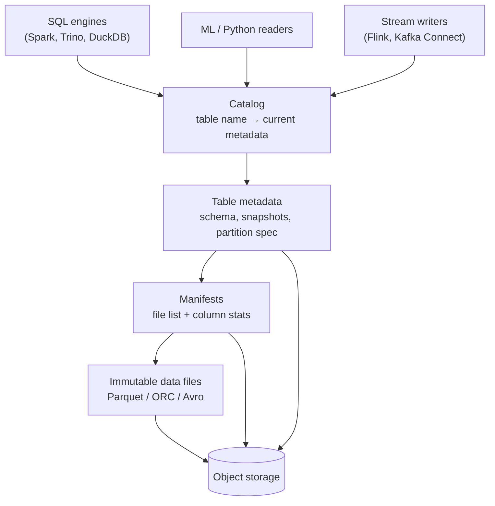
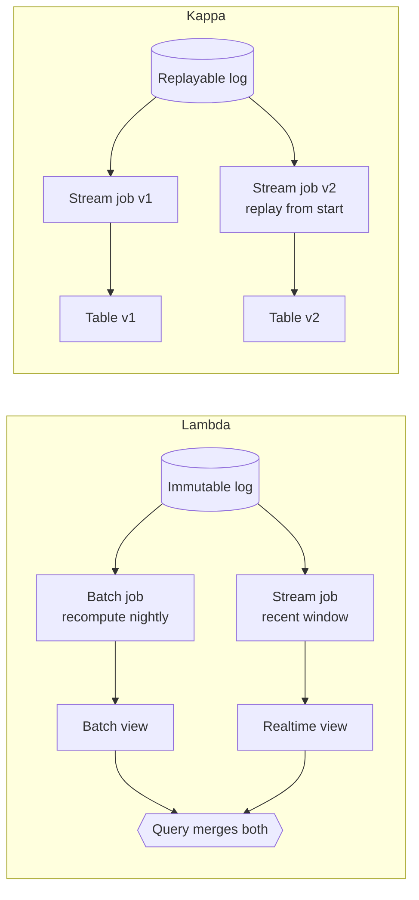
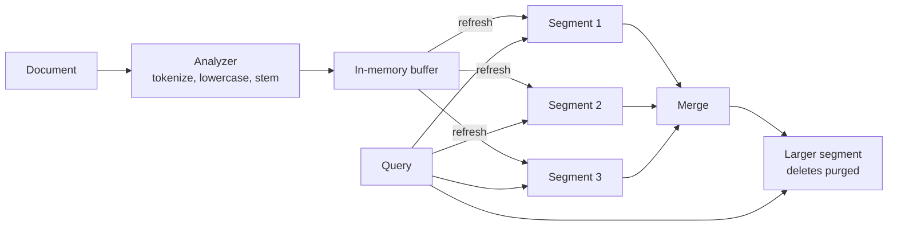
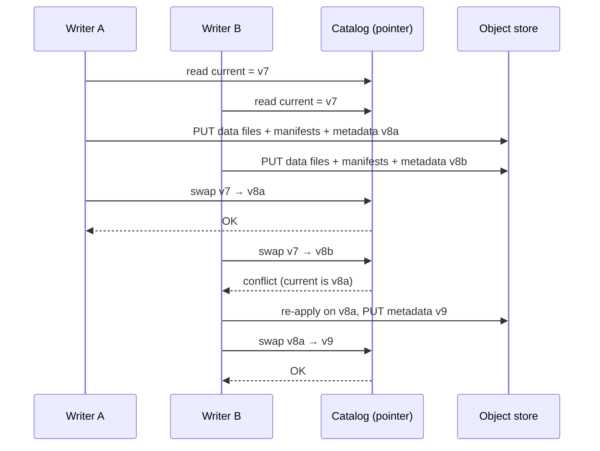

# 13 — Data at scale

> **The requirement.** Lumen, our fictional AI knowledge and chat product, now stores **2 PB** of user documents
> and attachments, ingests about **200 M product events a day**, and must (a) keep every document with
> "eleven-nines-class" durability at the lowest cost per byte, (b) answer product-analytics questions over the last
> **90 days** of events in **under 30 seconds**, and (c) serve keyword search over **500 M document chunks** with
> **p99 < 200 ms** and new content searchable within a few seconds. One OLTP database (SYSDESIGN-05) cannot do any
> of the three. This chapter is about the three storage-and-compute shapes that can: object storage, the
> lakehouse, and the search index — and the batch and stream engines that move data between them.

## In one minute

Most of the world's bytes do not live in databases; they live in **object stores** such as Amazon S3, Google Cloud
Storage or a self-hosted Ceph/MinIO cluster. An object store is a giant, durable key → blob map that is cheap per
byte but slow per request and cannot update a file in place. Analytics on top of it works by writing data as large,
immutable, **columnar** files (Parquet) and then adding a small **table format** (Iceberg, Delta Lake, Hudi) that
keeps a transaction log saying *which* files make up the table right now. That pairing — open files plus a
transactional metadata layer — is what the industry calls a **lakehouse**. Batch engines (MapReduce, then Spark)
scan these files in parallel; stream engines process events as they arrive; and the long-running argument between
the two is mostly an argument about how many code paths you are willing to maintain. Search is a different shape
again: an **inverted index** maps every word to the documents containing it, ranks results with **BM25**, and is
built from immutable **segments** that are periodically merged. Each of these ideas trades write flexibility for
read speed and cost, and each fails in a predictable way when you ignore that trade.

## Why this matters now

Three changes between 2020 and 2026 reshaped this chapter's design space:

1. **Object stores became strongly consistent and gained compare-and-swap.** Amazon S3 has delivered strong
   read-after-write consistency for all PUTs, overwrites and LISTs since December 2020, at no extra cost [1]. In
   August 2024 S3 added conditional writes with `If-None-Match: *`, and in November 2024 `If-Match` on ETags [3][4][33]. Before this, table
   formats needed an external lock service on S3; the Delta Lake paper explicitly notes that S3 lacked atomic
   put-if-absent and that Databricks ran a separate coordination service for log commits [9]. A primitive that
   was missing for 14 years is now a header.
2. **Open table formats won.** Apache Iceberg format **v3** is complete and adopted by the community (new types such
   as `variant` and geospatial, default values, row lineage, binary deletion vectors), while **v4** is "under
   active development and has not been formally adopted" (as of 2026-11) [10]. Iceberg 1.10 (September 2025)
   brought v3 features to general availability and the current Java release is 1.12.0 (2026-09-30) [11]. AWS ships
   managed Iceberg tables as "S3 Tables" (December 2024) [31].
3. **Object storage is eating the systems built *on top of* disks.** Kafka tiered storage (KIP-405) was marked
   production-ready in Kafka 3.9 [26]; WarpStream (acquired by Confluent in September 2024) runs a Kafka-compatible
   service with no local disks at all [27][28]; and Apache Kafka accepted the "Diskless Topics" direction
   (KIP-1150) in March 2026, with implementation KIPs still in progress [29]. Single-node engines such as DuckDB
   (2.0.0 LTS, October 2026) query Parquet on S3 directly from a laptop [30].

The result: for most teams the question is no longer "Hadoop or a warehouse?" but "which table format, which
catalog, how big are my files, and what is my freshness budget?"

## Core ideas [Core]

### 1. Object storage: what you actually get

An object store exposes buckets of **objects**: an opaque byte string up to many terabytes, addressed by a key,
with a small metadata map and an **ETag**. The operations are few: `PUT` (whole object, or multipart upload for
large ones), `GET` (optionally a byte range), `HEAD`, `DELETE`, `LIST` by prefix, and `COPY`. There is **no
append and no in-place update**: to change one byte you rewrite the object. Keys look hierarchical
(`tenant=42/2026/11/20/part-0001.parquet`) but the namespace is flat; "directories" are a LIST-by-prefix
convention, and "rename" is copy + delete, which is neither atomic nor cheap.

The semantics you can rely on (S3 as the reference implementation):

| Property | What S3 documents | Why you care |
|---|---|---|
| Durability | "Designed to provide 99.999999999% durability" for S3 Standard; data stored across at least three Availability Zones [2] | You almost never need your own replicas *for durability*; you still need versioning/backups for *mistakes* |
| Availability | Designed for 99.99% for S3 Standard [2] | A region-level dependency; plan for 503s and retries |
| Consistency | Strong read-after-write for new objects, overwrites and LIST since 2020-12-01 [1] | A reader that sees a commit pointer will see the objects it names |
| Conditional writes | `If-None-Match: *` fails with `412` if the key exists; `If-Match: <etag>` fails if the object changed; concurrent conditional writers: first to finish wins [3] | A compare-and-swap you can build commits and leases on |
| Request rate | "At least 3,500 PUT/COPY/POST/DELETE or 5,500 GET/HEAD requests per second per partitioned prefix"; scaling is gradual and you may see `503 Slow Down` meanwhile [5] | Spread hot keys across prefixes; never put a hot counter in one object |
| Latency | Small-object and first-byte latencies of "roughly 100–200 milliseconds" [5] | Object stores are throughput devices: few large requests, many in parallel |

The mental model to keep: **an object store is cheap per byte, expensive per request, slow per request, and
nearly infinitely parallel.** Every design below — big files, columnar layout, batched commits, caches in front —
follows from that sentence.

### 2. Durability inside the store: replication vs erasure coding

How does a store reach eleven nines without storing everything three times? By **erasure coding**. A
Reed-Solomon code RS(k, m) splits data into *k* data fragments and computes *m* parity fragments; any *k* of the
*k + m* fragments reconstruct the data. So RS(k, m) survives the loss of any *m* fragments at a storage overhead
of *m/k*.

| Scheme | Raw bytes per logical byte | Overhead | Losses tolerated | Bytes read to repair one lost fragment |
|---|---|---|---|---|
| 3× replication | 3.0 | 200% | 2 | 1 fragment (copy the survivor) |
| RS(6, 3) | 1.5 | 50% | 3 | 6 fragments |
| RS(10, 4) | 1.4 | 40% | 4 | 10 fragments |

HDFS documents exactly this comparison: 3× replication "has 200% overhead," while typical erasure-coding setups
stay at or below 50%, with RS-6-3 storing a 6-block file in 9 blocks instead of 18 [6]. The price is in the right
column and in locality: reads and writes of striped files are mostly off-rack, encoding and decoding cost CPU, and
HDFS warns that network bisection bandwidth "is thus very important" [6]. Facebook's f4 system made the same trade
for *warm* blobs, cutting the effective replication factor of its photo storage from 3.6 to 2.8 or 2.1 [7].

The design rule: **replicate what is hot or small; erasure-code what is large and cold.** Object stores apply this
internally; you meet the choice directly when you run Ceph, MinIO or HDFS yourself, and indirectly when a
storage class is priced lower because it is coded more aggressively.

### 3. From a data lake to a lakehouse

A **data lake** is a bucket of files in open formats, written by many jobs and read by many engines — cheap and
flexible, but with no transactions. Readers listing a directory mid-write see half a dataset; two writers can
clobber each other; deleting one user's rows for GDPR means rewriting files by hand. The usual fix in the 2010s was
a **two-tier** architecture: ETL from the lake into a warehouse for "important" queries. Armbrust et al. (CIDR 2021)
argue that this two-tier design suffers from four problems — **reliability** (keeping lake and warehouse
consistent), **data staleness**, **limited support for advanced analytics** such as ML, and **total cost of
ownership** — and propose the **lakehouse**: open direct-access formats such as Parquet, a transactional
**metadata layer** on top of the object store, and warehouse-class performance from caching, auxiliary statistics
and layout optimization [8].



*Diagram: engines resolve a table through a catalog to a metadata file, which points to manifests, which list
immutable Parquet data files; everything except the catalog pointer lives in object storage.*

The key trick is the same in all three formats: **files are immutable; the table is a pointer to a list of
files; a commit atomically moves the pointer.** Iceberg's spec states it directly: "All changes to table state
create a new metadata file and replace the old metadata with an atomic swap" [10]. Delta Lake keeps an ordered log
of JSON commit files (`_delta_log/000…01.json`) and periodically compacts the log into Parquet checkpoints
(by default every 10 transactions in the paper's implementation) [9]. Hudi, which began at Uber in 2017 as an
incremental-processing layer on Hadoop [13], keeps a **timeline** of actions and offers two table types:
**copy-on-write** (updates rewrite base files; fast reads) and **merge-on-read** (updates go to log files merged
at query time and by periodic compaction; fast writes) [12].

What you get from the metadata layer:

- **ACID commits** and snapshot isolation for readers — a query sees one snapshot, never half a write.
- **Time travel**: older snapshots stay readable until expired.
- **Schema evolution** by column ID rather than name/position, so renames do not corrupt old files [10].
- **Hidden partitioning** (Iceberg): partitions are derived from column transforms (`day(ts)`, `bucket(16, user_id)`),
  queries filter on the column, and the partition scheme can evolve without rewriting data [10].
- **Row-level deletes** without rewriting everything: v2 delete files, v3 deletion vectors (bitmaps of deleted
  row positions per data file) [10].
- **Planning without LIST**: manifests carry per-file column min/max statistics, so a planner prunes files with
  O(1) remote calls instead of listing millions of objects [10].

### 4. Columnar files: Parquet

Analytical queries read *few columns of many rows*. Row-oriented storage forces you to read every column of every
row; columnar storage stores each column contiguously so you read only what you need, and similar values sitting
next to each other compress well.

Parquet's layout [14]:

- A file is split horizontally into **row groups**; each row group holds one **column chunk** per column; each
  column chunk is a sequence of **pages** (the unit of encoding and compression).
- The **footer** (file metadata) is written *after* the data — "to allow for single pass writing" — and records
  where every column chunk starts, plus statistics; readers read the footer first [14].
- Encodings such as **dictionary** (store each distinct value once, then small integer codes) and **run-length /
  bit-packing** make low-cardinality columns tiny; a general compressor (Snappy, Zstd, …) runs on top.
- Parquet's own guidance recommends "large row groups (512MB - 1GB)" and "8KB for page sizes" [15].

Two read-side optimizations follow: **projection pushdown** (read only the requested column chunks) and **predicate
pushdown** (skip row groups and pages whose min/max statistics cannot match `WHERE ts >= …`). A table format adds a
third level above them: skip whole *files* using manifest statistics. Layout matters for all three: if you sort or
cluster data by the column you filter on, min/max ranges become narrow and skipping becomes effective.

### 5. Batch processing: MapReduce to Spark

**MapReduce** (Dean & Ghemawat, OSDI 2004) gave programmers two functions — `map` emits intermediate key/value
pairs, `reduce` merges all values for a key — and a runtime that handles "partitioning the input data, scheduling
the program's execution across a set of machines, handling machine failures, and managing the required
inter-machine communication" [16]. Its design choices are still the vocabulary of batch: data-parallel tasks over
file splits, a **shuffle** that groups by key across the network, fault tolerance by **re-running** failed or slow
tasks (the paper's "backup tasks" for stragglers), and intermediate results written to disk between stages.

Writing intermediates to disk made iterative work (machine learning, graph algorithms, interactive queries) slow.
**Spark's resilient distributed datasets** (Zaharia et al., NSDI 2012) keep working sets in memory and get fault
tolerance from "coarse-grained transformations rather than fine-grained updates to shared state" — if a partition
is lost, Spark recomputes it from the recorded chain of transformations (its lineage) instead of replicating it
[17]. Modern Spark adds SQL, a cost-based optimizer and vectorized Parquet reading, but the execution model —
stages separated by shuffles, tasks over partitions — is recognizably MapReduce's descendant.

### 6. Stream vs batch: Lambda and Kappa

Batch gives correct answers late; streaming gives fast answers that are harder to make correct. Nathan Marz's
**Lambda architecture** (2011) runs both: a batch layer recomputes views from the immutable master dataset, and a
speed layer covers the recent window, with queries merging the two [18]. Jay Kreps' 2014 critique ("Questioning
the Lambda Architecture") accepted the immutable log and the need to reprocess, but argued that keeping two
complex systems producing the same answer is the real cost — "I don't think this problem is fixable" — and proposed
what became known as **Kappa**: keep the input in a replayable log (e.g. Kafka with 30 days' retention), and when
logic changes, start a second streaming job that replays from the beginning into a new output table, then switch
readers over [19].



*Diagram: Lambda feeds one log into a batch job and a stream job and merges their views at query time; Kappa uses
only stream jobs, replaying the log into a new table when logic changes.*

In 2026 the lakehouse blurs the line: a stream job can commit to an Iceberg/Delta table every minute, and batch
jobs read the same table. Streaming in depth — CDC, Flink, stream–table duality — is SYSDESIGN-20
([20-real-time-streaming](../02-modern-requirements/20-real-time-streaming.md)).

### 7. Search: the inverted index

A B-tree answers "rows where `title = 'X'`". It cannot efficiently answer "documents containing *gpu* and
*eviction*, ranked by relevance". An **inverted index** can: for every **term** it stores a **postings list** of the
documents containing it (often with term frequencies and positions). Lucene's documentation defines it exactly
this way — it "stores terms and statistics about those terms" and can "list, for a term, the documents that
contain it" — and
structures the index as a set of **segments**, each "a fully independent index" that can be searched separately
[21].

Indexing pipeline: **analyze** text (tokenize, lowercase, maybe stem and remove stop words) → append postings to
an in-memory buffer → periodically **flush** a new immutable segment → in the background **merge** small segments
into larger ones, dropping documents marked deleted [21]. Updates are delete + re-add: the old copy is flagged in a
live-documents bitmap until a merge reclaims it [21]. This is an LSM tree in spirit (SYSDESIGN-05): fast writes,
background compaction, reads fan out over segments.



*Diagram: documents are analyzed into terms, buffered, flushed as immutable segments on refresh, and merged in the
background; a query searches every live segment.*

**Ranking with BM25.** Given query terms *q₁…qₙ*, BM25 (Robertson & Zaragoza [20]) scores document *D* as

```
score(D, Q) = Σᵢ IDF(qᵢ) · f(qᵢ, D) · (k₁ + 1) / ( f(qᵢ, D) + k₁ · (1 − b + b · |D| / avgdl) )
IDF(qᵢ)     = ln( 1 + (N − n(qᵢ) + 0.5) / (n(qᵢ) + 0.5) )      # the variant Lucene uses
```

where *f* is the term frequency in *D*, |*D*| the document length, *avgdl* the average length, *N* the number of
documents and *n(q)* the number containing *q*. Three intuitions: rare terms matter more (IDF); repeating a term
helps with **diminishing returns** (saturation controlled by *k₁*); long documents are penalized for having more
chances to match (length normalization controlled by *b*). Elasticsearch uses BM25 by default with *k₁* = 1.2 and
*b* = 0.75 [22].

**Distributing search.** Elasticsearch and OpenSearch shard an index (each shard is a Lucene index) and replicate
shards. A query **scatters** to one copy of every shard, each returns its local top-k, and a coordinator
**gathers** and merges. Two practical consequences: tail latency is the max over shards (SYSDESIGN-11), and
relevance statistics are per-shard unless you pay for a global pass. Elastic's sizing guidance is shards of
roughly 10–50 GB with fewer than 200 M documents each [32]. Near-real-time visibility comes from the **refresh**
that opens a new segment for search: `index.refresh_interval` defaults to 1 s on self-managed Elasticsearch (5 s
on its serverless offering) [23].

**Elasticsearch vs OpenSearch.** OpenSearch began in 2021 as an AWS-led fork after Elastic moved away from the
Apache 2.0 licence; in September 2024 the Linux Foundation launched the OpenSearch Software Foundation to host it
[25], and in August 2024 Elastic added the OSI-approved AGPLv3 as a third licence option alongside SSPL and ELv2
for the free part of Elasticsearch and Kibana [24]. Architecturally both are distributed Lucene; choose on
features, operations model and licence fit, not on the inverted index. Vector and hybrid (BM25 + embedding) search
are covered in SYSDESIGN-24 ([24-retrieval-vector-systems](../03-ai-systems/24-retrieval-vector-systems.md)); a
full crawler-plus-search case is C08 ([C08-web-crawler-search](../04-case-studies/C08-web-crawler-search.md)).

## Numbers that matter

All numbers below are **labelled assumptions** for Lumen unless they carry a citation. The method, not the
values, is what transfers.

**A. Document storage: replication vs erasure coding.**
Logical data: 2 PB (assumption).
- 3× replication: 2 PB × 3 = **6 PB raw**.
- RS(10, 4): 2 PB × 1.4 = **2.8 PB raw**, tolerating 4 lost fragments instead of 2.
- Difference: 3.2 PB of raw disk. At an assumed 20 TB per drive that is 160 drives before RAID, chassis or power.
- Repair: losing one 20 TB drive under RS(10, 4) means reading up to 10 × 20 TB = 200 TB across the network to
  rebuild it (versus 20 TB for replication). This is why repair bandwidth, not capacity, becomes the bottleneck
  of erasure-coded clusters [6][7].

**B. Event analytics: why columnar plus pruning wins.**
- Ingest: 200 M events/day × 1 KB JSON (assumption) = **200 GB/day raw**; 90 days ≈ **18 TB**.
- Assume Parquet with dictionary/RLE + Zstd achieves 5× over JSON for this data (assumption — measure your own;
  ratios vary widely with cardinality): 90 days ≈ **3.6 TB** of Parquet.
- A typical dashboard query reads 4 of 40 columns over the last 7 days, partitioned by `day(ts)`:
  bytes ≈ 3.6 TB × (4/40) × (7/90) ≈ **28 GB**.
- At an assumed 10 GB/s aggregate scan rate from object storage, that is about **3 s**; a row-oriented full scan of
  18 TB at the same rate is about **30 minutes**. Projection plus partition pruning is a ~600× reduction before
  any min/max skipping.

**C. File sizing and the small-files tax.**
- 50 streaming writers committing every 60 s: 50 × 1,440 = **72,000 files/day**, each about 200 GB / 72,000 ≈
  2.8 MB raw ≈ 0.55 MB compressed — far below the 512 MB–1 GB row-group recommendation [15].
- 90 days of that is ~6.5 M files; every query must plan over them and every file costs at least one GET (with
  ~100–200 ms first-byte latency [5]).
- Daily compaction to ~512 MB files: 40 GB/day compressed ÷ 0.5 GB ≈ **80 files/day**, or ~7,200 for 90 days.
  That is the reason table formats ship compaction ("rewrite data files") and snapshot expiry as routine
  maintenance.

**D. Requests cost money.**
WarpStream's documentation estimates that writing one object per partition every 100 ms costs roughly **$130 per
partition per month in S3 PUT charges alone** [27]. Check the arithmetic: 10 PUT/s × ~2.6 M s/month ≈ 26 M PUTs;
at an assumed list price of $0.005 per 1,000 PUTs (verify on the current S3 pricing page) that is ≈ $130. This is
why object-storage-native systems **batch many partitions into one object** and accept higher write latency.

**E. Search tier.**
- 500 M chunks × ~1 KB of text (assumption) ≈ 500 GB of source text. Assume the index plus stored fields is about
  the same size as the source (assumption — measure; depends on stored fields, positions and doc values) ≈ 500 GB.
- With 25 GB per primary shard (inside the 10–50 GB guidance [32]): **20 primaries**, 25 M documents each (well
  under 200 M). One replica → 40 shard copies.
- p99 budget 200 ms: every query fans out to 20 shards, so per-shard p99 must be well below 200 ms; if each shard
  independently exceeds its p99 1% of the time, the probability that at least one of 20 does is 1 − 0.99²⁰ ≈ 18%.
  Fan-out turns per-shard p99 into roughly the query's p82 (SYSDESIGN-11). Size per-shard latency at p99.9 or use
  hedged requests.

## Design choices and trade-offs

**Where analytical data lives**

| Option | Wins when | Costs | Example systems |
|---|---|---|---|
| Cloud data warehouse (managed, proprietary storage) | One engine, BI-centric, small team, governance out of the box | Lock-in of storage format; ML/Python readers go through the engine; egress | Snowflake, BigQuery, Redshift |
| Plain data lake (files, no table format) | Write-once archives, ML training dumps | No ACID, no safe concurrent writers, painful deletes | Parquet on S3/GCS + Hive-style directories |
| Lakehouse (open files + table format) | Many engines on the same data; streaming + batch writers; GDPR deletes; cost control | You operate compaction, snapshot expiry, a catalog; commit contention | Iceberg, Delta Lake, Hudi on object storage |
| Embedded / single-node analytics | Data fits one machine's scan budget (often tens to hundreds of GB) | No concurrency at scale; one box | DuckDB, Polars, SQLite |

**Table formats (as of 2026-11)**

| Format | Distinctive design | Wins when | Watch out for |
|---|---|---|---|
| Apache Iceberg (spec v3 adopted, v4 in development [10]) | Metadata tree (metadata → manifest list → manifests), hidden partitioning, partition evolution, catalog-based atomic swap | Multi-engine neutrality; very large tables; evolving partitioning | Requires a catalog; many tiny commits bloat metadata |
| Delta Lake (latest release v4.4.1 as of 2026-10) | Ordered JSON log + Parquet checkpoints in `_delta_log` [9] | Spark-centric stacks; simple log model | Historically needed coordination for S3 commits [9] |
| Apache Hudi | Timeline; copy-on-write vs merge-on-read; incremental pulls [12][13] | Upsert-heavy CDC ingestion with minute-level freshness | More table services to tune; MoR read cost depends on compaction lag |

**Batch vs stream**

| Architecture | Wins when | Costs |
|---|---|---|
| Batch only (hourly/daily) | Freshness of hours is fine; simplest correctness story | Stale dashboards; big periodic load spikes |
| Lambda | You need minutes-fresh approximate answers *and* recomputed exact ones | Two code paths that must agree [19] |
| Kappa | Logic can be expressed as a stream job and the log can be replayed | Log retention cost; replays need spare capacity |
| Streaming into a lakehouse table | Minutes-fresh tables readable by batch engines | Small files and commit rate must be managed |

**Search engines**

| Option | Wins when | Costs |
|---|---|---|
| Postgres full-text (`tsvector`) | Up to modest corpora, search lives next to OLTP rows | Weaker ranking/analysis features; shares OLTP resources |
| Elasticsearch / OpenSearch | Large corpora, rich analyzers, aggregations, hybrid search | Cluster operations, mapping design, JVM tuning |
| Managed search APIs | Small team, product search | Cost per query; less control over ranking |

## Deep dive [Deep]

### Optimistic commits on object storage

Iceberg writers work optimistically: read the current metadata, write new data files and manifests, write a new
metadata file, then **swap** the table's pointer from the base version to the new one; "if the snapshot on which an
update is based is no longer current, the writer must retry" [10].



*Diagram: two writers read version 7, both write new files, writer A's pointer swap succeeds, writer B's fails and
it re-applies its change on top of A's version before swapping again.*

Observations an interviewer will probe:

- **The swap is the only coordination point.** It can be a catalog database row updated with compare-and-swap, a
  REST catalog, or — since S3 added `If-None-Match` — a conditional PUT of the next log entry, which is exactly
  the put-if-absent the Delta paper wished S3 had [3][9].
- **Data files written by the loser are not wasted** if its change can be re-applied (an append can; a rewrite of
  files that someone else already deleted cannot). The spec lets writers choose what to validate, which sets the
  isolation level [10].
- **Contention scales with commit rate, not data size.** Fifty writers committing every minute to one table
  will retry constantly. Fix it by funnelling commits through fewer writers, committing less often, or
  partitioning work across tables.
- **Orphans happen.** A crashed writer leaves files that no snapshot references; a periodic "remove orphan files"
  job (with a safety margin longer than any in-flight write) cleans them up.

### Sequence numbers and deletes

Row-level deletes need to know whether a delete applies to a given data file. Iceberg assigns each commit a
**sequence number**; a delete file applies only to data files with an older sequence number in the same partition
[10]. v3's **deletion vectors** encode deleted row positions for one data file as a bitmap, replacing the v2
position-delete files [10]. The engineering consequence: deletes are cheap to write and expensive to read until a
compaction rewrites the affected files — so GDPR erasure (SYSDESIGN-19) is a *two-step* process: logical delete
now, physical rewrite plus snapshot expiry within your retention promise.

### Why Parquet skipping sometimes does nothing

Min/max statistics only help when values are **clustered**. If `tenant_id` is randomly distributed, every row group
contains tenants 1 to 10,000, every min/max range covers the predicate, and nothing is skipped. Remedies: sort
within files by the most selective filter column; use a bucket partition transform; use a multi-dimensional
clustering (Z-order / Hilbert curves) when queries filter on several columns; or add Bloom filters for
high-cardinality equality predicates (supported by the Parquet format). Sorting costs write time and compaction
CPU; measure skipped-bytes ratio before and after.

### Shuffles, skew and stragglers

Every `GROUP BY` or join on a non-co-partitioned key causes a shuffle: each task writes its output partitioned by
key and every downstream task fetches its slice from every upstream task — an all-to-all transfer of
*M × R* blocks. Two failure patterns dominate:

- **Skew.** If one key (a celebrity user, a `null` tenant) holds 30% of rows, the task that owns it runs 30% of the
  job alone. Mitigations: salting the hot key into sub-keys and aggregating twice, broadcast joins for small
  tables, adaptive query execution that splits skewed partitions.
- **Stragglers.** One slow machine delays the stage barrier. MapReduce's answer — speculative backup copies of the
  last in-progress tasks — remains standard [16].

### Search: refresh, merge and update costs

A refresh makes recent writes searchable by opening a new segment; a high refresh rate means many tiny segments,
which means more merge work and more per-query segment visits. Bulk loads therefore often disable refresh
(`refresh_interval: -1`) and restore it afterwards. Elasticsearch also stops background refreshes on
**search-idle** shards (no search for 30 s by default, when the interval is not set explicitly) [23]. Updates are
delete + insert, so an update-heavy index carries many deleted documents until merges catch up; merges are
I/O-heavy and compete with queries. Mapping design matters as much: an unbounded set of dynamic field names
("mapping explosion") bloats cluster state, and deep pagination with large `from` values forces every shard to
produce `from + size` results — use cursor-style `search_after` instead.

### BM25 behaviour worth knowing

- With *b* = 0, length normalization disappears; with *b* = 1 it is full. Short fields (titles) and long fields
  (bodies) often deserve different settings or separate fields with boosts.
- Because of saturation, a document repeating "gpu" 50 times scores only modestly above one that says it 5 times —
  a built-in defence against keyword stuffing.
- IDF is computed **per shard** by default; tiny shards or skewed routing give inconsistent scores for the same
  document across shards.

## Frontier [Frontier]

*(as of 2026-11)*

- **Iceberg v3 in production, v4 on the way.** v3 adds `variant` for semi-structured data, geometry/geography
  types, nanosecond timestamps, column default values, row lineage, binary deletion vectors and table encryption
  keys; v4 proposes an adaptive metadata tree for efficient small commits, data files combined with their deletion
  vectors, relative paths and table constraints — and stops allowing new equality deletes [10]. A format version
  is bumped precisely when older readers would misread new features [10], so every reader and writer of a table
  must support the new version before you upgrade it.
- **Object stores as coordination substrates.** Conditional writes [3] make it possible to implement commit logs,
  leases and leader election directly on S3-compatible storage — useful, but remember each attempt costs a
  request and ~100 ms [5].
- **Managed table buckets.** S3 Tables (December 2024) are a bucket type with built-in Iceberg support and
  automatic compaction, snapshot management and unreferenced-file removal [31]. Similar managed offerings exist on
  other clouds; the design question becomes "who runs maintenance and who owns the catalog?"
- **Object-storage-native streaming.** Kafka's tiered storage (KIP-405) keeps recent segments on broker disks and
  moves completed segments to object storage, production-ready since Kafka 3.9 [26]. WarpStream goes further:
  stateless "Agents" speak the Kafka protocol, write directly to object storage, keep metadata in a separate
  strongly consistent store, and trade higher end-to-end latency for no inter-AZ replication traffic and no local
  disks [27]. Apache Kafka's KIP-1150 ("Diskless Topics") was accepted on 2026-03-02 as a direction-setting KIP;
  the implementation KIPs (KIP-1163 Diskless Core, KIP-1164 Diskless Coordinator) were still in progress and not
  in a release when last checked [29]. Treat latency claims from vendors as vendor claims and measure.
- **Single-node analytics on the lake.** DuckDB 2.0.0 (LTS, released 2026-10-21) adds a client-server mode,
  asynchronous I/O for Parquet/CSV reads from object storage, and a shredded `VARIANT` type [30]. For data that fits
  a single machine's scan budget, "a laptop plus Parquet on S3" now replaces a cluster.
- **Search converges with retrieval for AI.** Lucene 10.x and both Elasticsearch and OpenSearch ship approximate
  vector search next to BM25; hybrid ranking is the default pattern for RAG (SYSDESIGN-24). Elastic's own AGPL
  announcement framed the change partly around vector-search adoption [24].

## Failure modes and operations

| Failure | Symptom | Detect (SLI / signal) | Mitigate |
|---|---|---|---|
| Small files | Query planning slow, high GET count, high cost per query | Files per partition; median file size; planning time | Batch writes; compaction jobs; target 256 MB–1 GB files |
| Metadata bloat | Planning time grows with table age | Snapshot count, manifest count, metadata file size | Expire snapshots; rewrite manifests; fewer, larger commits |
| Commit contention | Writers retry; ingest lag grows | Commit retry rate; commit latency p99 | Fewer committers; longer commit interval; split tables |
| Orphan files | Storage grows faster than table size | Bucket bytes vs table-referenced bytes | Orphan-file cleanup with a safety window |
| Hot prefix | `503 Slow Down` responses [5] | 503 rate per prefix | Spread keys (hash prefixes); back off with jitter (SYSDESIGN-11) |
| Abandoned multipart uploads | Invisible storage cost | Incomplete-upload bytes | Lifecycle rule to abort incomplete uploads [3] |
| Shuffle skew | One task runs for hours | Task duration max/median ratio | Salting; adaptive execution; broadcast joins |
| Stream–batch disagreement (Lambda) | Dashboards change after the nightly batch | Diff between speed and batch views | Single code path (Kappa or streaming into the lakehouse) |
| Search merge storm | Query p99 spikes during heavy indexing | Merge time, segment count, indexing rate vs latency | Throttle merges; lower refresh rate; separate indexing and search nodes |
| Shard fan-out tail | Query p99 far above per-shard p99 | Per-shard latency histograms | Fewer, larger shards; hedged requests; routing by tenant |
| Accidental deletion | Data gone at the source | Delete-API audit logs | Versioning, object lock, delayed hard delete, snapshot retention |

Operational SLIs worth putting on a dashboard: **data freshness** (now − timestamp of newest committed row), **query
p95/p99 by class**, **bytes scanned per query**, **files per partition**, **compaction backlog**, **search
indexing-to-visible lag**, and **cost per TB scanned**. Observability practice in general is SYSDESIGN-12
([12-observability](12-observability.md)).

## Cost and energy

- **Bytes stored** is the cheapest line item; **bytes scanned**, **requests** and **egress** are where surprises
  live. A columnar file with good pruning cuts scan cost by orders of magnitude (Numbers B); thousands of tiny
  objects multiply request cost (Numbers C, D).
- **Storage classes** are an erasure-coding and access-latency trade-off you buy rather than build; lifecycle
  rules that move cold partitions to colder classes are routine (SYSDESIGN-16,
  [16-cost-as-requirement](../02-modern-requirements/16-cost-as-requirement.md)).
- **Energy per query** tracks bytes read and CPU spent decoding them. Pruning and compression are therefore also
  energy optimizations; recomputing a whole history nightly (naïve Lambda) is the opposite. Keep reprocessing
  incremental where you can (SYSDESIGN-17).
- **Replicas in search** double cost and energy for availability and read throughput; size them against a
  measured query rate, not habit.
- **Cross-AZ traffic** is a hidden cost of replicated, disk-based systems; WarpStream's docs cite about $0.05/GB for
  inter-AZ replication at AWS retail prices as their motivation for writing straight to object storage [27]
  (vendor figure — verify against your provider's current pricing).

## Interview angle

**How it is asked.** "Design an analytics platform for clickstream events." "Design search for a document
product." "How would you store a petabyte of user uploads?" "Why not just use Postgres?" It also appears inside
bigger designs: the metrics store in a monitoring system, the cold tier of a chat service, the index of a crawler.

**Model answer outline (CLARIFY → QUANTIFY → SKETCH → DEEPEN → STRESS → WRAP).**

1. **CLARIFY** — freshness (seconds, minutes, hours?), query shapes (dashboards vs ad-hoc vs keyword search),
   retention, deletion obligations (GDPR), number of engines/teams reading the data.
2. **QUANTIFY** — events/day × bytes/event, retention, compression assumption, bytes scanned per typical query,
   files per day, shard count for search (as in Numbers A–E).
3. **SKETCH** — events → log (Kafka) → stream job committing to Iceberg on object storage every few minutes →
   SQL engine and BI; documents → object storage → indexer → search cluster; catalog and compaction jobs drawn
   explicitly.
4. **DEEPEN** — pick one: optimistic commits and the catalog; Parquet layout and pruning; BM25 and sharding.
5. **STRESS** — small files, commit contention, hot tenants, shard fan-out tail, reprocessing after a bug,
   deleting one user's data across all tiers.
6. **WRAP** — restate the freshness/cost trade-off you chose and what you would measure first.

**Red flags.** "Store everything in Postgres." Treating S3 as a filesystem with cheap renames and appends. No file
sizing or compaction. A Lambda architecture with no plan for keeping both paths consistent. A search cluster with
hundreds of tiny shards. Ignoring deletes.

**Follow-ups to prepare.** Why are object stores slow per request but fast in aggregate? How does a table format
give ACID on immutable files? What does erasure coding cost you on repair? Why does fan-out hurt p99? When would
you choose DuckDB over a cluster?

## Common mistakes

- Treating object storage like a disk: frequent small writes, appends by rewrite, renames as commits.
- Partitioning by a high-cardinality column (`user_id`) and producing millions of tiny partitions.
- Never compacting or expiring snapshots, then blaming the query engine for slow planning.
- Assuming durability means you are protected from *your own* deletes — versioning and backups are still needed.
- Believing erasure coding is free: repair traffic and degraded reads are the price.
- Shipping a Lambda architecture whose batch and speed layers silently disagree.
- Over-sharding search ("one shard per tenant") and drowning in cluster state and fan-out.
- Measuring search latency at the shard and promising it at the query.
- Quoting vendor latency or cost numbers as if they were measured on your workload.

## Check yourself

1. What changed for table formats when S3 gained `If-None-Match` conditional writes?
2. RS(10, 4) vs 3× replication for 1 PB: raw capacity, losses tolerated, and the cost you pay on repair?
3. A query reads 3 of 60 columns over 2 of 365 daily partitions of a 50 TB Parquet table. Roughly how many bytes
   does it scan?
4. Why does Kreps argue the Lambda architecture's problem is not fixable, and what does Kappa do instead?
5. In BM25, what do *k₁* and *b* control?

Full set with answers: [exercises/13-data-at-scale.md](../../exercises/13-data-at-scale.md).

## Lab

No lab for this unit. (Hands-on practice with streaming arrives in SYSDESIGN-20; search and vector retrieval are
exercised in lab L24.)

## Further reading

- Armbrust, Ghodsi, Xin, Zaharia — *Lakehouse* (CIDR 2021) [8]: the argument for open formats plus a metadata
  layer; read §3 for the design.
- Armbrust et al. — *Delta Lake* (PVLDB 2020) [9]: the clearest description of building ACID commits on an
  eventually-consistent object store.
- Apache Iceberg Table Spec [10]: precise, readable, and the best way to understand snapshots, manifests and
  deletes.
- Dean & Ghemawat — *MapReduce* (OSDI 2004) [16] and Zaharia et al. — *RDDs* (NSDI 2012) [17]: two papers that
  define batch processing's vocabulary.
- Kreps — *Questioning the Lambda Architecture* (2014) [19]: short, still the best framing of stream vs batch.
- Robertson & Zaragoza — *The Probabilistic Relevance Framework: BM25 and Beyond* (2009) [20]: where BM25 comes
  from and why it works.
- Muralidhar et al. — *f4: Facebook's Warm BLOB Storage System* (OSDI 2014) [7]: erasure coding in production with
  temperature-aware tiers.

## References

1. Amazon Web Services, "Amazon S3 now delivers strong read-after-write consistency automatically for all
   applications," What's New, 2020-12-01.
   https://aws.amazon.com/about-aws/whats-new/2020/12/amazon-s3-now-delivers-strong-read-after-write-consistency-automatically-for-all-applications/
   (accessed 2026-11)
2. Amazon Web Services, "Data protection in Amazon S3," Amazon S3 User Guide.
   https://docs.aws.amazon.com/AmazonS3/latest/userguide/DataDurability.html (accessed 2026-11)
3. Amazon Web Services, "How to prevent object overwrites with conditional writes," Amazon S3 User Guide.
   https://docs.aws.amazon.com/AmazonS3/latest/userguide/conditional-writes.html (accessed 2026-11)
4. Amazon Web Services, "Amazon S3 now supports conditional writes," What's New, 2024-08-20.
   https://aws.amazon.com/about-aws/whats-new/2024/08/amazon-s3-conditional-writes/ (accessed 2026-11)
5. Amazon Web Services, "Best practices design patterns: optimizing Amazon S3 performance," Amazon S3 User Guide.
   https://docs.aws.amazon.com/AmazonS3/latest/userguide/optimizing-performance.html (accessed 2026-11)
6. Apache Software Foundation, "HDFS Erasure Coding," Apache Hadoop 3.3.5 documentation.
   https://hadoop.apache.org/docs/stable/hadoop-project-dist/hadoop-hdfs/HDFSErasureCoding.html (accessed 2026-11)
7. S. Muralidhar, W. Lloyd, S. Roy, C. Hill, E. Lin, W. Liu, S. Pan, S. Shankar, V. Sivakumar, L. Tang, S. Kumar,
   "f4: Facebook's Warm BLOB Storage System," OSDI 2014, pp. 383–398.
   https://www.usenix.org/conference/osdi14/technical-sessions/presentation/muralidhar (accessed 2026-11)
8. M. Armbrust, A. Ghodsi, R. Xin, M. Zaharia, "Lakehouse: A New Generation of Open Platforms that Unify Data
   Warehousing and Advanced Analytics," CIDR 2021. https://www.cidrdb.org/cidr2021/papers/cidr2021_paper17.pdf
   (accessed 2026-11)
9. M. Armbrust et al., "Delta Lake: High-Performance ACID Table Storage over Cloud Object Stores," PVLDB 13(12):
   3411–3424, 2020. https://www.vldb.org/pvldb/vol13/p3411-armbrust.pdf (accessed 2026-11)
10. Apache Iceberg, "Iceberg Table Spec" (format versions 1–3 adopted; v4 in development).
    https://iceberg.apache.org/spec/ — source: https://github.com/apache/iceberg/blob/main/format/spec.md
    (accessed 2026-11)
11. Apache Iceberg, GitHub releases (1.10.0 2025-09-11; 1.12.0 2026-09-30).
    https://github.com/apache/iceberg/releases (accessed 2026-11)
12. Apache Hudi, "Table & Query Types." https://hudi.apache.org/docs/table_types (accessed 2026-11)
13. V. Chandar, P. Rajaperumal, "Hudi: Uber Engineering's Incremental Processing Framework on Apache Hadoop," Uber
    Engineering blog, 2017-03-11. https://www.uber.com/blog/hoodie/ (accessed 2026-11)
14. Apache Parquet, "File Format." https://parquet.apache.org/docs/file-format/ (accessed 2026-11)
15. Apache Parquet, "Configurations." https://parquet.apache.org/docs/file-format/configurations/ (accessed 2026-11)
16. J. Dean, S. Ghemawat, "MapReduce: Simplified Data Processing on Large Clusters," OSDI 2004, pp. 137–150.
    https://research.google/pubs/mapreduce-simplified-data-processing-on-large-clusters/ (accessed 2026-11)
17. M. Zaharia et al., "Resilient Distributed Datasets: A Fault-Tolerant Abstraction for In-Memory Cluster
    Computing," NSDI 2012. https://www.usenix.org/conference/nsdi12/technical-sessions/presentation/zaharia
    (accessed 2026-11)
18. N. Marz, "How to beat the CAP theorem," 2011. http://nathanmarz.com/blog/how-to-beat-the-cap-theorem.html
    (accessed 2026-11)
19. J. Kreps, "Questioning the Lambda Architecture," O'Reilly Radar, 2014-07-02.
    https://www.oreilly.com/radar/questioning-the-lambda-architecture/ (accessed 2026-11)
20. S. Robertson, H. Zaragoza, "The Probabilistic Relevance Framework: BM25 and Beyond," Foundations and Trends in
    Information Retrieval 3(4), 2009. https://doi.org/10.1561/1500000019 (DOI not fetchable by automated client
    this session; bibliographic details from the publisher record)
21. Apache Lucene, "Lucene 10.3 file format / index structure" (package summary).
    https://lucene.apache.org/core/10_3_0/core/org/apache/lucene/codecs/lucene103/package-summary.html
    (accessed 2026-11)
22. Elastic, "Similarity settings," Elasticsearch reference.
    https://www.elastic.co/docs/reference/elasticsearch/index-settings/similarity (accessed 2026-11)
23. Elastic, "Index settings / index modules," Elasticsearch reference.
    https://www.elastic.co/docs/reference/elasticsearch/index-settings/index-modules (accessed 2026-11)
24. Elastic, "Elastic Announces Open Source License for Elasticsearch and Kibana Source Code," press release,
    2024-08-29. https://www.businesswire.com/news/home/20240829537786/en (accessed 2026-11)
25. The Linux Foundation, "Linux Foundation Announces OpenSearch Software Foundation to Foster Open Collaboration in
    Search and Analytics," press release, 2024-09-16.
    https://www.linuxfoundation.org/press/linux-foundation-announces-opensearch-software-foundation-to-foster-open-collaboration-in-search-and-analytics
    (accessed 2026-11)
26. Apache Kafka, "KIP-405: Kafka Tiered Storage."
    https://cwiki.apache.org/confluence/display/KAFKA/KIP-405%3A+Kafka+Tiered+Storage (accessed 2026-11)
27. WarpStream, "Architecture overview," WarpStream documentation.
    https://docs.warpstream.com/warpstream/overview/architecture (accessed 2026-11)
28. J. Kreps, "Confluent + WarpStream = Large-Scale Streaming in your Cloud," Confluent blog, 2024-09-09.
    https://www.confluent.io/blog/confluent-acquires-warpstream/ (accessed 2026-11)
29. J. Prat (Aiven), "KIP-1150 accepted and the road ahead," 2026-03-12,
    https://aiven.io/blog/kip-1150-accepted-and-the-road-ahead ; KIP page:
    https://cwiki.apache.org/confluence/display/KAFKA/KIP-1150:+Diskless+Topics (accessed 2026-11)
30. DuckDB, "Announcing DuckDB 2.0.0," 2026-10-21. https://duckdb.org/2026/10/21/announcing-duckdb-200.html
    (accessed 2026-11)
31. Amazon Web Services, "Announcing Amazon S3 Tables," What's New, 2024-12-03.
    https://aws.amazon.com/about-aws/whats-new/2024/12/amazon-s3-tables-apache-iceberg-tables-analytics-workloads/
    (accessed 2026-11)
32. Elastic, "Size your shards," Elasticsearch documentation.
    https://www.elastic.co/docs/deploy-manage/production-guidance/optimize-performance/size-shards (accessed 2026-11)
33. Amazon Web Services, "Amazon S3 adds new functionality for conditional writes," What's New, 2024-11-25.
    https://aws.amazon.com/about-aws/whats-new/2024/11/amazon-s3-functionality-conditional-writes/ (accessed 2026-11)
