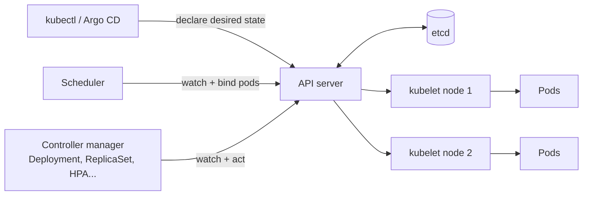
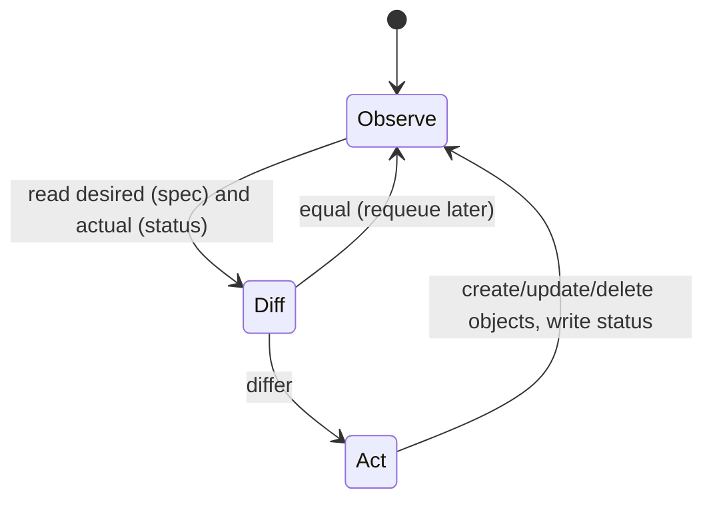
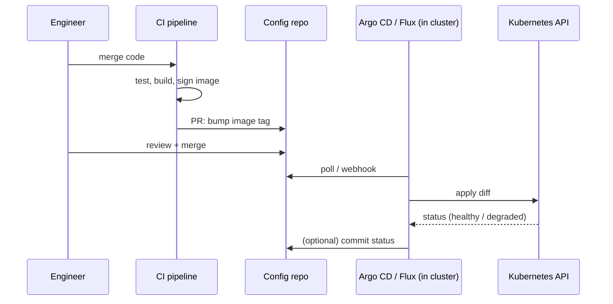
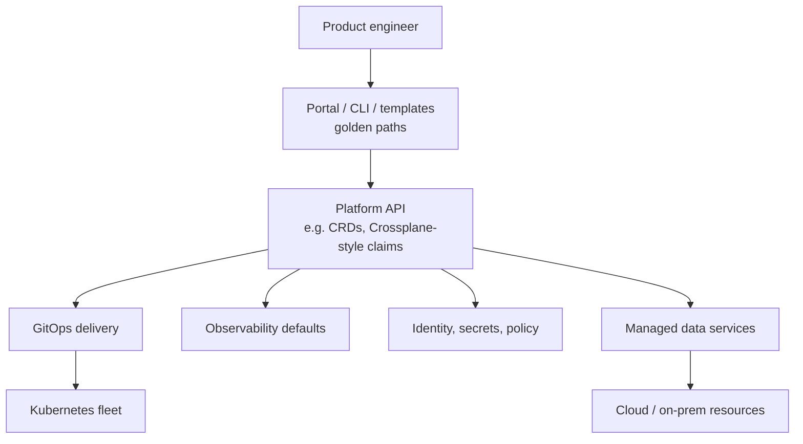

# 14 — Cloud-native & platform engineering

> **The requirement.** Lumen has grown to 40 product engineers in eight teams. They want to ship about **50
> deploys a day** to a shared fleet, with any bad deploy caught and rolled back before more than a few percent of
> users notice. Traffic swings **10×** between night and the European afternoon, and nobody wants to pay for peak
> capacity all night. Most engineers should never have to write a Kubernetes manifest. This is hard because three
> forces collide: autonomy (teams want to move fast), safety (one bad change must not take the product down), and
> cognitive load (the infrastructure needed to provide both is itself complicated).

## In one minute

"Cloud-native" means building systems from small, replaceable, automatically managed units instead of hand-tended
servers. The unit is usually a **container**: an ordinary Linux process that the kernel has been told to isolate
(its own view of files, processes and network) and limit (only so much CPU and memory). **Kubernetes** runs many
containers across many machines; you tell it *what you want* ("three copies of version 2.4, reachable at this
name") and a set of control loops keeps making reality match. Because everything is declared as data, you can keep
those declarations in Git and let a robot apply them — that is **GitOps**. Scaling happens by more loops that watch
metrics. Where even containers are too much to manage, **serverless** platforms run your code only when a request
arrives, and **WebAssembly** offers an even lighter sandbox. Finally, **platform engineering** packages all of
this behind a self-service product so product teams get "a database and a deploy pipeline" without becoming
Kubernetes experts.

## Why this matters now

- **Kubernetes is the default substrate**, including for AI workloads (SYSDESIGN-23), and it keeps moving: as of
  2026-11 the current minor release is **v1.37** (latest patch v1.37.2, 2026-10-28) [1]. In-place pod resize became
  stable in **v1.35** (December 2025) [2]; native sidecar containers became stable in **v1.33** [3].
- **Ingress is being superseded.** The Ingress API is frozen and the project recommends the **Gateway API** instead;
  the community **Ingress NGINX** controller was retired in **March 2026** after which it receives no releases or
  security fixes [4][5]. Gateway API's core resources (GatewayClass, Gateway, HTTPRoute) have been in the Standard
  channel since v0.5.0, and the project shipped **v1.7.0** on 2026-10-29 [6].
- **GitOps and event-driven autoscaling matured.** Flux (2022-11-30) and Argo (2022-12-06) graduated in the CNCF,
  KEDA graduated in 2023, and Knative in October 2025 [7][8][9][10].
- **WebAssembly components on the server became real.** WASI 0.2 shipped in January 2024 and WASI 0.3 — with native
  async — is now the "stable, current" release [11].
- **Platform engineering became a named discipline**, with a CNCF white paper defining platforms and their
  attributes [12].

## Core ideas [Core]

### Containers: namespaces + cgroups + an image

A container is not a virtual machine. It is a process (or group of processes) on a shared Linux kernel, with three
ingredients:

1. **Namespaces** give the process its own *view* of a global resource. Linux has eight: mount, PID, network, IPC,
   UTS (hostname), user, cgroup and time (the last added in kernel 5.6) [13]. In its own PID namespace a process
   sees itself as PID 1; in its own network namespace it has its own interfaces and ports.
2. **Control groups (cgroups v2)** *limit and account* resources: CPU weight and quota, memory limits (with the
   out-of-memory killer as enforcement), I/O and process counts [14]. A Kubernetes CPU *limit* becomes a CFS quota;
   a memory limit becomes a hard cap.
3. **An image**: a layered, content-addressed filesystem plus metadata, in the OCI format. Layers are shared, so 50
   containers from one base image do not store it 50 times.

Add capability dropping, seccomp syscall filters and Linux security modules (AppArmor/SELinux) and you have the
usual hardening. The important limit: **all containers on a node share one kernel**. A kernel exploit escapes all
of them. For untrusted code you need a stronger boundary — a micro-VM such as Firecracker (used by AWS Lambda and
Fargate) [15], gVisor's user-space kernel, or a separate node.

### Kubernetes in one picture



*Diagram: clients write desired state to the API server, which persists it in etcd; the scheduler and controllers
watch the API and act; kubelets on each node run the pods assigned to them.*

The design descends from Google's Borg and Omega [16][17]. Everything is an **object** in the API (stored in etcd,
which uses Raft — SYSDESIGN-09). Nobody calls "start container" directly; components *watch* objects and act.

**The primitives you must know:**

| Object | What it is | Why it exists |
|---|---|---|
| Pod | one or more containers sharing a network namespace and volumes, scheduled together | the unit of scheduling |
| ReplicaSet | keeps N identical pods running | self-healing |
| Deployment | manages ReplicaSets to roll from one version to another | declarative rollouts and rollback [18] |
| StatefulSet | pods with stable identity and per-pod storage | databases, brokers |
| DaemonSet | one pod per node | agents: log shippers, eBPF, CNI |
| Job / CronJob | run to completion | batch, migrations |
| Service | a stable virtual IP and DNS name over a changing set of pods selected by label [19] | discovery and L4 load balancing |
| Gateway / HTTPRoute | L7 entry point and routing rules, role-oriented | successor to Ingress [6] |
| ConfigMap / Secret | configuration and credentials as objects | decouple config from images |
| Namespace | a scope for names, RBAC and quotas | multi-team tenancy |

**Requests and limits.** Each container declares a CPU/memory *request* (what the scheduler reserves) and
optionally a *limit* (the cgroup cap). Requests drive bin-packing and autoscaling; limits protect neighbours.
Getting requests wrong is the most common cause of both waste and noisy-neighbour incidents.

**Probes.** *Readiness* decides whether a pod receives traffic; *liveness* decides whether it is restarted;
*startup* protects slow starters. A rollout is only as safe as its readiness probe.

### Controllers and reconciliation

The core pattern is a **control loop**: observe actual state, compare with desired state, act to reduce the
difference, repeat [20]. It is *level-triggered* — controllers react to the current state, not only to events — so
a missed event is corrected on the next pass, and the system converges after crashes.



*Diagram: a controller loops observe → diff → act; when desired and actual match it waits and re-checks.*

**Operators** apply the same pattern to your own domain: you add a *CustomResourceDefinition* (say
`VectorIndex` with `spec.replicas` and `spec.embeddingModel`) and a controller that knows how to create, back up,
upgrade and heal it [21]. An operator is "a runbook written as a control loop". Rules for writing one: make every
action idempotent; record progress in `status`; never assume the previous step succeeded; use owner references so
garbage collection cleans up; and treat the API server as the only source of truth.

### Autoscaling: four loops at different speeds

| Loop | Scales | Signal | Reaction time (typical) |
|---|---|---|---|
| **HPA** (Horizontal Pod Autoscaler) | number of pods | CPU/memory vs request, custom or external metrics | default check every 15 s [22] |
| **VPA** (Vertical Pod Autoscaler) | pod requests/limits | observed usage history | minutes to hours; can resize in place (beta mode) [2][23] |
| **KEDA** | pods, including **to and from zero** | event sources: queue length, Kafka lag, Prometheus queries… | polling interval, configurable [9] |
| **Cluster autoscaler / Karpenter** | nodes | unschedulable pods | tens of seconds to minutes (node boot) |

The HPA's core rule is `desiredReplicas = ceil(currentReplicas × currentMetric / targetMetric)`; it skips action
within a **0.1** tolerance of the target, treats missing metrics conservatively (as 0% of target when scaling up,
100% when scaling down), and by default waits a **300 s** stabilisation window before scaling down [22]. Scale-up is
rate-limited by default policies too (the lab shows 2 → 6 → 8 pods in two 15 s steps because the default allows
adding the larger of 100% or 4 pods per period).

**Which signal?** CPU is a fine proxy for CPU-bound stateless services. For queue consumers scale on **backlog**
(KEDA); for LLM servers CPU means nothing — scale on queue depth, KV-cache utilisation or tokens in flight
(SYSDESIGN-22). Never let HPA and VPA both act on the same resource metric for the same pods: they fight.

### Releasing safely: rolling, blue-green, canary

| Strategy | How | Wins when | Costs |
|---|---|---|---|
| Recreate | stop all old, start new | dev, or versions that cannot coexist | downtime |
| Rolling (Deployment default) | replace pods gradually (`maxSurge`, `maxUnavailable`) | most stateless services | both versions serve at once; rollback is another rollout |
| Blue-green | full new stack, switch traffic at once | fast rollback, schema-compatible releases | 2× capacity during switch |
| Canary | send a small % to the new version, watch SLOs, then promote | high-traffic services with good SLIs | needs traffic splitting and automated analysis |
| Feature flags | ship dark, enable per cohort | decoupling deploy from release | flag debt |

A canary is only as good as its **analysis**: compare the canary's error rate and latency (SYSDESIGN-12 burn rates)
with the stable version's, over enough requests to be statistically meaningful, and roll back automatically. Tools
such as Argo Rollouts and Flagger automate this; Gateway API `HTTPRoute` supports weighted `backendRefs`, so a 5%
split is a field, not a mesh feature [6].

### GitOps

GitOps is declarative delivery with four principles (OpenGitOps v1.0.0): desired state is **declarative**,
**versioned and immutable**, **pulled automatically** by software agents, and **continuously reconciled** [24]. In
practice: CI builds and signs an image and opens a pull request that bumps a tag in a config repository; a controller
in the cluster (Argo CD or Flux) notices the merge and applies it; drift (someone `kubectl edit`s production) is
detected and reverted.



*Diagram: CI builds an image and proposes a tag change to the config repository; after merge, an in-cluster agent
pulls the change, applies it and reports health.*

Why pull and not CI-push? The cluster's credentials never leave the cluster; the repository is the audit log; and
rollback is `git revert`. The cost: secrets need a separate mechanism (sealed or external secrets), and "what is
deployed" now has two sources (Git and live status) that you must reconcile in your head.

### Serverless

"Serverless" is a billing and operations model: you supply a function or container, the platform provisions,
scales (often to zero) and patches, and you pay per request and duration. Examples: AWS Lambda; Google Cloud Run;
Knative on your own Kubernetes (Serving for request-driven scale-to-zero, Eventing for event routing) [10][25].

The cost of scale-to-zero is the **cold start**. In Lambda's lifecycle the *Init* phase downloads code, starts the
runtime and runs your initialisation code before the first *Invoke* [26]. Mitigations, with their price:

- **Provisioned concurrency** keeps environments initialised; AWS describes it as responding "in double-digit
  milliseconds" — you pay for the idle capacity [27].
- **SnapStart** snapshots an initialised Firecracker micro-VM and restores it; it supports Java 11+, Python 3.12+ and
  .NET 8+, is not compatible with provisioned concurrency, and requires care with anything that must be unique per
  instance (random seeds, IDs, connections) [27].
- Smaller deployment packages, lazy imports, and moving heavy initialisation out of the request path.

Firecracker itself boots to application code in under **125 ms**, with **< 5 MB** memory overhead per micro-VM, and
up to **150** micro-VMs created per second per host [15] — the floor under which platform-side cold starts cannot go
without snapshots.

### WebAssembly on the server

WebAssembly (Wasm) is a portable bytecode with a capability-based sandbox: a module can touch nothing the host has
not explicitly handed to it. **WASI** defines system interfaces (files, sockets, clocks, HTTP) and the **Component
Model** defines typed interfaces between components written in different languages [11][28]. As of 2026-11 the
WASI site lists **WASI 0.3** as "stable, current" (adding native `async`, `stream<T>` and `future<T>`), **0.2** as
stable and superseded, and 0.1 as legacy [11].

Where Wasm fits: plugin systems and user-supplied code (strong sandbox, tiny footprint), edge functions
(SYSDESIGN-15), and dense multi-tenant function hosting. On Kubernetes, containerd shims (the runwasi project) let a
pod run a Wasm component instead of a Linux container; SpinKube, a CNCF Sandbox project since January 2025, packages
this for Spin applications [29]. Where it does not fit (yet): workloads needing threads-heavy native libraries,
GPUs, or mature debugging and profiling tools. Treat it as a third option beside containers and micro-VMs, not a
replacement.

### Platform engineering and internal developer platforms

The CNCF Platforms white paper defines a cloud-native platform as "an integrated collection of capabilities" offered
to its users, and lists seven attributes: **platform as a product**, user experience, documentation and onboarding,
**self-service**, **reduced cognitive load**, optional and composable, and **secure by default** [12]. Its capability
list spans portals, APIs/CLIs, golden-path templates, build and delivery automation, development environments,
observability, infrastructure, data services, messaging, identity and secrets, security, and artifact storage [12].



*Diagram: engineers use a portal, CLI or templates; these call a platform API that composes delivery, observability,
security and data services on top of a Kubernetes fleet and cloud resources.*

The key design move is the **platform API**: a small, opinionated interface ("I need a service called
`answer`, public, with a Postgres database and 99.5% SLO") that the platform team implements with Kubernetes
operators, Terraform modules or Crossplane-style compositions. Product engineers own their service's code, SLOs and
on-call; the platform team owns the paved road and treats product engineers as customers (measuring adoption,
lead time, change-failure rate and time-to-first-deploy).

### Multi-tenancy in Kubernetes

Kubernetes distinguishes **multi-team** tenancy (some trust; tenants are teams) from **multi-customer** tenancy
(SaaS; tenants are customers with no cluster access), and treats "soft" vs "hard" isolation as a spectrum [30].

| Model | Isolation | Cost / overhead | Use when |
|---|---|---|---|
| Namespace per team + RBAC + ResourceQuota + LimitRange + NetworkPolicy + Pod Security | soft: shared control plane and kernel | lowest | trusted internal teams |
| + dedicated node pools (taints/tolerations), sandboxed runtimes (gVisor, Kata, Firecracker) | stronger data-plane isolation | medium | semi-trusted or customer code |
| Virtual control plane per tenant (e.g. vCluster-style) | separate API server/etcd view, shared nodes | medium | tenants need cluster-admin-like APIs |
| Cluster per tenant | strongest | highest (control planes, idle capacity) | regulated or hostile tenants |

## Numbers that matter

**Capacity for the 10× swing.** Assume Lumen's API needs 0.25 CPU per 10 requests/s (measured in a load test —
SYSDESIGN-01), peak 2,000 req/s, night 200 req/s, pods with a 0.5 CPU request targeting 60% utilisation.

- Peak: 2,000 / 10 × 0.25 = 50 CPU of work. At 60% of 0.5 CPU per pod (0.3 CPU used per pod): 50 / 0.3 ≈ **167 pods**.
- Night: 200 req/s → 5 CPU → ≈ **17 pods**.
- Fixed peak provisioning = 167 pods × 24 h ≈ 4,000 pod-hours/day. With autoscaling following a smooth day curve
  (say 10 hours at peak, 14 hours averaging 40 pods): 10 × 167 + 14 × 40 ≈ **2,230 pod-hours/day — about 45% less**
  (all numbers are illustrative assumptions; the shape of the curve decides the real saving).

**How fast can it react?** HPA evaluates every 15 s [22]; metrics-server resolution adds tens of seconds; a new pod
needs scheduling plus image pull plus startup plus readiness. If a node must be added, add node boot (often around a
minute or more on clouds — measure yours). If traffic can double in 60 s, the HPA alone is too slow: keep headroom
(lower utilisation target) or scale on a leading signal (queue depth, request rate) rather than CPU.

**Rollout time.** 167 pods, `maxSurge` 25% (≈ 42 pods at a time), 30 s from pod creation to ready: ≈ 4 waves × 30 s
≈ **2 minutes** for a full rolling update. A 5% canary held for 10 minutes at 2,000 req/s sees ≈ 60,000 requests —
enough to detect a jump from 0.1% to 1% errors (60 expected vs 600 observed), not enough to detect 0.1% → 0.12%.

**Deploy budget.** 50 deploys/day × (2 min rollout + 10 min canary) ≈ 10 hours of "something is rolling" per day —
which is why canaries must be automated and why teams need independent services, not one shared deploy queue.

## Design choices and trade-offs

### Compute abstraction

| Option | Wins when | Costs | Examples |
|---|---|---|---|
| VMs | legacy, special kernels, strong isolation | slow to provision, low density | EC2, Compute Engine |
| Containers on Kubernetes | many services, steady load, portability, rich ecosystem | operational complexity; you run the platform | EKS, GKE, self-managed |
| Managed containers (serverless containers) | containers without cluster management, scale to zero | less control (networking, GPUs vary), per-request pricing | Cloud Run, Fargate, Knative |
| Functions (FaaS) | spiky, event-driven, short tasks | cold starts, duration limits, vendor APIs | Lambda, Cloud Functions |
| Wasm components | sandboxed plugins, edge, very dense multi-tenant functions | young ecosystem; limited native libraries | Spin/SpinKube, wasmCloud, edge platforms |
| Micro-VMs | untrusted code with VM-grade isolation and fast start | extra layer; tooling | Firecracker, Kata Containers |

### Delivery

| Choice | Option A | Option B | Guidance |
|---|---|---|---|
| Who applies changes | CI pushes (`kubectl apply` from pipeline) | GitOps agent pulls | pull for production; push is fine for ephemeral preview environments |
| Config format | raw YAML + Kustomize overlays | Helm charts | Kustomize for your own services; Helm for third-party packages |
| Repos | app + config in one repo | separate config repo | separate config repo when many services deploy to shared environments |
| Progressive delivery | manual canary | automated analysis (Argo Rollouts, Flagger) | automate once you deploy more than a few times a day |

### Ingress vs Gateway API

Ingress is a single resource with controller-specific annotations for anything beyond basic host/path routing. The
Gateway API splits responsibility by role — infrastructure provider (GatewayClass), cluster operator (Gateway),
application developer (HTTPRoute) — and puts features such as header matching, weighted backends and cross-namespace
references into the portable spec [6]. For a new design in 2026 choose the Gateway API; for an existing Ingress NGINX
estate, plan a migration, because the controller no longer receives security fixes [5].

## Deep dive [Deep]

### Writing a reconciler that survives reality

A pseudo-code reconciler for a Lumen `VectorIndex` custom resource:

```text
reconcile(name):
  idx = get VectorIndex(name)            # desired
  if idx is deleted: run finalizer (snapshot to object storage), remove finalizer, return
  sts = get StatefulSet(owned by idx)    # actual
  if sts missing: create StatefulSet(from idx.spec) ; set status.phase=Creating ; requeue 10s
  if sts.spec.replicas != idx.spec.replicas: patch replicas ; requeue
  if idx.spec.model != idx.status.builtModel: create Job(rebuild index) unless one is running ; requeue
  status.ready = sts.readyReplicas ; status.observedGeneration = idx.generation
  return (requeue after 5 min for drift checks)
```

Properties: every step is safe to repeat; the controller can crash at any line and resume; it stores progress only
in the API (status), not in memory; long work runs in Jobs, not in the reconciler; and `observedGeneration` tells
clients whether the status reflects the latest spec. Controllers use optimistic concurrency (`resourceVersion`) —
a write based on stale data fails and is retried, the same compare-and-swap idea as in SYSDESIGN-09.

### Scheduling and bin-packing

The scheduler filters nodes (enough allocatable CPU/memory, taints, affinity, topology spread) then scores them.
Over-requesting wastes nodes; under-requesting packs too tightly and causes CPU throttling and OOM kills at peak.
Two practical rules: set memory request = memory limit for latency-critical pods (no overcommit surprises), and
consider *not* setting CPU limits for latency-sensitive services when requests are accurate, because CFS quotas can
throttle bursts even when the node has idle CPU — a widely discussed trade-off; measure throttling
(`container_cpu_cfs_throttled_periods_total`) before deciding.

### Graceful rollouts in practice

Zero-error rolling updates need all of: a readiness probe that fails until the app can serve; `maxUnavailable: 0`
for small replica counts; a `preStop` delay or SIGTERM handling that keeps serving in-flight requests while endpoint
removal propagates; and connection draining at the load balancer. The lab's service fails readiness on SIGTERM and
keeps serving for five seconds before shutting down; the probe client observed no failed requests during a v1 → v2
rollout (see the lab's test record).

### In-place resize and the VPA

Before v1.35, changing a pod's CPU or memory meant recreating it. In-place resize (stable in v1.35) lets the kubelet
change cgroup limits on a running container through a `resize` subresource [2]. The VPA's `InPlaceOrRecreate` update
mode, beta as of the v1.35 announcement, uses it to right-size without restarts where possible [2]. This makes
vertical scaling attractive for stateful or single-replica workloads that the HPA cannot help.

### Event-driven scaling with KEDA

KEDA adds a `ScaledObject` that maps an external signal (a queue length, a Kafka consumer-group lag, a Prometheus
query) to replica counts, and it can scale a Deployment to **zero** and back — which the HPA alone cannot [9]. For
Lumen's document-ingestion workers: scale on the backlog per replica (e.g. target 100 pending documents per worker),
min 0 at night, max 50. The trade-off is the wake-up latency of the first message after zero.

## Frontier [Frontier]

**Gateway API everywhere (as of 2026-11, v1.7.0).** With Ingress NGINX retired in March 2026, migrations to Gateway
API implementations (Envoy-, NGINX-, HAProxy- and cloud-based) are mainstream; the Gateway API Inference Extension
adds model-aware routing for LLM serving (SYSDESIGN-22) [6][33].

**In-place resize and pod-level resources** (v1.35 GA for container-level resize) change how vertical autoscalers
work and enable restart-free right-sizing [2].

**WASI 0.3 and components.** Native async in WASI 0.3 removes a major blocker for network services written as
components [11]; container runtimes and Kubernetes integrations (runwasi, SpinKube) let Wasm workloads sit beside
containers in one cluster [29].

**Platforms as products, measured.** The CNCF Platform Engineering Maturity Model gives a vocabulary for platform
investment, adoption, interfaces, operations and measurement [31]. Expect interviewers to ask how you would measure a
platform's success (adoption, lead time, change-failure rate, developer satisfaction), not just what it contains.

**AI on the platform.** GPU scheduling (Dynamic Resource Allocation), model-serving operators and inference
gateways are now platform features; SYSDESIGN-23 covers them.

## Failure modes and operations

| Failure | Symptom | Detect | Mitigate |
|---|---|---|---|
| Bad rollout | error-rate jump after deploy | SLO burn rate split by `service.version` | automated canary analysis + auto-rollback; `revisionHistoryLimit` |
| Readiness probe too optimistic | errors during rollouts | errors correlate with pod starts | probe a real dependency path; startup probes |
| Liveness probe too aggressive | restart storms under load | rising restart count when latency rises | liveness checks only "process is wedged", never dependencies |
| CPU throttling | p99 latency spikes with idle node CPU | CFS throttled periods | raise or remove CPU limits; fix requests |
| OOM kills | restarts with `OOMKilled` | kubelet events | right-size memory (VPA recommendations); fix leaks |
| Autoscaler thrash | replica count oscillates | HPA events | stabilisation windows; better signal; don't combine HPA+VPA on CPU |
| Scale-up too slow | queueing at traffic ramps | latency vs replica lag | headroom; leading metrics; pre-scale on schedule |
| GitOps drift / stuck sync | live state differs from Git | Argo CD/Flux out-of-sync alerts | alert on sync status; forbid manual edits via RBAC |
| Control-plane overload | slow `kubectl`, controllers lag | API server latency, etcd fsync latency | fewer watchers, paginated lists, etcd on fast disks |
| Noisy neighbour tenant | one team's job starves others | per-namespace usage vs quota | ResourceQuota, LimitRange, priority classes, separate node pools |
| Unsupported component | known CVEs, no patches (e.g. retired Ingress NGINX) | SBOM + end-of-life tracking | migrate; platform team owns the lifecycle |

## Cost and energy

- **Requests are the bill.** Cloud nodes are paid for whether pods use them or not; the gap between requested and
  used CPU is the waste. Track per-namespace "request vs usage" and show it to teams (showback).
- **Autoscaling is the biggest lever** for diurnal traffic (the illustrative 45% above); scale-to-zero (KEDA,
  Knative, FaaS) removes idle cost entirely for spiky or rare workloads, at the price of cold starts.
- **Density.** Bin-packing more pods per node saves money and energy (fewer idle servers drawing base power) but
  raises noisy-neighbour risk; that is a tenancy decision, not just a cost one.
- **Platform cost.** A platform team is real headcount; the CNCF white paper's case for it is reduced cognitive load
  and duplicated effort across product teams [12]. Justify it with measured lead time and incident data, not slogans.
- **Serverless pricing** flips at sustained load: per-request pricing beats idle servers for spiky traffic and loses
  to well-utilised containers for steady traffic. SYSDESIGN-16 builds the break-even model; SYSDESIGN-17 covers
  energy.

## Interview angle

**How it is asked.** "How would you deploy this?", "How does it scale?", "How do you roll out safely?" as follow-ups
to any design; sometimes as "Design a deployment/CI-CD system" or "Design an internal developer platform".

**Model answer outline (CLARIFY → QUANTIFY → SKETCH → DEEPEN → STRESS → WRAP):**

1. **CLARIFY** — number of teams and services, deploy frequency, traffic shape, isolation needs (internal teams vs
   customers), compliance.
2. **QUANTIFY** — peak/trough pods from per-pod capacity; rollout duration; canary sample size.
3. **SKETCH** — Git → CI (build, test, sign) → config repo → GitOps agent → Kubernetes; Gateway API for ingress;
   HPA/KEDA; observability defaults.
4. **DEEPEN** — reconciliation and why it self-heals; rollout mechanics (`maxSurge`, readiness, draining);
   canary analysis with SLO burn rates.
5. **STRESS** — bad deploy at peak; autoscaler too slow; control-plane outage (running pods keep running; no changes
   possible); a noisy tenant; a retired dependency.
6. **WRAP** — trade-offs: Kubernetes vs serverless; namespace vs cluster per tenant; platform team cost vs product
   team load.

**Red flags:** "Kubernetes will autoscale it" with no signal or timing; liveness probes that check the database; CPU
autoscaling for an LLM server; manual `kubectl` in production; "containers are secure sandboxes for untrusted code".

**Follow-ups:** "What happens if etcd loses quorum?" (API is unavailable; existing pods keep running; no
scheduling or healing — SYSDESIGN-09). "Why is my HPA not scaling?" (missing requests, metrics-server down,
`<unknown>` targets, maxReplicas). "How would you scale to zero?" (KEDA/Knative; cold-start budget).

## Common mistakes

- No resource requests, so the scheduler and the HPA are both blind.
- Using one Kubernetes Deployment rollout as the only safety net, without SLO-based canary analysis.
- Treating Kubernetes namespaces as a security boundary for hostile tenants.
- Building a platform nobody asked for: no product management, no adoption metrics, mandatory everything.
- Copying `latest` image tags into production (non-reproducible, breaks rollbacks); pin by digest.
- Forgetting that serverless cold starts land on the first user after a quiet period.
- Picking Wasm or serverless for fashion rather than a measured requirement (cold start, density, isolation).

## Check yourself

1. Which Linux namespaces does a typical container get, and which resource does each isolate? What do cgroups add?
2. An HPA targets 50% CPU of a 100m request; 3 pods each use 180m. What replica count does the formula give, and
   what might the default scale-up policy allow in one step?
3. Why is a level-triggered controller more robust than an event-triggered script?
4. Name the four OpenGitOps principles and one practical consequence of each.
5. When would you choose a Wasm component over a container, and when not?

Full set with answers: [exercises/14-cloud-native-platforms.md](../../exercises/14-cloud-native-platforms.md).

## Lab

[labs/14-cloud-native-platforms/](../../labs/14-cloud-native-platforms/README.md) — a three-node **kind** cluster
(`sd-14`, Kubernetes v1.37.0, the kind v0.33.0 default [32]) running a tiny Lumen API. You drive CPU load and watch the HPA scale from 2 to 8 pods
(and back), perform a zero-error rolling update from v1 to v2 while a probe client records every response, run a
replica-ratio canary and measure its traffic share, and finally delete the cluster.

## Further reading

- Burns, Grant, Oppenheimer, Brewer, Wilkes, "Borg, Omega, and Kubernetes" [17] — why the API is designed around
  reconciliation and labels.
- Kubernetes docs: Controllers [20], HPA [22] and Multi-tenancy [30] — short and precise.
- OpenGitOps principles [24] — four sentences that define GitOps.
- Agache et al., "Firecracker" (NSDI 2020) [15] — the isolation/density trade-off behind serverless.
- CNCF TAG App Delivery, Platforms white paper [12] and maturity model [31].
- WASI releases and the Component Model book [11][28].

## References

[1] Kubernetes, "Releases," https://kubernetes.io/releases/ ; GitHub releases (v1.37.2, 2026-10-28), https://github.com/kubernetes/kubernetes/releases (accessed 2026-11).
[2] Kubernetes blog, "Kubernetes 1.35: In-Place Pod Resize Graduates to Stable," 2025-12-19, https://kubernetes.io/blog/2025/12/19/kubernetes-v1-35-in-place-pod-resize-ga/ (accessed 2026-11).
[3] Kubernetes blog, "Kubernetes v1.33: Octarine" (sidecar containers stable), 2025-04-23, https://kubernetes.io/blog/2025/04/23/kubernetes-v1-33-release/ (accessed 2026-11).
[4] Kubernetes docs, "Ingress" (API frozen; Gateway API recommended), https://kubernetes.io/docs/concepts/services-networking/ingress/ (accessed 2026-11).
[5] Kubernetes blog, "Ingress NGINX Retirement: What You Need to Know," 2025-11-11, https://kubernetes.io/blog/2025/11/11/ingress-nginx-retirement/ (accessed 2026-11).
[6] Kubernetes SIG Network, Gateway API documentation, https://gateway-api.sigs.k8s.io/docs/ ; releases (v1.7.0, 2026-10-29), https://github.com/kubernetes-sigs/gateway-api/releases (accessed 2026-11).
[7] CNCF, "Flux graduates from CNCF Incubator," 2022-11-30, https://www.cncf.io/announcements/2022/11/30/flux-graduates-from-cncf-incubator/ (accessed 2026-11).
[8] CNCF / ITOps Times, "Argo graduates from CNCF incubator," 2022-12-06, https://www.cncf.io/news/2022/12/06/itops-times-argo-graduates-from-cncf-incubator-following-massive-community-growth/ (accessed 2026-11).
[9] CNCF, "Cloud Native Computing Foundation announces graduation of Kubernetes autoscaler KEDA," 2023-08-22, https://www.cncf.io/announcements/2023/08/22/cloud-native-computing-foundation-announces-graduation-of-kubernetes-autoscaler-keda/ ; KEDA docs, https://keda.sh/ (accessed 2026-11).
[10] CNCF, "Cloud Native Computing Foundation Announces Knative's Graduation," 2025-10-08, https://www.cncf.io/announcements/2025/10/08/cloud-native-computing-foundation-announces-knatives-graduation/ (accessed 2026-11).
[11] WASI.dev, "Releases" (0.3 stable, current; 0.2 released end of January 2024), https://wasi.dev/releases (accessed 2026-11).
[12] CNCF TAG App Delivery, Platforms Working Group, "CNCF Platforms White Paper," v1.0, 2023, https://tag-app-delivery.cncf.io/whitepapers/platforms/ (accessed 2026-11).
[13] Linux man-pages, namespaces(7), https://man7.org/linux/man-pages/man7/namespaces.7.html (accessed 2026-11).
[14] Linux kernel documentation, "Control Group v2," https://docs.kernel.org/admin-guide/cgroup-v2.html (accessed 2026-11).
[15] A. Agache et al., "Firecracker: Lightweight Virtualization for Serverless Applications," NSDI 2020, https://www.usenix.org/conference/nsdi20/presentation/agache (accessed 2026-11).
[16] A. Verma et al., "Large-scale cluster management at Google with Borg," EuroSys 2015, https://research.google/pubs/large-scale-cluster-management-at-google-with-borg/ (accessed 2026-11).
[17] B. Burns, B. Grant, D. Oppenheimer, E. Brewer, J. Wilkes, "Borg, Omega, and Kubernetes," ACM Queue 14(1), 2016, https://research.google/pubs/borg-omega-and-kubernetes/ (accessed 2026-11).
[18] Kubernetes docs, "Deployments," https://kubernetes.io/docs/concepts/workloads/controllers/deployment/ (accessed 2026-11).
[19] Kubernetes docs, "Service," https://kubernetes.io/docs/concepts/services-networking/service/ (accessed 2026-11).
[20] Kubernetes docs, "Controllers," https://kubernetes.io/docs/concepts/architecture/controller/ (accessed 2026-11).
[21] Kubernetes docs, "Operator pattern," https://kubernetes.io/docs/concepts/extend-kubernetes/operator/ (accessed 2026-11).
[22] Kubernetes docs, "Horizontal Pod Autoscaling" (algorithm, 15 s sync period, 0.1 tolerance, 300 s scale-down stabilisation), https://kubernetes.io/docs/concepts/workloads/autoscaling/horizontal-pod-autoscale/ (accessed 2026-11).
[23] Kubernetes Autoscaler, "Vertical Pod Autoscaler," https://github.com/kubernetes/autoscaler/tree/master/vertical-pod-autoscaler (accessed 2026-11).
[24] OpenGitOps, "GitOps Principles v1.0.0," https://opengitops.dev/ (accessed 2026-11).
[25] Knative, "Knative Serving" documentation, https://knative.dev/docs/serving/ (accessed 2026-11).
[26] AWS, "Understanding the Lambda execution environment lifecycle," https://docs.aws.amazon.com/lambda/latest/dg/lambda-runtime-environment.html (accessed 2026-11).
[27] AWS, "Improving startup performance with Lambda SnapStart" (runtimes, provisioned concurrency comparison), https://docs.aws.amazon.com/lambda/latest/dg/snapstart.html (accessed 2026-11).
[28] Bytecode Alliance, "The WebAssembly Component Model," https://component-model.bytecodealliance.org/ (accessed 2026-11).
[29] CNCF, "SpinKube" project page (Sandbox, accepted 2025-01-21), https://www.cncf.io/projects/spinkube/ (accessed 2026-11).
[30] Kubernetes docs, "Multi-tenancy," https://kubernetes.io/docs/concepts/security/multi-tenancy/ (accessed 2026-11).
[31] CNCF TAG App Delivery, "Platform Engineering Maturity Model," https://tag-app-delivery.cncf.io/whitepapers/platform-eng-maturity-model/ (accessed 2026-11).
[32] kind v0.33.0 release notes (default node image kindest/node:v1.37.0), 2026-08-26, https://github.com/kubernetes-sigs/kind/releases/tag/v0.33.0 (accessed 2026-11).
[33] Kubernetes SIG Network, "Gateway API Inference Extension," https://gateway-api-inference-extension.sigs.k8s.io/ (accessed 2026-11).
