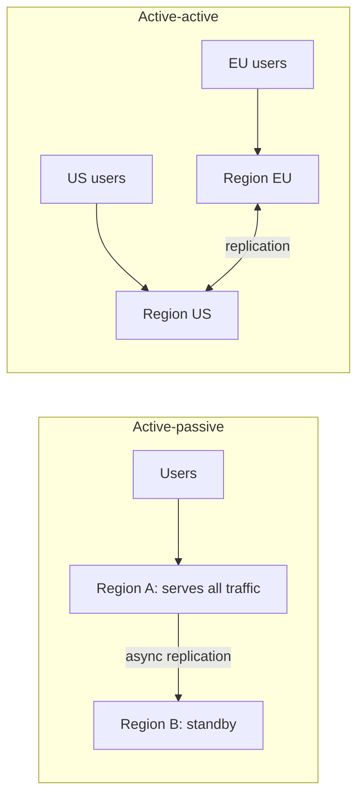
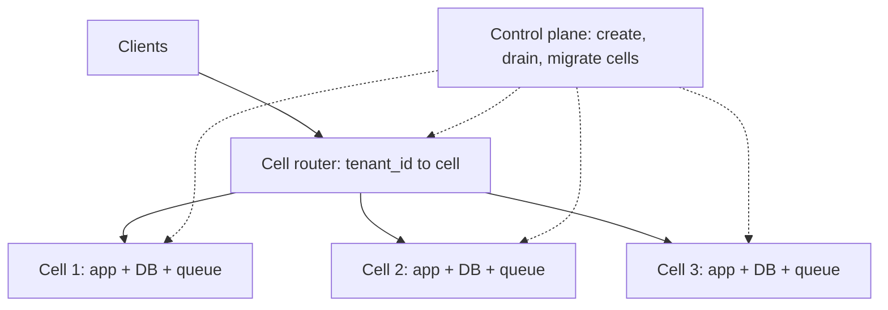
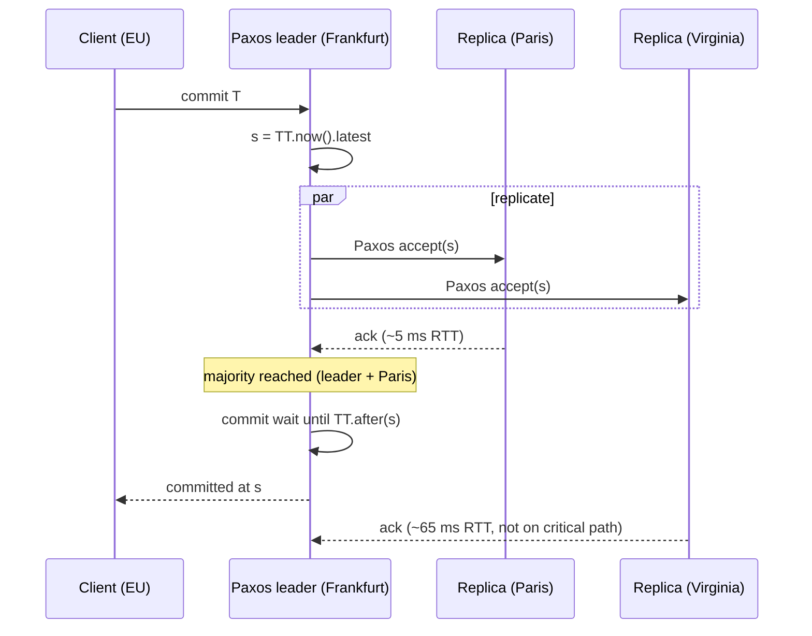

# 15 — Multi-region & edge

> **The requirement.** Lumen, our fictional AI knowledge and chat product, has paying tenants in Frankfurt, Virginia
> and Singapore. Product wants **p95 < 200 ms** for interactive API calls everywhere, the board wants the service to
> **survive the loss of an entire cloud region** with **RTO ≤ 5 minutes** and **RPO = 0 for billing**, and the EU
> sales team has signed contracts that say **EU tenants' data stays in the EU**. Each of these three sentences pulls the
> design in a different direction. Physics sets a hard floor on how fast two regions can agree on anything, so you
> cannot simply "replicate everything everywhere, synchronously".

## In one minute

A region is a cluster of data centers in one metropolitan area. Running in several regions buys three things: users
are closer to the servers (lower latency), the service keeps working when one region fails (availability), and data
can be kept inside a legal territory (sovereignty). The price is that the regions are far apart, and light in glass
fiber covers only about 200 km per millisecond. Every time two regions must agree before you answer a user, you pay at
least one round trip at that speed. So the core skill is deciding **which data must agree globally, and which data can
live in one home region and be copied elsewhere later**. Most real systems give each piece of data a home region,
serve reads nearby, and keep global agreement for the small set of things that truly need it, such as money and
uniqueness. On top of the regions sits the *edge*: hundreds of small points of presence (PoPs) that terminate
connections, cache content and, increasingly, run your code and even small AI models within a few milliseconds of
the user.

## Why this matters now

Three things changed between roughly 2020 and 2026.

1. **Managed global databases became real products, not research.** DynamoDB global tables now offer two modes:
   multi-Region *eventual* consistency with last-writer-wins and, since June 2025, multi-Region *strong* consistency
   (MRSC) with an RPO of zero [3][4]. CockroachDB ships per-row home regions (`REGIONAL BY ROW`) as a SQL keyword [6].
   Spanner's TrueTime design, published in 2012, is the ancestor of much of this [8]. You can now pick a consistency
   model per table rather than building replication yourself.
2. **Sovereignty became a hard requirement.** EU data-protection law, the EU Data Act and sector rules make "where
   does this byte live and who can reach it" an architectural question, not a contract footnote. The legal side is in
   [SYSDESIGN-19](19-privacy-compliance-sovereignty.md); this chapter covers the mechanics of pinning data to a place.
3. **The edge became programmable, then AI-capable.** V8-isolate platforms such as Cloudflare Workers start code
   without booting a VM or container per function [16], and CloudFront Functions run sub-millisecond logic at every
   edge location [15]. By September 2024 Cloudflare reported Workers AI GPUs in more than 180 cities [23]. So "run
   inference near the user" is now something you can buy rather than build.

At the same time, the "multi-region by default" instinct is being questioned. Multi-region costs real money and adds
real complexity. A well-built multi-AZ deployment in one region already survives the loss of a data center
([SYSDESIGN-11](../01-foundations/11-reliability-engineering.md)). AWS's own disaster recovery guidance says that for
the loss of one physical data center, backup and restore may be all you need, and that you should consider the more
expensive strategies when your definition of disaster is a whole region or when regulation requires it [1]. A strong
designer can argue both sides.

## Core ideas [Core]

### 1. Three reasons, three different designs

| Driver | What it really asks for | Typical design consequence |
|---|---|---|
| **Latency** | The user's *critical path* should not cross an ocean | Serve reads (and ideally writes) from a nearby region; put TLS, caching and light logic at the edge |
| **Availability** | Survive a regional outage within an RTO/RPO | A second region that can take over: standby (active-passive) or already serving (active-active) |
| **Sovereignty / residency** | Certain data must stay in a jurisdiction | Partition data *by geography*; route each tenant to its home region; control what replicates out |

These drivers do not lead to the same architecture, and asking "which of the three is it?" is the most useful
clarifying question in an interview. Latency alone can often be solved with a CDN and read replicas. Availability
alone can be solved with a warm standby that never serves traffic. Sovereignty *forbids* the naive "replicate
everything everywhere" answer.

### 2. The speed of light sets the floor

Light in vacuum travels about 300 km/ms. In optical fiber it travels at about two-thirds of that, roughly 200 km/ms,
because the glass has a refractive index of about 1.47. Singla et al. note that a 1.5× inflation over vacuum
latency "would occur even along the shortest path along the Earth's surface because the speed of light in fiber is
roughly 2/3rd the speed of light in air / vacuum" [19]. Real cables do not follow great circles, routers add delay and
protocols add round trips. In the same study the median fetch time of popular web pages was **34×** the vacuum
round-trip lower bound, and the router path alone was 2.3× inflated in the median [19].

The great-circle lower bound for a round trip in fiber is a number you can compute in your head:

```
RTT_min ≈ 2 × distance_km / 200 km/ms  =  distance_km / 100   (in ms)
```

So 6,500 km gives about 65 ms, before any routing, queuing or protocol overhead. The worked numbers are in
[Numbers that matter](#numbers-that-matter).

### 3. Active-passive vs active-active

The AWS disaster-recovery whitepaper gives a useful ladder of four strategies (wording paraphrased) [1]:

| Strategy | Second region holds | Serves traffic before failover? | Recovery requires |
|---|---|---|---|
| **Backup & restore** | Backups (data, plus IaC to rebuild) | No | Re-create infrastructure, restore data |
| **Pilot light** | Live replicated data stores; app tier defined but switched off | No | Switch on and scale out the app tier |
| **Warm standby** | Scaled-down but fully functional copy | Could, at reduced capacity | Scale up |
| **Hot standby** | Full-capacity copy, idle | No (by choice) | Shift traffic |
| **Multi-site active/active** | Full copy, serving | Yes | Shift traffic away from the failed region |

The whitepaper's distinction between pilot light and warm standby is precise: pilot light "cannot process requests
without additional action taken first, whereas warm standby can handle traffic (at reduced capacity levels)
immediately" [1]. It also warns that automatic failover based on health checks should be used with caution, because
a false alarm costs you availability and data you did not need to lose. Manually *initiated* but fully *automated*
failover, "like the push of a button", is common [1].



*Diagram: In active-passive, all users hit Region A, which replicates asynchronously to an idle Region B. In
active-active, EU users hit the EU region and US users hit the US region, and the two regions replicate to each other.*

Active-active is not one design. For writes, AWS names three options [1]:

- **Write global**: all writes go to one region; reads are served locally. Aurora Global Database fits this, with
  optional write forwarding from secondaries [5].
- **Write local**: writes go to the nearest region and replicate everywhere, so concurrent writes can conflict.
  DynamoDB global tables in eventual mode resolve conflicts with last writer wins [1][3].
- **Write partitioned**: each record has a home region chosen by a key such as user ID or tenant, so two regions
  never write the same record. This avoids conflicts by construction.

**Write partitioned is the workhorse of real multi-region systems.** It is also exactly what data residency needs:
the home region of an EU tenant is an EU region.

### 4. Data locality: give every row a home

The single most effective multi-region idea is to make most data *regional* and only a small part *global*:

- **Regional data**: a tenant's documents, chats and embeddings. Each lives in its home region, written there and
  read there. Optionally copied elsewhere for disaster recovery (if residency allows) or not at all.
- **Global, read-mostly data**: the model catalog, feature flags, pricing tables. These are written rarely, read
  everywhere and replicated to every region.
- **Global, contended data**: a username that must be unique worldwide, a billing balance. Writes need cross-region
  agreement, so they are slow, and you keep them small and rare.

CockroachDB exposes this taxonomy directly as table *localities* [6]:

| Locality | Optimizes | Reads | Writes |
|---|---|---|---|
| `REGIONAL BY TABLE` | One home region for the whole table | Fast in the home region | Fast in the home region, slow from others |
| `REGIONAL BY ROW` | Each row has its own home region, stored in a hidden `crdb_region` column | Fast from the row's home region | Fast from the row's home region |
| `GLOBAL` | Low-latency reads from every region | Fast everywhere | Slow from every region (must replicate to all) |

In `REGIONAL BY ROW`, `crdb_region` defaults to the region of the gateway that inserted the row, and the table and its
indexes are partitioned by it [6]. That one keyword is "geo-partitioning" in practice.

A *survival goal* decides how much failure each home region can absorb. With `SURVIVE ZONE FAILURE` (the default)
the database survives losing one zone without adding write latency. With `SURVIVE REGION FAILURE` it survives losing a
whole region, but this needs at least three regions, raises the replication factor from 3 to 5 (placed 2+2+1), and
adds at least one round trip to the nearest other region to every write [7]. **Region survival for a row means its
writes cross a region boundary. Residency and region survival pull against each other**: if an EU row must survive
the loss of Frankfurt, its replicas must sit in another region. That region should be an EU one, such as Paris or
Ireland.

### 5. Getting users to the right region: geo-DNS and anycast

Two mechanisms steer a user to a region or PoP:

**Geo-aware DNS.** The authoritative DNS server returns a different answer depending on where the query seems to
come from. Route 53, for example, offers latency-based routing ("route traffic to the Region that provides the best
latency"), geolocation routing (by the user's location), geoproximity routing, failover routing for active-passive,
and weighted routing [13]. DNS has two weaknesses:

- The server sees the *resolver*, not the user. EDNS Client Subnet (RFC 7871) lets resolvers pass a truncated client
  prefix (24 bits for IPv4, 56 for IPv6 recommended) to improve the answer. The RFC itself flags privacy and cache
  growth concerns and says the authors would probably not design it this way today [12].
- Answers are cached for their TTL, and some clients and resolvers keep them longer, so DNS failover is never
  instantaneous.

**Anycast.** The same IP address is announced from many locations, and BGP delivers each packet to a "nearby" one in
routing terms. RFC 4786 (BCP 126) defines it as making a service address available "in multiple, discrete,
autonomous locations" [11]. Anycast fails over at routing speed and does not depend on DNS caches, which is why CDNs
and edge platforms use it. AWS Global Accelerator's static IPs, for instance, are anycast from the AWS edge network
[14]. The caveat is that routing can change in the middle of a TCP connection. RFC 4786 asks that node selection be
"stable for substantially longer than the expected transaction time" [11]. Anycast suits short flows such as DNS
queries and fronting proxies that terminate TCP at the edge. Long stateful sessions belong behind that edge, not on
raw anycast.

A common production pattern combines them: anycast to the nearest edge PoP, the PoP terminates TLS, and then a
health- and latency-aware decision at the edge picks the origin region.

### 6. Edge compute

The edge is a tier between the user and your regions. What runs there has changed quickly:

| Edge tier | Example | Execution model | Good for |
|---|---|---|---|
| Static cache | CDN | Cache rules | Assets, public pages ([SYSDESIGN-04](../01-foundations/04-caching.md)) |
| Tiny functions | CloudFront Functions | JavaScript, submillisecond, 2 MB memory, 10 KB code, no request body [15] | Header rewrites, redirects, cache-key normalization, JWT checks |
| Edge functions | Lambda@Edge | Node.js/Python, up to 30 s, up to 10,240 MB at origin events, runs at regional edge caches [15] | Heavier logic, network calls, body access |
| Isolate platforms | Cloudflare Workers | V8 isolates. 128 MB memory per isolate. CPU time 10 ms on Free; on Paid, 30 s default, configurable to 5 min [16][17] | Full request handling, API gateways, auth, personalization |
| Edge state | Durable Objects | Globally unique, single-threaded objects with strongly consistent co-located storage, placed near first request [18] | Per-room/per-document coordination |
| Edge AI | Workers AI | Serverless GPU inference on the provider network [22] | Small-model inference, embeddings, classification |

Isolates are the key enabling idea. Cloudflare's documentation says an isolate is created within an existing
environment instead of a VM per function, which "eliminates the cold starts of the virtual machine model", and that
isolates start "around a hundred times faster than a Node process on a container or virtual machine" [16]. These are
vendor-stated, relative claims with no published method on that page. Treat them as an order of magnitude, not a
benchmark.

**The edge is fast for computing and slow for state.** A function at a PoP 5 ms from the user is useless if it then
makes three sequential calls to a database 80 ms away. That costs 240 ms, worse than running the whole thing in the
region. The rule: *move the work to the data, or the data to the work, but never pay the long round trip more than
once per request.*

### 7. Cells: multi-region's sibling for blast radius

Regions protect you from *infrastructure* failure. They do little against a *bad deploy* or a *poison request*, which
will happily take down every region you deploy to. The AWS Well-Architected guidance on cell-based architecture
(published 2023-09-20) addresses this [20]:

- A **cell** is "a complete workload, with everything needed to operate independently", that does not share state
  with other cells.
- A **cell router**, "the thinnest possible layer", sends each request to the right cell by a partition key, such as a
  customer ID, that aligns with the "grain" of the service.
- A **control plane** provisions cells and migrates customers between them.
- With 10 cells serving 100 requests, a failure in one cell leaves 90% of requests unaffected [20].



*Diagram: Clients reach a thin cell router that maps each tenant to one of three independent cells, each with its own
app, database and queue. A control plane, off the request path, provisions cells and updates the router's map.*

Regions and cells compose. Lumen can run several cells per region, assign each tenant to one cell in its home region,
and deploy changes one cell at a time (a "wave"). A bad release then hurts one cell's tenants, not every tenant in
every region.

**Shuffle sharding** is the probabilistic extension of cells. In Colm MacCárthaigh's Builders' Library example, 8
workers split into 4 fixed shards of 2 means one bad customer can take out 25% of the service. If each customer
instead gets its own *pair* of workers, there are 28 possible pairs, so the impact drops to 1/28 [21]. Route 53 uses
2,048 virtual name servers and gives each domain 4, which yields about 730 billion combinations, and no two domains
share more than 2 name servers [21]. Combined with client retries, a poison customer rarely takes out everyone it
overlaps with.

## Numbers that matter

### Fiber lower bounds between real regions

Assumptions (labelled): great-circle distance computed with the haversine formula on a 6,371 km sphere, using city
coordinates. Fiber speed is 200 km/ms (≈ 2/3 c) [19]. These are **lower bounds**. Real cable paths are longer,
and Singla et al. found the median router path 2.3× above the vacuum bound [19].

| Pair | Great-circle distance | One-way (fiber) | RTT lower bound (fiber) | RTT in vacuum |
|---|---|---|---|---|
| Frankfurt ↔ Paris | ≈ 480 km | ≈ 2.4 ms | ≈ 5 ms | ≈ 3 ms |
| Frankfurt ↔ Dublin | ≈ 1,090 km | ≈ 5.4 ms | ≈ 11 ms | ≈ 7 ms |
| N. Virginia ↔ Oregon | ≈ 3,500 km | ≈ 17.5 ms | ≈ 35 ms | ≈ 23 ms |
| London ↔ N. Virginia | ≈ 5,920 km | ≈ 29.6 ms | ≈ 59 ms | ≈ 39 ms |
| Frankfurt ↔ N. Virginia | ≈ 6,550 km | ≈ 32.7 ms | ≈ 65 ms | ≈ 44 ms |
| Frankfurt ↔ Singapore | ≈ 10,260 km | ≈ 51.3 ms | ≈ 103 ms | ≈ 68 ms |
| London ↔ Sydney | ≈ 16,990 km | ≈ 85.0 ms | ≈ 170 ms | ≈ 113 ms |

### A latency budget for Lumen's 200 ms p95

Suppose a Singapore user calls `POST /chat/{id}/messages` (store a message, return an acknowledgment; token
streaming is a separate path, see [SYSDESIGN-21](../03-ai-systems/21-llm-inference-anatomy.md)).

**Design 1: single region in Frankfurt.** The Singapore↔Frankfurt fiber floor is about 103 ms per round trip. A fresh
HTTPS connection needs TCP (1 RTT) plus TLS 1.3 (1 RTT) before the request (1 RTT), so about 3 RTTs ≈ 309 ms
*minimum* ([SYSDESIGN-02](../01-foundations/02-anatomy-of-a-request.md)). The SLO is violated by physics alone, before
a single server does any work.

**Design 2: edge PoP in Singapore + origin in Frankfurt.** TCP and TLS terminate at a PoP about 5 ms away. The PoP
holds a warm, reused connection to the origin, so the request costs one long round trip: about 2 × 5 + 103 ≈ 113 ms
floor, plus server time. That fits, but with little headroom once real path inflation is added.

**Design 3: home region in Singapore (APAC tenant).** About 2 × 5 ms to the PoP, plus a few ms PoP→region, plus server
time of, say, 30 ms (assumption) gives roughly 50 ms. Comfortable.

**Design 4: Singapore home region, but every write synchronously replicated to Frankfurt and Virginia.** Each write
waits for at least the nearest remote acknowledgment, so a quorum of 2 of 3 needs the Singapore↔Frankfurt or
Singapore↔Virginia round trip. That adds 100+ ms per write. It may fit once; it will not fit if the handler does
several such writes in sequence.

The lesson is the classic one: **count the wide-area round trips on the critical path, multiply by the distance
floor, and you know whether a design can meet the SLO before you build it.**

### Cost of region survival (illustrative)

CockroachDB's `SURVIVE REGION FAILURE` moves from 3 to 5 replicas [7]. That is 5/3 ≈ 1.67× the storage and
replication write traffic for those tables, *plus* cross-region transfer charges for every replicated byte. Cloud
egress pricing varies by provider and region pair and is covered in
[SYSDESIGN-16](16-cost-as-requirement.md). Never quote a price here from memory.

## Design choices and trade-offs

### Replication and write models

| Option | Wins when | Costs | Example systems |
|---|---|---|---|
| Single region, multi-AZ + CDN | Users are mostly in one geography; RTO of hours for a region loss is acceptable | Far users pay long RTTs for dynamic calls; a regional outage is a full outage | Most products, most of the time |
| Active-passive (pilot light / warm standby) | Availability is the driver, not latency; cost matters | Non-zero RPO with async replication; failover must be rehearsed; standby capacity may lag | Aurora Global Database with promotion [5]; S3 cross-region replication [1] |
| Active-active, write global | Read-heavy, global users, simple consistency | Writes from far regions pay a long RTT; the write region is special | Aurora write forwarding [5] |
| Active-active, write partitioned (home region) | Data has a natural geographic or tenant owner; residency rules | Cross-home operations are slow or async; rehoming is a migration | CockroachDB `REGIONAL BY ROW` [6]; cell-per-region designs |
| Active-active, write local + LWW | Availability and write latency beat correctness of concurrent updates | Silent lost updates on concurrent writes; clock-skew sensitivity | DynamoDB global tables, MREC mode [3] |
| Active-active, write local + CRDT/app merge | Collaborative or additive data (carts, counters, presence, docs) | Data model must be designed for merge; metadata overhead | Dynamo shopping cart [9]; CRDT libraries [10] |
| Globally consistent (consensus across regions) | Money, uniqueness, inventory; RPO = 0 | Every write pays ≥ 1 cross-region RTT; needs ≥ 3 regions | Spanner [8]; CockroachDB region survival [7]; DynamoDB MRSC [3] |

### Global databases at a glance (as of 2026-11)

| System | Writes accepted in | Cross-region consistency | Conflict handling | Notes |
|---|---|---|---|---|
| **Spanner** [8] | Leader of each Paxos group (placement-configurable) | Externally consistent (linearizable) transactions | None needed: consensus + TrueTime commit wait | ε ≈ 1–7 ms sawtooth, ≈ 4 ms most of the time, in Google's 2012 production description |
| **CockroachDB** (v26.4) [6][7] | Leaseholder of each range; homed per table or per row | Serializable transactions | None needed: Raft consensus | `GLOBAL` tables use a non-blocking, future-timestamp protocol for fast reads everywhere |
| **DynamoDB global tables, MREC** [3] | Any replica | Eventual; strongly consistent reads are only local | Last writer wins per item, by internal timestamp | Transactions atomic only in the originating region |
| **DynamoDB global tables, MRSC** [3][4] | Any replica | Strong: writes synchronously replicated to ≥ 1 other region before success | Concurrent cross-region writes to the same item fail with `ReplicatedWriteConflictException` (retryable) | Exactly 3 regions (3 replicas, or 2 + witness); no TTL, LSIs or transactions; GA 2025-06-30 |
| **Aurora Global Database** [5] | One primary region | Async to up to 10 secondary regions, lag typically under a second | Single writer, so no conflicts | Switchover (planned, no data loss) vs failover (unplanned) |

## Deep dive [Deep]

### Conflict resolution, from cheapest to most correct

When two regions accept writes to the same item concurrently, someone must decide the outcome. The options, in
increasing order of design effort (see [SYSDESIGN-06](../01-foundations/06-replication-consistency.md) for the theory):

1. **Avoid conflicts by construction.** Give every item a single home region (write partitioned). Concurrent writes
   to the same item are then serialized in one place. Most data in most systems can be modeled this way.
2. **Last writer wins (LWW).** Attach a timestamp; the highest wins. DynamoDB MREC uses "the latest internal
   timestamp on a per-item basis" [3]. LWW is simple and convergent, but it **silently discards** the losing
   write, and with wall clocks "latest" depends on clock skew. It is fine for a user's last-seen theme and dangerous
   for a bank balance.
3. **Semantic merge with CRDTs.** Conflict-free replicated data types are data structures whose concurrent updates
   commute, so all replicas that received the same updates converge (strong eventual consistency) [10]. Grow-only
   counters, observed-remove sets and sequence CRDTs for collaborative text are the classic examples. The cost is
   metadata and a constrained data model.
4. **Application-level merge.** Keep all concurrent versions (detected with vector clocks) and let the application
   reconcile them. Amazon's Dynamo paper describes a shopping cart that merges conflicting versions so that an "add to
   cart" is never lost [9]. The known cost is that deleted items can reappear.
5. **Do not allow the conflict: consensus.** Make the regions agree before acknowledging, using Paxos/Raft across
   regions ([SYSDESIGN-09](../01-foundations/09-coordination-consensus.md)). This is correct by construction and pays
   the round trip on every write.

DynamoDB MRSC is an instructive middle point. It does not merge concurrent writes. It *rejects* one of them with a
retryable conflict exception [3], which turns a silent lost update into an explicit error the client can handle.

### TrueTime and commit wait, in one page

Spanner needs transaction timestamps that respect real-time order: if T1 commits before T2 starts, then
`ts(T1) < ts(T2)`. That property is called *external consistency*. Clocks are never perfectly synchronized, so
Spanner's TrueTime API returns an *interval* `[earliest, latest]` guaranteed to contain true time, with
half-width ε. The 2012 paper reports ε as "typically a sawtooth function of time, varying from about 1 to 7 ms" over
each 30-second poll interval, and 4 ms most of the time [8].

The **commit wait** rule: after choosing commit timestamp *s*, the coordinator does not let anyone see the data until
`TT.after(s)` is true, that is, until *s* is definitely in the past everywhere [8]. Because *s* was taken from
`TT.now().latest`, the paper says the expected wait "is at least 2 ∗ ε̄" (ε̄ being the average uncertainty) and is
"typically overlapped with Paxos communication" [8]. The paper measured commit wait at about 5 ms in single-replica
experiments [8]. Uncertainty becomes latency: the tighter your clocks (GPS and atomic clocks in Google's case), the
less you wait. Systems without such clocks either use hybrid logical clocks plus a configured *maximum offset*,
which is CockroachDB's approach (its `GLOBAL` tables' write latency depends on `--max-offset` [6]), or they give
up external consistency across some boundaries.



*Diagram: A Frankfurt leader picks timestamp s, sends Paxos accepts to Paris and Virginia in parallel, reaches a
majority as soon as the nearby Paris replica acknowledges, waits until s is certainly past, and then confirms the
commit to the client. The slow Virginia acknowledgment is off the critical path.*

The diagram shows the most practical placement trick: **put a majority of voters close together**. With voters in
Frankfurt, Paris and Virginia, the quorum is Frankfurt+Paris (≈ 5 ms floor), and Virginia still holds a copy for
disaster recovery. The trade-off is that losing *both* EU voters stalls writes. "Region survival" in this setup means
surviving the loss of one region, not of a continent.

### Read paths in a strongly consistent global database

Reads are where global databases earn their keep:

- **Leaseholder or leader reads** are consistent but go to wherever the leader is.
- **Follower or stale reads** ("as of 10 seconds ago") can be served by any nearby replica. Spanner's lock-free
  read-only transactions and reads in the past are first-class features [8].
- **Global tables** (CockroachDB `GLOBAL`) make *current* reads local everywhere by writing with a future timestamp,
  so reads never block. The writer pays instead [6].

When you design, ask of each query: *does it need the latest value, or the latest value as of a bounded staleness?*
Most dashboard, feed and catalog reads tolerate seconds of staleness; balance checks do not.

### Failover is a distributed systems problem, not a DNS change

An active-passive failover has at least four steps: detect, decide, fence, shift.

1. **Detect.** Health checks from *multiple vantage points*. A single prober in the failed region tells you nothing.
2. **Decide.** Automatic or human-initiated. The AWS whitepaper recommends caution with automatic regional failover
   because false positives are expensive [1].
3. **Fence.** Make sure the old primary *cannot* accept writes any more (revoke its lease, flip a write-allowed flag,
   block it at the network). Otherwise you get split brain: two regions accepting writes for the same data. Leases
   and fencing tokens are covered in [SYSDESIGN-09](../01-foundations/09-coordination-consensus.md).
4. **Shift.** Move traffic with DNS, anycast or edge routing.

Two AWS principles make this survivable. First, rely on **data-plane** operations during failover, not control-plane
ones. The DR whitepaper recommends Route 53 health checks used as switches (Application Recovery Controller) over
editing weighted records, because the latter is a control-plane action [1]. Second, **static stability**: systems
"preconfigured to tolerate failures, rather than dynamically responding to them, are more reliable because their
behavior doesn't change during failures" [2]. In practice this means pre-provisioning enough capacity in the surviving
region instead of counting on autoscaling at the worst moment, when everyone else is scaling too.

### Rehoming and residency

Geo-partitioning raises an awkward question: **what happens when a tenant moves?** An EU company opens a US office,
or a user relocates. CockroachDB can *auto-rehome* a `REGIONAL BY ROW` row to the region of the gateway that updates
it [6]. That is convenient for latency and dangerous for residency, because a single update from a US gateway would
move an EU row. For regulated data, make the home region an explicit, audited attribute of the tenant (set by the
control plane, not inferred from traffic), and replicate only to regions inside the allowed jurisdiction. Also check
the *derived* data: search indexes, embeddings, caches, logs and backups all count. A vector index built from EU
documents is EU data. This is the systems side of [SYSDESIGN-19](19-privacy-compliance-sovereignty.md).

## Frontier [Frontier]

*As of 2026-11.*

- **Strongly consistent multi-region as a managed default.** DynamoDB MRSC reached general availability on 2025-06-30
  [4]. The current documentation lists 15 eligible regions across North America, Europe and Asia-Pacific and allows
  cross-continent combinations [3]. The design constraint is the same as Spanner's: three regions, and cross-region
  round trips on writes and strong reads. AWS's own docs recommend testing latency for your region trio under normal
  and failover conditions [3].
- **Edge AI inference.** Cloudflare describes Workers AI as running models on "serverless GPUs, on Cloudflare's global
  network", with a catalog of 50+ open models [22], and reported GPUs in more than 180 cities in September 2024 [23].
  The design question is *which* inference belongs at the edge. Small models (embeddings, classifiers, moderation,
  small LLMs for autocomplete) fit well. They have short prompts and the network round trip is a large share of their
  latency. Large-model chat is different. Generation takes seconds, so the 50–100 ms saved on the round trip is a
  small part of time-to-first-token plus generation. It also needs big, batched GPU pools and KV-cache locality
  ([SYSDESIGN-22](../03-ai-systems/22-serving-llms-at-scale.md)). That still favors regional GPU clusters. A hybrid
  is common: classify, embed and route at the edge, generate in a region.
- **Edge state primitives.** Single-writer objects placed near their first user (Durable Objects [18]) give you the
  "home region" idea at per-object granularity. One chat room or one document lives in one place and is strongly
  consistent there.
- **Cells as the default unit of scale and deployment.** The AWS cell guidance [20] has moved cell-based design from
  hyperscaler folklore into public reference architecture. The emerging practice is to size cells so each can be load
  tested at its maximum size, and to deploy in waves, one cell at a time.

## Failure modes and operations

| Failure | What it looks like | How you detect it (SLI) | Mitigation |
|---|---|---|---|
| **Regional outage** | All requests to one region fail or time out | Per-region availability SLI from external probes in *other* regions | Pre-provisioned capacity elsewhere (static stability [2]); rehearsed failover runbook |
| **Gray failure / partial region** | Elevated p99, some dependencies failing, health checks still green | Per-region latency and error SLOs; synthetic transactions, not just `/healthz` | Traffic dials to drain a region gradually [14]; multi-signal health |
| **Split brain** | Two regions accept writes for the same data after a failover | Write-origin metrics; conflict counters; LWW overwrite rate | Fencing tokens/leases; single-writer-per-key; consensus for critical data |
| **Replication lag spike** | Stale reads, growing RPO exposure | DynamoDB MREC publishes `ReplicationLatency` per region pair [3]; Aurora RPO lag monitoring [1][5] | Alert on lag vs RPO target; shift reads to the home region; throttle writers |
| **DNS failover too slow** | Some users still hit the dead region minutes later | Per-resolver/ASN error rates | Low TTLs on failover records; anycast front door; client-side retries to an alternate endpoint |
| **Anycast route flap** | Mid-connection resets for long flows | TCP reset rate by PoP | Terminate TCP at the edge; keep long sessions on unicast origins [11] |
| **Edge-origin chattiness** | Edge function slower than the region | Edge-to-origin call count and latency per request | One round trip per request; move data to the edge (cache/KV) or move logic back to the region |
| **Global bad deploy** | Every region breaks at once | Error-rate jump correlated with deploy | Cell-by-cell, region-by-region waves; automatic rollback; cells [20] |
| **Failback damage** | Returning to the original region loses or duplicates writes | Reconciliation diffs | Treat failback as a planned switchover (Aurora's no-data-loss switchover [5]); never "just flip back" |
| **Residency leak** | EU data appears in a non-EU region via logs, caches, backups or rehoming | Data-location inventory; replication-target audits | Explicit home attribute; replication allow-lists; disable auto-rehoming for regulated tables |

**Rehearse.** The DR whitepaper's main operational advice is to test regularly. An untested standby is a hope, not a
plan [1]. In active-active there is no "failover" as such, so the test is whether the remaining regions absorb the
traffic of the lost one.

## Cost and energy

- **Every extra region multiplies fixed cost.** Warm standby runs a reduced copy; active-active runs N full copies,
  each sized to absorb a share of a failed region's load. With N active regions each running at utilization u, losing
  one means the remaining N−1 must handle the load, so you need u ≤ (N−1)/N. That is 50% headroom for 2 regions and
  ≈ 67% maximum utilization for 3. Three regions are cheaper per unit of survivable capacity than two.
- **Replication is a recurring transfer bill.** Cross-region data transfer is charged by most clouds. Write-heavy
  global tables multiply it by the number of replicas. See [SYSDESIGN-16](16-cost-as-requirement.md) for
  egress models.
- **Edge can save money as well as latency**, by caching and by rejecting bad traffic (bots, invalid auth) before
  it reaches origin compute.
- **Energy and carbon.** Multi-region also gives you a choice of *where* to run deferrable work, which is the basis of
  carbon-aware scheduling ([SYSDESIGN-17](17-energy-carbon-aware.md)). Idle hot standbys draw power for nothing, so
  prefer warm standby or active-active if you are paying for the hardware anyway.

## Interview angle

**How it is asked.** "Design X for a global user base", "How would you make this survive a region failure?",
"Users in Australia complain it's slow", or "We must keep EU data in the EU". Multi-region often appears as the
"scale ×10" or "STRESS" step of a broader question.

**Model answer outline, using CLARIFY → QUANTIFY → SKETCH → DEEPEN → STRESS → WRAP:**

1. **CLARIFY.** Which driver: latency, availability or sovereignty? What are the RPO/RTO per data class? Where are
   the users? Which data must be globally consistent (money, uniqueness), and which can be regional?
2. **QUANTIFY.** Compute the fiber floor for the far user (distance/100 ms RTT), count the round trips on the
   critical path, and compare with the SLO. Size headroom: u ≤ (N−1)/N.
3. **SKETCH.** Anycast/geo-DNS to edge PoPs, then home regions; data split into regional, global-read-mostly and
   global-contended. Draw cells inside regions if blast radius matters.
4. **DEEPEN.** Pick the write model per data class (write partitioned for tenant data, consensus for billing, LWW or
   CRDT for presence and preferences). Explain the failover steps: detect, decide, fence, shift.
5. **STRESS.** Region loss, gray failure, split brain, replication lag, bad global deploy, tenant relocation and
   residency.
6. **WRAP.** Restate the trade-off: "Cross-region agreement only where correctness needs it, everything else is local
   with async copies, cells limit blast radius, and failover is rehearsed."

**Red flags.** "Just replicate the database to all regions synchronously" (ignores the RTT floor). "Active-active"
with no word on conflicts. DNS failover described as instantaneous. Ignoring residency for derived data such as logs,
indexes and backups. A failover plan that depends on control-plane APIs or autoscaling during the outage.

**Follow-ups to expect.** "What is your RPO with async replication?" (the replication lag at the moment of failure).
"How do you prevent both regions from accepting writes?" (fencing). "Why three regions and not two?" (majority quorum
and headroom). "What would you run at the edge?" (TLS, caching, auth, routing, small models, not chatty DB access).

## Common mistakes

- Treating "multi-region" as a goal rather than a response to a stated latency, availability or sovereignty
  requirement.
- Ignoring the speed of light: proposing synchronous cross-ocean writes on a 100 ms SLO path.
- Using LWW for data where a lost update is a business bug (balances, inventory, permissions).
- Two-region consensus. A majority of two is two, so losing either region stops writes.
- Forgetting that backups, logs, search indexes and embeddings are data for residency purposes.
- Running edge functions that make several sequential calls to a far-away database.
- Building failover that has never been tested, or that needs the control plane of the failing region.
- Deploying to all regions at once, which turns a bad release into a global outage.

## Check yourself

1. What is the fiber RTT lower bound between two regions 8,000 km apart, and why is the real RTT higher?
2. What is the difference between pilot light and warm standby, in one sentence?
3. Why does `SURVIVE REGION FAILURE` in CockroachDB need three regions and add write latency?
4. When would you choose DynamoDB MREC over MRSC, and what do you give up?
5. Why is raw anycast a poor fit for long-lived TCP sessions?

Full set with answers: [exercises/15-multi-region-edge.md](../../exercises/15-multi-region-edge.md).

## Lab

No lab for this unit. The latency-budget and conflict-resolution exercises in
[exercises/15-multi-region-edge.md](../../exercises/15-multi-region-edge.md) are designed to be worked on paper.
Replication lag and failover are exercised hands-on in the SYSDESIGN-06 lab, and consensus in the SYSDESIGN-09 lab.

## Further reading

- AWS, *Disaster Recovery of Workloads on AWS*: "Disaster recovery options in the cloud" [1]. The clearest public
  ladder from backup to active-active, with write-global, write-local and write-partitioned options.
- Corbett et al., *Spanner: Google's Globally-Distributed Database*, OSDI 2012 [8]. Read §3 (TrueTime) and §4
  (concurrency control) for commit wait.
- CockroachDB docs, *Table Localities* and *Survival Goals* (v26.4) [6][7]. The most concrete vocabulary for
  geo-partitioning in SQL.
- Amazon DynamoDB docs, *How global tables work* [3]. Precise statements of LWW, MRSC and their limitations.
- AWS Well-Architected, *Reducing the Scope of Impact with Cell-Based Architecture* (2023) [20], plus the Builders'
  Library article on shuffle sharding [21].
- Singla et al., *The Internet at the Speed of Light*, HotNets 2014 [19]. Why real latency is far above the physical
  floor.
- RFC 4786, *Operation of Anycast Services* [11]. Short, practical, and still the reference.

## References

[1] Amazon Web Services, "Disaster recovery options in the cloud", *Disaster Recovery of Workloads on AWS: Recovery in
the Cloud* (whitepaper), https://docs.aws.amazon.com/whitepapers/latest/disaster-recovery-workloads-on-aws/disaster-recovery-options-in-the-cloud.html (accessed 2026-11).

[2] Amazon Web Services, "Static stability", *AWS Fault Isolation Boundaries* (whitepaper),
https://docs.aws.amazon.com/whitepapers/latest/aws-fault-isolation-boundaries/static-stability.html (accessed 2026-11).

[3] Amazon Web Services, "How DynamoDB global tables work", *Amazon DynamoDB Developer Guide* (global tables version
2019.11.21), https://docs.aws.amazon.com/amazondynamodb/latest/developerguide/V2globaltables_HowItWorks.html (accessed 2026-11).

[4] Amazon Web Services, "Amazon DynamoDB global tables with multi-Region strong consistency is now generally
available", What's New, 2025-06-30,
https://aws.amazon.com/about-aws/whats-new/2025/06/amazon-dynamo-db-global-tables-multi-region-strong-consistency-generally-available (accessed 2026-11).

[5] Amazon Web Services, "Using Amazon Aurora Global Database", *Amazon Aurora User Guide*,
https://docs.aws.amazon.com/AmazonRDS/latest/AuroraUserGuide/aurora-global-database.html (accessed 2026-11).

[6] Cockroach Labs, "Table Localities", CockroachDB documentation v26.4,
https://docs.cockroachlabs.com/docs/stable/table-localities (accessed 2026-11).

[7] Cockroach Labs, "Multi-Region Survival Goals", CockroachDB documentation v26.4,
https://docs.cockroachlabs.com/docs/stable/multiregion-survival-goals (accessed 2026-11).

[8] J. C. Corbett, J. Dean, M. Epstein, et al., "Spanner: Google's Globally-Distributed Database", *10th USENIX
Symposium on Operating Systems Design and Implementation (OSDI '12)*, 2012,
https://www.usenix.org/conference/osdi12/technical-sessions/presentation/corbett (accessed 2026-11).

[9] G. DeCandia, D. Hastorun, M. Jampani, et al., "Dynamo: Amazon's Highly Available Key-Value Store", *21st ACM
Symposium on Operating Systems Principles (SOSP 2007)*,
https://www.allthingsdistributed.com/2007/10/amazons_dynamo.html (accessed 2026-11).

[10] M. Shapiro, N. Preguiça, C. Baquero, M. Zawirski, "Conflict-Free Replicated Data Types", *Stabilization, Safety,
and Security of Distributed Systems (SSS 2011)*, LNCS 6976, pp. 386–400, https://doi.org/10.1007/978-3-642-24550-3_29
(accessed 2026-11).

[11] J. Abley, K. Lindqvist, "Operation of Anycast Services", RFC 4786 / BCP 126, IETF, December 2006,
https://www.rfc-editor.org/rfc/rfc4786 (accessed 2026-11).

[12] C. Contavalli, W. van der Gaast, D. Lawrence, W. Kumari, "Client Subnet in DNS Queries", RFC 7871
(Informational), IETF, May 2016, https://www.rfc-editor.org/rfc/rfc7871 (accessed 2026-11).

[13] Amazon Web Services, "Choosing a routing policy", *Amazon Route 53 Developer Guide*,
https://docs.aws.amazon.com/Route53/latest/DeveloperGuide/routing-policy.html (accessed 2026-11).

[14] Amazon Web Services, "How AWS Global Accelerator works", *AWS Global Accelerator Developer Guide*,
https://docs.aws.amazon.com/global-accelerator/latest/dg/introduction-how-it-works.html (accessed 2026-11).

[15] Amazon Web Services, "Differences between CloudFront Functions and Lambda@Edge", *Amazon CloudFront Developer
Guide*, https://docs.aws.amazon.com/AmazonCloudFront/latest/DeveloperGuide/edge-functions-choosing.html (accessed 2026-11).

[16] Cloudflare, "How Workers works", *Cloudflare Workers docs*,
https://developers.cloudflare.com/workers/reference/how-workers-works/ (accessed 2026-11).

[17] Cloudflare, "Limits", *Cloudflare Workers docs*, https://developers.cloudflare.com/workers/platform/limits/
(accessed 2026-11).

[18] Cloudflare, "What are Durable Objects?", *Cloudflare Durable Objects docs*,
https://developers.cloudflare.com/durable-objects/concepts/what-are-durable-objects/ (accessed 2026-11).

[19] A. Singla, B. Chandrasekaran, P. B. Godfrey, B. Maggs, "The Internet at the Speed of Light", *HotNets-XIII*, 2014,
doi:10.1145/2670518.2673876; author copy https://www.andrew.cmu.edu/course/15-440-sp15/assets/READINGS/singla2014.pdf
(accessed 2026-11).

[20] Amazon Web Services, *Reducing the Scope of Impact with Cell-Based Architecture*, AWS Well-Architected guidance,
2023-09-20, https://docs.aws.amazon.com/wellarchitected/latest/reducing-scope-of-impact-with-cell-based-architecture/reducing-scope-of-impact-with-cell-based-architecture.html
; sections "What is a cell-based architecture?"
https://docs.aws.amazon.com/wellarchitected/latest/reducing-scope-of-impact-with-cell-based-architecture/what-is-a-cell-based-architecture.html
and "Cell sizing" https://docs.aws.amazon.com/wellarchitected/latest/reducing-scope-of-impact-with-cell-based-architecture/cell-sizing.html
(accessed 2026-11).

[21] C. MacCárthaigh, "Workload isolation using shuffle-sharding", Amazon Builders' Library, 2019,
https://builder.aws.com/content/3F06NpJ8YeoIGP8VHTw4n81pFn8/workload-isolation-using-shuffle-sharding (originally
https://aws.amazon.com/builders-library/workload-isolation-using-shuffle-sharding/) (accessed 2026-11).

[22] Cloudflare, "Workers AI", *Cloudflare docs*, https://developers.cloudflare.com/workers-ai/ (accessed 2026-11).

[23] Cloudflare, "Cloudflare Enhances AI Inference Platform with Powerful GPU Upgrade, Faster Inference, Larger
Models, Observability, and Upgraded Vector Database", press release, 2024-09-26,
https://www.cloudflare.com/press/press-releases/2024/cloudflare-enhances-ai-inference-platform-with-powerful-gpu-upgrade/
(accessed 2026-11).
