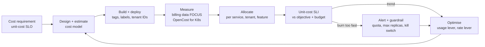

# 16 — Cost as a requirement

> **The requirement.** Lumen's API tier must serve **300 million requests per month** (about 115 requests/s on
> average, roughly 200 at the daily peak) for **no more than $6 per million requests, all-in**, and finance wants the
> cost of **each of 200 tenants** within 24 hours of the end of every day. That is hard for three reasons. The bill
> arrives weeks after the decisions that caused it. The biggest line item is often not the one you designed for (it
> is frequently network egress, not compute). And "all-in" includes capacity that serves nobody: idle replicas,
> availability headroom, forgotten environments.

## In one minute

Every design has a price, and the price is decided mostly by the architecture, not by the invoice. A cloud bill is
just a long list of *quantity × rate*. Engineers control the quantities: how many bytes cross a zone boundary, how
long a function waits on a slow dependency, how many replicas idle at 3 a.m. Finance and procurement control the
rates: commitments, discounts, contracts. Treat cost like latency: define what you measure (cost per request, per
tenant, per thousand tokens), set a target, give it a budget, and alert when it burns too fast. Pay-per-use services
are cheapest when traffic is small or spiky; provisioned capacity wins when traffic is high and steady. The skill is
knowing where the crossover is for *your* numbers, before launch, and watching it move as the system grows.

## Why this matters now

Three changes since about 2020 have made cost a first-class design requirement rather than an afterthought.

1. **The cloud made cost an engineering variable.** In a data centre, capacity was bought once a year and the
   marginal cost of a request was close to zero. In the cloud, every request, byte and second has a price, and
   engineers spend money every time they merge a change. The FinOps Foundation's framework states the consequence
   as a principle: "Everyone takes ownership for their technology usage" [2]. The AWS Well-Architected cost pillar
   asks for the same thing in different words: "Measure overall efficiency" and "Analyze and attribute expenditure"
   [19].
2. **Cost practice became standardised.** FinOps is defined by the FinOps Foundation as "an operational framework
   and cultural practice which maximizes the business value of technology, enables timely data-driven decision
   making, and creates financial accountability through collaboration between engineering, finance, and business
   teams" [1]. Its open billing schema, **FOCUS** (FinOps Open Cost & Usage Specification), normalises billing data
   "across AI, cloud, SaaS, data center, and other technology vendors"; version 1.4 is current (as of 2026-11) [6].
   For Kubernetes, **OpenCost** is a CNCF project, accepted in June 2022 and promoted to Incubating on
   2024-10-25 [9], with a published specification for allocating cluster costs to workloads [8].
3. **AI made unit cost volatile.** GPUs are expensive per hour and wasteful when idle, and LLM features are billed
   per token. The FinOps Foundation's *State of FinOps 2026* (1,192 respondents, "$83bn+ in annual cloud spend")
   reports that "98% now manage AI spend (up from 31% two years ago)" and that "Workload optimization and waste
   reduction remain the single top current priority" [5]. The FinOps Framework's 2026 revision lists AI, SaaS and
   data centre as technology categories alongside public cloud [2]. In Europe, the Data Act removes cloud
   *switching charges* altogether from 12 January 2027, which changes the economics of leaving a provider [25].

Cost is also the dimension where interview answers are weakest. A design that meets every latency target but costs
three times the revenue it supports is not a working design.

## Core ideas [Core]

### Cost is a non-functional requirement with a budget

You already know the pattern from [SYSDESIGN-01](../00-orientation/01-requirements-to-numbers.md) and
[SYSDESIGN-12](../01-foundations/12-observability.md): choose a service-level indicator (SLI), set an objective
(SLO), and manage an error budget. Apply the same structure to money. In this course we call it a **cost SLO**. The
term is our framing, not a FinOps Foundation term. It is defined by three parts:

- **Cost SLI**: a *unit cost*, meaning money divided by a unit of value. Examples: USD per million API requests, per
  active tenant per month, per thousand LLM tokens, per GB ingested. The FinOps Framework lists exactly these kinds of
  metrics under its *Unit Economics* capability: "cost per GB stored", "cost per token", "cost per tenant", "cost per
  transaction", and the KPI "Cost Per API Call = Total API Costs / Number of API Calls" [4].
- **Cost objective**: the target, for example "≤ $6 per million requests, monthly". Derive it from the business side
  (price minus target gross margin), not from last month's bill.
- **Cost budget and burn rate**: the absolute monthly envelope and how fast you are consuming it. A daily spend that
  would exhaust the monthly budget in 10 days is the cost equivalent of a fast error-budget burn, and it should page
  someone.

Unit cost is the right SLI because absolute spend *should* grow when the product grows. The bill doubling is good
news if traffic tripled and bad news if traffic was flat. Only the ratio tells you which.

### The cost equation: usage × rate

Every bill line is `quantity × rate`, summed:

$$\text{Cost} = \sum_{i} q_i \times r_i$$

This splits optimisation into two levers that the FinOps Framework names as separate capabilities, *Usage
Optimization* and *Rate Optimization* [2]:

| Lever | What changes | Who usually owns it | Examples |
|---|---|---|---|
| **Usage** (quantity *q*) | how much you consume | engineering | fewer bytes per response, caching, right-sizing, turning off idle environments, batching |
| **Rate** (price *r*) | what you pay per unit | finance, procurement, platform team | commitments (Savings Plans, Reserved Instances, committed-use discounts), spot, negotiated contracts, cheaper regions or architectures (e.g. Arm instances) |

Architecture decides the *shape* of the quantities, and shape matters more than size. Two designs that serve the same
traffic can differ in cost by an order of magnitude because one pays for capacity around the clock and the other pays
only per request, or because one crosses a zone boundary three times per request and the other none.

### Billing shapes

Recognising the billing shape of each component is the core skill of cost modelling. There are five common shapes.

| Shape | You pay for | Cost vs traffic | Examples |
|---|---|---|---|
| **Capacity-priced** | provisioned units × time, used or not | step function; flat between steps | VMs, provisioned databases, GPUs, load-balancer hours |
| **Consumption-priced** | each request, GB-second, GB scanned | linear | functions, API gateways, per-query warehouses, LLM APIs per token |
| **Tiered** | volume bands at falling unit prices | concave (cheaper per unit at scale) | internet egress, object storage |
| **Committed** | a promised spend or capacity for 1–3 years, at a discount | flat (a fixed cost you have pre-sold to yourself) | Savings Plans, Reserved Instances, committed-use contracts |
| **Interruptible** | spare capacity at a deep discount, revocable | like capacity-priced but cheaper, plus the cost of handling interruptions | AWS Spot, GCP Spot VMs |

AWS describes Compute Savings Plans as reducing costs "by up to 66%" and EC2 Instance Savings Plans "up to 72%", for a
1- or 3-year term [11]. Spot capacity is advertised at "up to 90%" off On-Demand on AWS [12] and "up to 91%" on Google
Cloud [14]. "Up to" is the ceiling, not the typical value. A spot instance can be reclaimed: AWS issues an
interruption notice "two minutes before" it stops or terminates the instance, on a best-effort basis [13]. Google's
Spot VM documentation describes a configurable preemption notice, 0 s by default or 120 s (as of 2026-11) [14].

### Cost drivers: where the money actually goes

When you sketch a design, list every component's cost driver next to it. These are the drivers in a typical
service, with the ones most often missed in bold.

- **Compute**: instance-hours, vCPU-seconds, function GB-seconds, GPU-hours. In functions you pay for *wall-clock*
  time, including time spent waiting on I/O. On a VM you pay for the VM, whether it waits or not.
- **Storage**: GB-months per class, plus request charges, plus **retrieval fees and minimum storage durations** in
  cold tiers. In S3, Standard-IA and Glacier Instant Retrieval have a 30-day and 90-day minimum storage duration
  respectively and a 128 KB minimum billable object size [17]. Retrieval costs $0.01/GB from Standard-IA and $0.03/GB
  from Glacier Instant Retrieval (us-east-1 list prices, 2026-11) [10].
- **Network**: **internet egress** (in us-east-1, $0.09/GB for the first 10 TB per month after a 100 GB monthly free
  allowance, falling to $0.05/GB above 150 TB [10][18]), **cross-AZ traffic** ($0.01/GB, charged in each direction
  [10]), **inter-region transfer**, **NAT gateway processing** (AWS's own example uses $0.045 per hour and $0.045
  per GB processed in US East (Ohio) [16]) and **public IPv4 addresses** ($0.005 per hour each [16]). Pricing differs
  between providers: Cloudflare R2, for example, states "There are no charges for egress bandwidth for any storage
  class" [24].
- **Managed-service premium**: a managed database, queue or gateway costs more per unit of capacity than the raw VM.
  You are buying operations labour, patching, failover and backups. That is often the right purchase. The AWS pillar
  calls it "Stop spending money on undifferentiated heavy lifting" [19]. But it must be a conscious choice.
- **Per-request orchestration**: state transitions, API-gateway calls, per-message charges. These are small per unit
  and enormous at high frequency (see the Prime Video case below).
- **Observability**: log ingestion, metric cardinality and trace retention are billed per GB or per series. Logging
  volume grows with traffic and with incidents, which is exactly when you least want to cut it.
- **Idle and headroom**: replicas held for N+1 availability, autoscaling lag, over-sized requests in Kubernetes,
  development environments left running. AWS points out that stopping development environments outside a 40-hour
  working week saves about 75% (40 versus 168 hours) [19].
- **People**: on-call time, upgrades, migrations. This driver is not on the cloud bill, but it belongs in the
  comparison between a managed service and running it yourself.

### Fixed, variable, marginal

Separate costs into **fixed** (paid regardless of traffic: the minimum fleet, the load balancer's hourly charge,
commitments, base storage) and **variable** (scaling with traffic: egress, function invocations, tokens). Average
cost per request is `(fixed + variable) / requests` and falls as traffic grows. **Marginal** cost, the price of the
next request, is the variable part only. Pricing decisions (free tiers, enterprise discounts) depend on marginal
cost. Capacity and commitment decisions depend on fixed cost. Confusing the two is the classic way to sell a
"profitable" plan that loses money at scale.

### FinOps in one diagram

The FinOps Framework organises the practice into three iterative phases. **Inform** covers visibility and
allocation: teams review "technology cost, usage and efficiency data". **Optimize** covers rates and usage:
"identifying opportunities to improve efficiency and value". **Operate** is continuous improvement, which loops back
to the other two [3]. Six principles govern the practice: "Teams need to collaborate", "Business value drives
technology decisions", "Everyone takes ownership for their technology usage", "FinOps data should be accessible,
timely, and accurate", "FinOps should be enabled centrally", and "Take advantage of the variable cost model of the
cloud" [2]. Maturity is described as Crawl, Walk, Run [2].

For a system designer, the practical meaning is a feedback loop wired into the architecture:

*Diagram: a loop from a unit-cost requirement to a design estimate, deployment with allocation tags, measurement of
billing and cluster data, allocation to services and tenants, comparison of unit cost against the objective, then
either an alert and guardrail or an optimisation that feeds back into design.*

The loop only works if allocation is designed in from the start. Every resource needs an owner, a service and an
environment tag. Every request needs a tenant ID that reaches the logs and the metrics, and every shared component
needs an allocation rule. Retrofitting tags onto 4,000 resources is a project. Adding them on day one is a line in a
template.

## Numbers that matter

Here is a worked estimate for the requirement at the top. Every input is either an AWS us-east-1 **list price**
read from the public AWS Price List API on 2026-11-19/20 [10] or a **labelled assumption**. The lab
([L16](../../labs/16-cost-as-requirement/README.md)) computes the same numbers.

**Workload assumptions (Lumen API tier):** 300M requests/month, so 300×10⁶ / 2.628×10⁶ s ≈ **114 req/s
average**. The diurnal profile has a peak-to-average ratio of **1.72**, so about **196 req/s at peak**. Each request
uses **50 ms of CPU** and lasts **120 ms wall-clock**, the difference being I/O wait. Each response sends **30 KB**
to the internet, and each request moves **10 KB** of service-to-datastore traffic, two-thirds of it across an AZ
boundary. Total stored data is **10 TB**, of which 20% is hot. There are **200 tenants** with a skewed (Zipf) usage
distribution.

**1. Egress, the line item people forget.** 300×10⁶ × 30 KB = 9,000 GB/month. After the 100 GB free allowance,
8,900 GB × $0.09 = **$801/month**. Per request, that is $2.67 per million, before any compute.

**2. Compute on VMs.** An m7i.xlarge (4 vCPU) costs **$0.2016/h** On-Demand. At a 60% CPU target (headroom for
the latency SLO), one VM serves 4 × 0.6 / 0.050 s = **48 req/s**. Peak needs ⌈196/48⌉ = **5 VMs**. A fixed fleet
sized for peak costs 5 × 730 h × $0.2016 = **$735.84/month**. If the fleet were 100% busy at the target, the
cost would be $0.2016 / (48 × 3,600) ≈ **$1.17 per million requests**. The difference between the two is paid for
peak headroom and night-time idleness.

**3. Compute on functions.** At 1 GB of memory and 120 ms wall-clock, the usage is 300×10⁶ × 1 GB × 0.12 s =
36×10⁶ GB-s. At $0.0000166667 per GB-s that is $600, and the request charge is 300 × $0.20 = $60. The HTTP API
gateway adds 300 × $1.00 = $300. The total is **$960/month**, or **$3.20 per million requests**, linear in traffic.
Little's law ([SYSDESIGN-01](../00-orientation/01-requirements-to-numbers.md)) gives the average concurrency:
114 req/s × 0.12 s ≈ 14 concurrent executions.

**4. Cross-AZ.** 300×10⁶ × 10 KB × ⅔ = 2,000 GB, charged on both sides at $0.01/GB, which is **$40/month**. That is
small here. With chatty microservices moving 100 KB per request it becomes $400.

**5. Storage.** 10,000 GB × $0.023 = **$230/month** in S3 Standard. Moving the cold 80% to Standard-IA brings it
to $146, and moving it to Glacier Instant Retrieval brings it to $78, *before* retrieval fees and minimum-duration
charges.

**6. The three architectures, all-in (lab output, 2026-11-20):**

| Architecture | Compute | Front door | Egress | Cross-AZ | Storage | **Total/month** | **Per 1M req** |
|---|---|---|---|---|---|---|---|
| A. Fixed fleet, On-Demand, sized for peak | $735.84 | $90.83 (ALB) | $801.00 | $40.00 | $230.00 | **$1,897.66** | **$6.33** |
| B. Autoscaled: 3 committed VMs (30% assumed discount) + burst 70% on spot (60% assumed discount) | $383.74 | $90.83 (ALB) | $801.00 | $40.00 | $230.00 | **$1,545.57** | **$5.15** |
| C. Functions + HTTP API gateway | $660.00 | $300.00 (API GW) | $801.00 | $40.00 | $230.00 | **$2,031.00** | **$6.77** |

Only B meets the $6 objective at this volume. The lab's traffic sweep puts the crossover between C and B at about
**110M requests/month (≈ 42 req/s average)**. Below that, serverless is cheaper because it has no minimum fleet.
Above it, the per-request premium of pay-per-use exceeds the cost of idle headroom. Note also that **egress
($801) is larger than compute in every design**. The cheapest optimisation available is a payload diet
(compression, pagination, smaller JSON), not a change of architecture.

**7. Cost per tenant.** In design B, the largest tenant generates 21.3% of requests. Under *proportional*
allocation it costs $328.92/month, and the smallest tenant (0.06% of requests) costs $0.97. If the fixed costs
(compute floor, load balancer, storage) are instead *split evenly*, the smallest tenant costs $4.05, four times as
much. Neither number is "true". Both are policies, and you must state which one a dashboard uses.

**8. Cost per thousand tokens (self-hosted).** A g6.xlarge (one NVIDIA L4) lists at **$0.8048/h** On-Demand. Assume
(a hypothetical figure; measure it in lab L22) that one GPU sustains 1,500 tokens/s at full batch. That is 5.4M
tokens/hour, so ≈ **$0.00015 per 1k tokens at 100% utilisation**, **$0.0015 at 10%** and **$0.003 at 5%**. The
formula is the point:

$$\text{USD per 1k tokens} = \frac{\text{GPU price per hour}}{\text{tokens/s} \times 3.6 \times \text{utilisation}}$$

Cost per token is inversely proportional to utilisation. An idle GPU is the most expensive thing in the
building. [SYSDESIGN-23](../03-ai-systems/23-gpu-infrastructure.md) develops this further.

## Design choices and trade-offs

### Buying compute

| Option | Wins when | Costs / risks | Example offerings |
|---|---|---|---|
| **On-Demand capacity** | unknown or new workloads; short-lived spikes; as the flexible top layer | highest unit rate; you pay for idle | EC2/GCE On-Demand |
| **Commitments** (1–3 yr) | a stable floor of usage you are confident will persist | lock-in to a spend level (and sometimes a family or region); unused commitment is pure waste | AWS Savings Plans [11] and Reserved Instances; Google committed-use discounts |
| **Spot / preemptible** | stateless, checkpointable or retryable work: batch, CI, training with checkpoints, burst web tiers behind a queue | interruption with short notice (2 min on AWS [13]); capacity can vanish in a pool; engineering effort to drain gracefully | AWS Spot [12], GCP Spot VMs [14] |
| **Consumption (serverless)** | low or very spiky traffic; scale-to-zero; small teams | per-unit premium; billed on wall-clock, so slow dependencies inflate cost; cold starts | functions, serverless containers, per-query warehouses |
| **Owned / colocated hardware** | large, stable, predictable load at scale; GPUs at sustained high utilisation | capital outlay, procurement lead time, staff, and you carry the idle risk | on-premises, colocation, HPC centres |

These options are layers, not alternatives. A mature fleet commits to the floor, runs the predictable daily hump
on On-Demand or spot, and absorbs the unpredictable tail with spot or serverless. Architecture B in the lab is the
smallest version of that portfolio.

### Architecture levers that change the bill

| Lever | Mechanism | Typical effect | Watch out for |
|---|---|---|---|
| Payload diet (compression, pagination, field selection) | fewer egress bytes per request | linear in bytes; often the largest saving | CPU for compression; client compatibility |
| Caching / CDN ([SYSDESIGN-04](../01-foundations/04-caching.md)) | fewer origin requests and less origin egress | proportional to hit ratio | CDN has its own per-GB and per-request prices; invalidation cost |
| Zone-aware routing | keep request paths inside one AZ | removes cross-AZ charges | less even load spreading; failover must still work |
| Async + batching ([SYSDESIGN-08](../01-foundations/08-async-event-driven.md)) | fewer, larger operations; smoother load | fewer per-request charges; smaller peak fleet | latency; queue cost |
| Right-sizing + bin packing | requests match real usage; fewer, fuller nodes | removes "workload idle" and "cluster idle" | OOM kills and throttling if cut too far |
| Storage lifecycle tiering | move cold bytes to cheaper classes | about 46% (Standard-IA) to 83% (Glacier IR) on cold bytes at us-east-1 list price [10] | retrieval fees, minimum durations, minimum object size [17] |
| Instance architecture | e.g. Arm instances: m7g.xlarge lists at $0.1632/h vs m7i.xlarge $0.2016/h (us-east-1, 2026-11) [10] | ~19% lower list rate; performance differs per workload | rebuild images for arm64; benchmark before claiming savings |
| Region choice ([SYSDESIGN-15](./15-multi-region-edge.md)) | list prices differ by region | varies | latency, residency and sovereignty constraints ([SYSDESIGN-19](./19-privacy-compliance-sovereignty.md)) |
| Scheduling non-prod | stop outside working hours | ~75% on those resources [19] | developer friction |

### Serverless vs monolith: the Prime Video case

In March 2023, Amazon Prime Video's Video Quality Analysis team described moving a stream-monitoring service from
a distributed design built on AWS Step Functions, Lambda and S3 (for intermediate frames) to components packed into
a single process on ECS/EC2. They reported a **90% reduction in operational cost**. The stated reasons were the
number of Step Functions state transitions per second of analysed video, which also hit account limits, and the
volume of S3 reads and writes for intermediate data. The original design supported only about 5% of the expected
load [22]. (The original post was on the Prime Video tech blog and no longer resolves; InfoQ's report is cited.)

The lesson is not "monoliths are cheaper". The lesson is that a **per-operation price multiplied by a
high-frequency internal operation** dominated the bill. The same analysis would condemn a VM design that wrote every
frame to object storage. Compute the per-request quantity of each billed operation before choosing.

### Cloud vs owning hardware

Wang and Casado (a16z, 2021) estimated that cloud costs suppress the market value of 50 large public software
companies by about $100B through margin compression. They argued for treating infrastructure spend as a first-class
metric and for selective repatriation of stable workloads at scale [23]. This is an investor's back-of-envelope
analysis, not audited data, and it was disputed. The defensible engineering version of the argument is narrower.
Large, stable, predictable workloads (including GPUs at high sustained utilisation) are where owned capacity
competes. Spiky, uncertain or small workloads are where the variable cost model wins. The Data Act's removal of
switching charges in the EU from 12 January 2027 [25] lowers one barrier to moving between providers. The
engineering cost of portability remains.

## Deep dive [Deep]

### How much to commit: the waterline rule

Suppose demand in hour *h* needs *D(h)* instances, the On-Demand rate is *r* per instance-hour, and a commitment
gives a discount *d* (you pay (1−d)·r for every committed instance-hour, used or not). Commit to *c* instances.
The cost over *H* hours is:

$$C(c) = c\,(1-d)\,r\,H \;+\; r \sum_{h=1}^{H} \max\big(D(h) - c,\; 0\big)$$

Adding the *k*-th committed instance costs (1−d)·r·H. It saves *r* for every hour in which demand reaches at least
*k*. So commit the *k*-th instance only if **the fraction of hours with D(h) ≥ k exceeds (1 − d)**. This is the
newsvendor condition applied to capacity (our derivation). Two consequences follow:

- With a 30% discount, commit only to the level that demand reaches in at least 70% of hours. With a 60% discount,
  the threshold drops to 40%: deeper discounts justify committing higher up the daily curve.
- In the lab's 300M-request profile, demand is 3 instances for 12 hours, 4 for 3 hours and 5 for 9 hours. Level 4 is
  reached in 12/24 = 50% of hours and level 5 in 37.5%. At *d* = 30% you commit to 3 (the floor). At *d* = 60% you
  would commit to 4.

Forecast uncertainty pushes the commitment lower still, because an unused commitment is pure loss. Teams therefore
track two FinOps KPIs. **Commitment coverage** is the share of eligible usage covered by commitments. **Commitment
utilisation** is the share of committed capacity actually used. High utilisation with moderate coverage is the
healthy combination.

### Spot economics with interruptions

Spot's real price is not the list discount. If a job of length *T* is interrupted at rate *λ* per hour and you
checkpoint every τ hours, the expected rework per interruption is about τ/2. The overhead is checkpointing time
plus λ·(τ/2 + restart time) per hour of progress. Effective cost ≈ spot rate × (1 + overhead). With short
checkpoint intervals and fast restarts, spot stays far cheaper than On-Demand. Stateful services without graceful
draining turn every interruption into an availability incident, and the "saving" is then paid for by the error
budget. Design rules:

- Use spot for **stateless** replicas behind a load balancer that drains on the interruption notice. AWS
  recommends polling the notice "every 5 seconds" [13].
- Diversify across instance types and zones so that one capacity pool drying up does not take the whole tier.
  Karpenter, for example, requires flexibility across at least 15 instance types before it performs single-node
  spot-to-spot consolidation, so that it does not "continually consolidate down to the lowest priced spot instance"
  with high interruption rates (Karpenter v1.15 docs) [20].
- Never put the *last* replica of anything on spot.

### Kubernetes cost allocation: requests, usage and idle

Kubernetes makes cost allocation harder because many workloads share a node. The OpenCost specification [8] defines
a standard model:

- Total cluster cost = asset costs (nodes, disks, load balancers) + overhead (for example, managed control-plane
  fees).
- A workload is charged **max(request, usage)** for CPU, memory and GPU: "Workload Costs should be understood as
  max(request, usage) when Assets have Resource Allocation Costs" [8]. Reserving capacity you do not use is charged
  to you, which gives teams an incentive to right-size requests.
- **Idle cost** is "the portion of Resource Allocation Costs that are not allocated to any workload" [8]. It is
  capacity the cluster bought but nobody requested. Idle cost and shared system workloads can be distributed evenly,
  proportionally, or by a custom metric [8].

How big is idle in practice? Datadog's *State of Cloud Costs 2024* (vendor telemetry from its customers, so treat
it as indicative, not universal) reported that "83% of container costs were associated with idle resources". Of
that waste, about 54% was cluster idle (over-provisioned nodes) and 29% workload idle (requests above need) [21].
The two kinds need different remedies. **Workload idle** is fixed by right-sizing requests: vertical autoscaling
recommendations, or load tests ([L01](../../labs/01-requirements-to-numbers/)). **Cluster idle** is fixed by bin packing and consolidation, for
example Karpenter's `WhenEmptyOrUnderutilized` policy, which deletes or replaces nodes whose pods fit elsewhere [20].
Autoscaling primitives are covered in [SYSDESIGN-03](../01-foundations/03-scaling-compute.md) and
[SYSDESIGN-14](./14-cloud-native-platforms.md).

### Billing data: which "cost" do you mean?

A bill has several defensible numbers for the same usage, and teams talk past each other when they mix them.
FOCUS 1.4 names them as separate columns [6]:

- **List Cost**: usage at public list prices.
- **Contracted Cost**: usage at your negotiated prices.
- **Billed Cost**: what is invoiced in the period. An upfront commitment appears here in full, in the month it is
  bought.
- **Effective Cost**: the amortised view. It "includes the recognized portion of Billed Cost from related purchase
  charges" (amortised prepayments), and the purchase line itself carries zero effective cost when it exists only to
  cover usage [7].

Engineering dashboards and unit-cost SLIs should use **effective cost**. Otherwise the month a team buys a 3-year
commitment looks like a disaster and the following 35 months look free. Finance reconciles to billed cost. Pricing
and margin analysis may use contracted or list cost to stay independent of discount timing.

### Allocation of shared costs

Some costs belong to everyone: the minimum fleet, the load balancer, the observability stack, the platform team's
clusters. There are three common policies, and you should pick one explicitly:

1. **Proportional to a driver** (requests, CPU-seconds, bytes). This is fair for variable costs, but it hides that
   a small tenant still needs the floor to exist.
2. **Even split**. This is simple and reflects the cost of *existing*, but it overcharges small tenants (the lab
   shows a 4× difference).
3. **Fixed fee plus variable**. A per-tenant platform fee covers the fixed share, and usage covers the rest. This
   mirrors how most SaaS pricing works, and it is usually what product pricing needs.

*Showback* reports costs to teams without moving money. *Chargeback* moves money between budgets, a capability the
FinOps Framework calls "Invoicing & Chargeback" [2]. Start with showback. Chargeback based on bad allocation data
creates political disputes, not savings.

### The cost of reliability

Availability has a price, and you should be able to quote it. N+1 across three zones means at least three replicas
even at zero traffic. In the lab, that floor ($441/month for three On-Demand VMs) is why serverless wins at low
volume. Active-active in two regions roughly doubles the fleet and adds inter-region replication traffic
([SYSDESIGN-15](./15-multi-region-edge.md)). Every extra nine should be justified by the cost of the downtime it
prevents ([SYSDESIGN-11](../01-foundations/11-reliability-engineering.md)). A good design document states both
numbers: "this second region costs $X/month and reduces expected downtime cost by $Y/month."

## Frontier [Frontier]

*As of 2026-11.*

- **FinOps for AI.** *State of FinOps 2026* names "FinOps for AI" the top forward-looking priority and "AI cost
  management" the top skill teams need. It also notes that "Many organizations report being asked to self-fund AI
  investments through optimization savings" [5]. Unit economics for AI features use per-token and per-task metrics.
  The FinOps Framework lists "cost per token" next to "cost per transaction" [4].
- **One schema for every vendor.** FOCUS 1.4 is current [6], and its stated scope now explicitly covers AI vendors,
  SaaS and data centres alongside public cloud [6]. FOCUS 1.4 also defines contract-commitment columns such as
  Contract Commitment Cost [6]. The practical consequence: a single query can compare GPU-hours on a
  hyperscaler, tokens from an LLM API and a SaaS licence in the same unit-cost dashboard.
- **Kubernetes-native cost data.** OpenCost (CNCF Incubating since 2024-10-25) [9] implements the allocation model
  above as an open, vendor-neutral tool: cost per container, aggregated by pod, namespace, label or cluster, with GPU
  treated like CPU and memory under max(request, usage) [8].
- **Cost-aware AI serving.** The levers from [SYSDESIGN-22](../03-ai-systems/22-serving-llms-at-scale.md) are cost
  levers: continuous batching and prefix caching raise tokens per GPU-second, and quantisation fits more on cheaper
  GPUs. Model routing in an LLM gateway ([SYSDESIGN-26](../03-ai-systems/26-llm-gateways-llmops.md)) sends easy
  requests to small models. Agents ([SYSDESIGN-25](../03-ai-systems/25-agentic-systems.md)) need per-task token
  budgets, because an unbounded tool loop is an unbounded bill.
- **Regulation reaching pricing.** The EU Data Act allows only reduced switching charges, capped at direct costs, from
  11 January 2024 to 12 January 2027. From 12 January 2027, providers "shall not impose any switching charges" [25].
  It also limits data egress charges for in-parallel use of multiple providers to passing on the costs incurred
  (Art. 34) [25].
- **Cost and carbon together.** Carbon-aware scheduling ([SYSDESIGN-17](./17-energy-carbon-aware.md)) moves work in
  time and space. Spot capacity and off-peak commitments create a similar incentive. The two objectives often align
  (idle capacity wastes both money and energy), but not always: the cheapest region is not necessarily the
  lowest-carbon one.

## Failure modes and operations

Cost failures are incidents. They deserve detection, runbooks and postmortems like any outage.

| Failure | Mechanism | How you detect it (SLI) | Mitigation |
|---|---|---|---|
| **Runaway autoscaling** | a bug, a bad metric or a traffic attack scales the fleet to its limit | replicas and spend per hour vs forecast; unit cost per request jumps | `maxReplicas`, account quotas, scale-up rate limits, alert on cost burn rate |
| **Retry storms** ([SYSDESIGN-11](../01-foundations/11-reliability-engineering.md)) | each failure multiplies billed requests and function-seconds | requests per *user* action; retry ratio | retry budgets, jittered backoff, circuit breakers |
| **Slow dependency on pay-per-use compute** | wall-clock-billed functions wait longer; cost rises without any traffic change | GB-seconds per request; p50 duration | timeouts; async hand-off; move the waiting work to provisioned capacity |
| **Chatty services / cross-AZ** | service calls bounce between zones | cross-AZ GB per request | zone-aware routing; co-location; fewer, larger calls |
| **Egress surprise** | a new feature returns images inline or a partner pulls bulk exports | egress GB per request; per-tenant egress | payload limits, CDN, signed URLs, egress quotas per tenant |
| **Observability explosion** | debug logging left on; high-cardinality labels | ingested GB/day; active series | sampling, log levels with expiry, cardinality limits |
| **Idle GPUs** | a model replica is kept warm for a feature with no traffic | GPU utilisation; cost per 1k tokens | scale to zero where cold-start tolerates it; multi-model / multi-LoRA serving; shared pools |
| **Orphaned resources** | volumes, snapshots, IPs, test clusters with no owner | untagged spend %; resources with no owner tag | tag policies enforced at creation; scheduled reaper with owner notification |
| **Commitment waste** | committed above real demand, or demand moved to another family or region | commitment utilisation | commit to the waterline; prefer flexible commitment types; review quarterly |
| **Unbounded agents / LLM loops** | an agent re-plans forever; a prompt grows each turn | tokens per task; cost per task | hard per-task token and wall-clock budgets ([SYSDESIGN-25](../03-ai-systems/25-agentic-systems.md)) |

**Operating rhythm.** Look at these signals at four cadences:

- **Daily**: anomaly detection on spend per service and per tenant. The FinOps capability is *Anomaly Management*
  [2].
- **Weekly**: unit-cost SLIs against their objectives.
- **Monthly**: allocation reconciled to the invoice, and the untagged share trending down.
- **Quarterly**: commitments re-sized to the waterline.

Put a **cost section in every design review** ("what does this cost per unit at launch and at 10× scale, and which
line item dominates?"). Put a **cost test in CI** for infrastructure changes: run a model like the lab's against the
planned resources and fail the build when the estimated unit cost exceeds the objective.

## Cost and energy

This chapter is about cost. Energy and carbon are the subject of [SYSDESIGN-17](./17-energy-carbon-aware.md). The
two connect through **utilisation**. Idle capacity is paid for in money and also draws power. Raising utilisation
(bin packing, consolidation, batching, scale-to-zero) is usually a win on both axes. Where they diverge, make the
trade-off explicit. A cheaper region may have a more carbon-intensive grid. A spot pool available at night may be
cheap and clean, or cheap and dirty, depending on the grid mix. When you report a design's unit cost, report its
energy per request next to it if you can measure it. The same allocation machinery (per service, per tenant)
applies to both.

## Interview angle

**How it is asked.** Rarely as "design for cost". Usually as a follow-up in the STRESS or WRAP phase: "This works.
What does it cost? How would you cut it in half? What happens to cost at 10×?" In ML and LLM interviews:
"Self-host or call an API? What is your cost per 1k tokens?" Staff-level loops may ask you to justify a second
region or a managed service in dollars.

**Where it fits in CLARIFY → QUANTIFY → SKETCH → DEEPEN → STRESS → WRAP:**

- **CLARIFY**: ask whether there is a cost target or a price point, and whether traffic is steady or spiky.
- **QUANTIFY**: estimate egress bytes and compute-seconds per request next to QPS and storage.
- **SKETCH**: mark each box with its billing shape (capacity, consumption, tiered).
- **DEEPEN**: pick the component whose cost dominates and optimise its quantity first.
- **STRESS**: cover runaway scaling, retry storms and the cost at 10×.
- **WRAP**: state the unit cost and the biggest lever you did not pull.

**Model answer outline (5 lines):**

1. "Let me put a unit-cost target on this: say ≤ $6 per million requests, from price and margin."
2. "Per request: about 50 ms CPU, 30 KB egress, 10 KB internal traffic. At 300M/month, egress alone is about $800,
   which is more than the compute."
3. "Traffic is diurnal with a 1.7× peak, so I'd commit to the nightly floor, run the daily hump autoscaled with spot
   for the stateless tier, and keep the last replicas on On-Demand."
4. "Serverless would be cheaper below about 100M requests/month in my model. Above that its per-request premium
   loses. I'd revisit the decision as we grow."
5. "I'd tag everything by service and tenant, use amortised effective cost in dashboards, and alert on unit-cost
   burn rate, with max-replica and token-budget guardrails."

**Red flags:**

- "Cost is ops' problem."
- Quoting only instance-hours.
- Ignoring egress, cross-zone traffic or NAT.
- Assuming "up to 90%" spot savings as typical.
- Committing to peak.
- Absolute monthly figures with no unit cost.
- "Serverless is always cheaper" or "VMs are always cheaper".

**Likely follow-ups:**

- How do you allocate a shared cluster to tenants? (OpenCost model, idle cost, policy choice.)
- What is the break-even between self-hosting a model and an API? (Utilisation formula.)
- How do you stop one tenant's usage from blowing the budget? (Quotas, rate limits by cost, per-tenant budgets.)
- How would you detect a cost regression before the invoice? (Unit-cost SLI from billing exports plus real-time
  proxies such as replicas, GB-seconds and egress bytes.)

## Common mistakes

- **Optimising the wrong line item.** Engineers trim instance sizes while egress or logging is the largest cost. Sort
  the bill by driver first.
- **Treating list-price discounts as typical.** "Up to 66/72/90%" are ceilings [11][12]. Model your own rates.
- **Committing to peak or to the average.** Commit to the waterline (the level reached in more than 1−d of hours).
- **Forgetting cold-tier fine print.** Minimum storage duration, minimum object size and retrieval fees can make
  Standard-IA more expensive than Standard for small or short-lived objects [17].
- **Ignoring that functions bill wall-clock.** A dependency that slows from 120 ms to 300 ms raised the lab's
  serverless total by 44% and the VM design's by 0%.
- **Using billed cost for unit metrics.** Commitment purchases create spikes. Use amortised (effective) cost [7].
- **No allocation keys.** Without tenant IDs in telemetry, "cost per tenant" is a guess forever.
- **Per-tenant numbers without a stated policy.** Proportional and even-split allocation differ by several times for
  small tenants.
- **Counting only cloud spend.** Managed-versus-self-run comparisons must include people's time and on-call.
- **Optimising cost at the expense of the SLO.** Running at 90% CPU to save a VM, then breaching latency. The cost
  SLO and the latency SLO are a joint constraint.

## Check yourself

1. Why is unit cost a better SLI than total monthly spend? Give an example where total spend rose and the system
   got *more* efficient.
2. A function averages 200 ms wall-clock but only 20 ms on CPU. Which billing shape punishes this, and what
   architectural change helps?
3. With a 40% commitment discount, demand needs 10 instances 100% of the time, 14 instances 65% of the time and 20
   instances 20% of the time. How many do you commit to?
4. In the Lumen estimate, which single change saves more: moving to the cheapest compute architecture or halving the
   response size? Show the numbers.
5. Name two ways Kubernetes clusters create idle cost, and the remedy for each.

Full set with answers: [exercises/16-cost-as-requirement.md](../../exercises/16-cost-as-requirement.md).

## Lab

[**L16 — A cost model for three architectures**](../../labs/16-cost-as-requirement/README.md) is a Python
standard-library script with no dependencies, no network and no cloud account. It models Lumen's API tier as (A) a
fixed On-Demand fleet, (B) an autoscaled fleet with a committed baseline and spot burst, and (C) serverless functions
behind an API gateway. Every input is a labelled list price (AWS us-east-1, with source and access date) or a
labelled assumption. You will find the break-even traffic, see egress dominate, measure the effect of a slow
dependency, compare tenant allocation policies and compute GPU cost per 1k tokens against utilisation. Test status:
runtime-tested on 2026-11-20, 18 unit tests passing.

## Further reading

- FinOps Foundation, *FinOps Framework* [2]: principles, phases, domains and capabilities. Use it as the shared
  vocabulary with finance.
- FinOps Foundation, *Unit Economics* capability [4]: how to choose unit metrics that tie spend to value.
- *FOCUS Specification v1.4* [6][7]: read the cost columns (Billed, Effective, List, Contracted) before building any
  cost dashboard.
- *OpenCost Specification* [8]: the clearest public definition of Kubernetes workload, idle and shared cost.
- AWS Well-Architected, *Cost Optimization design principles* [19]: short and vendor-flavoured, but the principles
  generalise.
- InfoQ on Prime Video's monitoring redesign [22]: a public, quantified example of per-operation charges dominating a
  design.
- Wang & Casado, *The Cost of Cloud, a Trillion Dollar Paradox* [23]: the investor's case for repatriation. Read it
  critically, alongside the variable-cost principle.

## References

1. FinOps Foundation, "What is FinOps?", https://www.finops.org/introduction/what-is-finops/ (accessed 2026-11).
2. FinOps Foundation, "FinOps Framework" (principles, phases, maturity, personas, domains and capabilities, scopes,
   technology categories; 2026 framework updates), https://www.finops.org/framework/ (accessed 2026-11).
3. FinOps Foundation, "FinOps Phases", https://www.finops.org/framework/phases/ (accessed 2026-11).
4. FinOps Foundation, "Unit Economics" capability, https://www.finops.org/framework/capabilities/unit-economics/
   (accessed 2026-11).
5. FinOps Foundation, "State of FinOps 2026" (6th annual survey, 1,192 respondents), https://data.finops.org/
   (accessed 2026-11).
6. FinOps Foundation / Joint Development Foundation, "FOCUS Specification v1.4",
   https://focus.finops.org/focus-specification/ and https://focus.finops.org/ (accessed 2026-11).
7. FOCUS v1.4, "Effective Cost" column,
   https://focus.finops.org/docs/specification/v1-4/columns/cost-and-usage/effective-cost/ (accessed 2026-11).
8. OpenCost, "OpenCost Specification", https://opencost.io/docs/specification (accessed 2026-11).
9. Cloud Native Computing Foundation, "OpenCost" project page (accepted 2022-06-17, Incubating 2024-10-25),
   https://www.cncf.io/projects/opencost/ (accessed 2026-11).
10. Amazon Web Services, AWS Price List Bulk API, us-east-1 offer files for AmazonEC2, AWSLambda, AmazonApiGateway,
    AWSELB, AmazonS3 and AWSDataTransfer,
    `https://pricing.us-east-1.amazonaws.com/offers/v1.0/aws/<offer>/current/us-east-1/index.json` (EC2 via
    `index.csv`), publication dates 2026-11-12 to 2026-11-19 (accessed 2026-11-19/20).
11. Amazon Web Services, "Savings Plans pricing", https://aws.amazon.com/savingsplans/compute-pricing/ (accessed 2026-11).
12. Amazon Web Services, "Amazon EC2 Spot Instances", https://aws.amazon.com/ec2/spot/ (accessed 2026-11).
13. Amazon Web Services, "Spot Instance interruption notices", Amazon EC2 User Guide,
    https://docs.aws.amazon.com/AWSEC2/latest/UserGuide/spot-instance-termination-notices.html (accessed 2026-11).
14. Google Cloud, "Spot VMs", Compute Engine documentation, https://docs.cloud.google.com/compute/docs/instances/spot
    (accessed 2026-11).
15. Amazon Web Services, "Elastic Load Balancing pricing" (LCU dimensions),
    https://aws.amazon.com/elasticloadbalancing/pricing/ (accessed 2026-11).
16. Amazon Web Services, "Amazon VPC pricing" (NAT gateway example, public IPv4), https://aws.amazon.com/vpc/pricing/
    (accessed 2026-11).
17. Amazon Web Services, "Understanding and managing Amazon S3 storage classes", Amazon S3 User Guide,
    https://docs.aws.amazon.com/AmazonS3/latest/userguide/storage-class-intro.html (accessed 2026-11).
18. Amazon Web Services, "Amazon S3 pricing" (100 GB/month free data transfer out), https://aws.amazon.com/s3/pricing/
    (accessed 2026-11).
19. Amazon Web Services, "Design principles", Cost Optimization Pillar, AWS Well-Architected Framework,
    https://docs.aws.amazon.com/wellarchitected/latest/cost-optimization-pillar/design-principles.html (accessed 2026-11).
20. Karpenter, "Disruption" (consolidation), docs v1.15, https://karpenter.sh/docs/concepts/disruption/ (accessed 2026-11).
21. Datadog, "Datadog's State of Cloud Costs 2024 Report …", press release, 2024-06-13,
    https://www.datadoghq.com/about/latest-news/press-releases/datadogs-state-of-cloud-costs-2024-report-finds-spending-on-gpu-instances-growing-40-as-organizations-experiment-with-ai/
    (accessed 2026-11). Vendor data from its own customer base.
22. R. Gancarz, "Prime Video Switched from Serverless to EC2 and ECS to Save Costs", InfoQ, 2023-05-03,
    https://www.infoq.com/news/2023/05/prime-ec2-ecs-saves-costs/ (accessed 2026-11). Reports on M. Kolny's
    March 2023 Prime Video tech-blog post, whose original URL now redirects.
23. S. Wang and M. Casado, "The Cost of Cloud, a Trillion Dollar Paradox", Andreessen Horowitz, 2021-05-27,
    https://a16z.com/the-cost-of-cloud-a-trillion-dollar-paradox/ (accessed 2026-11).
24. Cloudflare, "R2 pricing", https://developers.cloudflare.com/r2/pricing/ (accessed 2026-11).
25. Regulation (EU) 2023/2854 (Data Act), Arts. 29 and 34, Official Journal of the EU,
    https://eur-lex.europa.eu/eli/reg/2023/2854/oj/eng (accessed 2026-11).
