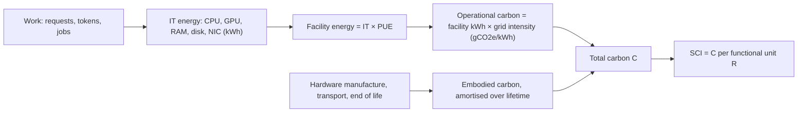
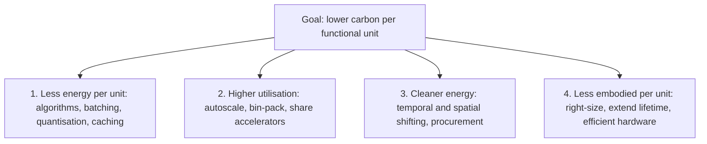
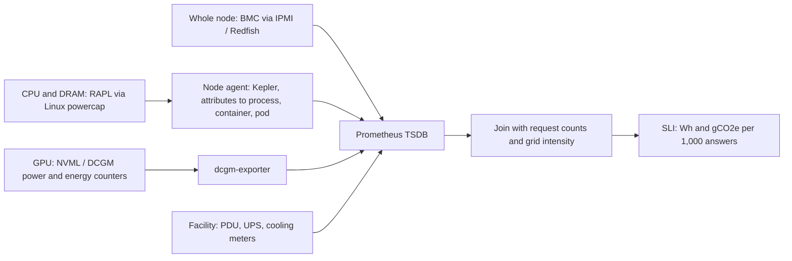

# 17 — Energy- & carbon-aware design

> **The requirement.** Lumen's enterprise customers now ask, in procurement questionnaires, for "the carbon
> footprint per 1,000 assistant answers, with method". Leadership commits to publishing that number and to
> cutting it by 40% within 12 months, without breaking the 2 s time-to-first-token (TTFT) SLO. This is hard
> for three reasons. Nobody measures energy per request today. The answer depends on things the software
> team does not control: the grid, the building, how the hardware was made. And the cheapest-looking levers,
> such as moving work to a "green" region, run straight into latency SLOs and data-residency rules.

## In one minute

Every request your system serves burns electricity. Somewhere a power plant made that electricity, and
depending on the plant, the hour and the country, that released a little or a lot of CO₂. The building also
spends energy on cooling and power conversion on top of what the servers draw. The servers and GPUs
themselves caused emissions when they were manufactured, before they ever ran a request. Carbon-aware design
means making those costs visible per unit of useful work (per request, per answer, per training run) and then
pulling the levers you control. You can do less work per request (efficiency). You can keep the hardware
busy instead of idle (utilisation). You can run flexible work when the grid is cleaner (temporal shifting)
or where it is cleaner (spatial shifting). You can choose hardware that does more per joule and per
kilogram of embodied carbon. You treat the result like any other non-functional requirement: an SLI, a
target and a budget.

## Why this matters now

Three things changed between 2023 and 2026.

1. **AI made data-centre electricity a grid-planning topic.** The International Energy Agency (IEA) estimates
   that data centres used about **415 TWh in 2024, about 1.5% of global electricity**, and projects about
   **945 TWh by 2030** in its Base Case. It names accelerated (GPU) servers as the largest growth driver, with
   their consumption growing about 30% per year [6]. For the EU, the Commission cites IEA figures of
   about **68 TWh in 2024**, expected to reach about **114 TWh by 2030**, more than 3% of EU electricity
   demand [9].
2. **Reporting became law in the EU.** Since 2024, operators of data centres with **at least 500 kW** of
   installed IT power must report energy and sustainability KPIs every year [7][8]. In September 2026 the
   Commission proposed an **A–G rating label** built on those reports, with first labels expected in 2027 [9].
   Your cloud or colocation provider is now filling in these numbers, and your customers will read them.
3. **The method was standardised.** The Green Software Foundation's Software Carbon Intensity (SCI)
   specification became **ISO/IEC 21031:2024** [1][2], and an AI-specific extension, "SCI for AI", was
   ratified by the foundation in December 2025 [35]. "Carbon per request" is no longer a number each
   team invents.

The classic interview question "design X for 10 million users" now often carries a follow-up: "and what
does one request cost in energy and carbon, and how would you reduce it?" This chapter gives you the
vocabulary, the arithmetic and the architecture to answer it.

## Core ideas [Core]

### From watts to carbon: the chain



*Diagram: work drives IT energy; multiplying by PUE gives facility energy; multiplying by grid carbon
intensity gives operational carbon; embodied carbon of hardware is added; the total is divided by a
functional unit to get the SCI score.*

Each arrow is a separate engineering lever, owned by a different team. Software owns *work → IT energy*.
The facility owns *PUE*. Energy procurement and location choice own *grid intensity*. Hardware lifecycle
and capacity planning own *embodied carbon*. A good design names all four.

### Power, energy, and why the unit matters

- **Power** (watts, W) is a rate. **Energy** (joules, J, or watt-hours, Wh; 1 Wh = 3,600 J) is power
  integrated over time. A 700 W accelerator running for one hour uses 0.7 kWh.
- Systems people think in **energy per unit of work**: joules per request, Wh per 1,000 tokens, kWh per
  training run. That is the energy analogue of cost per request in
  [SYSDESIGN-16](./16-cost-as-requirement.md), and it is built the same way.
- **Idle power is not zero.** Barroso and Hölzle observed that servers spend most of their time between 10%
  and 50% utilisation, where they are least efficient, and that even an efficient server drew about half its
  peak power while doing almost no work [17]. They called the goal **energy proportionality**: power should
  scale with load. Hardware has improved since 2007, but GPU servers with models resident in memory still
  draw substantial idle power. In practice, energy per request is set as much by how busy the fleet is as
  by how efficient each request is.

### PUE: the building's overhead

**Power Usage Effectiveness** was defined by The Green Grid as total facility energy divided by IT
equipment energy. Total facility energy is measured at the utility meter; IT energy is measured after power
conversion, typically at the output of the computer-room PDUs [3]. PUE runs from 1.0 (every joule reaches
IT equipment) upwards. It is standardised as ISO/IEC 30134-2, and the EU reporting rules compute it per
CEN/CENELEC EN 50600-4-2 [8].

Representative values, with their scope:

| Source | Value | Scope |
|---|---|---|
| Uptime Institute 2025 survey, as cited by Google [5] | 1.54 | weighted average of survey respondents; Uptime reports little change for six consecutive years [4] |
| Google fleet [5] | 1.09 | trailing-twelve-month average across Google's large data centres, 2025 |
| The Green Grid WP#49 (2012) [3] | 1.6 or better "should be achievable" with proper design | design guidance at the time |

Two things PUE does **not** tell you. The Green Grid itself says PUE is "not a data center productivity
metric" and gives no insight into how useful the IT work is [3]. A facility full of idle servers can have a
superb PUE. And PUE can *improve* when IT load rises, because the fixed overheads are spread more thinly,
even if the useful work stays the same. Use PUE as a multiplier in your estimate, not as a goal for
software teams.

Related ratios you will meet in EU reports: **WUE** (water usage effectiveness), **ERF** (energy reuse
factor, the share of energy reused, for example as district heat) and **REF** (renewable energy factor)
[8][9].

### Carbon intensity: average vs marginal

**Grid carbon intensity** is grams of CO₂-equivalent per kWh (gCO₂e/kWh). It varies:

- **By place.** Ember reports an EU average of **213 gCO₂/kWh** for 2024 generation and **361 gCO₂/kWh**
  for the US [12]. Within one country, Patterson et al. found the carbon-free energy fraction, and hence
  CO₂e, of ML training varying by about 5–10× across Google data centres [20].
- **By time.** Wiesner et al. analysed 2020 data. They found the German grid averaged **328.7 gCO₂/kWh on
  workdays and 243.7 on weekends (−25.9%)**, with weekend drops of 20.7% in Great Britain, 22.2% in France
  and 6.2% in California [13].

There are two different signals, and you have to pick one deliberately:

| Signal | Question it answers | Typical provider | Used for |
|---|---|---|---|
| **Average (attributional)** | "What is the emissions rate of the electricity mix I consume?" | Electricity Maps [10] | footprint reporting, SCI, the EU and corporate inventories |
| **Marginal** | "Which generator responds if I add (or remove) 1 kWh now, and how dirty is it?" | WattTime, whose MOER is "the emissions rate of the electricity generator(s) that are responding to changes in load", at 5-minute granularity with a 72-hour forecast [11] | real-time load-shifting decisions |

The two can point in opposite directions. Electricity Maps argues that the average signal is usually the
better proxy for long-term impact and is easier to verify [10]. WattTime's MOER is designed to capture
what a single load change actually affects [11]. Each provider argues its own position, so treat this as an open
methodological debate. Record which signal you use, and never mix them in one number.

### Embodied carbon

Manufacturing chips, boards, memory and buildings emits carbon before the first request. Gupta et al.
argued that for many computing systems the majority of the footprint is embodied, not operational. One of
their examples: across iPhone generations, the operational footprint fell 2.09× while embodied emissions
rose 2.85× [16]. For a data-centre service, embodied carbon is amortised over the hardware's expected life
and shared among the work it does. Two design consequences follow:

1. **Idle hardware wastes embodied carbon as well as energy.** A GPU at 20% utilisation carries five times
   the embodied carbon per request of one at 100%.
2. **As the grid decarbonises, embodied carbon dominates.** In the worked example below, moving to a
   low-carbon grid shrinks operational carbon by 6×, and embodied becomes the larger share. At that point
   the next lever is utilisation and hardware lifetime, not the grid.

### The SCI score

The SCI specification (v1.1.0, published as ISO/IEC 21031:2024) defines [1][2]:

```
SCI = ((E × I) + M) per R
```

- **E**: energy consumed by the software system (kWh), including supporting infrastructure.
- **I**: region-specific carbon intensity (gCO₂e/kWh).
- **M**: embodied emissions of the hardware, amortised to the measurement window.
- **R**: the **functional unit**, for example per API call, per user or per 1,000 answers. All terms must
  scale by the same R.

Two rules make SCI different from a corporate footprint. First, it is a **rate**, not a total: it rewards
doing the same work with less carbon, not shrinking the business. Second, "only actions that eliminate
emissions reduce an SCI score". Offsets and market-based instruments do not count [1]. SCI is the right
shape for an SLO-style requirement: "SCI ≤ 70 gCO₂e per 1,000 answers".

The **SCI for AI** extension, ratified by the Green Software Foundation in December 2025, defines a
*provider* score (model development, training, deployment efficiency) and a *consumer* score (inference
and monitoring). It suggests functional units such as tokens for language models, inferences for
classifiers and FLOPs for training efficiency [35].

### The four levers



*Diagram: the goal of lower carbon per functional unit splits into four levers: less energy per unit, higher
utilisation, cleaner energy, and less embodied carbon per unit.*

**Temporal shifting** runs flexible work at cleaner hours: nightly re-indexing, embedding backfills,
fine-tuning, analytics. Google described a production system that uses day-ahead carbon-intensity forecasts
to set hourly per-cluster capacity limits ("virtual capacity curves") and push flexible work to cleaner
periods [15]. Wiesner et al. found that deferring jobs whose results are not needed until the next working
day cut emissions by over 5% in all four regions they studied, and that shifting to weekends could save
more than 20% in most of them [13].

**Spatial shifting** runs work where the grid is cleaner. It is limited by latency SLOs, by data gravity
(moving the data costs time, egress money and energy), by capacity in the clean region, and by
data-residency law ([SYSDESIGN-19](./19-privacy-compliance-sovereignty.md)).

**Honest limits.** Sukprasert et al. studied 123 regions and found that the practical upper bounds of
spatiotemporal shifting are "currently limited and far from ideal". Simple policies capture most of the
gain, and the advantage over carbon-agnostic scheduling shrinks as grids get greener [14]. Shifting is
real, but it is not a substitute for doing less work per request.

## Numbers that matter

A worked estimate for Lumen's chat-answer fleet. **Every input is an explicit assumption** (marked A), chosen
to be plausible, not measured. Replace them with your own measurements (see the measurement pipeline below).

**Inputs**

| # | Assumption | Value |
|---|---|---|
| A1 | Answers per day | 10 million (average 115.7/s; peak = 2× average = 231.5/s) |
| A2 | Sustained throughput of one 8-GPU node at the TTFT SLO (from a load test like lab L22) | 10 answers/s |
| A3 | Node power: idle with model loaded / at full load (linear in between) | 2.0 kW / 6.0 kW |
| A4 | Facility PUE | 1.2 |
| A5 | Grid average carbon intensity (between Ember's 2024 EU and US averages [12]) | 300 gCO₂e/kWh |
| A6 | Embodied carbon per node, amortised over 4 years. Illustrative; obtain vendor LCA data | 20 tCO₂e |

**Step 1: capacity.** Provision for peak: 231.5 / 10 = 23.1, so **24 nodes**. Average utilisation =
115.7 / (24 × 10) = **48%**.

**Step 2: power.** Per node: 2.0 + (6.0 − 2.0) × 0.482 = **3.93 kW**. Fleet IT power: 24 × 3.93 =
**94.3 kW**. Facility energy per day: 94.3 × 24 h × 1.2 = **2,716 kWh**.

**Step 3: energy per answer.** 2,716 kWh / 10 M = **0.27 Wh per answer**. For orientation only, Google
reported a median of 0.24 Wh per Gemini Apps text prompt, with a boundary that includes idle capacity and
data-centre overhead [21]. Different model, hardware and boundary, so do not compare the two as a benchmark.

**Step 4: operational carbon.** 2,716 kWh × 0.300 kg/kWh = 815 kg/day, so **81.5 g per 1,000 answers**.

**Step 5: embodied carbon.** 24 × 20 t / (4 × 365 days) = 329 kg/day, so **32.9 g per 1,000 answers**.

**Step 6: SCI.** 81.5 + 32.9 ≈ **114 gCO₂e per 1,000 answers** (about 417 tCO₂e per year).

**Now pull the levers** (same assumptions, one change at a time, cumulative):

| Change | Nodes | Wh/answer | Operational g/1k | Embodied g/1k | SCI g/1k | vs base |
|---|---|---|---|---|---|---|
| Base | 24 | 0.272 | 81.5 | 32.9 | 114 | — |
| Better batching / prefix caching: 15 answers/s per node at the same power envelope (A7) | 16 | 0.181 | 54.3 | 21.9 | 76 | −33% |
| + GPU power cap cutting active power 20% at acceptable latency (A8) | 16 | 0.163 | 49.0 | 21.9 | 71 | −38% |
| Instead of the power cap: serve from a 50 gCO₂e/kWh grid (A9) | 16 | 0.181 | 9.1 | 21.9 | 31 | −73% |
| Base hardware at PUE 1.5 instead of 1.2 (for contrast) | 24 | 0.339 | 101.8 | 32.9 | 135 | +18% |

A7 is in line with the throughput gains continuous batching and prefix caching target
([SYSDESIGN-22](../03-ai-systems/22-serving-llms-at-scale.md)); measure your own. A8 is loosely grounded in
Samsi et al.: capping A100s from 250 W to 175 W while serving LLaMA-65B cut total energy by about 23% for
about 6.7% longer inference time [22]. Whether that keeps you inside the TTFT SLO has to be load-tested.

What the table teaches:

1. **The software lever came first and was largest among the levers the team fully controls (−33%).** It
   cut *both* energy and embodied carbon, because fewer nodes were needed.
2. **The 40% target is reachable without moving regions:** batching plus a power cap gets to −38%, and one
   more efficiency step (for example a quantised model or a response cache) closes the gap.
3. **On a clean grid, embodied carbon dominates** (21.9 of 31 g). After that move, the next gains come from
   utilisation and hardware lifetime.
4. **PUE matters, but it is not the team's lever.** It enters as a multiplier you choose when you choose
   where to run.

**A temporal-shifting micro-example.** A nightly re-embedding job uses 200 kWh. At 18:00 the grid is at
400 gCO₂e/kWh; at 03:00 it is at 150 (A10, illustrative; check your zone's forecast). Scheduling it at
03:00 changes the job's footprint from 80 kg to 30 kg. That is the same energy, 62% less carbon, and zero
user-visible latency impact, because nobody waits for it.

**A PUE micro-example.** A 1 MW IT load at PUE 1.54 spends 540 kW on overhead, about 4,730 MWh per year.
At PUE 1.09 the overhead is 90 kW, about 790 MWh per year.

## Design choices and trade-offs

| Option | Wins when | Costs / risks | Example systems |
|---|---|---|---|
| **Efficiency per request** (better algorithms, caching, batching, quantisation, smaller models) | Always. It lowers energy, cost and embodied carbon together | Engineering effort; quality risk for smaller or quantised models; needs evaluation | vLLM continuous batching and prefix caching ([SYSDESIGN-22](../03-ai-systems/22-serving-llms-at-scale.md)) |
| **Task-specific vs general-purpose models** | Narrow, high-volume tasks (classification, extraction) | Maintenance of several models; less flexibility | Luccioni et al.: multi-purpose generative models are orders of magnitude more expensive per inference than task-specific ones [18] |
| **Utilisation: autoscaling, bin-packing, accelerator sharing** | Diurnal or bursty load; many small models | Cold starts, noisy neighbours, SLO risk | Kubernetes HPA ([SYSDESIGN-14](./14-cloud-native-platforms.md)); MIG/time-slicing ([SYSDESIGN-23](../03-ai-systems/23-gpu-infrastructure.md)) |
| **Temporal shifting** | Batch jobs with slack (hours to days): training, backfills, ETL, re-indexing | Needs deadlines and preemption; forecast error; limited gain on already-clean grids [14] | Google carbon-intelligent computing [15]; GSF Carbon Aware SDK [36] |
| **Spatial shifting** | Stateless or data-light work; several allowed regions | Latency, egress, capacity, residency law; can move load onto a grid that is clean only on average | Patterson et al.: location changes CO₂e by ~5–10× [20] |
| **Power capping / DVFS** | Throughput-bound jobs, power-constrained sites | Longer latency; per-model tuning | Samsi et al. [22]; Zeus [23] |
| **Efficient hardware / facility** | New capacity decisions | Embodied carbon of replacement; lock-in | Green500 ranks HPL GFLOPS/W; #1 in November 2026 is 73.28 GFLOPS/W [34] |
| **Extend hardware lifetime** | Embodied-dominated footprints | Older hardware is less efficient per joule; failure rates rise | Gupta et al. [16] |
| **Carbon-free energy procurement** | Corporate footprint reporting | Does **not** lower an SCI score [1]; hourly vs annual matching debates | Corporate PPAs (outside software scope) |

**Rule of thumb (the author's synthesis of [14][16][20]).** Do efficiency and utilisation first, because
they compound with everything else. Add temporal shifting for batch work, because it is cheap and safe.
Use spatial shifting only for work that is latency-tolerant and residency-free. Treat hardware choice as a
capacity-planning decision that weighs operational against embodied carbon.

## Deep dive [Deep]

### Measuring energy: from silicon to SLI

You cannot manage what you only estimate. The measurement stack, bottom-up:



*Diagram: CPU energy from RAPL feeds Kepler; GPU energy from DCGM feeds dcgm-exporter; node power from the
BMC and facility meters go to Prometheus; joining with request counts and carbon intensity produces a
per-request energy and carbon SLI.*

**RAPL (CPU, DRAM).** Intel's Running Average Power Limit is exposed on Linux through the *powercap*
framework. Each zone, such as `intel-rapl:0` for a package, has an `energy_uj` counter in microjoules and a
`max_energy_range_uj` giving its range [24]. Read the counter twice and divide by the elapsed time to get
power. Handle wrap-around at the range limit. Two caveats:

- RAPL covers CPU package and DRAM domains, not the power supply, fans, NICs or disks. Node-level truth
  comes from the BMC or an external meter.
- After the PLATYPUS power side-channel disclosure (CVE-2020-8694), Linux restricted `energy_uj` to root,
  because fine-grained energy readings can leak secrets [25]. Energy telemetry is a security-sensitive
  interface. Expose aggregated rates, not raw counters, to tenants
  ([SYSDESIGN-18](./18-security-by-design.md)).

**DCGM (NVIDIA GPUs).** NVIDIA's Data Center GPU Manager exporter publishes, among others,
`DCGM_FI_DEV_POWER_USAGE` (a gauge) and `DCGM_FI_DEV_TOTAL_ENERGY_CONSUMPTION` (a counter) to Prometheus
[28]. Prefer the energy counter and take its `rate()`, rather than averaging sparse power samples. Accuracy
matters here. Yang, Adámek and Armour found that on A100 and H100 the power readings reported through
nvidia-smi sample only about 25% of runtime. They estimated the error as ±5%, versus the ±5 W claimed,
and showed that measurement practice can cut energy-measurement error substantially [37]. Validate GPU
telemetry against a node-level or external meter before you publish numbers.

**Kepler (Kubernetes).** Kepler, a CNCF Sandbox project, is a Prometheus exporter for energy at the
container, pod and node level [26]. From version 0.10 it was re-architected. It moved away from eBPF to
read-only access to `/proc` and `/sys`, discovers the RAPL zone structure at runtime, and attributes
active power to processes and then pods. By its maintainers' own account, idle power is not yet
attributed per workload, GPU support is experimental, and VMs rely on a model that needs retraining
(as of 2026-11) [27]. On public-cloud VMs there are no hardware counters, so Kepler's numbers there are
model estimates, not measurements.

**From counters to a per-request SLI.** In PromQL terms:

```
energy_per_1k_answers_Wh =
  1000 * (sum(rate(node_energy_joules_total[1h])) * PUE / 3600)
       / sum(rate(lumen_answers_total[1h]))
```

Multiply by the hourly grid intensity (from Electricity Maps or WattTime, stored as a time series) to get
gCO₂e per 1,000 answers. Put it next to latency and cost on the service dashboard
([SYSDESIGN-12](../01-foundations/12-observability.md)). It belongs in the same review as the cost per
request from [SYSDESIGN-16](./16-cost-as-requirement.md).

**Attribution is a modelling choice.** Splitting a node's idle power among the pods on it is an
allocation rule, not a physical fact, much like splitting a shared cluster's cost. Proportional-to-CPU-time,
proportional-to-requests, and "idle belongs to the platform team" are all defensible choices. Pick one,
document it, and keep it stable so that trends mean something.

### The HPC data-centre telemetry perspective

HPC centres have run facility-wide energy telemetry for over a decade, and their architecture shows what
"carbon-aware" looks like when it is done at the plant level rather than per container.

- **ExaMon** (Exascale Monitoring), developed at the University of Bologna with CINECA, is an MIT-licensed
  framework for holistic HPC monitoring [33]. Its collectors ("plugins") publish metrics over **MQTT**.
  Brokers pass them to a time-series store built on Cassandra/KairosDB, where online analytics run on them
  [29][31]. Beneventi et al. framed the motivation: at exascale, storing all monitoring data before
  processing it is unaffordable, so models must learn online from streams [29]. Bartolini et al. extended
  this towards energy-aware, automated data-centre operation [30].
- **M100 ExaData** (Borghesi et al., *Scientific Data*, 2023) published about two and a half years of
  ExaMon telemetry from CINECA's Marconi100 supercomputer, covering workload, facility and infrastructure
  data, 49.9 TB before compression. It is one of the few public datasets that joins job scheduling with
  power and cooling data [31].
- **High-resolution, out-of-band power.** Libri, Bartolini and Benini's DiG platform measured node power "at
  the plug", sampling up to 20 µs with under 1% error, entirely out-of-band [32]. The design lesson: the
  sampling rate must match the phenomenon. Per-request energy for millisecond-scale requests is
  *attributed* from coarse counters, never directly observed at 1 Hz.

What transfers to cloud-native systems: (1) a message bus between sensors and storage decouples hundreds of
thousands of sensors from consumers (compare [SYSDESIGN-08](../01-foundations/08-async-event-driven.md));
(2) facility data (cooling, inlet temperatures, PUE) and job data must share a time axis and identifiers;
(3) the scheduler is the natural actuator. Energy-aware HPC schedulers can cap power or shape job placement,
the same role a Kubernetes batch queue would play for carbon-aware shifting. Case study
[C13](../04-case-studies/C13-gpu-cluster-telemetry.md) designs this end to end.

### AI training vs inference energy

- **Training is a large, one-off, shiftable spend.** Patterson et al. estimated **1,287 MWh and 552 tCO₂e**
  for GPT-3's training. They also showed that the choice of model architecture, data centre and processor can
  change the footprint by up to ~100–1,000× [20]. Luccioni, Viguier and Ligozat estimated BLOOM's
  (176B parameters) final training at about **24.7 tCO₂e counting only dynamic power**, rising to
  **50.5 tCO₂e** once all processes from equipment manufacturing to operational consumption are included
  [19]. The doubling is an embodied-and-overhead lesson in one number.
- **Inference is small per call but unbounded in volume.** Luccioni, Jernite and Strubell measured 88 models
  across 10 tasks. Mean energy per 1,000 inferences was about **0.002 kWh for text classification** and
  **2.9 kWh for image generation** [18]. For BLOOMz models, they estimated that **about 200–590 million
  inferences** match the energy of training, depending on model size [18]. A popular service crosses that
  in weeks. For a high-traffic product, inference dominates lifetime energy, which is why the
  serving-efficiency chapters ([SYSDESIGN-21](../03-ai-systems/21-llm-inference-anatomy.md),
  [SYSDESIGN-22](../03-ai-systems/22-serving-llms-at-scale.md)) are also energy chapters.
- **Boundary choice moves the number.** Google's 2025 study of Gemini serving reported a median **0.24 Wh**
  per text prompt. It included accelerator, host, idle capacity and data-centre overhead, and reported a
  33× energy and 44× carbon reduction for the median prompt over one year, attributed to software
  efficiency and clean-energy procurement [21]. Press coverage noted that without the total prompt volume,
  no total footprint can be computed. Always state your boundary (what is
  inside E) next to your number.

### Why per-token energy falls with batching and rises with context

Decode is memory-bandwidth bound ([SYSDESIGN-21](../03-ai-systems/21-llm-inference-anatomy.md)). A decode
step reads the model weights once, whether it serves 1 sequence or 64, so batching spreads that fixed
energy over more tokens. That is the physical reason for lever A7 above. Long contexts work the other way:
KV-cache reads grow with sequence length, so energy per output token rises with context. Prefix caching
removes repeated prefill work. Each of these is a latency/throughput optimisation that *is also* an
energy optimisation, which is why energy and performance engineering share most of their tooling.

## Frontier [Frontier]

*(as of 2026-11)*

- **EU data-centre rating label.** On 21 September 2026 the Commission proposed a delegated regulation
  establishing a common Union rating scheme for data centres above 500 kW. It covers energy and water use
  and grid contribution (waste-heat reuse, added clean generation, flexibility). It is subject to a
  two-month scrutiny period by the Parliament and Council, first labels are expected in 2027, and a review is
  foreseen by end-2028. A parallel consultation on **minimum performance standards** for data centres
  closes on 14 December 2026 [9]. Treat the final text and dates as pending until published in the Official
  Journal.
- **SCI for AI.** Ratified by the GSF in December 2025, with provider and consumer boundaries and AI
  functional units [35]. Expect procurement questionnaires to start asking for it.
- **Kepler re-architecture** (0.10+): read-only `/proc`/`/sys` design, active-power-only attribution for now,
  experimental GPU support [27].
- **Accelerator efficiency leaders.** The November 2026 Green500 is led by KAIROS (CALMIP / University of
  Toulouse) at 73.28 GFLOPS/W, followed by ROMEO-2025 at 70.91 and the Levante GPU extension (DKRZ) at
  69.43 [34]. HPL is a dense linear-algebra benchmark; FLOPS/W for LLM decode, which is memory-bound,
  behaves differently.
- **Grid flexibility as a design feature.** The EU proposal explicitly values data centres that "adjust
  their electricity use to the grid's conditions" [9]. Delay-tolerant AI work (training, batch inference,
  embedding refreshes) is the obvious flexible load. Expect demand-response interfaces between schedulers
  and grid operators to become a design topic.
- **Energy-measured model leaderboards.** Projects such as ML.ENERGY (built on the Zeus measurement
  library [23]) publish measured inference energy for open models, making "joules per answer" a
  model-selection criterion.

## Failure modes and operations

| Failure | How it shows up | Detect (SLI) | Mitigate |
|---|---|---|---|
| **Measuring the wrong boundary** | Published Wh/request is 3× lower than the bill implies | Reconcile Σ node energy × PUE against the facility or invoice energy monthly | Define E's boundary in writing; include idle and overhead |
| **Mixed signals** | Marginal intensity used for scheduling *and* reporting; numbers do not reproduce | Lint the pipeline: one signal per metric, labelled | Average for reporting/SCI, marginal (optionally) for decisions |
| **Counter wrap or reset** | Negative or huge spikes in energy rate | Alert on `rate()` outliers; check `max_energy_range_uj` | Use monotonic-counter handling (`rate()` tolerates resets); validate against BMC |
| **GPU telemetry undersampling** | Energy for short kernels is under- or over-reported | Compare DCGM energy to node or PDU energy under synthetic load | Use energy counters; calibrate per GPU model [37] |
| **Carbon-shifting starvation** | Batch jobs keep waiting for a clean window and miss deadlines | Job deadline-miss rate; queue age | Deadline-aware policy: run at the cleanest slot *before* the deadline, never after |
| **Herding** | Every scheduler using the same forecast piles load into the same hour or region | Regional load spikes at forecast minima | Randomise within windows; cap per-region shifted load |
| **Shifting into SLO breach** | Moving interactive traffic to a distant clean region breaks TTFT | Latency SLI per region | Only shift latency-tolerant work; respect the latency budget ([SYSDESIGN-15](./15-multi-region-edge.md)) |
| **Residency violation** | Spatial shifting moves personal data out of an allowed jurisdiction | Policy-as-code checks on placement | Region allow-lists per data class ([SYSDESIGN-19](./19-privacy-compliance-sovereignty.md)) |
| **Rebound** | Efficiency gains enable more usage; total energy rises while per-request SCI falls | Track total kWh *and* SCI | Report both; SCI is a rate, not a cap |
| **Telemetry side channels** | Fine-grained energy data exposed to tenants | Access audit | Root-only raw counters [25]; expose aggregates |

Operationally, put three numbers on the service review dashboard: **Wh per 1,000 units**, **gCO₂e per
1,000 units (SCI)** and **total kWh per week**. Alert on regressions the way you alert on latency: a
deploy that raises energy per answer by 20% is a performance regression.

## Cost and energy

Energy and cost usually move together, but not always:

- **Aligned:** batching, caching, right-sizing and autoscaling cut cost, energy and embodied carbon at once.
  Most of the per-request cost drivers in [SYSDESIGN-16](./16-cost-as-requirement.md) are also energy
  drivers.
- **Divergent:** a cheaper region may have a dirtier grid. Spot capacity may sit in a high-carbon zone.
  Extending hardware lifetime cuts embodied carbon and capex but may raise energy per request on older
  silicon. Power capping trades latency for energy.
- **Recommendation:** express both as rates on the same functional unit (cost per 1,000 answers and SCI
  per 1,000 answers) and make trade-offs explicit in design reviews. When they diverge, the requirement
  (for example "SCI ≤ 70 g per 1,000 answers") decides, not habit.

Water is a third axis. EU reports include WUE [8], and Google reported 0.26 mL of water per median Gemini
text prompt [21]. Evaporative cooling trades water for energy, which matters in water-stressed regions.

## Interview angle

**How it is asked.** "Your system serves 10 M LLM answers a day. Estimate its energy and carbon per request,
and propose how to cut it 40%." Or as a follow-up to any design: "How would you make this carbon-aware?"

**Model answer outline** (CLARIFY → QUANTIFY → SKETCH → DEEPEN → STRESS → WRAP):

1. **CLARIFY:** functional unit (per answer? per 1k tokens?), boundary (IT only, or plus PUE, idle and
   embodied?), average vs marginal signal, which work is latency-tolerant, residency constraints.
2. **QUANTIFY:** capacity from peak QPS and per-node throughput; power from idle + utilisation × dynamic
   range; × PUE; × grid intensity; + embodied ÷ lifetime; ÷ volume. Say every assumption out loud.
3. **SKETCH:** measurement pipeline (RAPL/DCGM/BMC → Prometheus → join with requests and intensity) plus a
   carbon-aware batch queue with deadlines.
4. **DEEPEN:** batching and caching as the main software lever; utilisation and embodied carbon; temporal
   shifting for batch; spatial shifting only where latency and residency allow.
5. **STRESS:** forecast error, herding, starvation, SLO breach, boundary disputes, rebound. **WRAP:** SCI as
   an SLO next to latency and cost.

**Red flags.** "Just buy offsets" (does not reduce SCI). Quoting PUE as the software team's metric.
Ignoring idle power and embodied carbon. Moving interactive traffic across continents for carbon. Precise
numbers with no stated assumptions.

**Follow-ups to expect.** "What changes on a 30 g/kWh grid?" (embodied dominates; focus on utilisation and
lifetime). "Marginal or average?" (state both, pick per purpose). "How do you attribute idle power?" (an
allocation rule; document it). "Training or inference — which dominates?" (volume-dependent; inference for
popular services [18]).

## Common mistakes

1. Treating PUE as a measure of IT efficiency. It measures only the building's overhead [3].
2. Reporting energy per request from GPU counters alone, missing host, idle capacity and facility overhead.
3. Mixing average and marginal carbon intensities in one number.
4. Counting renewable certificates or offsets inside an SCI score [1].
5. Ignoring embodied carbon, then "optimising" by buying new hardware every year.
6. Assuming carbon-aware shifting is free. Studies show modest practical gains that shrink as grids
   decarbonise [14].
7. Spatially shifting work that carries personal data without checking residency rules.
8. Publishing per-request numbers without a boundary statement, a method, or a date.
9. Celebrating a lower SCI while total energy grows (rebound) without saying so.

## Check yourself

1. A facility reports PUE 1.1 but its servers average 15% utilisation. Is it efficient? What would you
   measure instead?
2. Why does moving Lumen to a 50 g/kWh grid make embodied carbon the dominant term, and which lever do you
   pull next?
3. Name two reasons a GPU's reported energy might disagree with a PDU meter.
4. Which of these can be temporally shifted: a TTFT-bound chat answer, a nightly embedding refresh, a
   fine-tuning job with a 3-day deadline?
5. What exactly does the EU require from a 600 kW data-centre operator each year, and by when?

Full set with answers: [exercises/17-energy-carbon-aware.md](../../exercises/17-energy-carbon-aware.md).

## Lab

No lab for this unit. The arithmetic in "Numbers that matter" is designed to be redone with the cost-model
script of lab L16 ([labs/16-cost-as-requirement/](../../labs/16-cost-as-requirement/)) by adding power and
carbon-intensity inputs. Lab L22 provides the per-node throughput that drives the estimate.

## Further reading

- **Green Software Foundation, SCI specification v1.1.0 / ISO/IEC 21031:2024** [1][2]: the method; short and
  precise.
- **The Green Grid, WP#49 "PUE: A Comprehensive Examination of the Metric" (2012)** [3]: what PUE measures,
  where to meter, and what it does not mean.
- **IEA, *Energy and AI* (2025)** [6]: the most cited global baseline and projections for data-centre
  electricity.
- **Sukprasert et al., EuroSys 2024** [14]: the sober, data-driven limits of carbon-aware shifting.
- **Gupta et al., "Chasing Carbon", HPCA 2021** [16]: why embodied carbon matters.
- **Luccioni, Jernite & Strubell, FAccT 2024** [18]: measured inference energy across tasks and models.
- **Directive (EU) 2023/1791 Art. 12 and Delegated Regulation (EU) 2024/1364** [7][8]: the legal reporting
  requirement, at the source.
- **Borghesi et al., M100 ExaData, *Scientific Data* 2023** [31]: a public, real HPC energy and facility
  telemetry dataset to practise on.

## References

[1] Green Software Foundation, *Software Carbon Intensity (SCI) Specification*, v1.1.0, 2024. https://sci.greensoftware.foundation/ (accessed 2026-11)
[2] ISO/IEC, *ISO/IEC 21031:2024 Information technology — Software Carbon Intensity (SCI) specification*, 1st ed., 2024. https://webstore.iec.ch/publication/93436 (accessed 2026-11)
[3] V. Avelar, D. Azevedo, A. French (eds.), *PUE™: A Comprehensive Examination of the Metric*, The Green Grid White Paper #49, 2012. https://datacenters.lbl.gov/sites/default/files/WP49-PUE%20A%20Comprehensive%20Examination%20of%20the%20Metric_v6.pdf (accessed 2026-11)
[4] Uptime Institute, *Global Data Center Survey 2025* (summary page), 2025. https://intelligence.uptimeinstitute.com/resource/uptime-institute-global-data-center-survey-2025 (accessed 2026-11)
[5] Google, *Data center efficiency*, 2026. https://datacenters.google/efficiency (accessed 2026-11)
[6] International Energy Agency, *Energy and AI: Energy demand from AI*, 2025. https://www.iea.org/reports/energy-and-ai/energy-demand-from-ai (accessed 2026-11)
[7] Directive (EU) 2023/1791 of 13 September 2023 on energy efficiency (recast), Art. 12 and Art. 26(6). https://eur-lex.europa.eu/eli/dir/2023/1791/oj/eng (accessed 2026-11)
[8] Commission Delegated Regulation (EU) 2024/1364 of 14 March 2024 on the first phase of the establishment of a common Union rating scheme for data centres. https://eur-lex.europa.eu/eli/reg_del/2024/1364/oj/eng (accessed 2026-11)
[9] European Commission, press release IP/26/1667, "Commission enhances energy efficiency and sustainability of data centres in the EU", 21 September 2026. https://ec.europa.eu/commission/presscorner/detail/en/ip_26_1667 (accessed 2026-11)
[10] Electricity Maps, "Marginal vs average: which one to use for real-time decisions?" (blog). https://www.electricitymaps.com/blog/marginal-vs-average-real-time-decision-making (accessed 2026-11)
[11] WattTime, "Marginal CO2" data signal. https://watttime.org/data-science/data-signals/marginal-co2/ (accessed 2026-11)
[12] Ember, *European Electricity Review 2025: Five years of progress*, 2025. https://ember-energy.org/latest-insights/european-electricity-review-2025/five-years-of-progress/ (accessed 2026-11)
[13] P. Wiesner, I. Behnke, D. Scheinert, K. Gontarska, L. Thamsen, "Let's Wait Awhile: How Temporal Workload Shifting Can Reduce Carbon Emissions in the Cloud", ACM Middleware 2021. https://arxiv.org/abs/2110.13234 (accessed 2026-11)
[14] T. Sukprasert, A. Souza, N. Bashir, D. Irwin, P. Shenoy, "On the Limitations of Carbon-Aware Temporal and Spatial Workload Shifting in the Cloud", EuroSys 2024. https://arxiv.org/abs/2306.06502 (accessed 2026-11)
[15] A. Radovanović et al., "Carbon-Aware Computing for Datacenters", arXiv:2106.11750, 2021 (preprint). https://arxiv.org/abs/2106.11750 (accessed 2026-11)
[16] U. Gupta et al., "Chasing Carbon: The Elusive Environmental Footprint of Computing", IEEE HPCA 2021. https://arxiv.org/abs/2011.02839 (accessed 2026-11)
[17] L. A. Barroso, U. Hölzle, "The Case for Energy-Proportional Computing", IEEE Computer 40(12), 2007. https://research.google/pubs/the-case-for-energy-proportional-computing/ (accessed 2026-11)
[18] A. S. Luccioni, Y. Jernite, E. Strubell, "Power Hungry Processing: Watts Driving the Cost of AI Deployment?", ACM FAccT 2024. https://arxiv.org/abs/2311.16863 (accessed 2026-11)
[19] A. S. Luccioni, S. Viguier, A.-L. Ligozat, "Estimating the Carbon Footprint of BLOOM, a 176B Parameter Language Model", JMLR 24(253), 2023. https://www.jmlr.org/papers/v24/23-0069.html (accessed 2026-11)
[20] D. Patterson et al., "Carbon Emissions and Large Neural Network Training", arXiv:2104.10350, 2021 (preprint). https://arxiv.org/abs/2104.10350 (accessed 2026-11)
[21] C. Elsworth et al., "Measuring the environmental impact of delivering AI at Google Scale", arXiv:2508.15734, 2025 (preprint). https://arxiv.org/abs/2508.15734 (accessed 2026-11)
[22] S. Samsi et al., "From Words to Watts: Benchmarking the Energy Costs of Large Language Model Inference", IEEE HPEC 2023. https://arxiv.org/abs/2310.03003 (accessed 2026-11)
[23] J. You, J.-W. Chung, M. Chowdhury, "Zeus: Understanding and Optimizing GPU Energy Consumption of DNN Training", USENIX NSDI 2023. https://www.usenix.org/conference/nsdi23/presentation/you (accessed 2026-11)
[24] Linux kernel documentation, "Power Capping Framework". https://docs.kernel.org/power/powercap/powercap.html (accessed 2026-11)
[25] Intel, "Running Average Power Limit Energy Reporting / CVE-2020-8694, CVE-2020-8695 / INTEL-SA-00389". https://www.intel.com/content/www/us/en/develop/articles/software-security-guidance/advisory-guidance/running-average-power-limit-energy-reporting.html (accessed 2026-11)
[26] Kepler maintainers, *Kepler (Kubernetes-based Efficient Power Level Exporter)*, GitHub repository. https://github.com/sustainable-computing-io/kepler (accessed 2026-11)
[27] CNCF blog, "Kepler re-architected: improved power accuracy and a community call to action", 30 June 2026. https://www.cncf.io/blog/2026/06/30/kepler-re-architected-improved-power-accuracy-and-a-community-call-to-action/ (accessed 2026-11)
[28] NVIDIA, *DCGM Exporter Metrics* (DCGM documentation). https://docs.nvidia.com/datacenter/dcgm/latest/reference/dcgm-exporter-metrics.html (accessed 2026-11)
[29] F. Beneventi, A. Bartolini, C. Cavazzoni, L. Benini, "Continuous learning of HPC infrastructure models using big data analytics and in-memory processing tools", DATE 2017, pp. 1038–1043, doi:10.23919/DATE.2017.7927143. https://past.date-conference.com/proceedings-archive/2017/html/0668.html (accessed 2026-11)
[30] A. Bartolini et al., "Paving the way toward energy-aware and automated datacentre", Workshop Proceedings of the 48th International Conference on Parallel Processing (ICPP Workshops), 2019. Listed at https://examonhpc.github.io/examon/latest/publications/ (accessed 2026-11)
[31] A. Borghesi et al., "M100 ExaData: a data collection campaign on the CINECA's Marconi100 Tier-0 supercomputer", *Scientific Data* 10, 2023, doi:10.1038/s41597-023-02174-3. https://www.nature.com/articles/s41597-023-02174-3 (accessed 2026-11)
[32] A. Libri, A. Bartolini, L. Benini, "DiG: Enabling Out-of-Band Scalable High-Resolution Monitoring for Data-Center Analytics, Automation and Control (Extended)", arXiv:1806.02698, 2018. https://arxiv.org/abs/1806.02698 (accessed 2026-11)
[33] ExaMon project documentation. https://examonhpc.github.io/examon/latest/ (accessed 2026-11)
[34] TOP500, *Green500 List — November 2026*. https://top500.org/lists/green500/2026/11/ (accessed 2026-11)
[35] Green Software Foundation, "SCI for AI specification ratified", 17 December 2025. https://greensoftware.foundation/articles/sci-ai-specification-ratified-standard-for-measuring-ai-emissions-across-the/ (accessed 2026-11)
[36] Green Software Foundation, *Carbon Aware SDK* documentation. https://carbon-aware-sdk.greensoftware.foundation/docs/overview (accessed 2026-11)
[37] Z. Yang, K. Adámek, W. Armour, "Part-time Power Measurements: nvidia-smi's Lack of Attention", arXiv:2312.02741, v3 2024 (preprint). https://arxiv.org/abs/2312.02741 (accessed 2026-11)
