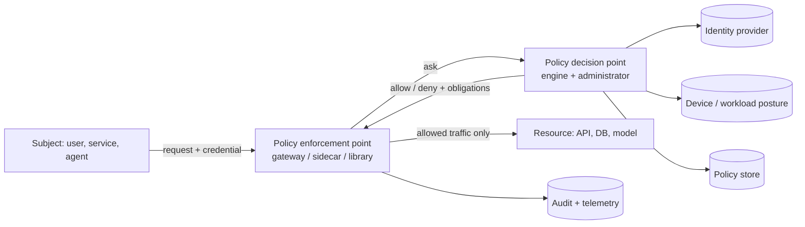
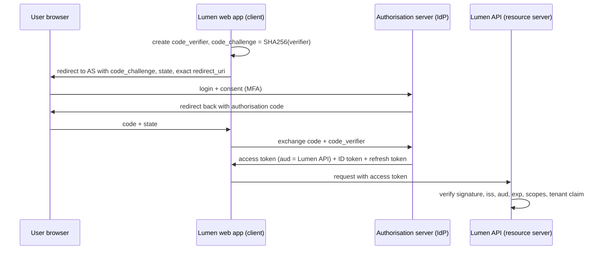
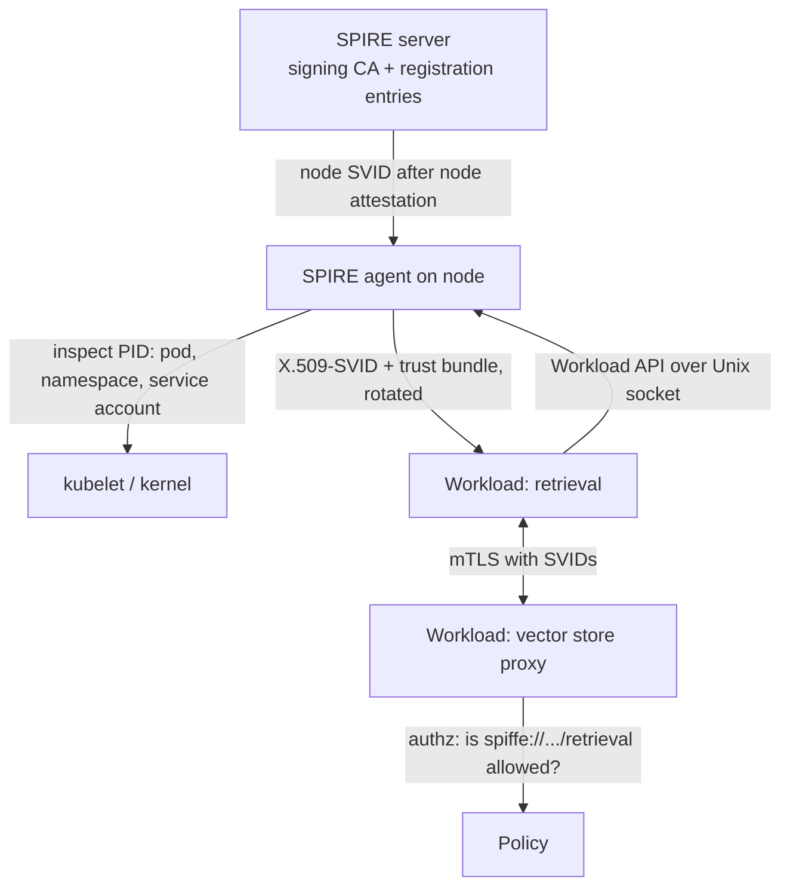
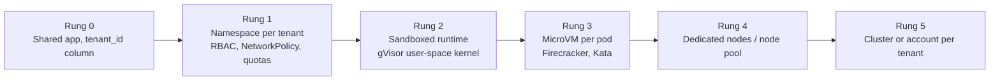
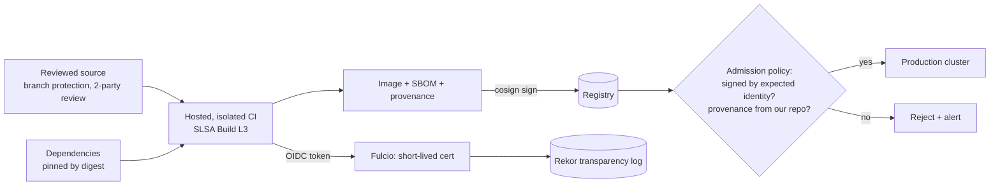

# 18 — Security by design

> **The requirement.** Lumen, our fictional AI knowledge-and-chat product, hosts 2,000 enterprise tenants on
> shared Kubernetes clusters. Contracts say: one compromised pod, one leaked credential or one poisoned open-source
> dependency must not expose another tenant's data, and every binary in production must be traceable to reviewed
> source. Lumen also sells into the EU, so from 11 September 2026 it must be able to report an actively exploited
> vulnerability within 24 hours [11]. This is hard because the attacker only needs one weak link, and the links
> include code Lumen never wrote, machines it does not own, and people it has never met.

## In one minute

Old security drew a wall around the data centre and trusted everything inside it. That stopped working once
laptops went home, services moved to the cloud, and one company's "inside" ran on another company's hardware.
Security by design assumes the attacker is already inside and asks a different question for every single request:
*who is this, what are they allowed to do, and how sure am I?* Every caller — a person, a service, a CI job, an
AI agent — gets a cryptographic identity that expires quickly. Every call is checked against a policy, not against
an IP address. Tenants are separated by boundaries strong enough for how much they distrust each other. And the
software itself is treated as an input that can be attacked: you record what is in it, prove where it was built,
and sign it, so production can refuse anything it cannot trace. None of this is a product you buy; it is a set
of boxes and arrows you draw on purpose, with a reason for each.

## Why this matters now

Three things changed between roughly 2020 and 2026.

1. **Zero trust became the reference model.** NIST published SP 800-207 *Zero Trust Architecture* in August 2020
   [1]. Its central statement — network location alone does not imply trust — is now the baseline assumption for
   cloud and Kubernetes designs, not an aspiration.
2. **The supply chain became the attack surface.** Log4Shell (CVE-2021-44228, CVSS 10.0, published 2021-12-10) showed
   that most organisations could not answer "where do we run this library?" [14]. In March 2024 the xz-utils backdoor
   (CVE-2024-3094, CVSS 10.0) showed something worse: a maintainer identity built over years could ship a backdoor in
   a release tarball that was not in the project's git history, aimed at `sshd` on major Linux distributions [12][13].
   OWASP's Top 10:2025 now lists *Software Supply Chain Failures* as A03 [24].
3. **Regulation turned practice into obligation.** The EU Cyber Resilience Act (Regulation (EU) 2024/2847) was
   published on 20 November 2024, applies in full from 11 December 2027, and its vulnerability-reporting duty
   (Article 14) applies from 11 September 2026 [11]. If you ship software with digital elements into the EU, your
   architecture now needs an SBOM pipeline and an incident clock.

AI systems add a fourth pressure: agents act on behalf of users across many tools, which makes delegation, token
audience and sandboxing everyday design problems rather than edge cases (see
[SYSDESIGN-25](../03-ai-systems/25-agentic-systems.md) and [SYSDESIGN-28](../03-ai-systems/28-ai-trust-safety-governance.md)).

## Core ideas [Core]

### Threat modelling first: name what you defend against

Security without a threat model is a pile of controls with no reason to exist. Before choosing any box, draw a
**data-flow diagram** (processes, data stores, external entities, flows) and draw **trust boundaries** wherever
the level of trust changes: browser to edge, edge to service, service to database, your code to a third-party API,
tenant A to tenant B.

**STRIDE** gives you six questions to ask of every element that crosses a boundary. It was introduced by Loren
Kohnfelder and Praerit Garg at Microsoft in 1999 [16][17]:

| Letter | Threat | Property violated | Typical Lumen example | Typical control |
|---|---|---|---|---|
| S | Spoofing | Authenticity | A pod claims to be the billing service | Workload identity + mTLS |
| T | Tampering | Integrity | Container image altered in the registry | Signatures + admission verification |
| R | Repudiation | Non-repudiation | Admin denies deleting a tenant's index | Append-only, signed audit log |
| I | Information disclosure | Confidentiality | Retrieval returns another tenant's chunks | Tenant-scoped authz on every query |
| D | Denial of service | Availability | One tenant's agent loops and starves GPUs | Quotas, rate limits, bulkheads |
| E | Elevation of privilege | Authorisation | Kernel exploit escapes a container | Sandboxed runtime, least privilege |

The output of a threat model is not a document; it is a list of **requirements with owners**: "every service-to-service
call is authenticated with an X.509-SVID", "the vector store rejects any query without a tenant claim". You revisit it
whenever a new trust boundary appears — for example when Lumen adds an AI agent that calls customer tools.

### Zero trust in one picture

NIST SP 800-207 defines seven tenets [1]. Paraphrased for system designers:

1. Every data source and service is a *resource* to protect.
2. All communication is secured regardless of network location.
3. Access is granted per session, with least privilege; access to one resource does not grant another.
4. Access is decided by dynamic policy using identity, the requesting asset's state, and other attributes.
5. The enterprise monitors the integrity and posture of all assets; no asset is inherently trusted.
6. Authentication and authorisation are dynamic and strictly enforced before access.
7. The enterprise collects as much information as possible about assets, network and communications and uses it to
   improve its posture.

Architecturally, the standard splits the decision from the enforcement. A **policy engine (PE)** decides, a **policy
administrator (PA)** sets up or tears down the session, together forming the **policy decision point (PDP)**; a
**policy enforcement point (PEP)** sits in the data path and allows or blocks [1].

*Diagram: a subject's request reaches an enforcement point, which asks a decision point that consults identity,
posture and policy stores; only allowed traffic reaches the resource, and every decision is logged.*

In a Lumen-style system, PEPs are everywhere: the API gateway (users), the service-mesh sidecar or a library
(service-to-service), the database proxy, the Kubernetes admission controller (which images may run), and the
agent tool router (which tools an AI agent may call). The PDP can be a library call (fast, local, eventually
consistent policy) or a remote service (central, fresher, one more dependency). That choice is one of this
chapter's main trade-offs.

### Authentication is not authorisation

- **Authentication (authn)** answers *who is calling?* — and produces an identity you can verify cryptographically.
- **Authorisation (authz)** answers *may this identity do this action on this resource, now?*

OWASP's top category, *Broken Access Control* (A01:2025) [24], is an authorisation failure, not an authentication
one: the caller can be exactly who they claim and still be allowed to read something they should not. The classic multi-tenant
failure is exactly this: a valid token from tenant A, and an endpoint that takes `tenant_id` from the URL instead of
from the verified token.

Authorisation models, from simple to expressive:

| Model | Decision based on | Wins when | Costs |
|---|---|---|---|
| ACL | list of principals per object | few objects, simple sharing | hard to audit at scale |
| RBAC | roles assigned to principals | stable job functions (Kubernetes RBAC) | role explosion with many tenants |
| ABAC | attributes of subject, resource, environment | context rules ("only from managed device") | policy debugging is hard |
| ReBAC | relationship graph (user → group → folder → doc) | sharing-heavy products (docs, drives) | needs a consistent graph store |

Google's Zanzibar paper (USENIX ATC 2019) is the reference for ReBAC at scale: it reports trillions of ACLs, millions of
authorisation checks per second, 95th-percentile latency below 10 ms and availability above 99.999% over three years
[19]. Policy-as-code engines (for example Open Policy Agent) implement ABAC-style PDPs as libraries or sidecars.

### User identity: OAuth 2.0 and OpenID Connect

**OAuth 2.0** (RFC 6749, 2012) is a *delegation* protocol: it lets a client obtain an **access token** to call a
**resource server** on behalf of a **resource owner**, issued by an **authorisation server** [3]. **OpenID Connect
(OIDC)** is "a simple identity layer on top of the OAuth 2.0 protocol" that adds an **ID token** — a JWT carrying
required claims `iss`, `sub`, `aud`, `exp` and `iat` — so the client learns *who* logged in [5].

Keep the two tokens apart:

- The **ID token** is for the client. It says "this user authenticated at this issuer". Do not send it to APIs.
- The **access token** is for the resource server. It says "this client may do these scopes at this audience".

In January 2025 the IETF published **RFC 9700, Best Current Practice for OAuth 2.0 Security (BCP 240)** [4]. For a
2026 design its rules are the floor:

- Use the **authorisation code grant with PKCE** (RFC 7636 [6]); public clients MUST use PKCE, and `S256` is the
  method to use.
- Avoid the implicit grant; the resource owner password credentials grant **MUST NOT** be used.
- Authorisation servers MUST match redirect URIs **exactly**.
- Refresh tokens for public clients must be **sender-constrained or rotated**.
- Prefer **sender-constrained access tokens** via mutual TLS (RFC 8705 [7]) or DPoP (RFC 9449 [8]), and
  **restrict token audience**.

OAuth 2.1, which folds these practices into one document, is still an Internet-Draft (draft-ietf-oauth-v2-1-17,
31 October 2026) and not yet an RFC (as of 2026-11) [9].

*Diagram: authorisation code flow with PKCE — the client proves at the token endpoint that it started the flow, and
the API validates issuer, audience, expiry, scopes and tenant before serving.*

For a hands-on treatment of OAuth/OIDC flows, Keycloak realms, token validation and common attacks, see the
companion open course **[MSKazemi/security](https://github.com/MSKazemi/security)**. This chapter stays at the
architecture level.

### Workload identity: SPIFFE, SPIRE and mTLS

Users log in; services cannot type passwords. The legacy answer — a long-lived API key in an environment variable —
fails every zero-trust tenet: it is not bound to the workload, it rarely expires, and it leaks into logs, images and
git history.

**SPIFFE** (Secure Production Identity Framework For Everyone) standardises workload identity [10]:

- A **SPIFFE ID** is a URI: `spiffe://<trust-domain>/<path>`, e.g. `spiffe://lumen.example.org/ns/retrieval/sa/indexer`.
- An **SVID** (SPIFFE Verifiable Identity Document) proves it, either as an **X.509-SVID** (a short-lived certificate,
  recommended because tokens can be replayed) or a **JWT-SVID** (useful when an L7 proxy sits between workloads).
- The **Workload API** hands a process its SVID and the **trust bundle** without the process needing any secret to
  ask for it; keys are short-lived and rotate automatically.

**SPIRE** is the reference implementation. SPIFFE and SPIRE graduated in the CNCF in 2022 [20]. A SPIRE server is
the signing authority; a SPIRE agent on every node performs **node attestation** (proving the node is a genuine
member, e.g. using a cloud instance identity document or a Kubernetes projected token) and **workload attestation**
(asking the kernel and kubelet which pod, namespace and service account a calling process belongs to).

*Diagram: the SPIRE server issues node identities after attestation; the node agent attests each workload by
inspecting the kernel and kubelet, hands it a rotating X.509-SVID, and workloads authenticate each other with mutual
TLS before a policy check.*

**Mutual TLS (mTLS)** is TLS 1.3 (RFC 8446 [21]) where *both* sides present certificates. With SVIDs it gives you
authentication (S in STRIDE), integrity (T) and confidentiality (I) for every hop, independent of network topology.
Service meshes such as Istio and Linkerd automate mTLS between sidecars or node proxies (see
[SYSDESIGN-10](../01-foundations/10-apis-communication.md)). Two cautions: mTLS authenticates the *workload*, not the
*user* — you still need to propagate the end-user context — and mTLS without an authorisation policy is just
encrypted any-to-any.

The same pattern now reaches CI: GitHub Actions issues each job a signed OIDC JWT with claims about repository,
branch and workflow; a cloud provider can exchange it for a short-lived credential "only valid for a single job",
so no long-lived cloud secret is stored in CI [22].

### Secrets management and least privilege

Some secrets remain: database passwords, third-party API keys, signing keys, model-provider keys. Design rules:

1. **Prefer no secret.** Federated workload identity (SPIFFE, cloud workload identity, CI OIDC) removes most of them.
2. **Prefer dynamic over static.** HashiCorp Vault's database secrets engine creates a per-client database user with
   a lease — by default a TTL of 1 hour and a max TTL of 24 hours — and revokes it when the lease ends [23]. Each
   service gets its own user, so the audit log shows who did what.
3. **Never in images, git or environment dumps.** Mount at runtime; scan repositories and images for leaks.
4. **Know your platform's defaults.** Kubernetes Secrets are, by default, stored unencrypted in etcd, and anyone who
   can create a pod in a namespace can read every Secret in it — including indirectly via a Deployment [18]. Enable
   encryption at rest, restrict RBAC, and consider an external secret store.
5. **Envelope encryption.** Encrypt data with data keys; encrypt data keys with a key-encryption key held in a KMS or
   HSM. Rotation re-wraps small keys, not terabytes of data. Per-tenant keys enable crypto-shredding
   (see [SYSDESIGN-19](19-privacy-compliance-sovereignty.md)).

**Least privilege** is the multiplier on every other control. Scope each identity to the smallest set of actions
and resources (tenant, namespace, bucket prefix), for the shortest time. Measure it: unused permissions in the last
90 days are attack surface you can delete.

### Multi-tenant isolation: a ladder, not a switch

Kubernetes' own guidance calls hard versus soft multi-tenancy "a broad spectrum" [15]. "Hard" multi-tenancy is when
tenants do not trust each other; because "data planes typically have much larger attack surfaces", it needs extra
data-plane isolation [15]. Think of a ladder where each rung shrinks blast radius and raises cost:

*Diagram: six isolation rungs from a shared application with a tenant column, through namespaces, sandboxed runtimes,
microVMs and dedicated nodes, to a separate cluster or cloud account per tenant.*

- **Rung 0–1** isolate in the control plane and the application. A shared Linux kernel remains the boundary between
  tenants' containers; a kernel exploit crosses it.
- **Rung 2: gVisor** is "an application kernel" written in Go that services the application's system calls in user
  space (the *Sentry*) rather than passing them to the host kernel, exposed as the OCI runtime `runsc`. Its documented
  costs are "higher per-system call overhead" and incomplete syscall/`/proc` coverage [25].
- **Rung 3: microVMs.** Firecracker is a minimal virtual machine monitor built for serverless and deployed in AWS
  Lambda and AWS Fargate (Agache et al., NSDI 2020) [26]. Kata Containers builds "lightweight virtual machines that
  seamlessly plug into the containers ecosystem", using hardware virtualisation as a second layer of defence [27].
- **Rung 4–5** remove sharing of nodes, then of control planes and cloud accounts. Kubernetes notes the benefit "must
  be evaluated against the cost and complexity of managing multiple clusters" [15].

Lumen's sensible mix: rung 1 for all tenants, rung 2–3 for anything that runs *untrusted code* (customer plugins,
AI-agent code execution — see [SYSDESIGN-25](../03-ai-systems/25-agentic-systems.md) and
[C11](../04-case-studies/C11-coding-agent-platform.md)), rung 5 sold as a premium tier for regulated tenants.

### The software supply chain

Your production system includes everything that went into the binary: your code, thousands of dependencies, the
compiler, the CI runner, the base image, and the people with commit rights to each. Four controls, each answering
one question:

| Control | Question it answers | Standard / tool |
|---|---|---|
| **SBOM** | What is inside this artefact? | SPDX (ISO/IEC 5962:2021; current spec 3.0) [28]; CycloneDX (ECMA-424, 2nd ed. Dec 2025 = CycloneDX 1.7) [29] |
| **Provenance** | Where, how and from what source was it built? | SLSA Build track, in-toto attestations [30] |
| **Signature** | Has it changed since the builder produced it, and who is the builder? | Sigstore: cosign, Fulcio, Rekor [31] |
| **Reproducible build** | Would an independent rebuild produce the same bytes? | reproducible-builds.org [32] |

**SLSA** (Supply-chain Levels for Software Artifacts) is at specification **v1.2**, status *Approved*, with a
*Build* track and a *Source* track (as of 2026-11) [30]. The Build track levels [33]:

| Level | Requirement in short | Main threat addressed |
|---|---|---|
| Build L0 | none | — |
| Build L1 | consistent build process; provenance generated and distributed | mistakes; provenance for inventory |
| Build L2 | hosted build platform signs the provenance; consumers verify it | tampering *after* the build |
| Build L3 | hardened platform; runs isolated from each other; signing secrets unreachable from user build steps | tampering *during* the build |

**Sigstore keyless signing** removes long-lived signing keys [31]: cosign generates an ephemeral key pair and sends an
OIDC identity token to **Fulcio**, which issues a short-lived certificate binding that identity to the key; cosign
signs, discards the private key, and records digest, signature and certificate in **Rekor**, an append-only
transparency log. A verifier checks the signature, that the certificate's identity matches the *expected* identity,
and that the entry is in Rekor. The Kubernetes project signs its release binaries, SBOMs and images this way, and
documents `cosign verify --certificate-identity ... --certificate-oidc-issuer ...` for users [34].

*Diagram: reviewed source and digest-pinned dependencies enter an isolated CI that emits an image, SBOM and
provenance, signs them with a short-lived certificate logged in a transparency log, and an admission policy only
admits artefacts signed by the expected identity from the expected repository.*

## Numbers that matter

All figures below are **labelled assumptions** for Lumen unless a source is cited. The point is the method.

**1. Short-lived workload certificates are cheap.** Assume 6,000 workloads, X.509-SVID lifetime 1 hour, and rotation
at half the lifetime (assumption; SPIFFE SVIDs are short-lived and rotate automatically [10]).

- Signings per second = 6,000 / 1,800 s ≈ **3.3 signatures/s**.
- Cut the lifetime to 10 minutes: 6,000 / 300 s = **20 signatures/s**.

A single CA process signing tens of certificates per second is a small load. The cost of short-lived credentials is
operational (the CA becomes a tier-0 dependency that needs HA and monitoring), not computational.

**2. Credential lifetime bounds the exposure window.** A static API key rotated every 90 days that leaks at a random
moment stays valid on average **45 days**. A 1-hour token stays valid **at most 1 hour** — about 1,000× shorter
(45 × 24 = 1,080). Detection that takes a day matters a lot for the first and very little for the second.

**3. Where you validate tokens changes load and revocation.** Assume 20,000 user requests/s at the gateway, each fanning
out to 5 internal calls: 100,000 internal calls/s.

- If every hop calls the authorisation server's introspection endpoint (RFC 7662 [35]), the AS must serve 100,000
  checks/s and each hop adds a network round trip — the AS becomes a scaling and availability bottleneck.
- If every hop verifies a signed JWT locally with cached signing keys, the AS sees **near-zero** per-request load, but
  a revoked token stays usable until it expires. With a 5-minute access-token lifetime, revocation lag ≤ 5 minutes.
- Common design: validate the user token once at the edge, then carry the user context inside the mTLS-protected
  mesh (or exchange it for a narrow internal token, RFC 8693 [36]); internal hops verify locally.

**4. Blast radius of a shared kernel.** Assume 40 pods per node and tenants placed at random among 2,000 tenants. A
node then hosts pods from ≈ 40 distinct tenants (2,000 × (1 − (1 − 1/2,000)^40) ≈ 39.6). A container escape on one
node (rung 1) exposes up to ~40 tenants; with a sandboxed runtime (rung 2–3) the attacker must also break the
sandbox; with dedicated node pools for premium tenants (rung 4), one escape exposes one tenant.

**5. The regulatory clock.** For an actively exploited vulnerability in a product placed on the EU market, the CRA
requires an early warning within **24 hours** of becoming aware, a vulnerability notification within **72 hours**,
and a final report no later than **14 days** after a corrective or mitigating measure is available (Article 14(2))
[11]. Working backwards: you need to know within hours which products contain the vulnerable component (SBOM
inventory), whether it is exploited (telemetry), and who decides (on-call security owner). A quarterly spreadsheet
of dependencies cannot meet a 24-hour clock.

## Design choices and trade-offs

**Where the PDP lives**

| Option | Wins when | Costs | Example systems |
|---|---|---|---|
| Central authz service (remote call) | policies change often; need one audit trail | extra hop per check; tier-0 dependency | Zanzibar-style services [19] |
| Embedded library / sidecar with pushed policy | latency-critical paths; tolerate seconds of staleness | policy distribution, version skew | OPA as sidecar or library |
| Gateway-only checks | small systems; coarse rules | internal calls trust anything inside | API gateway with JWT validation |

**Service-to-service identity**

| Option | Wins when | Costs | Example |
|---|---|---|---|
| Static API keys | prototypes only | leak, never rotated, not bound to workload | — |
| Platform service-account tokens | single cluster or single cloud | ties identity to one platform | Kubernetes projected tokens |
| SPIFFE X.509-SVIDs + mTLS | multi-cluster, multi-cloud, hybrid | run SPIRE (HA CA), handle rotation | SPIRE, service meshes |
| JWT-SVIDs / internal JWTs | L7 proxies terminate TLS | replay risk; needs audience binding | gateways between meshes |

**Tenant isolation** — choose the rung from the threat model, not by default:

| Rung | Wins when | Costs | Example |
|---|---|---|---|
| Namespace + RBAC + NetworkPolicy | tenants are your own teams, or code is trusted | shared kernel and control plane | Kubernetes soft multi-tenancy [15] |
| User-space kernel (gVisor) | untrusted code, syscall-light workloads | per-syscall overhead, compatibility gaps [25] | `runsc` RuntimeClass |
| MicroVM (Firecracker, Kata) | untrusted code that needs full Linux | VM boot and memory overhead, nested virt on cloud | AWS Lambda/Fargate [26], Kata [27] |
| Dedicated cluster / account | regulated tenants, contractual isolation | N× control planes, fleet management | premium enterprise tier |

**Supply-chain depth**

| Investment | Catches | Does not catch |
|---|---|---|
| SBOM + vulnerability matching | known-vulnerable components, fast inventory | malicious code with no CVE yet |
| SLSA Build L2–L3 provenance | builds from unexpected source or platform, post-build tampering | malicious source that passed review |
| Signatures + admission control | unsigned or wrongly signed artefacts in prod | a correctly signed malicious artefact |
| Reproducible builds | differences between declared source and shipped bytes | backdoors that are in the reviewed source |

## Deep dive [Deep]

### The xz-utils backdoor, read as an architecture lesson

On 29 March 2024 Andres Freund reported on the oss-security list that "the upstream xz repository and the xz tarballs
have been backdoored" in versions 5.6.0 and 5.6.1 [12]. He noticed it because SSH logins on Debian sid were using
unusual CPU and producing valgrind errors; his measured login time rose from about 0.299 s to 0.807 s [12]. NVD's
description: malicious code in the *upstream tarballs*; "through a series of complex obfuscations, the liblzma build
process extracts a prebuilt object file from a disguised test file existing in the source code" and uses it to modify
liblzma functions [13]. `openssh` does not link liblzma directly; several distributions patch it for systemd
notification, and libsystemd depends on liblzma, which is how the backdoor reached `sshd` pre-authentication [12].

Walk the defences against it:

- **SBOM**: would have told every operator *within minutes* which hosts ran xz 5.6.0/5.6.1 once the CVE existed — the
  response half. It would not have detected the backdoor beforehand.
- **Signatures**: the tarballs were produced and published by a legitimate maintainer identity. A signature proves
  *who* released; it cannot prove the releaser was honest.
- **Provenance from source**: part of the injection logic was in the release tarball but not in the git repository
  [12]. A policy of building only from the version-controlled source, with SLSA provenance stating the exact commit,
  removes the "tarball differs from git" channel.
- **Reproducible builds / diffing**: an independent rebuild from git compared against the tarball contents would have
  shown the difference.
- **Least privilege and dependency minimisation**: `sshd` gained a dependency on a compression library through an
  unrelated integration. Every transitive dependency in a privileged process is attack surface.
- **Telemetry**: the backdoor was found through a performance anomaly. Observability is a security control
  (see [SYSDESIGN-12](../01-foundations/12-observability.md)).

The uncomfortable lesson: the root cause was a social attack on an under-resourced maintainer. Technical controls raise
the cost; they do not replace funding and reviewing what you depend on.

### Token audience, confused deputies and delegation

A **confused deputy** is a service with legitimate power that is tricked into using it for someone else. In token
systems it appears as **token passthrough**: service A receives a user token and forwards it unchanged to service B.
Now B cannot tell whether A validated it, and anyone who steals a token issued for A can use it at B if B does not
check `aud`. Rules:

1. Every resource server verifies `aud` equals itself (RFC 9700 recommends audience restriction [4]).
2. A service that calls downstream on behalf of a user obtains a **new** token for the downstream audience — via
   OAuth 2.0 Token Exchange (RFC 8693 [36]) — carrying both the user (`sub`) and the acting service (`act` claim).
3. Downstream services authorise on *both* identities: "indexer acting for user U of tenant T may read T's documents".

The MCP authorisation specification (revision 2025-06-18) bakes these rules in for AI tool servers: an MCP server is an
OAuth resource server, clients MUST send RFC 8707 resource indicators, servers MUST validate that tokens were issued
for them, and "the MCP server MUST NOT pass through the token it received from the MCP client" [37].

### mTLS edge cases

- **Rotation without outages.** Peers must trust both the old and new CA during a trust-bundle rollover. Distribute
  the new root first, wait for propagation, then start issuing from it.
- **Clock skew.** Short-lived certificates make clock errors visible: a node 10 minutes behind rejects certificates
  that are not yet valid. Monitor NTP like any other dependency (see [SYSDESIGN-09](../01-foundations/09-coordination-consensus.md)).
- **Termination points.** Every L7 proxy that terminates TLS is a place where plaintext exists and identity must be
  re-asserted. Draw them on the data-flow diagram.
- **Identity granularity.** `spiffe://lumen.example.org/ns/retrieval/sa/indexer` names a service, not a tenant.
  Per-tenant authorisation must come from the request's verified tenant claim, not from the workload certificate.

### Authorisation at query time in AI systems

In a RAG system the "resource" is a chunk of text in a vector index. Two designs:

- **Post-filter**: retrieve top-k, then drop chunks the user cannot see. Simple, but can return zero results and
  leaks through timing and counts.
- **Pre-filter / partition**: put the tenant (and ACL groups) into the index partition or the filter predicate so the
  ANN search never sees forbidden vectors. Stronger; needs ACLs indexed and kept fresh.

Either way, the tenant ID must come from the verified token, enforced at the store's PEP, never from the prompt. See
[SYSDESIGN-24](../03-ai-systems/24-retrieval-vector-systems.md) and [C10](../04-case-studies/C10-enterprise-rag-assistant.md).

### Kubernetes defaults worth knowing

- By default a pod is non-isolated for both ingress and egress until a NetworkPolicy selects it, and NetworkPolicy
  objects have no effect unless the network plugin enforces them [2]; start each tenant namespace with default-deny
  ingress and egress, and test that the plugin enforces it.
- Pod Security Standards define *privileged*, *baseline* and *restricted* profiles; apply *restricted* to tenant
  namespaces with the built-in Pod Security Admission [38].
- Secrets are unencrypted in etcd by default, and pod-creation rights imply secret-read rights in that namespace [18].

## Frontier [Frontier]

*(as of 2026-11)*

- **SLSA v1.2** is approved with a **Source track** alongside the Build track, so "two-party reviewed, protected
  history" becomes a verifiable attestation instead of a policy document [30].
- **CRA phase-in.** Chapter IV (notification of conformity assessment bodies) applied from 11 June 2026; Article 14
  reporting from 11 September 2026; all remaining obligations from 11 December 2027 [11]. ENISA reported the CRA
  Single Reporting Platform's initial operating capability as deployed on 11 September 2026; reporting obligations
  for open-source software stewards start on 11 December 2027 [39]. The EU's Digital Omnibus proposal would
  consolidate incident-reporting channels, but at the time of writing it is still in the legislative process and has
  not changed the CRA's dates — check the current status before relying on it.
- **SBOM formats converge on richer models.** SPDX 3.0 is profile-based (security, build, AI, dataset profiles among
  others) and CycloneDX 1.7 is standardised as ECMA-424 2nd edition (December 2025) [28][29], so model and dataset
  bills of materials are now expressible in the same pipeline as code SBOMs.
- **Identity for AI agents.** Agents need delegated, audience-bound, short-lived tokens per tool, plus a record of
  *which human* authorised *which agent* to act. Token exchange (RFC 8693) and the MCP authorisation profile are the
  current building blocks [36][37]; expect this area to keep moving.
- **Post-quantum key exchange.** NIST published FIPS 203 (ML-KEM) on 13 August 2024 [40]. For system design this means
  planning crypto-agility: inventory where TLS and signatures are terminated, and make algorithm changes a
  configuration rollout rather than a re-architecture. (Concrete library and protocol support varies by version; check
  your TLS stack.)

## Failure modes and operations

| Failure | How it shows up | Detect (SLI / signal) | Mitigate |
|---|---|---|---|
| Expired CA or trust bundle | sudden fleet-wide mTLS handshake failures | handshake error rate; cert expiry gauges | alert at 30% remaining lifetime; staged rollover |
| Authorisation server outage | logins fail; introspecting services fail | AS availability SLO; token-issue latency | local JWT validation; longer-lived refresh path; HA AS |
| Over-broad policy | tenant A reads tenant B | cross-tenant access tests in CI; audit query on tenant mismatch | default deny; tenant claim mandatory at PEP |
| Policy push lag | revoked user still allowed | policy version skew across PEPs | version metrics; bounded staleness SLO |
| Leaked secret | unusual API usage from new ASN or region | secret-scanning hits; anomaly on key usage | short TTLs; one-click revocation; per-service credentials |
| Unsigned or unknown image in prod | admission rejects, or worse, a bypass namespace admits | admission deny count; inventory diff vs registry | no exemptions without expiry; alert on policy bypass |
| Vulnerable dependency (new CVE) | CRA clock starts | SBOM-to-CVE match time; % fleet affected | SBOM inventory query; rebuild + roll pipeline |
| Sandbox escape attempt | unusual syscalls, crashes in sandbox | runtime security events | patch runtime; move tenant up the ladder |

Operational practices that make the design real:

- **Security SLOs.** Examples: "99.9% of production pods carry a valid SVID", "p95 time from CVE publication to fleet
  inventory < 1 hour", "zero images admitted without verified signature". Treat breaches like reliability incidents
  (see [SYSDESIGN-11](../01-foundations/11-reliability-engineering.md)).
- **Audit logs with integrity.** Append-only, written to a separate account, hashed or signed in chains, retained per
  policy. Repudiation (the R in STRIDE) is only answered if the log survives the attacker.
- **Break-glass access.** Emergency admin paths exist; make them loud (paged alert on use), time-boxed and reviewed.
- **Game days.** Revoke a CA, rotate all database credentials, and simulate a CRA 24-hour report in a drill.

## Cost and energy

- **Per-request crypto.** TLS 1.3 needs one round trip for a full handshake [21]; connection reuse (HTTP/2, gRPC)
  amortises handshakes across many requests, so steady-state cost is symmetric encryption, which modern CPUs
  accelerate. Measure your own handshake rate rather than assuming a percentage overhead.
- **Sidecars.** A per-pod proxy costs CPU and memory on every pod; at thousands of pods that is a line item. Node-level
  or "ambient" proxy models trade some isolation for fewer proxies. Measure before and after with the cost model of
  [SYSDESIGN-16](16-cost-as-requirement.md).
- **Isolation rungs.** Sandboxed runtimes and microVMs add per-pod overhead and lower packing density; dedicated
  clusters multiply control-plane cost. Price the premium tier accordingly.
- **Supply chain.** Signing and SBOM generation add seconds to builds; storage of attestations is small. The expensive
  part is people: triaging SBOM matches and reviewing dependencies.
- **Energy.** Fewer redundant proxies and better packing reduce energy per request; see
  [SYSDESIGN-17](17-energy-carbon-aware.md).

## Interview angle

**How it is asked.** Rarely "design zero trust". Usually embedded: "design a multi-tenant SaaS", "design a
code-execution platform", "how do services authenticate to each other?", "how do you stop one customer from seeing
another's data?" At staff level: "your build system is compromised — what limits the damage?"

**Model answer outline (CLARIFY → QUANTIFY → SKETCH → DEEPEN → STRESS → WRAP):**

1. **CLARIFY** the trust boundaries: who are tenants, do they run code, what regulations apply (CRA, sector rules)?
2. **QUANTIFY** blast radius and clocks: tenants per node, credential lifetimes, revocation lag, reporting deadlines.
3. **SKETCH** PEPs at gateway, mesh and data store; PDP choice; OIDC for users, SPIFFE/mTLS for workloads.
4. **DEEPEN** on one: tenant isolation ladder for untrusted code, or the signed-provenance supply chain.
5. **STRESS + WRAP**: what happens when the IdP is down, a CA expires, a dependency is backdoored; name the security
   SLOs you would monitor.

**Red flags.** "It's inside the VPC, so it's trusted." Tenant ID taken from the request body. One shared API key
for all services. "We'll add security later." Treating signing as proof of safety.

**Follow-ups to prepare.** Introspection vs local JWT validation; ID token vs access token; how to rotate a root CA
without downtime; why gVisor or Firecracker for agent code execution; what SLSA L3 adds over L2; how an SBOM helps
in the first 24 hours of a new CVE.

## Common mistakes

- Using the OIDC **ID token** as an API access token, or not checking `aud`.
- Implementing authorisation in the UI only; the API trusts any authenticated caller.
- Long-lived static secrets "temporarily", with no owner and no rotation.
- Enabling mTLS mesh-wide and calling it zero trust, with no authorisation policy.
- Namespaces as the only boundary for **untrusted** code.
- Generating SBOMs nobody queries; signing images nobody verifies at admission.
- Allowing permanent admission-policy exemptions ("just for this namespace").
- Treating a signature as proof that the code is benign.
- Logging tokens, or audit logs writable by the same identity being audited.

## Check yourself

1. Why does NIST SP 800-207 separate the policy decision point from the policy enforcement point, and where would you
   place PEPs in Lumen?
2. A service validates JWTs locally with a 15-minute lifetime. An admin revokes a user. What is the worst-case window,
   and how would you shrink it?
3. Which isolation rung would you choose for a tenant-supplied Python plugin, and why not a namespace?
4. For the xz-utils backdoor, which control would have helped *before* disclosure, and which only *after*?
5. What must Lumen be able to do within 24 hours of learning that a component it ships is actively exploited?

Full set with answers: [exercises/18-security-by-design.md](../../exercises/18-security-by-design.md).

## Lab

No lab for this unit. The threat-modelling and token-audience exercises in
[exercises/18-security-by-design.md](../../exercises/18-security-by-design.md) are designed as paper labs; the agent
sandbox lab of [SYSDESIGN-25](../03-ai-systems/25-agentic-systems.md) exercises the isolation ladder in practice.

## Further reading

- NIST SP 800-207, *Zero Trust Architecture* [1] — the vocabulary (PE/PA/PEP) and tenets in 50 pages.
- RFC 9700, *Best Current Practice for OAuth 2.0 Security* [4] — the current floor for any OAuth design.
- SPIFFE concepts [10] — short, precise definitions of SPIFFE ID, SVID, Workload API and trust bundles.
- SLSA v1.2 specification [30][33] — build and source tracks, with threat lists per level.
- Freund, oss-security post on xz/liblzma [12] — a primary-source incident report worth reading in full.
- Kubernetes multi-tenancy concept page [15] — the official spectrum from soft to hard multi-tenancy.
- Pang et al., *Zanzibar* (USENIX ATC 2019) [19] — authorisation as a globally consistent distributed system.
- Companion course [MSKazemi/security](https://github.com/MSKazemi/security) — OAuth/OIDC/Keycloak in depth.

## References

All URLs accessed 2026-11.

1. S. Rose, O. Borchert, S. Mitchell, S. Connelly. *Zero Trust Architecture*, NIST SP 800-207, August 2020. https://doi.org/10.6028/NIST.SP.800-207 (landing page https://csrc.nist.gov/pubs/sp/800/207/final)
2. Kubernetes documentation. *Network Policies* (pods are non-isolated by default; enforcement requires a supporting network plugin). https://kubernetes.io/docs/concepts/services-networking/network-policies/
3. D. Hardt (ed.). *The OAuth 2.0 Authorization Framework*, RFC 6749, October 2012. https://www.rfc-editor.org/rfc/rfc6749
4. T. Lodderstedt, J. Bradley, A. Labunets, D. Fett. *Best Current Practice for OAuth 2.0 Security*, RFC 9700 (BCP 240), January 2025. https://www.rfc-editor.org/rfc/rfc9700.html
5. N. Sakimura et al. *OpenID Connect Core 1.0 incorporating errata set 2*, 15 December 2023. https://openid.net/specs/openid-connect-core-1_0.html
6. N. Sakimura, J. Bradley, N. Agarwal. *Proof Key for Code Exchange by OAuth Public Clients*, RFC 7636, September 2015. https://www.rfc-editor.org/rfc/rfc7636
7. B. Campbell et al. *OAuth 2.0 Mutual-TLS Client Authentication and Certificate-Bound Access Tokens*, RFC 8705, February 2020. https://www.rfc-editor.org/rfc/rfc8705
8. D. Fett et al. *OAuth 2.0 Demonstrating Proof of Possession (DPoP)*, RFC 9449, September 2023. https://www.rfc-editor.org/rfc/rfc9449
9. IETF OAuth WG. *The OAuth 2.1 Authorization Framework*, draft-ietf-oauth-v2-1-17, 31 October 2026 (Internet-Draft). https://datatracker.ietf.org/doc/draft-ietf-oauth-v2-1/
10. SPIFFE project. *SPIFFE Concepts*. https://spiffe.io/docs/latest/spiffe-about/spiffe-concepts/
11. Regulation (EU) 2024/2847 (Cyber Resilience Act), OJ L, 20.11.2024; Art. 14 and Art. 71. https://eur-lex.europa.eu/eli/reg/2024/2847/oj/eng
12. A. Freund. "backdoor in upstream xz/liblzma leading to ssh server compromise", oss-security, 29 March 2024. https://www.openwall.com/lists/oss-security/2024/03/29/4
13. NIST NVD. *CVE-2024-3094*, published 2024-03-29, CVSS 3.1 base 10.0. https://nvd.nist.gov/vuln/detail/CVE-2024-3094
14. NIST NVD. *CVE-2021-44228* (Log4Shell), published 2021-12-10, CVSS 3.1 base 10.0. https://nvd.nist.gov/vuln/detail/CVE-2021-44228
15. Kubernetes documentation. *Multi-tenancy*. https://kubernetes.io/docs/concepts/security/multi-tenancy/
16. L. Kohnfelder, P. Garg. *The Threats to Our Products*, Microsoft internal paper, 1 April 1999 (copy hosted by A. Shostack). https://threatmodelingbook.com/files/microsoft/The-Threats-To-Our-Products.docx
17. Microsoft. *Threats — Microsoft Threat Modeling Tool* (STRIDE categories). https://learn.microsoft.com/en-us/azure/security/develop/threat-modeling-tool-threats
18. Kubernetes documentation. *Secrets*. https://kubernetes.io/docs/concepts/configuration/secret/
19. R. Pang et al. *Zanzibar: Google's Consistent, Global Authorization System*, USENIX ATC 2019, pp. 33–46. https://www.usenix.org/conference/atc19/presentation/pang
20. CNCF. "SPIFFE and SPIRE projects graduate from Cloud Native Computing Foundation incubator", 20 September 2022. https://www.cncf.io/announcements/2022/09/20/spiffe-and-spire-projects-graduate-from-cloud-native-computing-foundation-incubator
21. E. Rescorla. *The Transport Layer Security (TLS) Protocol Version 1.3*, RFC 8446, August 2018. https://www.rfc-editor.org/rfc/rfc8446
22. GitHub Docs. *About security hardening with OpenID Connect*. https://docs.github.com/en/actions/security-for-github-actions/security-hardening-your-deployments/about-security-hardening-with-openid-connect
23. HashiCorp. *Vault: Database secrets engine*. https://developer.hashicorp.com/vault/docs/secrets/databases
24. OWASP. *OWASP Top 10:2025*. https://top10.owasp.org/2025
25. gVisor documentation. *What is gVisor?* https://gvisor.dev/docs/
26. A. Agache et al. *Firecracker: Lightweight Virtualization for Serverless Applications*, USENIX NSDI 2020, pp. 419–434. https://www.usenix.org/conference/nsdi20/presentation/agache
27. Kata Containers project. https://katacontainers.io/
28. SPDX. *Specifications* (SPDX 3.0; SPDX 2.2.1 published as ISO/IEC 5962:2021). https://spdx.dev/use/specifications/
29. Ecma International. *ECMA-424: CycloneDX Bill of Materials Specification*, 2nd edition, December 2025. https://ecma-international.org/publications-and-standards/standards/ecma-424/
30. OpenSSF SLSA. *SLSA specification v1.2*. https://slsa.dev/spec/
31. Sigstore. *Sigstore overview*. https://docs.sigstore.dev/about/overview/
32. Reproducible Builds project. *Definitions*. https://reproducible-builds.org/docs/definition/
33. OpenSSF SLSA. *Build track basics (v1.2)*. https://slsa.dev/spec/v1.2/build-track-basics
34. Kubernetes documentation. *Verify Signed Kubernetes Artifacts*. https://kubernetes.io/docs/tasks/administer-cluster/verify-signed-artifacts/
35. J. Richer (ed.). *OAuth 2.0 Token Introspection*, RFC 7662, October 2015. https://www.rfc-editor.org/rfc/rfc7662
36. M. Jones et al. *OAuth 2.0 Token Exchange*, RFC 8693, January 2020. https://www.rfc-editor.org/rfc/rfc8693
37. Model Context Protocol. *Specification 2025-06-18 — Authorization*. https://modelcontextprotocol.io/specification/2025-06-18/basic/authorization
38. Kubernetes documentation. *Pod Security Standards*. https://kubernetes.io/docs/concepts/security/pod-security-standards/
39. ENISA. "The CRA Single Reporting Platform is launched". https://www.enisa.europa.eu/index.php/news/the-cra-single-reporting-platform-is-launched
40. NIST. *FIPS 203: Module-Lattice-Based Key-Encapsulation Mechanism Standard*, 13 August 2024. https://csrc.nist.gov/pubs/fips/203/final
