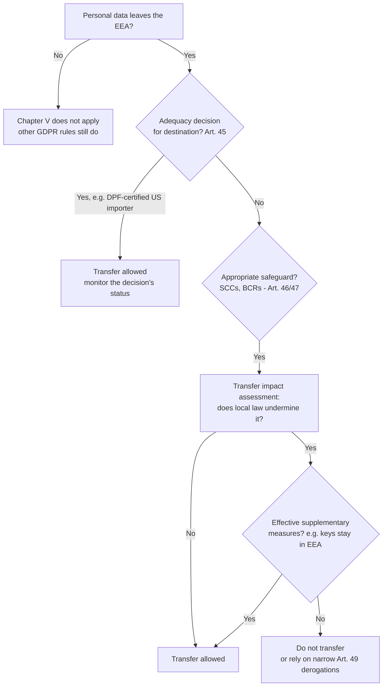
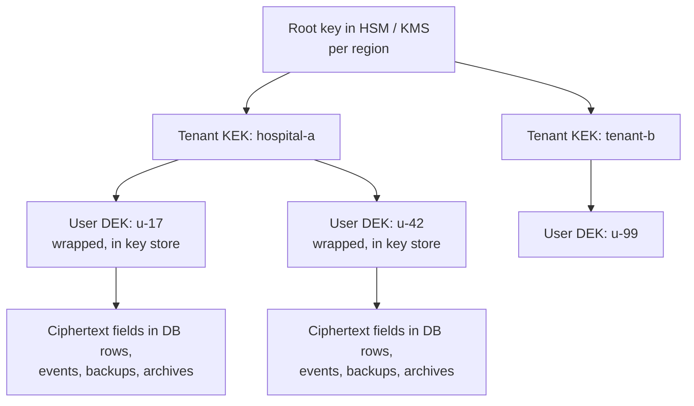
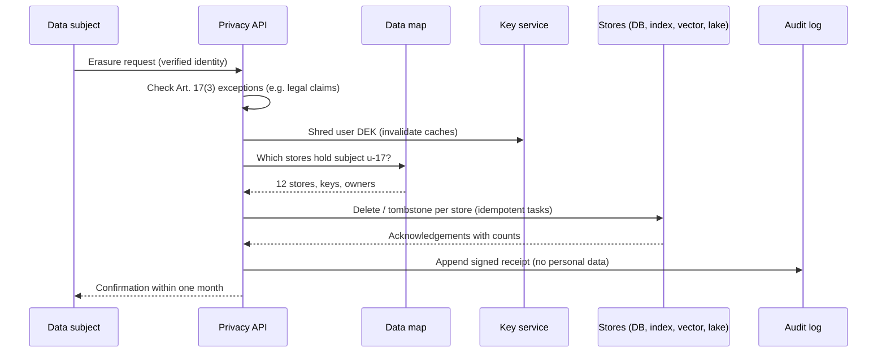
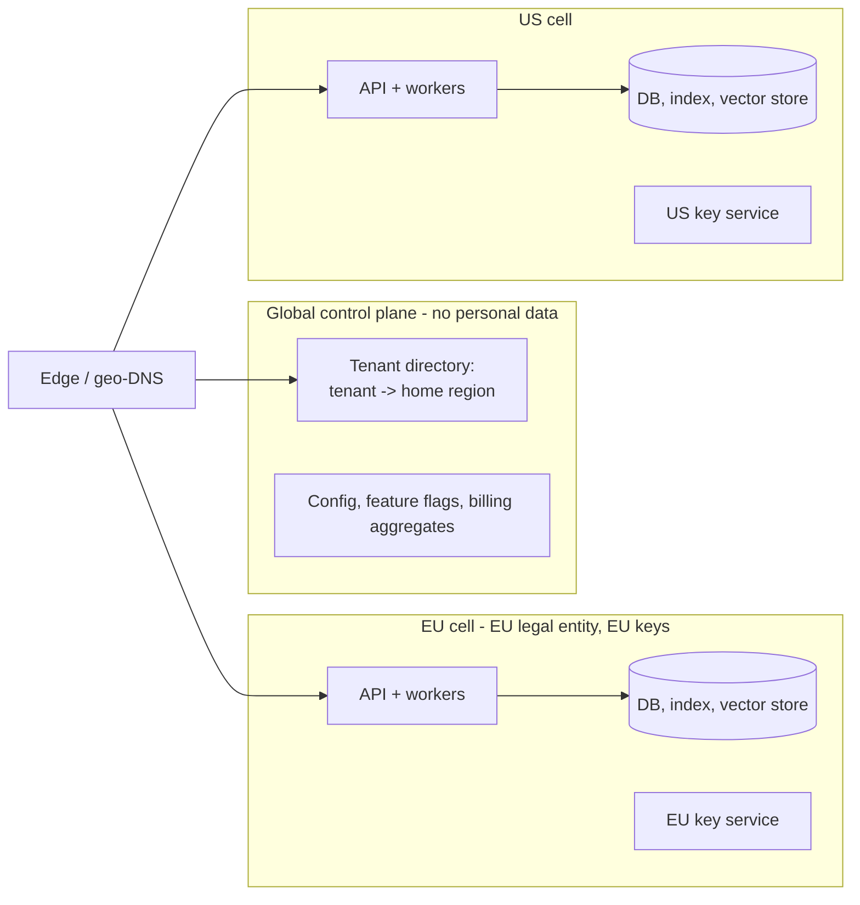

# 19 — Privacy, compliance & data sovereignty

> **The requirement.** Lumen, our fictional AI knowledge-and-chat product, signs its first large EU customer — a
> hospital group. The contract says: personal data of EU users is stored and processed in the EU; nobody outside
> the EU, including Lumen's own US-based staff and its US-headquartered cloud provider, can read it in clear; when a
> patient-facing employee leaves and asks to be forgotten, every copy of their data is gone or unreadable within
> the GDPR's one-month response window; and an auditor can verify all of this from logs that Lumen itself cannot
> silently rewrite. Every one of those sentences touches a different part of the stack, and most of them are about
> copies you did not know you had.

**Not legal advice.** This chapter explains how legal requirements translate into system design. It is written by
an engineer for engineers, it simplifies, and it reflects the state of EU law in November 2026, checked against
the published legal texts (EUR-Lex, court judgments, EDPB documents) where they could be read; statements that
rest on news reporting or commentary are marked as such. Laws, court cases and guidance change; for any real
decision, work with your Data Protection Officer and legal counsel.

## In one minute

Privacy law does not tell you which database to use. It tells you *what must be true* about the data: that you
collected only what you need, use it only for the purpose you declared, keep it only as long as necessary, protect
it, can show where it is, can move it or delete it on request, and do not let it flow to places where it would lose
its protection. Each of those obligations becomes an architectural property — a field you never store, a TTL, a
key per tenant, a region boundary, an index of where each person's data lives, a log that proves what happened.
The hard part is not the primary database; it is the copies: caches, search indexes, embeddings, analytics
extracts, debug logs, Kafka topics, backups, and model weights trained on the data. A system designed for
privacy treats "where do copies go and how do they die?" as a first-class design question, the same way a system
designed for reliability treats "what happens when this node dies?". The best tool for the copies you cannot
reach is cryptography: encrypt each person's or tenant's data under its own key, and destroy the key.

## Why this matters now

Three things changed between 2018 and 2026.

1. **Enforcement became real and architectural.** The GDPR has applied since 25 May 2018 [1]. Fines can reach
   EUR 20 million or 4 % of worldwide annual turnover, whichever is higher (Art. 83(5)) [1]. One of the largest
   GDPR fines, EUR 1.2 billion against Meta Platforms Ireland in May 2023, was not about a leak — it was about an
   architecture decision: transferring EU users' data to the US on standard contractual clauses after *Schrems II*
   had invalidated the Privacy Shield and required exporters to check that US law does not undermine the SCC
   safeguards. The Irish authority found that Meta's SCCs and supplementary measures did not address the risks the
   Court of Justice had identified, and imposed the fine following an EDPB binding decision [3][9]. A data flow on
   a diagram became a billion-euro line item.
2. **"Where" became a design input, not a deployment detail.** The Court of Justice's *Schrems II* judgment
   (C-311/18, 16 July 2020) invalidated the EU–US Privacy Shield and made every exporter responsible for checking
   whether the destination country's law undermines the safeguards [3]. The successor EU–US Data Privacy Framework
   (DPF) was adopted on 10 July 2023 [5], upheld by the General Court on 3 September 2025 in *Latombe* (T-553/23)
   [6] — and that judgment is under appeal at the Court of Justice (C-703/25 P, lodged 31 October 2025) [7]. As of
   2026-11 no appeal judgment had been found for this lesson. An architecture whose legality depends on one
   adequacy decision has a single point of failure that no SRE can page.
3. **AI multiplied the copies.** Embeddings, vector indexes, fine-tuning datasets, evaluation sets, prompt logs
   and model weights are all places personal data can land. The EDPB's Opinion 28/2024 says that whether a model
   trained on personal data is itself anonymous must be assessed case by case. Where an infringement is found,
   supervisory authorities may impose corrective measures up to erasing the unlawfully processed data (or, if that
   is not possible, the whole dataset and/or the model itself), taking remediation such as retraining into account
   when judging proportionality [16]. Meanwhile the EU AI Act (Regulation (EU)
   2024/1689) entered into force on 1 August 2024 and is being phased in through 2028, with dates changed in 2026
   by the "Digital Omnibus on AI" (Regulation (EU) 2026/1744) [11][12].

In 2025 the EDPB ran a coordinated enforcement action on the right to erasure: 32 supervisory authorities, 764
responding controllers. The report (adopted 10 February 2026) rated overall compliance "average" and listed seven
recurring issues. Among them, two engineering problems stand out: deletion in **backups**, and controllers using
weak **"anonymisation"** (basic pseudonymisation or partial masking) as a substitute for deletion [14]. Those are the two problems this chapter
spends most time on.

## Core ideas [Core]

### Personal data, pseudonymised data, anonymous data

- **Personal data** is any information relating to an identified or identifiable natural person (GDPR Art. 4(1))
  [1]. A user ID, an IP address in many contexts, a chat transcript, and an embedding of that chat transcript can
  all be personal data.
- **Pseudonymised data** has had identifiers replaced so it cannot be attributed to a person *without additional
  information kept separately* (Art. 4(5)) [1]. For the controller who holds the mapping it is still personal data.
  In *EDPS v SRB* (C-413/23 P, 4 September 2025) the Court of Justice held, under Regulation (EU) 2018/1725 (the
  data protection regulation for EU institutions, whose definitions mirror the GDPR's), that pseudonymised data is
  not automatically personal data for a *recipient* who has no means reasonably likely to re-identify it, while it
  remains personal data for the controller that can. It set aside the General Court's judgment and referred the
  case back [15]. Engineers should read this narrowly: it changes how you
  assess a data-sharing recipient, not whether your own pseudonymised tables are in scope. They are.
- **Anonymous data** no longer relates to an identifiable person (Recital 26) and falls outside the GDPR [1].
  Anonymisation is a high bar; hashing an email address is not it (the hash is a stable identifier and is
  dictionary-attackable), and the EDPB found exactly such weak techniques being used in place of deletion [14].

### The GDPR principles as architecture requirements

Article 5(1) lists six principles; Article 5(2) adds accountability — the controller must be able to *demonstrate*
compliance [1]. Here is how each becomes a property of the system.

| Principle (Art. 5) | What it means for the system | Typical mechanism |
|---|---|---|
| (a) Lawfulness, fairness, transparency | Every processing activity has a legal basis and is explainable | Purpose/legal-basis tags on datasets; consent records as data |
| (b) Purpose limitation | Data collected for X is not silently reused for Y | Purpose tags enforced at query/ETL time; separate datasets per purpose |
| (c) Data minimisation | Do not collect or keep fields you do not need | Schema reviews; drop fields at ingestion; aggregate early; redact logs |
| (d) Accuracy | Data can be corrected and corrections propagate | Single source of truth + change data capture to derived stores |
| (e) Storage limitation | Data has an end date | TTLs, retention policies per dataset, enforced deletion jobs |
| (f) Integrity and confidentiality | Protected against unauthorised access and loss | Encryption, access control, key management ([SYSDESIGN-18](./18-security-by-design.md)) |
| Accountability (5(2)) | You can prove all of the above | Records of processing (Art. 30), data map, audit logs |

**Article 25 — data protection by design and by default** — turns this into an engineering duty. Art. 25(1)
requires appropriate technical and organisational measures, "such as pseudonymisation", taking into account "the
state of the art"; Art. 25(2) adds that *by default* only the personal data necessary for each specific purpose is
processed [1]. The EDPB's Guidelines 4/2019 stress that the obligation applies to existing systems too and that controllers
answer for their processors and sub-processors [2]. In plain terms: privacy is a non-functional requirement with
the same status as availability, and "we will add deletion later" is a design defect.

### The data subject rights that hit the architecture hardest

- **Access and portability (Art. 15, 20):** you must find and export everything about a person. This needs an
  index of where their data lives.
- **Erasure (Art. 17):** on valid grounds you must erase "without undue delay" (17(1)); if you made the data
  public, you must take reasonable steps, "including technical measures", to inform other controllers (17(2)) [1].
  Erasure is not absolute: Art. 17(3)(a)–(e) lists exceptions such as compliance with a legal obligation or the
  establishment, exercise or defence of legal claims [1]. Where one applies, erasure can be refused to the extent
  the processing is necessary, so "erasure refused under Art. 17(3)" is a real system state.
- **Response time (Art. 12(3)):** respond without undue delay and in any event within one month of receipt,
  extendable by two further months where necessary [1]. This is the SLO your erasure pipeline is designed against.

### Residency, localisation, sovereignty

These three words are often used interchangeably. They are different requirements with different designs.

| Term | Question it answers | Design consequence |
|---|---|---|
| **Data residency** | *Where* are the bytes stored and processed? | Pin storage and compute to a region; control replication and backups |
| **Data localisation** | Is the data *legally required* to stay in a country? | Hard boundary: no copy leaves, including support access and telemetry |
| **Data sovereignty** | *Whose law* can compel access to the data, and who controls the keys and operations? | Jurisdiction of the operator and its parent, key custody, who can administer the system |

Residency is necessary but not sufficient for sovereignty. A US-headquartered provider running a data centre in
Frankfurt can still receive a US legal order: the US CLOUD Act provision codified at 18 U.S.C. § 2713 requires
providers to disclose data in their possession, custody or control "regardless of whether" it is located inside
or outside the United States [27]. That is why sovereignty discussions focus on three levers beyond location:
**who holds the keys**, **who operates the system**, and **which legal entity controls the operator**.

The EU institutions now score this explicitly. The European Commission's Cloud Sovereignty Framework assesses
providers across eight objectives (strategic, legal, operational, environmental, supply-chain transparency,
technological openness, security, and compliance with EU law) on assurance levels SEAL-0 (no sovereignty) to
SEAL-4 (full EU supply chain, chips to software); its first sovereign-cloud tender (up to EUR 180 million over
six years, announced 17 April 2026) required SEAL-2 as a minimum [26]. You do not need to adopt that framework to
learn from it: it is a good checklist of what "sovereign" can mean.

### International transfers in one diagram

*Diagram: decision tree for transferring personal data out of the EEA — adequacy first, then safeguards such as
standard contractual clauses with a transfer impact assessment and supplementary measures, otherwise no transfer.*

The EDPB's Recommendations 01/2020 (final version 2.0, adopted 18 June 2021) set out the exporter's six-step
roadmap: know your transfers, identify the transfer tool, assess the third country's law, adopt supplementary
measures, take procedural steps, re-evaluate at intervals [4]. Their annex of use cases is the most engineering-
relevant part of any transfer guidance: strong encryption where the keys stay under the exporter's control in the
EEA is treated as a potentially effective measure for data that the importer only needs to *store*. Cloud
processing that requires the provider to access data **in the clear** is different: where the destination
country's law lets public authorities access the data beyond what is necessary and proportionate in a democratic
society, the EDPB, "considering the current state of the art", could not envisage an effective technical measure
(Use Cases 6 and 7) [4]. That scenario does not arise for importers covered by a valid adequacy decision. The
architectural reading: if a foreign-controlled service in such a country needs plaintext, the key-custody trick
does not save you; keep that processing inside the jurisdiction.

## Numbers that matter

All numbers below are **assumptions for Lumen** unless a source is given. The point is the method.

**Scale.** 2 million EU end users across 400 tenants. Assume 0.5 % of users file an erasure request per year
→ 10,000 requests/year ≈ 27/day ≈ one every 53 minutes. Low rate — but each fans out to every store.

**Fan-out.** Lumen's personal data lands in (assumed inventory): Postgres (profiles, conversations), Redis
cache, OpenSearch (keyword index), a vector store (chunk embeddings), object storage (uploaded files), Kafka
(events), a lakehouse (analytics), application logs, traces, a fine-tuning dataset, and backups of most of the
above. That is ~12 stores. 27 requests/day × 12 stores ≈ 324 deletion tasks/day, each of which must be confirmed.
The work is small; the *coordination* is the problem.

**Response budget.** Art. 12(3) gives one month [1]. A reasonable internal SLO: erasure *effective* (data
unreadable in every online store) within 72 h, *complete* (physically gone or crypto-shredded everywhere,
including backups) within 30 days, with an auditable receipt. (Internal SLO = assumption.)

**Backups are the long pole.** Daily full backups retained 35 days mean a deleted row survives in up to 35
backup copies for up to 35 days. If backups are retained for a year (common for finance-adjacent customers),
physical deletion from backups is impractical. For comparison, Google Cloud publicly describes its own deletion
pipeline as: marked for deletion within about 24 hours, a recovery period of up to 30 days, logical deletion from
active systems in about two months, and expiry from backups within about six months (180 days), with
cryptographic erasure able to make data unrecoverable before blocks are overwritten [19].

**Crypto-shredding key store size.** One 256-bit data encryption key (DEK) per user, wrapped by a per-tenant key
encryption key (KEK): stored record ≈ 32 B key + ~28 B wrapping overhead (nonce + tag for AES-GCM) + ~40 B
metadata ≈ 100 B (assumption). 2 M users × 100 B = **200 MB** — trivially small, which is the point: the key
store is tiny, so you can afford to give *it* short backup retention and strict custody.

**Audit-log proof size.** In a Merkle-tree log with *n* entries, an inclusion proof needs at most ⌈log₂ n⌉ hashes
(RFC 9162 defines the tree and proof structure [22]; the proof-size arithmetic is ours). For n = 10⁹ entries and
SHA-256 (32 B): 30 × 32 B = **960 B** per proof. A consistency proof between two tree sizes is also O(log n)
(RFC 9162 bounds it at ⌈log₂ n⌉ + 1 hashes). Proving an entry exists in a billion-entry log costs about a kilobyte.

**Logs volume.** Assume 5,000 requests/s at peak, 1 KB of log per request = 5 MB/s ≈ 430 GB/day. Retaining
debug logs with raw user identifiers for 90 days = ~39 TB of data that must be searched on every erasure request.
Pseudonymising user IDs in logs (next section) turns that into a key deletion.

## Design choices and trade-offs

### Erasure strategies

| Option | Wins when | Costs | Example systems |
|---|---|---|---|
| **Physical delete** (DELETE + compaction/vacuum) | Primary OLTP stores, small number of copies | Must reach every replica, index and derived store; compaction delay; backups untouched | Postgres DELETE + VACUUM; Kafka compaction tombstones [20] |
| **TTL / retention expiry** | Data with a natural lifetime (logs, sessions, events) | Erasure happens on the TTL schedule, not on request; must be ≤ the response budget | Kafka `retention.ms` (default 7 days [20]); object lifecycle rules |
| **Crypto-shredding** (destroy the key) | Immutable or hard-to-edit copies: backups, event logs, archives, WORM storage | Key management complexity; key store becomes critical; ciphertext still exists; key copies must also die | NIST SP 800-88r2 cryptographic erase [17]; cloud KMS key deletion [18] |
| **Anonymisation** | You genuinely need aggregates afterwards | Hard to do right; weak masking is not erasure [14] | Aggregated metrics, k-anonymised exports |
| **Tombstone + rebuild** of derived stores | Indexes, vector stores, feature stores fed from a source of truth | Rebuild cost; lag between source delete and derived delete | CDC-driven index maintenance ([SYSDESIGN-20](./20-real-time-streaming.md)) |

### Isolation and key-custody models

| Option | Wins when | Costs | Example |
|---|---|---|---|
| Shared DB, row-level tenant ID, provider-managed keys | Many small tenants, low sensitivity | One bug leaks across tenants; no per-tenant shredding | Typical early-stage SaaS |
| Shared infra, **per-tenant KEK** | Most B2B SaaS; enables tenant offboarding by key destruction | Key-management service quotas and cost; key rotation per tenant | Envelope encryption with a KMS |
| Per-tenant KEK **held by the customer** (BYOK/HYOK, external key store) | Regulated customers who want a kill switch | Customer outage = your outage; latency on unwrap; support complexity | Cloud KMS external key stores [18] |
| **Regional cell** per jurisdiction | Residency/sovereignty requirements | Duplicate ops; cross-cell features need care | EU cell and US cell sharing only a control plane |
| Sovereign operator (EU entity, EU staff, EU supply chain) | Public sector, health, defence | Fewer managed services; higher cost; vendor choice narrows | Providers assessed at SEAL-3/4 [26] |

## Deep dive [Deep]

### 1. The data map is a system, not a spreadsheet

Article 30 requires records of processing activities [1]. Most organisations keep them as documents. For
erasure and access at scale you need a machine-readable version: **which stores hold which categories of personal
data, keyed by which identifier, for which purpose, with which retention, in which region**. Two complementary
techniques make it accurate:

- **Declared metadata:** every dataset, topic and table is registered with owner, purpose, legal basis,
  personal-data categories, subject key (e.g. `user_id`), retention and region. Schema registries and data
  catalogues can carry these as tags.
- **Observed lineage:** jobs emit lineage events (input datasets → job → output datasets) so derived copies are
  discovered rather than remembered. OpenLineage is an open specification for exactly this event format [25].

The rule of thumb: *if a pipeline can create a copy, it must emit lineage; if a dataset has no registered
subject key, it may not contain personal data* (enforced by scanners and CI checks).

### 2. Crypto-shredding done properly

The idea: encrypt each subject's data under a key unique to that subject (or tenant), keep keys in a small,
well-guarded store, and erase by destroying the key. Every copy of the ciphertext — replicas, backups, Kafka
segments, cold archives — becomes unreadable at once.

*Diagram: a three-level key hierarchy — a regional root key wraps per-tenant key-encryption keys, which wrap
per-user data keys, which encrypt that user's fields wherever they are copied. Deleting a user key erases one user;
deleting a tenant key erases a tenant.*

The pattern is simple; the failure modes are in the details:

1. **Key copies.** If the key store is backed up for a year, the shredded key lives for a year in the backup.
   Give the key store its own, much shorter backup retention, separate custody and an explicit "shredded keys"
   ledger. The AWS KMS documentation makes the same point about HSM-backed key stores: deleting a key does not
   delete it from cluster backups, so those backups must be deleted too [18].
2. **Deletion delays are a feature.** Cloud KMSs deliberately delay key destruction — AWS KMS requires a 7–30 day
   waiting period (default 30) [18] — because a mistaken key deletion is irreversible data loss. The waiting period
   delays irreversible destruction only: a key pending deletion cannot be used in new cryptographic operations
   (AWS notes this takes effect subject to eventual consistency), but data keys already unwrapped and cached keep
   working until evicted [18]. Count the waiting period towards your "complete" SLO, and for per-user DEKs prefer your own key table (rows you can delete immediately, wrapped by a
   KMS-managed KEK) over one KMS key per user, which would also collide with KMS quotas and pricing.
3. **Cached plaintext keys.** Services cache unwrapped DEKs for performance. A shred must invalidate caches, and
   the cache TTL bounds how long a "deleted" user stays readable. Data encrypted under data keys may stay readable
   until the key is next needed [18].
4. **Plaintext leaks.** Crypto-shredding protects only what was encrypted. Search indexes, embeddings, logs and
   analytics extracts are frequently built from plaintext. Either encrypt them too, keep them derivable and
   rebuildable from the encrypted source, or delete them explicitly.
5. **Is it deletion?** NIST SP 800-88 Revision 2 (September 2025) treats cryptographic erase as a sanitisation
   technique with conditions on cryptographic strength, key sanitisation, implementation quality and traceability
   [17]. Under the GDPR, whether crypto-shredding counts as erasure is a legal assessment; it is widely used and
   Google Cloud describes cryptographic erasure as part of its deletion process [19], but document your reasoning
   (algorithm, key length, where keys could have been copied) and treat it as one control among several.

### 3. The erasure pipeline

*Diagram: an erasure request is verified, checked against the Art. 17(3) exceptions, triggers a key shred, looks up affected
stores in the data map, fans out idempotent deletion tasks, records a signed receipt in the audit log and
confirms to the subject.*

Design notes:

- Model the request as a **durable workflow** (saga) with idempotent per-store tasks and retries — the same
  machinery as [SYSDESIGN-08](../01-foundations/08-async-event-driven.md). A failed store must not silently drop
  out; the workflow stays open and alerts until every store acknowledges.
- **Shred first, then delete.** Destroying the key makes all copies unreadable immediately; physical deletion
  then proceeds at each store's pace. This decouples the "effective" SLO from the "complete" SLO.
- **The receipt must not re-identify.** Record a request ID, a salted hash or random token for the subject, the
  stores touched and counts — not the name or email you just erased.
- **Art. 17(3) exceptions are a first-class state.** Where an exception applies, for example (b) a legal
  obligation or (e) the establishment, exercise or defence of legal claims, erasure may be refused to the extent
  the processing is necessary. Record which exception applies, and restrict the processing meanwhile [1].
- **Restores must replay erasures.** The EDPB's report notes that where modifying backups is not advisable,
  controllers should keep track of erasure requests and comply with them on restored systems, "as much as
  possible" [14]. Keep an erasure ledger
  (subject tokens, no personal data) and run it as a mandatory step of every restore.

### 4. Erasure in streams and logs

- **Kafka with `cleanup.policy=delete`:** data expires with `retention.ms` (default 7 days) [20]. If retention is
  within your erasure budget, expiry is your deletion — document it. Infinite or long retention topics
  (event-sourcing, audit) must use crypto-shredding on payload fields.
- **Compacted topics:** a record with a null value (tombstone) deletes the key on compaction, and tombstones are
  kept for `delete.retention.ms` (default 1 day) [20]. The trap: `max.compaction.lag.ms` defaults to effectively
  unlimited, so an old value can sit in a not-yet-compacted segment indefinitely [20]. Set a maximum compaction lag
  below your erasure SLO.
- **Event sourcing** keeps every event forever by design; combine it with per-subject encrypted payloads so the
  history stays structurally intact but unreadable for erased subjects.
- **Logs and traces:** first, minimise — do not log request bodies, prompts, or emails by default. Second,
  **pseudonymise identifiers at write time** with a keyed HMAC or a per-user token whose mapping is held in the key
  service; erasing the mapping unlinks the log lines. Third, keep raw debug logs on short retention (for example
  14–30 days, an assumption to set per system). See [SYSDESIGN-12](../01-foundations/12-observability.md).

### 5. Erasure in ML and AI artefacts

AI systems create derived copies that are harder to erase than rows:

| Artefact | Erasure approach | Difficulty |
|---|---|---|
| RAG chunks and embeddings ([SYSDESIGN-24](../03-ai-systems/24-retrieval-vector-systems.md)) | Delete vectors by document/subject ID; rebuild index segments | Low — a key reason RAG is friendlier to erasure than fine-tuning |
| Prompt and completion logs | Short retention + pseudonymised IDs + crypto-shredding | Low–medium |
| Feature store rows ([SYSDESIGN-27](../03-ai-systems/27-ml-platforms.md)) | Delete online and offline rows; lineage to training snapshots | Medium |
| Fine-tuning / training datasets | Versioned datasets; exclude the subject from every future version | Medium |
| Trained model weights | Retrain without the data, or retrain only an affected shard | High |

Two research results shape the risk. Large language models can memorise and emit verbatim training data; Carlini
et al. extracted hundreds of memorised sequences, including personal information, from GPT-2 [24]. So "it is only
in the weights" is not the same as "it is gone". For retraining cost, **SISA training** (Sharded, Isolated,
Sliced, Aggregated) partitions training data into shards with separate constituent models, so unlearning one
example requires retraining only the affected shard [23]. In practice the dominant mitigations in 2026 are
architectural and boring: minimise personal data before training, keep dataset lineage so you know which model
versions saw which subject, prefer retrieval over fine-tuning for personal or tenant data, and plan periodic
retraining on clean dataset versions. The EDPB's Opinion 28/2024 makes the stakes concrete: where unlawful
processing in development is found, authorities may order erasure of the unlawfully processed data, or, if that is
not possible, of the whole dataset and/or the model itself, taking retraining into account as a remediation when
judging proportionality [16]. AI-specific governance continues in
[SYSDESIGN-28](../03-ai-systems/28-ai-trust-safety-governance.md).

### 6. Regional cells and a personal-data-free control plane

*Diagram: a global control plane holds only a tenant-to-region directory, configuration and aggregates; each
regional cell holds its own data stores and its own key service, and the edge routes each tenant to its home cell.*

Rules that make cells honest (building on [SYSDESIGN-15](./15-multi-region-edge.md)):

1. The **tenant directory** stores tenant IDs and regions, not user names or emails. Login flows that need an
   email to find the tenant should use a hashed lookup or ask for the organisation first.
2. **Backups, DR replicas and logs stay in-cell.** Cross-region DR for an EU cell means a second EU region, not
   the US.
3. **Telemetry crossing cells is aggregated or pseudonymised** with keys that stay in the cell.
4. **Support access** to a cell is from staff and entities in the same jurisdiction, through audited
   break-glass flows.
5. **Keys are regional.** The EU cell's root keys live in an EU key service; if the customer requires it, the
   tenant KEK is held in the customer's own key manager.
6. **Model inference** for EU tenants runs on EU GPUs. Sending prompts to a model endpoint outside the cell is a
   transfer like any other.

### 7. Tamper-evident audit logs

An auditor wants to know not just *what* the log says but that nobody — including you — edited it afterwards.

- **Hash chain:** each entry stores `h_i = H(h_{i-1} || entry_i)`. Changing any past entry breaks every later
  hash. Simple, but verifying one entry means walking the chain.
- **Merkle tree log:** entries are leaves of a Merkle tree; you publish signed tree heads periodically. Anyone
  holding a tree head can verify inclusion of an entry, and that a newer tree extends an older one, with O(log n)
  hashes. This is the structure of Certificate Transparency (RFC 9162) [22], building on Crosby and Wallach's
  tamper-evident logging data structures [21].
- **Anchoring:** periodically store the signed tree head somewhere you do not control (the customer, a separate
  account with write-once storage, or a public transparency log), so you cannot rewrite history and recompute the
  chain.
- **No personal data in the audit log.** Audit entries describe actions on subject tokens. Otherwise the audit
  log becomes the one store you are not allowed to change but are required to erase — a contradiction you design
  away rather than litigate.

### 8. Retention enforcement

Storage limitation (Art. 5(1)(e)) [1] needs a mechanism, not a policy PDF:

- Every dataset has a declared retention in the data map; CI rejects new tables/topics/buckets without one.
- Retention is implemented by the store's native mechanism where possible (TTL indexes, partition dropping by
  date, Kafka retention, object lifecycle rules) — partition-by-time makes deletion a cheap metadata operation
  instead of a scan ([SYSDESIGN-07](../01-foundations/07-partitioning-sharding.md)).
- A **retention auditor** samples each store for records older than policy and alerts — treat violations like an
  SLO breach.
- The EDPB report found retention periods varying significantly within organisations, and one supervisory
  authority found that deleting data in increments spanning long periods made "without undue delay" hard to
  demonstrate [14]: one declared retention per dataset, enforced and measured, avoids both.

## Frontier [Frontier]

All status statements are **as of 2026-11**. EU texts were checked against the Official Journal and court
judgments on EUR-Lex; US legislative status rests on news reporting and is marked as such.

### EU AI Act timeline, as amended in 2026

The AI Act entered into force on 1 August 2024 [11]. Regulation (EU) 2026/1744 (the "Digital Omnibus on AI",
dated 8 July 2026, published in the Official Journal on 24 July 2026) amended its application dates; it entered
into force on the third day after publication [12].

| Date | What applies (high level) | Source |
|---|---|---|
| 2 Feb 2025 | Chapters I–II: general provisions incl. AI literacy (Art. 4) and prohibited practices (Art. 5). Art. 4 was replaced by Reg. 2026/1744 (in force 27 Jul 2026): providers and deployers must now "take measures to support" AI literacy | [11][12] |
| 2 Aug 2025 | General-purpose AI model obligations (Chapter V), governance, penalties (with exceptions) | [11] |
| 27 Jul 2026 | Articles 102–110 (amendments to other acts), per new Art. 113(d) | [12] |
| 2 Aug 2026 | General application date of the Regulation (not changed by the Omnibus) | [11][12] |
| 2 Dec 2026 | Newly inserted prohibited practices (Art. 5(1)(ba), (bb), 5(1a), (1b)); Art. 50(2) marking deadline for generative systems already on the market | [12] |
| 2 Aug 2027 | At least one national AI regulatory sandbox per Member State operational (Art. 57(1)) | [12] |
| 2 Dec 2027 | High-risk obligations for **Annex III** (stand-alone) systems — originally 2 Aug 2026 | [12] |
| 2 Aug 2028 | High-risk obligations for **Annex I** (product-embedded) systems — originally 2 Aug 2027 | [12] |
| 2 Aug 2030 | High-risk systems used by public authorities that were already on the market (Art. 111(2)) | [12] |

The new Art. 5(1)(ba) prohibition targets AI systems that generate or manipulate realistic intimate or sexually
explicit imagery of an identifiable person without that person's explicit consent; Art. 5(1a) narrows when placing
such a system on the market is prohibited, so read the Official Journal text for the exact scope [12].

For architects, the AI Act's system-level requirements for high-risk systems include data governance for
training, validation and test data (Art. 10), automatic record-keeping capability (Art. 12), and log retention of
at least six months by providers (Art. 19) and deployers (Art. 26(6)) for logs under their control [11]. Note the
tension with storage limitation: you must keep logs long enough for the AI Act and short enough for the GDPR, so
design logs with minimal personal data and pseudonymised identifiers. Details: [SYSDESIGN-28](../03-ai-systems/28-ai-trust-safety-governance.md).

### EU Data Act

The Data Act (Regulation (EU) 2023/2854) entered into force on 11 January 2024 and applies from 12 September
2025; the Article 3(1) design obligations for connected products apply to products placed on the market after 12
September 2026; Chapter IV (unfair contractual terms) applies from 12 September 2027 to contracts concluded on or
before 12 September 2025 that are of indefinite duration or due to expire at least 10 years from 11 January 2024
[10]. For cloud
architects the key parts are the **switching** rules: reduced switching charges were allowed from 11 January 2024
to 12 January 2027, and from 12 January 2027 providers may not impose switching charges at all (Art. 29) [10].
Article 32 also requires data-processing-service providers to take technical, organisational and legal measures
to prevent international and third-country governmental access to *non-personal* data held in the EU where it
would conflict with Union or national law [10] — sovereignty
for industrial data, not only personal data. Design implication: exportability (open formats, documented export
APIs, no proprietary lock-in in your data plane) is now a compliance property, not just good taste.

### The other Digital Omnibus (GDPR, ePrivacy, Data Act) — still pending

The Commission proposed a separate Digital Omnibus on 19 November 2025 (COM(2025) 837, procedure
2025/0360(COD)) touching the GDPR, ePrivacy rules and the Data Act [13]. Per the European Parliament's
Legislative Train (page updated 25 October 2026), the Council adopted its negotiating mandate on 21 October 2026;
the Parliament's committees were still working on their report, and the Council mandate keeps the current
definition of personal data [13]. The most contested element is the Commission's narrower, entity-relative
definition of personal data: in Joint Opinion 2/2026 (adopted 10 February 2026) the EDPB and EDPS "strongly urge"
the co-legislators not to adopt it [29]. **Status: not adopted as of 2026-11.** Design for the current GDPR.

### EU–US transfers

The DPF adequacy decision stands, was upheld at first instance in *Latombe* (3 September 2025) [6], is under
appeal (C-703/25 P) [7], and had its first Commission periodic review report on 9 October 2024 [8]. The framework
rests on US instruments (Executive Order 14086, and the statutory surveillance powers it constrains) that can
change. After short-term extensions in April 2026 [28], the statutory authority for FISA Section 702 lapsed on
12 June 2026 without reauthorisation; collection reportedly continues under FISA Court certifications approved in
March 2026 that run to March 2027 [30][31]. This rests on news reporting and an advocacy group's analysis, not
primary sources; no reauthorisation had been found as of 2026-11. Architects should treat adequacy as **a dependency with an
uncertain lifetime**: keep a tested "plan B" (EU-only processing path, SCCs plus supplementary measures, or no
transfer) rather than designing a system that only works if a decision survives.

## Failure modes and operations

| Failure | How you detect it (SLI) | Mitigation |
|---|---|---|
| A new pipeline copies personal data to an unregistered store | Lineage events with unknown outputs; PII scanner hits on unregistered datasets | Block deploy without data-map registration; scheduled PII scans |
| Erasure task silently fails for one store | Erasure workflow age > SLO; per-store ack rate < 100 % | Durable workflow, per-store dashboards, page on stuck requests |
| Restore resurrects erased users | Post-restore check: erasure ledger replay count | Mandatory replay step in runbooks; restore drills |
| Shredded key survives in key-store backup | Key-store backup age > key-backup retention | Separate, short retention for the key store; deletion attestations |
| Personal data in logs/traces/prompts | Log scanners (email, phone, ID regexes, ML detectors); sample audits | Redaction at the logging library; structured logging with allow-lists |
| Support engineer outside the jurisdiction reads EU data | Access logs with staff location/entity; break-glass alerts | Regional support teams; just-in-time access; customer-visible access logs |
| DR failover moves an EU cell outside the EU | Region of active primary not in allowed set | Policy-as-code on region placement; DR targets within jurisdiction |
| Audit log rewritten | Signed tree-head mismatch with the anchored copy | External anchoring; regular consistency-proof verification |
| Retention not enforced | Oldest record age per dataset > policy | Native TTLs, time partitioning, retention auditor |
| A legal change (adequacy, AI Act date) invalidates a design | Compliance calendar review; legal watch | Configuration-driven region and transfer policies; tested plan B |

Operate privacy like reliability: define **privacy SLOs** (erasure effective within 72 h at 99 %, complete within
30 days at 100 %, zero unregistered datasets containing personal data), alert on burn, and run **game days**
(restore a backup, then check that erased subjects stay erased).

## Cost and energy

- **Crypto overhead** is usually small: per-field AES-GCM with hardware AES instructions costs little CPU; the
  real cost is KMS calls. Cache unwrapped DEKs with short TTLs, batch unwraps, and avoid one KMS key per user. Cost
  of KMS operations varies by provider — check the official price page before estimating (see
  [SYSDESIGN-16](./16-cost-as-requirement.md)).
- **Regional cells duplicate fixed costs** (control-plane components, on-call, observability stacks, GPU
  capacity per region). A cell that holds 10 % of traffic still needs its own minimum footprint.
- **Data minimisation saves money and energy.** Every field you do not collect is a field you do not store,
  replicate, back up, index, embed, scan or erase. Shorter retention cuts storage and the energy to keep it
  ([SYSDESIGN-17](./17-energy-carbon-aware.md)).
- **Retraining for erasure is the expensive tail.** Keeping personal data out of fine-tuning sets, and serving it
  through retrieval instead, is cheaper than retraining models on erasure.
- **Sovereign offerings** often cost more and offer fewer managed services; the Commission's own tender shows the
  market pricing sovereignty as a distinct product tier [26].

## Interview angle

**How it is asked.** "Design a multi-tenant SaaS for EU healthcare customers", "How would you implement the right
to be forgotten in a system with Kafka, a data lake and backups?", "Our customer wants their data to stay in the
EU — what changes?", or a GDPR follow-up inside any design question ("what about deletion?").

**Model answer outline** (CLARIFY → QUANTIFY → SKETCH → DEEPEN → STRESS → WRAP):

1. **CLARIFY:** which jurisdictions; residency vs sovereignty (does the customer care about the operator's
   nationality and key custody?); which data is personal or special-category; retention rules; Art. 17(3) exceptions such as legal claims.
2. **QUANTIFY:** users, erasure request rate, number of stores per subject, backup retention vs one-month window.
3. **SKETCH:** regional cells, personal-data-free control plane, per-tenant KEKs and per-user DEKs, data map with
   lineage, erasure workflow, tamper-evident audit log.
4. **DEEPEN:** crypto-shredding for backups and streams; Kafka compaction lag; logs pseudonymisation; derived
   stores rebuilt via CDC; ML artefacts (prefer RAG, dataset lineage, retraining policy).
5. **STRESS + WRAP:** restore resurrects data → erasure ledger replay; key-store backups; DR stays in region; plan
   B for adequacy changes; privacy SLOs and game days.

**Red flags.** "We will just run DELETE"; ignoring backups; "hashing emails anonymises them"; treating region
selection as sovereignty; putting personal data in the audit log; claiming legal certainty.

**Follow-ups.** How do you search 40 TB of logs for one user? (You don't — pseudonymise at write time.) How do you
prove deletion? (Receipts + signed audit log + store-level counts.) What if the customer holds the key and their
KMS is down? (You are down for that tenant — make it explicit in the SLA.)

## Common mistakes

- Treating privacy as a legal checklist added after launch instead of a non-functional requirement (Art. 25).
- Deleting from the primary database and forgetting caches, search indexes, embeddings and analytics copies.
- Backing up the key store with the same long retention as the data, which defeats crypto-shredding.
- Using hashing or masking of identifiers and calling it anonymisation [14].
- Logging full prompts, request bodies or emails "for debugging", then keeping logs for a year.
- Building the "global" control plane with user emails in it, so the EU cell boundary leaks through login.
- Pointing DR at another continent.
- Fine-tuning on customer documents when retrieval would do, then discovering erasure means retraining.
- Assuming an adequacy decision is permanent.
- Writing "GDPR compliant" on an architecture diagram. Compliance is a property of the whole processing operation,
  including contracts and organisation — not of a box.

## Check yourself

1. Why does crypto-shredding fail if the key store has the same backup retention as the database?
2. A Kafka topic is compacted and you write a tombstone for user u-17. Name two reasons u-17's old value might still
   be readable a week later.
3. What is the difference between data residency and data sovereignty? Give one design lever that addresses
   sovereignty but not residency.
4. Which two high-risk AI Act dates did Regulation (EU) 2026/1744 change, and to what?
5. Why is a RAG-based assistant usually easier to make erasure-compliant than a fine-tuned one?

Full set with answers: [exercises/19-privacy-compliance-sovereignty.md](../../exercises/19-privacy-compliance-sovereignty.md).

## Lab

No lab for this unit. The erasure pipeline is exercised conceptually in the exercises; event-stream mechanics are
practised in the streaming unit ([SYSDESIGN-20](./20-real-time-streaming.md)) and the enterprise RAG case study
([C10](../04-case-studies/C10-enterprise-rag-assistant.md)) applies ACL-aware, erasable retrieval.

## Further reading

- GDPR full text, especially Art. 5, 12, 17, 25, 30, 32, 44–49 [1] — read the articles, not summaries.
- EDPB Guidelines 4/2019 on data protection by design and by default [2] — the official reading of Art. 25.
- EDPB CEF 2025 report on the right to erasure [14] — real-world findings on backups and fake anonymisation.
- EDPB Recommendations 01/2020 [4] — the transfer roadmap and its encryption/key-custody use cases.
- Regulation (EU) 2026/1744 [12] — the AI Act dates you will actually be held to.
- Google Cloud, *Data deletion on Google Cloud* [19] — a public, staged deletion pipeline with timelines.
- RFC 9162 (Certificate Transparency 2.0) [22] — the clearest spec of a Merkle-tree transparency log.
- Bourtoule et al., *Machine Unlearning* [23] — the SISA approach to making retraining cheaper.

## References

1. European Parliament and Council, Regulation (EU) 2016/679 (General Data Protection Regulation), OJ L 119,
   4.5.2016. https://eur-lex.europa.eu/eli/reg/2016/679/oj (accessed 2026-11)
2. EDPB, Guidelines 4/2019 on Article 25 Data Protection by Design and by Default, version 2.0, adopted 20 October
   2020. https://www.edpb.europa.eu/our-work-tools/our-documents/guidelines/guidelines-42019-article-25-data-protection-design-and_en (accessed 2026-11)
3. Court of Justice of the EU, Judgment of 16 July 2020, *Data Protection Commissioner v Facebook Ireland and
   Maximillian Schrems* (Schrems II), C-311/18, ECLI:EU:C:2020:559. https://curia.europa.eu/juris/liste.jsf?num=C-311/18 ;
   Press Release No 91/20: https://curia.europa.eu/jcms/upload/docs/application/pdf/2020-07/cp200091en.pdf (accessed 2026-11)
4. EDPB, Recommendations 01/2020 on measures that supplement transfer tools to ensure compliance with the EU level
   of protection of personal data, version 2.0, adopted 18 June 2021.
   https://www.edpb.europa.eu/our-work-tools/our-documents/recommendations/recommendations-012020-measures-supplement-transfer_en (accessed 2026-11)
5. European Commission, Implementing Decision (EU) 2023/1795 of 10 July 2023 on the adequate level of protection
   of personal data under the EU–US Data Privacy Framework. https://eur-lex.europa.eu/eli/dec_impl/2023/1795/oj (accessed 2026-11)
6. General Court of the EU, Judgment of 3 September 2025, *Latombe v Commission*, T-553/23, ECLI:EU:T:2025:831.
   https://curia.europa.eu/juris/liste.jsf?num=T-553/23 (accessed 2026-11)
7. Appeal brought on 31 October 2025 by Philippe Latombe, Case C-703/25 P, OJ C, 22.12.2025.
   https://eur-lex.europa.eu/eli/C/2025/6610/oj (accessed 2026-11)
8. European Commission, Report on the first periodic review of the functioning of the adequacy decision on the
   EU–US Data Privacy Framework, 9 October 2024. https://commission.europa.eu/document/25695177-8073-4ce3-bf81-eb816dc6b468_en (accessed 2026-11)
9. Data Protection Commission (Ireland), "Data Protection Commission announces conclusion of inquiry into Meta
   Ireland", press release, 22 May 2023.
   https://www.dataprotection.ie/en/news-media/press-releases/Data-Protection-Commission-announces-conclusion-of-inquiry-into-Meta-Ireland ;
   EDPB, Binding Decision 1/2023 (Art. 65 GDPR) on data transfers by Meta Platforms Ireland Limited, 13 April 2023.
   https://www.edpb.europa.eu/documents/edpb-binding-decisions/binding-decision-12023-on-the-dispute-submitted-by-the-irish-sa-on_en (accessed 2026-11)
10. European Parliament and Council, Regulation (EU) 2023/2854 (Data Act), OJ L, 22.12.2023 — Art. 3, 29, 32, 50.
    https://eur-lex.europa.eu/eli/reg/2023/2854/oj (accessed 2026-11)
11. European Parliament and Council, Regulation (EU) 2024/1689 (Artificial Intelligence Act), OJ L, 12.7.2024 —
    Art. 4, 5, 10, 12, 19, 26, 113. https://eur-lex.europa.eu/eli/reg/2024/1689/oj (accessed 2026-11)
12. European Parliament and Council, Regulation (EU) 2026/1744 of 8 July 2026 amending Regulations (EU)
    2024/1689, (EU) 2018/1139 and (EU) 2023/1230 (Digital Omnibus on AI), OJ L, 24.7.2026.
    https://eur-lex.europa.eu/eli/reg/2026/1744/oj (accessed 2026-11)
13. European Parliament, Legislative Train Schedule, "Digital Omnibus Regulation Proposal", procedure
    2025/0360(COD), page updated 25 October 2026.
    https://www.europarl.europa.eu/legislative-train/theme-a-new-plan-for-europe-s-sustainable-prosperity-and-competitiveness/file-digital-package (accessed 2026-11)
14. EDPB, 2025 Coordinated Enforcement Action: Implementation of the right to erasure by controllers, adopted 10
    February 2026. https://www.edpb.europa.eu/system/files/2026-02/edpb_cef-report_2025_right-to-erasure_en.pdf (accessed 2026-11)
15. Court of Justice of the EU, Judgment of 4 September 2025, *EDPS v SRB*, C-413/23 P, ECLI:EU:C:2025:645.
    https://curia.europa.eu/juris/liste.jsf?num=C-413/23 (accessed 2026-11)
16. EDPB, Opinion 28/2024 on certain data protection aspects related to the processing of personal data in the
    context of AI models, December 2024.
    https://www.edpb.europa.eu/our-work-tools/our-documents/opinion-board-art-64/opinion-282024-certain-data-protection-aspects_en (accessed 2026-11)
17. NIST, SP 800-88 Rev. 2, *Guidelines for Media Sanitization*, September 2025.
    https://csrc.nist.gov/pubs/sp/800/88/r2/final (accessed 2026-11)
18. Amazon Web Services, AWS KMS Developer Guide, "Delete an AWS KMS key".
    https://docs.aws.amazon.com/kms/latest/developerguide/deleting-keys.html (accessed 2026-11)
19. Google Cloud, "Data deletion on Google Cloud". https://docs.cloud.google.com/docs/security/deletion (accessed 2026-11)
20. Apache Kafka 4.2 documentation, Topic Configs (`retention.ms`, `delete.retention.ms`, `cleanup.policy`,
    `max.compaction.lag.ms`). https://kafka.apache.org/42/configuration/topic-configs/ (accessed 2026-11)
21. S. A. Crosby and D. S. Wallach, "Efficient Data Structures for Tamper-Evident Logging", USENIX Security 2009.
    https://www.usenix.org/legacy/event/sec09/tech/full_papers/crosby.pdf (accessed 2026-11)
22. B. Laurie, E. Messeri, R. Stradling, RFC 9162, *Certificate Transparency Version 2.0*, IETF (Experimental), December 2021.
    https://www.rfc-editor.org/rfc/rfc9162 (accessed 2026-11)
23. L. Bourtoule et al., "Machine Unlearning", IEEE Symposium on Security and Privacy 2021 (arXiv:1912.03817).
    https://arxiv.org/abs/1912.03817 (accessed 2026-11)
24. N. Carlini et al., "Extracting Training Data from Large Language Models", USENIX Security 2021
    (arXiv:2012.07805). https://arxiv.org/abs/2012.07805 (accessed 2026-11)
25. OpenLineage project, OpenLineage specification. https://openlineage.io/ ; project page at the LF AI & Data
    Foundation: https://lfaidata.foundation/projects/openlineage/ (accessed 2026-11)
26. European Commission, "Commission advances cloud sovereignty through strategic procurement", 17 April 2026.
    https://commission.europa.eu/news-and-media/news/commission-advances-cloud-sovereignty-through-strategic-procurement-2026-04-17_en (accessed 2026-11)
27. 18 U.S.C. § 2713, Required preservation and disclosure of communications and records (CLOUD Act).
    https://www.law.cornell.edu/uscode/text/18/2713 (accessed 2026-11)
28. Nextgov/FCW, "House passes 45-day FISA extension after senators secure declassification deal", April 2026
    (news report; perspective only).
    https://www.nextgov.com/policy/2026/04/house-passes-45-day-fisa-extension-after-senators-secure-declassification-deal/413250/ (accessed 2026-11)
29. EDPB and EDPS, Joint Opinion 2/2026 on the Proposal for a Regulation as regards the simplification of the
    digital legislative framework (Digital Omnibus), adopted 10 February 2026.
    https://www.edpb.europa.eu/system/files/2026-02/edpb_edps_jointopinion_202602_digitalomnibus_en.pdf (accessed 2026-11)
30. NPR, E. McDaniel, "A key U.S. spy tool has lapsed — now what?", 12 June 2026 (news report).
    https://www.npr.org/2026/06/12/nx-s1-5856291/fisa-702-surveillance-expiration-bill-pulte (accessed 2026-11)
31. Brennan Center for Justice, "Section 702 Surveillance Authority Will Not Lapse if Reauthorized by March 2027",
    one-pager, 22 September 2026 (advocacy organisation; perspective only).
    https://www.brennancenter.org/media/16217/download/bcj-702-march-2027-deadline-one-pager-9.22.26.pdf (accessed 2026-11)
