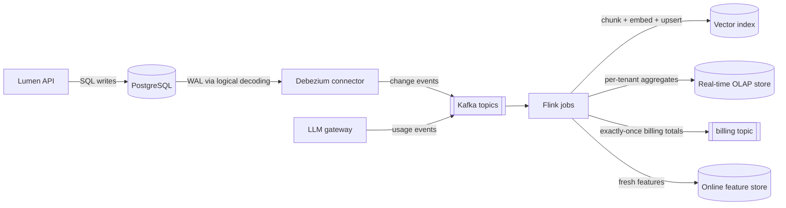
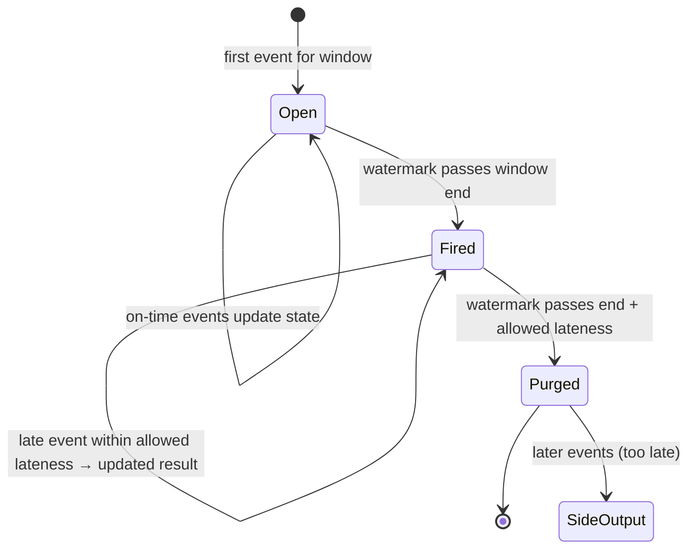
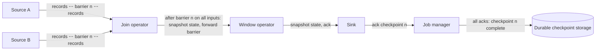
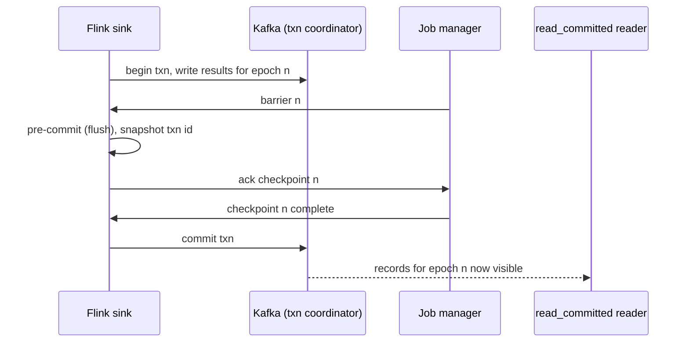

# 20 — Real-time & streaming systems

> **The requirement.** Lumen's customers edit documents all day. When someone fixes a wrong price in a policy
> document, the assistant must stop quoting the old price within **5 seconds (p99)**. Tenant admins want a live usage
> dashboard (questions, tokens, latency) that is at most **10 seconds stale**. Peak traffic is **50,000 events per
> second**. And because Lumen bills by token, the usage numbers that feed invoices must be **exact**: no event lost,
> none counted twice — even when machines crash mid-flight. Nightly batch jobs cannot meet the first two goals.
> A naive stream can't meet the third.

## In one minute

A batch job answers a question about data that has stopped moving. A streaming system answers the same question
continuously while data keeps arriving. That sounds like "run the batch job more often", but three things make it
genuinely different. First, events arrive late and out of order, so the system must decide *when* an answer for
"10:00–10:01" is complete enough to publish. Second, the computation keeps memory between events (counts, joins,
deduplication sets) and that memory must survive crashes without being rebuilt from the beginning of time. Third, a
crash in the middle of processing must not cause an event to be counted twice or zero times. The modern answer is a
log of changes (often captured straight from the database), a stream processor with checkpointed state, and sinks
that are either transactional or idempotent. Get those three right and "real-time" stops being a vague wish and becomes
a number you can put in an SLO.

## Why this matters now

- **CDC became the default integration pattern.** Instead of asking every service to publish events correctly, teams
  read the database's own replication log. PostgreSQL's logical decoding with the built-in `pgoutput` plug-in and
  open-source connectors such as Debezium (3.7 is the latest stable series as of 2026-11, 3.7.1.Final released in early
  November 2026 [15][17]) make this a
  configuration task rather than a research project.
- **Stream processors grew up.** Apache Flink 2.3.0 (released 2026-06-25, latest stable as of 2026-11 [27]) and Kafka
  Streams (shipped with Apache Kafka; 4.4.0 released 2026-10-22 [28]) both offer stateful processing with exactly-once
  guarantees for well-defined pipelines. Kafka 4.x runs only in KRaft mode — ZooKeeper is gone [29] — which removes a
  whole class of operational pain.
- **State moved off the box.** Flink 2.0 introduced disaggregated state: the primary copy of operator state lives in a
  distributed file system with local disk as a cache, accessed asynchronously [14]. That changes recovery and scaling
  economics for large-state jobs.
- **AI made freshness a product requirement.** A RAG assistant that cites yesterday's document is wrong, not just slow.
  Fraud models and recommenders need features computed seconds ago. "How fresh is the context?" is now an interview
  question, and its answer is a streaming pipeline (see [SYSDESIGN-24](../03-ai-systems/24-retrieval-vector-systems.md)
  and [SYSDESIGN-27](../03-ai-systems/27-ml-platforms.md)).

## Core ideas [Core]

### Streams, logs and the "why is this box here" of each component

Lumen's requirement forces four boxes onto the whiteboard, and each one exists for a reason:

*Diagram: application writes go to PostgreSQL; Debezium reads the write-ahead log and publishes change events to Kafka,
alongside usage events from the LLM gateway; Flink jobs consume them and update a vector index, a real-time OLAP store,
a billing topic and an online feature store.*

- **PostgreSQL** is the system of record. Nothing else gets to be "the truth" about a document.
- **CDC (Debezium)** exists because we need every committed change, in commit order, without trusting each code path to
  publish an event.
- **Kafka** exists because consumers fail, fall behind and get redeployed. A durable, replayable, partitioned log lets
  each consumer go at its own pace and rewind (the queue-vs-log distinction is covered in
  [SYSDESIGN-08](../01-foundations/08-async-event-driven.md)).
- **Flink** exists because the work is *stateful*: chunking needs the previous version of a document to know which
  chunks to delete; usage dashboards need running per-tenant windows; billing needs deduplication.
- **The sinks** differ because their requirements differ: the vector index needs low latency, the OLAP store needs fast
  aggregation over fresh rows, billing needs exactness.

### Change data capture: reading the database's diary

Every serious database already writes a log of changes for its own crash recovery and replication (the write-ahead log,
WAL, in PostgreSQL; the binlog in MySQL). CDC turns that internal log into a public stream.

In PostgreSQL, **logical decoding** is the mechanism that extracts committed changes from the WAL; the `pgoutput`
plug-in is built in from PostgreSQL 10 onward, so no extra library is needed [15]. A **replication slot** records how
far a consumer has read, and a **publication** declares which tables are included. Debezium's PostgreSQL connector
creates the slot if it has privileges, takes a consistent initial snapshot of existing rows, then streams changes from
the position it recorded during that snapshot [15].

Each Debezium change event has a key (the primary key) and a value with `before`, `after`, `op` (`c` create, `u` update,
`d` delete, `r` snapshot read), `source` metadata (database, table, log position, transaction) and timestamps [15].
Whether `before` is populated on updates and deletes depends on the table's `REPLICA IDENTITY` setting [15] — a small
setting with large consequences when a downstream job needs the old value.

**Why not dual writes?** The tempting alternative is "write to the database, then publish to Kafka" in application code.
If the process dies between the two, the database and the stream disagree forever. If you publish first and the
transaction rolls back, the stream contains a change that never happened. CDC removes the second write: the stream is
*derived* from the committed log, so it cannot disagree with it. When a service needs to publish *domain events* (not
raw row changes), the **outbox pattern** keeps the same property: the service writes the event into an `outbox` table
inside the same transaction as the business change, and CDC ships the outbox rows. Debezium's Outbox Event Router
expects columns such as `id`, `aggregatetype`, `aggregateid`, `type` and `payload`, routes by `aggregatetype` to a topic
and uses `aggregateid` as the message key to preserve per-aggregate ordering [16].

### Event time versus processing time

Flink's documentation gives the two clocks precise meanings: **event time** is when the event occurred on its producing
device; **processing time** is the system clock of the machine executing the operation [8]. They diverge constantly:
a mobile client queues events offline; a Kafka partition is briefly unavailable; a consumer restarts and replays an
hour of backlog. If Lumen's dashboard bucketed usage by processing time, a 20-minute consumer outage would show a hole
followed by a fake spike. Bucketing by event time shows what actually happened — but raises a new question: *when do
we know that all the events for 10:00–10:01 have arrived?*

The Dataflow model (Akidau et al., VLDB 2015) frames this honestly: in unbounded, out-of-order data you never know for
certain that you have seen everything, so the design question becomes a deliberate trade-off between **correctness,
latency and cost** [1]. The paper decomposes every streaming computation into four questions:

| Question | Concept | Lumen example |
|---|---|---|
| **What** is computed? | Transformations / aggregations | Sum of tokens per tenant |
| **Where** in event time? | Windows | 1-minute tumbling windows |
| **When** in processing time are results emitted? | Watermarks and triggers | Emit when the watermark passes 10:01, then update for late events |
| **How** do refinements relate? | Accumulation mode | Overwrite the previous value (upsert) |

### Watermarks

A **watermark** is the stream processor's estimate of event-time progress. In Flink's words, a `Watermark(t)` declares
that event time has reached `t` in that stream, meaning no more elements with timestamp `t' <= t` are expected [8].
Events that arrive with a timestamp the watermark has already passed are **late** [8].

The most common strategy is **bounded out-of-orderness**: watermark = highest timestamp seen − a fixed bound (minus
1 ms in Flink's own implementation, `forBoundedOutOfOrderness`) [9]. Choose the bound from data, not hope: measure the distribution of
`processing_time − event_time` per source and pick a high percentile. A larger bound means fewer late events and higher
latency; a smaller bound means fresher results and more corrections.

Two operational facts every senior engineer should know:

1. **The watermark of an operator with several inputs is the minimum of its input watermarks** [9]. One slow or *idle*
   partition holds back the whole job. Flink's `withIdleness(...)` marks a quiet input idle so it stops blocking
   progress [9].
2. **The opposite problem exists too**: a fast source racing ahead forces downstream operators to buffer state for
   windows that cannot close. **Watermark alignment** throttles sources whose watermarks get too far ahead of the
   rest [9].

### Windows, triggers and lateness

**Windows** group an unbounded stream into finite chunks of event time:

- **Tumbling** — fixed, non-overlapping (every minute). Usage dashboards, billing periods.
- **Sliding (hopping)** — fixed size, overlapping (a 5-minute window every 30 s). Moving averages, rate alerts.
- **Session** — closed by a gap of inactivity per key. Conversation analytics: "a chat session ends after 30 minutes
  of silence".
- **Global with custom triggers** — when the grouping is not about time at all.

A **trigger** decides when a window emits. The default event-time trigger fires once when the watermark passes the
window end. **Allowed lateness** (Flink) or **grace period** (Kafka Streams) keeps the window's state around for a while
longer so late events can *update* the result; after that, late events are dropped or diverted to a side output.
Kafka Streams documents the grace period as "how long Kafka Streams will wait for out-of-order data records for a given
window" and discards records that arrive after window end plus grace [6].

*Diagram: a window opens on its first event, accumulates on-time events, fires when the watermark passes its end,
emits updates for late events during allowed lateness, then purges its state; events after that go to a side output.*

The consequence for sink design: **a windowed result may be emitted more than once**. Downstream systems must either
upsert by window key (overwrite) or understand retractions. This is the "How" question of the Dataflow model [1].

### State and checkpoints

Stateful operators keep data between events: a count, the last version of a document, a deduplication set, the
build side of a join. In Flink, state is **keyed** (partitioned by the stream key, so all events for `tenant-42` go to the
same parallel instance) and stored in a **state backend** — on the JVM heap for small state, or in an embedded LSM
key-value store on local disk for large state [3].

Fault tolerance comes from **checkpoints**: periodic, consistent snapshots of all operator state plus the input
positions (Kafka offsets) that correspond to it. On failure, Flink restores the last completed checkpoint and rewinds
the sources to the recorded offsets. Every event after the checkpoint is replayed, and because the state was rewound to
the same point, the *internal* effect of each event is applied exactly once.

The mechanism is **Asynchronous Barrier Snapshotting (ABS)** (Carbone et al., 2015) [2], a variant of the classic
Chandy–Lamport distributed snapshot [4]. The job manager injects numbered **barriers** into each source. A barrier
flows with the data; when an operator has received barrier *n* on all inputs, it snapshots its state and forwards the
barrier. Because barriers separate "before snapshot *n*" from "after", no global pause is needed. The 2017 VLDB paper
describes how Flink applies this in production, including incremental snapshots and rescaling of keyed state [3].

*Diagram: barriers flow from both sources with the records; each operator snapshots its state once barrier n has arrived
on every input and forwards the barrier; the sink acknowledges, and the job manager marks checkpoint n complete in durable
storage.*

Flink distinguishes **checkpoints** (automatic, frequent, for crash recovery, in a backend-native format, deleted when
the job is cancelled unless retained) from **savepoints** (manual, for planned operations such as upgrades and job graph
changes, in a portable format, never deleted by Flink) [11].

### Exactly-once: what it does and does not mean

"Exactly-once" is the most misunderstood phrase in streaming. Separate three layers:

1. **Exactly-once state** — every event affects operator state exactly once. Checkpoints give this.
2. **Exactly-once output to a log** — every result appears in the output topic exactly once to readers that only read
   committed data. This needs transactions.
3. **Exactly-once side effects** — an email sent once, a card charged once. No stream processor gives this for an
   arbitrary external system; you need idempotent APIs (an idempotency key) or transactional sinks
   (see [SYSDESIGN-08](../01-foundations/08-async-event-driven.md) and the payments case
   [C06](../04-case-studies/C06-payments-ledger.md)).

Kafka's building blocks come from **KIP-98** [5]:

- The **idempotent producer** assigns each producer a producer ID and per-partition sequence numbers; the broker rejects
  a write whose sequence is not exactly one greater than the last, so retries cannot create duplicates — within one
  producer session [5].
- **Transactions** let a producer write to many partitions and commit its consumer offsets *atomically*. A stable
  `transactional.id` lets a restarted instance fence its zombie predecessor. A transaction coordinator writes commit or
  abort **control markers** into the partitions; consumers with `isolation.level=read_committed` only deliver committed
  transactional messages [5].

**Kafka Streams** wraps this: with `processing.guarantee=exactly_once_v2` (brokers 2.5+), the input offset commit, the
state-store changelog writes and the output writes commit atomically, so each input record's result is reflected once in
the output topic and in state stores [6][7]. The default remains `at_least_once`, and enabling exactly-once lowers the
default `commit.interval.ms` from 30 s to 100 ms [7].

**Flink's Kafka sink** with `DeliveryGuarantee.EXACTLY_ONCE` writes into a Kafka transaction that commits when a
checkpoint completes — a two-phase commit coordinated by the checkpoint [12]. Two consequences matter for design:
results become visible to `read_committed` readers **only after the checkpoint completes**, so the checkpoint interval
is added to end-to-end latency; and the producer's `transaction.timeout.ms` must exceed the maximum checkpoint duration
plus restart time, or Kafka may abort an in-flight transaction and data is lost [12].

*Diagram: the sink writes results into an open Kafka transaction; on barrier n it flushes and acknowledges; only after
the job manager declares checkpoint n complete does the sink commit, making the records visible to read-committed readers.*

### Stream–table duality

A table is the latest value per key; a stream is the sequence of changes. Kafka Streams' documentation states the
duality directly: a stream can be viewed as a table and a table as a stream; replaying a changelog rebuilds the
table [6]. CDC turns tables into streams; a keyed aggregation or a compacted topic turns streams back into tables.
Flink SQL builds its streaming semantics on the same idea: a **dynamic table** changes over time, a **continuous query**
over it produces another dynamic table, and its result is always semantically equivalent to running the same query in
batch mode on a snapshot of the inputs [13]. When a dynamic table is written out as a stream, it becomes one of three
encodings: **append-only** (inserts only), **retract** (add/retract messages; an update is a retract plus an add) or
**upsert** (upsert and delete messages keyed by a unique key, cheaper because an update is one message) [13].

This is not academic. Whether your sink accepts upserts decides whether `SELECT tenant, SUM(tokens) ... GROUP BY tenant`
is a valid streaming query for that sink at all.

### Real-time analytics stores

The usage dashboard needs sub-second aggregation over rows that arrived seconds ago. Three open-source column stores
dominate this niche, each with a different stance on freshness and updates:

- **Apache Druid** partitions data by time first, stores it in columnar *segments* with deep storage (object store) as
  the durable copy, and states that ingested data is immediately available for querying [21]. Its Kafka indexing tasks use
  partition offsets to provide exactly-once ingestion and read with `read_committed` by default [22].
- **Apache Pinot** supports **upserts** on real-time tables: full upsert replaces the row by primary key; partial upsert
  updates selected columns [23]. It requires the input stream to be partitioned by primary key, keeps an in-memory map
  from primary key to record location (so memory grows with distinct keys), and picks the winner by a comparison column,
  the time column by default [23].
- **ClickHouse** commonly ingests from Kafka through a Kafka engine table plus a materialized view into a MergeTree
  table [25]. Its `ReplacingMergeTree` removes rows with the same sorting key during background merges "at an unknown
  time" and explicitly does not guarantee the absence of duplicates; queries use `FINAL` for correct results before
  merges finish [24].

## Numbers that matter

All inputs below are **labelled assumptions** for the fictional Lumen product; replace them with your measurements.

**Assumptions.** Peak 50,000 events/s, daily average 15,000 events/s; average serialized event 1 KB; Kafka replication
factor 3; retention 7 days; deduplication by event ID for 1 hour; ~40 bytes of state per deduplication entry
(16-byte ID plus overhead); one Flink subtask sustains 10,000 events/s for this job (must be benchmarked).

**Ingress bandwidth.** 50,000 × 1 KB = **50 MB/s** at peak into Kafka; ×3 replicas = **150 MB/s** of disk writes across
the cluster (before compression).

**Retention storage.** 15,000 events/s × 1 KB × 86,400 s = 1.296 TB/day; ×7 days = **9.07 TB**; ×3 replicas =
**≈ 27.2 TB** of broker disk (before compression). This number, not throughput, often sets the broker count — or
pushes you to tiered storage (see [SYSDESIGN-16](16-cost-as-requirement.md) for the cost side).

**Parallelism and partitions.** 50,000 / 10,000 = 5 subtasks at peak; with 2× headroom for catch-up, **10**. Kafka
partitions cap consumer parallelism per topic, and the key-to-partition mapping changes when you add partitions (which
breaks per-key ordering assumptions and Pinot upsert tables [23]), so provision **12–24 partitions** up front.

**Deduplication state.** 50,000 × 3,600 s = 180 M IDs/hour at peak × 40 B = **≈ 7.2 GB** of keyed state. That is too
much for the JVM heap on one node and fits comfortably in an on-disk LSM backend; an incremental checkpoint every 30 s
writes only the new entries: 50,000 × 30 × 40 B = **≈ 60 MB** per checkpoint at peak.

**Recovery time (Little's-law style drain).** If a consumer group is down for 10 minutes at peak, the backlog is
50,000 × 600 = 30 M events. With 10 subtasks (100,000 events/s capacity) and 50,000 events/s still arriving, the net
drain rate is 50,000 events/s, so catch-up takes **600 s**. With only 5 subtasks (no headroom) the backlog would never
drain at peak. Headroom is a freshness SLO decision, not waste (queueing intuition from
[SYSDESIGN-01](../00-orientation/01-requirements-to-numbers.md)).

**Freshness budget for the 5 s RAG requirement** (assumed component latencies, p99):

| Stage | Budget |
|---|---|
| Commit → WAL decoded by Debezium | 0.5 s |
| Debezium → Kafka (produce + replicate) | 0.2 s |
| Flink: diff old vs new chunks | 0.3 s |
| Embedding new chunks (batched call to embedding service) | 1.5 s |
| Vector-index upsert + index visibility | 1.5 s |
| Slack | 1.0 s |
| **Total** | **5.0 s** |

Summing per-stage p99 targets gives a conservative budget, not the end-to-end p99: the p99 of a sum is usually lower
than the sum of the p99s, so meeting every stage budget leaves margin.

Now notice what a transactional exactly-once sink would do here: with a 10 s checkpoint interval, results would become
visible only at checkpoint completion [12], adding up to 10 s plus the checkpoint duration and blowing the budget by
itself. That single observation
drives the main design decision below.

## Design choices and trade-offs

### Delivery guarantees per sink

| Option | Wins when | Costs | Lumen use |
|---|---|---|---|
| At-most-once | Losing a sample is fine (debug metrics) | Silent loss on failure | Never for business data |
| At-least-once + **idempotent upsert** ("effectively once") | Sink has a natural key; overwrite is correct | Duplicates are transient; needs a deterministic key and version | Vector index: key `(doc_id, chunk_no)`, write only if `version` is newer |
| Transactional exactly-once (Kafka txns, Flink 2PC sink) | Output is a log that others aggregate; duplicates corrupt totals | Latency ≥ checkpoint interval; transaction timeouts to tune; read_committed readers | Billing totals topic, checkpoint every 60 s |
| Exactly-once via external idempotency key | Side effect in a third-party system | Requires the external API to support it | Invoice creation in the billing provider |

### Stream processing engine

| Option | Wins when | Costs | Example systems |
|---|---|---|---|
| **Kafka Streams** (library) | Kafka in, Kafka out; you want to deploy as an ordinary app | Kafka-only I/O; state restoration from changelog topics can be slow for big state | Microservice-embedded aggregations |
| **Apache Flink** (cluster runtime) | Many sources/sinks, large state, event-time-heavy logic, SQL | A runtime to operate (job manager, checkpoints, upgrades via savepoints) | Lumen's pipelines; managed Flink offerings exist on major clouds |
| **Spark Structured Streaming** (micro-batch by default) | You already run Spark; sub-second to seconds-level latency is fine | Micro-batch latency floor (about 100 ms per the Spark guide); Real-time Mode, added in Spark 4.1.0, removes the batch boundary but supports only stateless queries there, with a first set of stateful queries from Spark 4.3.0 (as of 2026-11) [31]; different state model | Lakehouse ETL (see [SYSDESIGN-13](../01-foundations/13-data-at-scale.md)) |
| **Streaming database / materialized views** | Logic is SQL views over CDC streams | Less control over operators; newer ecosystem | Incrementally maintained dashboards |

The managed-Flink and streaming-database entries are the author's survey of the market, not sourced claims.

### Lambda versus Kappa

The **Lambda architecture** runs a batch layer for correctness and a speed layer for freshness, then merges them. Jay
Kreps' 2014 critique argued that maintaining the same logic twice is the real cost, and proposed what he called the
Kappa architecture: keep the input log, and when logic changes, replay the log through a new version of the stream job
into a new output, then switch over [20]. With replayable logs, event-time semantics and checkpointed state, Kappa is
the default today; batch remains valuable for very long backfills and for cheap historical recomputation over a
lakehouse.

### Real-time analytics store

| Option | Wins when | Costs | Watch out for |
|---|---|---|---|
| **Apache Druid** | Time-partitioned event analytics, many concurrent dashboard users | Several service roles to run [33] | Updates are not its natural mode |
| **Apache Pinot** | User-facing analytics with upserts by key | Key-map memory; stream must be partitioned by key [23] | Partition count cannot grow later for upsert tables [23] |
| **ClickHouse** | Very fast scans and aggregations, SQL-first, simple ops | Eventual dedup with ReplacingMergeTree [24] | Forgetting `FINAL` or idempotent design gives inflated counts |
| Your OLTP database | Small volume, few readers | Analytic scans hurt the primary workload | The 3 a.m. lock contention |

## Deep dive [Deep]

### Why barriers instead of stopping the world

A naive consistent snapshot stops every source, waits for all in-flight records to drain, snapshots every operator and
resumes. ABS avoids the pause: the barrier *is* the cut. On an acyclic graph an operator only needs to snapshot its own
state — no in-flight records — because alignment guarantees that everything before barrier *n* has been processed and
nothing after it has [2]. **Alignment** has a cost: an operator with two inputs that has seen barrier *n* on input A must
buffer A's subsequent records until barrier *n* arrives on B. Under backpressure, barriers crawl behind full buffers and
checkpoints take minutes.

Flink offers two remedies [10]. **Unaligned checkpoints** let barriers overtake buffered records and store those
in-flight buffers as part of the checkpoint, making checkpoint duration largely independent of throughput, at the price of
more checkpoint I/O; an aligned-checkpoint timeout can start aligned and switch to unaligned if needed. **Buffer
debloating** shrinks the amount of in-flight data between operators automatically, which speeds up aligned checkpoints and
shrinks unaligned ones; the two can be combined [10].

### The end-to-end exactly-once contract

End-to-end exactly-once holds only if all three parts cooperate:

1. **Replayable source** with a position stored in the checkpoint (Kafka offsets, a database log position).
2. **Deterministic-enough processing** — replaying the same input after a restore must produce outputs that are
   acceptable to emit again. Processing-time logic, random numbers or calls to external services can produce *different*
   outputs on replay. With transactional sinks the first attempt's output is aborted, so this is safe; with idempotent
   sinks, a non-deterministic key would create a second row instead of overwriting.
3. **Transactional or idempotent sink.**

A subtle case: Lumen's indexing job calls an embedding model. Replaying a chunk after a crash calls the model again —
extra cost, not incorrectness, *if* the upsert key is the chunk identity and the model version is part of the record.
That is effectively-once with a measurable cost of replays.

### Kafka transaction internals worth knowing in an interview

- The **last stable offset (LSO)** is the offset below which every transaction is decided. `read_committed` consumers
  never read past it, so **one long-running or stuck transaction stalls every read_committed consumer of that partition**;
  KIP-98 itself warns that a transaction left open can prevent the LSO from advancing and consumers from making progress,
  which is why transaction timeouts exist: the producer's `transaction.timeout.ms`, capped by the broker's
  `max.transaction.timeout.ms` [5]. This is a real failure mode when a Flink job with an
  exactly-once sink hangs.
- **Zombie fencing**: when a producer with the same `transactional.id` re-initializes, the coordinator bumps an epoch and
  rejects the old instance's writes [5]. This is why each Flink job needs a unique `transactionalIdPrefix` on a shared
  cluster [12].
- **Idempotence is per session**: a new producer instance gets a new producer ID, so idempotence alone does not survive
  application restarts; transactions do [5].

### CDC snapshots without locking the world

The hard part of CDC is the bootstrap: you need all existing rows *and* the changes that happen while you read them.
Netflix's DBLog (Andreakis & Papapanagiotou, 2020, arXiv preprint) interleaves chunked table reads with log events using
low/high watermark markers written into the log, so the snapshot needs no table locks and can pause and resume [19].
Debezium's **incremental snapshots** use a closely related technique: they read tables in primary-key-ordered chunks
(1,024 rows by default), run in parallel with streaming, resume after interruption, and use watermarks and a snapshot
window to resolve collisions between snapshot rows and streamed changes; they are triggered with an `execute-snapshot`
signal [15]. (Note the overloaded word: these CDC "watermarks" are log markers, not event-time watermarks.)

### Replication slots: the CDC footgun

A logical replication slot pins WAL until its consumer confirms it. If the Debezium connector stops (or is deleted but its
slot is not), the primary keeps WAL indefinitely: PostgreSQL's `max_slot_wal_keep_size` defaults to `-1`, meaning slots may
retain unlimited WAL [18]. The primary's disk fills, and the *OLTP database* goes down because an *analytics* consumer
stopped. Mitigations: set `max_slot_wal_keep_size` (accepting that a slot past the limit may no longer be able to continue
and will need a re-snapshot [18]); PostgreSQL 18 and later add `idle_replication_slot_timeout`, which invalidates
slots inactive beyond a duration (default 0, disabled) [18]; alert on `pg_replication_slots` retained WAL; and treat slot creation
and deletion as part of the connector's lifecycle. On restart, Debezium resumes from its stored log position, and with
`snapshot.mode=when_needed` it re-snapshots if that position is no longer available [15].

A related subtlety: on a quiet table in a busy database, the connector may not receive events for its tables while other
tables generate WAL, so its confirmed position does not advance. Enable Debezium's `heartbeat.interval.ms` (default 0,
disabled) so the slot position advances on quiet tables [15].

### Joins in streams

- **Stream–stream join** needs a time bound ("payment within 10 minutes of the order"), otherwise state grows forever.
- **Stream–table join** enriches events with the *current* value of a table (often a CDC-derived table). The result
  depends on arrival order: an event joined before the table update sees the old value. Kafka Streams documents that
  stream–table and table–table joins only handle out-of-order data correctly with **versioned state stores** [6].
- **Temporal (as-of) join** looks up the table version valid at the event's timestamp — the correct semantics for
  "which price applied when this order happened", and the same idea as point-in-time correctness in feature stores.

### Disaggregated state in Flink 2.x

Classic Flink keeps the primary state on local disk, which couples state size to task-manager disks and makes rescaling
and recovery proportional to state download. Mei et al. (VLDB 2025) describe Flink 2.0's disaggregated design: primary
state lives in a distributed file system, local disk becomes a cache, and asynchronous state access plus the ForSt store
hide the added latency [14]. Design consequence: very large keyed state (hundreds of GB) becomes cheaper to rescale, but
state access latency now depends on object-store behaviour and cache hit ratio — measure it.

## Frontier [Frontier]

*(as of 2026-11; Flink 2.3, Kafka 4.4, Debezium 3.7)*

- **Streaming for AI freshness.** Real-time RAG pipelines are CDC pipelines with an embedding step: change event →
  diff chunks → embed only changed chunks → upsert by chunk ID → delete removed chunks. The freshness SLI is "commit time to
  retrievable" (measured with synthetic canary documents), not "index job ran". Deletes matter as much as inserts: a
  revoked document must leave the index, and erasure requests must reach derived stores
  (see [SYSDESIGN-19](19-privacy-compliance-sovereignty.md) and [SYSDESIGN-24](../03-ai-systems/24-retrieval-vector-systems.md)).
- **Streaming features for ML.** Feature stores accept streaming writes: Feast's push sources write stream-computed
  features into the online (and optionally offline) store [26], and its stream feature views are labelled alpha
  [32]. The
  hard problem is training/serving consistency — the same feature definition must produce the same value offline and
  online, at the same point in time (see [SYSDESIGN-27](../03-ai-systems/27-ml-platforms.md) and
  [C12](../04-case-studies/C12-realtime-fraud-recsys.md)).
- **Kafka evolves beyond the log.** Kafka 4.0 removed ZooKeeper mode entirely [29]; Kafka 4.1 introduced "Queues for
  Kafka" (KIP-932, share groups) as a preview, explicitly not yet production-ready in that release [30]. Check the status
  in your version before designing on it.
- **Disaggregated state and the lakehouse.** Flink 2.x's remote state [14] and streaming writes into open table formats
  (see [SYSDESIGN-13](../01-foundations/13-data-at-scale.md)) blur "stream processor" and "lakehouse ingestion". Treat
  claims about "unified batch and streaming" as hypotheses to test against your latency and cost numbers.

## Failure modes and operations

| Failure | Symptom (SLI) | Detection | Mitigation |
|---|---|---|---|
| Consumer lag grows | Freshness SLO burn; dashboards stale | Lag per partition (records and *seconds*), lag growth rate | Headroom (2×), autoscale parallelism, shed non-critical consumers |
| Stuck watermark | Windows never fire; output stops while input flows | Watermark vs wall-clock gap per operator | Idleness timeouts [9]; fix the empty/slow partition |
| Hot key | One subtask at 100%, others idle | Per-subtask throughput skew | Key salting with two-phase aggregation; separate hot tenants |
| Checkpoint timeouts | Checkpoints fail repeatedly; recovery point ages | Checkpoint duration, size, alignment time | Unaligned checkpoints, buffer debloating [10]; fix backpressure source |
| Unbounded state | Disk/memory grow; checkpoint size grows linearly | State size per operator | State TTL, bounded joins, windowed dedup |
| Stuck transaction | read_committed consumers frozen at the LSO | Consumer position flat while partition end advances | Tune `transaction.timeout.ms` [12]; restart/fence the producer |
| Replication slot WAL bloat | Primary disk filling | Retained WAL per slot | `max_slot_wal_keep_size`, idle slot timeout [18], slot alerts |
| Schema change upstream | Deserialization errors; job restarts in a loop | Error rate, dead-letter volume | Schema registry with compatibility rules; dead-letter topic |
| Poison event | Same offset fails forever | Restart count, offset not advancing | Dead-letter with alerting; never "skip silently" for billing |
| Replay after logic bug | Wrong historical results | Reconciliation against batch | Savepoint, deploy fixed job, replay into a new output, switch (Kappa) [11][20] |

**Operate with SLOs, not hopes.** Lumen's streaming SLOs: freshness (p99 commit-to-retrievable ≤ 5 s), completeness
(billing: daily reconciliation of streamed totals against the source of truth = 0 difference), and availability of the
pipeline (checkpoints completing). Burn-rate alerting on freshness is covered in
[SYSDESIGN-12](../01-foundations/12-observability.md).

**Measure lag in time, not just records.** 100,000 records of lag is nothing at 50k/s and a disaster at 50/s. Export
"age of the oldest unprocessed event" per partition.

## Cost and energy

- **Always-on compute.** A stream job runs 24/7, sized for peak plus catch-up headroom. Batch can run on spot capacity at
  night; streaming usually cannot tolerate frequent preemption without hurting freshness. Ask whether a freshness target
  really needs seconds — a 15-minute micro-batch may cost a fraction and meet the business need.
- **Retention and replication** dominate log cost: the 27 TB example above is mostly retention × replication factor.
  Shorter retention, compression and tiered storage are the levers (cost models in
  [SYSDESIGN-16](16-cost-as-requirement.md)).
- **Cross-zone traffic.** Replication factor 3 across availability zones means two cross-zone copies of every byte, plus
  consumer reads from other zones. On clouds that charge for inter-zone traffic this can rival compute.
- **Replays cost money** when processing calls paid services (embedding models). Budget for one full replay per quarter
  and per logic change.
- **Energy.** Idle-but-provisioned headroom consumes power; fewer, better-utilized nodes plus autoscaling of parallelism
  reduce energy per event (see [SYSDESIGN-17](17-energy-carbon-aware.md)). Exactly-once has an energy and latency tax
  (transaction coordination, checkpoint I/O); use it where correctness needs it, not everywhere.

## Interview angle

**How it is asked.** "Design a real-time dashboard for X", "Design ad-click aggregation", "How would you keep a search
index in sync with the database?", "Design fraud detection with sub-second features", and in AI interviews "How do you keep
RAG answers fresh?".

**Model answer outline (CLARIFY → QUANTIFY → SKETCH → DEEPEN → STRESS → WRAP):**

1. **CLARIFY** freshness target, correctness target (approximate vs exact), event-time semantics (when did it *happen*?),
   late data tolerance, and who reads the output.
2. **QUANTIFY** events/s peak and average, event size, retention, key cardinality, state size, catch-up headroom.
3. **SKETCH** source (CDC or outbox, never dual writes) → durable log partitioned by key → stateful processor with
   checkpoints → sinks chosen per requirement.
4. **DEEPEN** watermarks and allowed lateness; exactly-once where totals must be exact, idempotent upserts where latency
   matters; the latency cost of transactional sinks.
5. **STRESS + WRAP** hot keys, consumer outage and drain time, stuck watermarks, schema changes, replays with a new job
   version; close with SLOs (freshness, completeness) and reconciliation.

**Red flags.** "Kafka guarantees exactly-once, so we're done" (exactly-once side effects need idempotency); bucketing by
processing time for business metrics; no answer for late data; dual writes from the application; no plan for replay or
backfill; lag measured only in records.

**Likely follow-ups.** "What if a partition goes idle?" (idleness/min-watermark). "What if one tenant is 40% of
traffic?" (salting, two-phase aggregation). "How do you change the aggregation logic without downtime?" (savepoint or
Kappa replay into a new table, then switch). "How do you delete a user's data from the stream and every derived store?"
(tombstones, compaction, propagation to sinks — see [SYSDESIGN-19](19-privacy-compliance-sovereignty.md)).

## Common mistakes

- Treating "real-time" as a goal instead of a number with a percentile and a measurement point.
- Using processing time for business windows, then wondering why outages create spikes.
- Assuming exactly-once covers HTTP calls or emails made inside the processor.
- Enabling exactly-once sinks on a latency-critical path without accounting for checkpoint-interval visibility delay.
- Forgetting deletes: CDC `d` events and tombstones must remove rows from indexes and caches.
- Leaving a replication slot behind after removing a connector.
- Adding Kafka partitions to a keyed topic and silently breaking per-key ordering and upsert tables.
- Unbounded joins and dedup state without TTL.
- No reconciliation: trusting the stream for money without comparing it to the source of truth.

## Check yourself

1. Why does one idle Kafka partition stop all event-time windows in a Flink job, and what fixes it?
2. A Flink job writes to Kafka with `EXACTLY_ONCE` and a 30 s checkpoint interval. What are the worst-case and average
   visibility delays for `read_committed` readers, and why?
3. Give two reasons CDC from the WAL is safer than application dual writes.
4. Which delivery guarantee would you use for Lumen's vector index, and what key makes it correct?
5. What happens to a PostgreSQL primary if a Debezium connector is stopped for a week with default slot settings?

Full exercise set: [exercises/20-real-time-streaming.md](../../exercises/20-real-time-streaming.md).

## Lab

No lab for this unit. The queue/log lab for [SYSDESIGN-08](../01-foundations/08-async-event-driven.md) (poison
messages, dead-letter queues, idempotent consumers) and the lakehouse material in
[SYSDESIGN-13](../01-foundations/13-data-at-scale.md) are the closest hands-on companions; exercise 10 in this unit's
exercise file sketches a self-built CDC → Kafka → Flink experiment you can run with Docker.

## Further reading

- Akidau et al., *The Dataflow Model* (VLDB 2015) [1] — the What/Where/When/How vocabulary and the correctness–latency–cost
  framing.
- Carbone et al., *Lightweight Asynchronous Snapshots for Distributed Dataflows* (arXiv 2015) [2] — the barrier snapshot
  algorithm, short and readable.
- Carbone et al., *State Management in Apache Flink* (VLDB 2017) [3] — how the algorithm is used in production, including
  rescaling.
- KIP-98 [5] — Kafka's idempotent producer and transactions, from the design document itself.
- Flink 2.3 "Timely stream processing" and "Generating watermarks" docs [8][9] — the precise operational semantics.
- Debezium PostgreSQL connector reference [15] — snapshots, event format, slot handling.
- Kreps, *Questioning the Lambda Architecture* (2014) [20] — the replay-the-log argument (perspective piece).
- Mei et al., *Disaggregated State Management in Apache Flink 2.0* (VLDB 2025) [14] — where stateful streaming is heading.

## References

1. T. Akidau, R. Bradshaw, C. Chambers, S. Chernyak, R. J. Fernández-Moctezuma, R. Lax, S. McVeety, D. Mills, F. Perry,
   E. Schmidt, S. Whittle. "The Dataflow Model: A Practical Approach to Balancing Correctness, Latency, and Cost in
   Massive-Scale, Unbounded, Out-of-Order Data Processing." PVLDB 8(12):1792–1803, 2015.
   https://www.vldb.org/pvldb/vol8/p1792-Akidau.pdf (accessed 2026-11)
2. P. Carbone, G. Fóra, S. Ewen, S. Haridi, K. Tzoumas. "Lightweight Asynchronous Snapshots for Distributed Dataflows."
   arXiv:1506.08603, 2015 (preprint). https://arxiv.org/abs/1506.08603 (accessed 2026-11)
3. P. Carbone, S. Ewen, G. Fóra, S. Haridi, S. Richter, K. Tzoumas. "State Management in Apache Flink: Consistent Stateful
   Distributed Stream Processing." PVLDB 10(12):1718–1729, 2017. https://www.vldb.org/pvldb/vol10/p1718-carbone.pdf
   (accessed 2026-11)
4. K. M. Chandy, L. Lamport. "Distributed Snapshots: Determining Global States of Distributed Systems." ACM TOCS 3(1):63–75,
   1985. https://www.cs.princeton.edu/courses/archive/fall17/cos418/papers/chandy_lamport.pdf (accessed 2026-11)
5. Apache Kafka. "KIP-98 — Exactly Once Delivery and Transactional Messaging."
   https://cwiki.apache.org/confluence/display/KAFKA/KIP-98+-+Exactly+Once+Delivery+and+Transactional+Messaging
   (accessed 2026-11)
6. Apache Kafka 4.4 documentation. "Kafka Streams — Core Concepts." https://kafka.apache.org/44/streams/core-concepts/
   (accessed 2026-11)
7. Apache Kafka 4.4 documentation. "Configuring a Streams Application" (`processing.guarantee`, `commit.interval.ms`).
   https://kafka.apache.org/44/streams/developer-guide/config-streams/ (accessed 2026-11)
8. Apache Flink 2.3 documentation. "Timely Stream Processing."
   https://nightlies.apache.org/flink/flink-docs-stable/docs/concepts/time/ (accessed 2026-11)
9. Apache Flink 2.3 documentation. "Generating Watermarks."
   https://nightlies.apache.org/flink/flink-docs-stable/docs/dev/datastream/event-time/generating_watermarks/
   (accessed 2026-11)
10. Apache Flink 2.3 documentation. "Checkpointing under backpressure."
    https://nightlies.apache.org/flink/flink-docs-stable/docs/ops/state/checkpointing_under_backpressure/ (accessed 2026-11)
11. Apache Flink 2.3 documentation. "Checkpoints vs. Savepoints."
    https://nightlies.apache.org/flink/flink-docs-stable/docs/ops/state/checkpoints_vs_savepoints/ (accessed 2026-11)
12. Apache Flink 2.3 documentation. "Kafka connector" (Kafka Sink fault tolerance).
    https://nightlies.apache.org/flink/flink-docs-stable/docs/connectors/datastream/kafka/ (accessed 2026-11)
13. Apache Flink 2.3 documentation. "Dynamic Tables."
    https://nightlies.apache.org/flink/flink-docs-release-2.3/docs/concepts/sql-table-concepts/dynamic_tables/
    (accessed 2026-11)
14. Y. Mei, Z. Lan, L. Huang, Y. Lei, H. Yin, R. Xia, K. Hu, P. Carbone, V. Kalavri, F. Wang. "Disaggregated State
    Management in Apache Flink 2.0." PVLDB 18(12), 2025. https://www.vldb.org/pvldb/vol18/p4846-mei.pdf (accessed 2026-11)
15. Debezium 3.7 documentation. "Debezium connector for PostgreSQL."
    https://debezium.io/documentation/reference/stable/connectors/postgresql.html (accessed 2026-11)
16. Debezium documentation. "Outbox Event Router."
    https://debezium.io/documentation/reference/stable/transformations/outbox-event-router.html (accessed 2026-11)
17. Debezium. "Releases" (3.7 latest stable series; 3.7.1.Final, early November 2026). https://debezium.io/releases/ (accessed 2026-11)
18. PostgreSQL 18 documentation. "Server Configuration — Replication" (`max_slot_wal_keep_size`,
    `idle_replication_slot_timeout`). https://www.postgresql.org/docs/18/runtime-config-replication.html
    (accessed 2026-11)
19. A. Andreakis, I. Papapanagiotou. "DBLog: A Watermark Based Change-Data-Capture Framework." arXiv:2010.12597, 2020
    (preprint). https://arxiv.org/abs/2010.12597 (accessed 2026-11)
20. J. Kreps. "Questioning the Lambda Architecture." O'Reilly Radar, 2014-07-02.
    https://www.oreilly.com/radar/questioning-the-lambda-architecture/ (accessed 2026-11)
21. Apache Druid documentation (latest). "Introduction to Apache Druid" / design. https://druid.apache.org/docs/latest/design/
    (accessed 2026-11)
22. Apache Druid documentation (latest). "Apache Kafka ingestion."
    https://druid.apache.org/docs/latest/ingestion/kafka-ingestion/ (accessed 2026-11)
23. Apache Pinot documentation. "Stream Ingestion with Upsert."
    https://docs.pinot.apache.org/build-with-pinot/ingestion/upsert-dedup/upsert (accessed 2026-11)
24. ClickHouse documentation. "ReplacingMergeTree."
    https://clickhouse.com/docs/engines/table-engines/mergetree-family/replacingmergetree (accessed 2026-11)
25. ClickHouse documentation. "Kafka table engine." https://clickhouse.com/docs/engines/table-engines/integrations/kafka
    (accessed 2026-11)
26. Feast documentation. "Push source" and "Stream feature view." https://docs.feast.dev/reference/data-sources/push ;
    https://docs.feast.dev/getting-started/concepts/stream-feature-view (accessed 2026-11)
27. Apache Flink. "Downloads" (2.3.0 latest stable, 2026-06-25). https://flink.apache.org/downloads/ (accessed 2026-11)
28. Apache Kafka. "Downloads" (4.4.0, 2026-10-22). https://kafka.apache.org/community/downloads/ (accessed 2026-11)
29. Apache Kafka 4.1 documentation. "Upgrading" (4.0 supports only KRaft mode; ZooKeeper mode removed).
    https://kafka.apache.org/41/getting-started/upgrade/ (accessed 2026-11)
30. Apache Kafka. "Apache Kafka 4.1.0 Release Announcement" (KIP-932 Queues for Kafka in preview), 2025-09-04.
    https://kafka.apache.org/blog/2025/09/04/apache-kafka-4.1.0-release-announcement/ (accessed 2026-11)
31. Apache Spark 4.3 documentation. "Structured Streaming Programming Guide — Real-time Mode."
    https://spark.apache.org/docs/latest/streaming/real-time-mode.html (accessed 2026-11)
32. Feast documentation. "Feature view" (section "[Alpha] Stream feature views").
    https://docs.feast.dev/getting-started/concepts/feature-view (accessed 2026-11)
33. Apache Druid documentation (latest). "Architecture" (service types). https://druid.apache.org/docs/latest/design/architecture/
    (accessed 2026-11)
