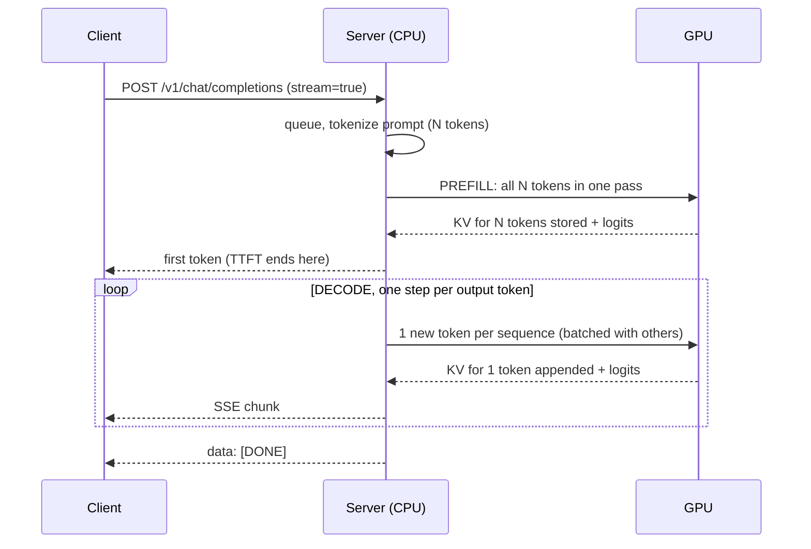
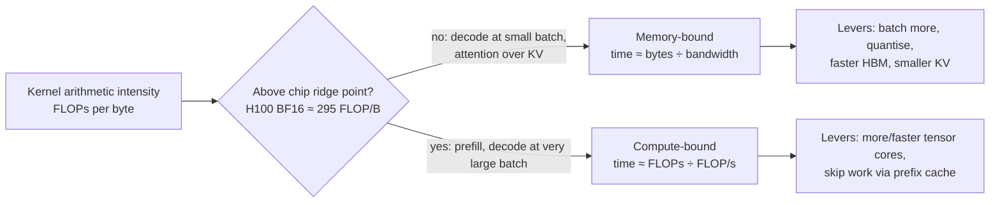

# 21 — Anatomy of LLM inference

> **The requirement.** Lumen, our fictional AI knowledge-and-chat product, is about to put an open-weight
> 8-billion-parameter model behind its chat box. Product asks for two numbers: the first word must appear within
> **500 ms at p95**, and text must then flow at **≥ 20 tokens/s per user** (comfortably faster than people read).
> Finance asks a third: **how many simultaneous users fit on one GPU?** None of these can be answered with the
> mental model of a classic web service ("a request takes X ms of CPU"). An LLM request is a *loop* — one big
> parallel step followed by hundreds of tiny sequential steps — and each part of the loop is limited by a
> different piece of hardware. This chapter takes the loop apart so the numbers become estimable.

## In one minute

A large language model writes text one *token* (a word fragment) at a time. To answer you, a server first reads your
whole prompt in one big parallel pass — **prefill** — which is limited by how fast the chip can do arithmetic. That pass
produces the first token. Then it enters **decode**: it produces one more token, appends it, and repeats until it hits a
stop condition. Every decode step must stream the *entire* model's weights from memory just to emit one token per user,
so decode is limited by **memory bandwidth**, not arithmetic. To avoid recomputing the past at every step, the server keeps
a **KV cache** — per-token intermediate results — which grows with every token and every concurrent user, and is usually
what runs out first. Because one decode step costs roughly the same whether it serves one user or fifty, servers **batch**
many users into each step; that is the single biggest lever on cost. The user-visible metrics follow directly:
**time to first token** (dominated by queueing + prefill) and **time per output token** (dominated by decode). Learn to
ask "which phase, which resource, which percentile?" and most LLM performance questions become arithmetic.

## Why this matters now

Between 2023 and 2026 LLM inference went from a research curiosity to one of the largest compute workloads in the
industry, and it broke several habits of classical system design:

- **Requests are not short and uniform.** A single request can occupy an accelerator for tens of seconds and its cost
  depends on input *and* output length, which you do not know in advance.
- **The bottleneck moved from compute to memory.** Accelerator FLOPs have grown faster than memory bandwidth (compare the
  ridge points computed in [Numbers that matter](#numbers-that-matter)); token-by-token generation sits on the
  bandwidth side of that gap.
- **State lives on the accelerator.** The KV cache makes a "stateless" HTTP endpoint secretly stateful for the life of
  each request — which is why later chapters care about cache-aware routing and paging
  ([SYSDESIGN-22](22-serving-llms-at-scale.md)).
- **Latency is two numbers, not one.** Users perceive the wait for the first token and the speed of the stream
  separately; papers and tools such as DistServe [11] and vLLM's benchmark suite [6] treat them as separate SLOs.
- **Open-weight models made this a self-hosting problem.** With models such as Qwen3 [1] under Apache-2.0, many teams now
  run inference themselves and must size GPUs, not just call an API.

## Core ideas [Core]

### 1. From text to tokens and back

Models do not see characters or words; they see integer **token IDs** from a fixed vocabulary, produced by a learned
sub-word tokenizer (byte-pair encoding and its descendants [13]). Qwen3-8B's vocabulary has **151,936** entries [2].
Three systems consequences:

1. **Everything is priced and limited in tokens** — context windows, rate limits, KV cache, bills. Words-per-token
   varies by tokenizer and language; measure it for *your* traffic (the lab does this with vLLM's `/tokenize` endpoint).
2. **Tokenisation is CPU work on the request path.** It is cheap per request but not free at thousands of requests per
   second; vLLM V1 deliberately moved tokenisation and detokenisation into a separate process from the GPU loop [7].
3. **Detokenisation must be incremental.** A token may be half of a multi-byte UTF-8 character, so the server buffers
   until it can emit valid text. That is why streamed chunks do not map one-to-one onto tokens.

### 2. One forward pass, at systems level

A decoder-only transformer is a stack of *L* identical layers. For each token position, each layer does:

- **Attention:** project the token's hidden vector into a query (Q), key (K) and value (V); compare Q with the K of
  every earlier token; take a weighted mix of their V.
- **MLP (feed-forward):** two or three large matrix multiplies applied to each token independently.

After the last layer, a final projection produces **logits** — one score per vocabulary entry — and a sampler picks the
next token. You do not need the training mathematics; you need three facts:

- The big matrix multiplies (Q/K/V/output projections and the MLP) touch **every weight once per forward pass**, no
  matter how many tokens are in the pass. Cost: about **2 FLOPs per parameter per token** (one multiply, one add).
- Attention at position *t* needs the K and V of **all positions < t**. Recomputing them every step would be quadratic
  waste, so they are stored: that store is the **KV cache**.
- Each new token depends on the previous one. Within one request, decode steps are **strictly sequential**.

### 3. Prefill and decode

*Diagram: the client sends a streaming request; the server queues and tokenizes it; the GPU runs one prefill pass over all
prompt tokens and returns the first token; then it repeats one decode step per output token, streaming each chunk, until
the server sends [DONE].*

| | **Prefill** | **Decode** |
|---|---|---|
| Tokens per pass, per request | all *N* prompt tokens at once | exactly 1 (more with speculative decoding, see 22) |
| Work per pass | ≈ 2 × params × *N* FLOPs (+ attention) | ≈ 2 × params FLOPs per sequence |
| Weight bytes read per pass | all weights once, reused across *N* tokens | all weights once, reused across only the batch |
| Limiting resource | **compute** (tensor-core FLOP/s) | **memory bandwidth** (HBM bytes/s) |
| User-visible metric | time to first token (TTFT) | time per output token (TPOT / ITL) |
| Gets better by | more FLOPs, prefix caching, shorter prompts | bigger batches, smaller weights (quantisation), faster HBM |

The asymmetry is the most important idea in this part of the course. Splitwise [12] characterised it on production
traces ("a compute-intensive prompt computation, and a memory-intensive token generation") and DistServe [11] showed
that running both phases on the same GPU makes them interfere. Sarathi-Serve [14] describes the same thing from the
scheduler's side: prefill saturates compute, while decode "processes only a single token per request".

### 4. Arithmetic intensity and the roofline

**Arithmetic intensity (AI)** = FLOPs performed ÷ bytes moved from memory. Every chip has a **ridge point** =
peak FLOP/s ÷ peak bytes/s. Below the ridge, a kernel is memory-bound: it finishes when its bytes arrive, and extra
FLOPs are free. Above it, it is compute-bound. This "roofline" view (Williams, Waterman and Patterson [15]) is the
fastest way to reason about inference.

*Diagram: a kernel's arithmetic intensity is compared with the chip's ridge point; below it the kernel is memory-bound
(levers: batching, quantisation, faster memory, smaller KV); above it compute-bound (levers: more compute, skipping work).*

Apply it to the big matrix multiplies with BF16 weights (2 bytes per weight):

- **Decode, batch size *B*.** Each weight is read once (2 bytes) and used for 2 FLOPs per sequence → AI ≈ 2*B* / 2 =
  **≈ *B* FLOP/byte**. At *B* = 1, AI ≈ 1, two orders of magnitude below an H100's BF16 ridge of ≈ 295 (derived below).
  The tensor cores are mostly idle, waiting for HBM.
- **Prefill of *N* tokens.** Each weight is reused for *N* tokens → AI ≈ *N*. A 2,000-token prompt sits far above the
  ridge: compute-bound.

Attention during decode is worse, and batching does **not** rescue it. For each sequence, the step reads that
sequence's own K and V for all *T* previous tokens and does ≈ 4 × *h* × *dhead* × *T* FLOPs per layer
(QKᵀ and the weighted sum over V), where *h* is the number of query heads. The bytes read are
2 × *hkv* × *dhead* × *T* × 2 bytes. The ratio is ≈ *h* / *hkv* FLOP/byte — the
**GQA group size** — independent of batch size, because no two sequences share KV. For Qwen3-8B (32 query heads, 8 KV
heads [2]) that is ≈ 4 FLOP/byte: deeply memory-bound at any batch size. This is why long contexts make decode slow and
why KV size reductions (GQA, MQA, KV quantisation) matter so much.

### 5. The KV cache

For every token in every active sequence, each layer stores one K vector and one V vector per **KV head**:

> **KV bytes per token = L × 2 × hkv × dhead × bytes per element**
>
> (L = layers; 2 = one K and one V; hkv = key/value heads; dhead = head dimension)

**KV bytes for a sequence** = per-token bytes × tokens in the sequence (prompt + generated so far). **KV bytes on the
server** = the sum over all sequences in flight. The PagedAttention paper gives the same calculation for OPT-13B:
"the KV cache of a single token demands 800 KB of space" [4].

The formula has a lever built into it: **hkv**.

- **Multi-head attention (MHA):** every query head has its own K/V head (hkv = h).
- **Multi-query attention (MQA)** — Shazeer, 2019 [16] — shares one K/V head across all query heads
  (hkv = 1). Shazeer motivated it explicitly by "the memory-bandwidth cost of repeatedly loading the large
  'keys' and 'values' tensors" during incremental decoding.
- **Grouped-query attention (GQA)** — Ainslie et al., EMNLP 2023 [17] — uses an intermediate number of K/V heads, and
  reports "quality close to multi-head attention with comparable speed to MQA". Most current open models use GQA:
  Qwen3-8B and Qwen3-32B both use 8 KV heads [2][3]; the Llama 3 8B/70B/405B models use 8 KV heads too [18].

The worked example in [Numbers that matter](#numbers-that-matter) shows that GQA cuts Qwen3-8B's KV cache by 4× compared
with an otherwise-identical MHA model.

### 6. Sampling, stopping and streaming

After each forward pass the server holds a logits vector of vocabulary size. Turning it into text:

1. **Logit processing:** apply penalties (repetition, presence/frequency), optional grammar masks for structured output
   (see 22), and **temperature** (divide logits by *T*; *T* → 0 approaches greedy).
2. **Truncation:** **top-k** keeps the *k* most likely tokens; **top-p** (nucleus) keeps the smallest set whose
   probability mass reaches *p*.
3. **Sample** one token (or take the argmax when greedy).
4. **Stop check:** end-of-sequence token, a stop string, or `max_tokens`. A request whose output length you cannot
   predict is the norm — which is why static batching wastes so much (see 22).
5. **Detokenise incrementally** and emit.

**Streaming** uses **Server-Sent Events (SSE)** [19]: a long-lived HTTP response with
`Content-Type: text/event-stream`, where each event is a `data: …` line followed by a blank line. OpenAI-compatible
servers (vLLM's server implements this API [8]) send one JSON chunk per event and finish with `data: [DONE]`. With
`"stream_options": {"include_usage": true}` the final chunk carries exact token counts — the lab uses this to compute
TPOT honestly. SSE is one-directional, plain HTTP and proxy-friendly; WebSockets are only needed when the client must
also push mid-stream (see [SYSDESIGN-10](../01-foundations/10-apis-communication.md)). Two operational traps:
proxies that **buffer** responses (the user sees nothing, then everything) and idle timeouts shorter than the longest
generation.

### 7. The metrics that matter

| Metric | Definition (as used by vLLM's benchmark tool [6]) | Dominated by | Typical SLO shape |
|---|---|---|---|
| **TTFT** — time to first token | request sent → first token received | queueing + tokenisation + prefill | p95/p99 < X ms |
| **TPOT** — time per output token | (E2E − TTFT) ÷ (output tokens − 1), per request | decode step time, batch size, interference | p95/p99 < Y ms |
| **ITL** — inter-token latency | each gap between consecutive streamed tokens/chunks | decode steps, plus stalls when prefills are scheduled | p99 < Z ms |
| **E2E latency** | request sent → last token | TTFT + TPOT × (n − 1) | matters for non-streaming / agents |
| **Throughput** | output tokens/s (or total tokens/s, requests/s) across the server | batch size × steps/s | capacity planning |
| **Goodput** | completed requests/s **that met all SLOs** | everything above | the number to optimise |

**TPOT vs ITL.** TPOT is a per-request average; ITL is the distribution of individual gaps. A request can have a fine
TPOT and a terrible p99 ITL if a long prefill was scheduled in the middle of its stream — the user sees a freeze.
vLLM's documentation names exactly this as a reason to disaggregate prefill: "vLLM may insert some prefill jobs during
the decoding of one request. This results in higher tail latency" [9].

**Goodput.** DistServe [11] defines the goal as the maximum request rate served "within both TTFT and TPOT
constraints"; vLLM's benchmark computes `request_goodput` as good completed requests ÷ duration [6]. Throughput without
SLOs is a vanity metric: you can always raise it by batching until every user waits.

**Why p99 matters more here than in a CRUD service.** Dean and Barroso's "The Tail at Scale" [20] showed that when a
user action fans out into many sub-requests, the tail of each becomes the median of the whole. LLM products fan out
*sequentially*: an agent that chains 10 model calls meets a per-call p99 only with probability 0.99¹⁰ ≈ 90 %, so one
action in ten sees at least one p99-or-worse call. And because TTFT includes **queueing**, tail latency explodes
non-linearly as utilisation approaches 100 % (the queueing results of
[SYSDESIGN-01](../00-orientation/01-requirements-to-numbers.md)).

### 8. Batching basics

A decode step reads all weights once regardless of batch size, so putting *B* sequences in the step multiplies
throughput by up to *B* while step time grows only by the extra KV reads and compute (see the batch table below). Three
generations of batching:

- **No batching:** one request at a time. Lowest latency at zero load, terrible cost.
- **Static (request-level) batching:** collect *B* requests, run them together until **all** finish. Short answers wait
  for the longest one; new arrivals wait for the whole batch. Orca's authors describe exactly this failure of
  request-level scheduling [21].
- **Continuous (iteration-level) batching:** the scheduler re-forms the batch **every step** — finished sequences leave,
  waiting ones join. Introduced by Orca (OSDI 2022) [21] and now the default in vLLM, SGLang, TensorRT-LLM and
  llama.cpp's server [22]. Chapter 22 takes it apart.

The cost of batching is memory: every extra sequence brings its KV cache. **Concurrency is capped by KV capacity**, and
that cap is what the worked example below computes.

## Numbers that matter

All hardware numbers below are vendor datasheet peaks; real kernels reach a fraction of them. Every efficiency factor
is a **labelled assumption**, not a measurement.

### Worked example: Qwen3-8B on one H100 SXM

**Model facts** (from the official model card and `config.json`, accessed 2026-11 [1][2]): 8.2 B parameters;
36 layers; 32 query heads and **8 KV heads**; head dimension 128; native context 32,768 tokens; weights published in
BF16.

**Hardware facts** (NVIDIA H100 SXM datasheet [23]): 80 GB HBM3; 3.35 TB/s; BF16 tensor core 1,979 TFLOPS *with
sparsity*, so **≈ 989.5 TFLOPS dense**; FP8 3,958 TFLOPS with sparsity (≈ 1,979 dense).

**Step 1 — weights.**

| Precision | Bytes/param | Qwen3-8B weights | Notes |
|---|---|---|---|
| BF16/FP16 | 2 | 8.2 × 2 = **16.4 GB** | as published |
| FP8 | 1 | **8.2 GB** | W8A8 FP8 runs on Hopper/Blackwell-class tensor cores |
| INT4 (weight-only, e.g. AWQ/GPTQ) | 0.5 + scales | 4.1 GB + ≈ 3 % for one FP16 scale per 128 weights ≈ **4.2 GB** | group size 128 is a common choice (assumption); some layers often stay at 16-bit |

**Step 2 — KV cache per token** (BF16 KV, 2 bytes):

36 layers × 2 × 8 KV heads × 128 × 2 bytes = **147,456 bytes = 144 KiB per token**

| Variant (same model, hypothetical) | hkv | KV per token | 4,096-token conversation |
|---|---|---|---|
| MHA | 32 | 576 KiB | 2.25 GiB |
| **GQA (actual Qwen3-8B)** | **8** | **144 KiB** | **576 MiB** |
| MQA | 1 | 18 KiB | 72 MiB |
| GQA + FP8 KV cache | 8 | 72 KiB | 288 MiB |

A single user at the full native 32,768-token context holds **4.5 GiB** of KV — more than a quarter of the BF16 weights.

**Step 3 — how many tokens fit?** Assume vLLM may use 90 % of HBM (72 GB) and that activations, CUDA graphs and
fragmentation take 2 GB (assumption; measure it — vLLM logs the KV capacity it actually allocated at start-up).

KV budget ≈ 72 − 16.4 − 2 = **53.6 GB** → 53.6 × 10⁹ ÷ 147,456 ≈ **363,000 tokens** → ≈ **88 concurrent
4,096-token conversations**, or ≈ 177 at 2,048 tokens. With FP8 weights the budget grows by 8.2 GB; with an FP8 KV
cache the token count doubles.

**Step 4 — decode speed.** A decode step must read all weights. Lower bound at batch 1:
16.4 GB ÷ 3.35 TB/s ≈ **4.9 ms per token** → at most ≈ 204 tokens/s for one user. FP8 weights halve that to ≈ 2.4 ms.

Now batch *B* sequences, each with a 2,048-token context, and assume kernels achieve 70 % of peak bandwidth
(assumption). Bytes per step = 16.4 GB + *B* × 2,048 × 147,456 B:

| Batch *B* | Bytes per step | Step time (= ITL) | Per-user tokens/s | Aggregate output tokens/s |
|---|---|---|---|---|
| 1 | 16.7 GB | 7.1 ms | ≈ 140 | ≈ 140 |
| 8 | 18.8 GB | 8.0 ms | ≈ 125 | ≈ 1,000 |
| 32 | 26.1 GB | 11.1 ms | ≈ 90 | ≈ 2,900 |
| 64 | 35.7 GB | 15.2 ms | ≈ 66 | ≈ 4,200 |
| 128 | 55.1 GB | 23.5 ms | ≈ 43 | ≈ 5,450 |

Read the table twice. **Aggregate throughput rises ≈ 39× from *B* = 1 to 128 while each user slows only ≈ 3×.** And
the step time growth is now dominated by **KV reads**, not weights: at *B* = 128, KV is 38.7 GB of the 55.1 GB moved.
That is the quantitative reason the next chapter is obsessed with KV-cache management. (This model ignores compute
time, scheduler overhead and the prefill work interleaved with decode — all of which make real numbers lower. Validate
with a benchmark before you buy hardware.)

**Step 5 — prefill speed (TTFT).** A 2,000-token prompt costs ≈ 2 × 8.2 × 10⁹ × 2,000 = **3.3 × 10¹³ FLOPs**. At an
assumed 50 % of the dense BF16 peak (≈ 495 TFLOPS achieved), prefill takes ≈ **66 ms**. Attention adds
≈ 4 × 32 × 128 × *T* × 36 FLOPs per token — ≈ 1.2 GFLOPs per token at *T* = 2,000 against 16.4 GFLOPs for the weights,
so it is small at short context but reaches parity around *T* ≈ 28,000 tokens. Prefill time therefore grows faster than
linearly at long context.

**Step 6 — answer Lumen.** Per-user ≥ 20 tokens/s means step time ≤ 50 ms; by the table that allows batches well beyond
128 *if memory allowed* — but Step 3 caps a 2k-context workload at ≈ 177 sequences. TTFT ≤ 500 ms p95 leaves ≈ 430 ms of
budget after a 66 ms prefill for queueing, tokenisation and network — which holds only if the server is not near
saturation. So the honest answer is: **"on the order of 100–150 concurrently streaming users per H100 for 2k-token
chats, limited by KV memory, with TTFT protected by admission control — to be confirmed by a load test."** Notice that
the answer is a range with its binding constraint named, which is exactly what interviewers want.

### Ridge points of common accelerators (derived from datasheets)

| Accelerator | Dense BF16 FLOP/s | HBM bandwidth | Ridge (FLOP/byte) | Source |
|---|---|---|---|---|
| H100 SXM | ≈ 989.5 T (1,979 T sparse ÷ 2) | 3.35 TB/s | ≈ 295 | [23] |
| H200 SXM | ≈ 989.5 T (same tensor cores) | 4.8 TB/s | ≈ 206 | [24] |
| AMD MI300X | 1.3 P (FP16) | 5.3 TB/s | ≈ 245 | [25] |

The H200 has the same compute as the H100 but 43 % more bandwidth and 141 GB of memory [24] — a chip designed around
decode. Chapter 23 covers accelerators in depth.

### Laptop scale (the lab)

The lab serves **Qwen2.5-0.5B-Instruct** (0.49 B parameters, 24 layers, 14 query / 2 KV heads, head dimension 64 [26])
on a CPU. KV per token = 24 × 2 × 2 × 64 × 2 B = **12 KiB** in BF16, or 24 KiB in the FP32 the lab uses on
AVX2-only laptops; weights are ≈ 1 GB in BF16 and ≈ 2 GB in FP32. (The lab's engine log reported 87,296 KV tokens for a
2 GiB FP32 budget: 2 GiB ÷ 24 KiB = 87,381, rounded down to whole 64-token blocks — the formula, confirmed.) Divide your
machine's memory bandwidth by the weight bytes and you have an upper bound on single-stream decode tokens/s to compare
with what you measure.

## Design choices and trade-offs

| Choice | Wins when | Costs | Example systems |
|---|---|---|---|
| **Bigger batch (more concurrency per GPU)** | cost per token matters; SLOs have slack | higher TPOT; more KV memory; longer queues at saturation | every continuous-batching server |
| **Smaller batch / reserved capacity** | strict interactive or voice latency | GPU mostly idle; high cost per token | latency-tier deployments |
| **FP8 weights** | Hopper/Blackwell-class hardware; bandwidth-bound decode | small accuracy risk, must evaluate; calibration step | vLLM FP8 W8A8 via LLM Compressor [10] |
| **INT4 weight-only (AWQ [27], GPTQ [28])** | memory-limited GPUs, edge, single-stream | larger accuracy risk; prefill gains smaller (weights dequantised) | vLLM, llama.cpp GGUF |
| **FP8 KV cache** | long contexts, high concurrency | small accuracy risk on attention | vLLM `--kv-cache-dtype fp8` |
| **Shorter context limit (`max_model_len`)** | protects KV capacity and tail latency | product limitation | any server |
| **Streaming (SSE)** | interactive UIs; perceived latency | long-lived connections through proxies/LBs | OpenAI-compatible servers |
| **Non-streaming** | agents and batch jobs that need the whole answer | users wait for E2E | batch APIs |
| **Model choice: smaller model** | the task quality allows it | capability | — often the biggest cost lever of all |

## Deep dive [Deep]

### Why "memory-bound" is literally about bytes per token

Write decode step time as

> *t*step ≈ max( FLOPsstep ÷ FLOP/sachieved , bytesstep ÷ bandwidthachieved ) + overhead

where bytesstep = weight bytes + Σsequences KV bytes(context length) and FLOPsstep ≈
2 × params × *B* + attention FLOPs. For dense models in the batch range that fits in memory, the second term usually
wins. Corollaries:

- **Quantising weights speeds up decode almost proportionally** at small batch (fewer bytes), but helps prefill only if
  the matrix multiplies themselves run in lower precision (FP8 W8A8 does; INT4 weight-only typically dequantises to
  16-bit before multiplying).
- **Faster HBM beats more FLOPs for chat.** Compare H100 and H200 above.
- **Mixture-of-Experts (MoE) changes the bytes.** An MoE model activates only some experts per token, so per-token
  FLOPs follow *active* parameters, while memory capacity follows *total* parameters. gpt-oss-120b's config, for
  example, lists 128 local experts with 4 active per token [29]. At small batch only the selected experts' weights are
  read; at large batch, different tokens select different experts and the step approaches reading all of them. MoE
  serving is therefore a capacity problem first and pushes toward expert parallelism (chapter 22).

### Where the time goes inside TTFT

TTFT = network + **queue wait** + tokenisation + prefill (+ KV transfer, if disaggregated) + first detokenisation +
proxy buffering. In a healthy system prefill dominates; in an overloaded one the queue does. Track
`vllm:request_queue_time_seconds` separately from `vllm:time_to_first_token_seconds` [5] — the fix for queueing is
capacity or admission control, the fix for prefill is compute or prefix caching.

### Chunked prefill and the TTFT/ITL tension

A 30,000-token prompt is a large compute job. Run it as one block and every decoding user on that GPU sees an ITL spike
equal to its duration. **Chunked prefill** (Sarathi [30], Sarathi-Serve [14]) splits it into pieces that share each
step with ongoing decodes under a token budget. In vLLM V1 it is "enabled by default whenever possible" and the
scheduler "prioritizes decode requests" [10]. The trade-off is a modest TTFT increase for the long request in exchange
for a flat ITL for everyone else; the budget (`max_num_batched_tokens`) is the knob.

### Preemption: what happens when KV runs out

Continuous batching admits optimistically; sequences then grow. When no KV blocks are free, the scheduler must evict a
running sequence. In vLLM V1 "the default preemption mode is `RECOMPUTE` rather than `SWAP`" — the evicted request's KV
is dropped and recomputed later [10]. Preemptions show up as sudden TTFT/E2E outliers; vLLM logs a warning and the docs
recommend more KV memory or a lower `max_num_seqs` [10]. Treat a non-zero preemption rate as a capacity alert.

### Determinism

Greedy decoding with temperature 0 is often assumed to be deterministic. In batched servers it may not be: floating-point
reductions can differ with batch composition. vLLM's speculative-decoding docs state that "changes in batch size may
cause variations in logprobs and output probabilities" [31]. If your product needs reproducibility (evaluations, audit),
design for it explicitly rather than assuming it.

## Frontier [Frontier]

*(as of 2026-11)*

- **Long context is a memory-systems problem.** Native windows of 32k–128k+ tokens (Qwen3: 32,768 native, 131,072 with
  YaRN [1]) mean a few users can exhaust a GPU's KV. Responses include KV quantisation, attention variants that shrink
  KV (sliding-window layers appear in gpt-oss's config [29]) and tiered KV offload to CPU/SSD (chapter 22).
- **Larger KV blocks by default.** vLLM v0.34.0 (2026-11-16) changed the default KV block size from 16 to 64 tokens and
  now sizes the KV cache from memory actually free after warm-up, advising most users to drop `gpu_memory_utilization`
  from their configs [32]. Version-specific defaults like these are why you re-measure after every upgrade.
- **Reasoning models change the output side.** Models that "think" before answering emit many more output tokens per
  request, shifting cost from prefill toward decode and making TPOT, not TTFT, the binding SLO. Expose and budget
  reasoning tokens separately.
- **Speculative decoding is mainstream** (EAGLE-family, n-gram, MTP heads; chapter 22): it trades spare compute for
  fewer sequential decode steps and works best exactly where decode is bandwidth-bound — at low to medium load [31].

## Failure modes and operations

| Failure | Symptom (SLI) | Likely cause | Mitigation |
|---|---|---|---|
| TTFT p99 climbs, TPOT flat | `request_queue_time` up, `num_requests_waiting` > 0 | saturation; queueing | scale out; admission control / load shedding; per-tenant rate limits on tokens |
| TTFT high even at low load | prefill time high | very long prompts; no prefix reuse | prompt trimming; prefix caching; more compute per replica |
| ITL spikes / stream freezes | ITL p99 ≫ p50 | long prefills interleaved with decode | chunked prefill budget; disaggregated prefill (22) |
| TPOT slowly worsens over a session | TPOT vs context length | KV reads grow with context | cap context; summarise history; FP8 KV |
| Random E2E outliers, "preempted" log lines | preemption counter > 0 | KV exhaustion | more KV memory; lower `max_num_seqs`; shorter `max_model_len` |
| Users see the whole answer at once | client-side TTFT ≈ E2E | proxy/LB buffering SSE | disable buffering for `text/event-stream`; flush per event |
| Streams cut at N seconds | truncated outputs, client errors | idle/total timeouts on LB/CDN | raise timeouts; send heartbeats; set max_tokens |
| Server OOM at start-up | crash during warm-up | weights + KV + graphs exceed memory | smaller `max_model_len`; quantise; bigger GPU / tensor parallelism |
| Outputs differ between runs | eval flakiness | batch-dependent numerics | fixed seeds, batch-invariant settings where supported; tolerance in evals |

**Instrument from both sides.** Server metrics (vLLM exposes `vllm:time_to_first_token_seconds`,
`vllm:inter_token_latency_seconds`, `vllm:request_time_per_output_token_seconds`, `vllm:e2e_request_latency_seconds`,
`vllm:num_requests_running`, `vllm:num_requests_waiting`, `vllm:kv_cache_usage_perc`, prompt/generation token counters
[5]) tell you what the engine did; **client-side** timing (the lab's `bench.py`) tells you what the user saw, including
network, proxies and buffering.

## Cost and energy

The unit of cost is **GPU-seconds per token**, and the formula falls out of the batching table:

> cost per output token ≈ (GPU price per second) × (step time) ÷ (batch size)

With the illustrative numbers above and an **assumed** price of $3.00 per H100-hour (assumption — prices vary widely
by provider and contract; see [SYSDESIGN-16](../02-modern-requirements/16-cost-as-requirement.md)):

- *B* = 1: 140 tokens/s → 504,000 tokens/hour → **≈ $5.95 per million output tokens**.
- *B* = 128: ≈ 5,450 tokens/s → 19.6 M tokens/hour → **≈ $0.15 per million output tokens**.

A ≈ 39× cost difference from batching alone, on identical hardware. Two caveats keep this honest: prefill tokens also
cost GPU time (chapter 22 does the blended calculation), and these are ceilings derived from a bandwidth model, not
measured throughput.

**Energy** follows the same shape. A GPU's power draw does not fall 39× when it serves one user instead of 128, so
energy per token improves roughly with batch size too. The H100 SXM is specified at "up to 700W" [23]; at an assumed
average draw of 600 W, 5,450 tokens/s is ≈ 0.11 J per output token, versus ≈ 4.3 J at 140 tokens/s (illustrative, GPU
board only; facility overheads such as PUE in [SYSDESIGN-17](../02-modern-requirements/17-energy-carbon-aware.md)).

## Interview angle

**How it is asked in ML-infra / LLM-serving interviews.**
- "Why is LLM generation slow even on a top GPU?" (→ decode is memory-bandwidth-bound.)
- "Estimate the memory needed to serve model X with context Y for Z users." (→ weights + KV formula.)
- "Our TTFT p99 doubled after a launch but TPOT is unchanged. What happened?" (→ queueing, not the model.)
- "How would you measure an LLM endpoint's performance?" (→ TTFT/TPOT/ITL/goodput under an arrival process.)
- As a sub-question of a bigger design (chat service, RAG, agents): "how many GPUs?"

**Model answer outline (CLARIFY → QUANTIFY → SKETCH → DEEPEN → STRESS → WRAP):**
1. **CLARIFY:** model size and architecture (layers, KV heads), precision, prompt/output length distributions,
   streaming or not, SLOs as TTFT and TPOT percentiles, peak concurrency.
2. **QUANTIFY:** weights = params × bytes; KV/token = L × 2 × hkv × dhead × bytes; KV budget →
   max concurrent sequences; decode step ≈ bytes ÷ bandwidth; prefill ≈ 2 × params × tokens ÷ FLOP/s.
3. **SKETCH:** gateway → queue/admission → continuous-batching engine with KV cache → SSE stream back.
4. **DEEPEN:** prefill vs decode as different bottlenecks; batching as the cost lever; GQA/quantisation as memory levers.
5. **STRESS:** long-context users, bursts (queueing → TTFT), preemption, proxy buffering, p99 in agent chains.
6. **WRAP:** state the binding constraint (usually KV memory or TPOT SLO) and what you would load-test to confirm.

**Red flags:** treating tokens/s as one number without saying per-user or aggregate; quoting GPU FLOPs to explain
decode speed; forgetting the KV cache entirely; "just add GPUs" without saying which phase is short of what; claiming
benchmark numbers without stating hardware, model, precision and sequence lengths.

**Likely follow-ups:** How does GQA change your estimate? What does FP8 KV cache buy and risk? How would chunked prefill
change ITL? Why does TTFT rise non-linearly with load? How do you autoscale this (→ chapter 22: queue depth and KV
utilisation, not CPU)?

## Common mistakes

- **Using sparse datasheet FLOPs as if they were dense.** NVIDIA marks tensor-core peaks "with sparsity" [23]; halve
  them for dense workloads.
- **Forgetting that KV scales with concurrency × context**, not just context.
- **Mixing up GB and GiB** in KV maths — a 7 % error that compounds.
- **Measuring TPOT by counting SSE chunks.** Chunks are not tokens; use the usage field or a tokenizer.
- **Benchmarking with `max_tokens` but letting the model stop early**, then comparing runs with different output
  lengths. Fix output length (vLLM's `ignore_eos`) for performance tests.
- **Load-testing with a closed loop at fixed concurrency and calling it "QPS".** Real users arrive open-loop; queueing
  only appears when arrivals are independent of completions.
- **Reporting averages.** Users feel p95/p99 TTFT and p99 ITL.
- **Assuming temperature 0 means reproducible.**

## Check yourself

1. Why does one decode step take nearly the same time for 1 user as for 16 users on the same GPU?
2. Compute the KV cache per token for Qwen3-32B (64 layers, 8 KV heads, head dim 128, BF16 KV).
3. A GPU has 1,000 TFLOP/s and 4 TB/s. Is a decode step at batch 64 memory- or compute-bound for the matrix multiplies?
4. TTFT p99 tripled after a marketing campaign; TPOT is unchanged. Which component is the first suspect, and which
   metric confirms it?
5. Why is p99 ITL a better freeze detector than mean TPOT?

Full set with answers: [exercises/21-llm-inference-anatomy.md](../../exercises/21-llm-inference-anatomy.md).

## Lab

[Lab L21 — measuring the anatomy of inference](../../labs/21-llm-inference-anatomy/README.md). You run vLLM's CPU build
(`vllm/vllm-openai-cpu:v0.34.0-x86_64`) serving Qwen2.5-0.5B-Instruct on your laptop, then use a small,
standard-library Python client to measure TTFT, TPOT, ITL and throughput. You vary prompt length (TTFT grows,
TPOT barely moves), output length (E2E grows linearly), and concurrency (aggregate throughput grows while per-user speed
falls), and compare measured decode speed with the bandwidth bound from this chapter. A llama.cpp fallback is included
for machines where the vLLM CPU image is impractical. On the 2026-11-20 test run (6-core AVX2 laptop, FP32), the
engine's own KV sizing matched this chapter's formula exactly, TTFT grew from ≈ 0.35 s to ≈ 8 s as prompts went from
66 to 1,564 tokens while TPOT stayed ≈ 0.1 s, and 8 concurrent requests gave 3.6× the aggregate tokens/s of one — see
the lab's test record for the full numbers and caveats.

## Further reading

- Kwon et al., *Efficient Memory Management for LLM Serving with PagedAttention*, SOSP 2023 [4] — the KV cache as a
  memory-management problem; the clearest systems framing of inference.
- Zhong et al., *DistServe*, OSDI 2024 [11] — TTFT and TPOT as separate SLOs; goodput.
- Agrawal et al., *Sarathi-Serve*, OSDI 2024 [14] — the prefill/decode throughput–latency trade-off and chunked prefill.
- Patel et al., *Splitwise*, ISCA 2024 [12] — characterisation of the two phases on real hardware.
- Ainslie et al., *GQA*, EMNLP 2023 [17] — why most open models have few KV heads.
- Williams, Waterman, Patterson, *Roofline*, CACM 2009 [15] — the performance model behind every estimate here.
- vLLM documentation: metrics [5] and optimisation/tuning [10] — the operational vocabulary.

## References

1. Qwen Team, *Qwen3-8B model card*, Hugging Face, 2025. https://huggingface.co/Qwen/Qwen3-8B (accessed 2026-11)
2. Qwen Team, *Qwen3-8B config.json* (num_hidden_layers 36, num_attention_heads 32, num_key_value_heads 8, head_dim 128, vocab_size 151936). https://huggingface.co/Qwen/Qwen3-8B/blob/main/config.json (accessed 2026-11)
3. Qwen Team, *Qwen3-32B model card and config.json* (64 layers, 64 Q / 8 KV heads, 32.8 B parameters). https://huggingface.co/Qwen/Qwen3-32B (accessed 2026-11)
4. W. Kwon et al., *Efficient Memory Management for Large Language Model Serving with PagedAttention*, SOSP 2023. arXiv:2309.06180. https://arxiv.org/abs/2309.06180
5. vLLM project, *Metrics (design doc)*, docs.vllm.ai. https://docs.vllm.ai/en/latest/design/metrics.html (accessed 2026-11)
6. vLLM project, *vllm/benchmarks/serve.py* (TTFT, TPOT, ITL, request_goodput definitions), v0.34.0. https://github.com/vllm-project/vllm/blob/v0.34.0/vllm/benchmarks/serve.py (accessed 2026-11)
7. vLLM Team, *vLLM V1: A Major Upgrade to vLLM's Core Architecture*, 2025-01-27. https://vllm.ai/blog/2025-01-27-v1-alpha-release (accessed 2026-11)
8. vLLM project, *OpenAI-Compatible Server*. https://docs.vllm.ai/en/latest/serving/openai_compatible_server.html (accessed 2026-11)
9. vLLM project, *Disaggregated Prefilling (experimental)*, docs/features/disagg_prefill.md, v0.34.0. https://github.com/vllm-project/vllm/blob/v0.34.0/docs/features/disagg_prefill.md (accessed 2026-11)
10. vLLM project, *Optimization and Tuning* (preemption, chunked prefill), docs/configuration/optimization.md, v0.34.0; and *Quantization* docs. https://docs.vllm.ai/en/latest/configuration/optimization.html (accessed 2026-11)
11. Y. Zhong et al., *DistServe: Disaggregating Prefill and Decoding for Goodput-optimized Large Language Model Serving*, OSDI 2024. arXiv:2401.09670. https://www.usenix.org/conference/osdi24/presentation/zhong-yinmin
12. P. Patel et al., *Splitwise: Efficient Generative LLM Inference Using Phase Splitting*, ISCA 2024. arXiv:2311.18677. https://arxiv.org/abs/2311.18677
13. R. Sennrich, B. Haddow, A. Birch, *Neural Machine Translation of Rare Words with Subword Units*, ACL 2016. arXiv:1508.07909. https://arxiv.org/abs/1508.07909
14. A. Agrawal et al., *Taming Throughput-Latency Tradeoff in LLM Inference with Sarathi-Serve*, OSDI 2024. arXiv:2403.02310. https://www.usenix.org/conference/osdi24/presentation/agrawal
15. S. Williams, A. Waterman, D. Patterson, *Roofline: An Insightful Visual Performance Model for Multicore Architectures*, Communications of the ACM 52(4), 2009. https://doi.org/10.1145/1498765.1498785
16. N. Shazeer, *Fast Transformer Decoding: One Write-Head is All You Need*, 2019. arXiv:1911.02150. https://arxiv.org/abs/1911.02150
17. J. Ainslie et al., *GQA: Training Generalized Multi-Query Transformer Models from Multi-Head Checkpoints*, EMNLP 2023. arXiv:2305.13245. https://arxiv.org/abs/2305.13245
18. A. Grattafiori et al. (Llama Team, Meta), *The Llama 3 Herd of Models*, arXiv:2407.21783, 2024 (Table 3: layers, heads, KV heads). https://arxiv.org/abs/2407.21783
19. WHATWG, *HTML Living Standard — Server-sent events*. https://html.spec.whatwg.org/multipage/server-sent-events.html (accessed 2026-11)
20. J. Dean, L. A. Barroso, *The Tail at Scale*, Communications of the ACM 56(2), 2013. https://doi.org/10.1145/2408776.2408794
21. G.-I. Yu et al., *Orca: A Distributed Serving System for Transformer-Based Generative Models*, OSDI 2022. https://www.usenix.org/conference/osdi22/presentation/yu
22. ggml-org, *llama.cpp server README* ("Continuous batching", `--parallel`, `--cont-batching`). https://github.com/ggml-org/llama.cpp/blob/master/tools/server/README.md (accessed 2026-11)
23. NVIDIA, *H100 Tensor Core GPU — product specifications*. https://www.nvidia.com/en-us/data-center/h100/ (accessed 2026-11)
24. NVIDIA, *H200 Tensor Core GPU — specifications* (141 GB, 4.8 TB/s; marked preliminary). https://www.nvidia.com/en-us/data-center/h200/ (accessed 2026-11)
25. AMD, *Instinct MI300X accelerator — specifications* (192 GB HBM3, 5.3 TB/s, 1.3 PFLOPs FP16). https://www.amd.com/en/products/accelerators/instinct/mi300/mi300x.html (accessed 2026-11)
26. Qwen Team, *Qwen2.5-0.5B-Instruct model card* (0.49 B parameters, 24 layers, 14 Q / 2 KV heads). https://huggingface.co/Qwen/Qwen2.5-0.5B-Instruct (accessed 2026-11)
27. J. Lin et al., *AWQ: Activation-aware Weight Quantization for LLM Compression and Acceleration*, MLSys 2024 (Best Paper). arXiv:2306.00978. https://arxiv.org/abs/2306.00978
28. E. Frantar et al., *GPTQ: Accurate Post-Training Quantization for Generative Pre-trained Transformers*, ICLR 2023. arXiv:2210.17323. https://arxiv.org/abs/2210.17323
29. OpenAI, *gpt-oss-120b config.json* (num_local_experts 128, num_experts_per_tok 4, sliding_window 128). https://huggingface.co/openai/gpt-oss-120b/blob/main/config.json (accessed 2026-11)
30. A. Agrawal et al., *SARATHI: Efficient LLM Inference by Piggybacking Decodes with Chunked Prefills*, 2023. arXiv:2308.16369 (preprint). https://arxiv.org/abs/2308.16369
31. vLLM project, *Speculative Decoding*. https://docs.vllm.ai/en/latest/features/speculative_decoding/ (accessed 2026-11)
32. vLLM project, *Release v0.34.0* (2026-11-16): default block size 64, extensible KV cache on by default. https://github.com/vllm-project/vllm/releases/tag/v0.34.0 (accessed 2026-11)
