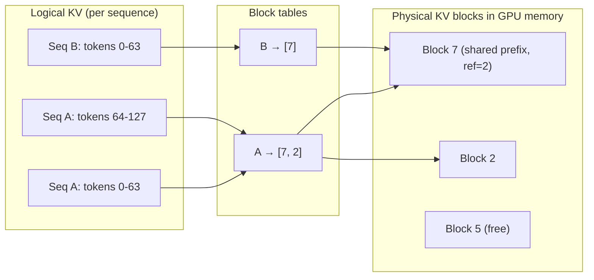
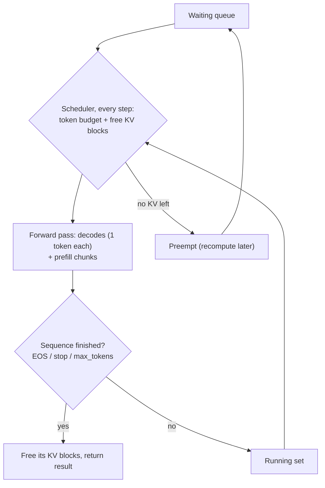
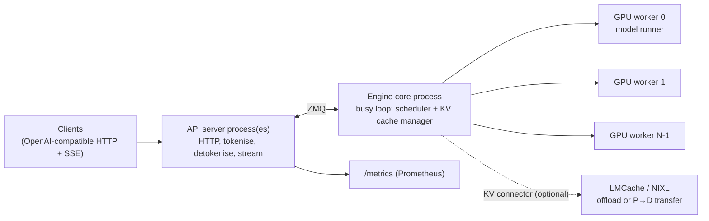
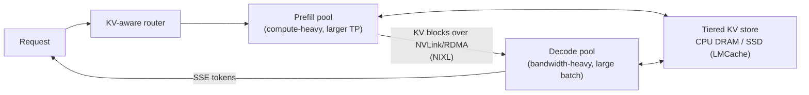

# 22 — Serving LLMs at scale

> **The requirement.** Lumen has outgrown one GPU. The product now needs a **32B-class open model** (we use
> Qwen3-32B [1]) for **10,000 concurrently active users** — people with a chat open, typing and reading — with
> **TTFT p95 < 2 s** and **TPOT p95 < 50 ms**, plus a cost per million tokens that finance can approve. Chapter 21
> showed that one GPU's limits are KV memory and memory bandwidth. At fleet scale, three new problems appear: keeping
> every GPU's batch full without breaking latency SLOs; not recomputing the same prompt prefixes thousands of times; and
> routing, scaling and loading replicas when each one is a stateful, 30–60 GB, minutes-to-start process. This chapter is
> the toolkit for those problems, centred on vLLM.

## In one minute

An LLM server is a scheduler wrapped around a GPU. Its job is to keep the GPU's batch as full as possible without making
anyone wait too long. **Continuous batching** lets requests join and leave the batch at every step instead of waiting for
the slowest one. **PagedAttention** stores the KV cache in small fixed-size blocks, like virtual memory pages, so
memory is not wasted on reservations and identical prefixes can share blocks. **Prefix caching** reuses the KV of a
prompt prefix — a system prompt, a document, a chat history — across requests, turning repeated prefill into a lookup.
**Chunked prefill** slices long prompts so they do not freeze other users' streams. Above a single server, you add a
**router** that sends each request to the replica that already holds its prefix, may split **prefill and decode onto
different GPUs**, and an **autoscaler** that watches queue depth and KV usage instead of CPU. Underneath it all,
**quantisation, speculative decoding and parallelism** trade accuracy, spare compute or interconnect bandwidth for
memory and speed. The capacity plan at the end shows how these turn 10,000 users into a GPU count and a price.

## Why this matters now

- **vLLM rebuilt its core.** The V1 engine was announced in January 2025 [2], became the default in v0.8.0
  (2025-03-18) and the old V0 engine was removed entirely in v0.11.0 (2025-10-02) — "V1 is the only engine in the
  codebase now" [3]. As of 2026-11 the latest release is **v0.34.0** (2026-11-16), which also removed the V1 *model
  runner* in favour of Model Runner V2 and changed default KV block size to 64 tokens [4]. Material written before 2025
  describes an engine that no longer exists.
- **Disaggregation went from papers to products.** DistServe (OSDI 2024) [5], Splitwise (ISCA 2024) [6] and Mooncake
  (FAST 2025 best paper) [7] argued for separating prefill and decode; by 2026 vLLM [8], SGLang, NVIDIA Dynamo [9] and
  llm-d [10] all ship it.
- **Kubernetes grew an inference layer.** The Gateway API Inference Extension promoted its `InferencePool` API to v1
  in September 2025 [11]; llm-d joined the CNCF as a Sandbox project in March 2026 and released v1.0.0 in October 2026
  [10]; KServe is a CNCF incubating project with vLLM and llm-d backends [12].
- **The field consolidated.** Hugging Face's TGI is in **maintenance mode** and its repository is archived; its README
  now recommends vLLM, SGLang, llama.cpp or MLX [13].

## Core ideas [Core]

### 1. PagedAttention: the KV cache as virtual memory

Before 2023, servers allocated each request's KV cache as one contiguous region sized for the maximum possible output.
Most of that space was never used. Kwon et al. profiled existing systems and found that "only 20.4% – 38.2% of the KV
cache memory is used to store the actual token states" [14]; the rest was reservation and fragmentation.

**PagedAttention** (SOSP 2023) [14] borrows the operating-system answer:

- The KV cache is divided into fixed-size **blocks** of *b* tokens (the physical pages). vLLM's default block size is
  now **64 tokens** (it was 16 before v0.34.0) [4].
- Each sequence has a **block table** mapping its logical token positions to physical blocks (the page table).
- Blocks are allocated **on demand** as the sequence grows. Waste is limited to the last, partly filled block.
- Blocks can be **shared** between sequences with identical prefixes (parallel sampling, beam search, common system
  prompts), with copy-on-write when they diverge.
- The attention kernel reads K/V through the block table, so non-contiguous storage costs little.

*Diagram: two sequences' logical token ranges map through per-sequence block tables to physical KV blocks; both
sequences point at the same physical block for their identical first 64 tokens, which is reference-counted; a third
block is free.*

The result reported in the paper: "near-zero waste in KV cache memory" and **2–4× throughput** "with the same level of
latency compared to the state-of-the-art systems, such as FasterTransformer and Orca" [14]. More usable KV memory means
bigger batches, and (chapter 21) bigger batches are the cost lever.

### 2. Continuous (iteration-level) batching

Orca (OSDI 2022) [15] identified the flaw in request-level batching: "requests that have finished earlier than other
requests in a batch cannot return to the client, while newly arrived requests have to wait until the current batch
completely finishes". Its fix, **iteration-level scheduling**, re-decides the batch at every model iteration. Orca
also introduced **selective batching** — batching the matrix multiplies across requests while running attention per
request — because sequences in one step have different lengths.

*Diagram: each step the scheduler takes running and waiting requests, fits them into a token budget and the free KV
blocks, runs one forward pass, frees finished sequences and keeps the rest running; if KV runs out it preempts a
sequence back to the waiting queue.*

**vLLM V1's version** is token-budget based: the scheduler output is "a dictionary `{request_id: num_tokens}`" and it
makes no hard distinction between prefill and decode [2]. With chunked prefill (on by default), it "batches all pending
decode requests before scheduling any prefill operations" and fills the remaining budget (`max_num_batched_tokens`)
with prefill chunks [16].

### 3. Automatic prefix caching (APC)

Real traffic repeats itself: the same system prompt on every request, the same retrieved document for many questions,
the same conversation history turn after turn. With paged KV, reuse is natural: if the first *k* full blocks of a new
prompt are identical to blocks already in memory, skip their prefill.

How vLLM does it (design doc [17]):

- Each **full** block gets a hash computed from **the parent block's hash, the block's tokens and extra keys** (LoRA
  ID, multimodal input hashes, cache salt). Chaining the parent hash makes a block's identity depend on the entire
  prefix before it. Only full blocks are cached.
- A global hash → block table finds hits. Freed blocks go to an **LRU free queue** and keep their contents until they
  are actually reused — so a cache hit can resurrect a block that no request currently holds.
- Since v0.11 the default hash is **SHA-256**, chosen because weaker hashes increase collision risk in multi-tenant
  setups [17].
- A per-request **`cache_salt`** is mixed into the first block's hash so "only requests with the same salt can reuse
  cached KV blocks" — isolation between tenants, which also blocks timing side channels that infer other tenants'
  prompts from cache hits [17].
- In V1, APC is **on by default**; the V1 announcement reported under 1 % throughput loss even at a 0 % hit rate [2].

SGLang's **RadixAttention** (Zheng et al., NeurIPS 2024) [18] generalised the idea to a radix tree over token
sequences with LRU eviction, and showed large gains on workloads with shared structure (the paper reports up to 6.4×
higher throughput across agent, reasoning, few-shot, JSON and multi-turn workloads [18]).

**What APC buys:** TTFT and prefill compute fall in proportion to the hit rate. **What it does not:** decode is
unchanged, and hits only happen on the replica that holds the blocks — which is why routing matters (section 8).

### 4. Chunked prefill

Covered in chapter 21: split long prefills so decodes are not stalled. Sarathi-Serve (OSDI 2024) [19] calls the
resulting schedules "stall-free" and reports 2.6× higher serving capacity for Mistral-7B on one A100 versus vLLM
at the time, under tail-latency constraints. The knob is the per-step token budget: larger favours TTFT and
throughput, smaller favours ITL. vLLM recommends `max_num_batched_tokens > 8192` for throughput on large GPUs [16].

### 5. vLLM V1 engine architecture (as of 2026-11, v0.34.0)

*Diagram: clients talk HTTP/SSE to API server processes, which tokenise and stream; they exchange messages over ZMQ with
the engine core, which runs the scheduler and KV cache manager and drives one worker process per GPU; an optional KV
connector moves KV to LMCache or over NIXL; metrics are exposed for Prometheus.*

From vLLM's architecture overview [20]:

- **API server process** — HTTP, "tokenization, multi-modal data loading", streaming results back; talks to the engine
  core "via ZMQ sockets". One by default; scales with data parallelism or `--api-server-count`.
- **Engine core process** — "runs the scheduler, manages KV cache, and coordinates model execution"; "a busy loop that
  continuously schedules requests". One per data-parallel rank.
- **GPU worker processes** — one per GPU (= TP × PP per engine core); load weights and run forward passes.
- **DP coordinator** — only with data parallelism; balances load and synchronises forward passes for MoE models.

What V1 changed versus V0 (from the V1 announcement [2]): an isolated `EngineCore` loop so CPU work (tokenisation,
streaming) overlaps GPU work; the unified token-budget scheduler; chunked prefill and prefix caching on by default with
constant-time eviction; a **persistent batch** that applies only diffs to cached input tensors; **piecewise CUDA
graphs** with `torch.compile`; symmetric tensor-parallel workers that cache request state. v0.34.0's release notes add
that Model Runner V2 is now the only GPU runner and that the KV cache is now sized from memory actually free after
warm-up, so most deployments should stop setting `gpu_memory_utilization` [4].

**Systems takeaway:** a vLLM replica is *CPU-sensitive* too. Starve the API server or engine core of CPU and the GPU
idles between steps. The architecture doc has a section on CPU sizing for GPU deployments for this reason [20].

### 6. The OpenAI-compatible server

`vllm serve <model>` exposes OpenAI-style `/v1/chat/completions`, `/v1/completions`, `/v1/embeddings`, model listing
and more, plus `/metrics`, `/health` and vLLM extensions such as `/tokenize` [21]. Compatibility is the reason vLLM is
easy to slot behind gateways (chapter 26): clients, SDKs and gateways speak one protocol, and extra sampling parameters
(`ignore_eos`, `min_tokens`, structured-output options) ride along as additional JSON fields.

**Structured outputs** constrain decoding so output matches a JSON schema, regex, choice list or grammar. vLLM uses
**xgrammar** or **guidance** as backends (`lm-format-enforcer` is deprecated) [22]. Mechanically, a grammar engine
masks the logits at each step so only tokens that keep the output valid can be sampled. Cost: per-step CPU work to
compute masks and grammar compilation on first use; caching compiled grammars matters at scale. SGLang's paper
contributes "compressed finite state machines for faster structured output decoding" [18].

### 7. Multi-LoRA serving

Many products fine-tune one base model into dozens or thousands of **LoRA adapters** (small low-rank weight deltas):
one per tenant, language or task. Running a replica per adapter wastes GPUs. **Punica** (MLSys 2024) [23] introduced a
CUDA kernel that batches requests for *different* adapters in one pass, so a GPU "hold[s] only a single copy of the
underlying pre-trained model", reporting 12× throughput over then-state-of-the-art systems. **S-LoRA** [24] added
*Unified Paging* — one memory pool for adapter weights and KV — and reported serving "thousands of LoRA adapters" with up
to 4× throughput over vLLM's naive LoRA support at the time.

In vLLM: `--enable-lora`, `--max-loras` (adapters resident on the GPU at once), `--max-lora-rank`, `--max-cpu-loras`
(a host-memory cache), and runtime loading through `/v1/load_lora_adapter` or LoRA resolver plugins (local or S3) when
`VLLM_ALLOW_RUNTIME_LORA_UPDATING=True` [25]. The LoRA ID is part of the prefix-cache hash [17], so adapters do not
share KV with the base model. Routing should be **adapter-aware**: send a tenant to replicas that already have its
adapter loaded (the Inference Extension lists LoRA availability among the signals it routes on [11]).

### 8. From one server to a fleet: routing

A round-robin load balancer is wrong for LLM serving for two reasons: requests vary 100× in cost, and replicas hold
different KV caches. The fleet-level router should consider:

1. **Load signals from the engine:** waiting queue length (`vllm:num_requests_waiting`), running requests, KV
   utilisation (`vllm:kv_cache_usage_perc`) [26].
2. **Prefix affinity:** send a request to the replica most likely to hold its prefix — by consistent hashing on
   session/conversation ID (simple), by approximate prefix matching on the prompt (better), or by a **global KV index**
   built from engine KV events (precise).
3. **Adapter and model affinity** for multi-LoRA and multi-model pools.
4. **Prefill/decode role** in disaggregated deployments (section 10).

These signals conflict: perfect affinity piles hot prefixes on one replica. Every production router mixes a cache-hit
score with a load penalty. The **Gateway API Inference Extension** standardises this on Kubernetes: an
`InferencePool` (v1 API) groups model-server pods, and an **Endpoint Picker (EPP)** plugged into an Envoy-based gateway
via ext-proc chooses the pod per request using "Metrics and Capabilities" such as "Prefix Cache status or LoRA Adapters
availability" [11]. (As of 2026-11, the full EPP implementation has moved to `llm-d/llm-d-router`; the
`kubernetes-sigs` repository keeps the `InferencePool` API, a lightweight reference EPP and the conformance tests [11].)
llm-d reports "3x higher output throughput and 2x faster TTFT with prefix-cache-aware routing vs round-robin" in one
partner deployment on Llama 3.1 70B — a vendor-reported result, not an independent benchmark [10].

### 9. Autoscaling on the right signals

CPU utilisation is meaningless for a GPU-bound server, and GPU "utilisation" (chapter 23) is nearly always high when
there is any work. Scale on what predicts SLO violations:

| Signal | Why | Pitfall |
|---|---|---|
| **Queue depth** (`num_requests_waiting`) per replica | leading indicator of TTFT | spikes briefly on bursts; smooth over a window |
| **KV-cache utilisation** (`kv_cache_usage_perc`) | the binding resource for concurrency | near 100 % is normal with APC (cached blocks look "used"); combine with queue |
| **TTFT / ITL percentiles** (histograms) | the SLO itself | lagging; best as a guard-rail |
| **Tokens/s in vs capacity** | proactive scaling from a capacity model | needs per-model calibration |

Implementation options: the Kubernetes HPA on custom/external metrics, KEDA, KServe's request-based autoscaling [12],
or the SLA-driven planners in Dynamo [9] and llm-d [10]. Whatever you choose, scale-up lead time is long (next section),
so keep **headroom** and scale on leading indicators.

### 10. Disaggregated prefill and decode

Colocating prefill and decode on one GPU makes them interfere: prefills stall decodes (ITL spikes) and decodes dilute
prefill batches (TTFT). **DistServe** (OSDI 2024) [5] assigns the phases to different GPUs, tunes parallelism per phase,
and reports serving "7.4x more requests or 12.6x tighter SLO" while staying within latency constraints for > 90 % of
requests. **Splitwise** (ISCA 2024) [6] observed that the token phase "do[es] not require the compute capability of the
latest GPUs" and reported 1.4× throughput at 20 % lower cost by splitting phases across machine types. **Mooncake**
(Moonshot AI's Kimi platform; FAST 2025 best paper) [7] built a KV-centric architecture with a distributed KV pool on
the cluster's CPU DRAM and SSD, plus early rejection under overload.

*Diagram: a KV-aware router sends a request to a prefill pool; the prefill pool computes KV and transfers it over a
fast interconnect via NIXL to a decode pool, which streams tokens to the user; both pools can read and write a tiered
KV store in CPU memory or SSD.*

**When it pays:** long prompts, strict ITL SLOs, large deployments where pools can be sized independently, and a fast
interconnect for KV transfer. **When it does not:** small deployments, short prompts, slow networks. vLLM's own docs are
blunt: disaggregated prefill "DOES NOT improve throughput" — its value is tuning TTFT and ITL separately and
"controlling tail ITL" [8]. In vLLM it is still marked experimental, implemented through **KV connectors** — among them
`NixlConnector` and `LMCacheConnectorV1` [8].

**The KV transfer plumbing (as of 2026-11):**
- **NIXL** (NVIDIA Inference Xfer Library, v1.5.2) — point-to-point transfers "in AI inference frameworks such as
  NVIDIA Dynamo", abstracting CPU/GPU memory and file/block/object storage, over UCX and other backends [27].
- **LMCache** — a KV cache layer that runs as a separate daemon so KV "will not be lost even if the inference engine
  crashes", offloads KV to CPU, disk and remote tiers, and supports P/D transfer "over NVLink, RDMA, or TCP through
  transport layers such as NIXL"; joined the PyTorch Foundation ecosystem in October 2025 [28].

## Numbers that matter

### Capacity plan: 10,000 active users on Qwen3-32B

Every row is either a **fact** (cited) or an **assumption** (A-n). Change the assumptions; keep the method.

**Model facts [1]:** 32.8 B parameters; 64 layers; 64 Q heads, 8 KV heads; head dim 128.
**GPU facts (H100 SXM) [29]:** 80 GB; 3.35 TB/s; FP8 tensor core 3,958 TFLOPS with sparsity → ≈ 1,979 dense.

| # | Assumption | Value |
|---|---|---|
| A-1 | Active users send one message per "think time" of | 60 s |
| A-2 | Prompt per request (system prompt + history + message) | 1,500 tokens |
| A-3 | Output per request | 300 tokens |
| A-4 | Prefix-cache hit rate on prompt tokens (shared system prompt + history reuse with session affinity) | 60 % |
| A-5 | Weights in FP8; KV cache in FP8 (1 byte) | quality validated beforehand |
| A-6 | Achieved prefill compute = 40 % of dense FP8 peak (MFU) | ≈ 790 TFLOPS |
| A-7 | Achieved decode bandwidth = 70 % of peak | ≈ 2.35 TB/s |
| A-8 | Usable HBM = 90 %; 4 GB for activations, graphs, fragmentation | — |
| A-9 | Peak-to-average traffic ratio | 1.5 |
| A-10 | GPU price | $3.00 per GPU-hour (illustrative) |

**Step 1 — users → requests/s.** 10,000 ÷ 60 s = **≈ 167 requests/s** (Little's law view: concurrency = rate × time).

**Step 2 — requests/s → tokens/s.**
Prompt: 167 × 1,500 = **250,000 tokens/s**, of which 40 % uncached (A-4) = **100,000 tokens/s to prefill**.
Output: 167 × 300 = **50,000 tokens/s to decode**.

**Step 3 — prefill GPUs.** 2 FLOPs × 32.8 × 10⁹ × 100,000 = 6.56 × 10¹⁵ FLOP/s ÷ 7.9 × 10¹⁴ (A-6) = **≈ 8.3 GPUs**.

**Step 4 — decode GPUs.** KV per token at FP8 = 64 × 2 × 8 × 128 × 1 B = **128 KiB**. Average context during decode
≈ 1,500 + 300/2 = 1,650 tokens → **216 MB per sequence**. KV budget per GPU = 72 − 32.8 − 4 = **35.2 GB** →
**≈ 162 sequences** max.

| Batch | Bytes per step (weights + KV) | Step time = TPOT (A-7) | Output tokens/s per GPU |
|---|---|---|---|
| 64 | 46.6 GB | 19.9 ms | ≈ 3,200 |
| 96 | 53.6 GB | 22.8 ms | ≈ 4,200 |
| **128** | **60.5 GB** | **25.8 ms** | **≈ 4,960** |
| 160 | 67.4 GB | 28.7 ms | ≈ 5,570 (too close to the 162-sequence memory cap) |

Choose *B* = 128: TPOT ≈ 26 ms leaves headroom under the 50 ms SLO for interference and tail effects.
50,000 ÷ 4,960 = **≈ 10.1 GPUs**. Cross-check with Little's law: in-flight decoding sequences = 50,000 tokens/s × 25.8 ms
≈ 1,290 → ÷ 162 per GPU ≈ 8 GPUs by memory, so throughput (10.1) binds, not memory.

**Step 5 — fleet.** Base ≈ 8.3 + 10.1 = 18.4 GPUs. × 1.5 for peaks (A-9) ≈ 27.6. Add N+1 failure headroom per pool and
round to nodes: **32 GPUs = four 8-GPU H100 nodes**. Whether to run them colocated (32 identical replicas with chunked
prefill) or disaggregated (≈ 14 prefill + 18 decode) is a design decision — section "Design choices".

**Step 6 — TTFT check.** Uncached prefill of 600 tokens on one GPU ≈ 2 × 32.8 × 10⁹ × 600 ÷ 7.9 × 10¹⁴ ≈ **50 ms**.
The 2 s p95 budget is safe *unless queues form*, which is why the autoscaler watches queue depth.

**Step 7 — validate.** These are roofline estimates. Before buying, run `vllm bench serve` (or the lab's client) with
your real prompt/output length distribution and an open-loop arrival rate, and adjust A-6/A-7.

### Cost per million tokens

> cost per 1M tokens = (GPUs × $/GPU-hour) ÷ (tokens per hour ÷ 10⁶) ÷ average utilisation

Fleet cost = 32 × $3.00 = **$96/hour** (A-10). At average load: 180 M output tokens/hour and 900 M prompt tokens/hour.

| View | Calculation | Result |
|---|---|---|
| All cost on output tokens | 96 ÷ 180 | **≈ $0.53 per 1M output tokens** |
| Blended over all tokens | 96 ÷ 1,080 | **≈ $0.089 per 1M tokens** |
| Split by GPU-time share (prefill 8.3 / decode 10.1 of 18.4) | 45 % → input, 55 % → output | **≈ $0.048 per 1M prompt tokens; ≈ $0.29 per 1M output tokens** |

Two honesty notes. (1) The fleet is sized for peak; if the daily *average* load is half of the "average" used above,
divide every throughput by two and double every price. (2) This counts GPUs only — not CPUs, network, storage,
engineers or idle replicas in other regions. Chapter 16 covers full unit economics.

### Speculative decoding arithmetic

With a draft that proposes γ tokens and a per-token acceptance rate α, Leviathan et al. derive the expected number of
tokens produced per target-model step as (1 − αγ+1) ÷ (1 − α) [30]. With γ = 4 and α = 0.7 that is
(1 − 0.7⁵) ÷ 0.3 ≈ **2.8 tokens per step**. The target model's verification step costs about one decode step when
decode is bandwidth-bound — which is why speculative decoding helps most at low to medium load and less when large
batches have already used up the spare compute (vLLM's docs target "medium-to-low QPS (queries per second),
memory-bound workloads" [31]).

## Design choices and trade-offs

### Serving engines (as of 2026-11)

| Engine | Latest release | Wins when | Costs / caveats | Notes |
|---|---|---|---|---|
| **vLLM** | v0.34.0 (2026-11-16) [4] | broad model and hardware support; OpenAI-compatible server; large ecosystem (LMCache, llm-d, KServe, production-stack) | fast-moving defaults — re-validate on upgrade | PagedAttention, APC, chunked prefill, spec decode, multi-LoRA, P/D via KV connectors |
| **SGLang** | v0.5.23 (2026-11-02) | prefix-heavy and structured workloads (RadixAttention, compressed FSM); large-scale P/D and expert parallelism | fast release cadence; verify model and feature coverage for your model | supports NVIDIA, AMD, TPU (via SGLang-TorchTPU/SGL-JAX), Intel and others per its README [32] |
| **TensorRT-LLM** | v1.4.0 release candidates (2026-11) | maximum performance on NVIDIA GPUs with NVIDIA-tuned kernels | NVIDIA-only | now "architected on PyTorch", fully open source, with `trtllm-serve`; P/D and wide expert parallelism [33] |
| **Hugging Face TGI** | v3.3.7 (2025-12-19), archived | existing deployments | **maintenance mode**; README recommends vLLM/SGLang/llama.cpp/MLX [13] | do not start new projects on it |
| **llama.cpp (`llama-server`) / Ollama** | llama.cpp builds daily; Ollama v0.40.16 (2026-11-09) [45] | laptops, edge, CPUs, Apple silicon, GGUF quantised models, single-user | lower peak throughput on data-centre GPUs | llama.cpp server supports continuous batching and parallel slots [34] |

**Above the engine:** NVIDIA **Dynamo** (v1.6.2) — "the orchestration layer above inference engines — it doesn't replace
SGLang, TensorRT-LLM, or vLLM", with disaggregated serving, KV-aware routing and SLA-based autoscaling; its own README
says a single model on a single GPU probably does not need it [9]. **llm-d** (v1.0.0, CNCF Sandbox) — Kubernetes-native
routing, tiered KV, P/D and wide expert parallelism over vLLM/SGLang [10]. **vLLM production-stack** (Helm chart
`vllm-stack-0.1.14`) — a reference K8s deployment with a session/prefix-aware router, LMCache offload and
Prometheus/Grafana [35]. **KServe** (v0.21.0) — CNCF incubating platform unifying predictive and generative serving,
with vLLM and llm-d backends [12].

### Colocated vs disaggregated

| | Colocated + chunked prefill | Disaggregated P/D |
|---|---|---|
| Wins when | small/medium fleets; short-to-medium prompts; simple ops | long prompts; strict ITL; large fleets; heterogeneous hardware |
| Costs | prefill/decode interference; one parallelism config for both | KV transfer bandwidth and latency; two pools to size and scale; more failure modes |
| Example | default vLLM replica | DistServe [5], Splitwise [6], Mooncake [7], vLLM KV connectors [8], Dynamo [9], llm-d [10] |

### Parallelism

| Strategy | Splits | Wins when | Costs | vLLM flag |
|---|---|---|---|---|
| **Data parallel (replicas)** | requests | model fits one GPU/node | none beyond memory per replica | `--data-parallel-size` / more pods |
| **Tensor parallel (TP)** | each layer's matrices across GPUs | model or KV too big for one GPU; lower per-token latency | all-reduce every layer → needs NVLink-class links | `--tensor-parallel-size` |
| **Pipeline parallel (PP)** | layers into stages | model too big for one node; GPUs without NVLink | pipeline bubbles; higher latency | `--pipeline-parallel-size` |
| **Expert parallel (EP)** | MoE experts across GPUs | large MoE models | all-to-all traffic; load imbalance across experts | DP attention + EP MoE layers |

vLLM's guidance: TP within a node, add PP across nodes (e.g. TP 8 × PP 2 on two 8-GPU nodes), and prefer PP over TP
on GPUs without NVLink (its example is L40S) [36]. For MoE, it supports "Data Parallel attention with Expert or Tensor
Parallel MoE layers" [36]. Chapter 23 quantifies why TP must stay inside the NVLink domain.

### Quantisation

| Method | What is quantised | Wins when | Costs | Reference |
|---|---|---|---|---|
| **FP8 (W8A8)** | weights and activations | Hopper/Blackwell-class GPUs; halves weight bytes and uses FP8 tensor cores | calibration; evaluate accuracy | vLLM via LLM Compressor [37] |
| **AWQ** (MLSys 2024 best paper) | weights to 4-bit, protecting salient channels found from activations | memory-limited deployment, edge | accuracy risk; dequantisation overhead | Lin et al. [38] |
| **GPTQ** (ICLR 2023) | weights to 3–4-bit via approximate second-order information | same | same | Frantar et al. [39] |
| **FP8 KV cache** | KV cache | long context / high concurrency | attention accuracy risk | vLLM `kv_cache_dtype="fp8"` [40] |
| **NVFP4 / MXFP4** | weights (and activations) to 4-bit floating point | Blackwell-class GPUs | newest; hardware-specific | vLLM quantisation docs [37] |

Rule: **quantisation is a model change.** Run your evaluation suite (chapter 26) before shipping, per model and per
method.

### Speculative decoding methods (vLLM, as of 2026-11)

vLLM lists draft-model, n-gram, suffix decoding, EAGLE (including `eagle3`), multi-token prediction (MTP) and several
newer methods, configured via `--speculative-config '{"method": ..., "num_speculative_tokens": ...}'` [31]. Standard
speculative sampling is "theoretically lossless up to the precision limits of hardware numerics" [31]. Published
results to calibrate expectations: Leviathan et al. 2–3× on T5-XXL with identical outputs [30]; EAGLE 2.7–3.5×
latency speedup on LLaMA2-Chat 70B [41]; EAGLE-3 "up to 6.5x" speedup and 1.38× throughput at batch size 64 in
SGLang [42]. Expect much smaller gains at high load.

## Deep dive [Deep]

### Admission control and SLO-aware scheduling

Continuous batching is first-come-first-served inside a token budget by default. At saturation that means every
request's TTFT rises together. Options, roughly in order of sophistication:

1. **Bound the queue and shed load** (HTTP 429 with `Retry-After`) when queue time would exceed the TTFT SLO
   ([SYSDESIGN-11](../01-foundations/11-reliability-engineering.md)). Mooncake's "prediction-based early rejection" is
   this idea applied under heavy overload [7].
2. **Priority scheduling** — vLLM V1 implements priority scheduling (since v0.9.2 [3]); map paid/interactive traffic to
   high priority and batch/agent traffic to low.
3. **Token-based rate limits per tenant** at the gateway (chapter 26), so one tenant's 100k-token prompts cannot starve
   others.
4. **Fairness-aware flow control** in the routing layer — llm-d lists "priority- and fairness-aware flow control" for
   multi-tenant quality of service [10].
5. **Separate pools per SLO class** — a latency tier at small batch and a throughput tier at large batch.

### Cold starts and model loading

A new replica must: get a GPU node (cloud provisioning can take minutes), pull a multi-GB container image, fetch tens of
GB of weights, load them into HBM, compile/capture CUDA graphs, then warm up. Tactics:

- **Pre-pull images** onto nodes; keep a small warm pool.
- **Stream weights** instead of copying then loading: vLLM supports the Run:ai Model Streamer
  (`--load-format runai_streamer`) to read safetensors concurrently, including directly from S3 or GCS [43].
- **Cache weights near the GPU** (node-local NVMe, a shared read-only volume) instead of downloading per pod.
- **Sleep mode** — vLLM can offload weights to CPU RAM and discard KV (level 1) to free GPU memory without killing the
  server, then wake quickly [44]; useful for time-sharing a GPU between models or with RL training.
- **Scale on leading indicators** (queue depth, arrival rate) with headroom, because lag is minutes, not seconds.

### Multi-tenancy and prefix caching security

Prefix caching creates a shared resource across requests. If two tenants share a replica, a timing difference can reveal
whether a prompt prefix is cached. vLLM's mitigations: per-tenant `cache_salt`, and SHA-256 block hashing by default
since v0.11 [17]. Combine with tenant-aware routing (chapter 18 on multi-tenant isolation) and do not log prompts by
default (chapter 19).

### KV offloading and the memory hierarchy

GPU HBM is the fastest and smallest tier. Multi-turn chats and agents revisit the same context minutes later — long
after LRU has evicted it from HBM. Tiered KV moves cold blocks to CPU DRAM, local SSD or a remote store and brings them
back on a hit, turning a re-prefill into a transfer. It pays when transfer time < recompute time: a 10,000-token
prefix of Qwen3-32B at FP8 KV is 10,000 × 128 KiB ≈ 1.3 GB; recomputing it costs ≈ 2 × 32.8 × 10⁹ × 10⁴ FLOPs ≈ 0.83 s
at the A-6 rate, while moving 1.3 GB over a 50 GB/s host link takes ≈ 26 ms (bandwidth illustrative; PCIe Gen5 x16 is
specified at 128 GB/s bidirectional on the H100 [29]). llm-d reports a 13.9× throughput improvement with hierarchical
KV offloading at 250 concurrent users on 4 H100s (vendor-reported) [10]; LMCache provides the layer for vLLM [28].

### Expert parallelism and very large MoE models

Frontier open models in 2026 are often MoE with hundreds of billions to a trillion total parameters (vLLM v0.34.0's
release notes add "Mistral Large 4" at "1T total / 52B active" [4]). Weights alone exceed a node, so serving combines
data-parallel attention with expert-parallel MoE layers across many GPUs ("wide EP"), adding all-to-all
communication every MoE layer and load-balancing across experts. This is where disaggregation, NVLink-domain size
(chapter 23) and KV transfer libraries all meet.

## Frontier [Frontier]

*(as of 2026-11)*

- **vLLM v0.34.0** (2026-11-16): Model Runner V2 only; extensible KV cache sized after warm-up on by default; default
  block size 64; new speculative-decoding plumbing (custom speculators, suffix decoding on a GPU speculator) [4].
- **llm-d v1.0.0** (2026-10-20): positioned as "inference ready for Day-2" — router HA, prefill/decode lockstep upgrades,
  batch APIs, agent-aware session routing [10].
- **Inference Gateway split**: the EPP moved from `kubernetes-sigs/gateway-api-inference-extension` to
  `llm-d/llm-d-router`; the InferencePool API and conformance tests stay in the SIG repo [11].
- **Dynamo v1.6.2** with Rust-core orchestration over vLLM/SGLang/TensorRT-LLM; NIXL v1.5.2 for KV transfer [9][27].
- **Agentic traffic** (chapter 25) is reshaping serving: long shared contexts, many short turns, tool-call pauses. Session
  affinity, KV offload and turn-priority scheduling are the responses llm-d and LMCache now advertise [10][28].

## Failure modes and operations

| Failure | Detect (SLI / metric) | Mitigate |
|---|---|---|
| **Queue build-up** → TTFT p99 explodes | `vllm:num_requests_waiting`, `vllm:request_queue_time_seconds` | autoscale on queue; shed load; priority classes |
| **KV exhaustion / preemption storms** | preemption log lines/counters; `kv_cache_usage_perc` pinned with queue growing | more replicas; FP8 KV; lower `max_num_seqs`/`max_model_len`; KV offload |
| **Prefix-cache hit rate collapses after a deploy/scale-out** | `vllm:prefix_cache_hits` ÷ `vllm:prefix_cache_queries` | prefix-aware routing; warm caches gradually; avoid reshuffling affinity on scale events |
| **Hot replica** from affinity routing | per-pod queue skew | load penalty in routing score; bounded-load consistent hashing ([SYSDESIGN-07](../01-foundations/07-partitioning-sharding.md)) |
| **ITL spikes** | ITL p99 vs p50 | smaller chunked-prefill budget; P/D disaggregation |
| **Cold-start lag during spikes** | time from scale decision to Ready | warm pools; weight streaming; pre-pulled images; scale earlier |
| **Silent quality regression** after quantisation/upgrade | eval scores, user feedback | canary + eval gates (chapter 26); pin versions |
| **A failed GPU kills a TP group** | pod restarts; Xid errors (chapter 23) | treat the TP group as one failure unit; N+1 per pool; drain on health signals |
| **KV-transfer bottleneck** in P/D | prefill→decode transfer time; decode idle | co-locate pools on the fast fabric; tune transfer backend; fall back to colocated |
| **Version drift** across replicas | mixed `vllm` versions in a pool | immutable images; staged rollouts per pool |

**Golden dashboard:** request rate; TTFT p50/p99; ITL p99; TPOT p50/p99; queue depth; running sequences; KV utilisation;
prefix-hit rate; preemptions; tokens/s in and out; error rate; goodput against SLO.

## Cost and energy

- **The three biggest levers**, in typical order of impact: (1) **batch occupancy** — keep KV and step budgets full
  within SLO; (2) **don't recompute** — prefix caching and KV offload; (3) **move fewer bytes** — FP8/INT4 weights, FP8
  KV, GQA models, speculative decoding at low load. Choosing a smaller model is often bigger than all three.
- **Price the phases separately.** Prompt tokens are cheap to compute per token (compute-bound, batched by length);
  output tokens are expensive (bandwidth-bound, sequential). This is why many public API price lists charge more per output
  token than per input token — check current pricing pages rather than trusting any number from a course.
- **Utilisation is the hidden multiplier.** A fleet sized for peak and idle at night costs the same per hour. Use the
  troughs: offline batch inference (llm-d lists OpenAI-compatible Batch APIs [10]), evaluation runs, or
  scale-down where cold starts allow.
- **Energy per token** improves with batch size and with HBM bandwidth per watt; report it as J/token alongside
  $/token (method in [SYSDESIGN-17](../02-modern-requirements/17-energy-carbon-aware.md)).

## Interview angle

**How it is asked in ML-infra / LLM-serving interviews.**
- "Design a ChatGPT-like service for N users" (full case: [C09](../04-case-studies/C09-llm-chat-service.md)).
- "We serve a 70B model on vLLM and p99 TTFT is bad at peak. Walk me through debugging."
- "Explain PagedAttention / continuous batching / prefix caching and what problem each solves."
- "How would you autoscale LLM inference on Kubernetes?" (→ not CPU.)
- "When would you disaggregate prefill and decode?"
- "Estimate the number of GPUs and cost per million tokens for this workload."

**Model answer outline (CLARIFY → QUANTIFY → SKETCH → DEEPEN → STRESS → WRAP):**
1. **CLARIFY:** model (size, dense/MoE, KV heads), precision tolerance, prompt/output distributions, prefix reuse
   (system prompts, RAG docs, multi-turn), SLOs as TTFT/TPOT percentiles, tenants/adapters, peak vs average.
2. **QUANTIFY:** users → req/s → prompt and output tokens/s; prefill GPUs from FLOPs; decode GPUs from bandwidth and KV
   capacity; peak and failure headroom; $/1M tokens with labelled assumptions.
3. **SKETCH:** gateway (auth, token rate limits) → KV/prefix-aware router → vLLM replicas (or P and D pools) →
   tiered KV → metrics → autoscaler; model-weight cache; eval-gated rollout.
4. **DEEPEN:** pick two: continuous batching + PagedAttention; prefix caching + routing; P/D disaggregation; quantisation
   and speculative decoding; parallelism choice for the model size.
5. **STRESS:** traffic spike (queue → shed/scale; cold-start lag), hot prefix, GPU failure in a TP group, KV
   exhaustion, cache hit-rate collapse on scale-out, bad quantised model.
6. **WRAP:** the binding constraint, the SLO you protect first, the cost per token, and what you would benchmark.

**Red flags:** round-robin load balancing; autoscaling on CPU or "GPU utilisation"; TP across nodes without saying why;
claiming disaggregation always increases throughput; ignoring prefix caching for chat; quoting a vendor speedup as a
law of nature; no admission control.

**Likely follow-ups:** How does prefix-aware routing interact with autoscaling? What happens to the cache when you add
replicas? How do you serve 500 LoRA adapters? What breaks when you move from H100 to a GPU without NVLink? How do you
roll out a new model version safely?

## Common mistakes

- **Benchmarking closed-loop at fixed concurrency and reporting "max QPS".** Use open-loop arrivals and report goodput.
- **Treating `kv_cache_usage_perc` ≈ 1.0 as an emergency** when APC keeps freed blocks resident; pair it with queue
  depth and preemptions.
- **Turning on every optimisation at once.** Speculative decoding at high load, small chunked-prefill budgets and
  aggressive quantisation can each hurt; change one variable at a time.
- **Forgetting the CPU.** Tokenisation, detokenisation, grammar masks and the engine loop need cores.
- **Ignoring version churn.** Defaults (block size, KV sizing, memory utilisation) changed in v0.34.0 alone [4].
- **Designing affinity without a load bound** → hot replicas.
- **Sharing prefix caches across tenants without salts** → a side channel.

## Check yourself

1. Why does PagedAttention increase throughput even though it does not make any kernel faster?
2. In vLLM V1, what does the scheduler output each step, and how does that make chunked prefill natural?
3. A replica's prefix-hit rate drops from 70 % to 15 % after scaling from 4 to 8 replicas. Why, and what do you change?
4. Name two signals better than CPU utilisation for autoscaling, and one pitfall of each.
5. Recompute the capacity plan's decode GPU count if outputs double to 600 tokens.

Full set with answers: [exercises/22-serving-llms-at-scale.md](../../exercises/22-serving-llms-at-scale.md).

## Lab

[Lab L22 — batching and prefix caching, measured](../../labs/22-serving-llms-at-scale/README.md). On a laptop CPU
(vLLM's CPU image; GPU optional) you run a **concurrency sweep** (1 → 16 in-flight requests) and watch aggregate
tokens/s rise while per-user TPOT degrades — continuous batching in numbers — then run the same shared-prefix workload
against two replicas, one with `--enable-prefix-caching` and one with `--no-enable-prefix-caching`, and compare TTFT and
the `vllm:prefix_cache_hits_total` counter. CPU absolute numbers do not transfer to GPUs; the shapes of the curves do.
On the 2026-11-20 test run (6-core AVX2 laptop), 16 concurrent requests produced 5.1× the aggregate tokens/s of one
while TPOT roughly doubled, and prefix caching cut warm-request TTFT from ≈ 3.9 s to ≈ 0.6 s with a 77 % token hit rate
— exactly 7 requests × 12 full blocks, as full-block hashing predicts. Details and caveats are in the lab's test record.

## Further reading

- Kwon et al., *PagedAttention / vLLM*, SOSP 2023 [14] — read §3–4 for the memory problem and the paging design.
- Yu et al., *Orca*, OSDI 2022 [15] — iteration-level scheduling, the origin of continuous batching.
- Zhong et al., *DistServe*, OSDI 2024 [5] and Qin et al., *Mooncake*, FAST 2025 [7] — disaggregation from first
  principles and in production.
- Zheng et al., *SGLang*, NeurIPS 2024 [18] — RadixAttention and structured-output decoding.
- vLLM V1 announcement [2] and architecture overview [20] — the engine you will actually run.
- Leviathan et al., *Speculative Decoding*, ICML 2023 [30] — the algorithm and its expected-speedup formula.
- llm-d and Gateway API Inference Extension docs [10][11] — the Kubernetes layer.

## References

1. Qwen Team, *Qwen3-32B model card and config.json*, Hugging Face. https://huggingface.co/Qwen/Qwen3-32B (accessed 2026-11)
2. vLLM Team, *vLLM V1: A Major Upgrade to vLLM's Core Architecture*, 2025-01-27. https://vllm.ai/blog/2025-01-27-v1-alpha-release (accessed 2026-11)
3. vLLM project, *GitHub releases v0.8.0 (V1 default), v0.9.2 (priority scheduling in V1; last version with V0 intact), v0.11.0 (V0 removed)*. https://github.com/vllm-project/vllm/releases (accessed 2026-11)
4. vLLM project, *Release v0.34.0*, 2026-11-16. https://github.com/vllm-project/vllm/releases/tag/v0.34.0 (accessed 2026-11)
5. Y. Zhong et al., *DistServe: Disaggregating Prefill and Decoding for Goodput-optimized Large Language Model Serving*, OSDI 2024. arXiv:2401.09670. https://www.usenix.org/conference/osdi24/presentation/zhong-yinmin
6. P. Patel et al., *Splitwise: Efficient Generative LLM Inference Using Phase Splitting*, ISCA 2024. arXiv:2311.18677. https://www.microsoft.com/en-us/research/publication/splitwise-efficient-generative-llm-inference-using-phase-splitting/
7. R. Qin et al., *Mooncake: Trading More Storage for Less Computation — A KVCache-centric Architecture for Serving LLM Chatbot*, FAST 2025 (Best Paper). arXiv:2407.00079. https://www.usenix.org/conference/fast25/presentation/qin
8. vLLM project, *Disaggregated Prefilling (experimental)*, v0.34.0. https://github.com/vllm-project/vllm/blob/v0.34.0/docs/features/disagg_prefill.md (accessed 2026-11)
9. NVIDIA, *Dynamo — README* (v1.6.2, 2026-11-05). https://github.com/ai-dynamo/dynamo (accessed 2026-11)
10. llm-d project, *README and releases* (v1.0.0, 2026-10-20; CNCF Sandbox since 2026-03). https://github.com/llm-d/llm-d (accessed 2026-11)
11. Kubernetes SIG Network, *Gateway API Inference Extension — README; release v1.0.0 (2025-09-09, InferencePool v1); latest v1.6.2*. https://github.com/kubernetes-sigs/gateway-api-inference-extension (accessed 2026-11)
12. KServe project, *README* (CNCF incubating; v0.21.0, 2026-09-25). https://github.com/kserve/kserve (accessed 2026-11)
13. Hugging Face, *text-generation-inference README* (maintenance mode; repository archived; v3.3.7, 2025-12-19). https://github.com/huggingface/text-generation-inference (accessed 2026-11)
14. W. Kwon et al., *Efficient Memory Management for Large Language Model Serving with PagedAttention*, SOSP 2023. arXiv:2309.06180. https://arxiv.org/abs/2309.06180
15. G.-I. Yu, J. S. Jeong, G.-W. Kim, S. Kim, B.-G. Chun, *Orca: A Distributed Serving System for Transformer-Based Generative Models*, OSDI 2022. https://www.usenix.org/conference/osdi22/presentation/yu
16. vLLM project, *Optimization and Tuning* (preemption, chunked prefill), v0.34.0. https://docs.vllm.ai/en/latest/configuration/optimization.html (accessed 2026-11)
17. vLLM project, *Automatic Prefix Caching (design)*. https://docs.vllm.ai/en/latest/design/prefix_caching.html (accessed 2026-11)
18. L. Zheng et al., *SGLang: Efficient Execution of Structured Language Model Programs*, NeurIPS 2024. arXiv:2312.07104. https://proceedings.neurips.cc/paper_files/paper/2024/hash/724be4472168f31ba1c9ac630f15dec8-Abstract-Conference.html
19. A. Agrawal et al., *Taming Throughput-Latency Tradeoff in LLM Inference with Sarathi-Serve*, OSDI 2024. arXiv:2403.02310. https://www.usenix.org/conference/osdi24/presentation/agrawal
20. vLLM project, *Architecture Overview* (V1 process architecture), v0.34.0. https://docs.vllm.ai/en/latest/design/arch_overview.html (accessed 2026-11)
21. vLLM project, *OpenAI-Compatible Server*. https://docs.vllm.ai/en/latest/serving/openai_compatible_server.html (accessed 2026-11)
22. vLLM project, *Structured Outputs*, v0.34.0. https://docs.vllm.ai/en/latest/features/structured_outputs.html (accessed 2026-11)
23. L. Chen et al., *Punica: Multi-Tenant LoRA Serving*, MLSys 2024. arXiv:2310.18547. https://proceedings.mlsys.org/paper_files/paper/2024/hash/054de805fcceb78a201f5e9d53c85908-Abstract-Conference.html
24. Y. Sheng et al., *S-LoRA: Serving Thousands of Concurrent LoRA Adapters*, 2023. arXiv:2311.03285. https://arxiv.org/abs/2311.03285
25. vLLM project, *LoRA Adapters*, v0.34.0. https://docs.vllm.ai/en/latest/features/lora.html (accessed 2026-11)
26. vLLM project, *Metrics (design doc)*. https://docs.vllm.ai/en/latest/design/metrics.html (accessed 2026-11)
27. NVIDIA, *NIXL — NVIDIA Inference Xfer Library, README* (v1.5.2, 2026-10-29). https://github.com/ai-dynamo/nixl (accessed 2026-11)
28. LMCache project, *README*. https://github.com/LMCache/LMCache (accessed 2026-11)
29. NVIDIA, *H100 Tensor Core GPU — product specifications*. https://www.nvidia.com/en-us/data-center/h100/ (accessed 2026-11)
30. Y. Leviathan, M. Kalman, Y. Matias, *Fast Inference from Transformers via Speculative Decoding*, ICML 2023. arXiv:2211.17192. https://arxiv.org/abs/2211.17192
31. vLLM project, *Speculative Decoding*. https://docs.vllm.ai/en/latest/features/speculative_decoding/ (accessed 2026-11)
32. SGLang project, *README* (v0.5.23, 2026-11-02). https://github.com/sgl-project/sglang (accessed 2026-11)
33. NVIDIA, *TensorRT-LLM README* (v1.4.0rc4, 2026-11-18). https://github.com/NVIDIA/TensorRT-LLM (accessed 2026-11)
34. ggml-org, *llama.cpp server README*. https://github.com/ggml-org/llama.cpp/blob/master/tools/server/README.md (accessed 2026-11)
35. vLLM project, *production-stack README* (vllm-stack-0.1.14, 2026-11-07). https://github.com/vllm-project/production-stack (accessed 2026-11)
36. vLLM project, *Parallelism and Scaling*, v0.34.0. https://docs.vllm.ai/en/latest/serving/parallelism_scaling.html (accessed 2026-11)
37. vLLM project, *Quantization* (supported methods; LLM Compressor; NVFP4), v0.34.0. https://docs.vllm.ai/en/latest/features/quantization/ (accessed 2026-11)
38. J. Lin et al., *AWQ: Activation-aware Weight Quantization for LLM Compression and Acceleration*, MLSys 2024 (Best Paper). arXiv:2306.00978. https://arxiv.org/abs/2306.00978
39. E. Frantar, S. Ashkboos, T. Hoefler, D. Alistarh, *GPTQ*, ICLR 2023. arXiv:2210.17323. https://arxiv.org/abs/2210.17323
40. vLLM project, *Quantized KV Cache*, v0.34.0. https://docs.vllm.ai/en/latest/features/quantization/quantized_kvcache.html (accessed 2026-11)
41. Y. Li, F. Wei, C. Zhang, H. Zhang, *EAGLE: Speculative Sampling Requires Rethinking Feature Uncertainty*, 2024. arXiv:2401.15077. https://arxiv.org/abs/2401.15077
42. Y. Li et al., *EAGLE-3: Scaling up Inference Acceleration of Large Language Models via Training-Time Test*, 2025. arXiv:2503.01840 (preprint). https://arxiv.org/abs/2503.01840
43. vLLM project, *Loading models with Run:ai Model Streamer*, v0.34.0. https://docs.vllm.ai/en/latest/models/extensions/runai_model_streamer.html (accessed 2026-11)
44. vLLM project, *Sleep Mode*, v0.34.0. https://docs.vllm.ai/en/latest/features/sleep_mode.html (accessed 2026-11)
45. Ollama project, *GitHub releases* (v0.40.16, 2026-11-09). https://github.com/ollama/ollama/releases (accessed 2026-11)
