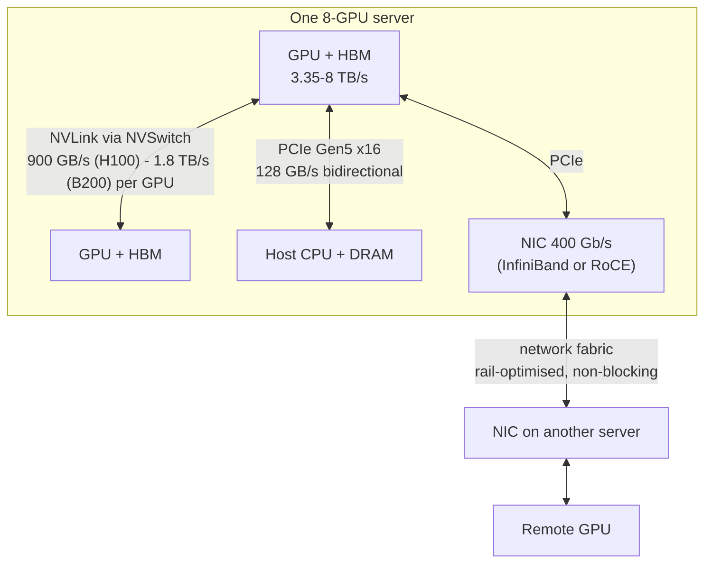
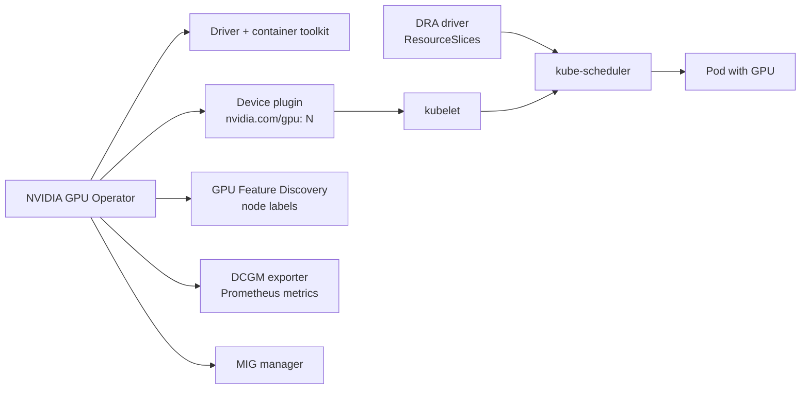

# 23 — GPU & accelerator infrastructure

> **The requirement.** Lumen now owns hardware: **64 GPUs** (eight 8-GPU nodes) shared by the inference fleet from
> chapter 22 and by weekly fine-tuning jobs. The platform team must (1) give inference predictable tail latency,
> (2) start a 32-GPU training job only when *all* 32 GPUs are free and well-connected, (3) detect and drain failing GPUs
> before they corrupt a run, and (4) tell finance the cost per million tokens and per training run. Treating GPUs as
> "big CPUs in a pod spec" fails all four. This chapter is the hardware and scheduling layer underneath AI systems.

## In one minute

A data-centre GPU is a very fast calculator bolted to a small, very fast memory (HBM). For LLMs the memory is usually the
limit — its size decides which models and how many users fit, and its bandwidth decides how fast tokens come out. GPUs
in one server talk over **NVLink** (fast); servers talk over **InfiniBand or Ethernet with RDMA** (much slower per GPU);
everything else goes over **PCIe**. Work that communicates every layer, like tensor parallelism, must stay on NVLink.
Kubernetes sees GPUs as countable devices advertised by a **device plugin**; the newer **Dynamic Resource Allocation**
(DRA) API lets you request devices by attributes. You can split a GPU with **MIG** (hard partitions), **MPS** (shared
with limits) or **time-slicing** (no isolation). Training jobs need **gang scheduling** — all pods or none — and
**topology-aware placement**. GPUs fail often at scale: Meta reported 419 unexpected interruptions in 54 days of
training on up to 16K H100s. And the "GPU utilisation" number most dashboards show is not what you think.

## Why this matters now

- **Memory became the product.** NVIDIA's H200 kept the H100's compute but raised memory to 141 GB at 4.8 TB/s [2]; AMD's
  MI355X ships 288 GB at 8 TB/s [6]; Google's TPU7x (Ironwood) has 192 GiB per chip [7]. The spec war moved from FLOPs to
  bytes because inference (chapter 21) is bandwidth-bound.
- **Racks became the unit.** NVIDIA's GB200 NVL72 joins 72 GPUs in one NVLink domain with 130 TB/s of total NVLink
  bandwidth, in a "rack-scale, liquid-cooled design" [4]. Scheduling now has to understand racks and NVLink domains,
  not just nodes.
- **Kubernetes caught up.** Dynamic Resource Allocation graduated to GA in Kubernetes v1.34 (August 2025) [9]; native
  gang scheduling is beta in v1.37 [10]; Kueue and Volcano matured for batch AI [12][13].
- **Slurm and Kubernetes converged.** SchedMD's Slinky project runs Slurm on Kubernetes [14], and NVIDIA acquired
  SchedMD in December 2025, committing to keep Slurm open-source and vendor-neutral [15].
- **Failures went from rare to routine.** The Llama 3 paper published per-component interruption statistics for a
  16K-GPU training run [16] — rare, concrete data for designing fault tolerance.

## Core ideas [Core]

### 1. What is inside a GPU (systems view)

You need four parts, not the micro-architecture:

- **Streaming multiprocessors (SMs)** with **tensor cores** — matrix-multiply units that deliver most of the FLOPs for
  BF16/FP16/FP8/FP4. CUDA cores do general arithmetic.
- **HBM** — stacked DRAM next to the die: tens to hundreds of GB at several TB/s. Holds weights, KV cache, activations.
- **On-chip SRAM/L2** — tiny but far faster; kernels such as FlashAttention [17] are designed to minimise HBM traffic
  by tiling through on-chip memory ("IO-aware").
- **Links** — NVLink ports to other GPUs, a PCIe link to the host CPU and NICs.

**Read datasheets carefully.** NVIDIA's tensor-core peaks are marked "With sparsity" [1][2]; the dense number is half.
"Sparsity" means 2:4 structured sparsity, which ordinary dense LLM inference does not use.

| Accelerator (as of 2026-11) | Memory | Bandwidth | Dense BF16/FP16 | Dense FP8 | Power | Source |
|---|---|---|---|---|---|---|
| NVIDIA H100 SXM | 80 GB HBM3 | 3.35 TB/s | ≈ 989.5 TFLOPS | ≈ 1,979 TFLOPS | up to 700 W | [1] |
| NVIDIA H200 SXM | 141 GB HBM3e | 4.8 TB/s | ≈ 989.5 TFLOPS | ≈ 1,979 TFLOPS | up to 700 W | [2] (preliminary) |
| NVIDIA B200 (per GPU, derived from DGX B200 ÷ 8) | 180 GB HBM3e | 8 TB/s | — | ≈ 4.5 PFLOPS | system ~14.3 kW max for 8 GPUs | [3] |
| AMD Instinct MI300X | 192 GB HBM3 | 5.3 TB/s | 1.3 PFLOPS | — | 750 W | [5] |
| AMD Instinct MI355X | 288 GB HBM3E | 8 TB/s | 2.5 PFLOPS | — | 1,400 W | [6] |
| Google TPU7x (Ironwood), per chip | 192 GiB | 7.38 TB/s | 2,307 TFLOPS | 4,614 TFLOPS | — | [7] |
| AWS Trainium3, per chip | 144 GB HBM3e | 4.9 TB/s | — | — | — | [8] |

(NVIDIA dense values are the datasheet's sparse figures halved; B200 values are DGX B200 system totals divided by eight
GPUs. Empty cells: not stated on the cited page.)

**Ridge points** (dense FLOP/s ÷ bandwidth): H100 FP8 ≈ 591; H200 FP8 ≈ 412; B200 FP8 ≈ 562; TPU7x FP8 ≈ 625 FLOP/byte.
Every one of these is far above decode's arithmetic intensity at realistic batch sizes (chapter 21), which is why
memory bandwidth per dollar is the metric to compare for chat inference, and FLOPs per dollar for training and
prefill-heavy work.

### 2. The interconnect hierarchy

*Diagram: inside one server each GPU has its own HBM, connects to the other GPUs through NVSwitch at 900 GB/s (H100) to
1.8 TB/s (B200) per GPU, and to the host CPU and its network card over PCIe Gen5; servers connect through 400 Gb/s
InfiniBand or RoCE network cards over a non-blocking fabric.*

| Tier | Per-GPU bandwidth (vendor figure) | Order of magnitude below HBM | Used for |
|---|---|---|---|
| HBM | 3.35 TB/s (H100) – 8 TB/s (B200) [1][3] | — | weights, KV, activations |
| NVLink + NVSwitch | 900 GB/s H100 [1]; ≈ 1.8 TB/s B200 (14.4 TB/s ÷ 8) [3] | ~4× | tensor parallelism, all-reduce, KV transfer within a node/rack |
| PCIe Gen5 x16 | 128 GB/s bidirectional [1] | ~25× | host↔GPU loads, NIC traffic, GPUs without NVLink |
| InfiniBand NDR / 400 GbE | 400 Gb/s = 50 GB/s per NIC; DGX B200 has 8 ConnectX-7 at up to 400 Gb/s [3] | ~65× | data/pipeline parallel, KV transfer between nodes, storage |
| Next generation | Quantum-X800 switches: 144 ports of 800 Gb/s [18]; Ultra Ethernet spec 1.0 (June 2025) [19] | — | larger training fabrics |

(Units matter: NVLink is quoted in GB/s *bidirectional*; network links in Gb/s *per direction*. Divide by 8 and check
direction before comparing.)

**InfiniBand vs RoCE.** Both provide **RDMA** — the NIC writes directly into remote (GPU) memory, bypassing the kernel —
which collective libraries such as NCCL use. InfiniBand is a separate, lossless, credit-based fabric with its own
switches and subnet manager. **RoCE v2** runs RDMA over UDP/IP on Ethernet and needs careful congestion control
(PFC/ECN) to stay effectively lossless. The Ultra Ethernet Consortium published its 1.0 specification on 11 June 2025 to
standardise an Ethernet transport for AI/HPC [19]. Large fabrics are usually **rail-optimised**: GPU *k* of every server
connects to the same leaf ("rail") switch, so the dominant collective traffic crosses one switch hop.

### 3. Kubernetes and GPUs

*Diagram: the GPU Operator installs the driver and container toolkit, the device plugin that advertises nvidia.com/gpu
counts to the kubelet, feature-discovery labels, the DCGM metrics exporter and the MIG manager; separately a DRA driver
publishes ResourceSlices; the scheduler uses both to place pods on GPUs.*

**Device plugin (the classic model).** A node agent advertises an *extended resource* such as `nvidia.com/gpu: 8`. Pods
request whole integers (`limits: nvidia.com/gpu: 1`). Simple and universal — but GPUs are opaque counts: the scheduler
cannot ask for "two GPUs on the same NVLink island" or "a GPU with ≥ 80 GB".

**NVIDIA GPU Operator** (v26.7.3, 2026-11 [20]) packages everything a node needs: "NVIDIA drivers (to enable CUDA)",
the Kubernetes device plugin, the NVIDIA Container Toolkit, GPU Feature Discovery for node labels, DCGM-based
monitoring, the MIG manager and more [20]. Operating GPUs on Kubernetes without it means owning driver/kernel
compatibility yourself.

**Dynamic Resource Allocation (DRA) — GA in v1.34.** DRA replaces opaque counts with structured requests:
drivers publish **ResourceSlices** describing devices and attributes; admins define **DeviceClasses**; workloads
create **ResourceClaims** (or ResourceClaimTemplates) selecting devices with CEL expressions; the scheduler allocates
matching devices. The `resource.k8s.io/v1` APIs graduated to stable in Kubernetes v1.34 [9]. Kubernetes' current
releases are v1.37.x, v1.36.x and v1.35.x (patch releases of 2026-10-28) [21].

**NVIDIA's DRA driver** (v0.5.1, 2026-10 [22]) manages two resource types. **ComputeDomains** — "an abstraction for
robust and secure Multi-Node NVLink (MNNVL)", needed for GB200-class racks — are officially supported. **GPU
allocation through DRA** "can be tried out" but is "not yet officially supported", so the GPU plugin is disabled by
default in its Helm chart [22]. *Practical reading as of 2026-11:* the DRA API is stable; vendor support for GPUs via
DRA is still maturing; most production clusters still allocate GPUs via the device plugin and use DRA first for
multi-node NVLink.

### 4. Sharing a GPU: MIG vs MPS vs time-slicing

Small models and dev workloads waste a whole 80 GB GPU. Three ways to share:

| Mechanism | How | Isolation | Wins when | Costs |
|---|---|---|---|---|
| **MIG** (Multi-Instance GPU) | hardware partitions: "up to seven separate GPU Instances" [23] | "separate and isolated paths through the entire memory system"; "L2 cache banks, memory controllers, and DRAM address busses are all assigned uniquely"; "QoS with fault isolation" [23] | multi-tenant inference of small models; predictable latency | fixed profile sizes; reconfiguration drains the GPU; supported only on data-centre GPUs |
| **MPS** (Multi-Process Service) | a control daemon shares one GPU among processes, with per-client memory and compute limits | "space partitioning … enforces these limits per workload" [24] | several cooperative processes on one GPU | weaker fault isolation than MIG; in the device plugin "considered experimental" and not supported with MIG [24] |
| **Time-slicing** | CUDA context switching among replicas of one GPU | "nothing special is done to isolate workloads"; same fault domain — "if one workload crashes, they all do" [24] | dev/test, notebooks, bursty low-priority work | no memory isolation; noisy neighbours; unpredictable latency |

MIG on an H100 80 GB offers profiles from **1g.10gb** (1/7 of SMs, 1/8 of memory; up to 7 instances) through 2g.20gb,
3g.40gb and 4g.40gb to **7g.80gb** (whole GPU) [25]. The device plugin exposes MIG with a *single* strategy (all
instances look like `nvidia.com/gpu`) or a *mixed* strategy (per-profile resources) [24]. In the device plugin,
time-slicing and MPS "are mutually exclusive" and are configured per node, not per GPU [24].

### 5. Gang and topology-aware scheduling

A 32-GPU distributed training job is useless at 31 GPUs: it waits on a collective forever while holding 31 GPUs
hostage. The default kube-scheduler places pods one at a time, so two such jobs can deadlock each other at
partial allocation. Two requirements follow:

- **Gang (all-or-nothing) scheduling** — admit all pods of a job or none.
- **Topology-aware placement** — put communicating pods within one NVLink domain, rack or leaf switch.

| Option (as of 2026-11) | What it adds | Notes |
|---|---|---|
| **Kueue** (v0.20.7) [12] | job queueing, quotas and **fair sharing** with cohorts and borrowing; **all-or-nothing** admission; **Topology-Aware Scheduling** ("place communicating Pods close together, such as on one rack"); MultiKueue for multi-cluster | works *with* kube-scheduler; quota/admission layer |
| **Volcano** (v1.16.0) [13] | a batch scheduler with gang scheduling, queues and fair-share | CNCF incubating; replaces kube-scheduler for its pods |
| **Native Workload API / gang scheduling** [10] | `PodGroup`-based gang scheduling in kube-scheduler | **beta since v1.37, disabled by default** (`GenericWorkload` gate, `scheduling.k8s.io/v1beta1`) |
| **Slurm** (and Slinky) [14] | decades of HPC batch scheduling: gang by default, topology plugins, fair-share, reservations | see next section |

Kueue's README lists integration with workload-aware scheduling in kube-scheduler as on its roadmap [12] — the layers are
converging.

### 6. Slurm vs Kubernetes for AI

| | **Slurm** | **Kubernetes** |
|---|---|---|
| Native model | batch jobs on nodes; gang by default; `srun` launches all ranks | long-running services; pods scheduled one by one |
| Strengths | HPC-grade topology-aware placement, fair-share, reservations, accounting; familiar to researchers | services, autoscaling, rollouts, the whole cloud-native ecosystem (chapter 14) |
| Weaknesses | weak for long-running services, autoscaling, multi-tenant APIs | batch semantics added by Kueue/Volcano/Workload API; operators needed for drivers |
| Typical AI use | large pre-training/fine-tuning runs | inference fleets; mixed platforms |

**Slinky** (by SchedMD) bridges them: the `slurm-operator` (v1.3.0, 2026-11-19) runs "Slurm on Kubernetes" — Slurm
controller and NodeSets as Kubernetes workloads, plus hybrid support [14]. NVIDIA announced on 15 December 2025 that
it had acquired SchedMD and would keep Slurm "open source and vendor-neutral" [15]. A common 2026 pattern: one
Kubernetes cluster for inference and platform services, with Slurm (native or via Slinky) offering a batch interface to
researchers on part of the same hardware.

### 7. Measuring GPUs honestly

The most common dashboard metric, "GPU utilisation" (NVML/`nvidia-smi` utilisation, exported by DCGM as
`DCGM_FI_DEV_GPU_UTIL`), measures the "percent of time over the past sample period during which one or more kernels was executing" [11] —
not how much of the GPU the kernel used. A tiny kernel that keeps one SM busy reads as 100 %. Use DCGM's **profiling metrics** instead [26]:

| DCGM field | Definition (DCGM docs [26]) | Use |
|---|---|---|
| `PROF_GR_ENGINE_ACTIVE` | "fraction of time any portion of the graphics or compute engines were active" | the honest version of "busy" |
| `PROF_SM_ACTIVE` | "fraction of time at least one warp was active on a multiprocessor, averaged over all multiprocessors" — "active" does not mean computing | spread of work across SMs |
| `PROF_SM_OCCUPANCY` | fraction of resident warps relative to the maximum | latency hiding |
| `PROF_PIPE_TENSOR_ACTIVE` | "fraction of cycles the tensor (HMMA / IMMA) pipe was active" | are matrix units used? (prefill/training) |
| `PROF_DRAM_ACTIVE` | "fraction of cycles where data was sent to or received from device memory" | the decode bottleneck (chapter 21) |
| `PROF_NVLINK_TX/RX_BYTES`, `PROF_PCIE_TX/RX_BYTES` | link bytes per second | communication bottlenecks |

For LLM decode, expect high `DRAM_ACTIVE` and modest `PIPE_TENSOR_ACTIVE`; for prefill and training the reverse. For
*business* utilisation, track **tokens/s per GPU against the capacity model** (chapter 22) and **MFU** (achieved model
FLOP/s ÷ peak) for training. DCGM exporter is at v4.9.0 as of 2026-11 [27].

## Numbers that matter

### Why tensor parallelism stays on NVLink

Tensor parallelism (TP) splits each layer's matrices across *n* GPUs and needs **two all-reduces per layer** of the
activation tensor. Take Llama 3 70B's shape (model dimension 8,192; 80 layers [16]) with TP = 8 and BF16 activations:

- **Prefill of 4,096 tokens:** activation tensor = 4,096 × 8,192 × 2 B = **64 MiB**. A ring all-reduce sends
  2(*n* − 1)/*n* × size ≈ 1.75 × 64 = **112 MiB per GPU** per all-reduce.
- Time per all-reduce (bandwidth term only, assumed achievable per-direction rates):

| Link | Per-direction rate (assumption from vendor figures) | Per all-reduce | × 160 per prefill |
|---|---|---|---|
| NVLink 4 (H100, 900 GB/s bidirectional) | 450 GB/s | 0.26 ms | **≈ 42 ms** |
| PCIe Gen5 x16 (128 GB/s bidirectional) | 64 GB/s | 1.8 ms | **≈ 294 ms** |
| One 400 Gb/s NIC | 50 GB/s | 2.3 ms | **≈ 376 ms** |

The ≈ 42 ms on NVLink is already a noticeable slice of TTFT; across PCIe or the network it would dominate. Decode moves far
fewer bytes per all-reduce (batch × 8,192 × 2 B) but still pays **160 latency-bound collectives per token**, so per-hop
latency matters as much as bandwidth. Hence vLLM's guidance: TP inside a node, pipeline parallelism across nodes, and PP
instead of TP on GPUs without NVLink [28].

### Model loading time (cold start)

Qwen3-32B in BF16 is 65.6 GB (chapter 22). At an illustrative sustained read rate, loading takes: local NVMe at 7 GB/s
≈ **9 s**; a 25 Gb/s network share (≈ 3.1 GB/s) ≈ **21 s**; 100 Gb/s (12.5 GB/s) ≈ **5 s**; then host→GPU over PCIe Gen5
adds ≈ 1 s at an assumed 55 GB/s effective. Container image pull, CUDA graph capture and warm-up come on top. Cold
starts measured in minutes are usually storage and provisioning, not the GPU.

### Failure arithmetic from a published run

The Llama 3 paper reports, for a **54-day snapshot** of pre-training on up to **16K H100 GPUs** (700 W TDP, 80 GB
HBM3): **466 job interruptions**, of which 47 planned and **419 unexpected**; "approximately 78%" of unexpected
interruptions attributed to confirmed or suspected hardware issues; **GPU issues the largest category at 58.7 %**; and
effective training time above 90 % [16]. Its root-cause table lists faulty GPUs (148 interruptions) and **GPU HBM3
memory (72, 17.2 %)** as the top two categories, ahead of software bugs and network switches/cables [16].

419 unexpected interruptions in 54 days is **≈ 7.8 per day — one every ≈ 3.1 hours**. At that rate:

- A job checkpointing every 3 hours loses, on average, half an interval (≈ 1.5 h) of progress per failure across all
  its GPUs, plus restart time — checkpoint frequency and restart speed are first-class design parameters.
- "Fail fast, detect fast, restart fast" beats any attempt to prevent failures at this scale.

The same paper notes "a diurnal 1-2% throughput variation" from mid-day temperatures affecting GPU dynamic voltage and
frequency scaling, and that synchronised power swings across the job can reach "the order of tens of megawatts" [16] —
infrastructure, not ML, problems.

### Training memory and checkpoint I/O

Lumen's weekly job fully fine-tunes Qwen3-32B (32.8 B parameters). The ZeRO paper's accounting for mixed-precision
Adam is **16 bytes per parameter** of model state: 2 (BF16/FP16 weights) + 2 (gradients) + 12 (FP32 master weights,
momentum and variance) [33].

- Model state ≈ 32.8 × 10⁹ × 16 B ≈ **525 GB** — before activations. That is more than six H100s' worth of HBM, so the
  state must be sharded (ZeRO/FSDP-style) across the data-parallel group: across 32 GPUs ≈ 16.4 GB each.
- A full checkpoint (FP32 master weights + two Adam moments, plus BF16 weights) ≈ 14 B/parameter ≈ **460 GB**.
- Written in parallel by 32 GPUs to a storage system sustaining an assumed 10 GB/s aggregate, that takes **≈ 46 s**; at
  an assumed 2 GB/s it takes ≈ 4 minutes. Plug that *C* into the checkpoint-interval exercise: storage bandwidth sets
  how often you can afford to checkpoint, and therefore how much work each failure destroys.

Fine-tuning with LoRA instead changes every number: base weights are frozen (BF16, 65.6 GB, shardable or replicated),
and only the small adapter carries gradients and optimiser state — which is why most product teams fine-tune with
adapters and serve them with multi-LoRA (chapter 22).

### Splitting Lumen's 64 GPUs

Chapter 22 sized the inference fleet at ≈ 32 H100s at peak, with an assumed 1.5× peak-to-average ratio. One layout for
the 64-GPU pool (all numbers illustrative):

| Pool | Nodes × GPUs | Scheduler | Notes |
|---|---|---|---|
| Inference, always on | 3 × 8 = 24 | Deployments + autoscaler (chapter 22) | covers the ≈ 18-GPU average with headroom |
| Inference burst / batch inference | 1 × 8 = 8 | Kueue, preemptible low-priority batch work | lent to inference at peak |
| Training / fine-tuning | 4 × 8 = 32 | Kueue all-or-nothing + topology-aware (one leaf switch) | weekly 32-GPU job; idle time lent to batch inference |
| Small models (embeddings, rerankers) | MIG slices on one inference node | device plugin, mixed MIG strategy | 7 × 1g.10gb per H100 |

The key trade-off is **preemption policy**: when the weekly 32-GPU job starts, batch inference borrowed from its pool
must be preempted cleanly (checkpointed batch jobs; Kueue priorities and preemption [12]), while the always-on inference
pool is never touched.

## Design choices and trade-offs

| Choice | Wins when | Costs | Example |
|---|---|---|---|
| **Whole GPUs via device plugin** | simple; large models; production | waste for small models | default on every cluster |
| **MIG partitions** | many small models/tenants needing isolation | fixed sizes; reconfiguration churn | 7 × 1g.10gb on an H100 for small embedding/reranker models |
| **Time-slicing** | dev/test, notebooks | no isolation, unpredictable latency | dev clusters |
| **DRA claims** | attribute-based selection; multi-node NVLink (ComputeDomains) | vendor GPU support still maturing (2026-11) | GB200-class racks |
| **Kubernetes + Kueue** | mixed inference + batch; cloud-native teams | batch semantics are add-ons | most new platforms |
| **Slurm (or Slinky)** | large training; HPC users | weaker for services | research clusters |
| **InfiniBand** | largest training jobs; turnkey lossless RDMA | separate fabric and skills; vendor concentration | many training clusters |
| **RoCE / Ethernet** | reuse Ethernet operations and tooling; multi-vendor | congestion-control tuning | Ultra Ethernet direction [19] |
| **More memory per GPU (H200/MI300X/MI355X class)** | decode-bound inference, long context, big models on fewer GPUs | price | — |
| **Liquid-cooled rack-scale systems (NVL72)** | very large MoE and training with huge NVLink domains | facility work: power density, liquid cooling | GB200 NVL72 [4] |

## Deep dive [Deep]

### Topology inside the node and why "8 GPUs" is not one thing

`nvidia-smi topo -m` prints the link type between every GPU pair and between GPUs and NICs (NVLink, or PCIe paths such
as PIX/PXB/PHB/SYS). The scheduler-relevant consequences:

- On NVSwitch systems (HGX/DGX), all 8 GPUs are equidistant — any TP-8 placement is fine. On PCIe-only or partial-NVLink
  servers, GPU pairs differ, and a TP-2 job placed on the "wrong" pair runs over PCIe through the CPU.
- GPU↔NIC affinity matters for RDMA: GPUDirect RDMA performs best when the NIC shares a PCIe switch with the GPU.
- In rack-scale NVLink systems the NVLink domain spans nodes; Kubernetes needs ComputeDomains (DRA) to express that a
  group of pods must share it [22].

### Stragglers

A synchronous job runs at the speed of its slowest GPU. A GPU throttling for heat or power, a node with a degraded
NIC, or a noisy neighbour on a shared fabric slows *every* rank. Detect with per-rank step-time histograms and DCGM
clocks/throttle reasons; respond by draining and replacing the node rather than waiting for a hard failure. The Llama 3
paper's diurnal throughput variation [16] is a fleet-wide, mild form of the same effect.

### Xid errors and ECC: a practical triage table

NVIDIA's driver reports GPU faults as **Xid** events in the kernel log. The Xid catalog prescribes an immediate action
for each [29]. A few to recognise:

| Xid | Catalog name | Catalog's immediate action | Platform response |
|---|---|---|---|
| 13 | Graphics Engine Exception — "general user application faults" | RESTART_APP | usually the app; check for repeats |
| 31 | GPU memory page fault | RESTART_APP | app bug or bad memory if repeated on one GPU |
| 48 | Double Bit ECC Error — "A GPU reset or node reboot is needed" | RESET_GPU (drain-and-reset with 63/64) | cordon, drain, reset, run diagnostics |
| 63 / 64 | GPU memory remapping event / failure | 63: IGNORE; 64: RESET_GPU | 64 → drain; track remap counts as a health signal |
| 74 | NVLINK Error | decode fields; contact support | suspect hardware; drain |
| 79 | GPU has fallen off the bus | RESTART_BM (bare metal) | node-level failure; replace |
| 94 / 95 | Contained / Uncontained memory error | 94: RESTART_APP; 95: RESET_GPU | 95 → drain immediately |
| 119 | GSP RPC Timeout | RESET_GPU | firmware/driver; reset, update |

Automate: parse Xids (DCGM health checks and node-problem-detector-style agents), map each to an action, cordon the
node, let the scheduler restart the job elsewhere. Remember chapter 22's lesson: a GPU failure kills the whole
tensor-parallel group, and for training, the whole job.

### Power and cooling

An 8× H100 server's GPUs alone can draw 5.6 kW at the 700 W TDP [1]; NVIDIA lists DGX B200 at "~14.3 kW max" [3]; GB200
NVL72 is liquid-cooled at rack scale [4]. Consequences for system designers: rack power density limits how many GPUs a
data hall can host (often the real capacity constraint, not money); air vs liquid cooling decides facility choice;
power capping is a lever for energy and for staying inside a power budget at some throughput cost. Energy per token and
PUE are covered in [SYSDESIGN-17](../02-modern-requirements/17-energy-carbon-aware.md).

### Other accelerators, neutrally

- **AMD Instinct (MI300X, MI325X, MI355X)** — the largest HBM capacities in the table above; programmed through **ROCm**.
  vLLM v0.34.0 ships ROCm wheels and images (it moved to ROCm 10.0 and dropped ROCm 7.2 artifacts) [30]; SGLang and
  llm-d list AMD support [31][32]. Check kernel and quantisation support per model before committing.
- **Google TPU (Trillium v6e, Ironwood TPU7x)** — systolic-array accelerators connected by an inter-chip interconnect
  (ICI) into pods of up to 9,216 chips for TPU7x [7]; programmed through JAX/XLA and PyTorch/XLA; SGLang documents a TPU
  path [31]. Available only in Google Cloud.
- **AWS Trainium / Inferentia** — AWS-designed chips programmed via the Neuron SDK; Trainium3 has 144 GB HBM3e at
  4.9 TB/s per chip and UltraServers of up to 144 chips [8]. Available only in AWS.

The decision variables are the same everywhere: memory per chip, bandwidth, interconnect domain size, software maturity
for *your* models, availability, and price. Benchmark your workload; do not compare peak FLOPs across vendors.

## Frontier [Frontier]

*(as of 2026-11)*

- **Rack-scale NVLink domains** (GB200 NVL72: 72 GPUs, 13.4 TB HBM3E, 576 TB/s aggregate HBM bandwidth, 130 TB/s NVLink
  [4]) make wide expert parallelism and huge KV pools practical, and push schedulers to understand domains via DRA
  ComputeDomains [22].
- **Kubernetes workload-aware scheduling**: Workload/PodGroup gang scheduling beta in v1.37; hierarchical
  CompositePodGroups alpha in v1.37 [10]; DRA stable since v1.34 [9].
- **Ethernet for AI fabrics**: Ultra Ethernet 1.0 (June 2025) and its point releases [19]; 800 Gb/s-per-port switches
  (Quantum-X800) [18].
- **FP4 inference** (NVFP4/MXFP4) on Blackwell-class and MI350-class hardware, supported in vLLM's quantisation stack [30].
- **Slurm under NVIDIA stewardship** and Slinky on Kubernetes [14][15].

## Failure modes and operations

| Failure | Detection | Mitigation |
|---|---|---|
| Uncorrectable ECC / Xid 48, 95 | Xid parsing; DCGM health; ECC counters | auto-cordon, drain, reset/RMA; restart job from checkpoint |
| HBM row-remap exhaustion (Xid 64) | remap counters | replace GPU before it fails a run |
| NVLink errors (Xid 74) | Xid; NVLink error counters; TP slowdowns | drain; avoid TP placement across a bad link |
| GPU off the bus (Xid 79) | node health; device count mismatch | treat as node failure; replace |
| Stragglers / thermal throttling | per-rank step time; DCGM clocks and throttle reasons | drain slow nodes; check cooling; power caps per rack |
| Partial gang allocation deadlock | pending pods holding GPUs | gang scheduling (Kueue/Volcano/Workload API) |
| Fragmented GPUs (MIG/whole mix) | pending large jobs despite free GPUs | defragment pools; separate node pools per profile |
| Driver/CUDA mismatch after upgrade | pods crash on start | GPU Operator–managed drivers; canary node pools |
| Misleading "100 % utilisation" | GR_ENGINE_ACTIVE vs DRAM/TENSOR activity | alert on profiling metrics and tokens/s, not GPU_UTIL |
| Fabric congestion (RoCE) | NCCL bandwidth tests; ECN/PFC counters | QoS tuning; rail-optimised topology; job placement |

## Cost and energy

**Fleet economics in three numbers.** For an inference fleet: *cost per GPU-hour* (owned: amortised capex + power +
facility + operations; rented: price), *useful tokens per GPU-hour* (chapter 22's capacity model × utilisation),
and *idle fraction*. Cost per token = the first ÷ the second.

Compare GPU generations by **bandwidth per dollar for decode**. Using chapter 22's model (Qwen3-32B, FP8, batch 128,
1,650-token context, 70 % of peak bandwidth assumed), the bandwidth model predicts ≈ 4,960 output tokens/s on an H100,
≈ 7,100 on an H200 and ≈ 11,850 on a B200 (bandwidth term only; the H200 and B200 also hold more KV, enabling larger
batches). If a B200-hour costs less than ≈ 2.4× an H100-hour (11,850 ÷ 4,960), it is cheaper per token for this
workload — a calculation you redo with real prices and real benchmarks.

**Utilisation levers:** MIG for small models; mixing inference (day) and batch/fine-tuning (night) on the same pool
via Kueue priorities and preemption; right-sizing models (chapter 22); spot/preemptible capacity for checkpointed
training (chapter 16). **Energy levers:** batch size and bandwidth per watt (chapter 21), power capping, liquid cooling
efficiency, carbon-aware scheduling of batch work (chapter 17).

## Interview angle

**How it is asked in ML-infra interviews.**
- "Design the GPU platform for a company running inference and training on shared hardware."
- "Your training job slows down 10 % every afternoon. Why?" (stragglers, thermal throttling — cf. [16].)
- "How do you share an 80 GB GPU between five small models?" (MIG vs MPS vs time-slicing.)
- "Why can't we just run tensor parallelism across two nodes?" (interconnect arithmetic.)
- "Dashboards say GPUs are 95 % utilised but throughput is poor. What do you check?" (GPU_UTIL vs profiling metrics.)
- "Slurm or Kubernetes for our AI cluster?"

**Model answer outline (CLARIFY → QUANTIFY → SKETCH → DEEPEN → STRESS → WRAP):**
1. **CLARIFY:** workload mix (inference/training/notebooks), model sizes, tenancy and isolation needs, SLOs, hardware
   (NVLink domains, fabric), team skills (Slurm vs K8s).
2. **QUANTIFY:** memory per model and KV; TP degree from memory; interconnect needs from TP/EP; failure rates (cite
   Llama 3 numbers) → checkpoint interval; power per rack.
3. **SKETCH:** GPU Operator + device plugin/DRA; node pools by GPU type and MIG profile; Kueue (quotas, gang, TAS) for
   batch; inference stack from chapter 22; DCGM → Prometheus; Xid-driven remediation.
4. **DEEPEN:** pick: sharing (MIG/MPS/time-slicing), topology-aware gang scheduling, metrics that tell the truth.
5. **STRESS:** GPU failure mid-run, straggler, fragmentation, driver upgrade, power cap, a tenant hogging GPUs.
6. **WRAP:** cost per token and per run, utilisation target, what you would measure first.

**Red flags:** "GPU utilisation" as the KPI; TP across nodes over Ethernet without justification; no gang scheduling
for distributed jobs; time-slicing for multi-tenant production; ignoring failure rates; comparing vendors on sparse
peak FLOPs.

## Common mistakes

- Quoting **sparse** tensor-core peaks as dense.
- Mixing **GB/s and Gb/s**, or bidirectional and per-direction figures.
- Assuming 8 GPUs in a box are equidistant without checking `nvidia-smi topo -m`.
- Using **time-slicing** where tenants need isolation.
- Scheduling multi-pod training without **gang** semantics.
- Treating **GPU_UTIL** as efficiency.
- Ignoring **power and cooling** in capacity plans.
- Planning training without a **checkpoint/restart** budget sized to real failure rates.

## Check yourself

1. Why is HBM bandwidth per dollar a better comparison than FLOPs per dollar for chat inference?
2. A pod needs 2 GPUs connected by NVLink. Why can the device plugin not express that, and what can?
3. Give one workload each for MIG, MPS and time-slicing, and say why.
4. With 419 unexpected interruptions in 54 days, what is the mean time between interruptions, and how should it shape
   checkpointing?
5. Which DCGM metric would you watch to confirm that decode is memory-bandwidth-bound?

Full set with answers: [exercises/23-gpu-infrastructure.md](../../exercises/23-gpu-infrastructure.md).

## Lab

No lab for this unit: meaningful GPU-scheduling labs need real GPUs (and MIG-capable ones for partitioning), which a
laptop course cannot assume. The exercises include calculation drills (interconnect, memory, failure and cost
arithmetic) that substitute for a lab, and the L22 lab's metrics section shows the engine-side signals (`/metrics`)
that DCGM complements on GPU hosts.

## Further reading

- Grattafiori et al., *The Llama 3 Herd of Models*, §3.3 (infrastructure, reliability) [16] — the best public data on
  large-cluster failures.
- Kubernetes docs: *Dynamic Resource Allocation* and *Gang Scheduling* [9][10] — the current scheduling primitives.
- NVIDIA MIG User Guide [23] and k8s-device-plugin README [24] — sharing options in detail.
- DCGM user guide, profiling metrics [26] — what the counters actually mean.
- NVIDIA Xid catalog [29] — the triage table you will automate.
- Dao et al., *FlashAttention* [17] — why memory hierarchy awareness matters even inside one GPU.
- Kueue documentation [12] — quotas, fair sharing, gang and topology-aware scheduling on Kubernetes.

## References

1. NVIDIA, *H100 Tensor Core GPU — product specifications* (80 GB, 3.35 TB/s, sparsity footnote, NVLink 900 GB/s, PCIe Gen5 128 GB/s, MIG up to 7). https://www.nvidia.com/en-us/data-center/h100/ (accessed 2026-11)
2. NVIDIA, *H200 Tensor Core GPU — specifications* (141 GB, 4.8 TB/s; preliminary). https://www.nvidia.com/en-us/data-center/h200/ (accessed 2026-11)
3. NVIDIA, *DGX B200 — specifications* (8 GPUs, 1,440 GB, 64 TB/s, FP8 72 PFLOPS sparse, NVLink 14.4 TB/s, ConnectX-7 400 Gb/s, ~14.3 kW). https://www.nvidia.com/en-us/data-center/dgx-b200/ (accessed 2026-11)
4. NVIDIA, *GB200 NVL72 — specifications* (72 GPUs, 13.4 TB HBM3E, 576 TB/s, 130 TB/s NVLink, liquid-cooled). https://www.nvidia.com/en-us/data-center/gb200-nvl72/ (accessed 2026-11)
5. AMD, *Instinct MI300X — specifications* (192 GB, 5.3 TB/s, 1.3 PFLOPs FP16, 750 W). https://www.amd.com/en/products/accelerators/instinct/mi300/mi300x.html (accessed 2026-11)
6. AMD, *Instinct MI355X — specifications* (288 GB, 8 TB/s, 2.5 PFLOPs FP16, 1,400 W). https://www.amd.com/en/products/accelerators/instinct/mi350/mi355x.html (accessed 2026-11)
7. Google Cloud, *TPU7x (Ironwood)* documentation (192 GiB, 7,380 GB/s, 2,307 BF16 / 4,614 FP8 TFLOPS, 9,216 chips per pod). https://docs.cloud.google.com/tpu/docs/tpu7x (accessed 2026-11)
8. AWS, *AWS Trainium* product page (Trainium3: 144 GB HBM3e, 4.9 TB/s, UltraServers up to 144 chips). https://aws.amazon.com/ai/machine-learning/trainium/ (accessed 2026-11)
9. Kubernetes, *Kubernetes v1.34: DRA has graduated to GA*, 2025-09-01; and *Dynamic Resource Allocation* concept page. https://kubernetes.io/blog/2025/09/01/kubernetes-v1-34-dra-updates/ ; https://kubernetes.io/docs/concepts/scheduling-eviction/dynamic-resource-allocation/ (accessed 2026-11)
10. Kubernetes, *Gang Scheduling* concept page (beta since v1.37, disabled by default; CompositePodGroup alpha in v1.37). https://kubernetes.io/docs/concepts/scheduling-eviction/gang-scheduling/ (accessed 2026-11)
11. PyTorch, *torch.cuda.utilization* ("percent of time over the past sample period during which one or more kernels was executing on the GPU as given by nvidia-smi"). https://docs.pytorch.org/docs/stable/generated/torch.cuda.utilization.html (accessed 2026-11)
12. Kubernetes SIGs, *Kueue README* (v0.20.7, 2026-11-19). https://github.com/kubernetes-sigs/kueue (accessed 2026-11)
13. Volcano project, *README* (CNCF incubating; v1.16.0, 2026-10-14). https://github.com/volcano-sh/volcano (accessed 2026-11)
14. SchedMD / Slinky project, *slurm-operator README* (v1.3.0, 2026-11-19). https://github.com/SlinkyProject/slurm-operator (accessed 2026-11)
15. NVIDIA, *NVIDIA Acquires Open-Source Workload Management Provider SchedMD*, 2025-12-15. https://blogs.nvidia.com/blog/nvidia-acquires-schedmd/ (accessed 2026-11)
16. A. Grattafiori et al. (Llama Team, Meta), *The Llama 3 Herd of Models*, arXiv:2407.21783, 2024 (Table 3; §3.3.4 reliability, Table 5). https://arxiv.org/abs/2407.21783
17. T. Dao et al., *FlashAttention: Fast and Memory-Efficient Exact Attention with IO-Awareness*, NeurIPS 2022. arXiv:2205.14135. https://arxiv.org/abs/2205.14135
18. NVIDIA, *Quantum-X800 InfiniBand platform* (144 ports of 800 Gb/s). https://www.nvidia.com/en-us/networking/products/infiniband/quantum-x800/ (accessed 2026-11)
19. Ultra Ethernet Consortium, *UEC Specification 1.0* (2025-06-11) and Linux Foundation press release. https://ultraethernet.org/specification ; https://www.linuxfoundation.org/press/uec-launches-spec-1.0 (accessed 2026-11)
20. NVIDIA, *GPU Operator overview* and releases (v26.7.3, 2026-11-17). https://docs.nvidia.com/datacenter/cloud-native/gpu-operator/latest/overview.html ; https://github.com/NVIDIA/gpu-operator/releases (accessed 2026-11)
21. Kubernetes, *GitHub releases* (v1.37.2, v1.36.6, v1.35.10 on 2026-10-28). https://github.com/kubernetes/kubernetes/releases (accessed 2026-11)
22. Kubernetes SIGs / NVIDIA, *DRA Driver for NVIDIA GPUs README* (v0.5.1, 2026-10-12). https://github.com/kubernetes-sigs/dra-driver-nvidia-gpu (accessed 2026-11)
23. NVIDIA, *MIG User Guide — Introduction*. https://docs.nvidia.com/datacenter/tesla/mig-user-guide/introduction.html (accessed 2026-11)
24. NVIDIA, *k8s-device-plugin README* (time-slicing, MPS, MIG strategies; v0.20.2). https://github.com/NVIDIA/k8s-device-plugin (accessed 2026-11)
25. NVIDIA, *MIG User Guide — Supported MIG Profiles* (H100 80GB). https://docs.nvidia.com/datacenter/tesla/mig-user-guide/supported-mig-profiles.html (accessed 2026-11)
26. NVIDIA, *DCGM User Guide — Feature Overview* (profiling metrics). https://docs.nvidia.com/datacenter/dcgm/latest/user-guide/feature-overview.html (accessed 2026-11)
27. NVIDIA, *dcgm-exporter releases* (4.9.0, 2026-11-06). https://github.com/NVIDIA/dcgm-exporter/releases (accessed 2026-11)
28. vLLM project, *Parallelism and Scaling*, v0.34.0. https://docs.vllm.ai/en/latest/serving/parallelism_scaling.html (accessed 2026-11)
29. NVIDIA, *Xid Errors — Analyzing Xid Errors with the Xid Catalog*. https://docs.nvidia.com/deploy/xid-errors/analyzing-xid-catalog.html (accessed 2026-11)
30. vLLM project, *Release v0.34.0* (ROCm 10.0 images; quantisation changes). https://github.com/vllm-project/vllm/releases/tag/v0.34.0 (accessed 2026-11)
31. SGLang project, *README* (hardware platforms). https://github.com/sgl-project/sglang (accessed 2026-11)
32. llm-d project, *README* (adopters and AMD MI300X results). https://github.com/llm-d/llm-d (accessed 2026-11)
33. S. Rajbhandari, J. Rasley, O. Ruwase, Y. He, *ZeRO: Memory Optimizations Toward Training Trillion Parameter Models*, SC 2020. arXiv:1910.02054 ("2Ψ + 2Ψ + KΨ = 16Ψ bytes", K = 12 for mixed-precision Adam). https://arxiv.org/abs/1910.02054
