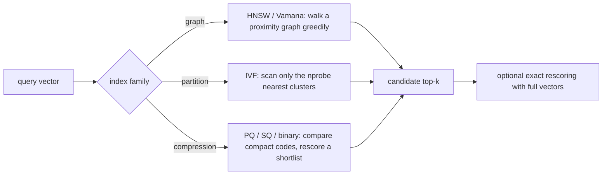
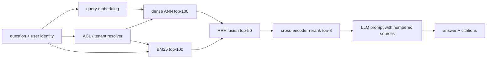
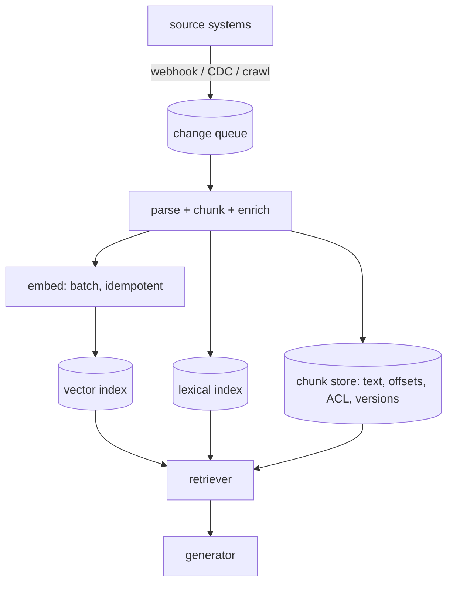

# 24 — Retrieval & vector systems

> **The requirement.** Lumen, our fictional AI knowledge assistant, now serves 2,000 company workspaces. Together
> they hold about 50 million text chunks. Each question must be grounded in that tenant's documents only, filtered by
> the asking user's permissions, and the retrieval stage (everything before the LLM starts generating) must finish
> in under 150 ms at p95. When someone edits a policy page, the next answer must reflect it within 15 minutes.
> The hard part is that the three obvious tools fight each other. Approximate indexes are fast because they skip most
> data. Permission filters break that shortcut, and freshness keeps changing the data under the index.

## In one minute

A language model only knows what was in its training data and what you put in its prompt. Retrieval is the system
that decides what goes in the prompt. You cut documents into chunks, turn each chunk into a vector (an *embedding*)
whose geometry roughly encodes meaning, and store those vectors in an index. At question time you embed the question
and ask the index for the nearest vectors. Exact nearest-neighbour search compares the question with every vector,
which is too slow at tens of millions of items. Approximate indexes such as HNSW and IVF look at a small, clever
subset and accept that they sometimes miss a true neighbour. Production retrievers mix this "dense" search with
classic keyword search, rerank the combined candidates with a slower, more accurate model, and enforce tenant and
permission filters on every step. Then you measure. A RAG answer can be wrong because retrieval missed the right
chunk or because the model ignored it, and those two failures have different fixes.

## Why this matters now

- **Retrieval became the default way to give LLMs private knowledge.** The pattern was named and formalised as
  retrieval-augmented generation by Lewis et al. in 2020 [1]. By 2026 it is the backbone of enterprise assistants,
  coding agents (SYSDESIGN-25) and support bots.
- **Vector search moved into general-purpose databases.** Postgres (pgvector), OpenSearch and Elasticsearch, among
  others, now ship ANN indexes next to dedicated engines such as Qdrant, Milvus, Weaviate and LanceDB
  [16]–[21]. So "do we need a vector database?" is now a real design question, not a given.
- **Embeddings became elastic.** Matryoshka representation learning (Kusupati et al., 2022) trains one embedding so
  that its prefixes are also usable embeddings [5]. Several current models expose this, for example
  nomic-embed-text-v1.5 [22]. Dimension is now a cost dial you can turn after training.
- **Long context windows did not remove retrieval.** Models with very long windows still use information unevenly
  across positions ("lost in the middle") [11]. Effective context is often shorter than advertised [12]. Retrieval
  plus a moderate window competes well with brute-force long context [13]. The trade-off is quantified below.
- **Quantization is now the default.** Recent Elasticsearch versions index float vectors with quantized HNSW by
  default (int8, or "BBQ" binary quantization for ≥384 dimensions from 9.1) [21]. Memory math that assumes 4 bytes
  per dimension is now the pessimistic case.

## Core ideas [Core]

### 1. Embeddings as a system component

An embedding model maps text (or images, or code) to a fixed-length vector of `d` floats. Similar meaning should give
a small distance: cosine distance, inner product, or L2. From a systems point of view, an embedding model is a
**versioned, lossy, schema-defining dependency**:

| Property | Why the system designer cares |
|---|---|
| Dimension `d` (for example 384, 768, 1024, 3072) | Memory and disk scale linearly with `d`. So do distance-computation cost and network bytes. |
| Max input length (for example 256 word pieces for all-MiniLM-L6-v2 [23]) | Text beyond the limit is silently truncated. Chunk size must respect it. |
| Version | Vectors from two model versions are **not comparable**. A model upgrade means re-embedding everything, which is a migration (§Deep dive). |
| Asymmetric prompts | Some models expect prefixes such as `search_query:` vs `search_document:` [22]. Forgetting them degrades recall quietly. |
| Normalisation | With L2-normalised vectors, cosine similarity, inner product and L2 order neighbours identically, so you can pick the cheapest operator. |
| Matryoshka support | If trained with MRL [5], you can truncate to the first `d'` dimensions and re-normalise. You trade a little quality for proportional savings. |

Treat the model name and version as part of the index's schema. Store them next to every vector, never in a config
file someone can change underneath a live index.

### 2. Exact vs approximate nearest neighbour

Exact k-NN computes the distance to all `n` vectors: `O(n·d)` work per query. At `n = 50M`, `d = 1024`, that is
about 5×10¹⁰ multiply-adds per query, plus reading 200 GB of float32 data. Even with SIMD and many cores, that is
seconds, not milliseconds. **Approximate nearest neighbour (ANN)** indexes return *most* of the true top-k while
touching a tiny fraction of the data. The quality metric is **recall@k**: the fraction of the true k nearest
neighbours that the index returned. Every ANN algorithm exposes a knob that trades recall for latency, and every
production system must choose a point on that curve *with measurement*. ANN-Benchmarks [14] is the standard public
methodology.

*Diagram: a query vector goes to one of three index families (graph walk, cluster partitioning, compressed codes);
each produces candidates that can be rescored with full-precision vectors.*

### 3. HNSW — the graph index everyone ships

Hierarchical Navigable Small World graphs (Malkov & Yashunin, arXiv 2016, IEEE TPAMI 2018/2020) [2] build a
multi-layer proximity graph. Every vector is a node in layer 0. A geometrically decreasing random subset also
appears in higher layers, like the express lanes of a skip list. A search enters at the top layer, greedily moves to
the neighbour closest to the query, drops a layer, and repeats. In layer 0 it keeps a candidate list of size
`ef_search` and returns the best k.

- **`M`**: maximum neighbours per node (layer 0 typically allows `2·M`). It sets graph memory and recall ceiling.
  pgvector defaults to `m = 16` [16].
- **`ef_construction`**: the candidate list size while inserting. Higher means a better graph and slower builds.
  pgvector defaults to 64 [16].
- **`ef_search`**: the candidate list size while querying. It is the runtime recall/latency dial. pgvector's
  `hnsw.ef_search` defaults to 40 [16].

Strengths: excellent recall at low latency, incremental inserts, no training step. Costs: the graph must live in
RAM for good latency. Deletes are awkward (tombstones plus repair). Builds are CPU-heavy and slow when the graph
does not fit in build memory (pgvector's README warns about `maintenance_work_mem` for exactly this reason [16]).

### 4. IVF — partition, then scan a few partitions

An inverted-file (IVF) index runs k-means to get `nlist` centroids. Each vector is assigned to its nearest centroid's
list. A query scans only the `nprobe` lists whose centroids are nearest. The idea comes from inverted files in text
and image retrieval, and Jégou et al. combined it with product quantization as IVFADC [3]. pgvector suggests
`lists = rows/1000` up to 1M rows and `probes ≈ sqrt(lists)` as a starting point [16].

Strengths: cheap to build, small, and easy to shard by list. Costs: it needs representative data *before* building
(centroids are trained). Recall drops when the data distribution drifts away from the centroids. At equal recall,
query speed is usually worse than HNSW (pgvector's own README says this about its IVFFlat [16]).

### 5. Quantization — make every vector smaller

- **Scalar quantization (SQ / int8):** store each dimension in 8 bits instead of 32. That is 4× smaller, with a
  small recall loss. It is often combined with rescoring.
- **Product quantization (PQ)** (Jégou, Douze & Schmid, TPAMI 2011) [3]: split the `d`-dimensional vector into `m`
  sub-vectors and replace each with the id of its nearest centroid in a 256-entry codebook (8 bits). A 1024-d float32
  vector (4,096 bytes) becomes `m = 64` bytes, which is 64× smaller. Distances are computed with look-up tables
  (asymmetric distance computation).
- **Anisotropic quantization (ScaNN)** (Guo et al., ICML 2020) [6]: for inner-product search, penalise quantization
  error *parallel* to the data point more than orthogonal error. Those are the errors that change the ranking.
- **Binary quantization:** keep 1 bit per dimension (sign) and compare with Hamming distance. That is 32× smaller.
  It is usually useful only with oversampling and rescoring on full vectors.
- **Half precision (`halfvec`, bf16):** 2 bytes per dimension, close to lossless for retrieval in practice. In
  pgvector it is also how you index up to 4,000 dimensions [16].

The standard production recipe is: **search compressed, rescore exact.** Fetch `k × oversample` candidates using
compact codes, then rerank that shortlist with full-precision vectors read from RAM or SSD.

### 6. DiskANN — when the index does not fit in RAM

DiskANN (Subramanya et al., NeurIPS 2019) [4] keeps PQ-compressed vectors in RAM to guide the search and puts the
full-precision vectors plus the graph (Vamana, a single-layer graph with long-range edges) on SSD. Each hop is an SSD
read, so the graph is designed to need few hops. The paper reports indexing and searching **one billion points on a
single workstation with 64 GB of RAM**, serving **>5,000 queries/s with <3 ms mean latency at 95%+ 1-recall@1** on
SIFT1B with 16 cores [4]. Treat this as the paper's own benchmark. Your recall and latency depend on your data,
SSD and parameters. Filtered-DiskANN (Gollapudi et al., WWW 2023) [9] extends the graph to respect label filters.

### 7. Filtering — the part that breaks naive designs

Real queries are never "nearest 10 vectors". They are "nearest 10 vectors **where tenant = 42 and the user may read
them and the doc is not deleted**." There are three strategies:

| Strategy | How | Wins when | Fails when |
|---|---|---|---|
| **Pre-filter** | Evaluate the predicate first (B-tree, bitmap), then exact-scan the survivors | The filter is very selective (few thousand rows) | The filter matches millions of rows, so you are back to brute force |
| **Post-filter** | ANN search first, drop non-matching results | The filter matches most rows | The filter is selective: of `ef_search` candidates almost none pass, so you return fewer than k results, or the wrong ones |
| **In-filter (filter-aware traversal)** | The index walks the graph but only *accepts* matching nodes, or has extra edges per label | A wide range of selectivities | It needs engine support. Very selective filters can disconnect the graph |

pgvector's README makes the post-filter trap concrete. If a condition matches 10% of rows and `hnsw.ef_search = 40`,
only about 4 rows survive on average. Since 0.8.0, **iterative index scans** keep scanning until enough rows match,
up to `hnsw.max_scan_tuples` (default 20,000) [16]. Qdrant adds filter-aware edges to its HNSW graph when payload
indexes exist before indexing, and uses filter-cardinality estimates to plan the search [17]. Research systems
such as ACORN (Patel et al., SIGMOD 2024) [10] and Filtered-DiskANN [9] make predicate-agnostic or label-aware
traversal a first-class index property. Lab L24 reproduces the post-filter shortfall and the iterative-scan fix.

**Multi-tenancy changes the picture.** If every query filters on `tenant_id`, the most robust design is often
*physical* separation: one index (or partition, collection or shard) per tenant or tenant group. Then the tenant
filter costs nothing and cannot leak. Qdrant documents an `is_tenant` payload index that builds per-tenant
sub-indexes [17]. Weaviate stores each tenant on a separate shard [36]. In Postgres you can use list partitioning by tenant
with a per-partition HNSW index. The trade-off is many small indexes (overhead, more build jobs) against one huge
index with a hard filter problem.

### 8. Hybrid search: dense + lexical, fused

Dense retrieval is good at paraphrase ("my file is too big" finds "upload exceeds the size limit"). It is bad at
exact tokens: error codes, SKUs, names, rare acronyms. Lexical retrieval with BM25 (Robertson & Zaragoza [7]) is
the opposite. Running both and fusing the result lists is the cheapest robustness win in retrieval.

**Reciprocal rank fusion (RRF)** (Cormack, Clarke & Büttcher, SIGIR 2009) [8] scores each document as
`Σ 1 / (c + rank_i)` over the lists in which it appears, with `c = 60` in the paper. It needs no score calibration,
because BM25 scores and cosine similarities live on incomparable scales. Alternatives include weighted score fusion
after normalisation (Weaviate's default since v1.24 is `relativeScoreFusion`, with `alpha` weighting vector vs keyword
and a server default of 0.75 [19]) and learned fusion. Learned sparse models such as SPLADE sit in between.

### 9. Reranking with cross-encoders

The first stage (bi-encoder ANN plus BM25) must be fast, so it compares query and document *independently* encoded.
A **cross-encoder** reads the query and a candidate *together* and outputs a relevance score. Nogueira & Cho's BERT
passage re-ranker [24] is the canonical early example. It is far more accurate per pair and far too slow to run over
millions of items, so you run it over the top 50–200 candidates. Late-interaction models (ColBERT [25]) sit between
the two: per-token vectors with cheap max-sim scoring. The resulting **retrieve → rerank** funnel is standard:

*Diagram: the question is embedded and resolved to permissions; dense and BM25 retrieval both run with the ACL
filter; results are fused with RRF, reranked by a cross-encoder, and the top passages go into the prompt, which
produces an answer with citations.*

### 10. The RAG pipeline as two systems

A RAG system is an **offline ingestion pipeline** and an **online query path**. They share an index and a contract.

**Ingestion (write path):**
1. **Connectors** pull or receive changes (webhooks, CDC, crawls) from source systems (SYSDESIGN-20 for CDC).
2. **Parsing and normalisation:** PDF/HTML/Office to text with structure (headings, tables, page numbers). OCR for
   scans. This is where most "the bot can't find it" bugs actually live.
3. **Chunking:** split into retrievable units. Options include fixed token windows with overlap, structure-aware
   chunks (by heading or section), and semantic chunking. Prepending document context to each chunk (title, section
   path, a short summary) improves retrieval. Anthropic's "contextual retrieval" write-up is one public description
   of this idea (vendor blog, treat as a lead) [26].
4. **Metadata:** `tenant_id`, `doc_id`, `chunk_no`, `acl_principals`, `source_uri`, `version/etag`, `updated_at`,
   `embedding_model@version`, language, and the byte or page offsets needed for citations.
5. **Embedding:** batch, rate-limited, idempotent (key = `doc_id + chunk_no + content_hash + model_version`).
6. **Indexing:** upsert into the vector index and the lexical index *together*, then publish an index version.

**Query (read path):** authenticate → resolve the principal's groups → (optionally) rewrite or expand the query →
hybrid retrieve with filters → rerank → assemble the prompt within a token budget → generate → **verify citations**
(every cited id must be in the retrieved set) → log everything needed for evaluation.

*Diagram: source changes flow through a queue to parsing/chunking and embedding, which write the vector index, the
lexical index and the chunk store; the retriever reads all three and feeds the generator.*

### 11. Citations are a data-model feature

A citation is only as good as the offsets you stored. Keep `(doc_id, version, char_start, char_end, page)` per chunk.
Number the passages in the prompt (`[3]`). After generation, *parse* the citations and reject or flag answers that
cite ids that were never retrieved. That check is cheap, deterministic and catches a class of hallucinated sources
(lab L24's `--generate` step does exactly this). Link to the source *at the version that was retrieved*. If the doc
changed since, say so.

## Numbers that matter

All figures below are **worked estimates with stated assumptions**, not benchmarks.

**Assumptions (Lumen):** 50M chunks; average 300 tokens per chunk; a 1,024-dimension embedding model; float32
unless stated; HNSW `M = 16`; 1 GiB = 2³⁰ bytes.

**1. Raw vector bytes.** `n × d × bytes/dim` = 50×10⁶ × 1,024 × 4 B = **204.8 GB (≈191 GiB)**. pgvector stores
`4·d + 8` bytes per vector [16], so the per-row overhead is negligible at this `d`.

**2. HNSW graph overhead.** hnswlib's guidance is roughly `M × 8–10` bytes per element for the graph [15]. That is
128–160 B per vector at `M = 16`, or **6.4–8 GB**. The vectors dominate, not the graph.

**3. The compression menu (vectors only, 50M items):**

| Representation | Bytes / vector | Total | Typical use |
|---|---|---|---|
| float32, 1,024-d | 4,096 | 204.8 GB | rescoring tier (SSD/RAM) |
| halfvec / bf16, 1,024-d | 2,048 | 102.4 GB | near-lossless default |
| int8 SQ, 1,024-d | 1,024 | 51.2 GB | in-RAM search tier |
| Matryoshka → 256-d float32 | 1,024 | 51.2 GB | if the model is MRL-trained [5] |
| PQ, m = 64 × 8 bit | 64 | 3.2 GB | IVF-PQ / DiskANN in-RAM guide [3][4] |
| binary, 1,024 bits | 128 | 6.4 GB | first pass + rescoring |

So "200 GB of RAM" becomes "≈10 GB of RAM plus 200 GB of SSD" with binary or PQ first-pass and SSD rescoring. That
is the core argument for DiskANN-style and quantized designs [4].

**4. Ingestion cost.** 50M × 300 tokens = **15×10⁹ tokens** to embed once. *Assume* a self-hosted embedding
server sustains 20,000 tokens/s per GPU (an assumption, measure yours). That is 7.5×10⁵ GPU-seconds, about
**208 GPU-hours** for a full re-embed. This is why an embedding-model upgrade is a planned migration.

**5. Freshness load.** If 1% of chunks change per day, that is 500,000 chunks/day, about **6 chunks/s on average**.
That is trivial for steady-state indexing. Bursts (a tenant bulk-imports 2M documents) are the real design load, so
put a queue and per-tenant fairness in front of the embedder (SYSDESIGN-08).

**6. Query latency budget (p95 150 ms), one plausible split.**

| Stage | Budget | Note |
|---|---|---|
| auth + ACL resolution | 10 ms | cached group membership |
| query embedding | 15 ms | one short sequence on a warm GPU or CPU model |
| dense ANN + BM25 in parallel | 30 ms | per shard, fan-out to shards in parallel |
| fusion + fetch chunk text | 15 ms | key-value lookups |
| cross-encoder rerank of 50 | 60 ms | 50 pairs × ~350 tokens ≈ 17.5k tokens, batched on GPU |
| slack | 20 ms | network, GC, tail |

Fan-out makes the tail worse. With 8 shards queried in parallel, the query's latency is the *max* of 8 draws (see
SYSDESIGN-01 and SYSDESIGN-11 on tail amplification). That is another argument for routing a tenant to a single
shard.

## Design choices and trade-offs

### Where should vectors live?

| Option | Wins when | Costs | Examples (as of 2026-11) |
|---|---|---|---|
| Extension in your OLTP database | < tens of millions of vectors, strong need for transactional consistency with metadata and ACLs, one less system | Shares CPU/RAM with OLTP; HNSW builds compete with writes; scale-out is your problem | pgvector 0.8.7 (HNSW, IVFFlat, halfvec, bit, sparsevec, iterative scans) [16] |
| Search engine with kNN | You already run it for BM25; hybrid in one query | JVM memory tuning; vector features vary by version and licence | OpenSearch (Lucene and Faiss engines, HNSW and IVF; NMSLIB deprecated) [20]; Elasticsearch (HNSW with int8/BBQ quantization defaults) [21] |
| Dedicated vector database | Hundreds of millions+, heavy filtering, quantization and tiering, multi-tenant features | Another stateful system to run, back up and secure | Qdrant 1.20 (filter-aware HNSW, tenant indexes) [17]; Milvus 3.0 (HNSW, IVF family, ScaNN, on-disk index) [18]; Weaviate 1.40 (HNSW default plus flat, dynamic and HFresh indexes; hybrid fusion; per-tenant shards) [19][36] |
| Embedded / lakehouse | Batch and offline workloads, object-storage-native, multimodal | Concurrency and latency of online serving need care | LanceDB (embedded library on the Lance columnar format; vector, full-text, hybrid search) [27] |
| Library in your service | You control everything; static or slowly changing corpora | You build persistence, replication, filtering | Faiss [28], hnswlib [15], ScaNN [6] |

Versions above are the latest releases observed on 2026-11-19. Features change monthly, so re-check the docs before
you rely on one. This course takes no vendor position. The table lists *documented* capabilities with links.

### Which index?

| Index | Recall/latency | Memory | Build | Updates | Choose when |
|---|---|---|---|---|---|
| Flat (exact) | perfect / O(n) | 1× | none | trivial | n < ~100k, or after a very selective pre-filter |
| HNSW | best in-RAM curve | vectors + graph | slow, CPU-heavy | good inserts, weak deletes | default for in-RAM online search |
| IVF-Flat | good, needs nprobe tuning | ≈1× | fast (k-means) | drift degrades | quick builds, partition-friendly |
| IVF-PQ / ScaNN | lower raw recall, rescoring recovers | 1/16–1/64 | k-means + codebooks | retrain on drift | billions, memory-bound |
| DiskANN / Vamana | high recall, SSD-bound latency | PQ codes in RAM, rest on SSD | slow | supported in fresh variants | index ≫ RAM |

### Long context vs RAG vs GraphRAG

| Approach | Wins when | Costs |
|---|---|---|
| **Stuff everything into a long context** | The corpus per question is small (one contract, one repo slice), and questions need whole-document reasoning | Cost scales with tokens *per request*. Prefill latency (SYSDESIGN-21). Uneven use of middle positions [11]. Effective length below the advertised window [12] |
| **Classic RAG** | Large corpus, point questions ("what is the leave policy?"), per-user ACLs, freshness | Retrieval misses are silent. Chunking and filters need engineering |
| **GraphRAG** (Edge et al., 2024) [29] | *Global* questions over a corpus ("what are the main themes?"), which plain RAG fails because no single chunk holds the answer [29] | An LLM extracts an entity graph and community summaries at index time, which is expensive to build and to keep fresh |
| **Hybrid: retrieve, then long context** | Retrieve whole sections or documents, not tiny chunks | More tokens per call, simpler chunking |

A useful anchor: Xu et al. found a 4K-context LLM with simple retrieval comparable to a 16K-context fine-tuned model
on their long-context tasks, at much less compute. Retrieval also helped models with extended windows [13]. This is a
2023 result on specific models. Re-check for yours, but the economics are durable: retrieval keeps per-request
tokens bounded while the corpus grows.

## Deep dive [Deep]

### Why HNSW is fast, and why it degrades

Navigable small-world graphs let a greedy walk reach the neighbourhood of any query in a number of hops that grows
roughly logarithmically with `n`, because long-range links let the walk cover distance quickly. The hierarchy
supplies those long links explicitly [2]. Search cost is roughly *(hops) × (neighbours per hop) × d* floating-point
work, dominated by **random memory access**. Every hop touches vectors that are not cache-adjacent. That is why HNSW
latency jumps when the working set falls out of RAM into page cache misses or swap, and why "fits in RAM" is the
first question for any HNSW deployment.

Recall degrades with: low `M` on high-intrinsic-dimension data; low `ef_construction`; heavy deletes (tombstoned nodes
still route traffic but cannot be returned); and selective post-filters. A useful hnswlib diagnostic: measure recall
for `M`-nearest-neighbour search at `ef = ef_construction`. If it is below 0.9, the graph itself is weak [15].

### PQ in one paragraph of math

Split `x ∈ ℝᵈ` into `m` sub-vectors `x = [x¹ … xᵐ]`, each of dimension `d/m`. Train a codebook of `k* = 256`
centroids per sub-space. Encode `x` as `m` bytes `[q¹(x¹) … qᵐ(xᵐ)]`. For a query `y`, precompute an `m × 256`
table of distances `‖yʲ − cʲᵢ‖²`. The approximate distance to any encoded vector is then the sum of `m` table
look-ups. No floating-point work touches the database vectors at all [3]. IVF-PQ applies PQ to the *residual*
`x − centroid`, which is smaller and quantizes better. ScaNN's anisotropic loss reshapes the quantization objective
for maximum inner product search [6].

### Filtering under the hood (pgvector example)

pgvector's HNSW and IVFFlat apply `WHERE` clauses *after* the index scan. With iterative scans enabled
(`hnsw.iterative_scan = strict_order | relaxed_order`), the scan continues past `ef_search` until enough rows match or
`hnsw.max_scan_tuples` is reached [16]. `relaxed_order` may return results slightly out of distance order, so wrap the
query in a materialised CTE and re-sort if strict order matters [16]. Alternatively, a B-tree on the filter column
lets the planner choose an exact scan of the matching rows. That is pre-filtering, and it is often the right plan
for a highly selective tenant filter. Partial indexes or list partitions per tenant give the in-filter effect for
the commonest predicate. The lab shows all three plans.

### Freshness and re-indexing

1. **Incremental upserts.** Change events → re-chunk the changed document → diff chunk hashes → embed only new or
   changed chunks → upsert vectors and lexical postings → delete orphaned chunks. Deletes must be **hard**
   for compliance (SYSDESIGN-19). Tombstones in HNSW need periodic compaction or rebuild.
2. **Read-your-writes for the editor.** A user who just edited a page expects the assistant to see the edit. Options:
   a short-lived "recent changes" overlay searched exactly (small), merged with ANN results.
3. **Model migration (blue/green index).** Build index v2 with the new embedding model in parallel (≈208 GPU-hours
   in our estimate). Dual-write new changes to both. Evaluate v2 offline on the golden set. Shadow-query it. Flip
   the alias. Keep v1 until rollback is no longer needed. Never mix vectors from two models in one index.
4. **IVF centroid drift.** If data distribution shifts (a new tenant with a very different domain), IVF lists become
   unbalanced and recall drops. Monitor list-size skew and retrain centroids.

### ACL-aware retrieval

The rule is **filter before the model sees anything**. Prompt-level instructions ("don't reveal HR docs") are not a
security boundary (SYSDESIGN-28 on prompt injection). Patterns:

- **Early binding:** at ingestion, store the list of principals (users and groups) allowed to read each chunk. At
  query time, filter `acl_principals && user_principals`. It is fast, but permission changes require re-tagging chunks.
- **Late binding:** retrieve candidates, then check each against the source system's authorisation API. It is
  always correct, adds latency, and needs over-fetching because many candidates may be denied.
- **Hybrid:** early binding for the coarse filter (tenant, department), late check for the final top-k only.

Group explosion is the scaling trap: a user in 400 groups produces a 400-element array predicate. Flatten groups to
a bounded set of "access tags" where possible, and test the worst-case user, not the average one.

### Evaluating retrieval and RAG

Separate the stages, or you will optimise the wrong one.

**Retriever metrics** (need a labelled set of query → relevant chunk ids):
- **recall@k**: fraction of relevant items found in the top k. It is the metric for "did the right chunk reach the
  prompt?"
- **MRR**: mean of `1/rank` of the first relevant result.
- **nDCG@k** (Järvelin & Kekäläinen, 2002) [30]: graded relevance with a logarithmic position discount, normalised
  by the ideal ordering.
- Public benchmarks such as BEIR [31] (zero-shot retrieval) and MTEB [32] (embedding models across tasks) are useful
  for shortlisting models. Your own golden set decides.

**Generation metrics** (judge whether the answer is supported):
- **Faithfulness / groundedness:** are the answer's claims supported by the retrieved context?
- **Answer relevance:** does it address the question?
- **Context precision / context recall:** how much of the retrieved context is relevant, and was everything needed
  retrieved?

RAGAS (Es et al., 2023) [33] proposed reference-free LLM-judged versions of such metrics. The ragas library (v0.4.4
as of 2026-11) implements them [34]. Because these metrics use an LLM as the judge, they inherit judge biases
(SYSDESIGN-26 discusses Zheng et al. on LLM-as-a-judge). Calibrate them against a human-labelled sample before
trusting trends.

**Diagnosis table:**

| Symptom | Retrieval recall@k | Faithfulness | Likely fix |
|---|---|---|---|
| Wrong answer, right doc never retrieved | low | n/a | chunking, hybrid search, query rewriting, filters too strict |
| Wrong answer, right doc retrieved | high | low | prompt, reranking order, context too long, model choice |
| Right answer, wrong citation | high | high | citation post-check, chunk offsets |
| Good offline, bad online | — | — | golden set not representative; log and sample real queries |

## Frontier [Frontier]

*As of 2026-11; verify before relying on any version-specific detail.*

- **Quantization by default in mainstream engines.** Elasticsearch defaults float vectors to `bbq_hnsw` (≥384 dims)
  from 9.1 and to `bbq_disk` from 9.4 where licensed [21]. Expect "RAM per vector" estimates to start from
  ~1 bit to 1 byte per dimension, with rescoring.
- **Filter-aware ANN as a core feature.** ACORN [10], Filtered-DiskANN [9], and engine features such as Qdrant's
  filter-aware HNSW [17] and pgvector's iterative scans [16] reflect a shift: filtering is part of the index, not an
  afterthought.
- **Elastic embeddings.** MRL-trained models let you store 1,024-d vectors but search a 256-d prefix first, then
  rescore [5][22].
- **Graph-based and agentic retrieval.** Microsoft's GraphRAG implementation is at v3.3.0 [35]. Agents increasingly
  call retrieval as a *tool* several times per task instead of once per question (SYSDESIGN-25). That multiplies
  retrieval QPS per user request and makes p95 latency and per-tenant quotas more important.
- **Late-interaction and multi-vector retrieval** (ColBERT-style [25]) are moving into vector engines. They store many
  vectors per document, so the storage math above multiplies by tokens per chunk unless compressed.

## Failure modes and operations

| Failure | Detection (SLI) | Mitigation |
|---|---|---|
| Recall regression after a parameter or version change | nightly recall@k on a golden set, exact vs ANN | gate deploys on recall; keep exact-search "canary" queries |
| Post-filter starvation (fewer than k results) | `results_returned < k` rate per tenant | iterative scans, pre-filter plan, per-tenant partitions |
| Cross-tenant leak | synthetic canary docs per tenant; alert if ever retrieved elsewhere | physical isolation; mandatory filter injected by the data layer, not the app |
| Stale answers | `now − source.updated_at` of cited chunks; ingestion lag p95 | queue lag alerts; recent-changes overlay |
| Index out of RAM | page-fault rate, p99 ANN latency jump | quantize, shard, DiskANN-style tiering |
| Embedding service outage | error rate on query embedding | fall back to BM25-only retrieval (degraded, not down) |
| Mixed embedding models | count of vectors by `model_version` ≠ 1 per index | enforce at write; blue/green migration |
| Hot tenant bulk import starves others | per-tenant queue depth | weighted fair queuing on the embedder |
| Hallucinated citations | citation-not-in-retrieved-set rate | post-generation check; refuse or regenerate |

Operate retrieval like a database plus a search engine: backups of the chunk store (vectors can be recomputed, but
it costs GPU-hours), index rebuild runbooks, and capacity alarms on RAM headroom.

## Cost and energy

- **Storage tiering is the big lever.** In the Lumen estimate, float32 in RAM (≈205 GB) versus binary codes in RAM
  plus float32 on SSD (≈6.4 GB RAM + 205 GB SSD) is a 30× difference in the expensive tier. Use your cloud's current
  RAM vs NVMe prices (SYSDESIGN-16) to turn that into money.
- **Embedding is a one-off per model version.** It is ≈15×10⁹ tokens for Lumen. Re-embedding is the dominant energy
  event in this subsystem. Avoid unnecessary model churn and embed only changed chunks (content hashes).
- **Reranking is per query.** A cross-encoder over 50 candidates processes ~17.5k tokens per question in our
  assumption. At high QPS that can cost more GPU time than the ANN search. Rerank fewer candidates when the first
  stage is confident.
- **Retrieval reduces generation cost.** Sending 8 relevant passages (~3k tokens) instead of a 100k-token document
  dump cuts prefill compute per request by >30× (SYSDESIGN-21 explains why prefill cost scales with prompt length).

## Interview angle

**How it is asked:** "Design a document Q&A assistant for an enterprise", "Design semantic search over 1B images",
"How would you add RAG to our support bot?", or as a deep dive inside C10 (enterprise RAG assistant).

**Model answer outline (CLARIFY → QUANTIFY → SKETCH → DEEPEN → STRESS → WRAP):**
1. **CLARIFY:** corpus size and growth, tenants, ACL model, freshness target, languages, question types (point vs
   global), latency SLO, citation requirement.
2. **QUANTIFY:** `n × d × bytes` for the index; graph overhead; ingestion tokens and GPU-hours; QPS and the latency
   budget split.
3. **SKETCH:** ingestion pipeline (queue → parse/chunk → embed → index) and query path (ACL → hybrid → RRF → rerank
   → generate → citation check).
4. **DEEPEN:** pick one: filtering under multi-tenancy, *or* the HNSW memory problem and quantization, *or*
   evaluation.
5. **STRESS:** model upgrade (blue/green), tenant bulk import, embedding outage (BM25 fallback), leak prevention.
6. **WRAP:** restate SLOs, name the two metrics you would put on the dashboard (recall@k on the golden set,
   faithfulness on sampled traffic) and the main risk.

**Red flags:** "just use a vector database" without numbers; ACL enforced by prompting; no lexical search for codes
and names; no evaluation; mixing embedding versions; ignoring deletes.

**Follow-ups to expect:** Why RRF instead of adding scores? What happens to HNSW recall with a 0.1% selective filter?
How do you delete a user's data from an ANN index? When would you skip RAG and use the long context?

## Common mistakes

- Choosing the index before measuring recall on *your* data and filters.
- Assuming cosine on unnormalised vectors equals inner product.
- Chunking without respecting the embedding model's max input (silent truncation).
- Applying tenant filters in application code after retrieval (a post-filter that can leak and starve).
- Re-embedding the whole corpus on every document change instead of diffing chunk hashes.
- Evaluating only end-to-end answer quality, so a retrieval regression looks like a "model problem".
- Treating RAGAS-style scores as ground truth without calibrating the judge.
- Forgetting that agents call retrieval many times per task (capacity planning off by 5–10×).

## Check yourself

1. Estimate the RAM for 20M 768-d float32 vectors in HNSW with `M = 32`. What would int8 SQ change?
2. A tenant filter matches 0.5% of rows. Why does post-filtering HNSW with `ef_search = 40` fail, and what are two
   fixes?
3. Why does RRF not need score normalisation?
4. Your RAG answers got worse after an embedding model upgrade, but recall@10 is unchanged. Where do you look?
5. Give one question type where GraphRAG beats plain RAG, and why.

Full set with answers: [exercises/24-retrieval-vector-systems.md](../../exercises/24-retrieval-vector-systems.md).

## Lab

[labs/24-retrieval-vector-systems](../../labs/24-retrieval-vector-systems/README.md). Runs Postgres 18 + pgvector
0.8.7 and a local embedding model (all-MiniLM-L6-v2, 384-d, served by llama.cpp's OpenAI-compatible server) in
docker compose (project `sd-24`). Part A loads
synthetic clustered vectors and measures storage against the `4·d + 8` estimate. It then sweeps HNSW `ef_search`
and IVFFlat `probes` for recall@10 and latency, reproduces post-filter starvation, and shows the iterative-scan and
B-tree fixes. Part B embeds a small fictional Lumen help-centre corpus for two tenants. It compares dense, lexical
and RRF-hybrid retrieval on hand-labelled queries (recall@3, MRR, nDCG@3), demonstrates what an un-filtered
retriever would leak across ACL groups, and optionally generates a cited answer and checks its citations.

**What one recorded run showed** (laptop, 2026-11-19, details and caveats in the lab's Test status). On 50,000
synthetic 384-d vectors, HNSW recall@10 was 0.973 at `ef_search = 40` (p50 ≈ 1.4 ms) against a 44 ms exact scan.
On a harder, overlapping-cluster dataset the *same setting* gave only 0.638. With a 1% filter, plain HNSW returned
0.3 of 10 rows on average. Iterative scans returned 10 of 10 at ≈19 ms p50. On the toy corpus, dense retrieval
ranked the wrong document first for the error-code query `LUM-5002`, and RRF hybrid put the right one first. These
are illustrations of the mechanisms, not benchmarks.

## Further reading

- Malkov & Yashunin, HNSW [2]: the paper behind most in-memory vector indexes; read §4 on parameters.
- Jégou, Douze & Schmid, Product Quantization [3]: the compression idea that makes billion-scale search affordable.
- Subramanya et al., DiskANN [4]: how to move the index to SSD without losing recall.
- pgvector README [16]: unusually honest documentation of filtering, iterative scans and tuning trade-offs.
- Cormack et al., RRF [8]: a two-page idea that most hybrid search systems use.
- Edge et al., GraphRAG [29]: why "global" questions defeat chunk retrieval.
- Liu et al., Lost in the Middle [11] and Hsieh et al., RULER [12]: evidence for why long context does not replace
  retrieval.
- Es et al., RAGAS [33]: the vocabulary of RAG evaluation metrics.

## References

1. Lewis, P. et al. "Retrieval-Augmented Generation for Knowledge-Intensive NLP Tasks." NeurIPS 2020. arXiv:2005.11401. https://arxiv.org/abs/2005.11401 (accessed 2026-11)
2. Malkov, Yu. A., Yashunin, D. A. "Efficient and robust approximate nearest neighbor search using Hierarchical Navigable Small World graphs." arXiv:1603.09320 (2016); IEEE TPAMI 42(4), 2020 (online 2018), doi:10.1109/TPAMI.2018.2889473. https://arxiv.org/abs/1603.09320 (accessed 2026-11)
3. Jégou, H., Douze, M., Schmid, C. "Product Quantization for Nearest Neighbor Search." IEEE TPAMI 33(1), 2011. doi:10.1109/TPAMI.2010.57 (accessed 2026-11)
4. Subramanya, S. J., Devvrit, F., Simhadri, H. V., Krishnaswamy, R., Kadekodi, R. "DiskANN: Fast Accurate Billion-point Nearest Neighbor Search on a Single Node." NeurIPS 2019. https://papers.nips.cc/paper/2019/hash/09853c7fb1d3f8ee67a61b6bf4a7f8e6-Abstract.html (accessed 2026-11)
5. Kusupati, A. et al. "Matryoshka Representation Learning." NeurIPS 2022. arXiv:2205.13147. https://arxiv.org/abs/2205.13147 (accessed 2026-11)
6. Guo, R. et al. "Accelerating Large-Scale Inference with Anisotropic Vector Quantization." ICML 2020. arXiv:1908.10396; code: https://github.com/google-research/google-research/tree/master/scann (accessed 2026-11)
7. Robertson, S., Zaragoza, H. "The Probabilistic Relevance Framework: BM25 and Beyond." Foundations and Trends in IR 3(4), 2009. doi:10.1561/1500000019 (accessed 2026-11)
8. Cormack, G. V., Clarke, C. L. A., Büttcher, S. "Reciprocal rank fusion outperforms Condorcet and individual rank learning methods." SIGIR 2009. doi:10.1145/1571941.1572114 (accessed 2026-11)
9. Gollapudi, S. et al. "Filtered-DiskANN: Graph Algorithms for Approximate Nearest Neighbor Search with Filters." ACM Web Conference 2023. doi:10.1145/3543507.3583552 (accessed 2026-11)
10. Patel, L., Kraft, P., Guestrin, C., Zaharia, M. "ACORN: Performant and Predicate-Agnostic Search Over Vector Embeddings and Structured Data." SIGMOD 2024. arXiv:2403.04871. https://arxiv.org/abs/2403.04871 (accessed 2026-11)
11. Liu, N. F. et al. "Lost in the Middle: How Language Models Use Long Contexts." TACL 2024. arXiv:2307.03172. https://arxiv.org/abs/2307.03172 (accessed 2026-11)
12. Hsieh, C.-P. et al. "RULER: What's the Real Context Size of Your Long-Context Language Models?" arXiv:2404.06654 (2024). https://arxiv.org/abs/2404.06654 (accessed 2026-11)
13. Xu, P. et al. "Retrieval meets Long Context Large Language Models." ICLR 2024. arXiv:2310.03025. https://arxiv.org/abs/2310.03025 (accessed 2026-11)
14. Aumüller, M., Bernhardsson, E., Faithfull, A. "ANN-Benchmarks: A Benchmarking Tool for Approximate Nearest Neighbor Algorithms." arXiv:1807.05614; https://ann-benchmarks.com (accessed 2026-11)
15. hnswlib maintainers. "HNSW algorithm parameters" (ALGO_PARAMS.md). https://github.com/nmslib/hnswlib/blob/master/ALGO_PARAMS.md (accessed 2026-11)
16. pgvector maintainers. pgvector README, v0.8.7. https://github.com/pgvector/pgvector (accessed 2026-11)
17. Qdrant. "Filtering" and "Indexing" documentation (v1.20). https://qdrant.tech/documentation/concepts/filtering/ ; https://qdrant.tech/documentation/manage-data/indexing/ (accessed 2026-11)
18. Milvus. "Index" documentation (v3.0.x). https://milvus.io/docs/index.md (accessed 2026-11)
19. Weaviate. "Hybrid search" concepts. https://docs.weaviate.io/weaviate/concepts/search/hybrid-search (accessed 2026-11)
20. OpenSearch. "Methods and engines" (k-NN vector). https://docs.opensearch.org/latest/mappings/supported-field-types/knn-methods-engines/ (accessed 2026-11)
21. Elastic. "dense_vector field type" reference (index_options defaults by version). https://www.elastic.co/docs/reference/elasticsearch/mapping-reference/dense-vector (accessed 2026-11)
22. Nomic AI. "nomic-embed-text-v1.5" model card (Matryoshka dimensions, task prefixes). https://huggingface.co/nomic-ai/nomic-embed-text-v1.5 (accessed 2026-11)
23. sentence-transformers. "all-MiniLM-L6-v2" model card (384 dimensions, 256 word-piece limit). https://huggingface.co/sentence-transformers/all-MiniLM-L6-v2 (accessed 2026-11)
24. Nogueira, R., Cho, K. "Passage Re-ranking with BERT." arXiv:1901.04085 (2019). https://arxiv.org/abs/1901.04085 (accessed 2026-11)
25. Khattab, O., Zaharia, M. "ColBERT: Efficient and Effective Passage Search via Contextualized Late Interaction over BERT." SIGIR 2020. arXiv:2004.12832 (accessed 2026-11)
26. Anthropic. "Introducing Contextual Retrieval" (vendor engineering blog, 2024). https://www.anthropic.com/news/contextual-retrieval (accessed 2026-11)
27. LanceDB documentation. https://docs.lancedb.com/ (accessed 2026-11)
28. Douze, M. et al. "The Faiss library." arXiv:2401.08281 (2024). https://arxiv.org/abs/2401.08281 (accessed 2026-11)
29. Edge, D. et al. "From Local to Global: A Graph RAG Approach to Query-Focused Summarization." arXiv:2404.16130 (2024). https://arxiv.org/abs/2404.16130 (accessed 2026-11)
30. Järvelin, K., Kekäläinen, J. "Cumulated gain-based evaluation of IR techniques." ACM TOIS 20(4), 2002. doi:10.1145/582415.582418 (accessed 2026-11)
31. Thakur, N. et al. "BEIR: A Heterogeneous Benchmark for Zero-shot Evaluation of Information Retrieval Models." NeurIPS 2021 Datasets & Benchmarks. arXiv:2104.08663 (accessed 2026-11)
32. Muennighoff, N. et al. "MTEB: Massive Text Embedding Benchmark." EACL 2023. arXiv:2210.07316 (accessed 2026-11)
33. Es, S., James, J., Espinosa-Anke, L., Schockaert, S. "Ragas: Automated Evaluation of Retrieval Augmented Generation." EACL 2024 (demo). arXiv:2309.15217. https://arxiv.org/abs/2309.15217 (accessed 2026-11)
34. ragas maintainers. "Available metrics" (ragas v0.4.4). https://docs.ragas.io/en/stable/concepts/metrics/available_metrics/ (accessed 2026-11)
35. Microsoft. GraphRAG (v3.3.0). https://github.com/microsoft/graphrag ; https://microsoft.github.io/graphrag/ (accessed 2026-11)
36. Weaviate. "Multi-tenancy" and "Vector indexing" docs. https://docs.weaviate.io/weaviate/manage-collections/multi-tenancy ; https://docs.weaviate.io/weaviate/concepts/vector-index (accessed 2026-11)
