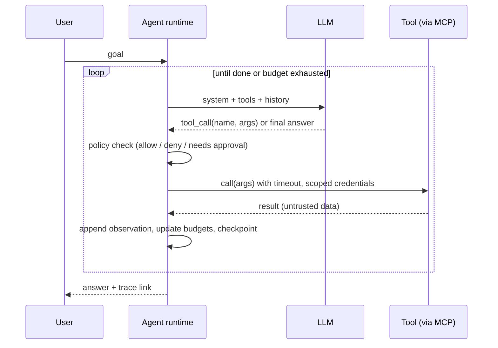
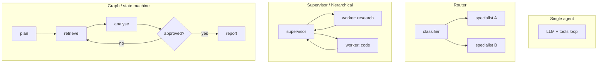

# 25 — Agentic systems

> **The requirement.** Lumen now offers "tasks": *"compare our three vendor contracts and chart the renewal costs"*.
> The assistant must search documents, run analysis code, call internal APIs, and write a report. Up to 10,000 users
> run tasks every day. One task may take 30 minutes and 20+ model calls. Every tool call must run with the minimum
> privileges it needs and leave an audit record. Sending an email or changing a record needs a human's approval.
> Each task has a hard cost cap. A worker crash must not cause a second email or a second database write.
> This is hard because an agent is a **non-deterministic program that writes its own control flow at runtime**, and
> every guarantee you normally get from code review has to be enforced by the runtime around it.

## In one minute

An *agent* is a loop. An LLM looks at the goal and the history so far, picks an action (usually a tool call such as
"search", "run this Python", "call the CRM API"), the runtime executes it, the result is appended to the history,
and the loop repeats until the model says it is done or a limit is hit. That is all. Everything difficult is in the
*runtime*. Tools need a standard interface (that is what MCP standardises). Agents may delegate to other agents
(A2A). Long tasks need saved state so a crash does not restart from zero. Code the model writes must run in a
sandbox. Dangerous actions need a human "yes". Budgets on tokens, time and money must stop runaway loops. And you
need traces to understand why the agent did what it did. Design the runtime as you would a workflow engine plus a
security boundary, and treat the model as an untrusted, creative planner inside it.

## Why this matters now

- **Tool calling became a native model feature.** ReAct (Yao et al., 2022) showed that interleaving reasoning traces
  with actions beats either alone on several tasks [1]. Toolformer (Schick et al., 2023) showed that a model can
  learn by itself when and how to call external APIs [2]. Model APIs and open inference servers now expose structured
  tool calls in the OpenAI-compatible format. Lab L25 uses llama.cpp's server for this.
- **Tool integration was standardised.** The Model Context Protocol (MCP) gives agents one way to discover and call
  tools, resources and prompts. Its current revision is **2026-07-28**, which made the core protocol **stateless**:
  the `initialize` handshake and `Mcp-Session-Id` were removed, so any server instance can handle any request [4][5].
  MCP was contributed to the Linux Foundation's **Agentic AI Foundation (AAIF)** at its formation on 9 Dec 2025
  [6]. *As of 2026-11.*
- **Agent-to-agent interoperability arrived.** The Agent2Agent protocol (A2A) reached **v1.0.0 on 2026-03-12**
  (v1.0.1 on 2026-05-28). It is Apache-2.0, under Linux Foundation governance, and its site lists it as part of AAIF
  [7][8]. *As of 2026-11.*
- **Agents run for minutes to hours.** Coding agents are evaluated on real repositories (SWE-bench: 2,294 issues from
  12 Python repos; SWE-bench Verified: a 500-task human-validated subset) [13][14]. Long tasks made durable
  execution, checkpointing and sandboxes into mainstream infrastructure concerns.
- **Prompt injection through tools is the defining security problem.** Indirect prompt injection (Greshake et al.,
  2023) showed that content an agent *reads* can steer what it *does* [17]. Design-level defences such as CaMeL
  (2025) [18] and benchmarks such as AgentDojo [19] followed. SYSDESIGN-28 treats this in depth. This chapter makes
  sure the runtime contains the blast radius.

The companion course **[AI Agent Systems](https://github.com/MSKazemi/ai-agent-systems-course)** goes deeper into
building agents in Python (MCP, A2A, LangGraph, a ReAct code-executor). This chapter is the *system design* view:
capacity, failure, isolation and cost.

## Core ideas [Core]

### 1. The agent loop

*Diagram: the runtime repeatedly sends the history to the model, receives a tool call or final answer, checks policy,
calls the tool with a timeout and scoped credentials, appends the result, updates budgets and checkpoints, and finally
returns the answer.*

Three properties follow directly:

1. **The model never executes anything.** It *proposes* a call. The runtime decides. That decision point is where
   policy, approvals, budgets and audit live.
2. **Tool results are untrusted input.** A web page, an email or a PDF returned by a tool may contain instructions.
   The runtime must treat them as data (§Deep dive, and SYSDESIGN-28).
3. **Context grows every step.** Each iteration re-sends the growing history, so tokens per task grow roughly
   quadratically with steps (see Numbers).

### 2. Tool calling

A tool is a name, a description and a JSON Schema for arguments. The model emits a structured call. The runtime
validates the arguments against the schema (never trust the model to obey it), executes, and returns a result.
Design rules that matter at scale:

- **Few, well-described tools beat many.** Every tool's schema goes into every prompt (token cost), and long tool
  lists make the model's choice harder (measure it on your own evals). Group by task. Load tools dynamically by
  context.
- **Idempotency keys on side effects.** `send_email(..., idempotency_key=task_id+step_no)` makes retries safe
  (SYSDESIGN-08 for the pattern).
- **Typed, bounded outputs.** Truncate and summarise large results before they enter the context. Return structured
  data where possible.
- **Errors are observations.** Return `{"error": "timeout after 10s"}` to the model so it can adapt. Do not crash the
  loop.

### 3. Model Context Protocol (MCP) — *as of 2026-11, spec revision 2026-07-28*

MCP standardises the connection between an AI application (the *host/client*) and a capability provider (the
*server*). Before MCP, every agent framework had its own plugin format, so N agents × M tools needed N×M adapters.

- **Server primitives:** *tools* (model-invoked functions), *resources* (readable context identified by URI), and
  *prompts* (reusable templates) [4].
- **Transports:** stdio (local subprocess) and Streamable HTTP (remote). The older HTTP+SSE transport has been
  deprecated since 2025-03-26. The release post calls it a year-long offramp, while the spec's deprecated-features
  registry sets a different earliest-removal rule, so plan on Streamable HTTP now [5][32].
- **Statelessness (2026-07-28):** every request carries its own protocol version (in `_meta` and the
  `MCP-Protocol-Version` header) and client details. Servers can be load-balanced like ordinary HTTP services.
  Requests also carry `Mcp-Method` and `Mcp-Name` headers so gateways can route and authorise per tool [3][5].
  Clients can call `server/discover` to learn versions and capabilities up front [3].
- **Extensions:** long-running *Tasks* moved into the `io.modelcontextprotocol/tasks` extension. Roots, Sampling
  and Logging are deprecated, with at least twelve months before removal can be proposed [5].
- **Multi round-trip requests (MRTR):** instead of the server opening its own requests to the client
  (elicitation, sampling, roots), a tool call can return `resultType: "input_required"` with the questions it
  needs answered, and the client retries the call with `inputResponses`. This is how a stateless tool asks the user
  to confirm an action. List and read results now also carry cache hints (`ttlMs`, `cacheScope`) [5].
- **Authorization:** OAuth-based. 2026-07-28 requires clients to validate the issuer (`iss`, RFC 9207) and binds
  client credentials to the issuing authorization server. Dynamic Client Registration is deprecated in favour of
  Client ID Metadata Documents [5].
- **Governance:** MCP is hosted by the Agentic AI Foundation, a Linux Foundation initiative launched with MCP,
  goose and AGENTS.md as founding projects [6]. The spec site carries the "LF Projects, LLC" copyright [5].

System-design consequences: an MCP server is a **microservice with a tool-shaped API**. It needs authN/Z, rate
limits, versioning, observability and SLOs like any other service. Because the protocol is now stateless, put MCP
servers behind ordinary L7 load balancers and gateways (SYSDESIGN-26). Any state a tool needs across calls is
returned as an explicit handle that the model passes back [5].

### 4. Agent2Agent (A2A) — *as of 2026-11, v1.0.x*

Where MCP connects an agent to *tools*, A2A connects an agent to *another agent* that it treats as opaque. You do not
see its prompts, tools or memory. Core concepts [8]:

- **Agent Card:** a JSON metadata document describing identity, capabilities, endpoint, skills and authentication
  requirements, used for discovery.
- **Task:** a stateful unit of work with an id and a lifecycle, which supports long-running and multi-turn
  collaboration.
- **Message / Part / Artifact:** turns of communication made of parts (text, file, structured data). Artifacts are
  the outputs, and they can be streamed.
- **Interaction:** operations are defined once and mapped to three protocol bindings: JSON-RPC 2.0 over HTTP(S),
  gRPC, and HTTP+JSON/REST, with guidance for custom bindings. Polling, streaming (SSE) and push notifications
  (webhooks) are supported for long tasks [8].
- **Versioning:** v1.0 clients must send an `A2A-Version` header (spec §3.6.1). Requests without it are treated as
  0.3, so this is a breaking change from 0.3 [8]. A v1.1.0 release candidate is tagged (as of 2026-11) [7].

Rule of thumb: **MCP for capabilities you control, A2A for delegating to agents you don't.** A2A is a federation
protocol across team or vendor boundaries.

### 5. Orchestration patterns

*Diagram: four patterns. A single agent loops alone. A router sends each request to one specialist. A supervisor
delegates to workers that report back. A graph defines explicit nodes and conditional edges, here
plan → retrieve → analyse → approval check (loop back or report).*

| Pattern | Wins when | Costs | Examples |
|---|---|---|---|
| **Single agent + tools** | Open-ended tasks, < ~10 tools | Context growth; one model does everything | most coding assistants |
| **Router** | Requests fall into clear categories | Misroutes; no multi-step collaboration | support triage |
| **Supervisor / hierarchical** | Sub-tasks need different tools or prompts; parallel research | Extra LLM calls for coordination; harder to debug; cost multiplies | research agents |
| **Graph / state machine** | You know the process shape; need checkpoints, approvals, retries per node | Less flexible; you design the graph | LangGraph [10], workflow engines |
| **Workflow with LLM steps** (no agent loop) | The process is fixed and auditable | No adaptivity | ETL with LLM extraction |

Start with the *least* agentic design that meets the requirement. Anthropic's engineering guidance makes the same
argument: workflows for predictable tasks, agents only where flexibility pays [20] (vendor blog, perspective).
Every extra agent adds latency, cost and a failure point.

### 6. State and memory

| Kind | What | Where it lives | Typical store |
|---|---|---|---|
| **Working (short-term)** | The current message history and scratchpad | In the prompt | the checkpoint |
| **Task state** | Plan, step number, budgets used, pending approvals, tool results | Checkpoint store, keyed by task/thread id | Postgres, Redis + durable log |
| **Long-term semantic** | Facts and preferences about a user or org | Retrieved into the prompt when relevant | vector + relational (SYSDESIGN-24) |
| **Episodic** | Records of past tasks ("last time this API needed pagination") | Retrieved by similarity or recency | event log + index |
| **Procedural** | Learned instructions or skills | Versioned prompt/tool configs | config store with review |

MemGPT framed long-term memory as OS-style paging between context and external storage [21]. Generative Agents
showed a memory stream with retrieval by recency, importance and relevance [22]. In production, memory is a **data
governance** problem as much as an AI one. Who can read it, how is it erased (GDPR, SYSDESIGN-19), and can an
attacker plant a "memory" through injected content?

**Checkpointing:** persist the task state after every step. LangGraph's checkpointers, for example, persist a
thread's graph state as checkpoints and use them for conversation continuity, human-in-the-loop, time travel and
fault tolerance [10]. Then a crash resumes from the last completed step, a human can inspect or edit state, and you
can "time-travel" to debug.

### 7. Durable execution for long-running agents

A 30-minute task on a worker that is redeployed every 10 minutes *will* be interrupted. Two families of solutions:

- **Checkpoint + resume** (agent frameworks): save state after each step. On restart, reload and continue. Side
  effects between "tool executed" and "checkpoint written" can repeat, so pair this with idempotency keys.
- **Durable execution engines** (Temporal [11], and similar): every action is recorded in the workflow's event
  history. After a failure the workflow is *replayed*: the commands its code generates are checked against the
  recorded history, and execution picks up where the last recorded event occurred [11]. Recorded activity results
  are reused rather than recomputed, which is what makes replay safe. Activities (LLM calls, tool calls) get
  timeouts and retry policies declaratively.

Mapping an agent to durable execution: the **agent loop is the workflow**, each **LLM call and tool call is an
activity**, and **approvals are signals** the workflow waits on (for hours, without holding a thread). The catch is
that workflow code must be deterministic. All non-determinism, including the model's output, must happen inside
activities whose results are recorded.

### 8. Sandboxed code execution

When the agent writes code, run it as if it came from an anonymous internet user. Isolation options, from weakest to
strongest:

| Isolation | Mechanism | Wins when | Costs |
|---|---|---|---|
| Process + seccomp/rlimits | Same kernel, syscall filter | Trusted code, speed | One kernel bug from escape |
| **Container** (namespaces + cgroups) | Shared host kernel | Low latency, density; internal code | Kernel attack surface is shared |
| **gVisor** (`runsc`) | User-space "application kernel" (the Sentry) intercepts syscalls [15] | Untrusted code with container ergonomics | Higher per-syscall overhead; some syscalls and `/proc` files unsupported [15] |
| **microVM** (Firecracker) | KVM-based minimal VMM; each sandbox has its own guest kernel | Multi-tenant untrusted code at scale (Firecracker runs AWS Lambda and Fargate [16]) | Needs KVM; image and boot management. The project states <125 ms boot and <5 MiB overhead per VM [24] |
| Wasm runtimes | Capability-based, no syscalls by default | Small pure functions | Limited language and library support |

Whatever the isolation layer, apply the same **container hygiene**: no network by default (or an egress proxy
with an allow-list), read-only root filesystem, a small writable tmpfs, CPU, memory and PID limits, a wall-clock
timeout, a non-root user, no host mounts, no cloud metadata endpoint, and a fresh sandbox per task (or per call) with
no credentials inside. Lab L25 implements this with `docker run --network none --read-only --memory --pids-limit`.

### 9. Permissions, least privilege and human-in-the-loop

OWASP lists **Excessive Agency** as a top risk (LLM03 in the 2026 edition, LLM06 in 2025) [23][33]. Its root causes are excessive functionality, excessive
permissions and excessive autonomy [23][33]. Controls:

- **Per-tool, per-task scopes.** The agent acting for Alice gets Alice's permissions, *narrowed* to the task (read
  the contracts folder, not the whole drive). Use short-lived, audience-restricted tokens (SYSDESIGN-18 workload
  identity), never a shared service account with admin rights.
- **Risk tiers.** Read-only tools: auto-allow. Reversible writes: allow with audit. Irreversible or external
  actions (send email, pay, delete, deploy): **require approval**.
- **Approval as a first-class state.** The runtime pauses the task, persists it, notifies a human with the *exact*
  call (tool, arguments, diff), and resumes on approve or reject. LangGraph `interrupt` [10] and Temporal signals
  [11] are two implementations. Approvals must show what will happen, not the model's summary of it.
- **The "lethal trifecta".** An agent that has (1) access to private data, (2) exposure to untrusted content and
  (3) a way to communicate externally can be made to exfiltrate data by injected instructions. Simon Willison named
  this combination [25] (blog, perspective). Break at least one leg per task.

### 10. Budgets and loop control

Every task carries budgets, enforced by the runtime and not by the prompt:

- **Steps** (max iterations), **tokens** (input + output, counted from API usage fields), **money** (tokens × price
  per model), **wall-clock** (deadline) and **per-tool timeouts**.
- **Loop detection:** the same tool with the same arguments N times, no new information for N steps, or oscillating
  between two states. On detection, inject a hint once, then stop with a partial result.
- **Graceful exhaustion:** when a budget runs out, return what was found plus "stopped: budget". Never crash
  silently and never keep going.

## Numbers that matter

*Assumptions, labelled: base prompt (system + tool schemas) 3,000 tokens; each step adds 1,500 tokens (model
reasoning + tool result, truncated); 300 output tokens per step; 15 steps per task.*

**1. Tokens grow quadratically.** Input tokens at step `i` ≈ `base + (i−1)·Δ`. Summed over `N` steps:
`N·base + Δ·N(N−1)/2` = 15×3,000 + 1,500×105 = **202,500 input tokens** per task, plus 15×300 = 4,500 output tokens.
Doubling the steps to 30 gives 90,000 + 1,500×435 = 742,500 input tokens: **3.7× the tokens for 2× the steps**.
Mitigations: prompt/prefix caching (the stable prefix is cheap to re-send on servers with prefix caching,
SYSDESIGN-22), summarising old steps, and sub-agents with fresh contexts.

**2. Cost per task.** *Assume* a hosted model at $1.00 per million input tokens and $4.00 per million output tokens
(illustrative prices, not a quote). That gives 0.2025 × $1 + 0.0045 × $4 = **≈ $0.22** per 15-step task. 10,000
users × 3 tasks/day = 30,000 tasks/day ≈ **$6,600/day**. A runaway 100-step loop costs 100×3,000 + 1,500×4,950 ≈
7.7M input tokens plus 30,000 output tokens, about **$7.8** for one task. That is why budgets are a requirement, not a nicety.

**3. Latency.** *Assume* 0.5 s time-to-first-token, 50 output tokens/s, 2 s average tool time. A step takes
0.5 + 300/50 + 2 = 8.5 s, so 15 steps take **≈ 2 minutes**. Users need progress streaming and a task model
(submit → poll/stream → result), not a blocking HTTP request.

**4. Reliability compounds.** If each step independently succeeds with probability 0.98, a 15-step task succeeds with
0.98¹⁵ ≈ **0.74**, and a 30-step task with 0.98³⁰ ≈ **0.55**. Independence is a simplification, but the direction
is robust: long chains need checkpoints, retries per step and verification steps. τ-bench's **pass^k** metric (the
probability that *all* k trials succeed) measures this consistency directly [12].

**5. Sandbox load.** 30,000 tasks/day × 5 code runs = 150,000 sandbox starts/day ≈ **1.7/s average**. Assume a 5×
peak: ≈ 9/s. With each run at ≤ 512 MiB and ≤ 30 s, peak concurrency ≈ 9 × 30 = 270 sandboxes ≈ **135 GiB** of
sandbox memory at the limit. Plan pools and per-tenant concurrency caps.

**6. Checkpoint volume.** 30,000 tasks × 15 checkpoints × ~50 KB = **22.5 GB/day** of state. Set a retention
policy. Checkpoints contain user data (SYSDESIGN-19).

## Design choices and trade-offs

### Where does the loop run?

| Option | Wins when | Costs |
|---|---|---|
| In the request handler (synchronous) | Tasks < 30 s, few steps | Timeouts, lost work on deploys, no approvals |
| Background worker + queue + checkpoint store | Minutes-long tasks; simple ops | You build resume, idempotency and timers |
| Durable execution engine (Temporal etc.) | Hours-long tasks, approvals, strict exactly-once *effects* | Another platform; determinism constraints on workflow code |
| Managed agent platforms | Speed to market | Lock-in; less control over isolation and data residency |

### Tool integration

| Option | Wins when | Costs |
|---|---|---|
| In-process functions | Single app, few tools | No reuse; tools share the agent's privileges |
| MCP servers (stdio) | Local, per-user tools (IDE, desktop) | Process per server; local trust model |
| MCP servers (Streamable HTTP) behind a gateway | Shared, multi-tenant tools; central auth, quotas and audit | Network hop; another service to operate |
| A2A delegation | The capability is another team's or vendor's agent | Opaque behaviour; contractual trust; latency |

## Deep dive [Deep]

### Exactly-once *effects* in a non-deterministic loop

You cannot get exactly-once *execution* of a tool call across crashes. You can get exactly-once *effects*:

1. Before executing a side-effecting call, write `intent(step=7, tool=send_email, args_hash, idem_key)` to the
   checkpoint.
2. Call the tool with `idem_key`. The tool (or a proxy in front of it) deduplicates on the key (SYSDESIGN-08's
   idempotent consumer).
3. Write `result(step=7)`. On resume, a step with an intent but no result is *retried with the same key*. It is
   never re-planned by the model, which might choose different arguments the second time.

The subtle part is step 3's last clause. If you let the model "redo" the step after a crash, you get a *different*
non-deterministic decision. Recorded results are what make replay safe. That is the core idea behind durable
execution [11].

### Containing prompt injection with architecture

Filters on tool output help, but they are probabilistic. Architectural controls:

- **Privilege separation (dual LLM / CaMeL-style):** a privileged planner sees only the trusted user request and
  produces a plan (a program). A quarantined model processes untrusted data but cannot call tools. A capability
  system tracks which values came from untrusted sources and blocks them from flowing into sensitive sinks [18].
- **Taint tracking at the runtime:** mark tool outputs as untrusted. Require approval when a tainted value reaches
  an external-communication tool's arguments (for example, an email recipient that came from a web page).
- **Egress control:** sandboxes and tools reach the network only through an allow-listing proxy. Then exfiltration
  needs an allowed destination.
- **Evaluate attacks:** AgentDojo [19] provides tasks with injected content and measures both utility and attack
  success. Run such suites in CI for your agent.

### Agent observability

A *trace* per task: a root span for the task, child spans for each LLM call (model, tokens in/out, latency, finish
reason), each tool call (tool name, arguments hash, duration, result size, error), approvals and checkpoints.
OpenTelemetry's GenAI semantic conventions define agent and tool spans (`invoke_agent`, `execute_tool`) and MCP
conventions, plus a page for A2A. They are still in **Development** status and maintained in a dedicated repository (as of 2026-11) [9].
SYSDESIGN-26 covers the metrics side. Record *trajectories* (the sequence of actions) for evaluation. Many agent
failures are visible only as weird trajectories (10 searches with the same query), not as errors.

### Evaluating agents

- **Task success on realistic environments:** SWE-bench (issue → patch → hidden tests) [13], τ-bench (tool-agent-user
  conversations, graded by final database state, plus pass^k) [12], GAIA (general assistant questions with tools)
  [26], AgentBench (multi-environment) [27], WebArena (web tasks) [28]. Use public benchmarks to pick models and
  your *own* task suite to ship.
- **Trajectory metrics:** steps, tokens and cost per success, tool error rate, approval rate, loop-detector trips.
- **Safety metrics:** attack success rate on injection suites [19]. Rate of actions that needed approval but did
  not get it (must be zero, enforced by construction).
- **Grading:** prefer deterministic checks (tests pass, DB state matches). LLM-as-judge for open-ended outputs
  needs calibration (SYSDESIGN-26).

## Frontier [Frontier]

*As of 2026-11; verify before relying on version specifics.*

- **Stateless MCP (2026-07-28)** makes tool servers horizontally scalable and gateway-friendly. Per-request
  method/name headers enable per-tool authorisation at the gateway [5]. Expect "MCP gateways" as a standard
  platform component. Kong's AI Gateway and Agent Router (formerly Envoy AI Gateway) both advertise MCP traffic
  management [29][30].
- **A2A v1.x** is in production integrations. The Linux Foundation reported 150+ adopting organisations in April
  2026 [31] (press release, a self-reported figure).
- **AAIF consolidation.** MCP, AGENTS.md, goose, A2A and Agent Router (formerly Envoy AI Gateway) now sit under the
  Agentic AI Foundation umbrella [6][8][30], which reduces the risk of single-vendor protocol capture.
- **Sandboxes as a product category:** microVM and gVisor-based code-execution services are now standard
  components of coding-agent platforms (case C11).
- **Design-level injection defences** (CaMeL [18]) are moving from papers into runtimes. Watch for capability and
  taint tracking in agent frameworks.

## Failure modes and operations

| Failure | Detection | Mitigation |
|---|---|---|
| Infinite / repetitive loop | repeated (tool, args) hashes; steps without new tokens of information | loop detector; step and token budgets; partial result |
| Cost blow-up | spend per task vs cap; spend per tenant per hour | hard caps checked *before* each LLM call; alerts on p99 cost/task |
| Duplicate side effect after crash | idempotency-key collisions logged by tools | intent/result checkpointing; idempotent tools |
| Prompt injection via tool output | canary instructions in test docs; approval-required rate spikes | taint tracking; approvals; egress allow-list; privilege separation |
| Sandbox escape attempt / resource abuse | syscall denials, OOM kills, egress denials | gVisor or microVMs for untrusted code; per-tenant limits |
| Tool outage | tool error rate SLI per MCP server | timeouts, circuit breakers (SYSDESIGN-11); errors returned to the model as observations |
| Stuck approvals | age of pending approvals | reminders, expiry, auto-reject with notification |
| Model regression after an upgrade | task-suite success and pass^k in CI | pin model versions; canary rollout (SYSDESIGN-26) |
| Context overflow | tokens per step near the window | summarisation; sub-agents; result truncation |

## Cost and energy

- Tokens per task scale ~N² with steps. **Cutting steps is the biggest lever**: better tools (one call that does
  the right thing), better plans, smaller tool outputs.
- **Prefix caching** on self-hosted servers (SYSDESIGN-22), or provider prompt caching, makes the stable system and
  tool prefix cheap to resend. Keep it byte-stable (no timestamps at the top of the prompt).
- **Model routing:** use a small model for routine steps (extract, classify) and a large one for planning
  (SYSDESIGN-26).
- **Sandboxes cost memory-seconds.** Pool and reuse warm sandboxes *per tenant*, never across tenants.
- Report **cost per successful task**, not cost per call. A cheaper model that needs twice the steps, or fails more
  often, can be more expensive.

## Interview angle

**How it is asked:** "Design an AI agent that can operate our internal tools", "Design a coding-agent platform"
(case C11), "How do you stop an agent from running up a $10k bill?", "How would you make an agent safe to send
emails?"

**Model answer outline (CLARIFY → QUANTIFY → SKETCH → DEEPEN → STRESS → WRAP):**
1. **CLARIFY:** task types and length, tools and their risk tiers, who approves, tenancy, latency expectations
   (interactive vs background), audit requirements.
2. **QUANTIFY:** steps per task → tokens (quadratic) → cost/task and cost/day; sandbox concurrency; checkpoint
   volume.
3. **SKETCH:** API (submit task → stream progress → result), queue, agent workers on a durable runtime, LLM gateway,
   MCP tool servers behind a tool gateway, sandbox pool, checkpoint store, approval service, trace store.
4. **DEEPEN:** exactly-once effects with intents and idempotency keys, *or* sandbox isolation choice, *or*
   permission model and approvals.
5. **STRESS:** worker crash mid-email, injected instructions in a fetched page, a 100-step loop, a tool outage, a
   model upgrade.
6. **WRAP:** budgets enforced by the runtime, least privilege per task, human approval for irreversible actions,
   evaluation suite in CI.

**Red flags:** "the prompt tells it not to do X" as a control; one admin service account for all tools; no budgets;
running generated code on the app server; retrying a step by re-asking the model; no trace of tool calls.

**Follow-ups:** How do you test an agent? MCP vs A2A? Where do you put the approval UI's source of truth? How do
you resume after a deploy? How would you cap cost per tenant?

## Common mistakes

- Building a multi-agent hierarchy when a single agent (or a fixed workflow) meets the requirement.
- Letting the model see secrets (API keys in the prompt or in the sandbox environment).
- Counting budgets in the prompt instead of in the runtime.
- Returning megabytes of tool output into the context.
- Treating MCP servers as "just plugins" without auth, quotas and SLOs.
- Approvals that show the model's paraphrase instead of the exact action.
- Evaluating with a single run per task. Agents are stochastic, so measure pass^k or success rates over trials.

## Check yourself

1. Why do input tokens grow quadratically with steps, and name two mitigations.
2. A worker crashes after `send_email` returned but before the checkpoint was written. What happens on resume in
   your design?
3. What changed in MCP 2026-07-28 that matters for load balancing?
4. When would you choose a microVM over a container for code execution?
5. Give a concrete instance of the "lethal trifecta" in Lumen and break one leg.

Full set with answers: [exercises/25-agentic-systems.md](../../exercises/25-agentic-systems.md).

## Lab

[labs/25-agentic-systems](../../labs/25-agentic-systems/README.md). A minimal agent loop in plain Python talks to a
small local model (Qwen2.5-0.5B-Instruct served by llama.cpp's OpenAI-compatible server in docker compose, project
`sd-25`). It discovers tools from an **MCP server** (official Python SDK, stdio transport) and runs model-written
Python in a **locked-down container sandbox** (`--network none`, read-only root, memory, CPU, PID limits, timeout).
It enforces **step, token, wall-clock and per-tool budgets**, detects repeated calls, and requires **human approval**
for a side-effecting tool. A deterministic scripted-model mode lets you test the runtime without a model. No paid
API keys are needed.

**What one recorded run showed** (2026-11-20, details in the lab's Test status). Sandboxed code could not open a
network connection or write to `/`, ran as uid 65534, and an infinite loop was killed at the 10 s wall-clock limit.
A crash after `send_email` but before the checkpoint, followed by a resume, produced exactly one email ("duplicate
suppressed"). The 0.5B model sometimes emitted truncated tool-call JSON. Until the runtime dropped such calls from
the history, the model server rejected every later turn. Robustness to malformed model output is a runtime
requirement.

## Further reading

- Yao et al., ReAct [1]: the loop everything else builds on.
- MCP specification 2026-07-28 and its release post [3][5]: read the changelog, especially statelessness and auth.
- A2A specification v1.0 [8]: Agent Cards, Tasks and Artifacts.
- Temporal docs on workflow execution [11]: the mental model for durable agents.
- Greshake et al. [17] and Debenedetti et al., CaMeL [18]: why injection is an architecture problem.
- OWASP Excessive Agency (LLM03:2026, formerly LLM06:2025) [33][23]: a checklist for tool permissions.
- Yao et al., τ-bench [12]: pass^k and why single-run evaluation misleads.

## References

1. Yao, S. et al. "ReAct: Synergizing Reasoning and Acting in Language Models." ICLR 2023. arXiv:2210.03629. https://arxiv.org/abs/2210.03629 (accessed 2026-11)
2. Schick, T. et al. "Toolformer: Language Models Can Teach Themselves to Use Tools." NeurIPS 2023. arXiv:2302.04761. https://arxiv.org/abs/2302.04761 (accessed 2026-11)
3. Model Context Protocol. "Versioning" (current revision 2026-07-28). https://modelcontextprotocol.io/docs/2026-07-28/learn/versioning (accessed 2026-11)
4. Model Context Protocol. Specification, revision 2026-07-28 (server features: tools, resources, prompts). https://modelcontextprotocol.io/specification/2026-07-28 ; https://modelcontextprotocol.io/specification/2026-07-28/server/tools (accessed 2026-11)
5. MCP maintainers. "MCP 2026-07-28" release post (stateless core, Tasks extension, deprecations, authorization changes). https://blog.modelcontextprotocol.io/posts/2026-07-28/ (accessed 2026-11)
6. Linux Foundation. "Linux Foundation Announces the Formation of the Agentic AI Foundation" (press release, 9 Dec 2025). https://www.linuxfoundation.org/press/linux-foundation-announces-the-formation-of-the-agentic-ai-foundation (accessed 2026-11)
7. A2A project. Releases v1.0.0 (2026-03-12), v1.0.1 (2026-05-28); tag v1.1.0-rc. https://github.com/a2aproject/A2A/releases (accessed 2026-11)
8. A2A project. Documentation and "Key concepts". https://a2a-protocol.org/latest/ ; https://a2a-protocol.org/latest/topics/key-concepts/ ; specification v1.0.0 (§3.6.1 version header; §§9–12 JSON-RPC, gRPC, HTTP+JSON/REST and custom bindings) https://a2a-protocol.org/latest/specification/ (accessed 2026-11)
9. OpenTelemetry. GenAI semantic conventions (agent spans, execute_tool, MCP, A2A), status Development. https://github.com/open-telemetry/semantic-conventions-genai (accessed 2026-11)
10. LangChain. LangGraph "Persistence" and "Interrupts" docs (LangGraph 1.2.x). https://docs.langchain.com/oss/python/langgraph/persistence ; https://docs.langchain.com/oss/python/langgraph/interrupts (accessed 2026-11)
11. Temporal. "Workflow Execution" and "Understanding Temporal". https://docs.temporal.io/workflow-execution ; https://docs.temporal.io/evaluate/understanding-temporal (accessed 2026-11)
12. Yao, S., Shinn, N., Razavi, P., Narasimhan, K. "τ-bench: A Benchmark for Tool-Agent-User Interaction in Real-World Domains." arXiv:2406.12045 (2024). https://arxiv.org/abs/2406.12045 (accessed 2026-11)
13. Jimenez, C. E. et al. "SWE-bench: Can Language Models Resolve Real-World GitHub Issues?" ICLR 2024. arXiv:2310.06770. https://arxiv.org/abs/2310.06770 (accessed 2026-11)
14. Princeton NLP / SWE-bench team. "SWE-bench Verified" dataset card (500 human-validated tasks). https://huggingface.co/datasets/princeton-nlp/SWE-bench_Verified ; leaderboard https://www.swebench.com/ (accessed 2026-11)
15. gVisor documentation. https://gvisor.dev/docs/ (accessed 2026-11)
16. Agache, A. et al. "Firecracker: Lightweight Virtualization for Serverless Applications." NSDI 2020. https://www.usenix.org/conference/nsdi20/presentation/agache (accessed 2026-11)
17. Greshake, K. et al. "Not what you've signed up for: Compromising Real-World LLM-Integrated Applications with Indirect Prompt Injection." AISec 2023. arXiv:2302.12173. https://arxiv.org/abs/2302.12173 (accessed 2026-11)
18. Debenedetti, E. et al. "Defeating Prompt Injections by Design" (CaMeL). arXiv:2503.18813 (2025). https://arxiv.org/abs/2503.18813 (accessed 2026-11)
19. Debenedetti, E. et al. "AgentDojo: A Dynamic Environment to Evaluate Prompt Injection Attacks and Defenses for LLM Agents." NeurIPS 2024 Datasets & Benchmarks. arXiv:2406.13352 (accessed 2026-11)
20. Anthropic. "Building effective agents" (engineering blog, Dec 2024; perspective). https://www.anthropic.com/research/building-effective-agents (accessed 2026-11)
21. Packer, C. et al. "MemGPT: Towards LLMs as Operating Systems." arXiv:2310.08560 (2023). https://arxiv.org/abs/2310.08560 (accessed 2026-11)
22. Park, J. S. et al. "Generative Agents: Interactive Simulacra of Human Behavior." UIST 2023. arXiv:2304.03442 (accessed 2026-11)
23. OWASP GenAI Security Project. "LLM06:2025 Excessive Agency." https://genai.owasp.org/llmrisk/llm062025-excessive-agency/ (accessed 2026-11)
24. Firecracker project site (stated startup time, memory overhead, creation rate). https://firecracker-microvm.github.io/ (accessed 2026-11)
25. Willison, S. "The lethal trifecta for AI agents" (blog, 16 Jun 2025; perspective). https://simonwillison.net/2025/Jun/16/the-lethal-trifecta/ (accessed 2026-11)
26. Mialon, G. et al. "GAIA: a benchmark for General AI Assistants." arXiv:2311.12983 (2023). https://arxiv.org/abs/2311.12983 (accessed 2026-11)
27. Liu, X. et al. "AgentBench: Evaluating LLMs as Agents." ICLR 2024. arXiv:2308.03688 (accessed 2026-11)
28. Zhou, S. et al. "WebArena: A Realistic Web Environment for Building Autonomous Agents." arXiv:2307.13854 (2023). https://arxiv.org/abs/2307.13854 (accessed 2026-11)
29. Kong. "AI Gateway" documentation (LLM, MCP and A2A traffic). https://developer.konghq.com/ai-gateway/ (accessed 2026-11)
30. Agent Router (formerly Envoy AI Gateway), README, v1.3.0. https://github.com/theagentrouter/agent-router (accessed 2026-11)
31. Linux Foundation. "A2A protocol surpasses 150 organizations…" (press release, Apr 2026). https://www.linuxfoundation.org/press/a2a-protocol-surpasses-150-organizations-lands-in-major-cloud-platforms-and-sees-enterprise-production-use-in-first-year (accessed 2026-11)
32. Model Context Protocol. "Deprecated Features" registry, revision 2026-07-28 (HTTP+SSE deprecated in 2025-03-26). https://modelcontextprotocol.io/specification/2026-07-28/deprecated (accessed 2026-11)
33. OWASP GenAI Security Project. "OWASP Top 10 for LLM Applications 2026" (LLM03:2026 Excessive Agency), 2026-08-04. https://genai.owasp.org/resource/owasp-genai-llm-top-10-2026/ (accessed 2026-11)
