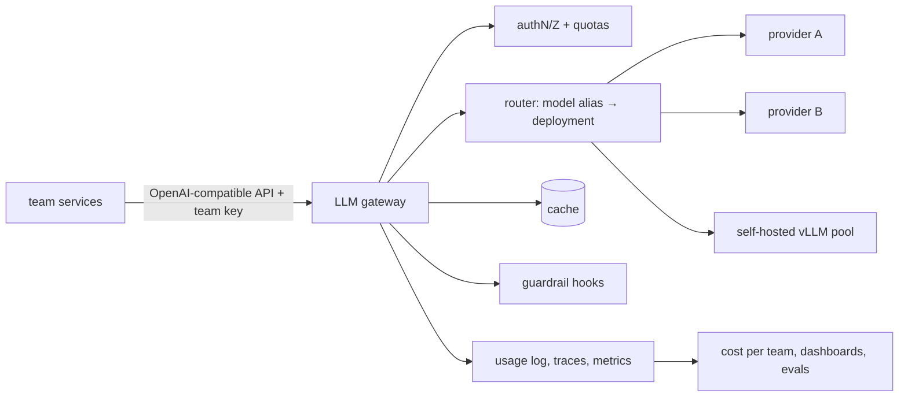
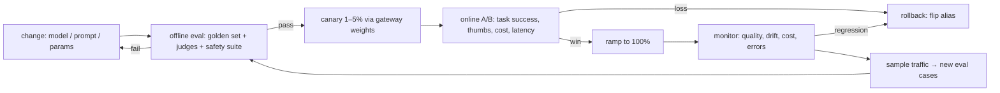

# 26 — LLM gateways & LLMOps

> **The requirement.** Inside Lumen's company, 40 teams now call LLMs: chat, RAG (SYSDESIGN-24), agents
> (SYSDESIGN-25), batch summarisation. They use four commercial providers plus a self-hosted vLLM fleet
> (SYSDESIGN-22). Finance wants cost per team. Security wants one place where keys live and prompts are logged under
> policy. SRE wants a provider outage to cause a fallback, not a page. Product wants to swap models without
> redeploying 40 services, and only after evaluations pass. Peak is 2,000 requests/s and the gateway may add no more
> than 10 ms at p95. This is hard because LLM traffic breaks the assumptions of ordinary API gateways. The cost of a
> request is measured in tokens that you only know *after* it finishes. Responses stream for many seconds. And
> "correct" is a statistical property, not a status code.

## In one minute

An LLM gateway is a reverse proxy that speaks the LLM API dialect (usually the OpenAI-compatible
`/v1/chat/completions`). Every application sends requests there instead of to a provider. Because all traffic
passes through it, the gateway is the natural place to authenticate callers, keep provider keys secret, enforce
*token* quotas, choose which model or provider serves a request, retry and fall back when one fails, cache, apply
safety checks, and record tokens, latency and cost per team. *LLMOps* is the practice around it: versioning prompts
and model choices like code, evaluating every change offline before it ships, comparing online, monitoring quality
and cost in production, and having a runbook for when a model quietly gets worse. The gateway gives you the control
point. LLMOps tells you what to do with it.

## Why this matters now

- **Multi-model is normal.** Teams mix frontier APIs with open models served on vLLM, SGLang or llama.cpp. All of
  them expose OpenAI-compatible endpoints (for example vLLM's server [1]), which makes a single gateway API
  practical.
- **A tooling category formed.** Open-source and commercial gateways now include LiteLLM's proxy (v1.108.12 is the current LTS
  line; the newest non-LTS release is 1.110.1, both as of 2026-11) [2], Agent Router (formerly Envoy AI Gateway; v1.3.0, now an Agentic AI Foundation project) [3],
  Kong AI Gateway [4], and Kubernetes' Gateway API Inference Extension. Its `InferencePool` API is v1 and GA since
  extension v1.0.0, latest v1.6.2 [5]. *As of 2026-11, re-check before relying on any of these.*
- **The gateway became a high-value target.** In March 2026 LiteLLM's maintainers reported that two PyPI releases
  (1.82.7 and 1.82.8) were compromised in a suspected supply-chain incident. Users were told to rotate credentials
  [6]. A component that holds every provider key needs SYSDESIGN-18-grade supply-chain hygiene: pinned digests,
  provenance, least privilege.
- **Observability got a vocabulary.** OpenTelemetry's GenAI semantic conventions define spans and metrics for
  inference, embeddings, retrieval, agents, tools and MCP. In June 2026 (semconv v1.42.0) they moved to a dedicated
  `semantic-conventions-genai` repository, and they are still in **Development** status as of 2026-11 [7][8].
- **Evaluation went continuous.** LLM-as-a-judge made cheap, scalable grading possible. Zheng et al. (2023) found
  strong judges agree with human preferences over 80% of the time, comparable to human-human agreement, and also
  documented position, verbosity and self-enhancement biases [9]. Using judges safely is now an engineering skill.

## Core ideas [Core]

### 1. The gateway pattern



*Diagram: team services call the gateway with a team key; the gateway authenticates and applies quotas, routes a
model alias to a provider or the self-hosted pool, consults a cache and guardrail hooks, and emits usage logs,
traces and metrics that feed cost reports and evaluations.*

**What belongs in the gateway** (cross-cutting, policy, per-request):
- **One API and model aliases.** Apps ask for `lumen-chat-default`, not `provider-x/model-2026-05-01`. Changing what
  the alias means is a config change, not 40 redeploys.
- **Identity and secrets.** Apps hold *gateway* keys (virtual keys) per team or service. Provider keys never leave
  the gateway.
- **Quotas and rate limits** in tokens and money, not just requests.
- **Routing, retries, fallbacks, load balancing** across deployments.
- **Caching** (exact, optionally semantic), **guardrail hooks** (pre-call, post-call, in-stream).
- **Telemetry:** tokens in/out, latency (TTFT, total), errors, cost, model actually used, cache hits.

**What does not belong in the gateway:** business logic, RAG orchestration, agent loops, and prompt construction
specific to one product. Put those in the gateway and it becomes a distributed monolith that every team must
coordinate changes in.

### 2. Routing

A *model alias* maps to a set of *deployments* (provider + model + region + key, or a self-hosted pool). The router
picks one per request:

| Strategy | Picks | Wins when | Watch out |
|---|---|---|---|
| Weighted random / shuffle | by weight or capacity | homogeneous deployments | ignores live latency |
| Least-busy | fewest in-flight requests | uneven request sizes | needs shared state across gateway replicas |
| Latency-based | lowest recent latency | interactive traffic | can herd onto one deployment; use decay and jitter |
| Usage/limit-aware | deployment with remaining TPM/RPM headroom | provider quotas are the bottleneck | counters must be shared (Redis) |
| Cost-based | cheapest deployment that qualifies | batch and offline jobs | quality differences across models |
| Quality / learned routing | a classifier picks strong vs weak model per prompt | mixed difficulty traffic | needs evals to prove it does not hurt quality |

LiteLLM, for example, documents `simple-shuffle` (default), `usage-based-routing-v2`, `latency-based-routing`,
`least-busy` and `cost-based-routing` strategies [10]. Learned routing is an active research area. RouteLLM trains
routers on preference data and reports cost reductions of over 2× in some settings without quality loss [11].
FrugalGPT's *cascade* tries a cheap model first and escalates when a scorer is not confident [12].

**Self-hosted pools are different.** For vLLM replicas, the best replica depends on *KV-cache state* (prefix cache
hits) and queue depth, not just round-robin. That is the job of the Gateway API Inference Extension's Endpoint
Picker, which routes within an `InferencePool` using model-server signals [5], and of KV-aware routers
(SYSDESIGN-22). Agent Router describes the resulting **two-tier pattern**: a tier-one gateway for auth, top-level
routing and global limits, and a tier-two gateway in front of self-hosted serving with endpoint picking [3].

### 3. Retries, fallbacks, cooldowns

- **Retry** the *same* deployment group a bounded number of times, with backoff and jitter, on retryable errors
  (429, 5xx, timeouts). Never retry 4xx content errors.
- **Fall back** to a *different* model group in order (`primary → secondary → self-hosted`) when retries are
  exhausted. LiteLLM runs `num_retries` before moving to `fallbacks` [13]. Separate fallback chains exist for
  context-window errors (route to a longer-context model) [10].
- **Cooldown** (a per-deployment circuit breaker): after N failures in a window, stop sending to that deployment for
  T seconds (LiteLLM: `allowed_fails`, `cooldown_time`) [10]. This is SYSDESIGN-11's circuit breaker applied per
  deployment.
- **Budget the retries.** A retry storm against a degraded provider multiplies load exactly when capacity is lowest.
  Cap total attempts per request and per second (retry budgets, SYSDESIGN-11).
- **Fallbacks change behaviour.** A fallback model has different quality, context length, tool-calling format and
  price. Log `model_requested` *and* `model_served`, and evaluate the fallback path too.

### 4. Token-based rate limiting and quotas

Requests per second are the wrong unit. One request may cost 50 tokens, the next 100,000. Gateways limit on
**tokens per minute (TPM)**, **requests per minute (RPM)**, **concurrent requests**, and **spend** (budget per
period), per key, team, model and deployment.

The design problem: *output length is unknown at admission time.*

1. **Estimate and reserve.** At admission, count input tokens (tokenizer or estimate) and reserve
   `input + max_tokens` from a token bucket (SYSDESIGN-10).
2. **Reconcile.** When the response finishes (or the stream ends), refund `max_tokens − actual_output`.
3. **Shared counters.** With N gateway replicas, counters live in Redis or similar. Use atomic scripts and accept
   small overshoot or use local leases (each replica pre-claims a slice).
4. **Fail open or closed?** If the counter store is down, do you allow traffic (cost risk) or reject it
   (availability risk)? Decide per tier. LiteLLM exposes this as a setting (`general_settings.fail_closed_rate_limit_enforcement`)
   and returns 503 instead of 429 when fail-closed enforcement cannot verify counters against Redis, so clients can tell the two apart [14].

Return `429` with `Retry-After` and quota headers so clients can back off. Separate **quota** (a monthly team
budget, a finance concept) from **rate limit** (a per-minute fairness and protection concept).

### 5. Streaming through proxies

Most interactive LLM traffic uses server-sent events (SSE) over HTTP/1.1 or HTTP/2. Through a proxy chain (CDN →
L7 LB → gateway → provider) the classic failures are:

- **Buffering:** a proxy that buffers the response turns a streaming answer into one 20-second blob. TTFT
  becomes total latency. Disable response buffering for streaming routes (in nginx, `proxy_buffering off` or the
  `X-Accel-Buffering: no` response header [15]).
- **Idle and total timeouts:** a 60 s LB timeout kills long generations. Reasoning models can be silent for a long
  time before the first token. Use keep-alive comments or heartbeats and set timeouts per route.
- **Cancellation:** when the client disconnects, the gateway must cancel the upstream request. Otherwise the GPU
  keeps generating tokens nobody reads, which costs money and capacity.
- **Usage accounting:** token counts arrive at the *end* of a stream (for OpenAI-style APIs when
  `stream_options.include_usage` is set). A stream cut mid-way needs an estimate from the tokens relayed so far.
- **Mid-stream guardrails:** post-call checks on streamed text must run on chunks, and "un-sending" already
  delivered tokens is impossible. Choose between buffering a window (latency cost) and accepting partial exposure.

### 6. Caching: exact and semantic

- **Exact cache:** key = hash(model, messages, parameters, tools, tenant). It is safe when temperature is 0 or
  determinism is not expected. Hit rates are usually low for chat but high for repeated batch or templated calls.
- **Provider and server prefix caching** is different and almost always safe. It reuses the KV cache for a shared
  prompt prefix and returns a freshly generated answer (SYSDESIGN-22).
- **Semantic cache:** embed the prompt, look for a previous prompt within a similarity threshold, return *its*
  answer. GPTCache (Bang, 2023) popularised the pattern [16]. LiteLLM supports `redis-semantic`,
  `qdrant-semantic` and `valkey-semantic` cache types [17]. Kong ships an AI Semantic Cache plugin [4].

**Semantic caching has correctness risks that an exact cache does not:**

| Risk | Example | Mitigation |
|---|---|---|
| False hit (near-duplicate, different meaning) | "Can I delete my account?" vs "Can't I delete my account?"; "price in EUR" vs "price in USD" | high threshold; restrict to templated or FAQ intents; verify with a cheap check |
| Cross-tenant / cross-user leakage | cached answer contains another user's data | partition the cache by tenant and permission scope; never cache personalised answers |
| Staleness | the policy changed but the cached answer did not | TTL; invalidate on source change (RAG doc versions in the key) |
| Context blindness | the same last message, different conversation history | key on the full relevant context, not just the last turn |
| Tool and agent calls | caching a tool-calling turn skips a side effect or reuses old data | do not semantic-cache tool-calling turns |

Treat a semantic cache as a **lossy approximation with a measurable error rate**, and measure it (§Numbers).

### 7. Prompt and version management

A production "model" is a tuple: `(model id + version, system prompt version, tools/schema version, decoding
params, retrieval config)`. Version all of it:

- Store prompts in a registry or repo with ids and versions, referenced by alias (`summarise@v12`), not pasted into
  code.
- **Pin model snapshots** where providers offer dated versions. Treat "latest" aliases as unpinned dependencies.
- Every change, whether prompt, model, decoding or retrieval, goes through the same pipeline: offline eval → canary →
  ramp. That includes "harmless" prompt edits.
- Log the full version tuple on every request. Without it, a regression cannot be bisected.

### 8. Guardrail hooks

The gateway offers hook points. *Pre-call*: PII redaction, prompt-injection classifiers, policy checks, topic
restrictions (Kong's AI Prompt Guard and AI Semantic Prompt Guard are examples of the category [4]). *Post-call*:
output moderation, schema validation, secret and PII detection. *In-stream*: incremental checks on chunks. Each hook
adds latency and its own false-positive rate, so measure both. Guardrails are one layer. SYSDESIGN-28 covers why
they cannot be the only one.

### 9. The LLMOps loop



*Diagram: a change is evaluated offline; if it passes it gets a canary via gateway weights, then an online A/B; wins
ramp to 100% and are monitored; losses or regressions roll back by flipping the alias; monitored traffic is sampled
into new evaluation cases.*

**Offline evaluation:** a versioned golden set per use case (hundreds to thousands of cases), deterministic checks
where possible (exact match, JSON schema, unit tests, retrieval recall from SYSDESIGN-24), LLM judges for
open-ended quality, and a safety and injection suite. Run it in CI on every change. Gate on regressions beyond a
threshold that accounts for run-to-run noise.

**LLM-as-judge caveats** (Zheng et al. [9]):
- **Position bias:** judges prefer the answer in a particular slot. Swap the order and average, or count only
  consistent verdicts.
- **Verbosity bias:** longer answers win. Control for length or instruct and check.
- **Self-enhancement bias:** judges favour outputs from their own model family. Use a different family as judge.
- **Limited reasoning:** judges miss maths and logic errors. Give them reference answers for such tasks.
- **Calibration:** measure judge-human agreement on a labelled sample *for your task* before trusting it. 80%
  agreement on MT-bench is not 80% agreement on your legal summaries.

**Online evaluation:** A/B by user or tenant (not by request, to avoid inconsistent experiences). Metrics include
explicit feedback (thumbs), implicit signals (copy, retry, abandonment, escalation to a human), task success where
measurable, cost and latency. Shadow traffic (send to the candidate, do not show the result) is useful for latency
and cost comparisons and for judge-based quality without user risk.

### 10. Monitoring

Golden signals for LLM traffic, per model alias, deployment, team and version tuple:

| Signal | Metric | Why |
|---|---|---|
| Latency | TTFT p50/p95/p99, time per output token, total duration | streaming UX (SYSDESIGN-21) |
| Traffic | requests/s, input and output tokens/s | capacity, rate limits |
| Errors | rate by class (429, 5xx, timeout, content filter, schema-invalid) | provider health, fallback triggers |
| Saturation | in-flight requests, queue depth on self-hosted pools, provider quota headroom | admission control |
| Cost | $ per request, per team, per successful task | finance, anomaly detection |
| Routing | fallback rate, cache hit rate, model_served ≠ model_requested | hidden degradation |
| Quality | judge scores on sampled traffic, thumbs-down rate, refusal rate | regressions |

OpenTelemetry's GenAI conventions give these names. Spans carry attributes such as `gen_ai.operation.name`,
`gen_ai.provider.name`, `gen_ai.request.model`, `gen_ai.response.model`, `gen_ai.response.finish_reasons`,
`gen_ai.usage.input_tokens` and `gen_ai.usage.output_tokens`. Metric instruments include
`gen_ai.client.inference.duration`, `gen_ai.client.inference.time_to_first_chunk` and the token-usage instruments
[8]. Because the conventions are in Development and names changed during 2026, pin the semconv version your
instrumentation emits and expect migrations [7][8]. Logging prompt and completion *content* is opt-in in the
conventions [8]. Treat it as personal data (SYSDESIGN-19).

## Numbers that matter

*Assumptions, labelled: 2,000 requests/s peak; average 1,500 input + 300 output tokens; streaming responses last
8 s on average; usage-log row 400 bytes without content.*

**1. Concurrency (Little's law, SYSDESIGN-01).** Open streams = λ × W = 2,000/s × 8 s = **16,000 concurrent
connections** at peak. A gateway that holds a thread per connection will not survive. Use an event-driven proxy and
size file-descriptor and connection limits.

**2. Token throughput.** 2,000 × (1,500 + 300) = **3.6M tokens/s** through the gateway at peak (3.0M input, 0.6M
output). Quota systems count these, so a team limit of "2M TPM" is ≈ 33k tokens/s, or about 1% of peak.

**3. Rate-limiter load.** Two atomic counter operations per request (reserve and reconcile) = **4,000 ops/s** on the
counter store. That is easy for one Redis primary, but every operation adds a network round trip (≈0.2–1 ms in-zone,
an assumption) to the latency budget. Local leases cut it.

**4. Latency budget (10 ms at p95 added).** Auth via a cached key lookup (≈0.5 ms), rate-limit round trip (≈1 ms),
routing decision (≈0.1 ms), request/response transformation (≈1 ms), logging *asynchronously* (≈0 ms on the hot
path). Total ≈ 3 ms, leaving headroom. A semantic-cache lookup adds an **embedding call plus an ANN query**, which
alone can use the whole budget. That is one more reason to apply it only to selected routes.

**5. Usage-log volume.** 2,000 × 86,400 ≈ 1.73×10⁸ rows/day at peak rate (an upper bound) × 400 B ≈ **69 GB/day**
of metadata. Logging full prompts and completions at ~8 KB/request would be ≈ 1.4 TB/day. Sample content, and keep
metadata for 100%.

**6. Semantic-cache error budget.** Suppose a semantic cache serves 20% of requests (hit rate 0.20) and 95% of those
hits are correct answers for the new prompt (precision 0.95). Then **0.20 × 0.05 = 1% of all responses** are wrong
answers served confidently from cache. Whether that is acceptable depends on the route. It may be fine for "what are
your opening hours", never for medical, legal or account-specific answers.

**7. Cost attribution.** Cost = Σ (input_tokens × in_price + output_tokens × out_price − cached-token discounts) per
deployment. For self-hosted pools, convert GPU-hours to a $/token rate: GPU $/h ÷ (tokens/s × 3,600) at measured
utilisation (SYSDESIGN-16, SYSDESIGN-23). Then all teams see one currency.

## Design choices and trade-offs

### Build vs adopt a gateway *(neutral, as of 2026-11)*

| Option | Wins when | Costs | Examples |
|---|---|---|---|
| Thin in-house proxy | Few providers, a strong platform team, special requirements | You maintain provider adapters, streaming edge cases, tokenizers | — |
| Python LLM proxy | Fast start; broad provider coverage; virtual keys, budgets, spend tracking | Python performance per replica; release-pipeline and PyPI supply-chain exposure (the March 2026 incident came via a CI/CD dependency) [6] | LiteLLM proxy v1.108.12-lts [2][10] |
| Envoy-based AI gateway | Kubernetes and Envoy shops; high-performance data plane; two-tier with self-hosted pools | Envoy and CRD complexity | Agent Router / Envoy AI Gateway v1.3.0 [3] |
| API-management vendor AI gateway | Existing Kong (or similar) estate; plugins for semantic cache, prompt guards, MCP | Some features may be licence-tiered (check vendor docs) | Kong AI Gateway [4] |
| Kubernetes inference routing only | Self-hosted pools; KV-cache and queue-aware endpoint picking | Not a full multi-provider gateway; pair with tier one | Gateway API Inference Extension v1.6.x [5] |

### Where does each control live?

| Control | Gateway | Application | Model server |
|---|---|---|---|
| Provider keys | ✔ | ✘ | — |
| Token quotas per team | ✔ | — | — |
| Per-request fairness inside a GPU pool | — | — | ✔ (scheduler, SYSDESIGN-22) |
| Prompt construction, RAG | ✘ | ✔ | — |
| Output schema validation | optional | ✔ (owns the schema) | grammar-constrained decoding |
| Evaluation gating | config flip | — | — |

## Deep dive [Deep]

### Token-bucket admission with reservation

```text
on request(team, model, input_tokens, max_tokens):
    need = input_tokens + max_tokens
    ok, remaining = redis.EVAL(reserve_script, key=team:model:minute, need, limit)
    if not ok: return 429, Retry-After = seconds_until_refill(remaining)
    stream response; count output tokens as relayed
on completion (or client disconnect, or error):
    actual = input_tokens + output_tokens_relayed
    redis.EVAL(refund_script, key, need - actual)
    emit usage event {team, model_requested, model_served, input, output, cost, latency, ttft}
```

Large `max_tokens` defaults reserve too much and cause false 429s. Clamp `max_tokens` per route. Cancelled streams
must refund. Batch traffic should use a separate, lower-priority bucket so it cannot starve interactive users. That
is SYSDESIGN-10's rate limiting with a token-shaped twist.

### Fallback semantics that bite

- **Tool-calling formats differ** across providers and open models. A fallback that cannot emit tool calls breaks
  agents (SYSDESIGN-25). Fall back only to models that passed the same tool-calling eval.
- **Context windows differ.** A 100k-token request cannot fall back to an 8k model. Route by required context first.
- **Content policies differ.** A request refused by one provider may succeed on another, which can be a policy
  violation. Decide explicitly whether content-policy errors trigger fallbacks.
- **Idempotency.** LLM calls are generally safe to retry, but agent tool calls downstream of them may not be. Do not
  retry at two layers (client *and* gateway) without coordination, or attempts multiply.

### Drift and model-regression incident response

*Drift* comes from three directions:
1. **Input drift:** traffic changes (new product, new language). Detect with embedding-cluster distributions of
   prompts, input-length histograms, language mix.
2. **Upstream model change:** a provider updates a model behind an unpinned alias, or a self-hosted rollout changes
   quantization or the engine version. Detect with judge scores on sampled traffic, refusal rate, output-length
   shift, schema-validity rate, and *canary prompts* with known good answers run every few minutes.
3. **Data drift in RAG:** the corpus changes, so answers change (SYSDESIGN-24's evaluation).

**Runbook for a suspected model regression:**
1. **Detect:** alert on canary-prompt failures, judge-score drop, or a thumbs-down spike, segmented by version tuple.
2. **Triage:** what changed? Diff the version tuple (model snapshot, prompt version, gateway config, retrieval index
   version). The gateway's request log is the timeline.
3. **Mitigate first:** flip the alias back (route weights) or pin the previous snapshot. Gateways make rollback a
   config change, which is the strongest operational argument for having one.
4. **Confirm:** re-run the offline suite against both versions on the failing slice.
5. **Learn:** add the failing cases to the golden set, so the same regression cannot ship twice.

### Multi-tenancy, privacy and audit

Per-tenant keys and budgets; per-tenant log retention; region pinning (route EU tenants only to EU deployments,
SYSDESIGN-19); redaction before logs; and an audit trail of *config* changes (who changed the alias weights at
14:02?). The gateway sees all prompts, so its access controls and logs are themselves sensitive data stores.

## Frontier [Frontier]

*As of 2026-11; verify before use.*

- **Gateways absorb agent traffic.** Agent Router and Kong AI Gateway now manage MCP and A2A traffic alongside LLM
  calls [3][4]. MCP 2026-07-28's per-request `Mcp-Method` and `Mcp-Name` headers exist to let gateways route and
  authorise tool calls (SYSDESIGN-25).
- **Inference-aware routing in Kubernetes.** The Gateway API Inference Extension (InferencePool v1 GA) standardises
  how a gateway delegates endpoint choice to a model-server-aware picker. The docs point to llm-d's router as an
  example of an existing EPP [5].
- **GenAI telemetry standardisation** is converging, but still in Development. The separate
  `semantic-conventions-genai` repo has no tagged release yet [7]. Expect attribute and metric renames.
- **Learned routing and cascades** (RouteLLM [11], FrugalGPT [12]) are moving from papers into gateway features.
  Evaluate them on your own traffic before trusting reported savings.
- **Supply-chain hardening for AI middleware** after 2026's LiteLLM incident [6]: pin image digests, verify provenance, and
  isolate the gateway's credentials (SYSDESIGN-18).

## Failure modes and operations

| Failure | Detection | Mitigation |
|---|---|---|
| Provider outage / brownout | error rate and TTFT by deployment | cooldown + fallback chain; retry budget |
| Retry storm | attempts/request > 1.5; upstream 429s rising | retry budgets; jitter; shed batch traffic first |
| False 429s | 429 rate vs actual token use; large reserved-vs-used gap | clamp `max_tokens`; refund on completion |
| Streams buffered | TTFT ≈ total latency at the client but not at the gateway | disable buffering on the path; test through every hop |
| Orphaned generations | upstream tokens > relayed tokens | propagate client cancellation upstream |
| Semantic-cache false hits | sampled audit of cache hits by judge or humans | raise threshold; restrict routes; per-tenant partitions |
| Silent model regression | canary prompts, judge-score drift, refusal-rate change | pinned snapshots; alias rollback; regression runbook |
| Cost anomaly | spend/team/hour vs baseline | budgets with alerts at 50/80/100%; hard caps for batch |
| Gateway as single point of failure | gateway SLOs; synthetic probes | stateless replicas across zones; counter-store failure policy; break-glass direct path |
| Compromised gateway dependency | SBOM / advisory monitoring | pinned digests, provenance, rotate keys on advisory [6] |

## Cost and energy

- The gateway's own cost is small. Its *leverage* is large: routing 60% of traffic to a smaller model that passes
  the evals can cut spend more than any infrastructure optimisation. Prove it with evals, not anecdotes.
- **Caching:** exact cache and provider/server prefix caching are low-risk savings. Semantic caching trades a
  measurable error rate for savings (§Numbers 6).
- **Self-hosted vs API:** compare $/1M tokens at *measured* utilisation. Idle GPUs make self-hosting expensive
  (SYSDESIGN-16, SYSDESIGN-23). The gateway's usage log is where utilisation and per-team cost become visible.
- **Energy per request** scales with tokens processed (SYSDESIGN-17). Routing to smaller models and trimming prompts
  are energy optimisations as well as cost ones.

## Interview angle

**How it is asked:** "Design an internal LLM platform for many teams", "How do you rate-limit an LLM API?", "Design
the API layer for a ChatGPT-like service" (C09), "A provider is down. What happens?", "How do you know a model
change didn't make things worse?"

**Model answer outline (CLARIFY → QUANTIFY → SKETCH → DEEPEN → STRESS → WRAP):**
1. **CLARIFY:** teams and tenants, providers and self-hosted pools, streaming share, latency overhead budget,
   compliance (regions, logging), budget ownership.
2. **QUANTIFY:** Little's law for concurrent streams; tokens/s; counter-store ops; log volume; quota sizes.
3. **SKETCH:** stateless gateway replicas behind an L7 LB; auth via virtual keys; Redis counters; router with
   aliases, retries, fallbacks, cooldowns; async usage pipeline → cost and metrics; eval pipeline wired to alias
   weights.
4. **DEEPEN:** token-based rate limiting with reservation and refunds, *or* streaming through proxies, *or* the
   eval and rollback loop.
5. **STRESS:** a provider brownout (retry storm), a Redis outage (fail open or closed), a semantic-cache leak, a
   silent model regression.
6. **WRAP:** one API, keys centralised, quotas in tokens, rollback as config, every change through evals.

**Red flags:** rate limiting in requests only; provider keys in application config; synchronous logging on the hot
path; a semantic cache shared across tenants; "we test the new model by switching it on"; trusting one LLM judge
without calibration.

**Follow-ups:** How do you count tokens for a stream that was cut off? How do you route to a self-hosted pool with
prefix caching? Should the gateway do RAG? How would you attribute cost for a self-hosted model?

## Common mistakes

- Using "latest" model aliases in production and calling the resulting change "drift".
- Clamping nothing: default `max_tokens` reservations cause 429s at low real usage.
- Testing streaming only against the gateway directly, never through the CDN and LB path.
- Falling back to a model that has never passed the evals for that route.
- Logging full prompts forever "for debugging" (a privacy and storage liability).
- Treating LLM-judge scores as absolute rather than relative and calibrated.
- Letting the gateway grow product logic until every team is blocked on its release.

## Check yourself

1. Why must a token-based limiter reserve `max_tokens` at admission, and what goes wrong if you never refund?
2. 1,000 req/s with 12 s average streams: how many concurrent connections?
3. Give two semantic-cache false-hit examples and one mitigation each.
4. Name three biases of LLM-as-a-judge and how you would control each.
5. A provider silently updates a model and your thumbs-down rate doubles. Walk through the runbook.

Full set with answers: [exercises/26-llm-gateways-llmops.md](../../exercises/26-llm-gateways-llmops.md).

## Lab

[labs/26-llm-gateways-llmops](../../labs/26-llm-gateways-llmops/README.md). Runs the LiteLLM proxy
(`v1.108.12-lts`, pinned) with Postgres for virtual keys, in front of **two llama.cpp replicas** serving the same tiny
open model (Qwen2.5-0.5B-Instruct, CPU), in docker compose (project `sd-26`). You call one model alias and watch it
load-balance across replicas. You stop a replica and watch retries and cooldown keep the alias up. You point an
alias at a dead backend and watch the fallback chain serve it. You issue a team key with a tiny TPM limit and hit
`429`. You stream through the proxy and measure TTFT versus total time, then read the per-key spend and usage the
gateway recorded. No paid API keys are needed.

**What one recorded run showed** (2026-11-20, details in the lab's Test status). With one replica stopped, every
request still succeeded, but the first one took 63.8 s in one run (14.7 s for one request in a second run) before
the gateway settled on the healthy replica. The mechanism was not investigated. Failure-detection latency is a design parameter to measure. A key with
`tpm_limit = 200` let four requests of 76 tokens through (304 tokens) before returning `429`. That is the
overshoot of post-hoc token accounting that §Deep dive's reserve-and-refund design avoids. It holds for the
`tpm_limit` path in this pinned version and configuration; LiteLLM documents a reservation mode for spend
budgets [14]. Streaming through the
gateway gave 187 ms time to first token against 1.6 s total.

## Further reading

- Zheng et al., "Judging LLM-as-a-Judge" [9]: the evidence base for judge biases and agreement.
- Gateway API Inference Extension docs [5]: how Kubernetes standardises inference-aware routing.
- Agent Router (formerly Envoy AI Gateway) README [3]: the two-tier gateway pattern.
- LiteLLM routing and reliability docs [10][13]: concrete vocabulary for retries, fallbacks and cooldowns.
- OpenTelemetry GenAI semantic conventions [8]: what to name your spans and metrics.
- Ong et al., RouteLLM [11] and Chen et al., FrugalGPT [12]: cost-quality routing.
- LiteLLM March 2026 security update [6]: a real supply-chain incident in AI middleware.

## References

1. vLLM project. "OpenAI-Compatible Server." https://docs.vllm.ai/en/latest/serving/online_serving/openai_compatible_server/ (accessed 2026-11)
2. BerriAI. LiteLLM releases (v1.108.12 LTS image `docker.litellm.ai/berriai/litellm:v1.108.12-lts`). https://github.com/BerriAI/litellm/releases ; Docker quick start https://docs.litellm.ai/docs/proxy/docker_quick_start (accessed 2026-11)
3. Agent Router (formerly Envoy AI Gateway). README and docs, v1.3.0 (2026-11-18). https://github.com/theagentrouter/agent-router ; https://theagentrouter.ai/docs/ (accessed 2026-11)
4. Kong. "AI Gateway" documentation (AI Semantic Cache, AI Rate Limiting Advanced, AI Prompt Guard, AI Semantic Prompt Guard, MCP). https://developer.konghq.com/ai-gateway/ (accessed 2026-11)
5. Kubernetes SIG Network. Gateway API Inference Extension docs (InferencePool v1, GA since v1.0.0; Endpoint Picker); releases (v1.6.2, 2026-09-17). https://gateway-api-inference-extension.sigs.k8s.io/ ; https://gateway-api-inference-extension.sigs.k8s.io/api-types/inferencepool/ ; https://github.com/kubernetes-sigs/gateway-api-inference-extension/releases (accessed 2026-11)
6. LiteLLM. "Security Update: Suspected Supply Chain Incident" (24 Mar 2026). https://docs.litellm.ai/blog/security-update-march-2026 (accessed 2026-11)
7. OpenTelemetry. Semantic conventions v1.42.0 release notes (GenAI conventions moved to a dedicated repository). https://github.com/open-telemetry/semantic-conventions/releases/tag/v1.42.0 (accessed 2026-11)
8. OpenTelemetry. GenAI semantic conventions (spans, metrics, agent and MCP conventions; status Development). https://github.com/open-telemetry/semantic-conventions-genai (accessed 2026-11)
9. Zheng, L. et al. "Judging LLM-as-a-Judge with MT-Bench and Chatbot Arena." NeurIPS 2023 Datasets & Benchmarks. arXiv:2306.05685. https://arxiv.org/abs/2306.05685 (accessed 2026-11)
10. LiteLLM. "Router — load balancing, routing strategies, cooldowns." https://docs.litellm.ai/docs/routing (accessed 2026-11)
11. Ong, I. et al. "RouteLLM: Learning to Route LLMs with Preference Data." arXiv:2406.18665 (2024). https://arxiv.org/abs/2406.18665 (accessed 2026-11)
12. Chen, L., Zaharia, M., Zou, J. "FrugalGPT: How to Use Large Language Models While Reducing Cost and Improving Performance." arXiv:2305.05176 (2023). https://arxiv.org/abs/2305.05176 (accessed 2026-11)
13. LiteLLM. "Proxy — fallbacks, retries, timeouts, cooldowns" (reliability). https://docs.litellm.ai/docs/proxy/reliability (accessed 2026-11)
14. LiteLLM. "Users / virtual keys: budgets and rate limits" (tpm_limit, rpm_limit, max_parallel_requests, max_budget). https://docs.litellm.ai/docs/proxy/users (accessed 2026-11)
15. nginx. "ngx_http_proxy_module: proxy_buffering, X-Accel-Buffering." https://nginx.org/en/docs/http/ngx_http_proxy_module.html (accessed 2026-11)
16. Bang, F. "GPTCache: An Open-Source Semantic Cache for LLM Applications Enabling Faster Answers and Cost Savings." NLP-OSS 2023. https://aclanthology.org/2023.nlposs-1.24/ (accessed 2026-11)
17. LiteLLM. "Caching" (cache types including redis-semantic, qdrant-semantic, valkey-semantic). https://docs.litellm.ai/docs/proxy/caching (accessed 2026-11)
