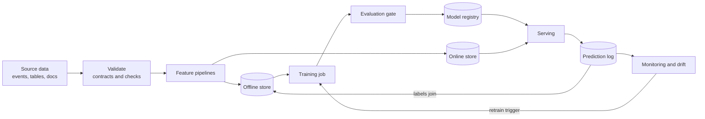
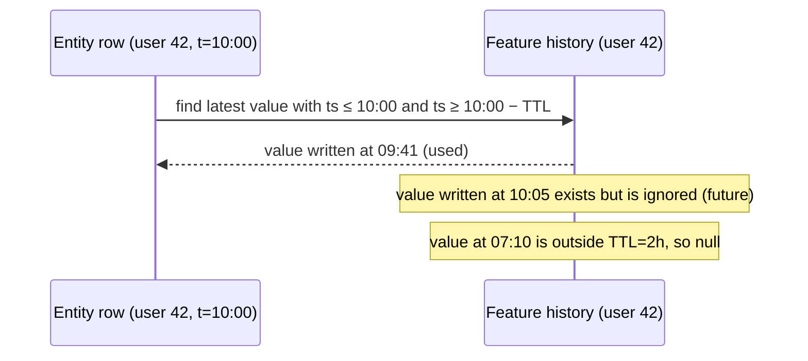
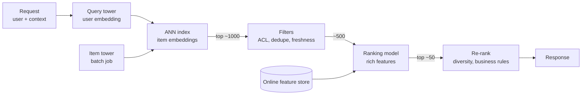
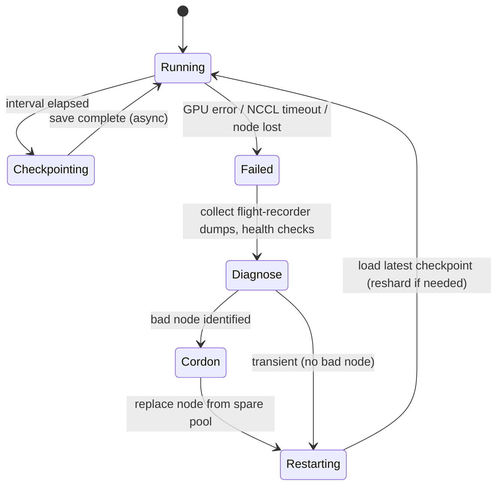

# 27 — ML platforms & data for AI

> **The requirement.** Lumen's product team wants three things at once. Personalized "related documents"
> that update within minutes of a user's activity. A fine-tuned support model that is retrained weekly on
> fresh tickets. And an auditor-friendly answer to "which data and which code produced the model that answered
> this customer on 3 March?" The model code is maybe a few hundred lines. Everything around it is the hard
> part: getting the same feature value in training and serving, reproducing a run, rolling a model back in
> seconds, and noticing when the world drifts away from the training set.

## In one minute

A model is a function learned from data, so changing the data changes the program. That one fact explains
almost everything an ML platform does. Traditional software has one artifact (code) and one pipeline (build,
test, deploy). ML has three artifacts that change on their own schedules: code, data and the trained model.
It has two pipelines that must agree with each other: the one that makes training examples and the one that
computes the same inputs live for every request. When they disagree, the model is quietly wrong and no
exception is thrown. An ML platform is the set of shared services that keeps those artifacts versioned, keeps
the two pipelines consistent, lets you train big models without losing a week to one dead GPU, and keeps
watching the model after it ships. Feature stores, registries, training orchestrators and drift monitors are
not fashion. Each one exists because a specific failure kept recurring.

## Why this matters now

Three shifts from 2023 to 2026 changed what "ML platform" means.

1. **Foundation models moved the work from training to adapting.** Most teams no longer pre-train. They
   fine-tune an open-weights model with parameter-efficient methods such as LoRA [9], or they build retrieval
   around one ([SYSDESIGN-24](24-retrieval-vector-systems.md)). The platform now has to manage adapters,
   base-model versions and evaluation suites, not just tabular classifiers.
2. **GPU clusters made failure a constant.** Meta reports 419 unexpected interruptions during a 54-day window
   of Llama 3 405B pre-training on up to 16K H100 GPUs. About 78% were attributed to confirmed or suspected
   hardware issues, and GPU issues alone were 58.7% [14]. Checkpointing and automatic restart are now core
   platform features, not nice-to-haves.
3. **The open-source stack consolidated.** Ray joined the PyTorch Foundation in October 2025 [17]. KServe
   became a CNCF incubating project in late 2025 [19]. Kubeflow moved to calendar-versioned platform
   releases (26.03) and shipped Trainer v2 [18]. Feast and MLflow kept monthly release trains (as of 2026-11:
   Feast v0.68.0, MLflow 3.18.0) [6][7]. You can now assemble a credible platform from open parts. The design
   question is less "what tool" and more "which contracts between the parts".

The classical lesson still holds. Sculley et al. described ML systems in which "only a small fraction" of the
system is ML code, and the "required surrounding infrastructure is vast and complex" [1]. That surrounding
infrastructure is this chapter.

## Core ideas [Core]

### The lifecycle is a system, not a sequence of notebooks

*Diagram: source data is validated, then turned into features that land in both an offline store (for
training) and an online store (for serving). Training reads the offline store, passes an evaluation gate,
and registers a model. Serving loads the model from the registry and reads the online store. Predictions are
logged, monitored for drift, joined with labels back into the offline store, and can trigger retraining.*

Read the diagram as a set of **contracts**, one per arrow.

| Arrow | Contract | What breaks without it |
|---|---|---|
| Source → validate | Schema, ranges, freshness and volume expectations | Upstream team renames a column; features silently go null |
| Features → stores | One definition, two materializations | Training and serving compute "the same" feature differently |
| Offline → training | Point-in-time correct examples | Label leakage; offline AUC far above online |
| Training → registry | Model + lineage (code commit, data snapshot, params, metrics) | "Which model is in prod?" has no answer |
| Registry → serving | Signature (input/output schema), alias, rollback | Deploying means editing YAML by hand |
| Serving → log | Log the features actually used, plus model version | No way to debug, audit or retrain on real inputs |
| Log → monitoring | Drift, quality and business metrics with thresholds | Model decays for months unnoticed |

Uber's 2017 description of Michelangelo laid the same workflow out as six steps: manage data, train,
evaluate, deploy, predict, monitor [5]. Most later platforms are variations on it.

### Training-serving skew

Martin Zinkevich's *Rules of Machine Learning* defines training-serving skew as "a difference between
performance during training and performance during serving". It lists three causes: a discrepancy in how the
two pipelines handle data, a change in the data between training and serving, and a feedback loop between
the model and the algorithm [2]. The first cause is an engineering bug you can design out. The second is
drift, which you monitor for. The third is a property of the product.

The classic engineering version goes like this. A data scientist computes `days_since_last_login` in SQL over
a nightly snapshot. A backend engineer computes it in Java at request time from a cache. One uses UTC
midnight, the other the user's local timezone. Both look correct in code review. The model learns from one
distribution and is served the other.

Two design moves remove most of this class of bug:

1. **Define once, materialize twice.** A feature is declared once (source, transformation, entity key,
   timestamp). The platform writes it to an offline store for training and an online store for serving.
   Uber's Michelangelo applied the same transformation expressions at training and prediction time for this
   reason [5].
2. **Log what you served.** Zinkevich's Rule #29: "The best way to make sure that you train like you serve
   is to save the set of features used at serving time" [2]. If you train on logged serving features, the two
   pipelines cannot disagree, because there is only one.

### Feature stores: online, offline and the registry

A **feature store** is the service that implements "define once, materialize twice". It has four parts.

- **Registry.** Metadata: entities (user, document, merchant), feature views (groups of features with a
  source and a TTL), owners, versions.
- **Offline store.** A columnar, append-mostly history of feature values with event timestamps: a lakehouse
  table, BigQuery, Snowflake, Spark, or files. It is optimized for large scans and joins (see
  [SYSDESIGN-13](../01-foundations/13-data-at-scale.md)).
- **Online store.** A key-value store holding the latest value per entity: Redis, DynamoDB, Cassandra,
  ScyllaDB and others. It is optimized for single-digit-millisecond point reads.
- **Materialization and ingestion.** Batch jobs copy the latest values from offline to online. Streaming jobs
  push fresh values directly ([SYSDESIGN-20](../02-modern-requirements/20-real-time-streaming.md)).

Feast, the most widely used open-source feature store, describes itself as using a *push model*. Data
producers push values and Feast stores them in the online store, because pulling from sources at request
time would make latency "at least as long as your slowest call" [3]. Its docs also say plainly that "strong
consistency is not guaranteed out of the box" [3]. Online values are eventually consistent with the offline
history, and your design must tolerate that.

Feast's model has **feature views** (a named collection of features from one source with an optional TTL),
**stream feature views** (batch plus stream sources for fresher online values) and **on-demand feature views**
(Python transformations over request-time inputs, run in both the online and historical paths) [8]. The last
one matters for skew. A feature such as "distance between the user's current location and the merchant"
cannot be precomputed. On-demand views let you write it once and run the same code in both paths.

### Point-in-time correctness

To build a training example for an event at time *t*, you may only use feature values that were known at
or before *t*. If you join on "latest value", every training row sees the future. A fraud label that arrived
three weeks later, or a user's lifetime click count including clicks made after the event, leaks into the
features. Offline metrics look excellent and online metrics collapse.

Feast's historical retrieval implements this as a **point-in-time join**. You provide an *entity dataframe*
of (entity key, event timestamp) rows. For each row, Feast scans backward from that row's timestamp up to the
feature view's TTL and takes the latest value it finds. The TTL is measured from each entity timestamp, not
from when the query runs [4]. A `filter_by_created_timestamp` option also excludes values that were *written*
after the event time, which keeps backfilled corrections from leaking into training [4].

*Diagram: for a training row at 10:00, the join returns the 09:41 value. A 10:05 value is ignored because it
is in the future, and a 07:10 value would be ignored because it is older than the two-hour TTL.*

**Rule of thumb:** if your training-set builder ever calls `max(timestamp)` without a bound, you have a leak.

### Training and fine-tuning pipelines

A training pipeline is a DAG: fetch a point-in-time dataset → validate it → train → evaluate → register.
Orchestrators such as Kubeflow Pipelines, Airflow, Argo Workflows or Ray jobs schedule the DAG and record its
inputs and outputs. The platform requirements are boring and essential:

- **Reproducible inputs:** the dataset is a versioned snapshot (a lakehouse table version, a manifest of
  files with hashes), not "whatever the table holds now".
- **Pinned environments:** container image digest, library versions, base-model revision.
- **Recorded outputs:** metrics, artifacts and a link from the model back to all of the above.

For LLMs the dominant pattern is **fine-tuning a frozen base**. LoRA freezes the pre-trained weights and
trains a low-rank update *BA* for selected weight matrices. The authors report up to 10,000× fewer trainable
parameters and a 3× lower GPU memory requirement than full fine-tuning of GPT-3 175B with Adam [9]. With
rank 4 on the query and value projections, the checkpoint shrinks from 350 GB to about 35 MB [9]. That is
why one serving fleet can host many adapters on one base model (multi-LoRA serving, see
[SYSDESIGN-22](22-serving-llms-at-scale.md)). QLoRA goes further, back-propagating through a 4-bit quantized
base model. Its authors report fine-tuning a 65B-parameter model on a single 48 GB GPU [10].

### Model registry and lineage

A **model registry** is the system of record for "which models exist, which version is live, and where it
came from". In MLflow, a *registered model* has numbered *versions*. Each version is linked to the run,
logged model or notebook that produced it. *Aliases* such as `champion` are "a mutable, named reference to a
particular version", resolved by URI as `models:/MyModel@champion` [7]. Serving code that loads `@champion`
never changes. Promotion and rollback become a single metadata write.

Lineage turns the registry into an audit tool. For the requirement's question ("which data and code produced
the model that answered on 3 March?"), you need four links:

1. prediction log row → model version (log it on every prediction);
2. model version → training run (registry);
3. training run → code commit, image digest, parameters (experiment tracker);
4. training run → dataset snapshot ID → feature definitions and source table versions (feature store and
   lakehouse).

Break any link and the answer becomes "probably". This is also what the EU AI Act's record-keeping and
technical-documentation duties ask for in high-risk systems ([SYSDESIGN-28](28-ai-trust-safety-governance.md)).

### Batch vs online inference

| Mode | How | Wins when | Costs |
|---|---|---|---|
| **Batch** (offline scoring) | Score every entity on a schedule; write results to a table or KV | Inputs change slowly; entity set is enumerable (daily churn scores, nightly recs) | Stale between runs; you pay to score entities nobody looks at |
| **Online** (request-time) | Model server scores on each request with fresh features | Inputs only exist at request time (the transaction, the query, the session) | Latency budget; fleet sized for peak; feature store on the hot path |
| **Streaming** | Score as events arrive; push results to a store | Near-real-time alerts; reactions to events, not requests | Stream infrastructure; replay and exactly-once concerns |
| **Hybrid** | Precompute heavy parts (embeddings, candidates) in batch; finish online | Recommenders; RAG | Two code paths to keep consistent |

Most production recommenders and fraud systems are hybrid. Rule of thumb: precompute whatever does not depend
on the request, and compute online only what does.

### Two-tower retrieval plus ranking

Recommending from a corpus of millions of items under a 100 ms budget cannot mean scoring every item with an
expensive model. The standard answer is a **funnel**. Covington et al. described YouTube's split into a deep
*candidate generation* model and a separate deep *ranking* model [11].

*Diagram: the user request goes through a query tower to an embedding, which retrieves about a thousand
candidates from an ANN index of item embeddings built offline by an item tower. Filters cut that to about
500, a ranking model with rich features from the online store scores them, and a re-ranker applies diversity
and business rules before the response.*

- **Retrieval (two-tower).** One network embeds the user and context. Another embeds items. Relevance is the
  dot product. Item embeddings are computed in batch and loaded into an ANN index (HNSW, IVF-PQ; see
  [SYSDESIGN-24](24-retrieval-vector-systems.md)). Yi et al. describe training such towers with in-batch
  negatives and a streaming item-frequency estimate that corrects the sampling bias in the batch loss. They
  deployed it for YouTube retrieval over tens of millions of videos [12].
- **Ranking.** A heavier model (gradient-boosted trees, a deep cross network, or a small transformer) scores a
  few hundred candidates with cross features (user × item) that the towers cannot express. This stage is
  where the online feature store sits on the hot path.
- **Re-ranking.** Diversity, freshness boosts, de-duplication, policy filters.

The candidate counts above are illustrative assumptions, not sourced figures. Tune them to your latency
budget.

### Drift and monitoring

Monitoring a model is monitoring three distributions.

- **Data (covariate) drift:** the inputs P(x) change. A new client app sends a new default value. A new market
  launches.
- **Concept drift:** the relationship P(y | x) changes. Fraudsters adapt. User taste shifts. The literature
  defines concept drift as unforeseeable changes in the underlying distribution of streaming data over time
  [15].
- **Prediction drift:** the output distribution changes. It is cheap to watch and is often the first signal.

Detection methods range from per-feature statistics (null rate, mean, quantiles; Kolmogorov–Smirnov or
chi-squared tests; population stability index) to multivariate tests. Rabanser et al. compared shift
detectors empirically and found that "a two-sample-testing-based approach, using pre-trained classifiers for
dimensionality reduction, performs best" among those they studied [16]. In practice:

1. Alert on **data-quality** breaks first: schema, null rate, freshness, volume. These are bugs, not drift,
   and they are the most common cause of "model got worse".
2. Watch **prediction distribution** and **business KPIs** next. They are label-free and fast.
3. Measure **actual performance** when labels arrive. Labels can take seconds (clicks) or months
   (chargebacks; see [C12](../04-case-studies/C12-realtime-fraud-recsys.md)).

### Data quality and contracts

Polyzotis et al. describe Google's data-validation system for ML. It targets "unexpected patterns,
schema-free data, or training/serving skew" in the data that feeds production pipelines [13]. Sculley et al.
warn that data dependencies "cost more than code dependencies" because there is no compiler that finds them,
and that unstable input signals owned by another team can change "at any time" [1].

A **data contract** makes the producer-consumer agreement explicit and machine-checkable. The Open Data
Contract Standard (ODCS, from the Bitol project) defines a YAML document with sections for schema, data
quality, service-level agreement, support channels, team and roles [20]. Whether you adopt ODCS or a homegrown
format, a useful contract states:

- schema and semantic types (including units and timezones; remember the `days_since_last_login` example);
- quality rules (non-null, ranges, uniqueness, referential integrity);
- freshness and volume SLOs ("partition for day D lands by 03:00 UTC with 0.9–1.1× the trailing mean rows");
- an owner and a change process (deprecation window, versioning).

Enforce contracts in CI for the producer, and as a gate in the training pipeline for the consumer. Fail
loudly before training, not silently after deploying.

## Numbers that matter

All figures are back-of-envelope estimates with labelled assumptions. Sourced constants carry a reference.

**1. Online feature store sizing (Lumen recommendations).**
Assumptions: 20 M users, 150 features per user, 8 bytes per value on average after encoding, plus about 50%
overhead for keys and store metadata.
20 M × 150 × 8 B = 24 GB raw → ~36 GB with overhead. That fits a small Redis cluster or a few DynamoDB
partitions comfortably. Users are not the hard part. **Item × user cross features** are: 20 M users × 10 k
items is 2×10¹¹ pairs, which you cannot store. That is why cross features are computed on demand or learned by
the ranking model rather than stored.

**2. Online read load.**
Assumptions: 3,000 recommendation requests/s at peak; ranking 500 candidates, each needing item features.
Item features are 500 key lookups per request, or 1.5 M point reads/s if done naively. Batched multi-get
(one round trip per request per shard) and a local in-process cache for hot items (item features change
slowly) bring this to a few thousand round trips per second. **Design implication:** the per-request feature
fetch must be a batched, parallel call with a hard timeout and a default-value fallback.

**3. Full fine-tuning vs LoRA memory (7B model).**
ZeRO's accounting for mixed-precision Adam: 2 bytes per parameter for fp16 weights, 2 for fp16 gradients, and
12 for fp32 optimizer states (master weights, momentum, variance), so **16 bytes per parameter** before
activations [21].
- Full fine-tune, 7 B params: 7×10⁹ × 16 B = **112 GB** of model states. That exceeds one 80 GB H100 before a
  single activation is stored. You need sharding (ZeRO-3 / FSDP) across at least two GPUs, more in practice.
  Over 8 GPUs that is 14 GB per GPU for states.
- LoRA, 7 B frozen in bf16: 7×10⁹ × 2 B = **14 GB** for the base, plus adapters and their optimizer states.
  If the adapters are 0.1–1% of parameters (an assumption; it depends on rank and target modules), that adds
  well under 2 GB. One GPU is enough, with room for activations.
- QLoRA (4-bit base): ~3.5 GB for the base weights, consistent with the paper's 65B-on-48 GB claim [10].

**4. Checkpoint interval.**
Young's first-order approximation gives the optimal checkpoint interval as T ≈ √(2·C·M), where C is the time
to write a checkpoint and M is the mean time between failures [22]. Using Meta's figure of 419 unexpected
interruptions in 54 days [14], M ≈ (54 × 24 h) / 419 ≈ 3.1 h ≈ 186 min for that very large job.
Assume C = 2 min (an asynchronous, sharded save; this is an assumption).
T ≈ √(2 × 2 × 186) ≈ √744 ≈ 27 min.
With synchronous saves taking 10 minutes, T ≈ √3720 ≈ 61 min, and the expected loss per failure (about half
an interval plus restart time) roughly doubles. **Faster checkpoints buy more frequent checkpoints, and
together they cut wasted GPU-hours.** That is why asynchronous, sharded checkpointing (for example PyTorch
Distributed Checkpoint's `async_save`, which stages to CPU memory and writes in a background thread [23])
matters at scale.

**5. Two-tower index size.**
Assumptions: 10 M items, 256-dimensional embeddings.
float32: 10⁷ × 256 × 4 B = **10.24 GB**; int8 scalar quantization: **2.56 GB**; PQ with 32 bytes per vector:
**320 MB**, plus graph or list overhead. A single node holds the quantized index in RAM. Replicate for
throughput, not for capacity.

**6. Batch vs online scoring cost.**
Assumptions: 20 M users, 5% daily active. Nightly batch scoring scores 20 M users, and 95% of that work is
never viewed. Online scoring scores 1 M users × sessions. If the model is cheap (trees on CPU), batch is
simpler and the waste is irrelevant. If each score is a GPU forward pass, online, or batch restricted to
recently active users, wins. **Always compute "cost per *used* prediction".**

## Design choices and trade-offs

**Feature computation placement**

| Option | Wins when | Costs | Example systems |
|---|---|---|---|
| Batch features (daily/hourly) | Aggregates over long windows; tolerant of staleness | Freshness measured in hours | Spark/SQL jobs → Feast materialization [3] |
| Streaming features | Velocity counts, session state, minutes-fresh signals | Stream infra, late events, backfill complexity | Flink / Kafka Streams → online store ([SYSDESIGN-20](../02-modern-requirements/20-real-time-streaming.md)) |
| Request-time (on-demand) | Depends on the request itself (distance, text of query) | Adds latency on the hot path; must be cheap | Feast on-demand feature views [8] |
| Logged serving features | Eliminating skew entirely | Can't backfill new features; history starts the day you log | Zinkevich Rule #29 [2] |

**Platform build vs assemble**

| Option | Wins when | Costs | Example systems |
|---|---|---|---|
| Managed cloud ML platform | Small team; one cloud | Lock-in; cost at scale; limited customization | Vertex AI, SageMaker, Databricks |
| Open-source assembly on Kubernetes | Multi-cloud or on-prem GPUs; platform team exists | Integration and upgrade work is yours | Kubeflow (Pipelines, Trainer, Katib) + KServe + Feast + MLflow [18][19] |
| Ray-centric | Python-native teams; mixed data/training/serving on one cluster | Another cluster manager to run; KubeRay to integrate | Ray Data / Train / Tune / Serve [17][24] |
| Slurm-centric (HPC) | Large synchronous training on a fixed cluster | Weak story for online serving; batch-queue UX | Slurm + PyTorch; Kubeflow Trainer added Flux for HPC in v2.2 [18] |

**Parallelism for training**

| Strategy | What is split | Wins when | Costs | Source |
|---|---|---|---|---|
| Data parallel (DDP) | Batch; full model replica per GPU | Model + optimizer fit on one GPU | All-reduce of gradients each step | — |
| Sharded data parallel (ZeRO / FSDP) | Optimizer states, gradients, parameters across DP ranks | Model states don't fit, but layers do | More communication (all-gather params) | [21][25] |
| Tensor parallel | Individual layers' matrices | Layers too large; fast intra-node links (NVLink) | Communication inside every layer; keep within a node | Megatron-LM [26] |
| Pipeline parallel | Consecutive layers into stages; micro-batches flow through | Very deep models across nodes | Pipeline bubbles; activation memory | GPipe [27] |

Large runs combine all of them ("3D parallelism"): tensor parallel inside a node, pipeline across a few nodes,
data parallel across everything. The topology side (NVLink islands, InfiniBand, gang scheduling) is in
[SYSDESIGN-23](23-gpu-infrastructure.md).

**Drift response**

| Response | Wins when | Costs |
|---|---|---|
| Scheduled retrain (weekly) | Slow, steady drift; cheap training | Wasted retrains; misses sudden shifts |
| Triggered retrain (on drift alert) | Episodic shifts | Needs trustworthy alerts; risk of retraining on corrupted data |
| Continuous / online learning | Very fast-moving targets (ads, recs) | Hard to reproduce; feedback loops; needs strong guardrails |
| Fallback model / rules | Severe drift or data outage | Lower quality, but bounded risk |

## Deep dive [Deep]

### Hidden technical debt, re-read for 2026

Sculley et al.'s catalogue maps directly onto platform features [1]:

- **CACE ("Changing Anything Changes Everything").** Inputs are entangled, so adding, removing or rescaling
  one feature changes how the model uses all the others. *Platform response:* treat any feature change as a
  model change. It needs a new training run and an evaluation gate, not a hot-patch.
- **Undeclared consumers.** Other systems silently read a model's outputs and create hidden coupling and
  feedback loops. The paper recommends access restrictions or strict SLAs. *Platform response:* serve
  predictions through an authenticated API with a consumer registry, never a shared table anyone can read.
- **Unstable and underutilized data dependencies.** The paper suggests versioned copies of unstable signals
  and regular leave-one-feature-out evaluations to remove features that add little. *Platform response:*
  feature versioning plus usage telemetry ("which models read feature X?") so that deletion is safe.
- **Glue code and pipeline jungles.** A mature system "might end up being (at most) 5% machine learning code
  and (at least) 95% glue code" [1]. *Platform response:* shared, typed interfaces (feature definitions, model
  signatures) instead of bespoke scripts per model.
- **Hidden feedback loops.** Two systems influence each other through the world. *Platform response:* holdout
  traffic and exploration (below).

### Feedback loops and the exploration holdout

A recommender that only shows what it already ranks highly only gathers labels on those items. The next
model learns that the shown items are good, because nothing else was ever shown. A fraud model that blocks
transactions never learns whether the blocked ones were really fraud. Both are **selection bias created by
the model itself**. Standard mitigations:

- a small **random holdout** that bypasses the model or explores (show random candidates; let a sliver of
  borderline transactions through with step-up verification instead of a block);
- **logging propensities** (the probability that the policy showed this item), so offline evaluation can use
  inverse-propensity weighting;
- including **position** as a training feature, then setting it to a constant at serving time to remove
  position bias.

Each holdout has a real cost (worse recommendations, some fraud loss), so its size is a business decision. The
platform's job is to make it a configuration flag with logging, not a code fork.

### Reproducibility in distributed training

Two runs with the same code and data can still differ. Sources include non-deterministic GPU kernels (atomic
adds in reductions), data-loader ordering across workers, and changes in the number of ranks (different
reduction order). A pragmatic platform stance:

- **Bitwise reproducibility** only where you need it (debugging), via deterministic algorithms and fixed seeds
  at a throughput cost.
- **Statistical reproducibility** as the default: rerun and get metrics within a tolerance band. Record the
  seed, world size and library versions in the run metadata.
- **Resumability:** a checkpoint must contain model, optimizer, LR-scheduler, data-loader position and RNG
  states, or a "resumed" run is a different run. Load-time resharding (saving on one topology and loading on
  another, which PyTorch DCP supports [23]) lets you restart on fewer nodes after a failure.

### Failure-aware training loops

The Llama 3 team reports reaching higher than 90% *effective training time* (useful training over elapsed
time). They got there partly by reducing job start-up and checkpoint time and by building fast-diagnosis tools
such as PyTorch's NCCL flight recorder, which captures collective metadata and stack traces in a ring buffer
[14]. The platform design pattern:

*Diagram: a training job alternates between running and asynchronous checkpointing. On failure it diagnoses
the cause. If a bad node is found it is cordoned and replaced from a spare pool, otherwise the job restarts
directly. Either way it resumes from the latest checkpoint, resharding if the topology changed.*

Keep a hot spare pool of nodes. Run pre-flight health checks (GPU burn-in, NCCL all-reduce test) before a node
joins. Make the restart path a tested, automated code path rather than a runbook. Telemetry for this
(per-GPU Xid errors, thermals, ECC counters) is designed in
[C13](../04-case-studies/C13-gpu-cluster-telemetry.md).

### Evaluation gates that mean something

An evaluation gate is a set of checks a candidate must pass before the registry will alias it as
`champion`:

1. **Offline metrics** on a frozen, versioned test set *and* on a recent time slice (to catch overfitting to
   the past).
2. **Slice metrics:** performance per segment (country, device, new vs returning users). A global
   improvement can hide a regression on a minority slice.
3. **Behavioral tests:** invariance ("changing the user's name doesn't change the score"), directional
   expectations, and for LLMs a task-specific evaluation suite (see
   [SYSDESIGN-26](26-llm-gateways-llmops.md)).
4. **Operational checks:** model size, p99 inference latency on the target hardware, memory footprint.
5. **Shadow traffic:** the candidate scores live requests without affecting the response. Compare
   distributions and, as labels arrive, outcomes.
6. **Canary:** a small percentage of live traffic, with automated rollback on guardrail metrics.

Steps 5–6 use the same alias mechanism. `challenger` receives shadow or canary traffic, and promotion is an
alias swap [7].

### Embedding versioning: the two-tower trap

Retrain the item tower and every item embedding changes. Query embeddings from the *old* query tower are now
in a different vector space, so dot products are meaningless. Treat a two-tower model as **one versioned
unit**:

- build the new item index fully, side by side with the old one;
- deploy query tower v2 and index v2 together, routing by model version;
- never mix versions in one ANN search;
- keep v1 until v2 passes the canary, so rollback is instant.

The same rule applies to RAG embedding models ([SYSDESIGN-24](24-retrieval-vector-systems.md)).

## Frontier [Frontier]

*(as of 2026-11; verify versions before relying on them)*

- **Feast** is still pre-1.0 and ships roughly monthly, at v0.68.0 (10 November 2026) [6]. Pin a version and
  read the project's security advisories before exposing the feature server on a network: it sits on the
  hot path and holds data about every user.
- **MLflow 3.x** (3.18.0 released 4 November 2026 [7]) has broadened from classical experiment tracking to
  GenAI: traces, evaluation, prompt and agent registries. The model registry centers on aliases.
- **Kubeflow** moved to calendar-versioned platform releases (Kubeflow 26.03 bundles Pipelines v2.16.0 and
  Trainer v2.2.0). Trainer v2 offers one `TrainJob` API across frameworks. v2.2 (March 2026) added JAX and
  XGBoost runtimes and Flux for HPC-style scheduling [18].
- **KServe** joined the CNCF as an incubating project (CNCF announcement dated 11 November 2025) [19] and is the
  common Kubernetes model-serving layer, increasingly for LLMs (see
  [SYSDESIGN-22](22-serving-llms-at-scale.md)).
- **Ray** is now a PyTorch Foundation project alongside PyTorch and vLLM (October 2025) [17]. The docs at access
  were for Ray 2.6x and mention token authentication becoming the default in recent releases [24].
- **Real-time recommenders with online training.** ByteDance's Monolith paper describes a recommender with a
  collisionless embedding table that trains in real time [28]. Treat it as a reference design for the
  "continuous learning" row above, with its reproducibility costs.
- **LLM fine-tuning platforms** converge on the same lifecycle: versioned instruction datasets, LoRA/QLoRA jobs,
  evaluation suites as gates, adapters in a registry, and multi-adapter serving.

## Failure modes and operations

| Failure | How it shows up | SLI / detector | Mitigation |
|---|---|---|---|
| Training-serving skew (logic) | Offline AUC high, online KPI flat or worse | Compare logged serving features vs offline recomputation for the same keys | Single definition; on-demand views; log-and-train |
| Label leakage | Offline metrics implausibly good | Feature importance dominated by "future" features; time-split eval vs random-split gap | Point-in-time joins; `created_timestamp` filter [4] |
| Stale online features | Recommendations ignore recent activity | Feature freshness lag (now − last write) per feature view | Stream ingestion; freshness SLO alerts; fallback values |
| Upstream schema change | Null rate spikes; model scores collapse to prior | Null-rate / range / volume checks on every batch | Data contracts; quarantine bad partitions |
| Feature store outage | Timeouts on the hot path | Online store p99, error rate | Hard timeout + defaults; cached last-known features; degraded model |
| Drift | Slow KPI decay | Prediction-distribution shift; per-feature tests; delayed-label metrics | Triggered retraining; fallback model |
| Bad model promoted | Sudden KPI drop after deploy | Canary guardrails | Alias rollback (seconds) [7] |
| Training job crash loop | GPU-hours burned, no progress | Effective training time; restarts/day | Async checkpoints; node health checks; spare pool [14][23] |
| Embedding version mismatch | Retrieval quality collapses | Recall@k on a canary query set | Version query tower + index together |
| Undeclared consumer | A "harmless" model change breaks another team | Consumer registry; auth logs | Serve through APIs; deprecation process [1] |

**SLOs for an ML platform** (examples to adapt, not sourced targets):

- online feature fetch p99 < 10 ms; availability 99.95%;
- feature freshness: streaming views < 5 min lag, batch views landed by 03:00 UTC;
- model rollback < 1 min (alias swap plus serving reload);
- training: effective training time > 90% for large jobs (the bar Meta reports reaching [14]).

## Cost and energy

- **Wasted GPU time is the biggest line item.** It comes from failed runs without recent checkpoints, idle
  reserved GPUs, and evaluation jobs on training-class GPUs. The checkpoint math above is a cost calculation.
- **Fine-tune with adapters before you consider full fine-tuning.** LoRA's 3× memory reduction and its
  roughly 10,000× smaller checkpoints [9] translate directly into fewer GPUs and cheaper storage and serving
  (many adapters per base model).
- **Score only what is used.** The batch-vs-online estimate above shows that the cheapest prediction is the one
  you don't compute.
- **Online feature stores cost RAM.** Every feature you materialize online costs memory on every replica.
  Prune features with low importance (Sculley's "ε-features" [1]).
- **Energy:** a GPU drawing hundreds of watts (H100 SXM TDP is 700 W, per the Llama 3 paper [14]) that idles at
  a barrier for a straggler still draws much of that power. Straggler detection and good placement are
  energy measures too. Per-job energy accounting is in
  [C13](../04-case-studies/C13-gpu-cluster-telemetry.md) and
  [SYSDESIGN-17](../02-modern-requirements/17-energy-carbon-aware.md).

## Interview angle

ML system design interviews (see I04) rarely want model architecture details. They want the system around the
model. Use the course framework:

- **CLARIFY:** What decision does the model drive? What latency? How fast do labels arrive? What does an error
  cost (false positive vs false negative)? Batch or online?
- **QUANTIFY:** entities × features for the online store; QPS × candidates for feature reads; index size;
  training data volume; retrain cadence.
- **SKETCH:** the lifecycle diagram, with an offline store, online store and registry, and the hot path drawn
  separately.
- **DEEPEN:** pick two: point-in-time correctness, skew prevention, two-tower + ranking, drift detection,
  checkpointing.
- **STRESS:** feature store down; drift; bad deploy; label delay; feedback loops.
- **WRAP:** restate the SLOs, rollback story and monitoring plan.

**Five-line model answer outline ("design a feature platform for real-time recommendations"):**
1. One feature definition, materialized to an offline store (point-in-time joins for training) and an online
   KV store (p99 < 10 ms) via batch and streaming ingestion.
2. Two-tower retrieval from an ANN index → ranking with online features → re-rank. Batch-precompute item
   embeddings.
3. Log served features and model version per prediction. Train on logs to eliminate skew.
4. Registry with aliases. Shadow → canary → promote. Rollback is an alias swap.
5. Monitor data quality, prediction drift and delayed-label performance. Keep a holdout to break feedback loops.

**Red flags:** "we'll just join on the latest value"; no story for label delay; computing features separately
in training and serving code; no rollback; retraining on a schedule with no data-quality gate; ignoring the
embedding-version problem.

**Likely follow-ups:** How do you backfill a new streaming feature for training? (Replay the stream or compute
it in batch with the same definition, and check equality on overlap.) How do you evaluate a recommender
offline when the logs are biased by the old model? (Propensity logging, inverse-propensity weighting, online
A/B.) How do you know whether a drop is drift or a bug? (Data-quality checks first, then slice analysis.)

## Common mistakes

- Treating the feature store as "a Redis cache". The offline half and point-in-time semantics are the point.
- Random train/test splits on time-ordered data, which leak the future and inflate metrics.
- Monitoring only infrastructure (CPU, p99), not model inputs and outputs.
- Retraining automatically on drift without a data-quality gate. You may be retraining on a broken pipeline.
- Storing a "model" without its lineage. A pickle file with no commit, data snapshot or metrics is unauditable.
- Deploying a new item tower without rebuilding the index, or mixing embedding versions.
- Using full fine-tuning by default when LoRA would meet the quality bar at a fraction of the cost.
- Synchronous checkpoints that stall thousands of GPUs, so the team checkpoints rarely and loses hours per
  failure.

## Check yourself

1. Name the three causes of training-serving skew in Zinkevich's definition, and the design response to each.
2. A training row is at 14:00 and the feature view TTL is 1 h. Values exist at 12:30, 13:50 and 14:10. Which
   value does a point-in-time join return?
3. Why does full fine-tuning of a 7B model with mixed-precision Adam not fit on one 80 GB GPU?
4. Your checkpoint takes 8 minutes and the job's MTBF is 4 hours. What interval does Young's formula suggest?
5. Why must a two-tower query tower and item index be deployed as one version?

Full set with answers: [exercises/27-ml-platforms.md](../../exercises/27-ml-platforms.md).

## Lab

No lab for this unit. The feature-store and two-tower ideas connect to the RAG lab in
[SYSDESIGN-24](24-retrieval-vector-systems.md), and the serving side to
[SYSDESIGN-22](22-serving-llms-at-scale.md).

## Further reading

- Sculley et al., *Hidden Technical Debt in Machine Learning Systems* (NeurIPS 2015) [1]: still the best
  one-paper argument for why ML platforms exist.
- Zinkevich, *Rules of Machine Learning* [2]: practical rules on skew, logging and launching.
- Feast docs, *Point-in-time joins* [4]: the clearest short explanation of leakage-free training sets.
- Polyzotis et al., *Data Validation for Machine Learning* (MLSys 2019) [13]: how data validation works at
  production scale.
- Covington et al. 2016 [11] and Yi et al. 2019 [12]: the two papers that define modern retrieval + ranking.
- Hu et al., *LoRA* [9] and Dettmers et al., *QLoRA* [10]: why fine-tuning got cheap.
- Llama 3 paper, §3.3.4 *Reliability and Operational Challenges* [14]: real failure statistics at 16K GPUs.

## References

1. D. Sculley et al., "Hidden Technical Debt in Machine Learning Systems," NeurIPS 28, 2015.
   https://papers.nips.cc/paper/5656-hidden-technical-debt-in-machine-learning-systems (accessed 2026-11)
2. M. Zinkevich, "Rules of Machine Learning: Best Practices for ML Engineering," Google for Developers.
   https://developers.google.com/machine-learning/guides/rules-of-ml (accessed 2026-11)
3. Feast documentation, "Push vs Pull Model." https://docs.feast.dev/getting-started/architecture/push-vs-pull-model
   (accessed 2026-11)
4. Feast documentation, "Point-in-time joins." https://docs.feast.dev/getting-started/concepts/point-in-time-joins
   (accessed 2026-11)
5. J. Hermann and M. Del Balso, "Meet Michelangelo: Uber's Machine Learning Platform," Uber Engineering, 2017.
   https://www.uber.com/blog/michelangelo-machine-learning-platform/ (accessed 2026-11)
6. feast-dev/feast, GitHub releases (v0.68.0, 2026-11-10). https://github.com/feast-dev/feast/releases (accessed 2026-11)
7. MLflow documentation, "MLflow Model Registry," and GitHub releases (3.18.0).
   https://mlflow.org/docs/latest/ml/model-registry/ ; https://github.com/mlflow/mlflow/releases (accessed 2026-11)
8. Feast documentation, "Feature view." https://docs.feast.dev/getting-started/concepts/feature-view (accessed 2026-11)
9. E. J. Hu et al., "LoRA: Low-Rank Adaptation of Large Language Models," arXiv:2106.09685, 2021.
   https://arxiv.org/abs/2106.09685 (accessed 2026-11)
10. T. Dettmers et al., "QLoRA: Efficient Finetuning of Quantized LLMs," arXiv:2305.14314, 2023.
    https://arxiv.org/abs/2305.14314 (accessed 2026-11)
11. P. Covington, J. Adams, E. Sargin, "Deep Neural Networks for YouTube Recommendations," RecSys 2016.
    https://research.google/pubs/deep-neural-networks-for-youtube-recommendations/ (accessed 2026-11)
12. X. Yi et al., "Sampling-Bias-Corrected Neural Modeling for Large Corpus Item Recommendations," RecSys 2019.
    https://research.google/pubs/sampling-bias-corrected-neural-modeling-for-large-corpus-item-recommendations/
    (accessed 2026-11)
13. N. Polyzotis, M. Zinkevich, S. Roy, E. Breck, S. Whang, "Data Validation for Machine Learning," MLSys 2019.
    https://proceedings.mlsys.org/paper_files/paper/2019/hash/928f1160e52192e3e0017fb63ab65391-Abstract.html
    (accessed 2026-11)
14. Llama Team, AI @ Meta (A. Grattafiori et al.), "The Llama 3 Herd of Models," arXiv:2407.21783, 2024, §3.3.4.
    https://arxiv.org/abs/2407.21783 (accessed 2026-11)
15. J. Lu et al., "Learning under Concept Drift: A Review," IEEE TKDE 31(12), 2018; arXiv:2004.05785.
    https://arxiv.org/abs/2004.05785 (accessed 2026-11)
16. S. Rabanser, S. Günnemann, Z. C. Lipton, "Failing Loudly: An Empirical Study of Methods for Detecting Dataset
    Shift," NeurIPS 2019; arXiv:1810.11953. https://arxiv.org/abs/1810.11953 (accessed 2026-11)
17. Linux Foundation / PyTorch Foundation, "PyTorch Foundation Welcomes Ray to Deliver a Unified Open Source AI
    Compute Stack," 2025-10-22.
    https://pytorch.org/blog/pytorch-foundation-welcomes-ray-to-deliver-a-unified-open-source-ai-compute-stack/
    (accessed 2026-11)
18. Kubeflow, "Kubeflow AI reference platform 26.03" and "Kubeflow Trainer v2.2" release blog.
    https://www.kubeflow.org/docs/kubeflow-platform/releases/kubeflow-26.03 ;
    https://blog.kubeflow.org/kubeflow-trainer-v2.2-release/ (accessed 2026-11)
19. CNCF, "KServe becomes a CNCF incubating project," 2025-11-11.
    https://www.cncf.io/blog/2025/11/11/kserve-becomes-a-cncf-incubating-project/ (accessed 2026-11)
20. Bitol, "Open Data Contract Standard (ODCS)." https://bitol-io.github.io/open-data-contract-standard/latest/
    (accessed 2026-11)
21. S. Rajbhandari, J. Rasley, O. Ruwase, Y. He, "ZeRO: Memory Optimizations Toward Training Trillion Parameter
    Models," arXiv:1910.02054, 2019. https://arxiv.org/abs/1910.02054 (accessed 2026-11)
22. J. W. Young, "A first order approximation to the optimum checkpoint interval," Communications of the ACM
    17(9):530–531, 1974. https://doi.org/10.1145/361147.361115 (accessed 2026-11)
23. PyTorch documentation, "Distributed Checkpoint – torch.distributed.checkpoint" (2.15).
    https://docs.pytorch.org/docs/stable/distributed.checkpoint.html (accessed 2026-11)
24. Ray documentation, "Overview." https://docs.ray.io/en/latest/ray-overview/index.html (accessed 2026-11)
25. Y. Zhao et al., "PyTorch FSDP: Experiences on Scaling Fully Sharded Data Parallel," arXiv:2304.11277, 2023. https://arxiv.org/abs/2304.11277 (accessed 2026-11)
26. M. Shoeybi et al., "Megatron-LM: Training Multi-Billion Parameter Language Models Using Model Parallelism,"
    arXiv:1909.08053, 2019. https://arxiv.org/abs/1909.08053 (accessed 2026-11)
27. Y. Huang et al., "GPipe: Efficient Training of Giant Neural Networks using Pipeline Parallelism,"
    arXiv:1811.06965, 2018. https://arxiv.org/abs/1811.06965 (accessed 2026-11)
28. Z. Liu et al., "Monolith: Real Time Recommendation System With Collisionless Embedding Table,"
    ORSUM@ACM RecSys 2022; arXiv:2209.07663. https://arxiv.org/abs/2209.07663 (accessed 2026-11)
