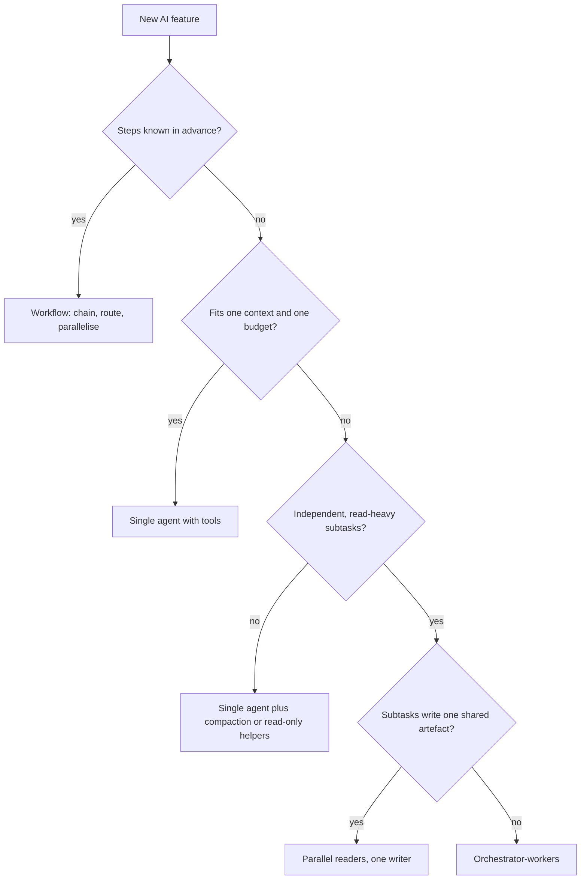
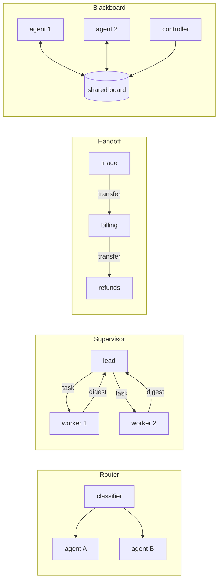
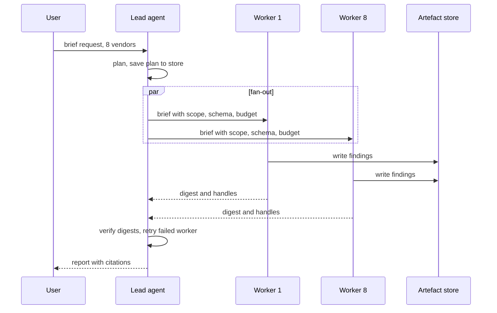

# 29 — Agent architectures & orchestration

> **The requirement.** Lumen's product team wants five AI features this quarter: **contract Q&A**, monthly
> **invoice reconciliation**, **vendor research briefs**, a **code-migration assistant** and **support-ticket
> triage**. Each needs a shape: a fixed workflow, one agent with tools, or a team of agents. The constraints are
> concrete. A vendor brief covering eight vendors must arrive in **under 2 minutes** and cost **under $0.50**
> (internal targets, assumptions). Triage must answer in **under 2 s**. Reconciliation must be auditable step by step,
> because finance signs it off. A teammate's multi-agent prototype looks impressive, but Anthropic reports that its
> own multi-agent research system used about **15× the tokens of a chat interaction** [2]. This is hard because the
> architecture choice multiplies everything at once: tokens, latency, failure points, debugging effort, and how
> tightly you are bound to one framework.

## In one minute

Most "agent" features do not need an agent. If you can write the steps down in advance, write them as code and call
the model inside fixed steps: that is a **workflow**, and it is cheaper, faster and easier to audit. Use an **agent**
(a model choosing its own next step in a loop) when the steps cannot be known ahead of time. Use **several agents**
only when the work splits into independent pieces that can run in parallel and would be too much for one agent to keep
in view. Several agents buy speed and breadth by spending more tokens. They also add new ways to fail: a helper
misreads its instructions, a summary drops the fact that mattered, or two agents make conflicting decisions. Every
pattern (router, supervisor, handoff, hierarchy, graph, blackboard) answers one question: **who decides the next step,
and who owns what each agent can see?** Pick the least agentic design that meets the requirement, measure it, and keep
your state, tools and traces portable so that a framework change does not force a rewrite.

## Why this matters now

- **Vendors published opposing advice in the same week.** On 12 June 2025 Cognition argued "Don't Build
  Multi-Agents", because sub-agents lose context and make conflicting decisions [3]. On 13 June 2025 Anthropic
  described a multi-agent research system that outperformed a single agent by 90.2% on its internal eval [2].
  Cognition has since narrowed its claim: its 2026 follow-up says multi-agent works when "writes stay
  single-threaded" [4]. Anthropic's original post already said that domains needing shared context or many
  inter-agent dependencies are "not a good fit" [2]. The useful lesson sits between the headlines.
- **Controlled evidence arrived.** The MAST study annotated 1,600+ traces from 7 multi-agent frameworks and found 14
  failure modes in 3 categories [7]. A Google-led study of agent architectures reports gains of up to +80.8% on
  decomposable financial reasoning and losses of up to −70.0% on sequential planning, relative to a single agent
  (arXiv v3) [5][6]. Architecture is now a measurable choice, not a matter of taste.
- **Frameworks churned.** Microsoft's AutoGen README now declares the project archived and points users to Microsoft
  Agent Framework [23]. Google's ADK deprecated its `SequentialAgent`, `ParallelAgent` and `LoopAgent` classes in
  Python and TypeScript in favour of graph workflows [22]. The Claude Code SDK became the Claude Agent SDK, with a migration guide [25].
  *As of 2026-11.* Lock-in is a practical risk.
- **Providers moved parts of the loop server-side.** Hosted tools (web search, code execution) run inside the model
  provider's infrastructure [26][19]. Managed harnesses run the whole loop for you [25]. Where the loop runs is
  now an architecture decision with security consequences.

[SYSDESIGN-25](25-agentic-systems.md) is the runtime chapter: the loop, tool calling, MCP and A2A, budgets,
sandboxes and exactly-once effects. This chapter is about **shape**: how many loops, who coordinates them, and when
the extra loops are worth paying for. The case studies apply it: a single-writer coding agent in
[C11](../04-case-studies/C11-coding-agent-platform.md), handoffs to specialists and humans in
[C15](../04-case-studies/C15-support-agent-platform.md), orchestrator-workers research in
[C16](../04-case-studies/C16-deep-research-agents.md), and a durable graph with approvals in
[C17](../04-case-studies/C17-workflow-automation-agent.md).

## Core ideas [Core]

### 1. Workflow or agent: a decision test

Anthropic's widely cited definitions are a good starting point. **Workflows** are "systems where LLMs and tools are
orchestrated through predefined code paths". **Agents** are "systems where LLMs dynamically direct their own
processes and tool usage" [1]. The difference is *who writes the control flow*: you, at design time, or the model, at
run time. In practice there is a spectrum. A workflow with one routing call is barely agentic. A graph whose nodes
are agents is a hybrid. An open loop with thirty tools is fully agentic.

Five questions place a feature on that spectrum:

1. **Can you write the steps down in advance?** If a domain expert can draw the flowchart, encode it. Workflows give
   "predictability and consistency for well-defined tasks" [1]. A model choosing steps that you already know is
   paying for flexibility you do not use.
2. **What does an error cost, and who audits it?** Finance, compliance and anything with irreversible effects favour
   fixed steps with explicit checks, because an auditor can review a graph and cannot review a model's improvisation.
3. **What is the latency budget?** Every model call costs seconds (SYSDESIGN-21). A 2 s budget leaves room for one or
   two calls, not a loop.
4. **What is the cost budget?** "Agentic systems often trade latency and cost for better task performance" [1].
   Check that the task's value covers the trade.
5. **Does the work split into independent, read-heavy parts?** Only then does a *team* of agents help (§4, Deep dive).

*Diagram: a decision tree. If the steps are known, build a workflow. Otherwise, if the task fits one context window
and budget, use a single agent. If it does not fit and the subtasks are not independent and read-heavy, keep a single
agent with compaction or read-only helpers. If they are independent but write one shared artefact, use parallel
readers with a single writer. Only fully independent subtasks go to orchestrator-workers.*

Applied to Lumen's five features:

| Feature | Steps known? | Error cost | Latency | Shape |
|---|---|---|---|---|
| Ticket triage | yes: classify, then route | low, reversible | < 2 s | **Routing workflow**: one classifier call |
| Contract Q&A | mostly: retrieve, answer, check citations | medium | seconds | **Prompt chain** over retrieval (SYSDESIGN-24), agentic fallback for multi-hop questions |
| Invoice reconciliation | yes: extract, match, flag, approve, post | high, audited | minutes | **Graph/state machine** with LLM extraction nodes and an approval node |
| Code migration | no: depends on the codebase | high, but reviewable | minutes to hours | **Single agent** (one writer), optionally a separate reviewer |
| Vendor research brief | no: depends on what is found | medium | < 2 min | **Orchestrator-workers**: parallel readers, one synthesiser |

In this example, only one of the five justifies multiple agents (our judgement, not a measured ratio).

### 2. The single-agent loop, recapped

[SYSDESIGN-25](25-agentic-systems.md#1-the-agent-loop) covers the loop: the runtime sends the history to the model,
the model proposes a tool call or a final answer, the runtime checks policy and budgets, executes, appends the
result, and repeats. Three facts from that chapter drive every architecture decision here:

- **Tokens processed grow roughly quadratically with steps**, because each call re-sends the growing history.
  Prompt caching lowers the *price* of the re-sent prefix but not the context-window pressure it creates (Numbers).
- **Reliability compounds.** If each step succeeds with probability p, an n-step task succeeds with about pⁿ when
  steps fail independently (a simplification; SYSDESIGN-25 Numbers #4).
- **Steps are not strictly serial.** Model APIs can return several tool calls in one response. Anthropic's API, for
  example, lets the model emit multiple `tool_use` blocks unless you set `disable_parallel_tool_use` [26].
  LLMCompiler planned independent calls as a DAG and ran them in parallel. It reported latency speedups of up to
  3.7× and cost savings of up to 6.7× over ReAct on its benchmarks [8]. Treat the serial loop as the worst case.

**Who executes the call?** It is tempting to say "the model never executes anything". That is true of the model
itself, which only emits text. It is not true of the *system* you may be buying. With **client tools**, your
application runs the call, so your runtime is the policy point that can deny, ask for approval, meter and audit. With
**provider-hosted tools**, the provider runs the call. Anthropic's server tools (`web_search`, `web_fetch`,
`code_execution`, `tool_search`, as of 2026-11) "run on Anthropic's infrastructure", and you see the results without
handling execution [26]. OpenAI's hosted tools (`WebSearchTool`, `CodeInterpreterTool`, `HostedMCPTool` and others, as of
2026-11) "execute for the model on OpenAI servers" [19]. Temporal's integration for the OpenAI Agents SDK lists the execution location
of a hosted tool as "Model provider" [28]. A managed harness goes further and runs the whole loop and sandbox on the
provider's side [25]. In each case the provider's runtime joins your trust boundary. Before you enable hosted tools,
check what you can still control: per-call approval hooks, egress restrictions, logging of each call and its
arguments, data residency, and whether your budgets see the call before it happens. Chapter
[SYSDESIGN-31](31-securing-agentic-systems.md) treats the security side.

### 3. Workflow patterns: the five building blocks

Before reaching for agents, learn the workflow patterns. Anthropic's taxonomy names five, each with a clear
condition for use [1]. Google's ADK documentation lists close equivalents (sequential pipeline, parallel fan-out and
gather, coordinator/dispatcher, hierarchical decomposition, generate-and-review, iterative refinement) [22].

| Pattern | What it is | Use when | Lumen example |
|---|---|---|---|
| **Prompt chaining** | Fixed sequence of calls, each consuming the previous output, with optional code checks between them | The task "can be easily and cleanly decomposed into fixed subtasks" [1] | Contract Q&A: retrieve → answer → verify citations |
| **Routing** | One call (or a classifier) chooses which downstream path handles the input | There are "distinct categories that are better handled separately" [1] | Ticket triage to six queues |
| **Parallelisation: sectioning** | Independent subtasks run at the same time and are merged | Subtasks are independent and speed matters [1] | Extract fields from 40 invoice pages concurrently |
| **Parallelisation: voting** | The same task runs several times and the outputs are aggregated | You need confidence, or diverse attempts [1] | Three independent "is this a duplicate invoice?" judgements |
| **Orchestrator-workers** | A model decomposes the task at run time and delegates subtasks | You "can't predict the subtasks needed" [1] | Vendor research: the plan depends on the vendors |
| **Evaluator-optimiser** | One call generates, another evaluates against criteria, loop until pass | There are "clear evaluation criteria" [1] | Migration patch reviewed against tests and a style rubric |

Orchestrator-workers is the boundary pattern. The *orchestrator* is agentic because it decides the subtasks. The
*fan-out* is a workflow because code runs the workers and collects their results. Most production multi-agent
systems are this pattern with better engineering.

### 4. Multi-agent patterns: who decides, who owns the context

A multi-agent system has several model loops, each with its own instructions, tools and context. The patterns differ
in two dimensions: **who chooses the next actor**, and **whose context the work happens in**.

*Diagram: four topologies. A router sends each request to one agent. A supervisor sends tasks to workers that return
digests to it. In a handoff, control passes along a chain (triage to billing to refunds) and does not return. In a
blackboard, agents and a controller read and write a shared board instead of messaging each other.*

- **Router.** One decision, then one specialist runs. No collaboration and minimal overhead. It is the multi-agent
  version of the routing workflow. LangChain's documentation describes it as a step that "classifies input and
  directs it to one or more specialized agents" [20].
- **Supervisor / orchestrator-workers ("agents as tools").** A lead agent keeps control and calls specialists like
  tools. In the OpenAI Agents SDK, "a manager agent keeps control of the conversation and calls specialist agents
  through `Agent.as_tool()`" [19]. Each worker runs in a **fresh, isolated context** and returns a digest. Anthropic's
  research system is this shape: a lead agent plans, spins up 3–5 subagents in parallel, and synthesises their
  results [2].
- **Handoff.** Control *transfers*. "A triage agent routes the conversation to a specialist, and that specialist
  becomes the active agent" [19]. Handoffs are exposed to the model as tools named `transfer_to_<agent_name>`, and by
  default the new agent "gets to see the entire previous conversation history" unless you filter it [19]. Good for
  conversational products where a specialist should take over the user (support, C15). It adds no parallelism.
- **Hierarchical.** Supervisors of supervisors: a top-level planner delegates to team leads, who delegate to workers.
  Google's ADK lists "hierarchical task decomposition" as a pattern [22]. Anthropic's scaling rules go up to "more
  than 10 subagents" for complex research, but as one flat lead with many workers [2], so that is evidence for wide
  fan-out, not for hierarchy. Each level adds a summarisation boundary, so use a hierarchy only when one supervisor's
  context cannot hold all the digests.
- **Graph / state machine.** The topology is written in code as nodes and edges, and agents (or plain functions) sit
  at the nodes. LangGraph is built on this model, and ADK now recommends graph workflows for new code [21][22]. It is
  the right home for processes with checkpoints, approvals and retries per node (invoice reconciliation, C17).
- **Blackboard.** Agents do not message each other. They read and write a shared workspace, and a controller decides
  who acts next based on what is on the board. The idea dates from the HEARSAY-II speech-understanding system, which "evolved
  between 1971 and 1976", and was surveyed by Nii in 1986 [14]. Recent LLM versions report competitive accuracy with fewer tokens on reasoning benchmarks (Han and Zhang,
  2025, preprint) [15]. A recent preprint system lets sub-agents "volunteer to respond based on their capabilities"
  to requests posted on the board, which spares the central agent from knowing every agent's expertise. It reports
  13–57% relative gains in end-to-end success on data-discovery tasks (Salemi et al., preprint) [16]. Engineering
  view: a blackboard is shared mutable state, so it needs the same concurrency control as any shared store
  (SYSDESIGN-06).
- **Debate and voting among agents.** Several agents answer, critique each other, and converge. Du et al. report that
  multi-agent debate improves mathematical and strategic reasoning on several tasks (preprint) [13]. It is
  parallelisation-voting with communication, and it multiplies tokens by the number of agents times the number of
  rounds. The evidence is mixed. A benchmark of debate protocols found that, in their current form, they "do not
  reliably outperform" self-consistency or ensembling, and that they are sensitive to hyperparameters (Smit et al.,
  preprint) [30]. Treat debate as a costly option to test against a cheaper baseline, not a default.

LangChain's documentation contains a useful illustration of the trade-offs. For one multi-domain request in its
example, the subagent pattern made 5 model calls and used about 9K tokens. Loading specialised "skills" into a single
agent made 3 calls but used about 15K tokens, because everything accumulated in one context. Handoffs needed 7+
calls [20]. These are one vendor's illustrative counts, not benchmarks. The direction matters: **isolation trades
extra calls for smaller contexts.**

### 5. Handoff versus agents-as-tools: the context-ownership question

The most consequential distinction in multi-agent design is not the topology diagram. It is **what the next agent
sees and what comes back**.

| | Agents as tools (supervisor) | Handoff |
|---|---|---|
| Control after the call | returns to the caller | stays with the new agent |
| Context the callee sees | only the task brief the caller writes | by default the whole conversation [19] |
| What comes back | a digest (the caller's context grows by the digest only) | nothing; the caller is done |
| Parallelism | natural: call several at once | none: one active agent at a time |
| Main risk | the brief omits something the worker needed | the conversation carries confusion forward |

Cognition's first principle is "share context, and share full agent traces, not just individual messages" [3]. Its
Flappy Bird example shows the failure: one sub-agent, given a terse subtask, built a background "that looks like
Super Mario Bros", and the bird from another sub-agent did not match it [3]. A supervisor that writes thin briefs
creates exactly this. The fix is to put more into the brief. Anthropic found that a vague brief such as "research the
semiconductor shortage" led subagents to duplicate each other's work, and concluded that each subagent "needs an
objective, an output format, guidance on the tools and sources to use, and clear task boundaries" [2].
The opposite risk belongs to handoffs and shared-context designs: the next agent inherits everything, including
dead ends and injected text. Choose deliberately, and filter what crosses the boundary.

### 6. Planning and verification: where extra calls pay

Two kinds of "extra" model calls appear in most good architectures, and both have evidence behind them.

**Explicit planning.** Plan-and-Solve prompting asks the model to devise a plan before executing it, which reduced
missing-step errors in zero-shot reasoning (ACL 2023) [10]. ReWOO separates planning from tool observations, so the
planner does not re-read every observation. It reported 5× token efficiency and a 4% accuracy gain on HotpotQA
(preprint) [9]. LLMCompiler turns the plan into a dependency graph and runs independent calls in parallel [8]. The
architectural point: **a plan is a data structure you can store, check and execute in parallel.** An orchestrator's
plan should be persisted outside its context window (Anthropic's lead agent saves its plan to memory because a context past 200,000
tokens will be truncated [2]), and a cheap code check can reject a plan that spawns fifty workers for a one-line
question.

**Independent verification.** Models are poor judges of their own work. Huang et al. found that "LLMs struggle to
self-correct their responses without external feedback", and that performance sometimes degrades after
self-correction (ICLR 2024) [12]. Reflexion improves agents by reflecting on feedback signals, "external or internally
simulated", stored in an episodic memory, and reached 91% pass@1 on HumanEval in its setting (NeurIPS 2023) [11].
Anthropic's long-running harness found that "agents reliably skew positive when grading their own work", and that
tuning a separate, sceptical evaluator was more tractable than making a generator self-critical [17]. Cognition
reports that a coding agent and a review agent work best when they "do not share any context beforehand" [4].
Therefore: **verify with something outside the generator's context**. That can be tests, a schema or database check,
or a second agent with a clean context and explicit criteria. A "please double-check your answer" prompt in the same
context is not verification.

### 7. Protocol boundaries: MCP for tools, A2A for agents

When agents and tools come from different teams or vendors, standard protocols draw the boundaries.
[SYSDESIGN-25 §3–4](25-agentic-systems.md#3-model-context-protocol-mcp--as-of-2026-11-spec-revision-2026-07-28)
covers both. **MCP** connects an agent to tools and data you control or trust. **A2A** connects an agent to *another
agent* that it treats as opaque, whose prompts, tools and memory it never sees. The architectural rule follows from
§4. Inside one system that you own, a sub-agent is usually just a function call (agents-as-tools), and a protocol adds
overhead without benefit. Across an organisational boundary, A2A's task lifecycle and Agent Cards give you a
contract. An A2A peer is the extreme case of a context boundary: you get back artefacts, never traces. Budget for
that opacity in evaluation (SYSDESIGN-32) and in incident response.

## Numbers that matter

*Assumptions, labelled. They match SYSDESIGN-25 so the two chapters can be compared. Base prompt (system and tool
schemas) 3,000 tokens; each research step adds 1,500 tokens to the history; 300 output tokens per step; illustrative
prices $1.00 per million input and $4.00 per million output tokens (not a quote); a step takes 0.5 s to first token
plus 300 / 50 tokens per second plus 2 s of tool time, so 8.5 s. The vendor brief covers 8 vendors at 5 research steps
each, followed by a 2,000-token report. Both designs below do the same 40 research steps.*

**1. Single agent, serial.** 40 research steps, then one report step.
- Input over the 40 research steps: `N·base + Δ·N(N−1)/2` = 40 × 3,000 + 1,500 × 780 = **1,290,000 tokens**. The
  report step reads 3,000 + 40 × 1,500 = 63,000 more. Total input **1,353,000**. Output 40 × 300 + 2,000 = 14,000.
- Cost: $1.353 + 14,000 × $4/M = $1.353 + $0.056 = **≈ $1.41**. That is almost three times the budget.
- Latency: 40 × 8.5 s + (0.5 + 2,000 / 50) s = 340 + 40.5 = **≈ 381 s (6.3 min)**. That is three times the deadline.
- Context at the last step: 63,000 tokens, most of them notes on vendors the agent finished long ago.

**2. Orchestrator-workers, isolated contexts.** The lead plans (3,000 in, 500 out). Eight workers each run 6 steps in
a fresh context (5 research steps and a digest step that returns a 1,000-token digest). The lead then synthesises.
- Per worker: input 6 × 3,000 + 1,500 × 15 = 40,500. Output 5 × 300 + 1,000 = 2,500. Eight workers: 324,000 input,
  20,000 output.
- Lead synthesis: input 3,000 + 500 + 8 × 1,000 = 11,500, output 2,000.
- Totals: input 3,000 + 324,000 + 11,500 = **338,500**, output 500 + 20,000 + 2,000 = **22,500**.
- Cost: $0.3385 + $0.090 = **≈ $0.43**, about 3.3× cheaper than the single agent and inside the $0.50 budget.
- Why: isolation removes the quadratic term. The single agent re-reads vendor 1's notes while researching vendor 8.
  Each worker carries only its own vendor. **Multi-agent is not inherently more expensive. It is more expensive when
  it does more work.**

**3. Latency is the critical path, not the sum (C7).** Workers run concurrently, so the elapsed time is plan +
slowest worker + synthesis: 10.5 s + (5 × 8.5 + 0.5 + 1,000 / 50) s + 40.5 s = 10.5 + 63 + 40.5 = **≈ 114 s**,
inside the 2-minute target and about 3.3× faster than the serial agent. The margin is only about 6 s, so two caveats
matter. First, the slowest of eight workers is slower than the average one, so a per-worker deadline is mandatory,
not optional. Second, a lead that waits for
*all* workers is a barrier. Anthropic notes its lead agents run subagents synchronously and that "synchronous
execution creates bottlenecks" [2]. Parallel tool calls inside each worker shorten the path further. LLMCompiler
reported up to 3.7× latency speedup on its benchmarks [8], and Anthropic reports that parallel subagents and parallel
tool calls "cut research time by up to 90% for complex queries" [2].

**4. Prompt caching narrows the cost gap (C6).** *Assume* Anthropic-style multipliers: cache write 1.25× base input,
read 0.1×, 5-minute TTL refreshed on each hit [27]. Multipliers vary by model and provider, so check your pricing
page. Every call writes only its new tokens and reads the cached prefix. This also assumes a model whose minimum
cacheable prompt length is at most 3,000 tokens. Some models need 2,048 or 4,096 tokens [27], and on those the
3,000-token prefix is not cached at all.
- Single agent: writes total 3,000 + 40 × 1,500 = 63,000 tokens (× 1.25 → $0.079). Reads are the other 1,290,000
  (× 0.1 → $0.129). Adding output ($0.056) gives **≈ $0.26**, under budget.
- Orchestrator-workers, cold parallel start: each worker writes 10,500 and reads 30,000 ($0.0161 per worker, $0.129
  for eight). The lead writes 3,000 for the plan, then reads 3,000 and writes 8,500 for the synthesis ($0.015). With
  output ($0.090) the total is **≈ $0.23**.
- If the eight workers share an identical system and tool prefix, it can be cached once. But a cache entry "only
  becomes available after the first response starts" [27], so you must launch one worker, wait for its first token,
  then launch seven. That saves 7 × 3,000 × (1.25 − 0.1) × $1/M ≈ $0.024 (to ≈ $0.21) and adds about 0.5 s to the
  critical path.
- Lesson: caching shrinks the multi-agent cost advantage from about 3.3× to about 1.1–1.3×, and output tokens
  ($0.090, nearly 40% of the team's bill) become a major line that caching does not discount. **Choose multi-agent for latency and context limits. Do not choose it for
  dollars alone.** Caching also only works while calls arrive within the TTL. A human approval pause longer than five
  minutes re-pays the write premium (SYSDESIGN-25 Numbers #2). Self-hosted servers get the same effect from prefix
  caching ([SYSDESIGN-22](22-serving-llms-at-scale.md)) without a write premium.

**5. Unbounded workers erase the saving.** Suppose workers are not step-capped and each runs 15 steps, which is in the
range Anthropic gives for "direct comparisons" (10–15 calls per subagent) [2]. Per-worker input becomes 15 × 3,000 +
1,500 × 105 = 202,500, so eight workers process 1.62 M input tokens and the task costs about $1.81 uncached, more
than the single agent. Extra exploration may buy quality: Anthropic found token usage by itself explains 80% of the
performance variance on BrowseComp [2]. But that is a product decision with a price, not an accident. **Per-worker
step and token caps are part of the architecture.** Anthropic's own early agents "made errors like spawning 50
subagents for simple queries" until scaling rules went into the lead's prompt (1 agent with 3–10 tool calls for simple
fact-finding, 2–4 subagents for comparisons) [2].

**6. Published multipliers, read carefully.**

| Source | Measured | Reported figure |
|---|---|---|
| Anthropic research system [2] | tokens versus a chat interaction | single agent about 4×, multi-agent about 15× |
| Anthropic research system [2] | quality on internal research eval | multi-agent (Opus 4 lead, Sonnet 4 subagents) +90.2% versus single Opus 4 |
| Anthropic harness [17] | cost and time, planner + generator + evaluator versus solo agent | $200 / 6 h versus $9 / 20 min (about 20×) |
| Anthropic C compiler [18] | 16 parallel agents, about 2,000 sessions | just under $20,000, about 2 B input and 140 M output tokens |
| Google scaling study, blog [6] | parallelisable finance task | centralised multi-agent +80.9% versus single agent |
| Google scaling study, blog [6] | sequential planning (PlanCraft) | every multi-agent variant −39% to −70% |

Two cautions. The "15× chat" figure compares against *chat*, not against a single agent doing the same job. Divided by
the 4× for single agents, it implies roughly 3.75× a single agent in Anthropic's workload (a back-of-envelope ratio of
two averages over different workloads, not a measured ratio), because that system does more searching, not the same
searching faster. Second, the Google numbers come from a blog describing 180
configurations, while the paper's v3 abstract reports 260 configurations and a range of +80.8% to −70.0% [5][6]. Cite
the version you used.

**7. Reliability: isolation enables cheap retries.** *Assume* each step succeeds independently with p = 0.98.
- Single agent, 41 steps: 0.98⁴¹ ≈ **0.44**. A single agent *without* checkpoints must repeat the whole run, and one
  retry gives 1 − 0.56² ≈ 0.68, at up to twice the cost. With checkpoints
  ([SYSDESIGN-25 §7](25-agentic-systems.md#7-durable-execution-for-long-running-agents)) it retries only the failed
  step, so the team's real advantage is narrower than "retry everything versus retry one part".
- Orchestrator-workers: each worker succeeds with 0.98⁶ ≈ 0.886. All eight succeed with 0.886⁸ ≈ 0.38. With the two
  lead steps the total is ≈ **0.36**, slightly below the single agent, because the team runs 50 steps (eight digest
  steps and a plan step more).
- But a failed worker can be retried alone. With one retry per failed worker, each succeeds with 1 − 0.114² ≈ 0.987.
  All eight then succeed with ≈ 0.90, and with the lead ≈ **0.86**. The expected cost is about 0.91 extra workers ×
  $0.05 ≈ **$0.05**.
- The team's remaining advantages: a bad digest can be detected and re-run in isolation, and partial results are
  usable. A brief with seven of eight vendors, clearly marked, may be acceptable. Independent units make partial
  results possible. The arithmetic holds only if the lead *checks* each digest. Google's study reports that
  independent multi-agent systems amplified errors 17.2×, while centralised coordination contained it to 4.4× [6].

## Design choices and trade-offs

### Choosing a pattern

| Pattern | Wins when | Costs | Example systems |
|---|---|---|---|
| **Workflow** (chain, route, parallelise) | Steps known; audit or latency matters | No adaptivity; you maintain the flow | ETL with LLM extraction; triage |
| **Single agent + tools** | Open-ended task fits one context and budget; one artefact is written | Quadratic context growth; one model does everything | Coding assistants (C11) |
| **Supervisor / orchestrator-workers** | Independent, read-heavy subtasks; latency or context limits | Brief quality; lead is a barrier; more output tokens; synthesis can lose detail | Anthropic Research [2]; deep research (C16) |
| **Handoff** | Conversational specialists that take over the user | No parallelism; history carried forward unless filtered | Support (C15); OpenAI Agents SDK handoffs [19] |
| **Hierarchical** | Too many digests for one supervisor | Each level is another summarisation loss and another barrier | Google ADK hierarchical task decomposition pattern [22] |
| **Graph / state machine** | Known process with agent steps, checkpoints, approvals | Less flexible; graph design effort | LangGraph [21]; ADK graph workflows [22]; C17 |
| **Blackboard** | Many specialists, opportunistic contributions, unknown expertise map | Shared mutable state; controller design; harder tracing | HEARSAY-II [14]; data discovery [16] |
| **Evaluator-optimiser / reviewer** | Clear criteria; the generator over-rates itself | Extra calls per iteration; reviewer can be lenient | Harness evaluator [17]; Devin Review [4] |

### Where does orchestration logic live?

The OpenAI Agents SDK documentation contrasts "orchestrating via LLM", where the model plans and decides, with
"orchestrating via code", "determining the flow of agents via your code" [19]. Most robust systems mix them:

| Decision | Put it in code when | Put it in the model when |
|---|---|---|
| Which agents exist and what tools each has | always (security, SYSDESIGN-31) | never |
| How many workers to spawn | you can bound it by input size | the decomposition depends on content, *with a code-enforced cap* |
| Order of steps | the process is known | it depends on intermediate results |
| When to stop | budgets, deadlines, loop detection (SYSDESIGN-25 §10) | the model judges "enough evidence", *inside* those budgets |
| Whether output is acceptable | a test, schema or rule can decide | only a judge can, and then use a separate context |

## Deep dive [Deep]

### When multi-agent pays off: three conditions and one gate

The evidence in this chapter converges on a short rule. A team of agents pays when **all three** hold:

1. **The work is parallelisable.** Independent subtasks give a latency win on the critical path (Numbers #3).
   Anthropic: "most coding tasks involve fewer truly parallelizable tasks than research" [2]. Google: centralised
   multi-agent gained on decomposable financial reasoning, and every variant lost on sequential planning [6].
2. **The work is read-heavy.** Readers do not conflict. Writers do, because "actions carry implicit decisions, and
   conflicting decisions carry bad results" [3].
3. **The total context exceeds what one agent can usefully hold.** Isolation keeps each context small (Numbers #2).
   If the whole task fits comfortably, a single agent with good context management (SYSDESIGN-30) is simpler.

The **gate** is Cognition's rule: **writes stay single-threaded** [4]. Several agents may read, search, review,
advise or plan. Exactly one agent, or deterministic code, writes the artefact. Cognition reports this working for a
coder plus a reviewer with separate contexts, a cheap model consulting a stronger one ("smart friend"), and a manager
splitting work into children, which it calls "map-reduce-and-manage". It reports that "writer" swarms editing in
parallel still see little adoption [4]. Anthropic's C compiler experiment shows what happens when the gate is
ignored. Sixteen agents "would hit the same bug, fix that bug, and then overwrite each other's changes", until a
reference compiler let them work on different files [18]. Note the fix: the work was re-partitioned so that writes no
longer overlapped. Coordination through git and lock files (`current_tasks/`) did the rest [18].

### Context at the boundary: designing the return contract

Every agent-to-agent boundary is a lossy channel. Design it like an API.

- **The brief (caller → worker).** Objective, expected output schema, scope boundaries, sources to prefer or avoid,
  and a budget. These are Anthropic's four brief elements plus a budget [2].
- **The digest (worker → caller).** A fixed schema: findings, evidence handles, confidence, open questions, and
  "what I did not check". Free-form prose invites the lead to lose the one caveat that mattered (MAST lists
  "information withholding" and "loss of conversation history" as distinct failure modes [7]).
- **References, not payloads.** Workers write full findings and source excerpts to a store (object storage, a
  document table) and return *handles*. The lead pulls detail on demand. This keeps the lead's context small and makes
  every claim traceable to a stored artefact. Anthropic recommends that subagents store their work in external systems and "pass
  lightweight references back to the coordinator", which reduces information loss and token overhead [2]. Chapter
  [SYSDESIGN-30](30-context-engineering-memory.md) covers context budgets and compaction. Handles also make the
  durable-execution limits in SYSDESIGN-25 §7 easier to respect, because transcripts stay out of the event history.

### Graph runtimes and durable execution

A graph runtime (LangGraph, ADK graph workflows) gives you an explicit topology and, with a checkpointer such as
LangGraph's, resumable state for crash recovery and human-in-the-loop [21][22]. A durable-execution engine (Temporal and
similar) gives you replay from recorded history and long waits without holding a thread (SYSDESIGN-25 §7). They
compose. Temporal's integration with the OpenAI Agents SDK routes every model call through an activity, while hosted
tools run inside that model activity at the provider [28]. Multi-agent fan-out maps cleanly onto both, because each
worker is a child unit with its own retry policy. The architecture question for this chapter is only *where the
topology is written*: in a graph you can review, or in a model's plan that you must constrain. Queues, workers,
tenancy and rollout of these runs belong to [SYSDESIGN-33](33-agent-platform-runtime.md). That includes Anthropic's
"rainbow deployments", which keep old and new versions running while traffic shifts, so that in-flight agents are not
disrupted [2].

### Parallelism done properly

Parallel fan-out is the main reason to build a team of agents, so engineer it like any fan-out
([SYSDESIGN-08](../01-foundations/08-async-event-driven.md)):

- **Bound concurrency** per task and per tenant. Eight workers × 3 parallel tool calls is 24 concurrent requests from
  one user. Token-per-minute quotas at the gateway ([SYSDESIGN-26](26-llm-gateways-llmops.md)) will throttle a burst
  of tasks before your GPUs or your provider do.
- **Deadlines per worker** and a policy for stragglers: proceed with partial results, or re-dispatch. Mark missing
  parts in the output.
- **Warm the shared prefix** before the fan-out if you rely on provider caching (Numbers #4).
- **Avoid a pure barrier** when synthesis can be incremental: let the lead read digests as they arrive. Anthropic
  identifies synchronous subagent execution as a current bottleneck [2].
- **Idempotent workers.** A retried worker must not double any side effect. Read-only workers make this trivial,
  which is another reason to keep writes single-threaded.

*Diagram: the user asks the lead agent for a brief on eight vendors. The lead plans and saves the plan, then sends
briefs to workers 1 to 8 in parallel. Each worker writes its findings to an artefact store and returns a digest with
handles. The lead verifies the digests, retries any failed worker, and returns the cited report.*

## Frontier [Frontier]

*As of 2026-11. Versions are the latest PyPI releases checked on 2026-11-20. Status changes quickly. This table
records what each project is, not which is best.*

| Framework | Latest (Python) | Licence | Orchestration model | Notes |
|---|---|---|---|---|
| **LangGraph** | 1.2.24 (2026-11-20) | MIT | Graph of nodes and edges with checkpointed state | Persistence for resume and human-in-the-loop [21] |
| **OpenAI Agents SDK** | 0.25.0 (2026-11-18) | MIT | Agents with handoffs and agents-as-tools; hosted tools | Hosted tools run on OpenAI servers [19] |
| **Google ADK** | 2.15.0 (2026-11-20) | Apache-2.0 | LLM agents plus graph workflows | `SequentialAgent`, `ParallelAgent`, `LoopAgent` deprecated in Python and TypeScript [22] |
| **Microsoft Agent Framework** | 1.26.0 (2026-11-12) | MIT (PyPI classifier) | Agents and workflows | Successor named by the AutoGen README [23] |
| **AutoGen** | autogen-agentchat 0.7.5 (2025-09-30) | — | Multi-agent conversations | README: "archived and no longer maintained" [23] |
| **AG2** | 1.3.3 (2026-11-19) | Apache-2.0 | Multi-agent conversations | Community project, "formerly AutoGen" [23] |
| **CrewAI** | 1.15.44 (2026-11-19) | MIT (GitHub LICENSE) | "Crews" of agents inside event-driven "Flows" | [24] |
| **Claude Agent SDK** | 0.2.186 (2026-11-19) | MIT package, Anthropic Commercial Terms | Claude Code's loop as a library, with subagents, sessions, hooks, MCP | Runs the Claude Code binary [25] |
| **Pydantic AI** | 2.71.0 (2026-11-19) | MIT | Typed agents | Listed for completeness, not reviewed here [29] |

**Reading the churn.** In two years, one major framework was archived and replaced, and another deprecated its
original workflow primitives for graphs in two of its languages [22][23]. Anthropic's 2024 caution still applies: frameworks "often create
extra layers of abstraction that can obscure the underlying prompts" [1]. The same post now carries a note that "much
of the tooling landscape described in this post has changed since December 2024" [1]. Two trends are visible.
Workflow-style primitives are converging on **explicit graphs**. Vendors are offering **whole harnesses** (Claude Agent
SDK, managed agents) rather than toolkits [25].

**A portability boundary.** You cannot avoid a framework, but you can decide what it owns. Keep these in your own
code and repository:

1. **The task-state schema** (plan, steps, budgets, approvals, digests, handles), stored in your database. Use the
   framework's checkpointer as a cache of it, not the source of truth.
2. **Prompts and tool schemas**, versioned in the repository and evaluated in CI (SYSDESIGN-26, SYSDESIGN-32).
3. **Tools behind MCP** (SYSDESIGN-25), so that switching frameworks does not mean rewriting integrations.
4. **Traces in OpenTelemetry GenAI conventions** (SYSDESIGN-32), so your observability survives a migration.
5. **Model access through your gateway** (SYSDESIGN-26), so you can route across providers.
6. **Budgets and policy in your runtime**, not in framework callbacks you cannot test in isolation.

With that boundary, a framework migration rewrites orchestration glue and keeps state, tools, prompts, traces and
policy. Without it, the framework becomes your data model.

## Failure modes and operations

MAST groups 14 failure modes into **system design issues**, **inter-agent misalignment** and **task verification**
[7]. The table maps the most common ones to detection and mitigation.

| Failure | Looks like | Detection (SLI) | Mitigation |
|---|---|---|---|
| **Error compounding** | One wrong digest becomes a confident wrong report | Per-worker verification failure rate; final-claim citation checks | Verify each digest against its handles before synthesis; retry the worker, not the task [6] |
| **Context loss at handoffs** | A worker solves the wrong problem; the lead drops a caveat | Brief and digest schema-validation failures; reviewer disagreement rate | Structured briefs and digests; references to stored artefacts; MAST "loss of conversation history", "information withholding" [7] |
| **Coordination loops** | Agents re-delegate or repeat steps; nobody stops | Repeated (agent, task) pairs; steps per task near the cap; MAST "step repetition", "unaware of termination conditions" [7] | Code-enforced caps on depth, fan-out and steps; loop detector (SYSDESIGN-25 §10) |
| **Over-spawning** | 50 workers for a simple question [2] | Workers per task versus input-size class | Scaling rules in the brief plus a hard cap in code |
| **Conflicting writes** | Agents overwrite each other's changes [18] | Merge conflicts; reverted edits; duplicate work | Writes single-threaded [4]; partition write sets; locks |
| **Premature or unverified completion** | "Done" with nothing checked | MAST "premature termination", "no or incomplete verification" [7]; evaluator pass rate | Independent evaluator with clean context and explicit criteria [17] |
| **Lenient reviewer** | Evaluator approves everything | Evaluator pass rate versus human spot checks | Tune the evaluator to be sceptical; calibrate on labelled cases [17] |
| **Straggler worker** | Report late because of one slow branch | p95 per-worker latency; critical-path time | Per-worker deadlines; partial results; incremental synthesis |
| **Fan-out burst throttled** | 429s from the gateway during fan-out | Rate-limit rejections per task | Concurrency caps; token reservations at the gateway (SYSDESIGN-26) |
| **Deploy mid-run** | Workers on version N+1 report to a lead on version N | Version mismatch in trace attributes | Rainbow deploys; pin a run to its version (SYSDESIGN-33) [2] |

Operate a multi-agent system by **tracing the whole tree**: one root span per task and child spans per agent, model
call and tool call, with the plan and every digest attached. Many of these failures look like success in metrics
until someone reads a trajectory. Chapter [SYSDESIGN-32](32-observing-evaluating-agents.md) covers trace-based
debugging and evaluating trajectories.

## Cost and energy

- **Report cost per successful task by architecture.** Numbers #2–#5 show that a team of agents can be about 3× cheaper or
  1.3× more expensive than a single agent for the same job, depending on isolation, caching and caps.
- **Output tokens matter more in teams.** Every worker writes a digest and the lead writes a synthesis. Output is
  priced at a multiple of input on most APIs (4× in our assumptions), and caching does not discount it.
- **Use smaller models for workers when the task allows.** Anthropic's system paired an Opus 4 lead with Sonnet 4
  subagents [2]. Cognition's "smart friend" inverts this: a small primary model consults a stronger one only when it
  needs to [4]. Route by role through the gateway (SYSDESIGN-26).
- **Energy follows tokens processed**, not dollars. Caching cuts the bill more than it cuts the work. Prefix reuse on
  self-hosted servers saves prefill compute (SYSDESIGN-22). The isolation in Numbers #2 cuts tokens processed by almost
  4× (about 1.37 M versus 0.36 M), which is the larger energy lever (SYSDESIGN-17).
- **Cap everything a model can multiply**: workers per task, depth, steps per worker, tokens per worker, wall-clock
  per worker. A runaway team multiplies the single-agent runaway in SYSDESIGN-25 by the fan-out.

## Interview angle

**How it is asked:** "Design a research assistant that writes a cited brief in two minutes." "Single agent or
multi-agent, and why?" "Design a support bot that escalates to specialists." "Our multi-agent prototype costs too
much. What do you change?"

**Model answer outline (CLARIFY → QUANTIFY → SKETCH → DEEPEN → STRESS → WRAP):**
1. **CLARIFY:** can the steps be written down? What does an error cost, and who audits? Latency target, budget per
   task, volume. Does the work split into independent parts, and does anything get *written*?
2. **QUANTIFY:** single-agent tokens (quadratic), cost and serial latency, compared with an orchestrator-workers
   design: isolated contexts, critical-path latency and cache effects. State the per-step success assumption and the
   resulting task reliability.
3. **SKETCH:** start with the least agentic design. Show where the workflow ends and the agent begins. If you use a
   team: lead, bounded fan-out, artefact store with handles, verifier, gateway, trace store.
4. **DEEPEN:** pick one. The brief and digest contract; verification with a clean context; parallelism and the cache;
   or the portability boundary.
5. **STRESS:** a worker returns a wrong digest; the lead spawns 50 workers; two agents edit the same file; a deploy
   lands mid-run; the provider rate-limits the fan-out.
6. **WRAP:** writes single-threaded, caps in code, verify outside the generator, cost per successful task by
   architecture, and state that you keep in your own schema.

**Red flags:** "multi-agent because it is more modern"; parallel writers on one artefact; a reviewer prompt in the
generator's own context presented as verification; no cap on workers; quoting "15×" as a law instead of a workload
measurement; choosing a framework before choosing a shape; assuming hosted tools pass through your policy point.

**Follow-ups:** How would you know the multi-agent version is better? (Paired evals on the same tasks, cost per
success, SYSDESIGN-32.) What if one vendor's data is behind another team's agent? (A2A boundary, opacity in evals.)
How do you migrate off a framework? (The portability boundary.) Where would you use a handoff instead? (Conversational
specialists, C15.)

## Common mistakes

- Building an agent for a process a flowchart could describe.
- Splitting work across agents along *roles* ("researcher", "writer", "critic") when the work does not parallelise.
  This adds handoffs without adding concurrency.
- Letting several agents write the same artefact.
- Thin briefs and free-form digests, then blaming the model for "misunderstanding".
- Comparing architectures by token count without caching, or by dollars without latency and reliability.
- Self-review in the same context, presented as verification.
- Leaving fan-out, depth and step caps to the prompt.
- Letting the framework's checkpoint format become your system of record.
- Enabling provider-hosted tools without checking which approvals and logs still apply.

## Check yourself

1. Give the five decision questions and apply them to "summarise each new support ticket and tag its product area".
2. Why can an orchestrator-workers design process fewer tokens than a single agent doing the same work, and what
   erases that advantage?
3. Explain the difference between a handoff and agents-as-tools in terms of control and context.
4. Why does prompt caching shrink the cost gap between single-agent and multi-agent designs, and what breaks the cache
   in a fan-out?
5. State the "writes single-threaded" rule and give one design that respects it for code migration.

Full set with answers: [exercises/29-agent-architectures-orchestration.md](../../exercises/29-agent-architectures-orchestration.md).

## Lab

No lab for this unit. (A CPU-only cost and latency simulator of the three shapes in Numbers, with no model calls, is
a possible future lab.)

## Further reading

- Anthropic, "Building effective agents" [1]: the workflow-pattern taxonomy and the case for simplicity (Dec 2024;
  the page notes that tooling has since changed).
- Anthropic, "How we built our multi-agent research system" [2]: the most detailed public account of
  orchestrator-workers in production, with token data and failure stories.
- Cognition, "Don't Build Multi-Agents" and "Multi-Agents: What's Actually Working" [3][4]: the context-sharing
  argument and the "writes single-threaded" rule.
- Cemri et al., MAST [7]: a failure taxonomy you can use as a trace-review checklist.
- Kim et al., "Towards a Science of Scaling Agent Systems" [5] and the Google blog [6]: controlled comparisons of
  architectures by task type.
- Kim et al., LLMCompiler [8]: planning as a DAG and parallel function calling.
- OpenAI Agents SDK, multi-agent and handoffs docs [19]: a precise statement of agents-as-tools versus handoffs.

## References

1. Anthropic. "Building effective agents" (engineering blog, 2024-12-19; page notes the tooling landscape has changed since). https://www.anthropic.com/research/building-effective-agents (accessed 2026-11)
2. Anthropic. "How we built our multi-agent research system" (engineering blog, 2025-06-13; 4×/15× tokens, +90.2% internal eval, 80% of BrowseComp variance, scaling rules, rainbow deployments, synchronous subagents). https://www.anthropic.com/research/multi-agent-research-system (accessed 2026-11)
3. Yan, W. (Cognition). "Don't Build Multi-Agents" (blog, 2025-06-12; perspective). https://cognition.com/blog/dont-build-multi-agents (accessed 2026-11)
4. Yan, W. (Cognition). "Multi-Agents: What's Actually Working" (blog, 2026-04-22; perspective). https://cognition.com/blog/multi-agents-working (accessed 2026-11)
5. Kim, Y. et al. "Towards a Science of Scaling Agent Systems." arXiv:2512.08296 (preprint; v1 2025-12-09, v3 2026-04-08; v3 abstract: 260 configurations, +80.8% to −70.0%). https://arxiv.org/abs/2512.08296 (accessed 2026-11)
6. Google Research. "Towards a science of scaling agent systems: when and why agent systems work" (blog, 2026-01-28; 180 configurations, 17.2× vs 4.4× error amplification, +80.9% Finance-Agent, −39% to −70% PlanCraft). https://research.google/blog/towards-a-science-of-scaling-agent-systems-when-and-why-agent-systems-work/ (accessed 2026-11)
7. Cemri, M. et al. "Why Do Multi-Agent LLM Systems Fail?" arXiv:2503.13657 (preprint; v3 2025-10-26; MAST, 14 failure modes, 3 categories, 1,600+ traces, 7 frameworks, κ = 0.88). https://arxiv.org/abs/2503.13657 (accessed 2026-11)
8. Kim, S. et al. "An LLM Compiler for Parallel Function Calling." ICML 2024. arXiv:2312.04511. https://arxiv.org/abs/2312.04511 (accessed 2026-11)
9. Xu, B. et al. "ReWOO: Decoupling Reasoning from Observations for Efficient Augmented Language Models." arXiv:2305.18323 (preprint, 2023). https://arxiv.org/abs/2305.18323 (accessed 2026-11)
10. Wang, L. et al. "Plan-and-Solve Prompting: Improving Zero-Shot Chain-of-Thought Reasoning by Large Language Models." ACL 2023. arXiv:2305.04091. https://arxiv.org/abs/2305.04091 (accessed 2026-11)
11. Shinn, N. et al. "Reflexion: Language Agents with Verbal Reinforcement Learning." NeurIPS 2023 (Advances in Neural Information Processing Systems 36). arXiv:2303.11366. https://arxiv.org/abs/2303.11366 (accessed 2026-11)
12. Huang, J. et al. "Large Language Models Cannot Self-Correct Reasoning Yet." ICLR 2024. arXiv:2310.01798. https://arxiv.org/abs/2310.01798 (accessed 2026-11)
13. Du, Y. et al. "Improving Factuality and Reasoning in Language Models through Multiagent Debate." arXiv:2305.14325 (preprint, 2023). https://arxiv.org/abs/2305.14325 (accessed 2026-11)
14. Nii, H. P. "The Blackboard Model of Problem Solving and the Evolution of Blackboard Architectures." AI Magazine 7(2), 1986, p. 38 onwards (part 1 of 2), doi:10.1609/aimag.v7i2.537. https://ojs.aaai.org/index.php/aimagazine/article/view/537 (live page behind a bot challenge; abstract checked on the Internet Archive snapshot of 2022-05-04, accessed 2026-11)
15. Han, B., Zhang, S. "Exploring Advanced LLM Multi-Agent Systems Based on Blackboard Architecture." arXiv:2507.01701 (preprint, 2025). https://arxiv.org/abs/2507.01701 (accessed 2026-11)
16. Salemi, A. et al. "LLM-Based Multi-Agent Blackboard System for Information Discovery in Data Science." arXiv:2510.01285 (preprint; v2 2026-01-31). https://arxiv.org/abs/2510.01285 (accessed 2026-11)
17. Anthropic. "Harness design for long-running application development" (2026-03-24; planner, generator, evaluator; $9 vs $200). https://www.anthropic.com/research/harness-design-long-running-apps (accessed 2026-11)
18. Anthropic. "Building a C compiler with a team of parallel Claudes" (2026-02-05; 16 agents, just under $20,000, lock files, overwrite problem). https://www.anthropic.com/research/building-c-compiler (accessed 2026-11)
19. OpenAI. Agents SDK documentation: "Multi-agent orchestration", "Handoffs", "Tools" (hosted tools); PyPI `openai-agents` 0.25.0 (2026-11-18). https://openai.github.io/openai-agents-python/multi_agent/ ; https://openai.github.io/openai-agents-python/handoffs/ ; https://openai.github.io/openai-agents-python/tools/ ; https://pypi.org/project/openai-agents/ (accessed 2026-11)
20. LangChain. "Multi-agent" documentation (subagents, handoffs, skills, router, custom workflow; illustrative call and token counts). https://docs.langchain.com/oss/python/langchain/multi-agent (accessed 2026-11)
21. LangChain. LangGraph "Persistence" documentation; PyPI `langgraph` 1.2.24 (2026-11-20, MIT). https://docs.langchain.com/oss/python/langgraph/persistence ; https://pypi.org/project/langgraph/ (accessed 2026-11)
22. Google. Agent Development Kit, "Workflow patterns" (deprecation of `SequentialAgent`, `ParallelAgent`, `LoopAgent`; graph workflows recommended); PyPI `google-adk` 2.15.0 (2026-11-20, Apache-2.0). https://adk.dev/workflows/patterns/ ; https://pypi.org/project/google-adk/ (accessed 2026-11)
23. Microsoft. AutoGen README ("Project archived and no longer maintained", successor Microsoft Agent Framework); PyPI `autogen-agentchat` 0.7.5 (2025-09-30), `agent-framework` 1.26.0 (2026-11-12); AG2 PyPI `ag2` 1.3.3 (2026-11-19, "formerly AutoGen"). https://github.com/microsoft/autogen ; https://pypi.org/project/agent-framework/ ; https://github.com/ag2ai/ag2 (accessed 2026-11)
24. CrewAI. Documentation, "Introduction" (Crews and Flows); PyPI `crewai` 1.15.44 (2026-11-19); licence MIT per the repository's LICENSE file. https://docs.crewai.com/en/introduction ; https://pypi.org/project/crewai/ ; https://github.com/crewAIInc/crewAI (accessed 2026-11)
25. Anthropic. Claude Agent SDK "Overview" (Claude Code's loop as a library; subagents, sessions, hooks, MCP; migration from the Claude Code SDK; Managed Agents as hosted harness); PyPI `claude-agent-sdk` 0.2.186 (2026-11-19). https://code.claude.com/docs/en/agent-sdk/overview ; https://pypi.org/project/claude-agent-sdk/ (accessed 2026-11)
26. Anthropic. Claude docs, "Tool use with Claude" (client tools versus server tools run on Anthropic's infrastructure; parallel tool use and `disable_parallel_tool_use`). https://platform.claude.com/docs/en/agents-and-tools/tool-use/overview (accessed 2026-11)
27. Anthropic. Claude docs, "Prompt caching" (write 1.25× for 5-minute TTL, 2× for 1 hour, read 0.1× with per-model exceptions; cache entry available only after the first response starts; organisation isolation). https://platform.claude.com/docs/en/build-with-claude/prompt-caching (accessed 2026-11)
28. Temporal. "OpenAI Agents SDK integration" (model calls as activities; hosted tools executed by the model provider). https://docs.temporal.io/develop/python/integrations/openai-agents (accessed 2026-11)
29. Pydantic. PyPI `pydantic-ai` 2.71.0 (2026-11-19, MIT). https://pypi.org/project/pydantic-ai/ (accessed 2026-11)
30. Smit, A., Duckworth, P., Grinsztajn, N., Barrett, T. D., Pretorius, A. "Should we be going MAD? A Look at Multi-Agent Debate Strategies for LLMs." arXiv:2311.17371 (preprint; v3 2024-07-18). https://arxiv.org/abs/2311.17371 (accessed 2026-11)
