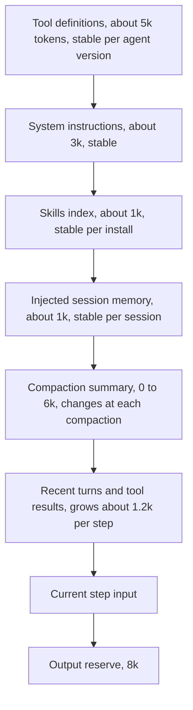
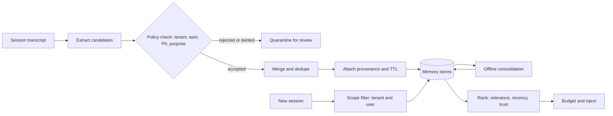
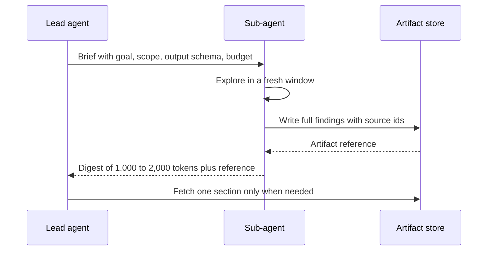

# 30 — Context engineering & agent memory

> **The requirement.** Lumen's contract-review agent answers questions like *"which of this customer's 40 supplier
> contracts auto-renew next quarter, and on what notice terms?"* One task reads up to 200 contract pages through
> about 150 tool calls. The model has a 200k-token window. The task must cost under $5 (a product assumption). The
> agent must remember each customer's preferences and past decisions across sessions ("we treat 60-day notice as
> standard"). No memory may cross between Lumen's 2,000 tenants. Every remembered fact must say where it came from.
> When a person asks to be forgotten, every memory about them must go, from every tier, within the GDPR deadline.
> This is hard because the window is **finite, priced per token on every step, and degrades before it is full**, and
> because memory is a **database that a non-deterministic program writes into** while reading untrusted text.

## In one minute

A model knows nothing about your task except the text it is given at this step, its context window; the files, the
database and last week's conversation are all outside it. Context engineering is choosing, at each step, which tokens
go into that window and in what order. Memory is the system that decides what to keep outside the window and how to
bring it back. Both matter because an agent re-sends its whole history every time it calls the model, so a long task
pays for its early steps again and again. Models also get worse at using information as the window fills, well before
the advertised limit. So the job is to keep the window small, stable and relevant. Memory then becomes an ordinary
data problem, with stores, rules for writing and reading, retention and access control. It has two twists: the
writer is an agent that may have been fooled, and the data is often personal, so it must be erasable.

## Why this matters now

Three things changed between 2023 and 2026.

1. **Windows grew, but effective use did not keep pace.** Vendors advertise windows of hundreds of thousands to
   millions of tokens. Academic evaluations keep finding that accuracy falls as inputs grow, often long before the limit
   (Lost in the Middle [6], RULER [7], NoLiMa [8]), and so does Chroma's Context Rot report (a vector-database
   vendor's technical report, 18 models) [9]. Anthropic's own guidance
   calls the window an "attention budget" that every new token draws down [1].
2. **Agents made context long by default.** A chat turn sends one question. An agent loop sends its whole history
   on every step ([SYSDESIGN-25](25-agentic-systems.md)), and multi-agent systems multiply it. Anthropic measured
   agents at about 4x the tokens of chat and multi-agent systems at about 15x [24].
3. **Providers turned context management into API features** (as of 2026-11). Prompt caching with explicit TTLs
   and write premiums [3][4][5] is one. Server-side tool-result clearing and compaction [11][29][12] are others.
   There is also a client-side memory tool [13] and an open format for packaging procedural knowledge as "skills"
   [20][21]. These features make the trade-offs explicit, and they also make them easy to get wrong.

The design questions are now system-design questions. What do you pay per step? What do you lose when you summarise?
Who may write a memory? How do you prove it was deleted?

## Core ideas [Core]

### 1. The context window is a budget, not a bucket

Every model call is built from the same parts. The names differ by provider. The roles do not.

| Part | What it holds | How it changes | Typical owner |
|---|---|---|---|
| **Tool definitions** | names, descriptions, JSON schemas of every tool the model may call | rarely, per agent version | platform team |
| **System instructions** | role, policies, output format, safety rules | per agent version | prompt owner |
| **Skills index** | one-line descriptions of procedures the agent can load | when skills are installed | skill owners |
| **Injected memory** | user profile, pinned preferences, project notes | per session | memory system |
| **History** | earlier user turns, model turns, tool calls and results | grows every step | runtime |
| **Retrieved knowledge** | document chunks, query results, pages | per step | retrieval ([SYSDESIGN-24](24-retrieval-vector-systems.md)) |
| **Scratchpad** | plan, to-do list, notes the agent writes for itself | per step | the agent |
| **Output reserve** | room for the model's answer and any reasoning tokens | per call (`max_tokens`) | runtime |

The window is shared by all of them, and **the output reserve is part of the budget**. A request whose input fills
the window leaves no room for the answer.

Three properties make the window a priced resource, not just a capacity limit.

- **Every input token costs money and prefill time on every call.** Prefill work grows with input length
  ([SYSDESIGN-21](21-llm-inference-anatomy.md)). An agent re-sends its history on each step, so total input tokens
  grow roughly with the square of the step count (the derivation is in SYSDESIGN-25 Numbers #1).
- **Prompt caching rewards a stable prefix.** Providers cache the processed form of a prompt prefix and bill
  re-reads at a fraction of the input price. As of 2026-11, Anthropic bills a cache read at 0.1x the base input
  price (0.05x or 0.025x on some models). A write costs 1.25x with the default 5-minute TTL, which is refreshed free
  on each hit, or 2x with a 1-hour TTL [3]. OpenAI bills writes on GPT-5.6 and later at 1.25x for the default
  30-minute lifetime or 2.5x for 12 hours, with reads at 0.1x on most of those models. Earlier OpenAI models have no
  write charge [4]. Google enables implicit caching by default on Gemini 2.5 and newer models [5]. Each provider has
  a **minimum cacheable length**: from 512 to 4,096 tokens depending on the Anthropic model [3], 1,024 tokens for
  GPT-5.6 and later [4], and 2,048 or 4,096 tokens on the Gemini models listed [5]. On self-hosted servers the
  equivalent is automatic prefix caching ([SYSDESIGN-22](22-serving-llms-at-scale.md)).
- **The prefix has an order, and a change invalidates everything after it.** Anthropic builds the cache in the order
  `tools`, `system`, `messages`. Changing a tool definition invalidates all three levels. Toggling some features or
  adding an image invalidates the later levels [3]. OpenAI lists tool names, descriptions, schemas and ordering
  among the things that change the prefix, and advises putting stable instructions first and dynamic content such as
  timestamps last [4].

**Design rule:** lay the window out from most stable to least stable, and never put a per-request value
(timestamp, user name, random id) above content you want cached.



*Diagram: the context window as a stack from most stable (tool definitions, system instructions, skills index,
session memory) to least stable (compaction summary, recent turns, the current step), with an output reserve at the
end. Token sizes are the assumptions used in Numbers that matter.*

### 2. What goes in, and what stays out

A useful test for every token is: **would the next step be worse without it?** Five kinds of content earn their place.

1. **Instructions that change behaviour.** Policies, formats and constraints. Keep them short and concrete. A long
   system prompt is paid for on every step. It is cheap when cached, but it still takes attention.
2. **Tools the task needs.** Each tool definition is paid for on every call, and overlapping tools confuse selection.
   Anthropic recommends namespacing related tools (`asana_search`, `jira_search`) to help the model choose [10].
   Changing the tool list mid-task breaks the cache, so prefer a stable tool set per task type (SYSDESIGN-25 §2).
3. **Knowledge needed for this step.** Retrieved just in time, not front-loaded. Anthropic describes agents that
   keep "lightweight identifiers (file paths, stored queries, web links, etc.)" and load the data with tools when
   needed, and recommends a hybrid with up-front retrieval in many cases [1].
4. **State the agent cannot rebuild cheaply.** The plan, decisions made, open questions, identifiers of things
   already done. This is the part compaction must keep.
5. **Recent evidence.** The last few tool results. Raw results from 50 steps ago rarely matter. Anthropic describes
   clearing them as one of the lightest-touch forms of compaction [1].

What stays out: full documents when a section will do, duplicate tool outputs, stale retrieval results, verbose
logs, and anything the agent can fetch again by id.

### 3. Context failure modes: why more context is not better

Long context fails in ways that look like model bugs. Each has evidence behind it and a different fix.

**Position effects.** Liu et al. found that "performance is often highest when relevant information occurs at the
beginning or end of the input context, and significantly degrades when models must access relevant information in
the middle of long contexts" [6]. The retrieval side of this result is covered in
[SYSDESIGN-24](24-retrieval-vector-systems.md). For agents the lesson is placement. Put the task and constraints
where they are read well, and do not bury a key fact 80k tokens deep.

**Effective length below advertised length.** RULER tested 17 long-context models on 13 tasks beyond simple
needle-in-a-haystack retrieval. All claimed windows of 32K tokens or more, but "only half of them can maintain
satisfactory performance at the length of 32K" [7]. NoLiMa removed literal word overlap between question and answer.
At 32K tokens, 11 of 13 models claiming at least 128K fell below 50% of their short-context baseline, and GPT-4o fell
from 99.3% to 69.7% [8].

**Degradation with length, distractors and structure.** Chroma's Context Rot report evaluated 18 models and found
that "model performance consistently degrades with increasing input length", even on simple tasks. A single
distractor lowered accuracy, and more distractors lowered it further [9]. On LongMemEval questions, models did
significantly better with a focused prompt of about 300 tokens than with the full prompt of about 113k tokens [9].

These results are from specific models tested in 2023–2025. Newer models may do better on some of them, but none of
the sources above tests the 2026 models. The direction has held across several research groups, but **re-measure on your model and your task** before relying on the
exact numbers. The failure modes to recognise in an agent are:

| Symptom | Likely cause | First fix |
|---|---|---|
| Ignores an instruction given early in a long run | instruction buried mid-context, diluted by history | restate constraints in the compaction summary; keep them in the stable prefix |
| Picks the wrong one of several similar tools | too many overlapping tool definitions | consolidate and namespace tools; load per task type |
| Repeats a wrong fact it produced earlier | an error in history is re-read as evidence | clear or correct the bad turn; verify against the source |
| Uses an old value after the data changed | stale tool result or stale memory still in context | clear old results; store `valid_to` on memories |
| Plan forgotten after a summary | compaction dropped it | pin the plan in a structured note, outside the summary |

### 4. Keeping the window small: six levers

Each lever trades information for tokens. Each also has a cache effect that changes its real cost.

**(a) Design tool outputs for tokens.** The cheapest token is one the tool never returns. Anthropic recommends
"pagination, range selection, filtering, and/or truncation with sensible default parameter values", and reports that
Claude Code caps tool responses at 25,000 tokens by default [10]. A `response_format` parameter with `concise` and
`detailed` values let one example tool return 72 tokens instead of 206 [10]. Return ids with content. *Loss:* none if the agent can page for more. *Cache:* neutral.

**(b) Retrieve just in time.** Hold references and load content when a step needs it [1]. *Loss:* none, but each
fetch is a tool call with latency. *Cache:* neutral, because new content is appended at the end.

**(c) Clear old tool results.** Replace raw results older than N steps with a placeholder that says how to re-fetch
them. As of 2026-11, Anthropic does this server-side: `clear_tool_uses_20250919` defaults to triggering at 100,000
input tokens and keeping the 3 most recent tool use/result pairs, while the client keeps the full history [11]. *Loss:* small, if the cleared data can be fetched again. *Cache:* clearing
**invalidates the cached prefix** from the clearing point onward, so the docs advise clearing enough tokens at once to
make the invalidation worthwhile [11].

**(d) Compact.** Near a threshold, summarise the conversation and continue in a fresh window that starts with
the summary. Anthropic describes Claude Code keeping "architectural decisions,
unresolved bugs, and implementation details" and dropping redundant tool outputs, then continuing with the summary
plus "the five most recently accessed files" [1]. As of 2026-11, both Anthropic (a summary "that Claude writes on the server" [29], enabled with
the `compact_20260112` edit [11]) and OpenAI (threshold-based or the stateless `/responses/compact` endpoint, with an encrypted, opaque compaction item
[12]) offer server-side compaction. *Loss:* real and hard to see (section 5).
*Cache:* everything after the stable prefix is rewritten, so the next step pays a cache write for the summary.

**(e) Take structured notes.** The agent writes its plan, progress and findings to a store outside the window, and
reads them back later [1]. Anthropic's memory tool is one implementation (tool type `memory_20250818`). It runs
**client-side**: the model asks for `view`, `create`, `str_replace`, `insert`, `delete` or `rename` on paths under
`/memories`, and your application performs them against storage you control [13]. Notes survive compaction because
they are not in the summary. *Loss:* only what the agent chose not to write. *Cache:* reads are appended, so neutral.

**(f) Delegate to sub-agents.** A sub-agent explores in its own clean window and returns a digest. Anthropic reports
sub-agents using "tens of thousands of tokens or more" while exploring and returning summaries of "often 1,000-2,000
tokens" [1]. In its research system, sub-agents write their outputs to external storage and pass "lightweight
references back to the coordinator", to avoid a "game of telephone" [24]. *Loss:* everything not in the digest,
unless the full output is stored and referenced. *Cost:* total tokens rise, because each sub-agent pays its own
prefix and loop (about 15x chat for multi-agent systems in Anthropic's measurement [24]). When to split a task across
agents at all is an architecture decision ([SYSDESIGN-29](29-agent-architectures-orchestration.md)).

### 5. Compaction loses information. Plan for it

A summary is a lossy, model-written compression of evidence. Two failure patterns have names in the literature. The
ACE paper describes **brevity bias**, which "drops domain insights for concise summaries", and **context collapse**,
"where iterative rewriting erodes details over time" [14]. Its remedy is to treat context as an evolving playbook
that grows through small itemised updates instead of whole rewrites. The paper reports +10.6% on agent benchmarks and
+8.6% on finance benchmarks over strong baselines, in its own experiments [14].

Engineering rules that follow:

- **Specify what a summary must keep.** Write it as a schema, not a vibe: goal and constraints as the user stated
  them, decisions with their reasons, open questions, identifiers (file paths, record ids, URLs) of everything
  touched, the current plan, and the user's explicit instructions **verbatim**.
- **Never summarise a summary blindly.** Repeated compaction is where context collapse happens. Rebuild from the
  previous summary *plus* structured notes, and keep the notes as the system of record for the plan.
- **Keep the raw transcript outside the window as ground truth.** Anthropic's memory work treats transcripts as the
  "ground truth" against which notes are checked [2]. A summary is a cache of the transcript, not a replacement.
- **Pin what must survive verbatim.** Legal terms, numbers, quoted policies and the user's own words go into notes
  or a pinned block, never only into prose.
- **Test compaction like any lossy codec.** Build a set of long traces with questions whose answers sit early in
  the trace. Measure answer accuracy before and after compaction, and track it as a regression metric
  ([SYSDESIGN-32](32-observing-evaluating-agents.md)).

### 6. Retrieval-as-memory, fine-tuning or long context?

Three ways to give an agent knowledge it was not trained on.

| Approach | Wins when | Costs and limits |
|---|---|---|
| **Long context** (put it all in the window) | knowledge per task is small and must be read as a whole (one contract) | paid on every step; degrades with length (section 3); nothing persists after the session |
| **Retrieval-as-memory** (store outside, fetch by query or id) | knowledge is large, changes, is per-user or per-tenant, or must be erasable | retrieval misses are silent; needs write, ranking and freshness engineering ([SYSDESIGN-24](24-retrieval-vector-systems.md)) |
| **Fine-tuning** (put it in the weights) | stable behaviours, formats, style or domain skill shared by all users | slow to update; hard to attribute; erasure means retraining ([SYSDESIGN-19](../02-modern-requirements/19-privacy-compliance-sovereignty.md)); poor at injecting new facts |

The evidence on facts favours retrieval. Ovadia et al. compared the two for knowledge injection and found that RAG
consistently outperformed unsupervised fine-tuning, for knowledge seen in training and for new knowledge alike.
Models struggled to learn new facts through unsupervised fine-tuning [15] (an arXiv preprint, on the models and tasks
it tested). Erasure points the same way. Deleting a memory row is easy. Removing a fact from model weights is
not (the artefact table in SYSDESIGN-19, section 5). **For per-user and per-tenant memory, retrieval is the
default.** Fine-tuning remains a tool for procedural behaviour shared by everyone
([SYSDESIGN-27](27-ml-platforms.md)), and long context is the right tool *within* a task.

### 7. A memory taxonomy for agents

The CoALA framework (Sumers, Yao, Narasimhan, Griffiths) gives a common vocabulary. **Working memory**
"maintains active and readily available information as symbolic variables for the current decision cycle".
**Episodic memory** "stores experience from earlier decision cycles". **Semantic memory** "stores an agent's
knowledge about the world and itself". **Procedural memory** comes in two forms, the model's weights and "explicit
knowledge written in the agent's code". CoALA also warns that writing to procedural memory "is significantly
riskier than writing to episodic or semantic memory" because it "can easily introduce bugs" [16]. Production systems
add a **session** tier between working and long-term memory.

| Kind | Example in Lumen | Lifetime | Who writes it | Read path |
|---|---|---|---|---|
| **Working** | this step's prompt: plan, recent results | one model call | runtime, rebuilt from the checkpoint each step | is the context |
| **Session (short-term)** | this task's history, notes, compaction summaries | one task or conversation, hours to days | runtime and agent | loaded on resume |
| **Semantic (long-term)** | "Tenant T-42 treats 60-day notice as standard" | until changed or erased | extraction pipeline, user, or agent with review | query by scope + relevance |
| **Episodic** | "Task 9F3 on 2026-11-02: supplier X contract had a hidden auto-renewal in an annex" | weeks to months, TTL | runtime, from transcripts | similarity + recency |
| **Procedural** | "How to review a renewal clause" skill; tool configs; prompts | versioned releases | humans via review; agent proposals only via review | skills index + on-demand load |

Two framings from earlier work are useful. MemGPT treats the window as main memory and external stores as disk, with
"virtual context management, a technique drawing inspiration from hierarchical memory systems" in operating
systems [17]. Generative Agents store "a complete record of the agent's experiences", "synthesize those
memories over time into higher-level reflections, and retrieve them dynamically" [18]. Retrieval there scores
recency, importance and relevance, which is still a sound default ranking.

### 8. Storage design for each kind of memory

Memory is data, so choose stores by access pattern, as in [SYSDESIGN-05](../01-foundations/05-choosing-storage.md).

| Memory | Access pattern | Good fit | Why |
|---|---|---|---|
| Session state and checkpoints | get/put by task id, ordered steps | KV or document store, relational for audit | point reads on resume; see SYSDESIGN-25 checkpointing |
| Transcripts | append-only, search by text and time, replay | event log + object storage + search index ([SYSDESIGN-13](../01-foundations/13-data-at-scale.md)) | ground truth for provenance and re-derivation |
| Semantic facts and preferences | lookup by subject + key, update in place, filter by tenant | **relational** (rows with provenance, validity interval) + vector index for fuzzy lookup | facts change; you need "current value" and history, and deletes by subject |
| Episodic records | "have we seen something like this?" | **vector index** with metadata filters, plus time | similarity search with tenant filter (SYSDESIGN-24, filtering) |
| Entity relations | "which contracts reference supplier X?" | **graph** or relational join tables | multi-hop questions; a graph pays off only when queries are truly multi-hop |
| Notes, wikis, skills | read whole files by path, edit, version | **files** in versioned object storage or a repo | agents read and edit files well; diffs give review and rollback |

Anthropic's recent memory write-up layers memory as **transcripts** (a searchable event log), **memory notes** that
the agent writes during a session, **memory representations** (wikis of linked pages that an offline process
writes), and **injected context** loaded at every session start. It says the top layer should stay small because a
bad note can propagate to every session. Claude Code's `MEMORY.md`, for example, loads only the first 200 lines or
25 KB [2]. That is one vendor's design, reported in November 2026. The layering itself (raw log, extracted notes,
consolidated representation, small injected set) matches what you would build from first principles.

**The write path** decides what becomes a memory. A write is a database write with an untrusted author.

1. **Extract** candidates from the session: explicit user statements ("remember that…"), confirmed decisions,
   observed outcomes.
2. **Check policy**: right tenant and subject? Was any untrusted content read in this session (taint)? If so, every
   candidate the agent inferred or extracted is tainted. The one exception is a verbatim user statement (Deep dive,
   Memory poisoning). Does it contain special-category personal data? Is there a purpose and legal basis for keeping
   it?
3. **Merge**: deduplicate against existing memories. Update the current value and close the old one's validity
   interval instead of overwriting it.
4. **Attach provenance and expiry** (Deep dive).
5. **Store**, with a version number for optimistic concurrency.

**The read path** decides what comes back into the window.

1. **Scope filter first**: tenant, user, project. This is a security boundary, not a ranking signal.
2. **Retrieve** candidates by key, by similarity or by both.
3. **Rank** by relevance, recency and trust (provenance class).
4. **Budget**: take the top items that fit a fixed token allowance (for example 1,000 tokens), and label them
   inside the prompt as memories with their dates and sources.

**Consolidation** runs offline. It merges duplicates, resolves contradictions, expires stale items and builds
higher-level summaries such as wiki pages. Anthropic calls its offline pass "dreaming", and recommends targeting it
at information likely to change [2]. LongMemEval (ICLR 2025) is a useful yardstick for the read side. It tests
information extraction, multi-session reasoning, temporal reasoning, knowledge updates and abstention over 500
questions. It reports a 30% accuracy drop for commercial assistants and long-context models on sustained
interactions, and gains from finer-grained session indexing, fact-augmented keys and time-aware queries [19].



*Diagram: the write path runs from session transcript through extraction, a policy check (tainted or disallowed
candidates go to quarantine), merge, and provenance tagging into the memory stores, which an offline consolidation job
rewrites. The read path starts from a new session, applies a tenant and user scope filter, ranks candidates by
relevance, recency and trust, and injects a fixed token budget into context.*

### 9. Procedural memory and skills

Procedural memory is "how to do things": prompts, tool configurations, scripts and checklists. The 2025–2026 change
is that this knowledge is now packaged as files the agent loads on demand.

**Agent Skills** (as of 2026-11) is an open format that Anthropic originally developed and published as an open
standard in December 2025 [20][21]. A skill is a folder with a `SKILL.md` file, YAML front matter followed by
Markdown instructions, and optional `scripts/`, `references/` and `assets/` folders. The required fields are `name`
(at most 64 characters, lowercase letters, digits and hyphens) and `description` (at most 1,024 characters). An
experimental `allowed-tools` field lists pre-approved tools [20]. The spec defines **progressive disclosure** in
three levels [20]:

1. **Metadata** (about 100 tokens per skill): name and description, loaded at startup for every installed skill.
2. **Instructions** (under 5,000 tokens recommended): the `SKILL.md` body, loaded when the skill is activated. The
   spec recommends keeping it under 500 lines.
3. **Resources**: scripts and reference files, loaded only when needed.

The agentskills.io site lists client products that support the format. Check it for the current list rather than
relying on a list printed in a course. A related convention, **AGENTS.md**, is "a simple, open format for guiding
coding agents". It is a README for agents in a repository, stewarded by the Agentic AI Foundation under the Linux
Foundation and used by "over 60k open-source projects" per its site [22]. The research ancestor is Voyager, whose
agent kept "an ever-growing skill library of executable code for storing and retrieving complex behaviors" [23].

Skills are a context-engineering device. They keep many procedures available while only a few hundred tokens of
metadata sit in the window. They are also **code and instructions from someone else**. Anthropic's own guidance is to
install skills "only from trusted sources" and to audit less-trusted ones, including their scripts and any
instruction to connect to external network sources [21]. Treat a skills library as a software supply chain, with
pinned versions, review, signing and an allow-list. That supply chain is designed in
[SYSDESIGN-31](31-securing-agentic-systems.md). By analogy with CoALA's warning about writes to procedural memory [16],
treat an agent-proposed skill as the riskiest kind of memory write. So an agent may *propose* a new skill, but a human or a gated pipeline
*publishes* it.

### 10. Multi-agent shared memory and context handoff

When several agents work on one task, context moves between windows, and every move is a lossy copy. Design the
handoff as an interface.

- **Brief down, digest up.** The coordinator sends a brief with the goal, scope, constraints, output schema and
  budget. The sub-agent returns a digest in that schema plus a **reference** to its full output in an artifact
  store, not the full output itself [24].
- **One writer per entity.** Shared memory needs the same concurrency discipline as any shared database. In one
  Anthropic experiment, agents writing contract facts into one shared table kept 41 of 57 facts (72%). One page per
  contract, with terms quoted verbatim, kept all 57 [2]. Partition shared memory so that each record has a single
  writer at a time, and use version checks for the rest
  ([SYSDESIGN-06](../01-foundations/06-replication-consistency.md)).
- **Handoffs carry provenance.** A digest says which sources each claim came from, so the coordinator can cite or
  verify without re-reading everything.
- **Isolation is the default.** Sub-agents get the memory scopes their task needs, no more. A research sub-agent
  reading the open web should not have write access to the tenant's long-term memory.



*Diagram: the lead agent sends a brief to a sub-agent, the sub-agent explores in its own window, writes full findings
with source ids to an artifact store, and returns only a short digest with a reference. The lead fetches detail from
the store only when it needs it.*

Concrete multi-agent designs that use this handoff are in [C16](../04-case-studies/C16-deep-research-agents.md)
(deep research) and [C15](../04-case-studies/C15-support-agent-platform.md) (support agents with customer memory).

## Numbers that matter

*Assumptions, labelled: base prefix 10,000 tokens (tools 5,000, system 3,000, skills index 1,000, session memory
1,000). Each step appends 1,200 tokens (model turn plus a capped tool result). 300 output tokens per step. 150 steps
per task. Illustrative prices: $3.00 per million input tokens, $15.00 per million output tokens, with Anthropic-style
cache multipliers (write 1.25x at a 5-minute TTL, read 0.1x) [3]. These are not a quote. Use your provider's
current rates.*

**1. The window fills.** At step *i* the input is 10,000 + (*i* − 1) × 1,200 tokens. At step 150 that is
10,000 + 149 × 1,200 = **188,800 tokens**, 94% of a 200k window, which leaves 11,200 tokens for output and
reasoning. The task barely fits. A few longer tool results would overflow it. It also spends most of its life deep
in the length range where section 3's evaluations see degradation.

**2. The cost of re-sending history.** Total input = 150 × 10,000 + 1,200 × (150 × 149 / 2) =
1,500,000 + 13,410,000 = **14.91M input tokens** for one task.

- *Uncached:* 14.91 × $3.00 = $44.73, plus 45,000 output tokens × $15/M = $0.68. **≈ $45.40 per task**, nine times
  the budget.
- *With prompt caching:* each step writes only its new tokens and reads the rest. Writes are 10,000 + 149 × 1,200 =
  188,800 tokens at $3.75/M = $0.71. Reads are the other 14,721,200 tokens at $0.30/M = $4.42. With output that is
  **≈ $5.80 per task**. Caching is the biggest single lever here (about 8x). It still misses the $5 target.

**3. Add compaction.** *Assume* compaction triggers when the context would exceed 100,000 tokens and produces a
6,000-token summary. The next window starts at 10,000 + 6,000 = 16,000 tokens. The first window runs 76 steps
(10,000 to 100,000 tokens), the second 71 (16,000 to 100,000), and the last 3 steps open a third window. Two
compactions cover the 150 steps. Summed exactly, input falls to
**8.35M tokens** (44% fewer). The two compaction calls read about 202,000 tokens and write 12,000 summary tokens.

- *Uncached:* about $26.51 per task (−42%).
- *Cached:* writes rise slightly to 200,800 tokens ($0.75), because each summary is a new write. Reads fall to 8.15M
  ($2.45). With compaction calls ($0.24) and output ($0.68), the task costs **≈ $4.11** (−29%). That is under target.

*Sensitivity.* At the 0.05x read rate listed for some current models [3], the cached task is ≈ $3.59 without
compaction, and compaction brings it to ≈ $2.86 (−20%). The ranking of the levers holds, but whether caching alone
meets the $5 target depends on the read multiplier, so measure it on your model.

The lesson in these numbers is that **with caching, compaction saves fewer dollars than tokens**. The tokens it
removes were mostly cheap cached reads. Compaction's bigger payoffs are headroom (the window never passes about
100k) and quality (the model works in the shorter range).

**4. The TTL penalty.** Suppose a human approval pauses the task for 20 minutes at step 100, past the 5-minute TTL.
Without compaction, step 100 has 128,800 input tokens. Re-writing them costs 128,800 × $3.75/M = **$0.48**, against
$0.04 for a cached read. With compaction, the context at step 100 is 16,000 + 23 × 1,200 = 43,600 tokens, so the
re-write costs **$0.16**. If pauses are expected, the 1-hour TTL (2x write) or a compaction before the pause is
cheaper than re-paying the whole prefix. SYSDESIGN-25 Numbers #2 shows the same effect on a shorter task.

**5. Sub-agent digests.** *Assume* 200 contract pages at about 600 tokens per page = 120,000 tokens of raw text.
Four sub-agents each read 50 pages (30,000 tokens) and return a 1,500-token digest (inside the 1,000–2,000 range
reported in [1]). The lead agent receives **6,000 tokens instead of 120,000**, 20x less. Total tokens processed
across all agents go *up*, because each sub-agent has its own prefix and loop. You buy a clean lead context with
extra total spend, which is the trade-off measured in [24].

**6. A skills library in the window.** With the spec's figure of about 100 tokens of metadata per skill [20], 60
installed skills cost about **6,000 tokens** on every call, and loading one skill's body adds up to about 5,000 more.
Loading all 60 bodies up front would cost about 300,000 tokens, more than the whole window. Progressive disclosure is
what makes a large library possible. If 60 skills already cost 6,000 tokens per call, either filter the index per
task type or put the index behind a search tool.

**7. Memory store sizing.** *Assume* 2,000 tenants with 500 users each = 1M users, and 50 long-term memories per
user, each with about 1 KB of text, a 1,024-dimension float32 embedding (4 KB) and 0.5 KB of metadata and provenance.
50M items × 5.5 KB ≈ **275 GB**, plus an HNSW graph of roughly 8 GB (using SYSDESIGN-24's 8–10 bytes × M with M = 16).
*Assume* 20% of users are active each day, with 3 sessions and 2 memory writes per session. That is 1.2M writes/day
(≈ **14/s average**) and, at 6 reads per session, 3.6M reads/day (≈ **42/s**, about 210/s at a 5x peak). That is
small data. The hard parts of memory are correctness, isolation and erasure, not throughput.

**8. The erasure clock.** The legal deadline is GDPR Art. 12(3): act on a request without undue delay and within one
month, extendable by two further months where necessary [28]. Use
[SYSDESIGN-19](../02-modern-requirements/19-privacy-compliance-sovereignty.md)'s internal targets inside that month:
erasure *effective* (unreadable in every online store, keys shredded) within 72 h, and *complete* (including backups)
within 30 days. Both are internal SLOs, which are assumptions, not law. Do not confuse that 72 h with GDPR's 72-hour
breach notification (Art. 33), which is a different duty [28]. The 30-day window leaves room for the slow tiers:
index segment rebuilds, consolidated pages that must be re-derived, and backups that must replay the erasure ledger
(SYSDESIGN-19, the erasure pipeline).

## Design choices and trade-offs

### Context-reduction techniques

| Technique | Wins when | Information loss | Prompt-cache effect | Example systems (as of 2026-11) |
|---|---|---|---|---|
| Tool output caps, pagination, concise mode | tools return large payloads | none if paging is possible | neutral | Claude Code's 25k-token default cap [10] |
| Just-in-time retrieval by id | data is large and addressable | none; adds calls | neutral (appends) | file paths, queries, URLs as handles [1] |
| Tool-result clearing | old raw results dominate the window | low if results can be re-fetched | invalidates from the clearing point | `clear_tool_uses_20250919` [11] |
| Compaction | long tasks near the window | medium to high, hard to see | rewrites everything after the stable prefix | `compact_20260112` [11]; `/responses/compact` [12] |
| Structured notes / memory files | plans and findings must survive compaction | only what was not written | neutral (reads append) | memory tool `memory_20250818` [13] |
| Sub-agent digests | big reading or search jobs that split well | everything outside the digest unless referenced | lead stays stable, sub-agents pay their own | multi-agent research [24] |

### Who writes long-term memory?

| Writer | Wins when | Risk | Control |
|---|---|---|---|
| **User, explicitly** ("remember…", settings page) | preferences, standing instructions | low; user owns it | show and edit in UI |
| **Extraction pipeline** after a session | facts from confirmed outcomes | wrong extraction, over-collection | schema, confidence threshold, purpose check |
| **Agent, during the session** (memory tool) | notes, progress, discoveries | poisoning from untrusted content read in the same session | taint check, quarantine, human review for high-impact keys |
| **Offline consolidation** | merge, summarise, expire | context collapse, provenance lost in merges | keep source links per claim, diff review, rollback |

### Memory as files or as rows and vectors?

Files (notes, wikis) suit agents that read and edit text well, and they give diffs, review and rollback cheaply. A
single file per user grows without bound and makes per-fact erasure and per-fact provenance awkward. Rows plus a
vector index make deletion by subject, filtering by tenant and validity intervals natural, but the agent sees query
results instead of a coherent page. A common hybrid stores **facts as rows with provenance** (system of record) and
**renders** a small per-user page from them at session start, so the injected view can be rebuilt after every
erasure.

## Deep dive [Deep]

### Memory provenance: the record schema

Every long-term memory carries enough metadata to answer five questions. Who wrote it? From what evidence? Is it
still valid? Who may read it? How is it erased? A minimal record:

```yaml
memory_id: mem_01HZX...           # opaque
tenant_id: t-42                   # partition key, checked on every read and write
subject_id: u-1789                # data subject, for erasure fan-out (may be null for org facts)
scope: {tenant: t-42, project: p-7, visibility: [role:legal]}
kind: semantic                    # working | session | semantic | episodic | procedural
key: notice_period_standard
value: "60 days"                  # or quoted source text
source:
  session_id: s-77f1
  turn: 41
  evidence_ref: "transcripts/t-42/s-77f1#turn-41"   # pointer to ground truth
  origin: user_statement          # user_statement | tool_result | web | agent_inference | consolidation
writer: {agent: contract-reviewer, agent_version: "3.4.1", model: "<model id>", pipeline: extract-v2}
taint: clean                      # clean | untrusted_seen | quarantined
confidence: 0.9
valid_from: 2026-11-02T10:14:00Z
valid_to: null                    # closed when superseded; never overwrite history in place
created_at: 2026-11-02T10:14:05Z
last_read_at: 2026-11-19T08:01:00Z
expires_at: 2027-05-02T00:00:00Z  # TTL by kind and purpose
purpose: contract_review_preferences
version: 3                        # optimistic concurrency
```

Three design points matter. First, `origin` separates what a user said from what a tool returned, what the web said
and what the model inferred. The read path ranks and labels by origin. Second, `evidence_ref` points at the
transcript, so a reviewer, or a consolidation job, can check the memory against what actually happened. Anthropic's
consolidation checks notes against original transcripts for this reason [2]. Third, **consolidated memories keep the
union of their sources' ids**. Without that, erasure and poisoning clean-up cannot find what a merged page was
derived from.

### Memory poisoning

A memory is a delayed prompt injection with persistence. Content read today becomes trusted context next month, in
another session, maybe for another user in the same tenant. The evidence is direct:

- **MINJA** injects malicious records into an agent's memory bank "by only interacting with the agent via queries",
  with no direct access to the store. The records later trigger harmful reasoning on a
  victim's query (NeurIPS 2025) [25].
- **AgentPoison** (NeurIPS 2024) poisons agent memory or RAG knowledge bases with an optimised trigger. It reports an
  average attack success rate above 80% with a poison rate below 0.1%, and benign performance dropping by less than
  1% [26].
- OWASP's *Top 10 for Agentic Applications for 2026* (2025-12-09) lists this as **ASI06 Memory & Context
  Poisoning** [27]. The general threat model is in [SYSDESIGN-28](28-ai-trust-safety-governance.md).

Defences, layered:

1. **Taint the session, not just the text.** If a session read untrusted content (web pages, inbound email,
   third-party tool output), mark its candidate memories `untrusted_seen`. They go to quarantine, or are kept as
   low-trust episodic records that are never injected as instructions. One exception: a candidate whose `origin` is
   `user_statement`, matched verbatim against an authenticated user turn, is not tainted by what the session read,
   because it did not pass through the model's reading of untrusted content. Everything the agent *infers* or
   *extracts* in that session is tainted.
2. **Authorise writes by key.** High-impact keys (payment details, approval rules, "always do X") are writable only
   by the user through the UI or by a reviewed pipeline, never by the agent alone.
3. **Label memories in the prompt as data.** Inject them in a delimited block with origin and date, below the
   instructions. Never merge them into the system prompt.
4. **Make memory reversible.** Version every write. Keep a per-session index of writes, so that when a session is
   found to be compromised, you can roll back every memory it produced and every consolidation that used it.
5. **Watch the write stream.** Alert on spikes in memory writes per session, writes that contain URLs or
   imperative instructions, and writes to keys that rarely change.

How these controls fit into tool trust, capability scoping and containment is covered in
[SYSDESIGN-31](31-securing-agentic-systems.md).

### Erasure under GDPR Art. 17 across memory tiers

Art. 17(1) requires the controller to erase personal data "without undue delay" where a ground applies. Art. 17(2)
adds a duty to inform other controllers when the data was made public [28]. Erasure is not absolute: Art. 17(3)
lists exceptions, such as a legal obligation to keep the data (SYSDESIGN-19). So the per-tier ledger needs a "refused,
with reason" state as well as "done". For agents, the hard part is
**derived copies**. A fact about a person may live in a row, its embedding, an episodic record, a consolidated wiki
page, a compaction summary inside a checkpoint, a trace, a provider-side prompt cache and a backup.

| Tier | Erasure approach | Notes |
|---|---|---|
| Semantic rows + embeddings | delete by `subject_id`; rebuild affected index segments | easy if `subject_id` was recorded at write time |
| Episodic records | delete by `subject_id` and by session ids linked to the subject | needs the session-to-subject map |
| Consolidated pages / wikis | re-derive from remaining sources using stored source ids | impossible without per-claim provenance |
| Session checkpoints and compaction summaries | short TTL; crypto-shred per-subject or per-session keys | summaries mix subjects, so keys per session are simpler |
| Transcripts and traces | retention limit + per-subject keys + redaction at capture | traces are observability data that also holds personal data ([SYSDESIGN-32](32-observing-evaluating-agents.md)) |
| Provider prompt caches | expire by TTL (minutes to hours, [3][4]); avoid long TTLs on personal prefixes | check zero-data-retention terms with the provider |
| Backups | erasure ledger replayed on restore | the SYSDESIGN-19 pattern |

Run erasure as SYSDESIGN-19's durable, idempotent workflow, with one task per tier and an acknowledgement from each.
Agent memory is just more stores in the data map, but the ones most often missing from it. Vendor docs also
recommend expiring memory files that have not been accessed in a long time [13]. Set TTLs by kind and purpose:
sessions in days, episodic records in months, semantic facts until changed or erased.

### Per-tenant isolation

The 2,000-tenant requirement adds isolation rules to every store and cache.

- **Tenant id is a mandatory partition key** in every memory table, index and file path, enforced by the data-access
  layer (row-level security or a tenant-scoped client), never by the prompt.
- **Separate vector namespaces or filtered indexes per tenant.** The filtering pitfalls of approximate search
  (SYSDESIGN-24, filtering) apply. A post-filter on a global index can return too few results, and a bug there leaks
  data.
- **Per-tenant encryption keys** make tenant offboarding a key shred ([SYSDESIGN-18](../02-modern-requirements/18-security-by-design.md)).
- **No cross-tenant consolidation.** Offline jobs run per tenant, with credentials scoped to that tenant.
- **Shared caches are shared resources.** Self-hosted prefix caches need a per-tenant salt (vLLM's `cache_salt`,
  SYSDESIGN-22). For provider caches, keep tenant-specific content out of any prefix that is shared.
- **Test the boundary.** Seed canary memories in tenant A and assert they never appear in tenant B's retrievals,
  prompts or traces. Run this in CI and continuously in production. Platform-level tenancy (quotas, fairness) is in
  [SYSDESIGN-33](33-agent-platform-runtime.md).

## Frontier [Frontier]

*As of 2026-11. These change quickly; check the cited pages before relying on details.*

- **Opaque compaction.** OpenAI's compaction item is encrypted [12], so you cannot inspect or test what it kept.
  Keep your own notes for anything that must survive, whichever provider compacts for you.
- **Offline consolidation ("dreaming").** Anthropic reports gains on its own tasks from rewriting memory into linked
  wiki pages. For example, on the multi-document items of a 24-question merger test, Claude scored 87% with a
  consolidated wiki versus 73% with search alone [2]. These are single-vendor
  experiments on that vendor's models: design leads, not benchmarks.
- **Playbooks instead of summaries.** ACE replaces whole-context rewrites with itemised updates [14].
- **Skills ecosystems.** With Agent Skills an open standard [20] and AGENTS.md under the Agentic AI Foundation [22],
  expect registries, signing and scanning for skills, the path package ecosystems took.
- **Memory benchmarks.** LongMemEval [19] is the academic reference. Vendor memory-layer numbers are not
  independently reproduced. Prefer results on your own traffic.

## Failure modes and operations

| Failure | Symptom | Detect (SLI) | Mitigate |
|---|---|---|---|
| Context overflow | API error or truncated output late in long tasks | p99 input tokens per call vs window; `max_tokens` stop rate | output reserve; compaction trigger at about 50% of the window |
| Cache-hit collapse | cost per task jumps after a deploy | cached-token share per call (provider usage fields) | keep prefix byte-stable; no timestamps up top; stable tool list |
| Compaction loss | agent repeats work or contradicts earlier decisions after a summary | regression set of long traces with early-answer questions | summary schema; pinned notes; never summarise summaries blindly |
| Stale memory | agent applies an old preference or price | memory age at read time; user corrections per memory | validity intervals; consolidation for volatile keys; TTLs |
| Poisoned memory | odd instructions appear across sessions | writes with URLs or imperatives; write spikes; red-team canaries | taint and quarantine; key-level write authorisation; rollback by session |
| Cross-tenant leak | tenant B sees tenant A's fact | canary memories in retrieval, prompts, traces | mandatory tenant filter in the data layer; per-tenant namespaces and keys |
| Memory bloat | injected memory grows, every call costs more | injected-memory tokens per session | hard injection budget; offline consolidation; expiry |
| Erasure miss | deleted fact resurfaces from a summary or backup | post-erasure probe queries across tiers | per-claim provenance; erasure ledger; per-session keys |
| Skill drift or tampering | behaviour changes with no code deploy | hash of installed skills per run in traces | pinned versions, review, signing ([SYSDESIGN-31](31-securing-agentic-systems.md)) |

Operate memory like any production database. Keep dashboards for size, write rate, read latency, injected tokens
and erasure backlog. Keep a runbook for "roll back all memories written by session X". Record in traces which
memory ids were injected into each call, so a bad answer can be traced to the memory that caused it.

## Cost and energy

- **Re-sent tokens dominate long-agent cost.** In Numbers #2–3, caching cut cost about 8x and compaction a further
  29%. Without caching, compaction is worth 42%. The ranking depends on your hit rate, so measure the cached share
  before and after every context change.
- **Edits have their own costs:** a summarisation call and a cache re-write. Trigger them rarely and remove a lot
  each time [11].
- **Memory storage is cheap. Memory injection is not.** 1,000 injected tokens across 150 calls is 150,000 tokens per
  task, cheap only while cached.
- **Energy follows tokens processed.** Prefill work grows with input tokens, and cached prefixes skip recomputation
  on self-hosted fleets ([SYSDESIGN-17](../02-modern-requirements/17-energy-carbon-aware.md)). A smaller window saves
  both money and energy.

## Interview angle

**How it is asked:** "Design memory for an assistant that remembers users across sessions." "Your agent gets worse
and more expensive on long tasks. What do you do?" "How do you stop one customer's data from showing up in another
customer's agent?"

**Model answer outline (CLARIFY → QUANTIFY → SKETCH → DEEPEN → STRESS → WRAP):**

1. **CLARIFY:** task length (steps, tokens per step), window size, cost and latency targets, what must be
   remembered across sessions and for how long, tenancy, regulatory regime (GDPR erasure, retention), and who may
   write memory.
2. **QUANTIFY:** context growth per step and when the window fills; total input tokens and cost with and without
   caching (Numbers #2–3); memory items, bytes and read/write rates (Numbers #7); erasure deadline.
3. **SKETCH:** a context layout from stable to volatile, the six reduction levers, memory tiers with stores, and the
   write and read paths with a policy check and a tenant scope filter.
4. **DEEPEN:** pick two. Compaction design and its loss (summary schema, notes, tests). Memory provenance and
   poisoning (taint, quarantine, rollback). Erasure across derived tiers. Cache-aware cost.
5. **STRESS:** a poisoned web page tells the agent to "remember" a new bank account; a compaction drops the user's
   constraint; an erasure request arrives for a person mentioned in a consolidated page; a deploy changes the tool
   list and the cache hit rate falls to zero; one tenant's index filter has a bug.
6. **WRAP:** memory is a governed database written by an untrusted author. Context is a priced, degrading budget.
   Name what you measure: cached share, input tokens by length bucket, compaction regression score, memory age,
   canary leaks and erasure backlog.

**Red flags:** "Just use a 1M-token window." "Store everything in a vector database" with no write policy. Letting
the agent write long-term memory from any session with no taint check. No tenant id in the memory schema. Erasure
that covers rows but not summaries, checkpoints or traces. Fine-tuning per-user facts into weights.

**Follow-ups:** *How do you know compaction did not lose something?* (regression traces, pinned notes). *How do you
handle contradictory memories?* (validity intervals; the newest user statement wins; confirm conflicts). *Where do
injected memories go relative to the cache?* (after the shared prefix; cached within the session).

## Common mistakes

- Treating the advertised window as the usable window, with no output reserve.
- A timestamp or per-request id at the top of the prompt, or a per-step tool list, so caching does nothing.
- Compacting with "summarise the conversation" and no schema, then summarising the summary.
- Tools that return whole documents instead of pages, sections or ids.
- Tenant filtering done in the prompt, or agent-written memory with no provenance, taint flag or rollback.
- Forgetting that summaries, checkpoints, traces and caches are in scope for erasure.

## Check yourself

1. Why does a 150-step task at 1,200 tokens per step cost about 8x less with prompt caching, and why does compaction
   then save only about 29% more?
2. Name the six context-reduction levers. Which two invalidate the prompt cache, and from where?
3. Give two pieces of evidence that models use long contexts unevenly, and say what each implies for agent design.
4. What fields does a memory record need so that it can be (a) ranked by trust, (b) rolled back after poisoning and
   (c) erased from a consolidated page?
5. Why is retrieval, not fine-tuning, the default for per-user memory?

Full set with answers: [exercises/30-context-engineering-memory.md](../../exercises/30-context-engineering-memory.md).

## Lab

No lab for this unit. (A CPU-only context-manager and memory-service simulation, with no model calls, is a possible
future lab.)

## Further reading

- Anthropic, "Effective context engineering for AI agents" (2025) [1]: compaction, note-taking, sub-agents, just-in-time retrieval, in one vendor's words.
- Liu et al., "Lost in the Middle" (TACL) [6], and Hsieh et al., "RULER" (COLM 2024) [7]: the core evidence that long windows are used unevenly.
- Chroma, "Context Rot" (2025) [9]: 18 models, simple tasks, length alone hurts.
- Sumers et al., "Cognitive Architectures for Language Agents" (TMLR) [16]: the memory vocabulary this chapter uses.
- Anthropic, "The components of agent memory" (2026) [2]: layered memory, consolidation and concurrent-writer data, as a vendor case study.
- Zhang et al., "Agentic Context Engineering" (ICLR 2026) [14]: why repeated summarisation erodes detail, and an alternative.
- Agent Skills specification [20]: the format and progressive-disclosure budget for procedural memory.
- Chen et al., "AgentPoison" (NeurIPS 2024) [26]: how little poison a memory store needs.

## References

1. Anthropic. "Effective context engineering for AI agents." Anthropic Engineering, 2025-09-29. https://www.anthropic.com/research/effective-context-engineering-for-ai-agents (accessed 2026-11)
2. Martin, L. (Anthropic). "The components of agent memory." 2026-11-06. https://www.anthropic.com/research/components-of-agent-memory (accessed 2026-11)
3. Anthropic. "Prompt caching" (TTL, write and read multipliers, minimum cacheable length, prefix order, invalidation table). Claude Platform docs. https://platform.claude.com/docs/en/build-with-claude/prompt-caching (accessed 2026-11)
4. OpenAI. "Prompt caching" guide (minimum length, TTL options, write multipliers for GPT-5.6+, what forms the prefix). https://developers.openai.com/api/docs/guides/prompt-caching (accessed 2026-11)
5. Google. "Context caching" (implicit caching default on Gemini 2.5+, minimum tokens per model). Gemini API docs. https://aistudio.google.com/docs/caching (accessed 2026-11)
6. Liu, N. F., Lin, K., Hewitt, J., Paranjape, A., Bevilacqua, M., Petroni, F., Liang, P. "Lost in the Middle: How Language Models Use Long Contexts." TACL (2024). arXiv:2307.03172. https://arxiv.org/abs/2307.03172 (accessed 2026-11)
7. Hsieh, C.-P. et al. "RULER: What's the Real Context Size of Your Long-Context Language Models?" COLM 2024. arXiv:2404.06654. https://arxiv.org/abs/2404.06654 (accessed 2026-11)
8. Modarressi, A. et al. "NoLiMa: Long-Context Evaluation Beyond Literal Matching." ICML 2025. arXiv:2502.05167. https://arxiv.org/abs/2502.05167 (accessed 2026-11)
9. Hong, K., Troynikov, A., Huber, J. "Context Rot: How Increasing Input Tokens Impacts LLM Performance." Chroma technical report, 2025-07-14. https://www.trychroma.com/research/context-rot (accessed 2026-11)
10. Anthropic. "Writing effective tools for agents — with agents." Anthropic Engineering, 2025-09-11. https://www.anthropic.com/research/writing-tools-for-agents (accessed 2026-11)
11. Anthropic. "Context editing" (`clear_tool_uses_20250919` defaults, `clear_thinking_20251015`, cache interaction; the `compact_20260112` edit appears in its SDK section). Claude Platform docs. https://platform.claude.com/docs/en/build-with-claude/context-editing (accessed 2026-11)
12. OpenAI. "Compaction" guide (server-side `compact_threshold`, standalone `/responses/compact`, encrypted compaction item). https://developers.openai.com/api/docs/guides/compaction (accessed 2026-11)
13. Anthropic. "Memory tool" (`memory_20250818`, client-side `/memories`, commands, security considerations). Claude Platform docs. https://platform.claude.com/docs/en/agents-and-tools/tool-use/memory-tool (accessed 2026-11)
14. Zhang, Q. et al. "Agentic Context Engineering: Evolving Contexts for Self-Improving Language Models." ICLR 2026. arXiv:2510.04618. https://arxiv.org/abs/2510.04618 (accessed 2026-11)
15. Ovadia, O., Brief, M., Mishaeli, M., Elisha, O. "Fine-Tuning or Retrieval? Comparing Knowledge Injection in LLMs." arXiv:2312.05934 (preprint, v3 2024). https://arxiv.org/abs/2312.05934 (accessed 2026-11)
16. Sumers, T. R., Yao, S., Narasimhan, K., Griffiths, T. L. "Cognitive Architectures for Language Agents." TMLR. arXiv:2309.02427 (v3, section 4.1 memory). https://arxiv.org/abs/2309.02427 (accessed 2026-11)
17. Packer, C. et al. "MemGPT: Towards LLMs as Operating Systems." arXiv:2310.08560 (preprint, 2023). https://arxiv.org/abs/2310.08560 (accessed 2026-11)
18. Park, J. S. et al. "Generative Agents: Interactive Simulacra of Human Behavior." UIST 2023. arXiv:2304.03442. https://arxiv.org/abs/2304.03442 (accessed 2026-11)
19. Wu, D. et al. "LongMemEval: Benchmarking Chat Assistants on Long-Term Interactive Memory." ICLR 2025. arXiv:2410.10813. https://arxiv.org/abs/2410.10813 (accessed 2026-11)
20. Agent Skills. "Specification" and "Overview" (format, field limits, progressive disclosure, origin as an open standard). https://agentskills.io/specification ; https://agentskills.io/ (accessed 2026-11)
21. Anthropic. "Equipping agents for the real world with Agent Skills." Anthropic Engineering, 2025-10-16 (updated 2025-12-18: published as an open standard). https://www.anthropic.com/research/equipping-agents-for-the-real-world-with-agent-skills (accessed 2026-11)
22. AGENTS.md (stewarded by the Agentic AI Foundation under the Linux Foundation). https://agents.md (accessed 2026-11)
23. Wang, G. et al. "Voyager: An Open-Ended Embodied Agent with Large Language Models." arXiv:2305.16291 (2023). https://arxiv.org/abs/2305.16291 (accessed 2026-11)
24. Anthropic. "How we built our multi-agent research system." Anthropic Engineering, 2025-06-13. https://www.anthropic.com/research/multi-agent-research-system (accessed 2026-11)
25. Dong, S. et al. "Memory Injection Attacks on LLM Agents via Query-Only Interaction" (MINJA). NeurIPS 2025 (Advances in Neural Information Processing Systems 38). arXiv:2503.03704 (v5 2026-02). https://arxiv.org/abs/2503.03704 (accessed 2026-11)
26. Chen, Z., Xiang, Z., Xiao, C., Song, D., Li, B. "AgentPoison: Red-teaming LLM Agents via Poisoning Memory or Knowledge Bases." NeurIPS 2024. arXiv:2407.12784. https://arxiv.org/abs/2407.12784 (accessed 2026-11)
27. OWASP GenAI Security Project. "OWASP Top 10 for Agentic Applications for 2026" (ASI06 Memory & Context Poisoning), 2025-12-09. https://genai.owasp.org/resource/owasp-top-10-for-agentic-applications-for-2026/ (accessed 2026-11)
28. Regulation (EU) 2016/679 (GDPR), Art. 12(3), Art. 17 and Art. 33. EUR-Lex. https://eur-lex.europa.eu/eli/reg/2016/679/oj/eng ; alternative URL https://eur-lex.europa.eu/legal-content/EN/TXT/HTML/?uri=CELEX:32016R0679 (accessed 2026-11)
29. Anthropic. "Compaction" (server-side compaction: a summary that Claude writes on the server). Claude Platform docs. https://platform.claude.com/docs/en/build-with-claude/compaction (accessed 2026-11)
