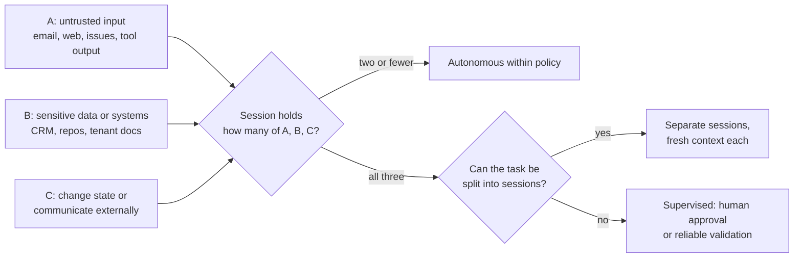
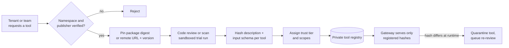
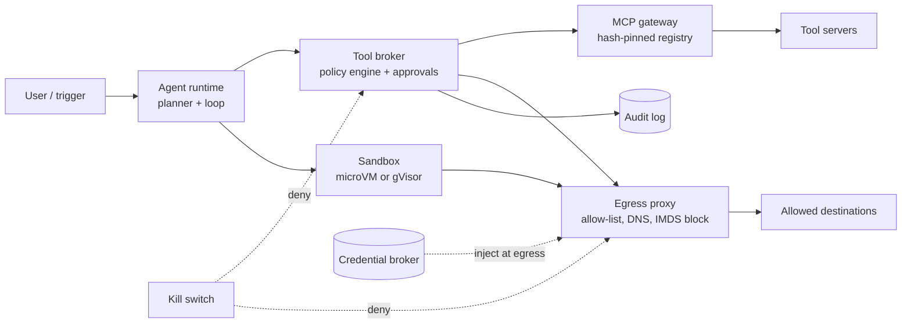

# 31 — Securing agentic systems

> **The requirement.** Lumen now runs an agent platform. 2,000 tenant organizations build agents that call about
> 300 tools: 60 first-party tools, the rest served by third-party MCP servers or shipped as skills from a catalog.
> A third-party server can change a tool description tomorrow without telling anyone. Security sets four rules:
> (1) no session may read another tenant's data; (2) no outbound action that untrusted content could have steered
> may run without a deterministic control or a human; (3) every tool call is attributable to a human principal, an
> agent version and a policy version; (4) one operator action stops a misbehaving agent version on every tenant
> within 60 seconds. This is hard because the agent's control flow is written at runtime by a model that reads
> attacker-controlled text, and the tools it calls are themselves software from strangers.

**Where this chapter sits.** [SYSDESIGN-28](28-ai-trust-safety-governance.md) explains prompt injection, the OWASP
lists, guardrail layers, session versus value taint, the six secure-by-design patterns and the EU AI Act. This
chapter does not repeat them. [SYSDESIGN-25](25-agentic-systems.md) builds the agent runtime, its sandbox table and
its permission tiers. [SYSDESIGN-18](../02-modern-requirements/18-security-by-design.md) owns zero trust, workload
identity, token exchange and delegation chains for agents
([Agent identity and delegation chains](../02-modern-requirements/18-security-by-design.md#agent-identity-and-delegation-chains)),
and the software supply chain. Here we treat the agent
platform *as a system to threat-model*: which property combinations are dangerous, where tools come from, how
authority moves, how you contain a hijacked agent, and how you notice and stop one. The regulatory side (Art. 12
logging, Art. 14 oversight and stop controls, incident reporting) is in
[SYSDESIGN-28](28-ai-trust-safety-governance.md); the audit log and kill switch here are how a platform meets those
requirements. This is not legal advice.

## In one minute

An agent is dangerous when three things meet in one session: it reads text an attacker could have written, it can
reach data that matters, and it can change something or send something out. Adaptive attacks bypassed 12 published
defenses, most at over 90% success [20], so you design as if the model will follow injected instructions. That turns agent
security into classical systems work. Count the dangerous combinations per workflow and break them where you can.
Treat every tool, tool description and skill as third-party code with a supply chain: admit it on purpose, pin it,
and re-review it when it changes. Make sure tokens are issued for one audience and never forwarded. Run agent code
in a sandbox whose limits you know, let it reach the network only through a proxy that decides where data may go,
and keep credentials in a broker the agent never sees. Then watch for the signals a hijacked agent produces, and
build a kill switch that works without the agent's cooperation.

## Why this matters now

Between 2025 and 2026 the agent attack surface stopped being hypothetical. Each of these is a published report or
advisory, in date order:

- **Tool poisoning, shadowing and rug pulls (April 2025).** Invariant Labs showed that instructions hidden in an
  MCP tool's description, which the model sees and the user usually does not, made an agent read `~/.ssh/id_rsa`
  and send it out through a tool argument. The same post described *shadowing*, where one server's description
  changes how the agent uses another server's tool, and *rug pulls*, where a server changes a description after the
  user approved it [7].
- **A "toxic agent flow" (May 2025).** An injected issue on a public GitHub repository made an agent with the
  GitHub MCP server copy private-repository data into a pull request on the public repository. The authors stress
  that this "is not a flaw in the GitHub MCP server code itself" but an architectural problem [8].
- **A vulnerable MCP client component (July 2025).** CVE-2025-6514 in `mcp-remote` (versions 0.0.5 to 0.1.15)
  let a malicious MCP server achieve OS command injection on the client through a crafted `authorization_endpoint`
  URL during OAuth; JFrog rated it CVSS 9.6 [12].
- **Zero-click exfiltration in production (CVE-2025-32711, analysed September 2025).** The EchoLeak paper describes
  a single crafted email that made Microsoft 365 Copilot exfiltrate data with no user action, chaining a bypass of
  the vendor's injection classifier, reference-style Markdown links, auto-fetched images and a proxy allowed by the
  content security policy [15].
- **A malicious MCP package (September 2025).** An npm package named `postmark-mcp`, not published by Postmark,
  shipped 15 benign versions and then added a backdoor in 1.0.16 that blind-copied every email to an outside
  address [11]. MITRE ATLAS records it as case study AML.CS0053 and calls it a rug pull [10].
- **A poisoned skills marketplace (February 2026).** Koi Security reported that an audit of 2,857 skills on
  ClawHub found 341 malicious ones, 335 from one campaign that used typosquatted names and a fake "prerequisite"
  install step to drop an infostealer (as reported by eSecurity Planet; the vendor's later counts were higher) [13].

The vocabulary matured at the same time. Meta published the *Agents Rule of Two* in October 2025 [2]. OWASP
published the *Top 10 for Agentic Applications for 2026* in December 2025 [16]. MITRE ATLAS added an "Agentic AI"
platform tag and agent techniques such as AI Agent Tool Poisoning (AML.T0110, created 2026-03-30), and its content
release 2026.10 is dated 2026-10-28 [10]. MCP's revision 2026-07-28 ships a security best-practices page with
normative MUSTs for proxies, tokens, SSRF and local installs [4].

## Core ideas [Core]

### 1. The threat model is a property of the session

Simon Willison's **lethal trifecta** names three capabilities that, combined, let an attacker steal data:
"access to your private data", "exposure to untrusted content" and "the ability to externally communicate". His
conclusion is blunt: "The only way to stay safe there is to avoid that lethal trifecta combination entirely" [1].
He also points at MCP's role: it "encourages users to mix and match tools from different sources that can do
different things", so users assemble the trifecta themselves [1].

Meta's **Agents Rule of Two** generalizes the idea from exfiltration to any consequential action. Until robustness
research can reliably detect and refuse prompt injection, an agent "must satisfy no more than two" of these three
properties *within a session* [2]:

- **[A]** it "can process untrustworthy inputs";
- **[B]** it "can have access to sensitive systems or private data";
- **[C]** it "can change state or communicate externally".

Two differences from the trifecta matter for design. First, [C] includes *changing state*, not only communicating:
an injected agent that deletes records or merges a pull request does damage even if nothing leaves the building.
Second, the rule has an explicit escape hatch. If a task needs all three properties and cannot be split into
sessions with a fresh context window, the agent "should not be permitted to operate autonomously and at a minimum
requires supervision", by human approval or "another reliable means of validation" [2]. Meta is also explicit
about the limits: the rule does not address other threats (mistakes, hallucinations, excessive privileges, spam),
a compliant design can still fail (for example when a user confirms a warning blindly), and it supplements least
privilege and defense in depth rather than replacing them [2]. Meta credits Willison's trifecta and a similarly
named Chromium policy as inspiration [2].

*Diagram: three property boxes (untrusted input, sensitive data, change state or communicate) feed one decision:
how many does the session hold? Two or fewer runs autonomously under policy. All three leads to a second decision:
if the task can be split, use separate sessions with fresh context, otherwise require supervision by human approval
or reliable validation.*

Read the rule as a **design inventory**, not a slogan. For each workflow, list which tools and data sources the
session can touch, mark each A, B or C, and record the verdict. Note what counts as each property in practice:

| Property | Usually present when the session… | Often missed |
|---|---|---|
| A untrusted input | reads email, tickets, web pages, uploaded files, issue text | tool *descriptions* and tool *results* from third-party servers; skill files; repository config read by a coding agent |
| B sensitive data | queries a CRM, a private repo, a tenant's documents | the agent's own memory and earlier turns; secrets in environment or config files (ATLAS AML.T0083 [10]) |
| C state change or outbound | sends, writes, merges, deletes, pays | "read" tools with free-form arguments (web search, URL fetch); rendered images and links ([SYSDESIGN-28](28-ai-trust-safety-governance.md#data-exfiltration-channels)) |

The session is the unit because a context window carries influence forward. Once [A] text has entered the
context, every later step may be shaped by it, which is the *session taint* idea from
[SYSDESIGN-28](28-ai-trust-safety-governance.md#writing-tool-policies-that-hold). Splitting a task into sessions
with fresh contexts is therefore a real control, not bookkeeping, provided that what passes between sessions is
constrained (typed fields, not free text).

### 2. Tool trust levels and capability scoping

A tool brings three separate things into the agent: **code** that runs somewhere, a **description** that the model
reads as instructions, and **results** that flow back into the context. Each has its own owner and trust level. A
first-party tool you build and review has trusted code and description, but its *results* can still carry
attacker text (a ticket body). A remote third-party server may be honest today and different tomorrow.

Give every tool a **trust tier** in the platform's tool registry and let the tier drive policy:

| Tier | Example at Lumen | Code | Description and schema | Default policy |
|---|---|---|---|---|
| T0 first-party | `crm.lookup_account`, built and reviewed by Lumen | trusted, in Lumen's CI | trusted, versioned with the code | allowed for tenants that enable it |
| T1 vetted third-party, pinned | a shipping-tracker server, reviewed, pinned by digest | reviewed once per version | hash-pinned; any change quarantines the tool | allowed, scoped, never co-loaded with T0 write tools in tainted sessions |
| T2 third-party remote, unpinned | a SaaS vendor's hosted MCP endpoint | not reviewable | can change at any time | read-only scopes, its results count as [A], approval for any [C] |
| T3 tenant-supplied or community | a tenant's own server, a catalog skill | unknown | unknown | runs only inside that tenant's isolation domain, results are [A], description is [A] |

Then scope capabilities at three layers, because each fails differently:

1. **What the model can see.** Load only the tools a workflow needs. A tool the model never sees cannot be
   misused, and fewer descriptions mean fewer injection points. Filter the `tools/list` result per agent version
   and per tenant at the gateway.
2. **What the broker will execute.** The model's tool call is a *request*. A deterministic policy engine outside
   the model decides, with default-deny and argument-aware rules ([SYSDESIGN-28](28-ai-trust-safety-governance.md#writing-tool-policies-that-hold)).
   Bind risky arguments to values the controller supplies (the recipient is the ticket's verified sender, not a
   string the model wrote).
3. **What the credential allows.** The token attached to the call should permit only that operation on that
   resource for that task. MCP's best-practices page calls for "a progressive, least-privilege scope model": a
   minimal initial scope and "incremental elevation via targeted `WWW-Authenticate` `scope="..."` challenges"
   when a privileged operation is first attempted, and it lists "using wildcard or omnibus scopes" as a common
   mistake [4].

Never let **tool annotations** drive these decisions. In the 2026-07-28 schema, `readOnlyHint`, `destructiveHint`
and `openWorldHint` are "hints" that "are not guaranteed to provide a faithful description of tool behavior", and
"clients should never make tool use decisions based on `ToolAnnotations` received from untrusted servers" [5]. The
specification's overview says that "descriptions of tool behavior such as annotations should be considered
untrusted, unless obtained from a trusted server" [3]; treat tool descriptions and results from third-party servers
the same way. A malicious server that labels its exfiltration tool `readOnlyHint: true`
must not get auto-approval for it. Classify tools yourself, by what leaves the system.

### 3. The MCP server and skills supply chain

Agent tooling is a software supply chain with one new property: some of the artifacts are *instructions to the
model*. The attack classes, with the evidence behind each:

| Attack | What happens | Evidence |
|---|---|---|
| **Tool poisoning** | Hidden instructions in a description steer the agent | Invariant Labs PoC, credentials exfiltrated through a tool argument [7]; ATLAS AML.T0110 AI Agent Tool Poisoning, maturity "Realized" [10] |
| **Shadowing** | One server's description changes how the agent uses *another* server's tool | Invariant Labs: a malicious description redirected emails sent through a trusted tool [7] |
| **Rug pull** | A server or package behaves well, gains approval or adoption, then changes | Description changes after approval [7]; `postmark-mcp` turned malicious at version 1.0.16 after 15 benign versions [11][10] |
| **Impersonation and typosquatting** | A package or skill uses a trusted name or a near-miss | `postmark-mcp` impersonated Postmark [11]; ClawHavoc skills used typosquatted names [13] |
| **Install-time code execution** | Installing a local server or following a skill's "setup" runs attacker code | MCP best practices list malicious startup commands [4]; ClawHavoc's fake prerequisite step [13] |
| **Vulnerable client plumbing** | The MCP client or proxy itself is exploitable by a malicious server | CVE-2025-6514 in `mcp-remote` [12] |
| **Configuration and rules files** | Instruction files shipped in a repository or package steer a coding agent | ATLAS AML.T0081 Modify AI Agent Configuration and case study AML.CS0041, invisible Unicode in rules files [10] |

How effective is poisoning against current models? The MCPTox benchmark built 1,348 malicious test cases on 45
live MCP servers and 353 real tools. The highest attack success rate it reports is 72.8% (o1-mini), it notes that
"more capable models are often more susceptible", and the highest refusal rate was under 3% (Claude-3.7-Sonnet)
[9]. Those numbers are for that benchmark's attacks and model versions. The design conclusion does not depend on
them: model refusals are not a control you can count on.

**Skills** add their own surface. The Agent Skills format is a directory with a `SKILL.md` file and optional
`scripts/` with "executable code that agents can run" [14]. Its only permission-like field, `allowed-tools`, lists
"pre-approved" tools, is marked "Experimental" (as of 2026-11), and "support for this field may vary between agent
implementations" [14]. So `allowed-tools` widens what a skill may do without asking. It does not sandbox the
skill, and the specification defines no signing or trust model (as of 2026-11). A skill is code plus a prompt, and you should admit
it as both.

**The admission pipeline.** Treat a new tool, server or skill like a new dependency
([SYSDESIGN-18](../02-modern-requirements/18-security-by-design.md#the-software-supply-chain)), with two extra
steps for the parts the model reads:

*Diagram: a tool request passes a namespace and publisher check (or is rejected), is pinned by digest or version,
reviewed or scanned in a sandboxed trial, has each tool's description and input schema hashed, gets a trust tier
and scopes, and is stored in a private registry. The gateway serves only registered hashes, and a runtime hash
mismatch quarantines the tool and queues a re-review.*

The controls in that pipeline, and their sources:

- **Verify the publisher, but know what that buys.** The official MCP Registry (in preview as of 2026-11) ties
  reverse-DNS server names such as `io.github.username/server` to verified GitHub accounts or domains, which
  defeats a squatter publishing under *your* namespace. It hosts metadata, not code, and "delegates security
  scanning" to the package registries and to downstream aggregators [6]. A verified namespace tells you *who*
  published, not whether the code is safe. `postmark-mcp` was a validly published npm package under a name the
  real vendor had never used [11].
- **Pin.** Pin packages by version and digest, and sign and verify them as you would container images
  ([SYSDESIGN-18](../02-modern-requirements/18-security-by-design.md#the-software-supply-chain)). Invariant's
  recommendations include pinning server and tool versions and verifying descriptions "with a hash or checksum"
  before use [7].
- **Diff on change.** MCP lets servers announce `notifications/tools/list_changed` [5], and a remote server can
  simply return different descriptions. The gateway compares each served description and schema hash with the
  registered one. A mismatch quarantines that tool (not the whole server) and opens a review that shows the text
  diff. This is the rug-pull control.
- **Consent with the exact command.** For one-click local installs, an MCP client "MUST" show "the exact command
  that will be executed, without truncation", flag it as code execution, and require explicit approval; it
  "SHOULD" run local servers in a sandbox with minimal default privileges [4].
- **Isolate servers from each other.** Shadowing works because all descriptions land in one context. Do not
  co-load an unvetted server's tools in a session that also holds high-consequence tools from another server.
- **Treat repository and package config as input.** For coding agents, instruction files, hooks and MCP
  definitions in a cloned repository are attacker-writable. Load them only from trusted paths or after review,
  and never let them add tools or widen permissions automatically
  ([C11](../04-case-studies/C11-coding-agent-platform.md)).

### 4. Confused deputies and token passthrough in MCP

A **confused deputy** is a component with authority that is tricked into using it for someone else
([SYSDESIGN-18](../02-modern-requirements/18-security-by-design.md#token-audience-confused-deputies-and-delegation)).
Agent platforms have several, and they need different fixes:

1. **The model as deputy.** Injected text makes the model use the user's tools against the user. The fix is the
   policy engine and the Rule of Two above ([SYSDESIGN-28](28-ai-trust-safety-governance.md#why-injection-is-a-confused-deputy-problem)).
2. **The MCP proxy as an OAuth deputy.** An MCP server that fronts a third-party API with one static OAuth client
   ID can be abused when it also lets clients register dynamically and the third-party authorization server
   remembers consent in a cookie, and the proxy does not ask the user for consent per MCP client (these are the four
   conditions the best-practices page lists). An attacker registers a client with their own redirect URI, sends the user a
   link, the cookie skips the consent screen, and the authorization code lands at the attacker [4]. MCP's
   mitigation is normative: proxy servers "MUST implement per-client consent", keep "a registry of approved
   `client_id` values per user", check it before starting the third-party flow, match redirect URIs exactly, and
   handle `state` as single-use, set only after consent [4].
3. **Token passthrough.** An MCP server that accepts a token "without validating that the tokens were properly
   issued *to the MCP server*" and forwards it downstream breaks audience boundaries, bypasses downstream rate
   limits and policy, and leaves audit logs that show the wrong caller [4]. The rule is short: "MCP servers
   **MUST NOT** accept any tokens that were not explicitly issued for the MCP server" [4]. When a server needs to
   call an upstream API for the user, it obtains a *new* token for that audience by token exchange
   ([SYSDESIGN-18](../02-modern-requirements/18-security-by-design.md#token-audience-confused-deputies-and-delegation)).
4. **Discovery as SSRF.** During OAuth discovery the client fetches URLs the server supplies. A malicious server
   can point them at `169.254.169.254` or internal hosts. Server-side clients "MUST consider SSRF risks", "SHOULD"
   block private, loopback and link-local ranges, and "SHOULD consider using an egress proxy" [4]. The
   `mcp-remote` CVE shows the client-side version of the same trust error: a server-supplied authorization URL
   became a command [12]. MCP now says clients "MUST NOT use shell commands" to open URLs and must allow only
   `http`/`https` schemes [4].
5. **State handles as bearer tokens.** Because MCP 2026-07-28 is stateless, servers return explicit handles (a
   cart ID, a workflow ID) that come back as tool arguments. Servers "MUST NOT treat possession of a state handle
   as authentication" and "SHOULD" key stored state by the user ID from the verified token, such as
   `<user_id>:<handle>` [4]. On a multi-tenant platform, a guessable handle is a cross-tenant read.

Who the agent *is* (its own principal, acting for which human, through which chain of sub-agents) is the subject
of [Agent identity and delegation chains](../02-modern-requirements/18-security-by-design.md#agent-identity-and-delegation-chains)
in SYSDESIGN-18: workload identity per agent version, token exchange with the `act` claim, and attenuation at every
hop. For this chapter the requirement is narrower: every hop gets a token for exactly one audience, the gateway never
forwards the token it received, and the audit line records the human, the agent version and the policy decision.

### 5. Containment architecture

Assume the model will be hijacked. Containment decides what a hijacked agent can touch. Four layers, each with
documented limits:

*Diagram: a user or trigger starts the agent runtime. Tool calls go through a tool broker with the policy engine
and approvals, then an MCP gateway with a hash-pinned registry, then tool servers. Agent-written code runs in a
sandbox whose only network path is an egress proxy with an allow-list, DNS control and a metadata-endpoint block;
the broker's outbound calls use the same proxy. A credential broker injects credentials at the proxy. A kill switch
can make both the broker and the proxy deny. The broker writes the audit log.*

**Sandbox tiers and their stated limits.** [SYSDESIGN-25](25-agentic-systems.md#8-sandboxed-code-execution)
compares the mechanisms and [SYSDESIGN-18](../02-modern-requirements/18-security-by-design.md#multi-tenant-isolation-a-ladder-not-a-switch)
gives the isolation ladder. What matters for security architecture is what each project says it does *not* do:

| Tier | Typical use for agents | What its own documentation says it does not cover |
|---|---|---|
| OS-level sandbox (bubblewrap on Linux, Seatbelt on macOS) | local coding agents on a developer machine | Anthropic built Claude Code's sandbox on these primitives and stresses that "effective sandboxing requires both filesystem and network isolation" [22]; the kernel is still shared |
| Container + seccomp | trusted internal tools | shared host kernel; one kernel bug crosses the boundary ([SYSDESIGN-18](../02-modern-requirements/18-security-by-design.md)) |
| gVisor | untrusted code with container ergonomics | no protection against hardware side channels; host cgroups needed against resource exhaustion [24] (limits quoted in [SYSDESIGN-25 §8](25-agentic-systems.md#8-sandboxed-code-execution)) |
| Firecracker microVM (via the jailer) | hostile multi-tenant code | "not able to mitigate host's hardware vulnerabilities"; so run the jailer, keep seccomp, turn SMT off where tenants share hosts, drop guest traffic to the metadata service [25] (details in [SYSDESIGN-25 §8](25-agentic-systems.md#8-sandboxed-code-execution)) |
| Dedicated node, cluster or account | regulated or premium tenants | removes sharing at a cost per tenant ([SYSDESIGN-18](../02-modern-requirements/18-security-by-design.md#multi-tenant-isolation-a-ladder-not-a-switch)) |

On Kubernetes, the SIG Apps project `agent-sandbox` manages "isolated, stateful, singleton workloads" through a
`Sandbox` resource with templates, claims and warm pools, and runs them under runtimes such as gVisor or Kata
Containers through `RuntimeClass` [26]. It is an orchestration layer: the isolation strength is that of the runtime
class you pick.

**Egress control** is where exfiltration is actually stopped. Default deny. Allow destinations per tenant and per
agent version, and allow them at the narrowest level the protocol lets you see: an allow-listed *host* such as a
public code-hosting site still lets an injected agent post to a public repository the attacker reads, which is the
GitHub MCP attack [8]. Route DNS through the proxy too, so name lookups cannot carry data to an attacker's resolver
(the course's reasoning). Block link-local and private ranges, including the cloud metadata address, for both the
sandbox and the broker's own HTTP clients, as MCP's SSRF guidance and Firecracker's host guide both recommend
[4][25]. Anthropic reports that in its own product the proxy "enforces restrictions on the domains that a process
can connect to" and asks the user about new domains [22].

**Secrets brokering.** The agent and the sandbox should never hold long-lived credentials. A credential broker
injects a short-lived token at the egress proxy or the tool broker, keyed by the sandbox's workload identity
([SYSDESIGN-18](../02-modern-requirements/18-security-by-design.md)). Anthropic describes the same pattern: git
credentials and signing keys "are never inside the sandbox", and a proxy attaches authentication to git requests
[22]. **The caveat is the whole point.** Brokering hides the credential, not its authority. A hijacked agent can
still ask the proxy to use the injected token against every allowed destination, for every operation the token
permits. So the broker must also scope: one repository or resource, one operation class, the task's lifetime,
bound to the sandbox identity, and refused the moment the kill switch fires. Log every injection with the task ID,
because the downstream service will only see the broker.

## Numbers that matter

All figures below are **labelled assumptions for Lumen** unless a source is given. The point is the arithmetic,
not the inputs.

**1. Description drift review load.**
Assumptions: 240 third-party tools; 3% change their description or input schema in a given week; a human review
of a diff takes 15 minutes.
240 × 0.03 ≈ **7 diffs a week**, about 1.8 hours of review. That is cheap. The alternative, accepting changes
silently, is exactly the rug pull. If the change rate is high for one vendor, that is itself a signal to move the
vendor down a tier.

**2. Approval load if you gate naively.**
Assumptions: 1.2 M tool calls a day; 25% are outbound-capable or state-changing; half of those happen in sessions
already holding untrusted input; 10 seconds of human attention per approval.
1,200,000 × 0.25 × 0.5 = **150,000 approvals a day**, or 1.5 M seconds ≈ **417 person-hours a day**, about 75
approvals per tenant per day across 2,000 tenants. Nobody reads 75 prompts a day carefully; Anthropic reported
that users "accept 93%" of Claude Code permission prompts (vendor measurement, one product) [23]. Now redesign: approve at the plan level (assume 8
outbound calls per task, one approval per task) and bind destinations to the tenant's own domains so that,
assume, 70% of the remaining calls need no human:
150,000 / 8 ≈ 18,750; 18,750 × 0.3 ≈ **5,600 approvals a day**, under 3 per tenant. Structural controls, not
faster clicking, made the gate meaningful.

**3. A mediator's misses, with and without a deterministic layer behind it.**
Anthropic reports that its two-stage permission classifier missed 17% of real "overeager" actions (n = 52, so the
interval is wide, roughly 9% to 30%) and
5.7% of synthetic exfiltration attempts (n = 1,000), with a 0.4% false-positive rate on 10,000 real actions
(vendor measurement, one product) [23]. Assume 1,000 attempted exfiltrations a month reach such a mediator. At
5.7%, about **57 get through**. If the egress proxy only allows the tenant's own destinations, those 57 calls fail
at the proxy. If it allows any HTTPS host, they succeed. The classifier lowers volume; the allow-list is the
boundary.

**4. Credential blast radius.**
Assumption A: one tenant-wide repository token, valid 8 hours, covering 2,000 repositories.
Assumption B: a per-task token for 1 repository, push to a task branch only, valid 30 minutes.
Exposure as repository-hours: 2,000 × 8 = 16,000 versus 1 × 0.5 = 0.5, a **32,000-fold** reduction, before even
counting the narrower operation set. Per-task scoping is the cheapest containment you will buy.

**5. Kill-switch time budget (requirement: 60 s).**
Assumptions: workers, the broker and the egress proxy subscribe to a revocation topic, with a 10 s poll as a
fallback; tool calls have a 30 s timeout; injected tokens have a 5-minute TTL but the broker refuses to inject for
a revoked agent version.
Worst case for new external effects: 10 s (fallback poll) + 30 s (an in-flight call completing) = **40 s**, inside
the requirement. The token TTL does not matter, because the proxy and broker stop using tokens at propagation
time. If you had relied on the agent loop noticing a flag between steps, a 20-minute tool-free reasoning step would
blow the budget.

## Design choices and trade-offs

**Design patterns, judged by evidence.** The patterns are defined in
[SYSDESIGN-28](28-ai-trust-safety-governance.md#constrained-tools-and-secure-by-design-agent-patterns). Here is what
each guarantees and what it leaves open.

| Pattern | Guarantees | Leaves open | Cost | Evidence |
|---|---|---|---|---|
| Plan-then-execute | Untrusted data cannot change *which* tools run or in what order | Data flowing through the plan (a recipient read from an email) can still be attacker-chosen; pair with argument binding | Less adaptive agents; replanning needs a new trusted step | Pattern analysis with case studies, not a benchmark [18] |
| Dual LLM (privileged + quarantined) | The tool-calling model never reads untrusted text, only variable names such as `$VAR1` | Willison lists user social engineering and "a great deal more implementation complexity"; his 2025 update notes CaMeL "highlights a potential flaw" [19] | Two models, a controller, degraded UX | Design proposal [19] |
| CaMeL (code-then-execute with capabilities) | Control and data flow come from the trusted query; capabilities on values let policies block private data from reaching unauthorized sinks | Policies must be written by people; denied flows still need a human or a refusal | Custom interpreter; on AgentDojo 77% of tasks solved "with provable security" versus 84% undefended (arXiv v2) [17] | Benchmark result [17] |
| Session split (Rule of Two) | No single context holds A, B and C | What passes between sessions must be typed and checked | Orchestration work ([SYSDESIGN-29](29-agent-architectures-orchestration.md)) | Framework [2] |
| Classifier mediation | Fewer prompts for humans | Misses (17% on real overeager actions in one product [23]); adaptive attackers | Model calls per action | Vendor measurement [23] |

A warning about evidence. Nasr, Carlini and colleagues bypassed 12 recent jailbreak and prompt-injection defenses
"with attack success rate above 90% for most", although most had originally reported near-zero attack success
[20]. A defense's published attack-success rate describes the attacks it was tested against. Prefer controls whose
guarantee is a system property you can check (a tool is not loaded, a destination is not allowed, a value's
capability forbids a sink) over controls whose guarantee is a detection rate.

**Where to enforce tool policy.**

| Option | Wins when | Costs |
|---|---|---|
| In the agent client or framework | Single-team prototypes | Every framework re-implements it; bypassed by any code path that calls tools directly |
| **Central tool broker plus MCP gateway** | Multi-tenant platforms; many agents | A critical-path service with its own SLO; must fail closed |
| In each tool server | Defense in depth for high-value tools | Servers lack session context (taint, plan, approvals) |

Lumen uses the broker and gateway as the boundary and asks T0 servers to enforce their own authorization as a
second layer.

**Which sandbox tier for which code.**

| Code | Tier at Lumen | Why |
|---|---|---|
| Agent-written analysis code from any tenant | Firecracker microVM per task, jailer, SMT off on shared hosts | Hostile multi-tenant code; the stated limits above |
| Tenant-supplied (T3) MCP servers | microVM in the tenant's pool, egress only to that tenant's allow-list | Unknown code; cross-tenant boundary |
| T1 vetted third-party servers | gVisor pods, per-server egress allow-list | Reviewed code, still not ours |
| T0 first-party servers | ordinary pods, workload identity, NetworkPolicy | Our code, our CI |

## Deep dive [Deep]

### Worked threat model: Lumen's Account Assistant

Lumen's *Account Assistant* (fictional) helps a tenant's account managers. It has three workflows. The inventory
below is the deliverable a security review asks for.

| Workflow | A untrusted input | B sensitive data | C state change or outbound | Rule of Two verdict |
|---|---|---|---|---|
| W1 Answer inbound customer email | email body | CRM accounts, order history | send reply | **All three.** Must split or supervise |
| W2 Weekly account report | customer-uploaded files attached to accounts | CRM, tenant documents | write report to the tenant's drive | **All three** if it reads attachments |
| W3 Research a prospect | web pages | none if CRM is not attached | web fetch with free-form query | Two (A, C): allowed |

**W1 design.** A quarantined step reads the email and returns typed fields: sender address (from the verified
envelope, not the body), intent from a fixed list, order number matching a pattern. The privileged planner never
sees the body ([19]). CRM access is scoped to the account whose verified domain matches the sender, where
"verified" means the message passed SPF, DKIM and DMARC alignment, so an attacker
emailing from their own domain can only reach their own account. The reply is a draft rendered from a template plus
the typed fields. Sending is [C] in a session that still holds [A] influence through the typed fields, so Lumen
supervises it: the account manager approves the draft, shown as the exact outgoing message, with the recipient
bound by the controller to the original sender. Sending to any other address is not a capability the session has.

**W2 design.** Drop [A]. The report session reads only structured CRM fields and document *metadata*. A separate,
tool-less map-reduce step summarizes attachments into bounded fields (counts, dates, a classification), and only
those cross into the report session. Writing to the tenant's own drive folder is a [C] whose audience is the
requester's organization only.

**W3 design.** Keep it at two properties by construction: the session has no CRM connector, no memory write, and
its output is rendered as text with no automatic image loading. The web-fetch tool's egress goes through the proxy,
which logs destinations for detection. The user's own prompt is the one piece of sensitive context that can still
reach a fetch URL, so keep it free of secrets and log destinations.

**Supply chain.** W1 uses a third-party shipping-tracker MCP server for order status. It is tier T1: pinned by
digest, descriptions hashed, a read-only scope, and it is never co-loaded with the email-send tool from another
server in the same session, which closes the shadowing path [7].

**Threats mapped to OWASP and ATLAS.** OWASP's agentic list ([SYSDESIGN-28](28-ai-trust-safety-governance.md#the-owasp-lists-as-a-checklist-of-controls))
gives the risk names; ATLAS gives adversary techniques you can test against [10][16].

| Threat to the Account Assistant | OWASP ASI | ATLAS technique | Control |
|---|---|---|---|
| Email steers the agent | ASI01 Agent Goal Hijack | AML.T0051 LLM Prompt Injection | Quarantined extraction; supervised send |
| Data leaves through a tool call | ASI02 Tool Misuse and Exploitation | AML.T0086 Exfiltration via AI Agent Tool Invocation | Recipient binding; egress allow-list |
| Shipping server changes its description | ASI04 Agentic Supply Chain Vulnerabilities | AML.T0110 AI Agent Tool Poisoning | Hash pinning; quarantine on diff |
| Credentials read from agent config | ASI03 Identity and Privilege Abuse | AML.T0083 Credentials from AI Agent Configuration | Credential broker; nothing in config |
| "Remember to CC this address" | ASI06 Memory & Context Poisoning | AML.T0080 AI Agent Context Poisoning | Memory writes off in tainted sessions, except a verbatim user statement ([SYSDESIGN-30](30-context-engineering-memory.md#memory-poisoning)) |
| Injected loop burns budget | ASI08 Cascading Failures, ASI10 Rogue Agents | AML.T0034.002 Agentic Resource Consumption | Budgets; spend-velocity alerts; kill switch |

Not mapped in this table: ASI05 Unexpected Code Execution (the sandbox tiers in §5), ASI07 Insecure Inter-Agent
Communication (authenticate every agent-to-agent hop like a service call, with the delegation chains of
[SYSDESIGN-18](../02-modern-requirements/18-security-by-design.md#agent-identity-and-delegation-chains)) and ASI09
Human-Agent Trust Exploitation (approval rendering, below).

**Residual risk, stated.** A human can still approve a bad draft. The typed fields can still be wrong. A vetted
server can still be compromised between reviews, which the hash check catches only if the description changes,
not if only the server's behavior does. Write these down; they are what monitoring is for.

### Approval design without approval fatigue

[SYSDESIGN-28](28-ai-trust-safety-governance.md#human-oversight) covers the basics: show the exact action, bind
the approval to a hash of it, measure dwell time and approval rate, and remember the AI Act's automation-bias
clause (Art. 14(4)(b)). Agent platforms need four more rules, all visible in the arithmetic above.

1. **Tier by consequence, audience and taint together.** A write that only the requester can see is low risk; a
   write that others can read is a disclosure channel even when it is reversible
   ([SYSDESIGN-25](25-agentic-systems.md#9-permissions-least-privilege-and-human-in-the-loop)). Whether the
   session holds [A] decides whether the middle tier needs a human.
2. **Approve plans, not steps, where the plan is fixed.** With plan-then-execute, one approval of the plan
   (tools, destinations, data classes) covers its steps. Any deviation from the approved plan is a new approval.
3. **Give approvals a budget.** If a workflow needs more than a few approvals per user per day, treat it as a design
   bug: bind the argument, narrow the destination, or split the session.
4. **Render from structure, never from the model's words.** The approval shows the structured call (recipient,
   fields, byte count, destination), generated by the broker. The model's explanation is attacker-influenced text
   (OWASP ASI09 Human-Agent Trust Exploitation [16]).

Automated mediation can carry the low tiers. Anthropic's classifier sees "only user messages and the agent's tool
calls", with tool results and assistant prose stripped, so injected text in results cannot argue with it [23]. Its
authors still say it "is not a drop-in replacement for careful human review on high-stakes infrastructure" [23].
Put mediation in front of humans, and deterministic limits behind both. [SYSDESIGN-33](33-agent-platform-runtime.md)
covers how a paused run waits for an approval without holding resources.

### Monitoring, detection and the kill switch

A hijacked agent produces signals before it produces damage, if you collect them. Emit them as structured events
to the security event stream at 100% (they are cheap), and also attach them to the run's trace
([SYSDESIGN-32](32-observing-evaluating-agents.md#4-sampling-and-storing-agent-traces), where a security event is
a keep reason). Traces are sampled debugging data: a silent, successful exfiltration is neither failed nor costly,
so a trace-only signal would usually be sampled away. The complete, tamper-evident record of tool calls and policy
decisions is the audit log ([SYSDESIGN-28](28-ai-trust-safety-governance.md#audit-logs-and-traceability)), which is
what makes requirement (3) checkable.

| Signal | Why it indicates trouble | Response |
|---|---|---|
| Description or schema hash mismatch at the gateway | Rug pull or compromised server | Quarantine the tool automatically |
| New egress destination for an agent version | Exfiltration or scope creep | Deny, alert, require allow-list change |
| Policy denials per session above baseline | Injected agent probing for an open path | Pause the session for review |
| Outbound-capable call in a session holding [A] | The dangerous combination is live | Already gated; count it per tenant |
| A canary token used anywhere | Planted fake credential or record was read and sent | High-confidence incident; stop the agent version |
| Tool-call fan-out or spend velocity spike | Injected loop or resource abuse (ATLAS AML.T0034.002 [10]) | Throttle, then stop |
| Memory write in a tainted session, other than a verbatim user statement ([SYSDESIGN-30](30-context-engineering-memory.md#memory-poisoning)) | Persistence attempt | Block or quarantine the entry |

**Canaries** deserve a note. Plant fake records and fake credentials in tenant data and agent configuration that
no legitimate task touches. Their use is a near-zero-false-positive signal, which is what you want an automatic
stop to hang on.

**The kill switch must not need the agent's cooperation.** Define levels: one session, one agent version
everywhere, one tool everywhere, one tenant, and global. For each level, the enforcement points are outside the
loop: the broker denies tool calls, the gateway stops serving the tool, the egress proxy drops traffic, the
credential broker refuses to inject and revokes delegated tokens, the run queue stops dispatching
([SYSDESIGN-33](33-agent-platform-runtime.md)), and sandboxes are frozen. Freeze, not destroy: snapshot the sandbox,
stop memory writes, and preserve the trace and audit records so you can reconstruct what happened. Measure stop
time in drills, against the 60-second requirement. Afterwards, every incident becomes a regression case in the red
team suite.

### Red-teaming agents

[SYSDESIGN-28](28-ai-trust-safety-governance.md#red-teaming-and-evaluation-as-a-pipeline) puts security
evaluation in the release gate. For agents, structure the program around the threat model rather than around a
list of jailbreak prompts.

- **Use ATLAS as the attack catalog.** ATLAS 2026.10 tags techniques by platform, including "Agentic AI" [10].
  Agent-relevant entries include AML.T0051 LLM Prompt Injection, AML.T0053 AI Agent Tool Invocation, AML.T0080 AI
  Agent Context Poisoning (with a Memory sub-technique), AML.T0081 Modify AI Agent Configuration, AML.T0083
  Credentials from AI Agent Configuration, AML.T0086 Exfiltration via AI Agent Tool Invocation and AML.T0110 AI
  Agent Tool Poisoning. Its case studies include the Postmark rug pull (AML.CS0053), Invariant's poisoned tool
  (AML.CS0054), EchoLeak (AML.CS0059) and the rules-file backdoor (AML.CS0041) [10]. ATLAS publishes monthly
  content updates, so pin the version in your test plan.
- **Use OWASP ASI01 to ASI10 as the coverage checklist** [16]: every risk has at least one test or a written
  reason why it does not apply.
- **Test each property combination.** For every workflow with two Rule-of-Two properties, try to obtain the third
  through a side door: a "read" tool with a free-form query, a rendered image, a memory write, a co-loaded tool.
- **Measure attack success and utility together.** AgentDojo provides "97 realistic tasks" and 629 security test
  cases [21]; MCPTox covers tool poisoning on real servers [9]. Use them as a floor, then add fixtures built from
  your own tools.
- **Assume adaptive attackers.** Static suites overstate defense strength [20]. Give the red team the system
  prompt, the tool list and the policy, and budget for human and automated adaptive attacks before launches.
- **Drill the supply chain and the kill switch.** In staging, change a pinned tool's description and check that it
  is quarantined; publish a typosquatted package to the private registry and check that admission rejects it;
  trigger the kill switch and measure the stop time.

### Multi-tenant isolation for agent platforms

The isolation ladder in [SYSDESIGN-18](../02-modern-requirements/18-security-by-design.md#multi-tenant-isolation-a-ladder-not-a-switch)
applies to compute. Agent platforms add state that is easy to share by accident:

- **Sandboxes and warm pools** are per tenant. Never return a sandbox used by one tenant to another tenant's pool.
- **Caches** must follow MCP's cache hints where they exist. In the 2026-07-28 schema, `ttlMs` and `cacheScope`
  live on `CacheableResult`, which list results (`tools/list`, `prompts/list`, `resources/list`, resource
  templates), `resources/read` and discovery results extend; `tools/call` results (`CallToolResult`) carry no cache
  hint [5]. `"public"` means the response holds no user-specific data and may be served across authorization
  contexts, while for `"private"` responses "Caches MUST NOT be shared across authorization contexts (e.g., a
  different access token requires a different cache)" [5]. Never cache `tools/call` results across tenants, key
  every other gateway cache by tenant, user and token audience (a cache keyed only by tool name and arguments is a
  cross-tenant leak), and do not trust a T2 or T3 server's `"public"` label for data you have not classified
  yourself.
- **State handles** are keyed by the verified user and tenant, never by the handle alone [4].
- **Memory, checkpoints and traces** live in per-tenant stores with per-tenant keys, so erasure and incident
  isolation work per tenant ([SYSDESIGN-30](30-context-engineering-memory.md),
  [SYSDESIGN-19](../02-modern-requirements/19-privacy-compliance-sovereignty.md)).
- **Credentials** are per tenant and per user in the broker; a token's audience never spans tenants.
- **Policy and registry views** are per tenant: tenant A enabling a T3 server never makes it visible to tenant B.
- **Quotas are a security control.** Per-tenant token, tool-call and spend limits stop one tenant's injected loop
  from becoming everyone's outage or bill ([SYSDESIGN-33](33-agent-platform-runtime.md)).

## Frontier [Frontier]

*(as of 2026-11)*

- **Registries with provenance.** The official MCP Registry is still in preview and verifies namespaces, not code
  [6]. Expect enterprises to run private registries that add digests, signatures and review status on top of the
  public metadata; the registry defines an OpenAPI interface other registries can implement [6].
- **Skills meet MCP.** MCP lists *Skills over MCP* as a notable extension under a working group [3], while the
  Agent Skills format's only permission field remains experimental [14]. A trust and permission model for skills is
  still open.
- **Agent techniques in threat catalogs.** ATLAS keeps adding agent techniques and real case studies (for example
  AML.T0110, created 2026-03-30) [10]. Treat the catalog version as an input to your red-team plan.
- **Capability-based agents.** CaMeL showed a 77% versus 84% utility trade on AgentDojo for provable guarantees
  [17]. Whether that gap narrows enough for general agents is an open research question.
- **Agent identity.** Delegated, audience-bound, per-task identity for agents is being standardized in IETF
  working-group drafts; [SYSDESIGN-18](../02-modern-requirements/18-security-by-design.md#agent-identity-and-delegation-chains) tracks them.
- **Sandboxes as platform primitives.** Kubernetes `agent-sandbox` [26] makes per-agent sandboxes a declarative
  resource; isolation strength still comes from the runtime underneath.

## Failure modes and operations

| Failure | How it shows up | Detect (SLI) | Mitigate |
|---|---|---|---|
| Silent tool description change | Agent behavior shifts after no deploy | Hash mismatches per server per day | Quarantine on mismatch; re-review |
| Malicious package admitted | Unexpected egress from a tool server | New destinations per server; scan results at admission | Pin digests; publisher verification; sandbox servers |
| Token passthrough in a tool server | Downstream logs show the wrong caller | Audience-validation failures; token-exchange count per call | Reject foreign tokens; exchange per audience |
| Over-broad egress allow-list | Data posted to an allowed public host | Writes to shared or public destinations from tainted sessions | Allow at path or org level; audience-aware tiers |
| Proxy-injected token misused | Valid-looking calls outside the task scope | Injections per task; operations outside plan | Per-task, per-resource tokens; kill-switch revocation |
| Approval rubber-stamping | Approval rate near 100%, low dwell | Approvals per user per day; dwell time | Plan-level approval; argument binding; mediation |
| Cache hit across tenants (resource or tool result) | Tenant sees another tenant's data | Canary records per tenant | Never share `tools/call` results across tenants; honor `cacheScope` where the schema has it; key caches by tenant, user and audience |
| Kill switch too slow | Effects continue after the stop order | Stop-time measured in drills | Enforce at broker, proxy and credential broker, not in the loop |
| Policy engine outage | Calls fail, or pass unchecked | Fail-open counters | Fail closed for [C] tools |

**Operational SLOs (examples to adapt):** zero [C] tool executions without a logged policy decision; hash check on
100% of served tool descriptions; kill-switch stop time under 60 s in monthly drills; red-team suite on 100% of
model, prompt, policy and tool-version changes.

## Cost and energy

- **Isolation costs capacity.** MicroVMs and gVisor cost more per task than plain containers, and disabling SMT on
  shared hosts gives up hardware threads. Spend that on hostile, multi-tenant code only, and keep first-party
  tools on cheaper tiers ([C11](../04-case-studies/C11-coding-agent-platform.md) prices a sandbox fleet).
- **Secure patterns cost utility.** CaMeL's reported cost is 7 percentage points of task success on AgentDojo
  [17]. Session splits and quarantined steps add model calls.
- **Humans are the most expensive control.** The approval arithmetic above shows why structural controls pay for
  themselves.
- **Supply-chain review is cheap.** A few hours a week for diff review is small next to one incident.

## Interview angle

**How it is asked.** "Design an agent platform where customers can connect their own and third-party MCP tools.
How do you stop a malicious tool or an injected document from leaking another customer's data?" Variants: "a
third-party MCP server changes a tool description, what happens?" or "your coding agent reads public issues, what
can go wrong?"

**Model answer outline (course framework):**

1. **CLARIFY:** which tools (first-party, vetted, tenant-supplied), which data, who triggers runs, what autonomy is
   expected, and the stop-time requirement.
2. **QUANTIFY:** tools and change rate, tool calls per day, the fraction that is outbound-capable, the approval
   budget per user, the credential blast radius.
3. **SKETCH:** runtime, tool broker with policy engine, MCP gateway with a pinned registry, per-tenant sandboxes,
   egress proxy, credential broker, audit log, kill switch.
4. **DEEPEN:** Rule-of-Two inventory per workflow; admission, pinning and quarantine on diff; no token passthrough;
   secrets brokering with per-task scope.
5. **STRESS:** rug pull, malicious package, adaptive injection, proxy-token misuse, cross-tenant cache, kill switch
   under load. **WRAP:** residual risks and what monitoring catches them.

**Red flags:** "we use a prompt-injection classifier" as the main control; "the system prompt tells the agent not
to"; auto-approving tools because `readOnlyHint` is true; forwarding the user's token to tool servers; one shared
sandbox pool or tool-result cache across tenants; a kill switch that sets a flag the agent loop reads.

**Follow-ups:** How would you let one workflow legitimately hold all three properties? What does the approval
screen show, and who generates it? What changes if a tenant can upload its own skills? How do you prove, after an
incident, which human authorized which agent to make which call?

## Common mistakes

- Treating the trifecta as only about exfiltration and ignoring state changes (Rule of Two property [C]).
- Trusting tool annotations or descriptions from servers you do not control.
- Approving a server once and never noticing that its descriptions changed.
- Equating a verified publisher namespace with safe code.
- Treating `allowed-tools` in a skill as a sandbox.
- Allow-listing egress by host when the host is a shared public service.
- Believing credential injection prevents misuse; it prevents disclosure.
- Building a kill switch that depends on the agent's cooperation.
- Citing a defense's published attack-success rate as if it held against adaptive attackers.

## Check yourself

1. State Meta's three Rule-of-Two properties and what the rule says to do when a task needs all three.
2. Why must a gateway never auto-approve a tool because its annotation says `readOnlyHint: true`?
3. Name the four conditions that make an MCP OAuth proxy a confused deputy, and the MUST that fixes it.
4. What does credential brokering protect against, and what does it not?
5. Which enforcement points should a kill switch act on, and why not the agent loop?

Full set with answers: [exercises/31-securing-agentic-systems.md](../../exercises/31-securing-agentic-systems.md).

## Lab

**Planned — not yet built.** The planned lab extends the agent sandbox of
[SYSDESIGN-25](25-agentic-systems.md#lab) without any model calls: a scripted "agent" replays fixed tool-call
traces through a small tool broker and MCP gateway. You will pin a fixture MCP server's tool descriptions by hash,
then change one description and watch the gateway quarantine that tool; run a trace that tries to send fixture
data to a non-allow-listed destination and see the egress proxy refuse it; mark a session tainted and see an
outbound-capable call routed to approval; and fire the kill switch while a trace is running and measure the stop
time at the broker and the proxy. Everything is CPU-only and local, and no result is claimed until the lab is built
and run.

## Further reading

- Meta, *Agents Rule of Two* (2025) [2]: the session-level framing and its stated limits.
- Willison, *The lethal trifecta* (2025) [1] and *The Dual LLM pattern* (2023) [19]: the clearest statements of
  the problem and of the first architectural answer.
- MCP, *Security Best Practices* (2026-07-28) [4]: confused deputy, token passthrough, SSRF, local installs and
  scope minimization, with MUSTs.
- Invariant Labs on tool poisoning [7] and the GitHub MCP attack [8]: short, concrete teardowns.
- Debenedetti et al., *Defeating Prompt Injections by Design* (CaMeL) [17]: what a provable guarantee costs.
- Nasr et al., *The Attacker Moves Second* [20]: why static defense numbers mislead.
- MITRE ATLAS data [10]: agent techniques and case studies to build a test plan on.

## References

1. S. Willison, "The lethal trifecta for AI agents: private data, untrusted content, and external communication,"
   2025-06-16. https://simonwillison.net/2025/Jun/16/the-lethal-trifecta/ (accessed 2026-11-20) *(blog;
   perspective)*
2. Meta, "Agents Rule of Two: A Practical Approach to AI Agent Security," 2025-10-31.
   https://ai.meta.com/blog/practical-ai-agent-security/ (accessed 2026-11-20) *(vendor blog)*
3. Model Context Protocol, "Specification" (revision 2026-07-28), Security and Trust & Safety; Extensions.
   https://modelcontextprotocol.io/specification/2026-07-28 (accessed 2026-11-20)
4. Model Context Protocol, "Security Best Practices" (docs for revision 2026-07-28): Confused Deputy Problem, Token
   Passthrough, SSRF, State Handle Hijacking, Local MCP Server Compromise, OAuth Authorization URL Validation, Scope
   Minimization. https://modelcontextprotocol.io/docs/2026-07-28/tutorials/security/security_best_practices
   (accessed 2026-11-20)
5. Model Context Protocol, `schema/2026-07-28/schema.ts` (`ToolAnnotations`, `CacheableResult` and the result types
   that extend it, `CallToolResult`, `notifications/tools/list_changed`).
   https://github.com/modelcontextprotocol/modelcontextprotocol/blob/main/schema/2026-07-28/schema.ts (accessed 2026-11-20)
6. Model Context Protocol, "The MCP Registry" (preview), Trust and Security.
   https://modelcontextprotocol.io/registry/about (accessed 2026-11-20)
7. Invariant Labs, "MCP Security Notification: Tool Poisoning Attacks," 2025-04-01.
   https://invariantlabs.ai/blog/mcp-security-notification-tool-poisoning-attacks (accessed 2026-11-20)
   *(vendor research)*
8. Invariant Labs, "GitHub MCP Exploited: Accessing private repositories via MCP," 2025-05-26.
   https://invariantlabs.ai/blog/mcp-github-vulnerability (accessed 2026-11-20) *(vendor research)*
9. Z. Wang et al., "MCPTox: A Benchmark for Tool Poisoning Attack on Real-World MCP Servers," arXiv:2508.14925
   (v1 2025-08-19, v2 2026-09-29), preprint. https://arxiv.org/abs/2508.14925 (accessed 2026-11-20)
10. MITRE, ATLAS data, content version 2026.10 (collection modified 2026-10-28), format 6.1.0: techniques AML.T0034.002,
    T0051, T0053, T0080, T0081, T0083, T0086, T0110; case studies AML.CS0041, CS0053, CS0054, CS0059.
    https://github.com/mitre-atlas/atlas-data (file `dist/v6/ATLAS-2026.10.yaml`; accessed 2026-11-20). Browsable
    at https://atlas.mitre.org
11. Postmark, "Security Alert: Malicious 'postmark-mcp' npm Package Impersonating Postmark," 2025-09-25.
    https://postmarkapp.com/blog/information-regarding-malicious-postmark-mcp-package (accessed 2026-11-20)
12. JFrog Security Research, "mcp-remote command injection RCE" (JFSA-2025-001290844, CVE-2025-6514), 2025-07-09.
    https://research.jfrog.com/vulnerabilities/mcp-remote-command-injection-rce-jfsa-2025-001290844/
    (accessed 2026-11-20)
13. eSecurity Planet, "Hundreds of Malicious Skills Found in OpenClaw's ClawHub," 2026-02-03, reporting Koi
    Security's audit. https://esecurityplanet.com/threats/hundreds-of-malicious-skills-found-in-openclaws-clawhub
    (accessed 2026-11-20) *(secondary; the vendor's primary post was not reachable this session)*
14. Agent Skills, "Specification." https://agentskills.io/specification (accessed 2026-11-20)
15. P. Reddy, A. S. Gujral, "EchoLeak: The First Real-World Zero-Click Prompt Injection Exploit in a Production
    LLM System," arXiv:2509.10540, 2025-09-06, preprint. https://arxiv.org/abs/2509.10540 (accessed 2026-11-20)
16. OWASP GenAI Security Project, "OWASP Top 10 for Agentic Applications for 2026," 2025-12-09.
    https://genai.owasp.org/resource/owasp-top-10-for-agentic-applications-for-2026/ (accessed 2026-11-20; ASI
    names as listed in [SYSDESIGN-28](28-ai-trust-safety-governance.md))
17. E. Debenedetti et al., "Defeating Prompt Injections by Design," arXiv:2503.18813v2 (2025-06-24), preprint.
    https://arxiv.org/abs/2503.18813 (accessed 2026-11-20)
18. L. Beurer-Kellner et al., "Design Patterns for Securing LLM Agents against Prompt Injections,"
    arXiv:2506.08837 (v1 2025-06-10, v3 2025-06-27), preprint. https://arxiv.org/abs/2506.08837 (accessed 2026-11-20)
19. S. Willison, "The Dual LLM pattern for building AI assistants that can resist prompt injection," 2023-04-25
    (with a 2025 update). https://simonwillison.net/2023/Apr/25/dual-llm-pattern/ (accessed 2026-11-20) *(blog)*
20. M. Nasr, N. Carlini, C. Sitawarin et al., "The Attacker Moves Second: Stronger Adaptive Attacks Bypass Defenses
    Against LLM Jailbreaks and Prompt Injections," arXiv:2510.09023, 2025-10-10, preprint.
    https://arxiv.org/abs/2510.09023 (accessed 2026-11-20)
21. E. Debenedetti et al., "AgentDojo: A Dynamic Environment to Evaluate Prompt Injection Attacks and Defenses for
    LLM Agents," arXiv:2406.13352 (v3 2024-11-24). https://arxiv.org/abs/2406.13352 (accessed 2026-11-20)
22. Anthropic, "Beyond permission prompts: making Claude Code more secure and autonomous," 2025-10-20.
    https://www.anthropic.com/research/claude-code-sandboxing (accessed 2026-11-20) *(vendor engineering post)*
23. Anthropic, "How we built Claude Code auto mode: a safer way to skip permissions," 2026-03-25.
    https://www.anthropic.com/research/claude-code-auto-mode (accessed 2026-11-20) *(vendor measurement, one
    product)*
24. gVisor, "Security Model" (architecture guide). https://gvisor.dev/docs/architecture_guide/security/
    (accessed 2026-11-20)
25. Firecracker, "Production Host Setup Recommendations" (`docs/prod-host-setup.md`).
    https://github.com/firecracker-microvm/firecracker/blob/main/docs/prod-host-setup.md (accessed 2026-11-20)
26. Kubernetes SIG Apps, `kubernetes-sigs/agent-sandbox`. https://github.com/kubernetes-sigs/agent-sandbox
    (accessed 2026-11-20)
