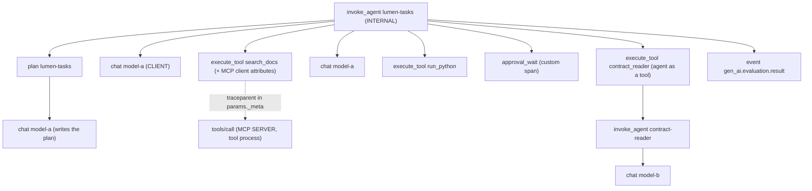
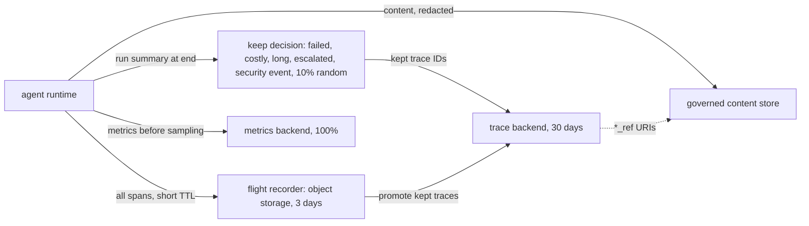
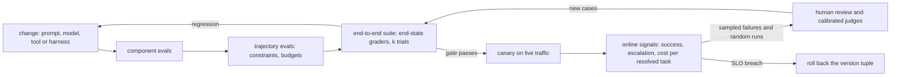

# 32 — Observing & evaluating agents

> **The requirement.** Lumen's task agent from [SYSDESIGN-25](25-agentic-systems.md) runs 30,000 tasks a day, about
> 15 model calls and 15 tool calls each. On Tuesday a prompt edit shipped. By Thursday, support tickets said that
> "the assistant gives up on long contracts". Nothing paged: no 5xx, no exception, latency normal. Task success had
> slipped from about 85% to about 81%. Product now wants four things. An engineer must get from "success dropped" to
> the guilty step in under 30 minutes. No prompt, model, tool or harness change may reach all users if it lowers task
> success by 3 points or more. Every failed and every unusually expensive run must be kept for 30 days. Raw prompts
> and tool results must never sit in the trace store. This is hard because an agent fails *semantically*. The HTTP
> status is 200 and the answer is wrong, or right only every other time. The run that failed is a two-minute,
> sixty-span tree that will never execute the same way again. And the instrument you would use to prove a fix, an
> evaluation suite, is itself a noisy, gameable measurement.

*All Lumen numbers in this chapter are fictional and illustrative; the scenario is a teaching device, not an
incident report.*

## In one minute

Ordinary services fail loudly. Agents mostly fail quietly: the wrong tool, the same search five times, an
instruction lost as the context grows, an early "done". To see that, record each run as a **trace**: a span for the
run, child spans for every model and tool call, carrying tokens, cost, versions and errors. Prompts and tool outputs
live in a separate governed store that spans reference. Decide *per run* what to keep: every failure, every
expensive or long run, every run that raised a security event, a random slice of the rest. Traces say *what* happened. **Evaluations** say whether a change
made things better or worse, at three layers: components, the sequence of actions (trajectory), and whether the
task was done (end-to-end). Run each task several times and report how often it succeeds *every* time (pass^k).
Gate changes with a statistically sized suite in CI, then watch production with SLOs on task success, escalations
and cost per resolved task.

## Why this matters now

- **Agents became production workloads** (cases [C11](../04-case-studies/C11-coding-agent-platform.md),
  [C15](../04-case-studies/C15-support-agent-platform.md), [C16](../04-case-studies/C16-deep-research-agents.md),
  [C17](../04-case-studies/C17-workflow-automation-agent.md)). Anthropic reported that its multi-agent research
  system used about 15× the tokens of a chat (single agents about 4×), and that "adding full production tracing let
  us diagnose why agents failed and fix issues systematically" [19].
- **The telemetry vocabulary arrived, but is not stable.** OpenTelemetry's GenAI conventions define agent, tool and
  MCP spans, agent-level metrics and an evaluation-result event [2][3][7][8][9], all in **Development** status. They
  live in `open-telemetry/semantic-conventions-genai`, which had no tagged release on 2026-11-20. A schema URL for a
  first `0.1.0-dev` release was set the day before [1]. Pin what you emit (*as of 2026-11*).
- **Agent evaluation got a method.** τ-bench (Yao et al., 2024) introduced **pass^k**, the chance that *all* k trials
  of a task succeed. GPT-4o-based agents solved under 50% of its tasks, with pass^8 below 25% in retail [11].
  Anthropic's "Demystifying evals for AI agents" (January 2026) gave a practical vocabulary [18].
- **Benchmarks lost authority.** OpenAI stopped reporting SWE-bench Verified in February 2026 [23], and Epoch AI
  rated it "Flawed" [22]. Your own suite, built from your own traffic, is the only number you can defend.
- **Judges are cheap, but not ground truth.** Strong LLM judges agreed with human preferences over 80% of the time
  in Zheng et al. (2023) [14]. On hard pairs, many do little better than random [16].

## Core ideas [Core]

### 1. Why agent observability is different

[SYSDESIGN-12](../01-foundations/12-observability.md) built observability for request/response services: RED
metrics, traces of a few hundred milliseconds, SLO burn-rate alerts. Four properties of agents break those habits.

1. **Non-determinism is the normal case.** The same input can produce different tool sequences on two runs, even
   with identical prompts [19]. One failed trace is a sample from a distribution, not a reproducible bug. You debug
   by comparing *populations* of runs (before and after a change, success and failure), then reading exemplars.
2. **Traces are long and deep.** A 15-step run is 60+ spans over minutes (Numbers 1). It may pause for approval,
   resume on another worker ([SYSDESIGN-33](33-agent-platform-runtime.md)) or fan out to sub-agents
   ([SYSDESIGN-29](29-agent-architectures-orchestration.md)), which breaks sampling tuned for sub-second traces (§4).
3. **Every run has a price.** Tokens grow roughly quadratically with steps
   ([SYSDESIGN-25](25-agentic-systems.md), Numbers 1). A runaway run can cost 100× a normal one. Cost is an SLI with a
   distribution and a tail, attributed per run, per tenant and per version.
4. **Failure is semantic.** The worst failures return HTTP 200: a confident wrong answer, a skipped policy check, a
   loop that ends at the step budget with "I could not find it". Error-rate dashboards stay green. Signals come from
   *outcomes* (did the refund exist in the database?), *trajectories* (ten searches with the same query) and *people*
   (escalations, reopened tickets).

The consequence is a design rule. **Observability and evaluation are one system.** Traces feed evals with real
cases. Evals attach scores to traces. Production monitoring is evaluation run continuously on live traffic.

### 2. The trace model of an agent run (OpenTelemetry GenAI, as of 2026-11)

One task is one trace. The conventions define the operations below; all are Development status [2][3][4][6][9].

| Operation (`gen_ai.operation.name`) | Span name pattern | Kind | Use |
|---|---|---|---|
| `invoke_agent` | `invoke_agent {gen_ai.agent.name}` | INTERNAL (in-process) or CLIENT (remote agent service, span type `gen_ai.client.invoke_agent`) | an LLM drives the control flow through tool calls |
| `invoke_workflow` | `invoke_workflow {gen_ai.agent.name}` | INTERNAL | the application defines the control flow (for example a LangGraph `StateGraph`) |
| `plan` | `plan {gen_ai.agent.name}` | INTERNAL | planning or task-decomposition phase |
| `chat` (and other inference operations) | `{gen_ai.operation.name} {gen_ai.request.model}` | CLIENT | one model call |
| `execute_tool` | `execute_tool {gen_ai.tool.name}` | INTERNAL | one tool execution, including an agent called as a tool |
| MCP request | `{mcp.method.name} {target}`, e.g. `tools/call` | CLIENT on the caller, SERVER on the MCP server | the wire call to a tool server |
| `create_agent` | `create_agent {gen_ai.agent.name}` | CLIENT | creating a hosted agent resource |

If both the application and an MCP instrumentation could emit a span for the same tool call, the conventions say
the MCP instrumentation SHOULD add its attributes to the existing `execute_tool` span instead of creating its own
when it can detect it [9]. If both spans do exist, set `gen_ai.operation.name = execute_tool` on only one of them, or
you double count tool durations and tool-call totals.



*Diagram: one task trace. The root `invoke_agent` span has children for planning (with the model call that writes
the plan as the plan span's child), each model call (`chat`), each tool execution and an approval wait. A tool call
to an MCP server is one client-side `execute_tool` span carrying the MCP attributes. The trace context travels in
the request's `params._meta` so the server's span joins the same trace. A sub-agent called as a tool nests its own
`invoke_agent` and `chat` spans when the framework reports it as its own entrypoint. An evaluation-result event is
attached to the span it evaluates (here the run).*

**Attributes that make the trace useful.** Agent spans: `gen_ai.agent.name` (its value MUST be low-cardinality),
`gen_ai.agent.id`, `gen_ai.agent.version`, and `gen_ai.conversation.id` to group a session's turns [2]. Model spans:
requested and response model, finish reasons, token usage, and `gen_ai.response.time_to_first_chunk` for streams
[6]. Tool spans: `gen_ai.tool.name`, `gen_ai.tool.type`, `gen_ai.tool.call.id`, and `error.type` on failure [3]. The
registry also has `gen_ai.prompt.name`, `gen_ai.prompt.version` and `gen_ai.conversation.compacted` [1].
Sampling-relevant attributes (agent name, operation, provider, requested model) SHOULD be set at span creation [2].

Add your own attributes, in your own namespace, for what the conventions do not cover:

- the **version tuple**: agent version, prompt version, model snapshot, tool-set hash, harness version and retrieval
  index version. This is the first thing you slice by when success drops (§5).
- the **outcome**: `lumen.task.outcome` = success / failed / budget_exhausted / escalated / cancelled, set when the
  run ends.
- **semantic tool results** that are not errors, such as `lumen.tool.result_count = 0` for an empty search. A tool
  that "succeeds" with nothing is the most common silent failure.
- **budget state**: steps used, dollars used, loop-detector trips ([SYSDESIGN-25](25-agentic-systems.md) §10).

**Propagation across processes.** MCP calls carry W3C `traceparent`, `tracestate` and `baggage` in the request's
`params._meta`, which the server uses as the remote parent [9]. The OTel MCP page references MCP revisions up to
2025-11-25; its `mcp.session.id` attribute has no equivalent in the stateless 2026-07-28 revision, so correlate by
trace context and your own handle IDs (as of 2026-11). A2A has its own page in the same repository. For a
run that resumes on another worker after a pause, store the trace context in the checkpoint and parent or link the
resumed span to it, or one run becomes two unrelated traces.

**Content capture versus privacy.** Prompts, completions, system instructions, tool arguments and tool results are
**opt-in** [5]. An environment variable controlling it MUST be named `OTEL_INSTRUMENTATION_GENAI_CAPTURE_CONTENT`,
with values `NO_CONTENT` (default), `SPAN_ONLY`, `EVENT_ONLY` and `SPAN_AND_EVENT` [5]. Reference attributes such as
`gen_ai.input.messages_ref` and `gen_ai.output.messages_ref` hold an absolute URI of content in external storage.
The conventions advise against embedding credentials such as signed URLs in them, and note that a reference does
not prove the upload succeeded [2]. A configured upload hook SHOULD run regardless of the sampling decision [5], so
content has its own retention and cost line. Lumen's design:

- **Spans carry metadata only.** Tokens, versions, outcome, tool names, argument *hashes* (keyed per tenant, for
  example HMAC, never a bare SHA-256 of a short value, which a dictionary reverses), result sizes.
- **Content goes to a governed store.** It is encrypted, access-controlled and tenant-partitioned, with its own
  retention and erasure path ([SYSDESIGN-19](../02-modern-requirements/19-privacy-compliance-sovereignty.md)). Spans
  carry `*_ref` URIs.
- **Redact before writing**, not at read time. Treat tool results as untrusted data that may hold secrets or
  injected instructions ([SYSDESIGN-31](31-securing-agentic-systems.md)). An observability UI that renders tool
  output is an injection surface for the humans and judges who read it.

Anthropic describes the same posture: it monitored "agent decision patterns and interaction structures" without
monitoring the contents of individual conversations [19].

### 3. Token and cost attribution

Cost must be computed per model span and rolled up the tree. Three details from the conventions change the formula
[6]:

- `gen_ai.usage.input_tokens` SHOULD **include** cached tokens. `gen_ai.usage.cache_read.input_tokens` and
  `gen_ai.usage.cache_write.input_tokens` are reported separately, and both are counted inside the input total.
- `gen_ai.usage.output_tokens` SHOULD include reasoning tokens. `gen_ai.usage.reasoning.output_tokens` breaks them
  out.
- The agent span may carry usage totals of its own [2]. If you sum agent totals *and* child model spans, you count
  every token twice. Pick one rule. Summing leaf inference spans is the safest, because it also covers sub-agents.

Per model span, with provider prices `p_in`, `p_out` and cache multipliers `m_read`, `m_write` (check your
provider's current pricing):

```
fresh   = input_tokens − cache_read − cache_write
cost    = fresh·p_in + cache_read·m_read·p_in + cache_write·m_write·p_in + output_tokens·p_out
run     = Σ cost over all inference spans in the trace (including sub-agents)
```

Tool costs (sandbox seconds, paid APIs) and human time belong in the same roll-up. The figure that matters is
**cost per resolved task**: all spend, including failed and escalated runs, divided by tasks resolved (Numbers 8).
Failed runs are often the expensive ones, so average cost per run flatters a degrading agent. The gateway
([SYSDESIGN-26](26-llm-gateways-llmops.md)) attributes tokens per team; the trace adds per run, step and version.

The conventions also add agent-level metrics. `gen_ai.invoke_agent.duration` has histogram buckets up to 86,400 s,
because agent runs can last hours. `gen_ai.invoke_agent.inference_calls` and `gen_ai.invoke_agent.tool_calls` are
histograms counted per invocation, and each call is counted once across the call tree, so sub-agents report their
own [7]. Their upper tail is a cheap, sampling-proof loop detector.

### 4. Sampling and storing agent traces

The tail-sampling processor in [SYSDESIGN-12](../01-foundations/12-observability.md) keeps all errors and slow
traces, and only a fraction of the rest. It needs adjustment for agents, for three reasons.

- **Runs outlast the decision window.** The OpenTelemetry Collector's tail-sampling processor (Beta for traces)
  waits `decision_wait` (30 s by default) and holds up to `num_traces` (50,000 by default) in memory. It requires all
  spans of a trace to reach the same collector instance [10]. A Lumen run takes about two minutes, a paused one far
  longer, and a policy judges only the spans that have arrived. Late spans inherit the decision while the trace is
  buffered. After that they are treated as a new trace unless a decision cache is configured (`sampled_cache_size`,
  0 by default) [10]. Raising `decision_wait` costs memory (Numbers 3), and runs paused for hours still escape.
  Newer collector versions add `sampling_strategy: span-ingest`, which finalizes terminal outcomes as spans arrive
  instead of after `decision_wait`, and `decision_wait_after_root_received`; `span-ingest` does not support stateful
  policies and still cannot see outcomes the runtime has not yet written, so the run-level decision below still
  applies (as of 2026-11) [10].
- **The best keep signals are known only at the end.** "Failed", "cost above the p95", "hit the step budget" and
  "escalated" are known when the run finishes, and by the agent runtime, not by a generic span processor. The
  collector's `ottl_condition`, `numeric_attribute` and `string_attribute` policies can act on them only if they are
  on spans that have already arrived [10].
- **Content is the bulk, and naive capture is quadratic.** Recording the full input history on every model span
  stores the conversation prefix again at every step (Numbers 2).

So decide at the **run level**:



*Diagram: the agent runtime writes all spans to cheap, short-retention object storage (a flight recorder), emits a
run summary when the run ends, and a keep decision (failed, costly, long, escalated, a security event, or a random
10%) promotes those
traces into the trace backend for 30 days. Metrics are computed from all runs before sampling. Redacted content goes
to a separate governed store that spans reference by URI.*

The rules that make this work:

1. **Compute metrics before sampling.** Success rate, cost, steps and tool error rate come from 100% of runs, as
   counters and histograms or from a run-summary event. Otherwise the sampler biases every dashboard. A trace store
   that keeps all failures shows a failure rate of about 64% (Numbers 3).
2. **Keep security events, and record why each run was kept.** A run in which a security event fired (policy
   denial, description-hash mismatch, canary use, outbound call in a tainted session;
   [SYSDESIGN-31](31-securing-agentic-systems.md#monitoring-detection-and-the-kill-switch)) is always kept: a
   silent, successful exfiltration is neither failed nor costly, and the random slice would drop it 90% of the time.
   Record the keep reason and the sampling probability on the run. A random 10% slice, weighted by 1/0.1, gives
   unbiased population estimates. The forced keeps do not.
3. **Keep content by reference, deduplicated.** Content-addressed storage of each message once, plus per-span lists
   of hashes, turns quadratic content storage into linear storage. A 15-step run shrinks about 7× (Numbers 2).
4. **Tie retention to purpose.** Debug traces: 30 days. Traces copied into eval datasets: as long as the dataset
   exists, with consent and erasure tracked per case. Raw content: shortest of all, and never longer than the
   tenant's data-retention terms.
5. **Traces are not the audit log.** Traces are sampled debugging data. Every tool call and policy decision is also
   written, unsampled and tamper-evident, to the audit log
   ([SYSDESIGN-28](28-ai-trust-safety-governance.md#audit-logs-and-traceability)), and security signals
   ([SYSDESIGN-31](31-securing-agentic-systems.md#monitoring-detection-and-the-kill-switch)) are counted from 100% of
   events. Use the trace to debug a run, and the audit log to prove who did what.

### 5. Debugging with traces

The Lumen incident, as an illustrative walk-through of the 30-minute budget:

1. **Detect.** Task success over 6 hours, from 100% of runs, is 81% against an 85% baseline. A change-detection
   alert fires (§11). An error-rate alert never would.
2. **Slice by the version tuple.** The drop appears only on prompt v15 (`gen_ai.prompt.version`), and mostly on tasks
   whose documents exceed 40 pages.
3. **Compare distributions, not single traces.** Failed v15 runs make more tool calls than the v14 baseline, and
   repeated identical `search_docs` calls (same argument hash three or more times) are far more common.
4. **Read exemplars.** In five failed traces, input tokens climb towards the context limit, compaction fires
   (`gen_ai.conversation.compacted = true`), and the agent then repeats searches. v15 had moved the instruction "keep
   a running list of searched sections" into text that compaction summarises away.
5. **Reproduce cheaply.** Replay a failed run with **recorded tool results** served from the content store, then
   **fork from step k** (just before compaction) with the fix, several times, because the model is still
   non-deterministic. Replay is the main reason to keep content for failed runs at all.
6. **Close the loop.** Add the failing tasks to the regression suite (§9).

Three trace patterns cover most agent incidents:

| Pattern | What the trace shows | Cheap detector (from metrics, no sampling) |
|---|---|---|
| **Loop** | same tool with the same argument hash N times; oscillation between two tools; no new information across steps | tail of `gen_ai.invoke_agent.tool_calls`; loop-detector trips per 1,000 runs; share of runs ending in `budget_exhausted` |
| **Tool error, hidden or loud** | `error.type` on `execute_tool` spans; MCP server spans with errors; *successful* spans with empty or truncated results that the model then works around | tool error rate per tool and per MCP server; `result_count = 0` rate; `gen_ai.execute_tool.duration` p99 |
| **Context blow-up** | input tokens per model span rising step after step; finish reason `length`; compaction events followed by repeated work | p95 input tokens per step; share of runs that compact; first-pass success for runs that compact against runs that do not (set by your harness, since the convention only sets `compacted` to `true` when compaction is known; unset means unknown, not "no compaction") |

The loudest tool errors are often the least harmful: agents usually recover from an exception returned as an
observation. A tool returning `200 OK` with stale or empty data produces confident wrong answers. Instrument result
*semantics*, not just status.

### 6. Layered evaluation

Traces explain incidents; evaluations decide whether a change may ship. In Anthropic's vocabulary [18], a
**task** is a test case with success criteria, a **trial** one attempt, a **grader** scores an aspect of a trial,
the **transcript** is the full record and the **outcome** the final environment state. Evaluating "the agent" means
evaluating the model *and* its **agent harness** (scaffold) together. Build evaluations in three layers:

| Layer | Question | Examples | Typical grader | Cost per case |
|---|---|---|---|---|
| **Component (unit)** | Does each part work in isolation? | tool contract tests; retrieval recall@k ([SYSDESIGN-24](24-retrieval-vector-systems.md)); "given this state, is the next tool call valid JSON and permitted?"; router accuracy | code | very low; no full run |
| **Trajectory (tool use)** | Did the agent act acceptably on the way? | required policy check before a refund; no forbidden tool; step and cost within budget; no repeated identical calls; asked the user when information was missing | code over the trace; model-based rubric for judgement calls | one full run, graded cheaply |
| **End-to-end (task success)** | Was the task actually done? | database end-state equals the expected state; tests pass; report contains the required facts with valid citations | code on the end state; model-based or human for open-ended output | one full run plus environment setup |

**Grade the outcome first, the path second.** Anthropic calls rigid step-sequence checks "overly brittle" [18], and
its research team reported "success focusing on end-state evaluation rather than turn-by-turn analysis" [19].
Trajectory checks are for *constraints* (a refund without the policy check, a write without approval) and budgets,
not for prescribing one path. τ-bench grades the final database against the goal state plus required information
sent to the user, and its authors note this is necessary but not sufficient: an agent can reach the right state
while skipping a confirmation the policy requires [11]. A trajectory constraint covers that gap.

**Clean environments.** Each trial must start from a clean environment. Anthropic describes an agent that gained an
unfair advantage by reading the git history left by earlier trials [18]. Shared caches, files and rate-limit state
also correlate failures. For Lumen, every trial gets a fresh sandbox, a seeded copy of the tenant fixture and mocked
side-effecting tools ([SYSDESIGN-25](25-agentic-systems.md) §8).

**Users are part of the environment.** τ²-bench adds a simulated user who also acts on the shared environment, and
reports significant performance drops from the no-user to this dual-control setting [12]. If your agent talks to
people, your eval needs a user simulator, versioned like any grader.



*Diagram: a change passes component, trajectory and end-to-end evaluations before a canary. Online signals from the
canary and production are monitored. Sampled failures and random runs go to human review and calibrated judges,
which turn them into new end-to-end cases. A regression in CI sends the change back. An SLO breach in production
rolls back the version tuple.*

### 7. Graders: programmatic, model-based, human

Anthropic's taxonomy is a good starting point [18]:

- **Code-based** (string match, unit tests, static analysis, state checks, tool-call checks). Fast, cheap,
  reproducible, debuggable. Brittle when many answers are valid. Use them wherever the task has a checkable outcome,
  which is more often than teams assume: "does the refund row exist with amount ≤ policy limit" is a code grader.
- **Model-based** (rubrics, natural-language assertions, pairwise comparison, reference-based grading). Flexible and
  scalable, but non-deterministic, more expensive, and in need of calibration against human graders.
- **Human** (expert review, spot checks, A/B tests, inter-annotator agreement). The reference standard. Slow and
  expensive, so spend it where it buys the most: labelling disagreements, calibrating judges, reviewing new failure
  types.

**Model-graded caveats, with evidence.** Zheng et al. measured position, verbosity and self-enhancement biases and
limited reasoning in LLM judges. They also found GPT-4 agreeing with human preferences over 80% of the time, about
the human-human rate, on MT-bench and Chatbot Arena [14]. [SYSDESIGN-26](26-llm-gateways-llmops.md) §9 covers the
mitigations: swap positions, control for length, judge with a different model family, give reference answers. Newer
evidence narrows how far that result transfers:

- **Judging the Judges** (Thakur et al., GEM 2025) tested 13 judges in a setting where humans agree strongly. Only
  the best and largest judges reached reasonable alignment with humans, still well behind inter-human agreement.
  Their scores could differ from human scores by up to 5 points. The judges tended towards leniency. And "judges with
  high percent agreement can still assign vastly different scores" [15]. Report a chance-corrected agreement
  statistic and score error, not percent agreement alone.
- **JudgeBench** (Tan et al., ICLR 2025) built hard response pairs where correctness is objective. Many strong
  models, GPT-4o among them, did only slightly better than random guessing [16]. Judges are weakest exactly where
  agent outputs are hardest to check: long reasoning and subtle factual errors.
- **Agent-as-a-Judge** (Zhuge et al., 2024 preprint) lets the judge use tools to inspect intermediate artefacts. On
  their 55-task DevAI benchmark, the authors report that it "dramatically outperforms LLM-as-a-Judge" and is about as
  reliable as their human baseline [17]: promising for whole trajectories, but one preprint on its own benchmark.

Practical rules for judges in an agent eval:

1. **Judge narrow questions**, one rubric item per call: "Did the report cite a source for each renewal figure?"
   beats "rate this report 1–10".
2. **Give the judge an "unknown" option**, which Anthropic recommends to reduce hallucinated verdicts [18].
3. **Calibrate per task family** on 100–200 hand-labelled cases, with an interval, before the judge gates anything.
   Version judge prompt and model, and re-calibrate when either changes.
4. **Never let the agent's own model be the only judge** of its output (self-enhancement [14]).
5. **Record each judgement as telemetry.** The `gen_ai.evaluation.result` event (`gen_ai.evaluation.name`,
   `.score.value`, `.score.label`, explanation) is parented to the span it evaluates [8].

**Human review as a system.** A review queue fed by sampled traces (all escalations, some failures, a random slice
of successes) needs a rubric shared with the judges, double-labelling on a subset to measure inter-annotator
agreement, access control on content, and a path from "new failure type" to "new eval task". Anthropic's human
testers found early research agents that "consistently chose SEO-optimized content farms" over authoritative
sources, which no automated eval had caught [19].

### 8. Reliability metrics: pass@k and pass^k

Run each task n times and count c successes. Two metrics answer opposite questions [11][13][18]:

- **pass@k**: the probability that **at least one** of k trials succeeds. Chen et al. (2021) used it for code
  generation, where you can generate many candidates and keep one that passes tests [13]. Unbiased estimator per task:
  `1 − C(n−c, k) / C(n, k)`, averaged over tasks.
- **pass^k**: the probability that **all** k trials succeed. Yao et al. (2024) introduced it for agents that must
  behave reliably every time a user arrives [11]. Unbiased estimator per task: `C(c, k) / C(n, k)`, averaged over
  tasks.

At k = 1 both equal the mean success rate. As k grows, pass@k rises towards 1 and pass^k falls towards 0 [18].
Anthropic's example: 75% per-trial success gives pass^3 = 0.75³ ≈ 42% [18]. Which one you report is a product
decision. A coding agent whose candidate patches are checked by tests before a human sees them lives by pass@k. A
support agent that every customer meets once lives by pass^k. The averages hide a crucial difference that pass^k
exposes (Numbers 5). An agent that is right 80% of the time *on every task* is a different product from one that
always solves 80% of tasks and never solves the other 20%.

### 9. Offline and online evaluation

**Offline** evals run before a change ships, on fixed tasks in controlled environments. Anthropic separates
**capability suites** ("what can it do?", starting at a *low* pass rate) from **regression suites** ("does it still
do what it did?", near 100%), into which saturated capability tasks "graduate" [18]. Two warning signs belong on a
dashboard: a suite at 100% "provides no signal for improvement", and 0% across many trials usually means a broken
task or grader [18]. Starting with 20–50 tasks from real failures is fine [18][19]. Statistical power (Numbers 4) is
what forces the suite to grow before it can *gate*.

**Online** evals run on live traffic, with new intents, real tools and real drift. Three forms:

- **Implicit outcome signals**: escalation to a human, the user retrying or rephrasing, abandonment, a reopened
  ticket, a reverted change. Many arrive **late**: a ticket is "resolved" only if it stays closed for 7 days. Define
  for each SLI when it becomes final, and show provisional and final values separately.
- **Sampled grading**: judges and humans scoring a sample of production traces, written back as
  `gen_ai.evaluation.result` events [8].
- **Controlled comparisons**: canaries and A/B tests by user or tenant ([SYSDESIGN-26](26-llm-gateways-llmops.md)
  §9). Shadow runs of an agent are safe only with read-only or mocked tools, because tools have side effects.

**Closing the loop.** Every human-confirmed production failure becomes a candidate task: original inputs, tool
fixtures from the recorded results, expected end state, consent and provenance. That is how the regression suite
comes to resemble your traffic. A trace copied into a dataset is personal data with a new purpose.

### 10. Regression gates in CI/CD for agents and prompts

Treat **every element of the version tuple as code** (system prompt, tool descriptions and schemas, model snapshot,
harness, retrieval index, judge prompts): a change to any of them triggers the gate. Prompt and tool-description
edits are the most common changes, and the least tested.

A workable gate has tiers:

| Tier | When | Suite | Decision rule |
|---|---|---|---|
| Smoke | every pull request | ~50 regression tasks × 1 trial, plus component tests | any regression-suite failure on a task that was passing → block or require review |
| Full gate | before merge to release, nightly | ~900 paired tasks × 3 trials, old and new version on the same tasks | block if the paired difference (new − old) is significantly negative: the two-sided 95% interval lies entirely below 0, which at n = 900 means a point estimate below about −2.1 points (Numbers 4); also block on any hard-constraint violation |
| Canary | after the gate | 5–10% of live traffic by tenant | roll back on a significant drop in success or a rise in escalation or cost per resolved task (§11) |

Design notes:

- **Compare paired, on the same tasks, in the same run.** Miller (2024) recommends question-level paired
  differences, clustered standard errors for related tasks, and power analysis [20]. Side-by-side runs also cancel
  environment drift.
- **Measure the noise floor first.** In an A/A run (one version against itself), the share of tasks whose outcome
  flips is your discordance rate. It sets the gate's resolution.
- **Do not lower the temperature to make the gate pass.** Miller advises resampling instead [20], and a temperature-0
  eval measures a configuration you do not run.
- **Gate on cost and safety too:** cost per resolved task, any trajectory-constraint violation (a write without
  approval must be zero), and injection-suite attack success ([SYSDESIGN-31](31-securing-agentic-systems.md)).
- **Test the eval harness itself.** Anthropic reports a model scoring 42% on CORE-Bench at first and about 95% after
  grading and scaffold problems were fixed [18]. Read transcripts of passes and failures alike.

Rollout after the gate belongs to the runtime: pin in-flight runs to their starting version and drain old runs
([SYSDESIGN-33](33-agent-platform-runtime.md)). Anthropic describes "rainbow deployments" that run old and new
versions side by side for exactly this reason [19].

### 11. Production monitoring signals and SLOs for agents

| SLI | Definition (per tenant, task type, version tuple) | Why |
|---|---|---|
| **Task success rate** | resolved ÷ finished, using the *final* outcome when it arrives late | the product promise |
| **Hard-failure rate** | runs ending in error, budget exhaustion, loop stop or timeout ÷ all runs | small error budget, so classic burn-rate alerting works |
| **Escalation rate** | runs handed to a human ÷ all runs, split into policy-required and agent-initiated | quality and staffing cost ([C15](../04-case-studies/C15-support-agent-platform.md)) |
| **Cost per resolved task** | total spend including failed and escalated runs ÷ resolved tasks | unit economics ([SYSDESIGN-16](../02-modern-requirements/16-cost-as-requirement.md)) |
| **Steps and tool calls per run** | p50/p95 of `gen_ai.invoke_agent.tool_calls` and `inference_calls` | loops and plan quality |
| **Time to outcome** | run start to final answer, p50/p95, excluding human wait | user experience for long tasks |
| **Tool health** | error and empty-result rate per tool and MCP server; `gen_ai.execute_tool.duration` | dependency health |
| **Judge score on sample** | mean and share failing per rubric item, with interval | early quality signal |

**Alerting on task success needs different maths.** The multi-window, multi-burn-rate alerts in
[SYSDESIGN-12](../01-foundations/12-observability.md) assume a small error budget. The SRE Workbook's starting
page threshold is burn rate 14.4 over one hour [25]. Burn rate is the error ratio divided by the budget, so it can
never exceed 1/budget. A task-success SLO of 85% has a budget of 15%, and its burn rate tops out at 6.7 even when
*every* task fails (Numbers 7). Use two mechanisms instead:

1. Burn-rate alerts on the **hard-failure SLI**, whose budget is small (for example 99% of runs end cleanly).
2. **Change detection** on task success: a statistical test of the recent window against a baseline, by version
   tuple, with a minimum sample size, on final outcomes and, as early warning, provisional outcomes and judge scores.

Low-volume tenants have the Workbook's low-traffic problem, where one failure is a large burn [25]: alert on
aggregates, review per tenant.

## Numbers that matter

*Assumptions, labelled. Lumen's agent as in [SYSDESIGN-25](25-agentic-systems.md) Numbers 1–2: 30,000 tasks/day;
15 steps; base prompt 3,000 tokens; +1,500 tokens per step; 300 output tokens per step; ≈ $0.066 per task with
prompt caching (illustrative prices). New here: 65 spans per run (1 agent, 1 plan, 15 chat, 15 execute_tool, 15 MCP
client, 15 MCP server, 3 other; an upper bound, since it assumes separate application and MCP client spans per tool
call, and merging them as the conventions prefer gives 50); 1 KB per span of metadata; 4 bytes of text per token; 85% baseline task success;
failed runs cost 3× successful ones.*

**1. Span volume is small, content is not.** 30,000 × 65 = **1.95 M spans/day** ≈ 23 spans/s on average. At 1 KB,
that is ≈ **2 GB/day** of span metadata, which any trace backend absorbs. The problem is trace length and content.

**2. Naive content capture is quadratic.** Recording the full input history on every model span stores the
202,500 input tokens of [SYSDESIGN-25](25-agentic-systems.md) plus 4,500 output tokens: 207,000 × 4 B ≈
**828 KB per run**, ≈ **25 GB/day**. Storing each message once (base prompt, each step's new 1,500 tokens, each
output) stores 3,000 + 14 × 1,500 + 15 × 300 = 28,500 tokens ≈ **114 KB per run**, ≈ **3.4 GB/day**. That is
**7.3× less** for 15 steps, and the ratio grows with run length.

**3. Run-level sampling.** Keep all failures (15%), all runs above the p95 cost (5%), all runs with a security
event (assumed rare enough to ignore here), and 10% of the rest. Under this chapter's assumption that failed runs
cost 3× successful ones, the costliest 5% are almost all failures, so they add little: about 0.15 + 0.10 × 0.85 ≈
**23.5% of runs**. If the costly runs were all successes instead (no overlap), it would be 0.15 + 0.05 + 0.08 = 28%.
Head sampling at 10% would keep only 10% of failures, about 450 of the day's 4,500. Run-level sampling keeps all
4,500. If dashboards were computed from the kept traces, the failure rate would read 0.15/0.235 ≈ **64%** (54% in
the no-overlap case) instead of 15%. Collector tail sampling with `decision_wait` raised to 30 minutes needs, at a
5× peak (≈ 113 spans/s), ≈ 113 × 1,800 s × 1 KB ≈ **200 MB** of serialized span data per collector (a lower bound:
the collector's in-memory representation is larger): affordable, but runs paused for hours still escape.

**4. Your eval suite is smaller than your ambition.** On a single run of a 200-task suite at 85% success, the
standard error is √(0.85 × 0.15 / 200) ≈ 2.5 points. The 95% interval is about **±4.9 points**, larger than the
3-point regression you want to catch. An *unpaired* comparison of two versions that detects a 3-point drop (85% →
82%) with 80% power at α = 0.05 needs (1.96 + 0.84)² × (0.85·0.15 + 0.82·0.18) / 0.03² ≈ **2,400 tasks per
version**. A *paired* comparison on the same tasks, with an assumed 10% of tasks flipping outcome between versions
(measure yours with an A/A run), has a standard error of the difference ≈ √(d/n). It needs
(1.96 + 0.84)² × 0.10 / 0.03² ≈ **870 tasks**. Hence the ~900-task gate in §10. This sizes a *significance* test:
at n = 900 the standard error of the difference is √(0.10/900) ≈ 1.05 points, so the gate blocks when the observed
difference is below −1.96 × 1.05 ≈ −2.1 points. That blocks about 81% of changes that truly cost 3 points, 48% of
2-point and 16% of 1-point losses, and 2.5% of neutral ones; smaller regressions, and the 3-point ones that slip
through, are left to the canary. A *non-inferiority* rule ("pass only if the 95% lower bound is above −3") swaps
the two errors: at the same n it lets only 2.5% of 3-point drops through but blocks about one neutral change in
five (19%). Say which error your gate controls. A 50-task smoke suite catches only breakage.

**5. pass^k separates agents with the same average.** Agent A succeeds with probability 0.8 on *every* task. Agent B
always solves 80% of tasks and never solves the other 20%. Both have pass@1 = 0.80. Over k = 4 trials, A's pass^4 =
0.8⁴ ≈ **0.41**, while B's pass^4 = **0.80**. A's pass@4 = 1 − 0.2⁴ ≈ **0.998**, B's is 0.80. A looks great by
pass@k and poor by pass^k. For a customer-facing agent, B is better, and its failing 20% is a nameable set of tasks. With n = 8 trials and c = 6 successes on one task, the unbiased
pass^4 estimate is C(6,4)/C(8,4) = 15/70 ≈ **0.21**. Plugging in the observed rate gives (6/8)⁴ ≈ 0.32, which
overstates reliability.

**6. Evals cost money.** A full gate of 900 tasks × 3 trials × 2 versions = 5,400 runs × $0.066 ≈ **$356** per gate
run with caching. Without a warm cache (eval runs often start cold), at $0.22, it is ≈ $1,190. A 50-task smoke run
costs ≈ $3.30. Judging one trajectory with *assumed* 8,000 input and 300 output tokens at $1/$4 per million costs
≈ $0.009. Judging 2% of production (600 runs/day) costs ≈ **$5.50/day**. Human review is the expensive layer: 50
traces/day at an assumed 5 minutes each is ≈ 4 hours of reviewer time per day. The production token bill is
30,000 × $0.066 ≈ $1,980/day: a full gate per release is affordable, one per pull request is not.

**7. The burn-rate ceiling.** Burn rate = error ratio ÷ budget. With an 85% success SLO, the budget is 0.15 and the
maximum burn rate is 1/0.15 ≈ **6.7**. A 14.4× page can never fire, and a 6× page fires only above a 90% failure
rate. With a 99% hard-failure SLO (budget 0.01), 14.4× means 14.4% of runs failing hard, which is a meaningful
page. Change detection on success: at 1,250 tasks/hour, one hour's success rate has a standard error of
√(0.85·0.15/1,250) ≈ **1.0 point**, so a 4-point drop over two hours stands out clearly. On a 10% canary
(125 tasks/hour), 6 hours give n = 750 and a standard error ≈ 1.3 points. A 4-point drop is then about 3 standard
errors: agent canaries last hours, not minutes, and outcomes that become final after 7 days cannot gate them.

**8. Cost per resolved task.** With the header's mean of $0.066 per run and failed runs at 3× successful ones,
successful runs cost $0.051 and failed runs $0.152: 0.85 × 0.051 + 0.15 × 0.152 ≈ **$0.066**. Cost per resolved task
is 0.066 / 0.85 ≈ **$0.078**. Now success drops to 81% and failures loop more, costing $0.203 (4×). Mean cost per run
rises by about a fifth, to 0.81 × 0.051 + 0.19 × 0.203 ≈ $0.080 (+21%), but cost per resolved task rises to
0.080 / 0.81 ≈ **$0.098**, up about 27%: the regression shows up in unit economics first.

## Design choices and trade-offs

### What to capture, and where

| Option | Wins when | Costs | Example |
|---|---|---|---|
| Metadata only (`NO_CONTENT`, the default) | regulated data; high volume; early debugging needs are structural | cannot replay or judge offline; harder root cause | spans with tokens, versions, outcome, argument hashes |
| Content on spans (`SPAN_ONLY`) | small internal tools, short retention | trace store becomes a sensitive data store; size limits; quadratic growth | dev and staging environments |
| Content by reference (`*_ref` to a governed store) | replay, offline judging and dataset building are needed under privacy rules | a second store with its own access control, retention and erasure; upload hook runs even for unsampled spans [5] | Lumen's design (§2) |
| Content on events (`EVENT_ONLY`) | log pipeline already has redaction and retention tooling | events in Development and not available in all SDKs [8]; correlation by span ID | log-centric organisations |

### Sampling agent traces

| Strategy | Wins when | Costs |
|---|---|---|
| Head sampling by trace-ID ratio | very high volume, uniform runs | keeps the same small share of failures as of successes |
| Collector tail sampling (status, latency, attributes) | runs shorter than `decision_wait`, or a long window is affordable | memory grows with window; one-collector-per-trace routing; paused runs escape [10] |
| Run-level decision in the agent runtime plus a flight recorder | long or paused runs; keep reasons known only at the end | custom component; extra short-term storage; must record keep reasons and weights |
| No sampling, metrics only | early stage, cost-sensitive | no exemplars to read, no replay |

### Graders

| Grader | Wins when | Costs | Typical use |
|---|---|---|---|
| Code on end state | checkable outcome (database, tests, files) | needs a deterministic environment; can be gamed or buggy [21] | end-to-end success |
| Code on trajectory | hard constraints and budgets | brittle if it prescribes a path | policy checks, forbidden tools, loops |
| Model-based rubric | open-ended outputs, many valid answers | bias, leniency, drift with judge version [14][15][16]; per-call cost | report quality, tone, citation adequacy |
| Agent-as-a-judge | judging multi-artefact work | early evidence only [17]; expensive | code and research tasks |
| Human expert | calibration, new failure types, high stakes | slow, costly, needs agreement measurement | review queue, judge calibration |

## Deep dive [Deep]

### Estimating pass^k and putting intervals on it

The per-task estimators in §8 are unbiased for the task's true per-trial success rate p_i, given n ≥ k independent
trials. C(c,k)/C(n,k) is the share of k-subsets of the n trials that are all successes, and its expectation is
p_iᵏ. The plug-in (c/n)ᵏ is biased *upwards*, because xᵏ is convex (Jensen's inequality). The bias is large for small
n (Numbers 5). Averaging over tasks then gives the suite-level metric.

For intervals, treat the task as the unit: bootstrap over tasks, or cluster standard errors by task when trials
repeat. Miller's recommendations apply directly [20]: CLT standard errors, clustering for related questions (tasks
from one tenant or document), resampling to cut within-task variance, paired differences between versions. More
trials per task shrink only the within-task part (hence three in §10). Between-task variance, usually the larger
part, shrinks only with more tasks.

Two traps. **Peeking**: re-running the gate until it passes is a multiple-comparisons error. Fix the sample size in
advance (Numbers 4), or use a sequential test designed for repeated looks. **Correlated trials**: trials that share
cached state, a warm tool server or a rate-limited dependency are not independent. That inflates both pass^k and
confidence. Clean environments [18] are a statistical requirement, not only hygiene.

### When the grader is the bug

The ABC checklist (Zhu et al., 2025) audited agentic benchmarks for task and outcome validity. It found that
SWE-bench Verified "uses insufficient test cases", that τ-bench "counts empty responses as successful", and that
such flaws can mis-state performance by up to 100% in relative terms [21]. Internal suites fail the same ways:

- **Hackable graders.** A test that checks only that the output file exists. A substring check that the agent can
  satisfy by quoting the task. A judge that rewards confident tone. Red-team the grader: try to pass a task without
  doing it.
- **Impossible tasks.** Fixtures that drifted from production schemas. Expected states that depend on wall-clock
  time. A task at 0% across many trials with a strong model is probably broken [18].
- **Leaking environments.** Answers reachable through the environment (git history, cached results, logs from a
  previous trial) [18].
- **Version skew.** The judge model was upgraded and every score moved by 3 points. Pin and version judges, and
  re-score a frozen reference set whenever they change.

### Benchmark hygiene and contamination: the SWE-bench Verified case

SWE-bench Verified is a 500-task, human-screened subset of SWE-bench ([SYSDESIGN-25](25-agentic-systems.md),
[C11](../04-case-studies/C11-coding-agent-platform.md)). In February 2026, OpenAI published an audit of 138 tasks
(27.6% of the set) that o3 did not solve consistently across 64 runs. It found material problems in the tests or
problem statements of 59.4% of them, for example tests that demanded one specific implementation. It also reported
that all frontier models it tested could reproduce gold patches or verbatim problem details for some tasks, a sign
of training exposure. OpenAI said it had stopped reporting SWE-bench Verified scores and recommended SWE-bench Pro
until new uncontaminated evaluations exist [23]. Epoch AI's review (2026-09-03) rated the benchmark "Flawed". It
lists 100% of tasks and solutions as public, puts the floor of broken tasks at 16.4%, and notes a reward hack that
reaches a perfect score [22]. SWE-bench Pro (Deng et al., 2025) has 1,865 problems from 41 repositories, split into a
public set (11 repositories), a held-out set (12) and a commercial set of proprietary code (18), to resist
contamination; the held-out and commercial sets are not publicly accessible [24]. Its graders deserve the same audit as any other's.

Lessons that carry over to any benchmark, public or internal:

1. **Hold out data.** Public test sets leak into training data. Keep a private split that never leaves your
   systems, and rotate fresh tasks in from production.
2. **Audit graders on the tasks the best agents fail.** OpenAI's audit targeted exactly those [23].
3. **Report the scaffold.** A score belongs to a model *and* harness pair [18]. Comparing models across different
   harnesses compares harnesses.
4. **Watch for saturation.** A benchmark near its ceiling, or one that moves only with contamination, has stopped
   measuring what you care about [18][22].

### Evaluating multi-agent and long-running systems

Multi-agent systems ([SYSDESIGN-29](29-agent-architectures-orchestration.md)) raise an attribution question: whose
mistake was it? Each sub-agent's `invoke_agent` span carries its own counts [7], and an agent called as a tool
appears as an `execute_tool` span with `gen_ai.transfer.mode` and `gen_ai.transfer.target.name` [3]. The
conventions say instrumentations SHOULD NOT report additional spans for such transfer calls [3]; a nested
`invoke_agent` span, as drawn in §2, appears when the framework reports the sub-agent as its own entrypoint. Evaluate end to
end first, then each sub-agent on inputs recorded from real parent runs, not on what you imagine the planner sends.
For long-running agents ([C17](../04-case-studies/C17-workflow-automation-agent.md)), grade intermediate checkpoints
as partial credit, as Anthropic recommends for multi-part tasks [18]. Otherwise a multi-day task yields one binary
label per several days and almost no statistical power. Memory evals (right fact recalled, erased fact gone) belong
to [SYSDESIGN-30](30-context-engineering-memory.md).

## Frontier [Frontier]

*As of 2026-11; verify before relying on version specifics.*

- **OpenTelemetry GenAI conventions are still Development** (see Why this matters now). The current draft also
  includes agent-skill spans (`gen_ai.skill.name`) and memory operations [1][3]. Expect renames (see
  [SYSDESIGN-12](../01-foundations/12-observability.md) Frontier).
- **Evaluation results as telemetry.** `gen_ai.evaluation.result` gives judges, graders and human labels one schema
  on the evaluated span [8], an emerging rather than settled pattern.
- **Simulated users and dual control** (τ²-bench [12]): the environment, the user and the agent all act, and
  simulator fidelity becomes a validity question of its own.
- **Judges that act.** Agent-as-a-Judge [17] inspects artefacts instead of transcripts. Evidence is early, and
  JudgeBench [16] shows capable judges still failing on hard, objective cases.

## Failure modes and operations

| Failure | How you detect it (SLI) | Mitigation |
|---|---|---|
| Silent quality regression after a prompt or model change | success change detection by version tuple; judge-score drop on sampled runs; cost per resolved task up | paired regression gate; canary by tenant; roll back the version tuple |
| Loops and runaway cost | tail of `tool_calls` and `inference_calls`; `budget_exhausted` share; p99 cost per run | loop detector; hard budgets ([SYSDESIGN-25](25-agentic-systems.md) §10); keep all such runs |
| Tool returning empty or stale data | empty-result rate per tool; success sliced by tool path | semantic result attributes; contract tests in component evals; circuit breaker on stale data |
| Context blow-up | p95 input tokens per step; compaction rate; `finish_reason = length` | compaction that preserves key instructions ([SYSDESIGN-30](30-context-engineering-memory.md)); smaller tool outputs; sub-agents |
| Broken traces for paused or resumed runs | traces without a root; runs with more than one trace ID | store trace context in checkpoints; span links on resume |
| Dashboards biased by sampling | failure rate from traces ≠ failure rate from metrics | compute metrics before sampling; record sampling weights |
| Sensitive data in the trace store | DLP scans of attributes; content-attribute presence on spans | `NO_CONTENT` by default; references to a governed store; redaction at write time |
| Grader drift or bug | frozen reference set re-scored; A/A discordance jumps; judge-human agreement drops | version and pin judges; calibrate; read transcripts |
| Contaminated or saturated eval | public-versus-private split gap; scores near ceiling | private held-out split; refresh from production; graduate saturated tasks |
| Eval environment leakage | suspiciously high pass^k; correlated failures | clean environment per trial; no shared caches or state |

**Operating the eval system.** Give the eval harness an owner, an SLO (the full gate finishes within N hours) and a
budget. Version datasets like code. Treat a grader change like a schema migration: re-score the frozen set and
explain any shift before the next gate uses it.

## Cost and energy

- **Telemetry cost follows content, not spans** (Numbers 1–2): deduplicated references and short content retention
  beat aggressive span sampling.
- **Evaluation is a real line item** (Numbers 6). Tier it: smoke tests per change, the full paired gate per
  release, canary hours on live traffic. Eval runs often start with cold prompt caches and cost more per run than
  production.
- **Judges add tokens.** Narrow rubric items on summarised trajectories cost cents per hundred runs. Judging whole
  transcripts of long runs can approach the cost of the run itself.
- **Cost per resolved task is the unit metric** (Numbers 8). It folds quality, loops and escalations into one number
  ([SYSDESIGN-16](../02-modern-requirements/16-cost-as-requirement.md)).
- **Energy follows tokens.** Every trial and judge call is inference. Nightly gates can run in low-carbon hours
  ([SYSDESIGN-17](../02-modern-requirements/17-energy-carbon-aware.md)).

## Interview angle

**How it is asked:** "How would you know your agent got worse?", "Design observability for an agent platform",
"Your agent's success rate dropped 4 points and nothing errored. Walk me through it.", "How do you test a prompt
change?", "What is pass^k and why does it matter?" It also appears as the DEEPEN step of agent case studies
([C11](../04-case-studies/C11-coding-agent-platform.md), [C15](../04-case-studies/C15-support-agent-platform.md),
[C16](../04-case-studies/C16-deep-research-agents.md)).

**Model answer outline (CLARIFY → QUANTIFY → SKETCH → DEEPEN → STRESS → WRAP):**
1. **CLARIFY:** What counts as success, and when is it known (immediately, or after a 7-day reopen window)? Is the
   agent customer-facing (pass^k) or candidate-generating (pass@k)? What are the privacy constraints on prompts and
   tool data? What volume, run length and budget?
2. **QUANTIFY:** spans and content per run (quadratic if naive); the share of runs to keep; the eval suite size
   needed for the regression you must detect; canary duration from tasks per hour; eval and judge cost.
3. **SKETCH:** OTel GenAI span tree with a version tuple and an outcome attribute; metrics from 100% of runs;
   run-level keep decision with a flight recorder; content by reference in a governed store; layered evals; a CI
   gate; a canary; a review queue that feeds the suite.
4. **DEEPEN:** pick one: run-level sampling and storage, *or* the statistics of the gate (paired, powered, k
   trials, pass^k), *or* graders (end-state first, trajectory constraints, calibrated judges).
5. **STRESS:** a grader bug that inflates scores; contamination; a paused run that breaks its trace; a judge
   upgrade that shifts all scores; a burn-rate alert that cannot fire on a success SLO.
6. **WRAP:** observe populations of runs, not single traces; grade outcomes first; size the gate statistically;
   watch cost per resolved task.

**Red flags:** "we log everything"; an uncalibrated LLM judge; "the suite passed" with 50 tasks and no interval;
a public benchmark as the release gate; head sampling that drops most failures; one trial per task for a
customer-facing agent; error-rate alerts as the only quality signal.

**Follow-ups:** How do you evaluate a tool *description* change? How do you replay a run whose tools have side
effects? Who is to blame in a multi-agent failure? What if outcomes arrive a week late?

## Common mistakes

- Treating one failed trace as a reproducible bug instead of a sample from a distribution.
- Computing success rates from sampled traces.
- Capturing full prompt history on every span "for debugging".
- Asserting the exact tool sequence in evals, which punishes valid alternative solutions.
- Reporting pass@1 from one trial for an agent that customers meet once.
- Gating on a suite too small to see the regression you care about, then re-running it until it passes.
- Upgrading the judge model without re-scoring a frozen reference set.
- Shipping prompt and tool-description edits outside the gate because "it's just text".
- Quoting public benchmark scores as evidence of fitness for your workload.

## Check yourself

1. Name four reasons agent observability differs from request/response observability.
2. Draw the span tree for a run with two tool calls, one through MCP. Where does the trace context travel?
3. Why can a 14.4× burn-rate alert never fire on an 85% task-success SLO, and what do you use instead?
4. Two agents both have pass@1 = 0.8. Construct a case where their pass^4 values differ by a factor of two.
5. How many tasks does a paired gate need to detect a 3-point drop, if 10% of tasks flip outcome between versions?

Full set with answers: [exercises/32-observing-evaluating-agents.md](../../exercises/32-observing-evaluating-agents.md).

## Lab

**Planned — not yet built.** Experiments for Wave 1 units are paused, so there is no `labs/` folder and no test
status for this unit.

*Plan for L32, agent traces and evals (CPU-only, €0, no model calls by default):*

1. **Scripted agent.** A Python loop whose "model" replays recorded responses with seeded variation, calling two
   local tools and one local MCP server. It emits OTel GenAI spans (with `params._meta` propagation) to
   `grafana/otel-lgtm` as in L12, with the tag pinned at build time. Content goes by reference to a local object store.
2. **Fault injection:** switches for loops, empty tool results and post-compaction context loss, found first from
   metrics, then from traces.
3. **Sampling:** collector tail sampling (`decision_wait` 30 s) against a run-level keep decision, comparing kept
   failures with the metrics-computed failure rate.
4. **Layered eval harness:** tool component tests, trajectory constraints over exported spans, end-state graders on
   a fixture database, unbiased pass@k/pass^k with bootstrap intervals, an A/A run and a paired gate on a scripted
   "prompt change".
5. **Optional model:** a small local model (for example through Ollama) for a judge experiment, off by default.

## Further reading

- Anthropic, "Demystifying evals for AI agents" [18]: practical vocabulary and suite design.
- Yao et al., τ-bench [11], and Barres et al., τ²-bench [12]: end-state grading, pass^k, and simulated users.
- OpenTelemetry GenAI agent spans [2] and MCP conventions [9]: names and cross-process propagation.
- Miller, "Adding Error Bars to Evals" [20]: the statistics most eval dashboards skip.
- Zhu et al., ABC checklist [21]: how benchmarks, and your own suites, go wrong.
- Thakur et al., "Judging the Judges" [15], and Tan et al., JudgeBench [16]: the limits of LLM judges, beyond the
  2023 baseline [14].
- Epoch AI's SWE-bench Verified review [22]: a worked example of a benchmark losing validity.

## References

1. OpenTelemetry. `open-telemetry/semantic-conventions-genai` repository: GenAI README (status Development), attribute registry `docs/registry/attributes/gen-ai.md`; no tagged release as of 2026-11-20; commit fdeed76 (2026-11-19) "Set opentelemetry.io/schemas/semconv-genai-dev/0.1.0-dev schema url / version for the upcoming release"; main at 622b2b6 (2026-11-20). https://github.com/open-telemetry/semantic-conventions-genai (accessed 2026-11)
2. OpenTelemetry. "Semantic Conventions for GenAI agent and framework spans" (`create_agent`, `invoke_agent` internal, `invoke_workflow`, `plan`; content and `*_ref` attributes). https://github.com/open-telemetry/semantic-conventions-genai/blob/main/docs/gen-ai/gen-ai-agent-spans.md (accessed 2026-11)
3. OpenTelemetry. "Execute Tool" conventions (`execute_tool` span, agent as a tool, agent skills, `gen_ai.execute_tool.duration`). https://github.com/open-telemetry/semantic-conventions-genai/blob/main/docs/gen-ai/execute-tool.md (accessed 2026-11)
4. OpenTelemetry. "Client Agent Invocations" (`gen_ai.client.invoke_agent` CLIENT span, `gen_ai.client.invoke_agent.duration`). https://github.com/open-telemetry/semantic-conventions-genai/blob/main/docs/gen-ai/client-invoke-agent.md (accessed 2026-11)
5. OpenTelemetry. "Semantic conventions for generative AI model spans": content capture configuration (`OTEL_INSTRUMENTATION_GENAI_CAPTURE_CONTENT`, `NO_CONTENT` default) and uploading content to external storage. https://github.com/open-telemetry/semantic-conventions-genai/blob/main/docs/gen-ai/gen-ai-spans.md (accessed 2026-11)
6. OpenTelemetry. "Client Inference" (span name, `gen_ai.response.time_to_first_chunk`, usage attributes incl. cache read/write) and "Inference Token Metrics". https://github.com/open-telemetry/semantic-conventions-genai/blob/main/docs/gen-ai/client-inference.md ; https://github.com/open-telemetry/semantic-conventions-genai/blob/main/docs/gen-ai/gen-ai-token-metrics.md (accessed 2026-11)
7. OpenTelemetry. "Semantic conventions for generative AI metrics" (agent metrics `gen_ai.invoke_agent.duration`, `gen_ai.invoke_agent.inference_calls`, `gen_ai.invoke_agent.tool_calls`). https://github.com/open-telemetry/semantic-conventions-genai/blob/main/docs/gen-ai/gen-ai-metrics.md (accessed 2026-11)
8. OpenTelemetry. "Semantic conventions for Generative AI events" (`gen_ai.evaluation.result`). https://github.com/open-telemetry/semantic-conventions-genai/blob/main/docs/gen-ai/gen-ai-events.md (accessed 2026-11)
9. OpenTelemetry. "Semantic conventions for Model Context Protocol (MCP)" (client/server spans, context propagation in `params._meta`). https://github.com/open-telemetry/semantic-conventions-genai/blob/main/docs/gen-ai/mcp.md (accessed 2026-11)
10. OpenTelemetry Collector Contrib. Tail Sampling Processor README (Beta for traces; `decision_wait` 30 s, `num_traces` 50,000; same-collector requirement; late-arriving spans and decision cache; policy types). https://github.com/open-telemetry/opentelemetry-collector-contrib/blob/main/processor/tailsamplingprocessor/README.md (accessed 2026-11)
11. Yao, S., Shinn, N., Razavi, P., Narasimhan, K. "τ-bench: A Benchmark for Tool-Agent-User Interaction in Real-World Domains." arXiv:2406.12045 (2024, preprint). https://arxiv.org/abs/2406.12045 (accessed 2026-11)
12. Barres, V., Dong, H., Ray, S., Si, X., Narasimhan, K. "τ²-Bench: Evaluating Conversational Agents in a Dual-Control Environment." arXiv:2506.07982 (2025, preprint). https://arxiv.org/abs/2506.07982 (accessed 2026-11)
13. Chen, M. et al. "Evaluating Large Language Models Trained on Code." arXiv:2107.03374 (2021, preprint). https://arxiv.org/abs/2107.03374 (accessed 2026-11)
14. Zheng, L. et al. "Judging LLM-as-a-Judge with MT-Bench and Chatbot Arena." NeurIPS 2023 Datasets and Benchmarks Track. https://proceedings.neurips.cc/paper_files/paper/2023/hash/91f18a1287b398d378ef22505bf41832-Abstract-Datasets_and_Benchmarks.html ; arXiv:2306.05685 https://arxiv.org/abs/2306.05685 (accessed 2026-11)
15. Thakur, A. S., Choudhary, K., Ramayapally, V. S., Vaidyanathan, S., Hupkes, D. "Judging the Judges: Evaluating Alignment and Vulnerabilities in LLMs-as-Judges." Proc. Fourth Workshop on Generation, Evaluation and Metrics (GEM²), ACL 2025, pp. 404–430. https://aclanthology.org/2025.gem-1.33 ; arXiv:2406.12624 (accessed 2026-11)
16. Tan, S. et al. "JudgeBench: A Benchmark for Evaluating LLM-based Judges." ICLR 2025. https://proceedings.iclr.cc/paper_files/paper/2025/hash/9e720fce64f91114c49cfd640d821da3-Abstract-Conference.html ; arXiv:2410.12784 (accessed 2026-11)
17. Zhuge, M. et al. "Agent-as-a-Judge: Evaluate Agents with Agents." arXiv:2410.10934 (2024, preprint). https://arxiv.org/abs/2410.10934 (accessed 2026-11)
18. Grace, M., Hadfield, J., Olivares, R., De Jonghe, J. (Anthropic). "Demystifying evals for AI agents." Anthropic, 2026-01-09. https://www.anthropic.com/research/demystifying-evals-for-ai-agents (accessed 2026-11)
19. Anthropic. "How we built our multi-agent research system." Anthropic, 2025-06-13. https://www.anthropic.com/research/multi-agent-research-system (accessed 2026-11)
20. Miller, E. "Adding Error Bars to Evals: A Statistical Approach to Language Model Evaluations." arXiv:2411.00640 (2024, preprint). https://arxiv.org/abs/2411.00640 (accessed 2026-11)
21. Zhu, Y. et al. "Establishing Best Practices for Building Rigorous Agentic Benchmarks" (ABC checklist). arXiv:2507.02825 (2025, preprint). https://arxiv.org/abs/2507.02825 (accessed 2026-11)
22. Epoch AI. "SWE-bench Verified" benchmark review (verdict "Flawed"), 2026-09-03. https://epoch.ai/benchmarks/swe-bench-verified/review (accessed 2026-11)
23. OpenAI. "Why SWE-bench Verified no longer measures frontier coding capabilities" (published 2026-02-23 per [22]). https://openai.com/index/why-we-no-longer-evaluate-swe-bench-verified/ (accessed 2026-11; openai.com returned HTTP 403 to automated fetch, text read through a reader-mode mirror and cross-checked against [22])
24. Deng, X. et al. "SWE-Bench Pro: Can AI Agents Solve Long-Horizon Software Engineering Tasks?" arXiv:2509.16941 (2025, preprint). https://arxiv.org/abs/2509.16941 (accessed 2026-11)
25. Google. *The Site Reliability Workbook*, "Alerting on SLOs" (multiwindow, multi-burn-rate starting parameters; low-traffic services). https://sre.google/workbook/alerting-on-slos/ (accessed 2026-11)
