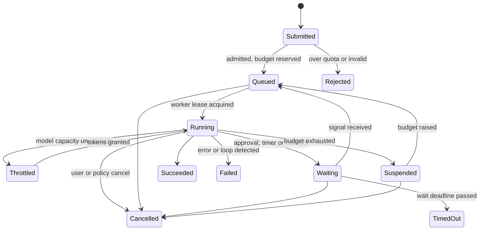
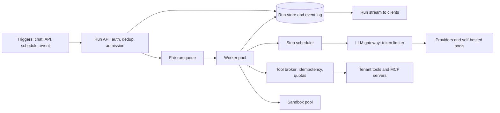
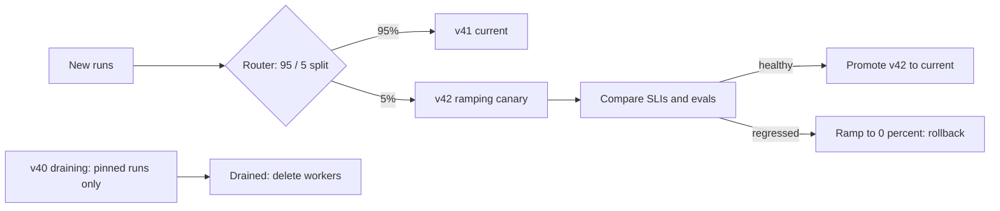

# 33 — Agent platform runtime: queues, tenancy, fairness, rollout

> **The requirement.** Lumen is now a platform: 2,000 business tenants run agents that answer tickets, reconcile
> invoices and write weekly reports, **240,000 runs a day**. Runs start from chat, from a tenant's API call, from a
> schedule or from a webhook event. Interactive runs must take their first step within **2 s at p95**, even at 09:00
> when one tenant submits **20,000 runs at once**. No run may be lost and no email or refund may happen twice across
> crashes and deploys. Every run and tenant has a **hard cost cap**, and new agent versions ship most days, canaried
> and rolled back while thousands of runs are mid-flight.
> This is hard because the scarce resource is **shared model capacity, metered in tokens per minute**. One run can
> cost 25 times another, runs last minutes to days, and the code being run decides its own control flow.

## In one minute

Chapter 25 built one agent. This chapter builds the factory that runs a hundred thousand of them for strangers who
must not hurt each other. The organising idea: **an agent run is a job**, like a payment or a video transcode, with
an identity, an owner, a budget, a deadline, a pinned version and a state machine. Jobs go into queues and workers
pick them up. What is special is what agent jobs consume: model calls limited in tokens per minute, so the real
"server capacity" is a token budget shared by every tenant. That is why the queue must be **fair**, since FIFO lets
one tenant's burst delay everyone for most of an hour. It is also why **backpressure** must flow from the model
provider back to the submitter. Runs are long, so crashes and deploys happen during them: state is durable, side
effects carry idempotency keys, and each run stays pinned to its starting version until it drains.

## Why this matters now

**Runs got longer and heavier.** Anthropic reported in June 2025 that its agents "typically use about 4× more tokens
than chat interactions" and multi-agent systems "about 15× more" [16]. Because "whenever we deploy updates, agents
might be anywhere in their process", the team uses **rainbow deployments**, "gradually shifting traffic from old to
new versions", and resumes agents "from where the agent was when the errors occurred" [16].

**Provider capacity is the binding constraint, metered in tokens.** As of 2026-11, Anthropic limits each model class
in requests, input tokens and output tokens per minute (RPM, ITPM, OTPM), replenished by a token bucket, and a
**ramp limit** can return 429 "after a sharp increase in usage" even below those limits [10]. OpenAI counts a request
as "the maximum of `max_tokens` and the estimated number of tokens" [15]. Twenty thousand runs starting at 09:00 meet
these limits in the first minute.

**The building blocks matured.** Temporal made Task Queue **Priority and Fairness** generally available on
2026-05-06 [5], and announced Worker Versioning, which pins a workflow to the code version that started it, as GA on
2026-03-30 [7]. Kubernetes' `agent-sandbox` project has a `SandboxWarmPool` resource [29]. Managed runtimes give each
session a microVM (AWS Bedrock AgentCore) [30] or a Durable Object (Cloudflare Agents) [31], and Claude Managed Agents
bills runtime at $0.08 per *running* session-hour [11]. The mechanisms exist. The designer's job is the policy that
composes them: who waits, who pays, and what happens mid-flight.

## Core ideas [Core]

### 1. The agent run is the unit of work

A **run** is one execution of one agent on one input for one tenant. Give it a record before you give it a worker:

```text
run {
  run_id, tenant_id, principal (user or service), trigger {kind, source_id, dedup_key},
  agent_version_tuple {agent_code, prompt, tool_catalogue, model_snapshot, policy},
  priority_class, budget {tokens, usd, steps, wall_clock}, deadline,
  idempotency_key, state, current_step, lease {worker_id, expires_at, fencing_token},
  created_at, started_at, ended_at, cost_so_far
}
```

Each field serves a requirement. `tenant_id` and `priority_class` feed the fair scheduler. The version tuple lets a
deploy leave the run alone and answers "which prompt produced this?". The budget is the cost cap. The lease's fencing
token stops a worker that lost its lease from acting on a run that moved elsewhere
([SYSDESIGN-09](../01-foundations/09-coordination-consensus.md)).

**Triggers** differ in what they promise and in how they duplicate:

| Trigger | Caller expects | How duplicates arise | Default class |
|---|---|---|---|
| Chat | first token in about a second, a person is watching | double submit, client reconnect | interactive |
| API (tenant backend) | a run id now, the result later (or within a short timeout) | client retry after a timeout | standard |
| Schedule | the run happens once per period | overlapping periods, catch-up after an outage | background |
| Event (webhook, queue message) | an acknowledgement within seconds | at-least-once delivery, manual redelivery | standard or background |

**Sync or async?** Run synchronously only if the p99 run fits the caller's timeout and a dropped connection may
safely kill it, which almost no agent run satisfies. Default to asynchronous with a synchronous *feel*: `POST /runs`
returns `202 Accepted` and a `run_id`, and the client streams the run's events (SSE or WebSocket) from its event log,
polls, or registers a webhook. Chat works the same way, so a closed laptop lid does not cancel a 6-minute
investigation and a reconnect resumes from the last event offset. `POST /runs` accepts an `Idempotency-Key`, so a
client retry returns the same `run_id` (§8).

Event triggers must **acknowledge fast and process later.** GitHub expects a 2XX "within 10 seconds", recommends
queuing and processing in the background, "does not automatically redeliver failed deliveries", and keeps the same
`X-GitHub-Delivery` id on a manual redelivery [26]. So the receiver verifies the signature, stores the delivery id as
the run's `dedup_key` under a uniqueness constraint, enqueues and returns 202.

### 2. The run lifecycle as a state machine

The run's state belongs to the platform, not the agent (the agent's conversation and memory are
[SYSDESIGN-30](30-context-engineering-memory.md)'s concern). Make it explicit, persisted, and changed only by the
runtime:



*Diagram: a submitted run is either rejected or queued with a budget reservation. A worker lease moves it to running.
From running it can be throttled while waiting for model capacity, wait for an approval, timer or callback (and
requeue when signalled), be suspended when its budget runs out (and requeue if the budget is raised), or end as
succeeded, failed or cancelled. Queued, waiting and suspended runs can also be cancelled. A wait that passes its
deadline ends as timed out.*

Four rules make it safe to operate:

- **Waiting releases everything.** A run waiting three days for approval holds no worker slot, sandbox or model
  reservation. When signalled, it requeues and competes fairly.
- **Throttled is its own state.** It is where provider backpressure becomes visible, and its share of time is an SLI
  (§11). A dashboard of 3,000 "running" runs, 2,000 of them throttled, hides the capacity problem.
- **Every non-terminal state has a timeout**: queue time-to-live, wait deadline, run deadline, lease expiry.
  Otherwise "stuck" is a state you learn about from a customer.
- **Terminal states are immutable and carry a reason.** "Failed: platform", "Failed: agent" and "Suspended: budget"
  count against different SLOs.

### 3. Queues and worker pools for agent runs

The platform is a classic job system ([SYSDESIGN-08](../01-foundations/08-async-event-driven.md)) with two extra
pools: model capacity and sandboxes.



*Diagram: triggers call the run API, which authenticates, deduplicates and admits runs into a fair run queue and
records them in the run store. Workers take runs from the queue, write progress to the run store, send model calls
through a step scheduler and an LLM gateway with a token limiter to providers, send tool calls through a tool broker
to tenant tools, and borrow sandboxes from a pool. Clients follow the run through a stream fed from the run store.*

Why each box is here: the **run API** is the only door, for quotas, budget reservation, dedup and 429s. The **fair run queue** decides which run gets the next worker slot (§6). **Workers** run
the loop and are stateless, so any worker can resume any run. The **step scheduler** decides which model call goes
next when tokens are short, a second scheduling level (Deep dive 1). The **LLM gateway**
([SYSDESIGN-26](26-llm-gateways-llmops.md)) holds provider keys and token buckets with reservation and refund. The
**tool broker** attaches idempotency keys and enforces per-tenant, per-tool quotas, which also protects tenants' own
systems from their own agents' bursts. The **sandbox pool** lends isolated environments (§9).

**Workers are I/O-bound.** A run mostly waits for tokens and tool responses, so a worker slot is a cheap coroutine,
and one async process can hold a hundred runs. *Worker slots are not your capacity.* Capacity is model tokens per
minute, sandboxes and tool quotas. Autoscaling workers on CPU while the real queue forms in the gateway is the most
common sizing error.

**Stateless or sticky?** Keep workers stateless. Affinity pays in two places only. A **self-hosted model pool**
benefits when a run's steps reach the replica holding its KV cache, which is inference-layer routing
([SYSDESIGN-22](22-serving-llms-at-scale.md)). A **sandbox** with a checked-out repository is costly to rebuild, so a
run's tool calls go to its sandbox. AgentCore makes the latter explicit, routing by session header and warning that
without it "each request may be routed to a new microVM, which may result in additional latency due to cold starts"
[30]. Provider prompt caches are keyed on the prompt prefix, not on your worker, so they need no affinity.

### 4. Durable execution engines and their limits

Chapter 25 maps an agent to a durable workflow: the loop is the workflow, model and tool calls are recorded
activities, approvals are signals ([SYSDESIGN-25](25-agentic-systems.md),
[SYSDESIGN-08](../01-foundations/08-async-event-driven.md)). On a platform, the engine's limits become platform
limits. As of 2026-11, Temporal documents:

| Limit | Value | Source |
|---|---|---|
| Single request payload (Cloud) | 2 MB | [2] |
| gRPC message | 4 MB | [2] |
| Event history per execution | 51,200 events or 50 MB, warning at 10,240 events or 10 MB | [1][2] |
| Pending activities, child workflows, signals, cancellations per execution | 2,000 each by default | [1] |
| Namespace actions per second (Cloud, default floor) | 500 APS | [2] |

Three shape agent design:

- **Bytes.** If activities take the whole transcript as input, history grows roughly with the *square* of the step
  count (worked in Numbers that matter). Use the **claim check**: "store message data in a persistent store and pass
  a Claim Check to subsequent components" [32]. Transcripts and tool outputs live in object storage, and history
  holds keys and hashes. Temporal's own advice is to "offload them to External Storage" [2].
- **Events.** Continue-As-New is meant to "create a new Workflow with a fresh history that picks up where your last
  one left off", keeping the Workflow Id with a new Run Id, and Temporal signals "Continue-As-New Suggested" near the
  limits [3]. Continue at a step boundary carrying only task state: goal, summary, transcript references, remaining
  budget and version tuple.
- **Fan-out.** A supervisor launching 3,000 sub-agents as child workflows exceeds the 2,000 pending default, and the
  workflow task "will fail and get retried" [1]. Bound fan-out in the orchestrator
  ([SYSDESIGN-29](29-agent-architectures-orchestration.md)) and budget it.

A queue plus checkpoints and your own resume logic stays valid for minutes-long runs. The limits are the price of
the engine's guarantees.

### 5. Concurrency control and backpressure against shared LLM capacity

Model capacity is a **shared, metered resource with several dimensions**: per provider and model class, RPM, input
and output tokens per minute, sometimes ramp limits and a monthly spend cap. For self-hosted pools, it is the tokens
per second your GPUs sustain at the latency SLO. Providers count differently (as of 2026-11):

- Anthropic counts only *uncached* input toward ITPM: `input_tokens` and `cache_creation_input_tokens` count,
  `cache_read_input_tokens` do not, and "the `max_tokens` parameter does not factor into OTPM". Its example: a
  2,000,000 ITPM limit with an 80% cache hit rate processes 10,000,000 input tokens per minute [10].
- OpenAI counts `max(max_tokens, estimate)`, so an unclamped `max_tokens` wastes limit [15].
- After a ramp-limit 429, Anthropic advises holding traffic where requests succeed and then increasing "by at most
  one step per minute", and to "start scheduled or bulk jobs at a low rate" [10].
- At the monthly **spend cap** of its usage tier (as of 2026-11: Start $500, Build $1,000, Scale $200,000; the Custom
  tier has no monthly cap and its limits are arranged with the account team), Anthropic returns 429 with code
  `enforced_spend_limit_reached` and *no* `retry-after` until 00:00 UTC on the first of the next month or a higher
  limit [10]. That is not a rate limit to retry. It is an outage for every tenant behind that organization, and a
  design constraint: projected monthly spend must fit the tier (Numbers that matter).
- A spend limit **you set yourself** (organization or workspace) returns HTTP **400** `invalid_request_error`, not
  429 [10]. Classify it as non-retryable and page, like the tier cap.

The design is a **backpressure chain** in which each layer turns the "no" below into a cheaper "not yet" above:

1. **Provider → gateway.** The gateway's own token buckets sit *below* the provider's limits, reserving
   `input + max_tokens` and refunding the rest ([SYSDESIGN-26](26-llm-gateways-llmops.md)), so most 429s are local and
   immediate. That reservation matches OpenAI's counting [15]. On Anthropic, clamping `max_tokens` bounds cost and
   latency, not OTPM [10]. Provider 429s with `retry-after` shrink the local bucket. Ramp and spend codes trigger their own policies.
2. **Gateway → step scheduler.** Without tokens, the step waits and the run enters `Throttled`. In-flight runs' next
   steps go before new runs' first steps (Deep dive 2).
3. **Step scheduler → run admission.** If throttled time grows, admitting more runs only adds waiting. The run queue
   lowers its **concurrency limit** on runs in `Running` or `Throttled`: static (derived in Numbers that matter) or
   adaptive, shrinking as latency or throttled time rises, like the adaptive limiters in
   [SYSDESIGN-11](../01-foundations/11-reliability-engineering.md).
4. **Run admission → submitter.** When a tenant's queue exceeds its bound in length *or* expected wait, `POST /runs`
   returns 429 with `Retry-After` and a queue position. Schedules and events have nobody to tell, so they queue with a
   time-to-live or coalesce (Deep dive 3).

Retry 429s only where told when (`retry-after`), with jitter, under a retry budget, and at one layer only
([SYSDESIGN-11](../01-foundations/11-reliability-engineering.md)).

### 6. Multi-tenant fairness

**The noisy neighbour in numbers.** Suppose the platform admits 2,250 concurrent runs (derived in Numbers that
matter) and a run is active for 6 minutes, so slots free at 375 per minute. At 09:00 one tenant submits 20,000 runs.
Under FIFO the last starts after 20,000 / 375 ≈ 53 minutes, and every other tenant's run submitted at 09:00:05 waits
that long. A fair queue rotating among 60 backlogged tenants makes the same run wait about one rotation: 60 / 375
minutes ≈ 10 seconds. The burst tenant still gets one slot in 60 plus all idle capacity. Nothing is refused. Only
the order changes. A 10% per-tenant cap (225 runs) also stops the burst from taking every free slot at 09:00:00.
Ten seconds suits a standard run but breaks the 2 s interactive target, so interactive work needs a reserved share.

Fair queuing comes from networking. Demers, Keshav and Shenker (SIGCOMM 1989) showed fair queueing gives competing
flows a fair share, lower delay to flows below their share, and "protection from ill-behaved sources" [17].
**Deficit round robin** (Shreedhar and Varghese, SIGCOMM 1995) approximates it with O(1) work per item through a
per-flow deficit counter, which handles variable-size items [18]. Map it directly: a tenant is a flow, a run or model
call is a packet, tokens are bytes.

| Mechanism | What it bounds | Wins when | Costs |
|---|---|---|---|
| Per-tenant concurrency cap | runs in flight per tenant | simple, protects the shared pool from any one tenant | not work-conserving: idle capacity is wasted while a capped tenant waits |
| Per-tenant token bucket (rate + burst) | tokens or runs per minute | contractual quotas, billing alignment | a full bucket still lets a tenant burst into everyone's latency |
| Weighted fair queuing / DRR over tenants | *share* of capacity when it is contended | work-conserving fairness, weights by plan | per-tenant queues, choosing the cost unit |
| Priority classes | who goes first across classes | interactive vs background | strict priority starves lower classes |
| Shuffle sharding | blast radius of a bad tenant | isolating failure, not just load | more pools to operate |

Combine them: a token bucket says *how much* a tenant may use, a fair queue says *who goes next* under contention,
and a concurrency cap is the safety net. The Amazon Builders' Library states the goal as "every client in a
multi-tenant system is provided with a single-tenant experience", enforces quotas "at a per-tenant or per-workload
granularity", and lets busy tenants borrow unused capacity while returning tenants regain priority [20]. Borrowing is
what makes fairness *work-conserving*: no slot idles while anyone has work.

**Fairness in what unit?** Runs differ in size. A tenant whose runs take 300 steps gets 25 times the tokens of one
whose runs take 12, at an equal share of runs. Sheng et al. call request-rate limits a "rudimentary notion of
fairness" and define fairness by a cost over input and output tokens. For their Virtual Token Counter (VTC) scheduler
on continuous batching they prove a "2× tight upper bound" on the service difference between two backlogged clients
(OSDI 2024) [19]. On a platform: fair-share **runs** at the run queue (worker slots, sandboxes) and **weighted tokens**
or dollars at the step scheduler (model capacity), as in Deep dive 1.

**Real systems to borrow from.**

- **Kubernetes API Priority and Fairness** (stable since v1.29) gives priority levels separate concurrency limits
  "so that requests assigned to different priority levels cannot starve each other", applies "a fair-queuing
  algorithm" among flows within a level, and assigns flows to queues by **shuffle sharding** with a `handSize` that
  trades collision probability against how much one flow can dominate [22].
- **Shuffle sharding**: with 8 workers in shards of 2 there are 28 shards, so one bad customer affects about 1/28
  of the service. Route 53 gives each domain 4 of 2,048 virtual name servers, about 730 billion shards [21].
  Shuffle-shard tenants across worker pools, provider projects or keys, and sandbox hosts, so a tenant whose tools
  hang degrades only its shard.
- **Temporal fairness keys** (GA 2026-05) dispatch round-robin across keys in a task queue, with weights (2.0 about
  twice as often as 1.0) and per-key rate limits. Priority (1–5, lower first, default 3) applies first as a strict
  tier [4]. Documented limits are design inputs: enforcement per task-queue partition, weights applied at scheduling
  and not to existing backlog, no fairness guarantee across Worker Versioning transitions, only the top 100 keys
  keeping fairness state across server restarts, and accuracy that "can degrade as you add more" keys, which matters
  with 2,000 tenants [4].

**Priority without starvation.** With strict priority, lower-priority tasks "remain in the backlog until all higher
priority Tasks have dispatched" [4], so steady interactive load can starve schedules. Reserve a minimum share per
class (for example 15% of slots for background, lent out when idle) or age waiting work upward, and chart the
background queue's age.

### 7. Budgets and cost caps: defending against denial of wallet

OWASP LLM10:2025 "Unbounded Consumption" describes **denial of wallet**: "by initiating a high volume of operations,
attackers exploit the cost-per-use model of cloud-based AI services". Its mitigations include rate limits and user
quotas, timeouts and throttling, and resource allocation management "to prevent any single user or request from
consuming excessive resources" [23]. On an agent platform the attacker may be a prompt injection that makes an agent
loop, a misconfigured schedule, an event storm or an honest tenant's runaway fan-out. Defend with a **hierarchy of
runtime-enforced budgets**:

1. **Per call:** `max_tokens` clamped per agent and step type.
2. **Per run:** tokens, dollars, steps, wall clock. Reserve each call's estimated cost before making it and
   reconcile after ([SYSDESIGN-25](25-agentic-systems.md), C11). At 80% inject "wrap up". At 100% suspend with the
   partial result.
3. **Per tenant:** daily and monthly spend. Reservations held by running runs count *now*, and admission refuses a
   run whose minimum plausible cost exceeds what is left.
4. **Per trigger:** "this webhook may start at most 500 runs per hour", because a trigger spends money on its own.
5. **Platform:** set your own limits *below* the provider's cap. Anthropic supports per-workspace spend and rate
   limits, and organization-wide limits "always apply, even if workspace limits add up to more" [10]. A workspace per
   tier or per shuffle shard keeps one runaway from tripping the cap that halts everyone.

The step budget also protects the durable engine, because a runaway run is the one that reaches its history limit.

### 8. Timeouts, retries and idempotent tool effects

**Timeouts nest**, each shorter than the one above: model call (time to first token and total), tool call, step, run
deadline, queue time-to-live, wait deadline, and lease expiry. Long tool calls heartbeat so a dead worker is found in
seconds.

**Classify before retrying.** Retry timeouts, 5xx and 429 *with* `retry-after`, with jittered backoff inside a retry
budget. Never retry validation errors, policy denials or spend-cap responses. Retrying a model call costs tokens but
has no side effects. Retrying a tool call is safe only if its effect is idempotent.

**Exactly-once effects** come from recording intent and result around each side-effecting call and passing a key the
tool deduplicates on ([SYSDESIGN-25](25-agentic-systems.md) Deep dive). Use `{run_id}:{step_seq}:{call_index}`,
stable across retries and replays, so never include the attempt number or a timestamp. Two references define the
semantics to expect. Stripe's v1 API saves "the status code and body of the first request made with a given
idempotency key after endpoint execution begins", replays it to retries (including 500s), rejects changed
parameters, and may prune keys once they are at least 24 hours old [24]. The IETF `Idempotency-Key` draft (-08, 2026-10-22, still an
Internet-Draft) recommends 409 for a retry while the original is in flight, 422 for a key reused with a different
payload, and 400 for a missing required key [25].

The platform trap is **key retention versus retry delay**. Be precise about what a crash re-executes. A durable
engine replays *workflow code* against its history: replayed commands are matched to recorded events, and activities
"execute outside the replay path" [34], so a step whose result is recorded is never called again. A step whose
result was *not* recorded (the worker died mid-call, the response was lost) is retried after its activity timeout,
minutes later and well inside a 24-hour key window. A lease-based runtime does the same at lease expiry. A three-day
approval wait is therefore harmless on its own: the steps before it are recorded, and the steps after it are new
calls with new keys.

The danger is a **late retry of an unknown-outcome call**. A refund call times out, so the refund may have happened.
Then either the retry policy keeps backing off through a multi-day downstream or platform outage (Temporal's default
activity retry policy allows unlimited attempts, with intervals capped at 100 s [35]), or the step is parked as
`unknown` for human reconciliation and resumed after a weekend. If the downstream system may prune keys once they are
24 hours old [24], that late resend is a second refund. The rule: **any retry later than the downstream key retention
goes through the broker's journal and a lookup of the downstream state, never a blind resend.** So the tool broker
keeps its own intent/result journal for longer than the longest run, bounds automatic retries of side-effecting calls
with a deadline below the downstream retention (in Temporal, the Schedule-To-Close timeout caps the whole activity
execution including retries [35]), and past that deadline moves the step to `unknown` for lookup or reconciliation.
The downstream key is the second line of defence.

**Triggers need dedup too.** Events dedup on the delivery id (§1). Schedules need an **overlap policy**: Temporal's
default `Skip` means "the Workflow Execution is not started" while the previous one runs, and the catch-up window
defaults to **one year** ("Actions will be taken unless over one year late") [8]. Decide deliberately whether missed
weekly reports all fire after an outage. Usually only the latest should.

### 9. Sandboxes as a pooled resource

Runs that execute code need isolation (choices in [SYSDESIGN-25](25-agentic-systems.md) §8 and
[SYSDESIGN-31](31-securing-agentic-systems.md)). At scale a sandbox is a **pooled, metered resource with a cold
start**, treated like database connections:

- **Warm pools.** Runs claim pre-booted, never-used sandboxes. Kubernetes `agent-sandbox` models this with
  `SandboxTemplate`, `SandboxWarmPool` ("a pool of pre-warmed Sandboxes that can be quickly allocated to users")
  and `SandboxClaim`, optional extension CRDs at `extensions.agents.x-k8s.io/v1beta1` beside the core `Sandbox` at
  `agents.x-k8s.io/v1beta1` (as of 2026-11) [29]. Size the pool by Little's law: claim rate × refill time, plus burst
  headroom (Numbers that matter).
- **Boot is not ready.** Firecracker states boot "in <125ms", "<5 MiB overhead per VM" and "up to 150 microVMs per
  second per host" [28], the VMM's own figures. Image pulls, runtimes and dependencies take far longer, which is why
  [C11](../04-case-studies/C11-coding-agent-platform.md) restores warmed snapshots. Plan with your measured
  claim-to-ready time, not boot time.
- **Release while waiting.** A waiting run snapshots its sandbox and returns the capacity. Holding one through a
  3-day approval is costly idle.
- **Never recycle across tenants.** Used sandboxes are destroyed, not returned. AgentCore terminates the microVM and
  "memory is sanitized" after each session [30].
- **Quota per tenant.** Sandboxes are scarcer than worker slots and need their own cap and fair-queue place. A run
  needing one is not admitted to `Running` until it holds one.

Managed runtimes package these choices. AgentCore sessions last "up to 8 hours for each
lifecycle on microVMs" and stop after 15 idle minutes by default. The next call to a stopped session gets new compute,
and filesystem data survives only if session storage is configured [30]. (AgentCore's snapshot is a cold-start
optimisation: each session's microVM is restored from a snapshot taken "before any session existed".) Cloudflare runs each
agent as a Durable Object with identity, SQL storage and scheduled work [31]. Both replace the sandbox pool and part
of the worker, not your run record, fair queue or budgets.

### 10. Versioning and rollout of agents, prompts, tools and models

Behaviour is set by a **version tuple**: agent code, prompt templates, tool catalogue (names, descriptions,
schemas), model snapshot, decoding parameters, and policy and guardrails. Chapter 26 versions it for single calls
([SYSDESIGN-26](26-llm-gateways-llmops.md) §7). The platform adds one hard problem: **runs in flight during a
deploy**. A run started on v41 has a transcript shaped by v41's prompt and tools. Moved to v42 mid-run, a tool it
already called may be gone, the model may reinterpret earlier steps, and in a durable engine, replaying v41's history
through v42's code fails determinism checks.

| Strategy | How | Wins when | Costs |
|---|---|---|---|
| **Pin and drain** (rainbow) | each run completes on the version it started on; old workers run until their runs drain | most agent runs; behaviour must be reproducible | several versions live at once; long runs keep old versions alive for days |
| **Auto-upgrade** | runs move to the new version at the next step | urgent fixes (a security patch to a tool) | code must stay replay-compatible (patching); behaviour changes mid-run |
| **Upgrade at a checkpoint** | move at a Continue-As-New boundary with only the task state carried over | very long runs | the new version must accept the old state schema |
| **Cancel and restart** | stop old runs, restart from inputs | short, side-effect-free runs | wasted tokens; duplicate effects unless idempotent |

Temporal implements the first three. A **Pinned** workflow "is guaranteed to complete on a single Worker Deployment
Version", an **Auto-Upgrade** workflow moves before its next activity, and a version with open pinned workflows is
**Draining** until they close, then **Drained** [6]. The third needs care: a plain Continue-As-New keeps the pin
("the Pinned version is inherited across the Continue-As-New chain" [6]), and moving at that boundary needs the
opt-in Upgrade on Continue-as-New, announced on 2026-03-30 and still public preview as of 2026-11 [7]. A *ramping*
version gets 0–100% of new workflows, split by Workflow ID [6]: a canary by run.



*Diagram: new runs are split 95/5 between the current version v41 and a ramping canary v42. An older version v40
receives no new runs and serves only its pinned runs until it is drained and its workers are deleted. The canary's
SLIs and evals are compared, and v42 is either promoted to current or ramped to zero as a rollback.*

Rules:

- **Pin the whole tuple at run start** and record it on the run and every span, so regressions bisect to one
  component ([SYSDESIGN-32](32-observing-evaluating-agents.md) owns the evals).
- **Pins expire.** Anthropic gives "at least 60 days' notice before model retirement for publicly released models",
  after which "requests to it fail" [14]. Track an end-of-life date per pinned tuple and migrate long-lived runs and
  schedules before it.
- **Tool contracts evolve additively**: add optional parameters and new tools, never rename or repurpose, and keep
  old versions served while pinned runs drain. Because "modifying tool definitions (names, descriptions, parameters)
  invalidates the entire cache" [12], a tool edit makes the canary pay cache writes until caches rebuild. Do not read
  that cost spike as a regression.
- **Canary by run, then by tenant cohort**: internal tenants, a percentage of runs, then whole plans. Compare success
  rate, cost per *successful* run, steps, escalations and tool errors over enough runs
  ([SYSDESIGN-14](../02-modern-requirements/14-cloud-native-platforms.md)).
- **Shadow runs never touch the world.** Their tool broker answers reads from recorded results and refuses writes.
  A shadow that sends real emails is a second production, and shadowing doubles token cost for its share.
- **Rollback is a pointer move.** Ramp to 0% or point "current" back, and new runs go to the old version at once.
  Decide before the incident whether runs pinned to the bad version finish, suspend or are cancelled.
- **Do not rely on the grace period.** Kubernetes' default `terminationGracePeriodSeconds` is 30 seconds, then
  `SIGKILL` [27], far shorter than a 6-minute run. On `SIGTERM` a worker stops taking runs, releases its leases and
  exits, and the run resumes elsewhere from durable state. Graceful shutdown is an optimisation. Durability is the
  guarantee.

### 11. SLOs for an agent platform

Separate **platform** SLOs (did the runtime do its job?) from **quality** SLOs (did the agent?), which
[SYSDESIGN-32](32-observing-evaluating-agents.md) owns. A model regression should not burn the platform's error
budget, and a lost run should not be blamed on the prompt. Example targets (this chapter's choices, not industry
standards):

| SLI | Definition | Example target |
|---|---|---|
| Time to first step, interactive | submit → first model call sent, per priority class | p95 ≤ 2 s |
| Time to start, standard | submit → `Running`, for tenants within quota, measured per tenant | worst-tenant p95 ≤ 60 s |
| Throttled share | time in `Throttled` / time in `Running` + `Throttled` | ≤ 10% at peak |
| Platform success | runs not ending in `Failed: platform` / all runs | ≥ 99.9% per 28 days |
| Lost runs | runs with no terminal state after deadline + grace | 0 (each one is an incident) |
| Duplicate effects | side effects executed twice per idempotency key, from the broker journal | 0 |
| Budget overrun | runs whose cost exceeds the cap by more than one step's reservation | 0 |
| Trigger latency | event received → run queued | p99 ≤ 5 s |

**Worst-tenant p95** is the fairness SLI: a global p95 can look healthy while one tenant waits an hour, so compute it
per tenant (excluding tenants over their own quota) and alert on the worst. **Zero-target SLIs** are invariants with
detectors, not error budgets: a sweeper for runs past their deadline without a terminal state, and a journal audit
for duplicated keys. Alert with burn rates as in [SYSDESIGN-12](../01-foundations/12-observability.md).

## Numbers that matter

### Capacity plan: from runs per day to tokens, dollars, workers and sandboxes

*Assumptions, labelled, to replace with measurements: A1: 240,000 runs/day. A2: 70% arrive in a 10-hour business
window. A3: top-of-hour bursts reach 2× the window average for a few minutes. A4: mean active run time (excluding
human waits) 6 min = 360 s. A5: 12 model calls per run. A6: a 4,000-token system-and-tools prefix shared by all runs
of an agent version, 1,500 new tokens per step (task input, tool results, previous output), 400 output tokens per
call. A7: the prompt cache stays warm within a run (steps under 5 minutes apart), with a cache breakpoint at the end
of each request. Prices: Claude Sonnet 5.5 as of 2026-11, $2/MTok input, $2.50/MTok 5-minute cache write, $0.10/MTok
cache read, $10/MTok output [11].*

**Arrival rate and concurrency (Little's law, L = λW [33]).** λ = 0.7 × 240,000 / 36,000 s ≈ **4.67 runs/s** (≈ 9.3
in bursts). L = 4.67 × 360 ≈ **1,680 concurrent active runs** (≈ 3,360 if the burst rate were sustained). Model calls:
4.67 × 12 ≈ 56/s ≈ **3,360 RPM**.

**Tokens per run.** Step k's input is 4,000 + 1,500k, so 12 steps total 12 × 4,000 + 1,500 × 78 = **165,000 input
tokens**. With a warm cache each step reads the previous step's input and writes its 1,500 new tokens: reads 12 ×
4,000 + 1,500 × 66 = **147,000** (89%), writes 12 × 1,500 = **18,000**, output 12 × 400 = **4,800**.

| Component | Tokens | Price | Cost |
|---|---|---|---|
| Cache reads | 147,000 | $0.10/MTok | $0.0147 |
| Cache writes (5 min) | 18,000 | $2.50/MTok | $0.0450 |
| Output | 4,800 | $10/MTok | $0.0480 |
| **Total, cached** | | | **≈ $0.108** |
| Same run uncached | 165,000 in + 4,800 out | $2 / $10 | ≈ $0.378 |

So 240,000 runs cost about **$25,800/day** cached (≈ $775k per 30 days, ≈ $388 per tenant per month on average)
against ≈ $90,700/day uncached, for model tokens only (engine actions, billed per action [9], and sandboxes are extra).
Caching is worth 71%, and it depends on A7, which the scheduler controls (Deep dive 2).

**Spend is a limit too.** The Scale tier caps monthly spend at $200,000 [10]: at $25,800/day this platform reaches it
after about 200,000 / 25,800 ≈ **7.8 days** (≈ 2.2 days uncached), and then every request fails with
`enforced_spend_limit_reached` until the next month. So at this volume the design *requires* a Custom-tier agreement,
which has no monthly cap and negotiated limits [10], or traffic split across providers (the cap is per
organization, so a second model class does not help). The
Scale-tier per-minute limits below are used only as a realistic order of magnitude until those limits are agreed.

**Provider limits.** Anthropic counts cache writes and uncached input toward ITPM but not cache reads [10], so an
active run consumes 18,000 ITPM tokens and 4,800 OTPM tokens over 360 s: **50 input and 13.3 output tokens/s**. The
Scale-tier defaults for Claude Sonnet 5.5 as of 2026-11, used here as a stand-in for the Custom-tier limits, are
13,000 RPM, 10,000,000 ITPM and 2,000,000 OTPM [10]:

| Limit | Per-minute limit | Per second | ÷ per-run rate | Max concurrent runs |
|---|---|---|---|---|
| OTPM | 2,000,000 | 33,333 | ÷ 13.3 | **≈ 2,500** |
| ITPM (warm cache) | 10,000,000 | 166,667 | ÷ 50 | ≈ 3,333 |
| ITPM (cold cache) | 10,000,000 | 166,667 | ÷ 458 | **≈ 364** |
| RPM | 13,000 | 217 calls/s | ÷ (12/360) | ≈ 6,500 |

None of the following is visible from worker CPU. **Output tokens bind first**: about 2,500 active runs on this
model and tier, so admit near 2,250 (90%) and queue the rest. The 09:00 burst (≈ 3,360) *will* queue, and fairness
decides who waits. **Cache-hit rate is a capacity parameter**: if caches go cold, because steps wait more than 5
minutes or a rollout edits tool definitions [12], the ITPM ceiling falls from ≈ 3,333 to ≈ 364 runs, a 9× drop.
Beyond these ceilings you need a custom tier, a second model class with its own limits, or a self-hosted pool, which
must prefill the uncached-equivalent 4.67 × 165,000 ≈ **770,000 input tokens/s**
([SYSDESIGN-22](22-serving-llms-at-scale.md) sizes GPUs from that).

**Workers, sandboxes and the engine.** *A8: one async worker process holds 100 active runs. A9: 30% of runs hold a
code sandbox for their whole active time. A10: refilling one warm sandbox takes 20 s (an assumption: measure your
claim-to-ready time). A11: about 30 engine actions per run (start, 12 model activities, about 10 tool activities,
retries, timers, heartbeats), where Temporal Cloud bills each activity start and retry as an action [9].*

Workers and sandboxes are sized at the admission cap (2,250 runs), the conservative choice; the rate-based figures
(claims, engine actions) use the mean window rate λ.

- Workers: 2,250 / 100 ≈ **23 processes**, plus N+2 for failures and rollout.
- Sandboxes in use: 0.3 × 2,250 ≈ **675**. Claim rate 0.3 × 4.67 ≈ 1.4/s, so the warm pool needs ≥ 1.4 × 20 ≈ **28**
  ready sandboxes, about **56** for 2× bursts, and more if a whole host can fail.
- Engine: 4.67 × 30 ≈ **140 actions/s**, ≈ 280 in bursts, under the 500 APS default floor [2] but close enough for a
  retry storm to reach it.

**History size, the quadratic trap.** *A12: 4 bytes per token.* With full contexts as activity inputs, a 12-step run
writes ≈ 165,000 × 4 ≈ 0.66 MB of history. A 300-step runaway writes Σ(4,000 + 1,500k) for k = 1..300 = 1.2 M +
1,500 × 45,150 ≈ **68.9 M tokens ≈ 276 MB**, over five times the 50 MB limit [1], and its last step alone carries
454,000 tokens ≈ 1.8 MB, just under the 2 MB payload limit [2]. (A 454,000-token context also needs a model with a
1M-token window, which Claude Sonnet 5.5 has at standard pricing [11].) With claim checks (a few hundred bytes per step) the
same run writes well under 1 MB.

## Design choices and trade-offs

### Where do runs queue and execute?

| Option | Wins when | Costs | Example systems |
|---|---|---|---|
| Broker queue + own scheduler + checkpoint store | minutes-long runs, a small team, full control of fairness | you build leases, resume, timers, dedup | SQS / RabbitMQ + Postgres ([SYSDESIGN-08](../01-foundations/08-async-event-driven.md)) |
| Durable execution engine with fairness keys | long runs, approvals, strict exactly-once effects | engine limits (§4), determinism constraints, another critical platform | Temporal task queues with priority and fairness [4] |
| Managed per-session runtime | speed to market, microVM isolation without operating it | per-session lifetime limits, lock-in, less control of fairness and residency | AWS Bedrock AgentCore Runtime [30], Cloudflare Agents [31], Claude Managed Agents [11] |
| Serverless functions per step | short, bursty, stateless steps | function time limits, cold starts, state must be external | step functions or queues triggering functions ([SYSDESIGN-14](../02-modern-requirements/14-cloud-native-platforms.md)) |

### Which fairness unit, at which layer?

| Layer | Contended resource | Fair-share unit | Mechanism |
|---|---|---|---|
| Run admission | worker slots, sandboxes | runs (weighted by plan) | per-tenant queues + DRR, concurrency cap |
| Step scheduler | provider tokens per minute | weighted tokens or dollars | DRR with token-sized deficits (Deep dive 1) |
| Self-hosted serving | GPU batch slots | weighted input and output tokens | token-counting fair scheduler such as VTC [19] |
| Tool broker | tenant APIs and MCP servers | calls per tool per tenant | token bucket per (tenant, tool) |

### In-flight versioning policy

| Change | Default policy | Why |
|---|---|---|
| Prompt or agent logic | pin and drain, canary by run | reproducibility, clean A/B comparison |
| Tool schema (additive) | new runs only, old version stays served | old runs may still call the old shape |
| Tool security fix | auto-upgrade at the next step | the risk of the old tool outweighs behavioural drift |
| Model snapshot | pin, migrate before the retirement date | retirements fail requests [14] |
| Runtime and platform code | rolling, replay-compatible | runs must not notice |

## Deep dive [Deep]

### 1. Two-level fair scheduling with token-sized deficits

Run-level fairness fails when appetites differ: tenant A's runs take 12 steps of 4,000–22,000 tokens, tenant B's take
300 steps and reach 450,000-token contexts, and equal run slots hand B most of the model. A second scheduler at the
model-call level shares **tokens**, using deficit round robin with deficits counted in tokens:

```text
# one DRR scheduler per (provider, model class); cost(call) = weighted tokens of the call
# weighted tokens = uncached_input + cache_write + w_out * output_estimate  (w_out reflects output price or OTPM scarcity)
active = round-robin list of tenants with pending calls
on each scheduling tick while gateway.tokens_available():
    t = active.next()
    t.deficit += QUANTUM * t.weight           # e.g. QUANTUM = 50,000 weighted tokens
    while t.queue and cost(t.queue.head) <= t.deficit and gateway.reserve(t.queue.head):
        call = t.queue.pop()
        t.deficit -= cost(call)
        dispatch(call)                          # gateway refunds unused reservation on completion
    if not t.queue: t.deficit = 0; active.remove(t)   # idle tenants do not bank credit
```

Three details matter. **Cost uses the provider's counting**: cache reads are not charged against ITPM [10], so a
well-cached call is cheap in the scarce unit, and fairness should reward that. **Idle tenants' deficits reset**, as in
DRR's rule for empty queues [18], so nobody saves credit overnight to spend at 09:00. **Output is estimated at
dispatch and corrected at completion**, like the gateway's reservations. This is VTC's idea [19] applied one layer up,
where you buy tokens rather than generate them.

### 2. Cache-aware scheduling: finish what you started

Anthropic's prompt cache lives 5 minutes by default, "refreshed for no additional cost each time the cached content
is used", with a 1-hour option at a higher write price [12]. That creates a cliff. A run at step 40 with a
100,000-token context on Claude Sonnet 5.5 reads its prefix for 100,000 × $0.10/MTok = $0.01. Left throttled for 6
minutes, its cache expires and the next step rewrites the prefix for 100,000 × $2.50/MTok = $0.25 [11]: **25 times
more**, and 100,000 tokens of ITPM instead of about 1,500. Under load, a scheduler that starts new runs while
in-flight ones wait makes the platform poorer *and* slower.

So: (1) in the step scheduler, **in-flight runs' next steps outrank new runs' first steps** within each tenant's
share, the agent form of "finish in-progress work before starting new work"
([SYSDESIGN-11](../01-foundations/11-reliability-engineering.md)); (2) admission throttles *new* runs first; (3) a run
that will predictably wait past the TTL (an approval, a long tool call) either accepts the cold cache or buys the
longer TTL deliberately, a trade-off C11 computes for paused tasks.

The same arithmetic rules out a tempting saving. Batch APIs halve prices, but Anthropic's Message Batches take up to
24 hours ("most batches completing within 1 hour") and do not support cache pre-warming, since an entry "would likely
expire before the follow-up request runs" [13]. A 12-step run could wait up to 24 hours *per step*, cold each time.
Batch suits single-shot work such as classifying 100,000 tickets overnight, not multi-step runs. Claude Managed Agents
pricing says the same: "Sessions are stateful and interactive. There is no batch mode." [11]

### 3. Event and schedule storms

A trigger is a loop the platform does not own, and a common source of fires.

- **Coalesce by entity.** Ten webhooks for one ticket in 30 seconds should yield one run on the latest state. Debounce
  on `(tenant, trigger, entity_id)` and have the run read the current entity, not the event payload.
- **Break feedback loops.** An agent that updates a ticket emits "ticket updated", which triggers the agent again.
  Propagate a causation chain through the tool broker, refuse to trigger on an effect the same agent caused on the
  same entity within a window, and cap hop counts across agents.
- **Spread schedules.** "Every Monday 07:00" across 2,000 tenants is a synchronised burst into the ramp limit, which
  advises starting bulk jobs "at a low rate" [10]. Temporal Schedules add "a random offset between zero and the
  maximum jitter" [8]. Add jitter or a tenant-hash offset unless exact timing is required.
- **Per-trigger budgets** (§7) are the backstop.

### 4. Deploys, leases and zombie workers

A partitioned but live worker may keep executing a run whose lease went to another worker. Durable engines reject
stale completions centrally. A home-grown runtime needs the same: each lease carries a monotonically increasing **fencing token**, and the run store and tool broker reject writes and
effects with an older one ([SYSDESIGN-09](../01-foundations/09-coordination-consensus.md)). With step-level
idempotency keys, a zombie's late tool call becomes a deduplicated no-op. Deploys exercise this path daily
(`SIGTERM`, 30 s, `SIGKILL` [27]). Make the clean path fast by releasing leases explicitly, make the dirty path
correct with expiry, fencing and idempotent replay, and test it by killing workers in staging, not only draining them.

## Frontier [Frontier]

*As of 2026-11.*

- **The engines absorb platform features.** Temporal fairness and Worker Versioning are GA, External Storage (claim
  checks in S3 or a custom driver) and Upgrade on Continue-as-New are in public preview, and Serverless Workers are in
  pre-release [5][7]. The rainbow deployment Anthropic described in 2025 [16] is becoming a product feature.
- **Per-session runtimes and sandbox pools are standard resources** (§9): AgentCore [30], Cloudflare Agents
  ("scaling to tens of millions of instances", a vendor claim) [31] and `agent-sandbox` warm pools [29]. Runtime is
  billed as its own dimension [11].
- **Provider-side shaping is richer**: ramp limits, cache-aware ITPM, priority-tier headers and per-workspace limits
  [10]; project-level limits and background-request queues [15]. Platforms must read error codes, not just statuses.
- **Token-fair LLM serving** is established in research (VTC [19]). How far production engines have adopted
  token-level tenant fairness was not verified for this chapter, so check your engine's scheduler.

## Failure modes and operations

| Failure | What you see (SLI) | Mitigation |
|---|---|---|
| Noisy neighbour burst | worst-tenant time-to-start p95 spikes, global p95 fine | per-tenant queues + DRR, concurrency caps, reserved interactive share |
| 09:00 ramp-limit 429s | 429 with `ramp_limit_exceeded`, throttled share rises | ramp admission up gradually, jitter schedules, start bulk work slowly [10] |
| Provider spend cap reached | 429 `enforced_spend_limit_reached`, no `retry-after`, all tenants fail (an own limit returns 400 `invalid_request_error`) | projected spend checked against the tier cap ($200,000/month on Scale) or a Custom-tier agreement [10]; own limits below the cap per workspace; alert well before it (for example at 70/85/95%, this chapter's suggestion) |
| Retry storm on 429 | RPM rises while successful tokens/min fall | retry only with `retry-after`, one retrying layer, retry budgets |
| Cache-TTL cliff | cost per step and ITPM per run jump under load | in-flight steps first, throttle new runs, watch cache-read share |
| History or payload limit | executions terminated, `BlobSizeLimitError`-class failures | claim checks, Continue-As-New on suggestion, step budgets [1][2][3] |
| Fan-out over pending limit | workflow tasks failing and retrying | bounded fan-out, batch children, budgeted sub-agents [1] |
| Poison run | same run crashes workers repeatedly | attempt limit per run, then `Failed: platform` + quarantine with diagnostics (a DLQ for runs) |
| Stranded pinned runs | old-version runs stuck after its workers were deleted | delete workers only when the version is Drained [6], alert on runs per version |
| Idempotency key expired downstream | duplicate effect when an unknown-outcome call is retried after the downstream retention | broker-side journal retained longer than max run lifetime, retry deadline below the retention, lookup before any late retry [24][35] |
| Zombie worker | two workers act on one run | leases with fencing tokens, broker rejects stale tokens |
| Warm pool exhaustion | claim-to-ready p95 jumps to cold-start time | pool sized by Little's law, per-tenant sandbox caps, refill alerts |
| Webhook or event storm | runs per trigger per minute spike | coalescing, causation-chain loop guard, per-trigger budgets |
| Model retired under a pin | runs and schedules on the tuple start failing | track retirement dates per pinned tuple, migrate ≥ 60 days ahead [14] |

Operate from four dashboards: **flow** (runs per state, class and tenant), **capacity** (tokens per minute against
limits, cache-read share, sandboxes), **money** (spend against budgets, cost per successful run) and **versions**
(runs per version, draining versions, canaries).

## Cost and energy

Account in **cost per successful run**, by version and tenant: a version 10% cheaper per run that succeeds 20% less
often is more expensive. Attribute every model call, tool call and
sandbox-second to `(tenant, run, version)` and show it to tenants. Showback makes budgets negotiable rather than
surprising ([SYSDESIGN-16](../02-modern-requirements/16-cost-as-requirement.md)).

In the cached example, output and cache writes are about 86% of cost and cache reads 14%. The levers, roughly by
effect: keep caches warm (scheduling, stable prefixes, additive tool changes), cap steps and output, route easy steps
to cheaper models (26), release sandboxes during waits, and right-size warm pools, whose idle sandboxes are pure
overhead. Do not use batch APIs for multi-step runs.

Energy follows tokens. Scheduled and background runs are flexible load that can move to lower-carbon hours or regions
within their deadlines ([SYSDESIGN-17](../02-modern-requirements/17-energy-carbon-aware.md)). No published, measured
energy-per-agent-run figure was found for this chapter. Measure your own fleet if you self-host, and do not quote
chat-prompt figures as agent figures.

## Interview angle

**How it is asked:** "Design a platform that runs AI agents for many customers." "One customer submits 20,000 tasks
at once. What happens to everyone else?" "How do you deploy while tasks are running?" "How do you stop an agent
spending $10,000 overnight?" It is also the platform half of C11,
[C15](../04-case-studies/C15-support-agent-platform.md) and [C17](../04-case-studies/C17-workflow-automation-agent.md).

**Model answer outline (CLARIFY → QUANTIFY → SKETCH → DEEPEN → STRESS → WRAP):**

1. **CLARIFY:** triggers and their latency expectations, run-length distribution and human waits, tenants and plans,
   side effects and reversibility, providers versus self-hosted, who sets cost caps, residency.
2. **QUANTIFY:** runs/day → λ → L = λW → tokens/s in the provider's counting → which limit binds → cost per run and
   per day → sandboxes and warm pool by Little's law.
3. **SKETCH:** run API (admission, dedup) → run store and event log → per-tenant fair run queue → stateless workers
   with leases → step scheduler → LLM gateway with token buckets → providers, plus tool broker with idempotency
   journal, sandbox pool and run stream.
4. **DEEPEN** (one or two): two-level fairness in tokens, the backpressure chain, in-flight versioning, or engine
   limits and claim checks.
5. **STRESS:** the 09:00 burst, a provider outage or spend cap, a crash mid side effect, a deploy with thousands of
   runs in flight, a webhook storm, a model retired under a pin.
6. **WRAP:** a run is a job with a version pin and a budget. Capacity is tokens per minute, so fairness and
   backpressure count tokens. Durability plus idempotency gives exactly-once effects. Rollout is pin and drain.

**Red flags:** sizing workers by CPU; one FIFO queue; fairness in requests only; retrying 429s at every layer;
budgets in the prompt; "we'll just redeploy" with runs in flight; idempotency keys containing the attempt number;
shadow runs with live tools; warm sandboxes reused across tenants.

**Follow-ups:** What does your fair queue count? What does a run waiting three days hold, and which of its calls could
be retried after the downstream key expired? What happens to the canary's runs on rollback? How do you prove no run was lost last month?

## Common mistakes

- Treating a run as an HTTP request: synchronous, unrecorded, killed by a disconnect or deploy.
- Measuring capacity in worker slots or CPU instead of tokens per minute and sandboxes.
- One global FIFO queue, or fair-sharing runs when runs differ 25× in tokens.
- Treating every 429 alike: retrying a spend cap, hammering a ramp limit.
- Whole transcripts in engine history, found out on the longest, costliest runs [1].
- Idempotency keys that change between retries, or a blind resend after the downstream key expired.
- Deleting an old version's workers while its pinned runs still drain.
- Reading the cache-invalidation spike from a tool change [12] as a regression.
- Global percentiles only, hiding the tenant who waits an hour.
- Holding sandboxes, slots and reservations through human waits.

## Check yourself

1. Why does a cache-hit rate drop reduce the platform's maximum concurrent runs, not just raise its bill?
2. A tenant's runs average 300 steps and another's 12. Which fairness unit keeps both served, and at which layer?
3. Your downstream payment API may prune idempotency keys after 24 hours. A refund call timed out, and its retry runs
   3 days later after a downstream outage. What breaks, and where do you fix it? Why is a 3-day approval wait alone
   not the problem?
4. What happens to runs pinned to version v40 if you delete v40's workers while it is still Draining?
5. Name two SLIs that should have a target of zero, and how you detect a violation.

Full set with answers: [exercises/33-agent-platform-runtime.md](../../exercises/33-agent-platform-runtime.md).

## Lab

**Planned — not yet built.** Lab L33 (curriculum §6) will be a **CPU-only Python simulation of per-tenant fair
queuing for agent runs**: standard library only, no containers, no model calls, €0. Planned scope:

1. A discrete-event simulator: Poisson arrivals per tenant plus a burst tenant, runs with sampled step counts and
   token sizes, a run queue with a concurrency limit, and a step scheduler in front of a token bucket that models ITPM
   and OTPM separately, with cache reads excluded.
2. Interchangeable schedulers: FIFO, per-tenant caps, DRR over runs, DRR over weighted tokens, and strict priority
   versus priority with a reserved share.
3. Experiments: (a) the 20,000-run burst, worst-tenant p95 time-to-start per scheduler; (b) run-count versus token
   fairness with a 300-step tenant; (c) a cache-TTL model charging full writes after 5 idle minutes, "new runs first"
   versus "in-flight first"; (d) a rolling deploy and a worker crash, counting lost runs and duplicate effects with
   and without leases and idempotency keys.
4. Output: per-tenant wait percentiles, throttled share, cost per run, and a CSV.

No results are claimed until it is built and run. Numbers that matter is arithmetic from labelled assumptions, not
simulation output.

## Further reading

- Demers et al. [17], Shreedhar and Varghese [18]: fair queueing and deficit round robin.
- Sheng et al. [19]: LLM fairness counted in tokens.
- Kubernetes API Priority and Fairness [22]: fair queuing and shuffle sharding in production.
- Amazon Builders' Library [20][21]: quotas, bursting and blast radius.
- Temporal [4][6][1]: fairness, versioning and limits in a durable engine.
- Anthropic [16][10]: rainbow deployments, and how a provider counts tokens.

## References

1. Temporal documentation. "Workflow Execution limits" (event history 51,200 events or 50 MB, warning at 10,240 / 10 MB; 2,000 pending activities, child workflows, signals and cancellations by default). https://docs.temporal.io/workflow-execution/limits (accessed 2026-11)
2. Temporal documentation. "Temporal Cloud limits" (2 MB payload per request, 4 MB gRPC message, 4 MB history transaction, history limits, External Storage advice, 500 APS default). https://docs.temporal.io/evaluate/cloud/limits (accessed 2026-11)
3. Temporal documentation. "Continue-As-New" (fresh event history, same Workflow Id, new Run Id, Continue-As-New Suggested). https://docs.temporal.io/workflow-execution/continue-as-new (accessed 2026-11)
4. Temporal documentation. "Task Queue Priority and Fairness" (priority 1–5, fairness keys and weights, rate limits, limitations). https://docs.temporal.io/develop/task-queue-priority-fairness (accessed 2026-11)
5. Temporal. "Announcing new Temporal capabilities from Replay 2026" (blog, 2026-05-06: Priority and Fairness GA, External Storage public preview for Python and Go, Serverless Workers pre-release). https://temporal.io/blog/replay-2026-product-announcements (accessed 2026-11)
6. Temporal documentation. "Worker Versioning" (Worker Deployment Versions, Pinned, Auto-Upgrade, ramping, Draining, Drained). https://docs.temporal.io/worker-versioning (accessed 2026-11)
7. Temporal. "Announcing GA for Worker Versioning and Public Preview for Upgrade on Continue-as-New" (blog, 2026-03-30). https://temporal.io/blog/ga-worker-versioning-public-preview-upgrade-on-continue-as-new ; status as of 2026-11 ("Public Preview as an experimental SDK-level option"): https://docs.temporal.io/production-deployment/worker-deployments/worker-versioning/upgrade-on-continue-as-new (accessed 2026-11)
8. Temporal documentation. "Schedule" (overlap policies with Skip as default, catch-up window default one year, jitter, pause, backfill). https://docs.temporal.io/schedule (accessed 2026-11)
9. Temporal documentation. "Actions" in Temporal Cloud (workflow starts, each activity start and retry, heartbeats that reach the server, timers, signals, schedules). https://docs.temporal.io/evaluate/cloud/actions (accessed 2026-11)
10. Anthropic. "Rate limits" (RPM, ITPM, OTPM per model class, token bucket, cache-aware ITPM, OTPM not counting `max_tokens`, ramp limits, monthly spend caps per tier: Start $500, Build $1,000, Scale $200,000, Custom none; own spend limits return 400; workspace limits, response headers, tier tables). https://platform.claude.com/docs/en/api/rate-limits (accessed 2026-11)
11. Anthropic. "Pricing" (Claude Sonnet 5.5 $2 / $2.50 / $4 / $0.10 / $10 per MTok, batch 50% discount, Managed Agents session runtime $0.08 per session-hour, no batch mode for sessions). https://platform.claude.com/docs/en/about-claude/pricing (accessed 2026-11)
12. Anthropic. "Prompt caching" (5-minute default lifetime refreshed on use, 1-hour option, write and read multipliers, tool-definition changes invalidate the entire cache). https://platform.claude.com/docs/en/build-with-claude/prompt-caching (accessed 2026-11)
13. Anthropic. "Batch processing" (most batches complete within 1 hour, expiry at 24 hours, 100,000 requests or 256 MB per batch, no cache pre-warming in a batch). https://platform.claude.com/docs/en/build-with-claude/batch-processing (accessed 2026-11)
14. Anthropic. "Model deprecations" (lifecycle states, at least 60 days' notice before retirement of publicly released models, requests to retired models fail). https://platform.claude.com/docs/en/about-claude/model-deprecations (accessed 2026-11)
15. OpenAI. "Rate limits" guide (RPM, RPD, TPM, TPD, IPM; organization and project level; maximum of `max_tokens` and estimated tokens; `x-ratelimit-*` headers; batch and background queue limit). https://developers.openai.com/api/docs/guides/rate-limits (accessed 2026-11)
16. Anthropic. "How we built our multi-agent research system" (2025-06-13; token multipliers, rainbow deployments, resuming from errors). https://www.anthropic.com/research/multi-agent-research-system (accessed 2026-11)
17. Demers, A., Keshav, S., Shenker, S. "Analysis and Simulation of a Fair Queueing Algorithm." ACM SIGCOMM 1989, pp. 1–12. https://web.stanford.edu/class/cs244/papers/demers-queueing.pdf (accessed 2026-11)
18. Shreedhar, M., Varghese, G. "Efficient Fair Queueing Using Deficit Round Robin." ACM SIGCOMM 1995, pp. 231–242 (journal version IEEE/ACM Transactions on Networking 4(3), 1996). https://doi.org/10.1145/217382.217453 ; abstract ("requires only O(1) work to process a packet") of the Washington University technical report version: https://doi.org/10.7936/K7513WG9 (accessed 2026-11)
19. Sheng, Y., Cao, S., Li, D., Zhu, B., Li, Z., Zhuo, D., Gonzalez, J. E., Stoica, I. "Fairness in Serving Large Language Models." USENIX OSDI 2024, pp. 965–988. https://www.usenix.org/conference/osdi24/presentation/sheng ; arXiv:2401.00588 (accessed 2026-11)
20. Yanacek, D. "Fairness in multi-tenant systems." Amazon Builders' Library (2020; now hosted on AWS Builder Center). https://builder.aws.com/content/3Eupj3d2bo4fEvlzYbICMZNhQ3B/fairness-in-multi-tenant-systems (accessed 2026-11)
21. Amazon Builders' Library. "Workload isolation using shuffle-sharding" (8 workers in shards of 2 give 28 shards; Route 53 with 2,048 virtual name servers in shards of 4 gives about 730 billion). https://builder.aws.com/content/3F06NpJ8YeoIGP8VHTw4n81pFn8/workload-isolation-using-shuffle-sharding (accessed 2026-11)
22. Kubernetes documentation. "API Priority and Fairness" (stable since v1.29; priority levels, flow schemas, fair queuing, shuffle sharding, `handSize`, `queueLengthLimit`). https://kubernetes.io/docs/concepts/cluster-administration/flow-control/ (accessed 2026-11)
23. OWASP GenAI Security Project. "LLM10:2025 Unbounded Consumption" (denial of wallet, rate limiting and quotas, timeouts and throttling, resource allocation management). https://genai.owasp.org/llmrisk/llm102025-unbounded-consumption/ (accessed 2026-11)
24. Stripe. "Idempotent requests" (API reference: saved first response, 255-character keys, parameter comparison, keys may be pruned once at least 24 hours old in API v1). https://docs.stripe.com/api/idempotent_requests (accessed 2026-11)
25. IETF HTTPAPI WG. "The Idempotency-Key HTTP Header Field", draft-ietf-httpapi-idempotency-key-header-08 (Internet-Draft, 2026-10-22). https://datatracker.ietf.org/doc/draft-ietf-httpapi-idempotency-key-header/ (accessed 2026-11)
26. GitHub Docs. "Best practices for using webhooks" (respond within 10 seconds, queue and process asynchronously, `X-GitHub-Delivery`) and "Handling failed webhook deliveries" (no automatic redelivery). https://docs.github.com/en/webhooks/using-webhooks/best-practices-for-using-webhooks ; https://docs.github.com/en/webhooks/using-webhooks/handling-failed-webhook-deliveries (accessed 2026-11)
27. Kubernetes documentation. "Pod termination" (default `terminationGracePeriodSeconds` 30 s, SIGTERM, preStop, SIGKILL). https://kubernetes.io/docs/concepts/workloads/pods/pod-termination/ (accessed 2026-11)
28. Firecracker project site (stated boot <125 ms, <5 MiB overhead per VM, up to 150 microVMs per second per host). https://firecracker-microvm.github.io/ (accessed 2026-11)
29. Kubernetes SIG Apps. `agent-sandbox` (core `Sandbox` at `agents.x-k8s.io/v1beta1`; SandboxTemplate, SandboxClaim, SandboxWarmPool as optional extension CRDs at `extensions.agents.x-k8s.io/v1beta1` in the latest release's `extensions.yaml`). https://github.com/kubernetes-sigs/agent-sandbox (accessed 2026-11)
30. AWS. "Use isolated sessions for agents", Amazon Bedrock AgentCore Runtime developer guide (dedicated microVM per session, up to 8 hours per lifecycle on microVMs or 14 days on Instances, 15-minute idle default, new compute after a stop with filesystem data kept only with session storage, pre-session snapshot, session-header stickiness). https://docs.aws.amazon.com/bedrock-agentcore/latest/devguide/runtime-sessions.html (accessed 2026-11)
31. Cloudflare. "Agents" documentation (each agent is a Durable Object with durable identity, local SQL storage and scheduled work). https://developers.cloudflare.com/agents/ (accessed 2026-11)
32. Hohpe, G., Woolf, B. *Enterprise Integration Patterns*, Addison-Wesley 2003, "Claim Check" pattern. https://www.enterpriseintegrationpatterns.com/patterns/messaging/StoreInLibrary.html (accessed 2026-11)
33. Little, J. D. C. "A Proof for the Queuing Formula: L = λW." *Operations Research* 9(3), 1961, pp. 383–387. https://doi.org/10.1287/opre.9.3.383 (metadata checked via Crossref, accessed 2026-11)
34. Temporal documentation. "Workflow Definition" (deterministic constraints; replayed commands matched to existing events; Activities "execute outside the replay path and are automatically retried"). https://docs.temporal.io/workflow-definition (accessed 2026-11)
35. Temporal documentation. "Retry Policies" (default activity policy: initial interval 1 s, coefficient 2.0, maximum interval 100 × initial, unlimited attempts; retries capped by the activity's Schedule-To-Close timeout). https://docs.temporal.io/encyclopedia/retry-policies (accessed 2026-11)
