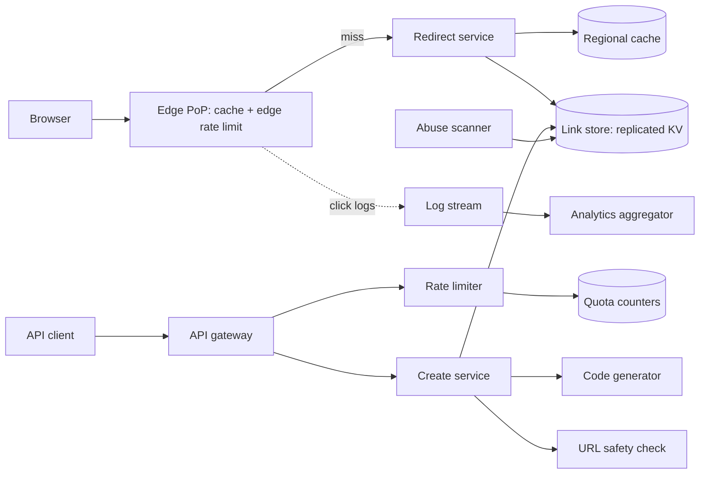
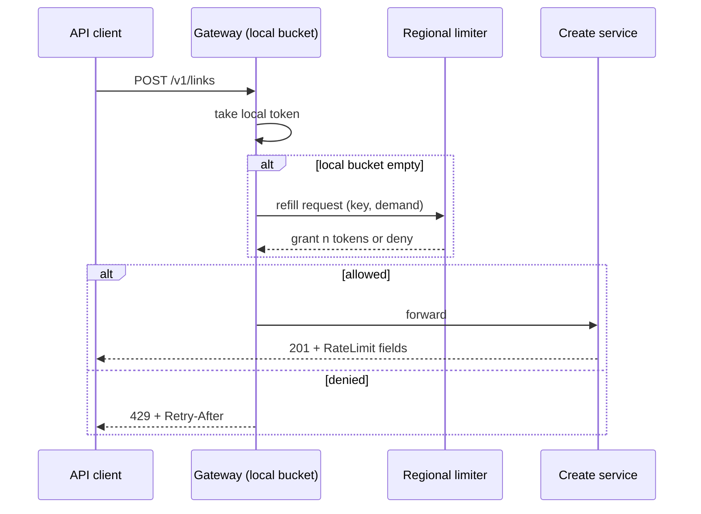

# C01 — URL shortener + distributed rate limiter

> **The requirement.** A public shortener at `lmn.example` takes **100 million new links per month** from a web UI and
> a paid API, and serves **10 billion redirects per month** to anyone on the internet, with **p99 redirect latency under
> 50 ms** measured at the edge. API customers have per-key quotas that must hold even when they spread calls across
> three regions. Phishing campaigns will try to use the service the week it launches. It is hard for two reasons that
> look small and are not: the read path is so hot and so skewed that one viral link can exceed the whole fleet's
> average load, and a quota that must be "global" sits on top of a system whose regions cannot afford to talk to each
> other on every request.

The shortener is the simplest realistic system that *needs* a limiter. Prerequisites:
[SYSDESIGN-04 caching](../01-foundations/04-caching.md), [SYSDESIGN-07 partitioning](../01-foundations/07-partitioning-sharding.md)
and [SYSDESIGN-10 APIs and rate-limiting algorithms](../01-foundations/10-apis-communication.md).

## The prompt

"Design a URL shortener" usually comes with no numbers and an implied answer of "hash the URL, store it". Ask who
creates links, whether links can be edited or expire, whether you must count clicks, and what happens when a link
points at malware. Those answers decide the status code, the cache policy, the limiter and the abuse pipeline.

## CLARIFY: requirements

### Functional

1. **Create** a short link for a long URL; optional custom alias (`lmn.example/spring-sale`); optional expiry.
2. **Redirect**: `GET lmn.example/{code}` sends the browser to the long URL.
3. **Manage**: owners can disable a link or change its destination (paid tier); disabled links stop redirecting
   within 60 s.
4. **Analytics**: click counts per link per hour, by country and referrer; delayed by up to 5 minutes is fine.
5. **API** with per-key quotas: e.g. free 100 creates/hour, business 6,000 creates/minute; quota state visible to
   clients.
6. **Abuse handling**: links to known phishing/malware are refused at creation or blocked later; abusive clients are
   throttled before they reach the origin.

### Non-functional

| Property | Target | Why |
|---|---|---|
| Redirect latency | p99 < 50 ms at the edge (cache hit); p99 < 150 ms on a miss | a redirect sits in front of someone else's page load |
| Redirect availability | 99.99 % monthly (≈ 4.3 min of errors) | a broken shortener breaks every page that embedded its links |
| Create availability | 99.9 % | creators can retry; the API is idempotent |
| Durability | an acknowledged link is never lost or re-pointed | printed QR codes live for years |
| Limiter accuracy | per-key quota overshoot ≤ 5 % in steady state | customers pay for quota; overshoot is free capacity |
| Limiter overhead | p99 < 2 ms added to an API call in-region | the limiter must not become the bottleneck it prevents |
| Takedown propagation | blocked link stops redirecting everywhere within 60 s | abuse reports are time-critical |

### Out of scope (say it)

Link-in-bio pages, branded custom domains (mention as a follow-up), billing, and a full abuse-review UI.

## QUANTIFY: estimates

Every number below is an **assumption** unless a source is cited. One month ≈ 30 × 86,400 s = 2.59 M s.

| Quantity | Working | Result |
|---|---|---|
| Creates, average | 100 M / 2.59 M s | ≈ 39 /s |
| Creates, peak (assume 5× average) | 39 × 5 | ≈ 195 /s; provision 500 /s for bulk API jobs |
| Redirects, average | 10 B / 2.59 M s | ≈ 3,860 /s |
| Redirects, peak (assume 5×) | 3,860 × 5 | ≈ 19,300 /s |
| One viral link (assumption) | campaign in a push notification | 50,000 /s for minutes |
| Read : write | 3,860 / 39 | ≈ 100 : 1 |
| Links after 5 years | 100 M × 60 months | 6 B |
| Bytes per link (assume 150 B average long URL + ≈ 100 B metadata, ×2 engine/index overhead) | 250 B × 2 | ≈ 500 B |
| Primary storage, 5 years | 6 B × 500 B | ≈ 3 TB; ≈ 9 TB with 3 replicas |
| Key space, 7 base-62 characters | 62^7 | ≈ 3.52 × 10^12 codes |
| Occupancy after 5 years | 6 × 10^9 / 3.52 × 10^12 | ≈ 0.17 % |
| Redirect egress (≈ 500 B response incl. headers) | 19,300 × 500 B | ≈ 9.7 MB/s ≈ 77 Mbit/s |
| Click events (≈ 100 B each) | 10 B × 100 B | ≈ 1 TB/month raw |
| Limiter state (1 M API keys × 2 counters × 64 B) | | ≈ 128 MB |

**What the numbers say.** Storage and bandwidth are small: a few nodes hold the whole dataset and one network card
carries peak egress. The design problem is *not* volume. It is (a) **skew** — the viral link at 50,000 /s is 2.6× the
fleet's entire peak, all on one key; (b) **latency** — 50 ms p99 is less than one transatlantic round trip, so
redirects must be answered near the user; and (c) **coordination** — quotas are global but the regions are far apart.
Say this out loud; it tells the interviewer you will not spend 20 minutes sharding a 3 TB table.

Why 7 characters? Six base-62 characters give 62^6 ≈ 5.7 × 10^10 codes; 6 B links would fill ≈ 10.6 % of that, which
makes random-key collisions frequent and leaves little room for growth. Seven characters keep occupancy below 0.2 %
for five years, so a random code collides with probability ≈ 0.0017 per attempt and one retry almost always succeeds.

## SKETCH: high-level design



*Diagram: browsers hit an edge PoP that caches redirects and applies edge rate limits; misses go to a regional redirect
service backed by a cache and a replicated KV link store. API clients pass a gateway and rate limiter (with quota
counters) before the create service, which uses a code generator and a URL safety check and writes to the KV store.
Edge click logs flow to an analytics aggregator; an abuse scanner re-checks stored links.*

**Why each box is there.**

- **Edge PoP** — the only way to meet 50 ms p99 globally and absorb the viral link; it also sees abusive IPs first.
- **Redirect service + regional cache** — a stateless, mostly in-memory read path, separate from the create service
  so a write-side incident cannot take down redirects.
- **Link store** — a replicated key-value store keyed by code. The access pattern is pure point lookup and
  insert-if-absent; no joins, no range scans. Any store with conditional writes works (DynamoDB, Cassandra with
  lightweight transactions, PostgreSQL with a primary key) — choose by what your team operates
  ([SYSDESIGN-05](../01-foundations/05-choosing-storage.md)).
- **Rate limiter + quota counters** — enforce the paid product (quotas) and protect the origin (abuse).
- **Code generator** — issues codes without a global lock (deep dive 1).
- **URL safety check + abuse scanner** — a shortener hides the destination, which is exactly what phishing needs.
- **Log stream + analytics** — clicks are counted from edge logs asynchronously, never on the redirect's critical path.

## API and data model

### Public API

```http
POST /v1/links
Authorization: Bearer <api-key>
Idempotency-Key: 9f1c2e7a-...           # retries return the same link
Content-Type: application/json

{ "url": "https://shop.example.com/spring?utm=x", "alias": "spring-sale", "expires_at": "2027-06-01T00:00:00Z" }

201 Created
RateLimit-Policy: "hourly";q=100;w=3600
RateLimit: "hourly";r=97;t=2410
{ "code": "spring-sale", "short_url": "https://lmn.example/spring-sale", "created_at": "..." }
```

```http
GET /{code}            → 302 Found, Location: <long URL>, Cache-Control: public, s-maxage=60, max-age=0
                       → 404 if unknown, 410 Gone if disabled or expired, 200 interstitial if flagged
GET /v1/links/{code}/stats?from=...&to=...&granularity=hour
PATCH /v1/links/{code}  { "url": "...", "disabled": true }
```

The `RateLimit` / `RateLimit-Policy` fields follow the IETF httpapi working-group draft
(draft-ietf-httpapi-ratelimit-headers-11, May 2026 — still an Internet-Draft, not an RFC) [5]. A throttled call gets
`429 Too Many Requests` [6] with `Retry-After` (RFC 9110 §10.2.3) [1]. The `Idempotency-Key` request header is also an
active IETF draft (draft-ietf-httpapi-idempotency-key-header-08, October 2026) [7]; it lets a client retry a create after
a timeout without minting a second code.

### Data model

| Table | Key | Columns | Notes |
|---|---|---|---|
| `links` | `code` (partition key) | `long_url`, `owner_id`, `created_at`, `expires_at`, `status` (active / disabled / flagged), `version` | point lookups only; conditional insert enforces uniqueness |
| `links_by_owner` | `owner_id`, `created_at` | `code` | secondary index for the dashboard; eventually consistent is fine |
| `idempotency` | `(api_key, idempotency_key)` | request hash, response, TTL 24 h | lets retries replay the original response |
| `click_hourly` | `(code, hour)` | counts by country, referrer | written by the aggregator, columnar store or wide-column table |
| quota counters | `(api_key, window)` in an in-memory store | count or token level + timestamp | TTL'd; losing them is tolerable (deep dive 3) |

### Which redirect status code?

RFC 9110 defines the semantics [1]. **301** and **308** are *permanent* and "heuristically cacheable", meaning a browser
or proxy may cache them without explicit freshness headers; 301 (like 302) historically allows a user agent to change
POST to GET, while 308 (like 307) forbids changing the method. **302** and **307** are *temporary*: the client "ought
to continue to use the target URI for future requests".

For a shortener the method rule is irrelevant (redirects are GETs); caching is what matters. A browser-cached 301 means
the next click never reaches you: you lose the click count, you cannot change the destination, and — worst — you cannot
take down a phishing link that a victim has already visited once. The design choice here: **302 with
`Cache-Control: public, s-maxage=60, max-age=0`**. Shared caches (your CDN) may keep the answer for 60 s, which absorbs
viral load and bounds *passive* CDN staleness to 60 s (plus any stale-while-revalidate window); the 60 s takedown
requirement is met only by active purge (deep dive 2), which must also bypass stale-while-revalidate and
stale-if-error, so keep the SWR window at ≤ 5 s. Browsers revalidate every time, so every click passes through an edge
you log. If a customer explicitly wants SEO-style permanence, offer 301 per link and document
that analytics and takedown become best-effort.

## DEEPEN

### Deep dive 1 — generating short codes without a global lock

| Scheme | How | Collisions | Coordination | Enumerable? | Verdict |
|---|---|---|---|---|---|
| Hash and truncate | first 7 base-62 chars of a hash of the long URL | yes; must check and re-salt | none | no | dedupes identical URLs for free, but two owners shortening the same URL get the *same* code — wrong when they need separate analytics or expiries |
| Global counter → base 62 | one sequence | none | every create hits one counter | **yes** — `…a0`, `…a1`, … lets anyone crawl every link | simple; leaks volume and private links |
| Counter blocks per node | a coordinator hands each node ranges of 10,000 IDs | none | one call per 10,000 creates | yes, unless scrambled | good throughput; gaps on node crash are harmless |
| Random code + conditional insert | 7 random base-62 chars from a CSPRNG; `INSERT … IF NOT EXISTS` | probability = occupancy (≈ 0.17 % at 5 years) → retry | none | no | **default here** |
| Counter + keyed permutation | counter block value → a keyed bijection on [0, 62^7) → base 62 | none, by construction | one call per block | no, without the key | best when you want zero retries and non-guessable codes |
| Snowflake-style ID [8] | 41-bit time + 10-bit machine + 12-bit sequence | none | machine IDs only | partially (time-ordered) | IDs are 64-bit, ≈ 11 base-62 chars — too long; here *short* and *non-guessable* beat time order |

The random scheme's cost is easy to bound. With occupancy *p*, the expected number of attempts is 1 / (1 − p) ≈ 1.0017
at five years; even at 10× the planned volume (1.7 % occupancy) it is ≈ 1.017. A conditional insert is a single
round-trip in DynamoDB (`attribute_not_exists`) or PostgreSQL (`ON CONFLICT DO NOTHING`); in Cassandra it is a
lightweight transaction, implemented with Paxos [14], which adds several replica round trips — acceptable at
≈ 200 writes/s.

**Custom aliases** use the same conditional insert plus a reserved-word and brand-impersonation check.

### Deep dive 2 — the read path and the viral link

The redirect path is a cache hierarchy: **edge cache (60 s) → regional in-memory cache → link store**. With a Zipf-like
popularity curve (an assumption; measure it), a small fraction of codes takes most traffic. Caching the top 1 % of
links (60 M × 250 B ≈ 15 GB) fits in a small in-memory cluster; most redirects never reach it because the edge answers
them.

The viral link breaks naive caching in three ways, each with a standard fix from
[SYSDESIGN-04](../01-foundations/04-caching.md):

1. **Stampede on expiry.** At 50,000 /s, when the edge entry expires, every PoP's concurrent misses go to origin at
   once. Fix: *request coalescing* at the edge and in the redirect service (one in-flight fetch per key; others wait),
   plus *stale-while-revalidate* so expiry triggers a background refresh rather than a miss.
2. **Hot shard.** Even with coalescing, the regional cache node owning that key sees every edge miss. Fix: a small
   *in-process* LRU in each redirect service instance (a few thousand entries, 5 s TTL) so the hottest keys are served
   without a network hop.
3. **Negative lookups.** Scanners probing random codes miss every cache and hit the store. Fix: cache 404s briefly
   at the edge and rate-limit 404-heavy clients. (A Bloom filter of all codes — 6 B entries at 1 % false positives ≈
   7.2 GB — is too big per instance.)

Takedown and edits must invalidate all three layers. Because the edge TTL is 60 s and the in-process TTL is 5 s, the
worst-case propagation without active purging is ≈ 65 s. To meet "≤ 60 s" with margin, a takedown writes the store,
publishes an invalidation event to the regional caches, and calls the CDN purge API for that path.

### Deep dive 3 — the distributed rate limiter

The limiter has five decisions. Work through them in this order.

**(a) What to limit and where.** Three layers, each with a different key:

| Layer | Key | Purpose | Example limit |
|---|---|---|---|
| Edge (CDN/WAF) | client IP, ASN, TLS fingerprint | drop floods and scanners before origin | 600 redirects/min per IP; 20 404s/min per IP |
| API gateway | API key (tenant) | enforce paid quotas | business: 6,000 creates/min |
| Service | internal caller, resource | protect dependencies (load shedding) | create service: 2,000 in-flight requests |

Stripe describes the same layering from production: a per-user *request rate limiter* (the most important one), a
*concurrent requests limiter* ("You can only have 20 API requests in progress at the same time"), and two load
shedders that reserve capacity for critical traffic [2]. Concurrency limits matter for expensive endpoints
(bulk create, long stats queries).

**(b) Which algorithm.** [SYSDESIGN-10](../01-foundations/10-apis-communication.md) covers them; the summary for this
design:

- **Token bucket** — capacity *b* (burst) and refill rate *r*. Stores two numbers per key (tokens, last-refill time).
  Stripe uses it, backed by Redis [2]; Envoy's local rate limit is a token bucket [3]; DynamoDB's global admission
  control is built on token buckets held by request routers [11]. **Default for API quotas** because "burst + sustained
  rate" is what customers understand.
- **Fixed window counter** — one `INCR` per window. Allows up to 2× the limit across a window boundary.
- **Sliding window log** — exact, but stores one timestamp per request: 6,000/min × 1 M keys is not affordable.
- **Sliding window counter** — weights the previous window's count by the fraction still inside the sliding window:
  `rate ≈ prev × (window − elapsed)/window + current`. Cloudflare measured this approximation over 400 million
  requests from 270,000 sources: 0.003 % of requests wrongly allowed or limited, average 6 % difference between real and
  approximate rate [4]. **Default for edge limits** — two counters per key, no per-request state.

**(c) Where the state lives.** A per-key counter must be updated atomically. The Redis documentation's own rate-limiter
pattern shows the classic race: `INCR` followed by a separate `EXPIRE` can leak a key if the client dies in between;
the fix is to make the read-modify-write one Lua script [9]. Lab [labs/10-apis-communication](../../labs/10-apis-communication/)
implements five limiters as atomic Lua scripts so you can see the boundary effects.

Three placements:

| Placement | Accuracy | Latency added | Failure impact |
|---|---|---|---|
| Central store per region (Redis/Valkey cluster, sharded by key) | exact within the region | one in-region round trip (≈ 0.5–1 ms, assumption) | store down → decide fail-open/closed |
| Local in each gateway instance | per-instance only; a key spread over 50 instances gets 50× its quota unless shares are assigned | ≈ 0 | none |
| **Two-stage: local bucket + central/global service** | local absorbs bursts, central enforces the real quota | ≈ 0 for most requests | degrades to local-only |

Envoy documents the two-stage pattern explicitly: a local token bucket applies a coarse first limit and a global gRPC
rate-limit service applies the fine-grained one, so the local bucket can "reduce load on the global rate limit
service" [3]. Envoy also offers a quota-based global limiter that shares a quota "with periodic load reports" [3],
the same shape as the adaptive split below. DynamoDB's global
admission control works the same way: each request router keeps a local token bucket and periodically refills it from
a central service [11].

**(d) Multi-region quotas.** A business customer may send creates to all three regions. Options:

1. **Pin the key to a home region** for quota decisions (one cross-region hop for traffic arriving elsewhere). Exact,
   but adds a cross-region round trip (assume 70–150 ms) for remote callers — unacceptable for most APIs.
2. **Static split** — each region enforces ⅓ of the quota. Simple, but a customer whose traffic is 90 % in one region
   gets throttled at 33 % of what they paid for.
3. **Adaptive split (default)** — each region enforces locally against a *share*; every second, regions publish
   their per-key consumption to the others and recompute shares in proportion to recent demand. The overshoot is
   bounded by the sync interval: if a client suddenly sprays all regions, each region can admit at most its current
   share plus one interval of unsynchronized traffic. With a 6,000/min quota (100 /s), 3 regions and a 1 s interval,
   worst-case excess is on the order of (regions − 1) × 100 /s × 1 s = 200 requests per interval, ≈ 3 % of a minute's
   quota — inside the 5 % accuracy target. The bound assumes any region admits at most the full per-second quota rate
   for one sync interval; it is a worst-case burst bound, not the steady-state error. Write that bound down; it converts "eventually consistent limiter" from
   hand-waving into a contract.

**(e) Failure policy.** If the counter store is unreachable, **fail open with a conservative local limit** for API
quotas (a missed quota is lost revenue for minutes; a blocked API is an outage for every customer) and **fail closed**
only for limits that protect safety-critical resources (e.g. login attempts). Emit a metric on every fallback decision. Tell clients the truth: `429` plus `Retry-After`, and the `RateLimit` fields so
well-behaved SDKs slow down *before* they hit the wall [5]. Add jitter guidance to the SDK; synchronized retries after
a `Retry-After` are their own thundering herd ([SYSDESIGN-11](../01-foundations/11-reliability-engineering.md)).



*Diagram: the client calls the gateway, which takes a token from its local bucket; only when the local bucket is empty
does it ask the regional limiter for more tokens. Allowed requests are forwarded and return 201 with rate-limit fields;
denied ones get 429 with Retry-After.*

### Deep dive 4 — analytics without slowing the redirect

Counting clicks synchronously couples the 50 ms redirect to a write path and creates the hottest write key in the
system. The edge already logs every request: ship edge logs to a log
stream ([SYSDESIGN-08](../01-foundations/08-async-event-driven.md)), aggregate per `(code, hour, country, referrer)` in a
stream processor, and write hourly rows. Micro-batches meet the 5-minute freshness. Deduplicate by request ID (edge log delivery is at-least-once)
and drop known bots. Raw logs contain IP addresses — personal data under GDPR — so truncate or hash IPs at ingestion and keep raw
logs for days, not years ([SYSDESIGN-19](../02-modern-requirements/19-privacy-compliance-sovereignty.md)).

## STRESS: failures, hot spots, scale ×10

| Failure / stress | Symptom | Detection (SLI) | Mitigation |
|---|---|---|---|
| Viral link | one key at 50,000 /s; regional cache node CPU pegged | per-key request rate at edge; cache node CPU | coalescing, stale-while-revalidate, in-process LRU (deep dive 2) |
| Link-store region outage | misses fail in that region | redirect error ratio on cache misses | read from replicas in another region (accept stale for ≤ minutes); creates fail over or return 503 with `Retry-After` |
| Cache cluster loss | all traffic becomes misses; store overload | cache hit ratio drops; store latency rises | edge keeps serving for 60 s plus stale-if-error; warm the cache from the top-N list; shed 404 probes first |
| Limiter store down | either everyone throttled or no quotas | fallback-decision counter | fail open with local limits (deep dive 3e); page if > 5 min |
| Clock skew between gateways | windows misaligned; burst at boundaries | skew metric from NTP | use the counter store's clock (e.g. Redis `TIME` inside the script) rather than gateway clocks |
| Enumeration scan | high 404 rate from a few ASNs | 404 ratio per IP/ASN | edge 404 limit; random codes make scanning unprofitable |
| Phishing wave | many creates from new accounts pointing at look-alike domains | safety-check hit rate; abuse reports | creation-time checks, new-account quotas, interstitials, fast takedown (Modern twist) |
| Retry storm after 429 | clients retry in lock-step | 429 rate oscillates | `Retry-After` with jitter in SDKs; token bucket rather than fixed window |

**Scale ×10** (100 B redirects/month; ≈ 193,000 /s peak; 1 B creates/month). The read path is still mostly edge
hits, and edge capacity is bought, not built. Storage grows to ≈ 30 TB (90 TB with
replicas) over five years — now partition the link store by code hash across more nodes, which is trivial because
there are no cross-key queries ([SYSDESIGN-07](../01-foundations/07-partitioning-sharding.md); try
[labs/07-partitioning-sharding](../../labs/07-partitioning-sharding/) to see how much data moves when you add nodes).
Key-space occupancy reaches ≈ 1.7 % — still one expected retry in 60. Creates at ≈ 2,000 /s peak make Cassandra
lightweight transactions noticeably expensive; switch to counter blocks with a keyed permutation (zero retries, no
Paxos). The limiter's central stores scale by sharding keys; the multi-region sync message grows with active keys, so
send only keys whose consumption changed.

## Operate: SLOs, cost, energy

### SLOs

| SLI | SLO | Burn-rate alert |
|---|---|---|
| Redirect success (non-5xx for known codes), measured at edge | 99.99 % / 30 days | page at 14.4× burn over 1 h ([SYSDESIGN-12](../01-foundations/12-observability.md)) |
| Redirect latency at edge | p99 < 50 ms on hits, < 150 ms on misses | ticket on 1 h breach |
| Create success | 99.9 % | page at 14.4× over 1 h |
| Takedown propagation | 99 % of takedowns effective in ≤ 60 s | synthetic check: create, block, poll from 10 PoPs |
| Limiter fallback decisions | < 0.1 % of decisions | ticket |

### Cost

The cost structure is unusual: compute and storage are tiny, so **per-request edge pricing and log volume dominate**.
Work it as a sensitivity, not a quote: at 10 B redirects/month, every 1 cent per 10,000 requests of CDN request pricing
is 10 B / 10,000 × $0.01 = **$10,000 per month**. Edge logs at ≈ 1 TB/month raw are cheap to store but expensive to
*query* if kept raw; aggregate to hourly rows and expire raw logs. The biggest lever is the edge hit ratio: each point
of misses at peak is ≈ 190 /s of origin traffic. See
[SYSDESIGN-16](../02-modern-requirements/16-cost-as-requirement.md) for building the unit-cost model.

### Energy

Assumption: one server drawing 300 W serves 20,000 cache-hit redirects/s; energy is 300 J/s ÷ 20,000 /s = **15 mJ per redirect** before network and
cooling overhead (PUE). At 10 B/month that is ≈ 150 MJ ≈ 42 kWh per month for that tier — negligible. The energy
levers are architectural: answer from the edge and drop abusive traffic there ([SYSDESIGN-17](../02-modern-requirements/17-energy-carbon-aware.md)).

## Modern twist

What changes in 2026 is less the shortener than the **adversary**.

**Abuse detection is a first-class component.** Short links hide destinations, so they are a standard phishing
wrapper. Check every destination at creation and re-check stored links asynchronously:
a domain clean yesterday can host a kit today. Google's Safe Browsing API is for non-commercial use only; the
commercial product is Web Risk, which offers a *Lookup* API (send the URL; Google learns which URLs you check) and an
*Update* API (keep hashed copies of the lists locally and query the server only on a local match — better privacy and
latency) [10][12]. For a high-volume shortener the Update pattern fits: a local hash-prefix check at creation adds
microseconds, not a network round trip. Layer your own signals on top — account age, creation velocity, look-alike
domains, landing-page classification — and route uncertain cases to an **interstitial** ("this link leads to …,
continue?") rather than a hard block, which keeps false positives survivable.

**Rate limiting moved to the edge, and it counts per data center.** Cloudflare's rate-limiting rules can count by
IP, headers, cookies, ASN, country, path, JSON body fields and JA3/JA4 TLS fingerprints (richer characteristics are
plan-dependent), and its documentation states counters have a *per-data-center scope* [13]: the trade-off of deep
dive 3(d) made by a vendor. A distributed attacker spread over many PoPs gets more than the nominal limit, in exchange
for zero cross-PoP coordination. Design for it — combine an edge limit (coarse, per PoP, cheap) with your gateway's
per-key quota (precise, per region) and a per-tenant concurrency cap.

**Standard headers are close.** The `RateLimit` and `RateLimit-Policy` fields [5] and the `Idempotency-Key` header [7]
are both active IETF drafts as of 2026-11. Implementing them now is cheap; pin the draft version in your API docs.

## WRAP: interview summary

**A strong 45-minute answer covers, in order:** clarify → numbers showing skew and latency, not size → 7-character
codes → sketch with separate read and create paths → 302 + `s-maxage` → code generation → viral-link mitigations →
limiter (algorithm per layer, atomic state, two-stage, multi-region overshoot bound, fail-open, `429`) → failures and
×10.

| Level | What "good" looks like |
|---|---|
| Junior | Correct API and data model; base-62 encoding with a key-space calculation; a cache in front of the store; knows 301 vs 302 differ in caching; one rate-limiting algorithm explained correctly |
| Senior | Everything above, plus: picks a code scheme and defends it on collisions and enumerability; edge caching with coalescing for the viral link; analytics off the critical path; limiter with atomic updates, two-stage design and a fail-open/closed decision; signals quotas to clients |
| Staff | Frames the system around skew, latency and abuse; states an explicit overshoot bound for multi-region quotas and why it meets the product contract; designs takedown propagation as an SLO; treats abuse detection and privacy of click logs as requirements; knows which parts are bought (edge) vs built, and where the cost is |

**Red flags.** Sharding a 3 TB dataset before discussing caching. MD5-and-truncate with no collision story. A global
auto-increment counter exposed as the code. Counting clicks synchronously on the redirect path. A 301 with no
discussion of what it does to analytics and takedown. A rate limiter that reads, then writes, without atomicity. "Use
Redis" with no answer to "what happens when Redis is down?"

**Follow-ups to expect.** Branded custom domains (per-domain TLS at the edge); link expiry at scale (store TTL plus a
lazy check on read); GDPR erasure of a creator's links and analytics.

## Alternatives considered

| Alternative | Wins when | Why not the default here |
|---|---|---|
| Relational database (PostgreSQL) as the link store | small to mid scale, team already runs it | fine up to the ×10 case with read replicas and caching; a KV store makes cross-region replication and partitioning simpler at the top end |
| Single global limiter (one region) | one-region deployments | adds a cross-region round trip to every API call from elsewhere |

## Exercises

See [exercises/C01-url-shortener-rate-limiter.md](../../exercises/C01-url-shortener-rate-limiter.md); labs used:
[labs/10-apis-communication](../../labs/10-apis-communication/), [labs/04-caching](../../labs/04-caching/) and
[labs/07-partitioning-sharding](../../labs/07-partitioning-sharding/).

## References

All accessed 2026-11-19; re-checked 2026-11-20.

1. R. Fielding, M. Nottingham, J. Reschke (eds.), "HTTP Semantics," RFC 9110, June 2022 — §15.4.2 (301), §15.4.3 (302), §15.4.8 (307), §15.4.9 (308), §10.2.3 (Retry-After). https://www.rfc-editor.org/rfc/rfc9110
2. P. Tarjan, "Scaling your API with rate limiters," Stripe blog, 2017-03-30. https://stripe.com/blog/rate-limiters
3. Envoy project, "Global rate limiting" (architecture overview; local token bucket + global service). https://www.envoyproxy.io/docs/envoy/latest/intro/arch_overview/other_features/global_rate_limiting
4. Cloudflare, "How we built rate limiting capable of scaling to millions of domains," 2017-06-07. https://blog.cloudflare.com/counting-things-a-lot-of-different-things/
5. IETF httpapi WG, "RateLimit header fields for HTTP," draft-ietf-httpapi-ratelimit-headers-11, 2026-05-23 (Internet-Draft). https://datatracker.ietf.org/doc/draft-ietf-httpapi-ratelimit-headers/
6. M. Nottingham, R. Fielding, "Additional HTTP Status Codes," RFC 6585, April 2012 (status 429). https://www.rfc-editor.org/rfc/rfc6585
7. IETF httpapi WG, "The Idempotency-Key HTTP Header Field," draft-ietf-httpapi-idempotency-key-header-08, 2026-10-22 (Internet-Draft). https://datatracker.ietf.org/doc/draft-ietf-httpapi-idempotency-key-header/
8. Twitter, "Snowflake" README (2010 release; 41-bit time, 10-bit machine, 12-bit sequence). https://github.com/twitter-archive/snowflake/tree/snowflake-2010
9. Redis documentation, "INCR — Pattern: rate limiter" (race between INCR and EXPIRE; Lua fix). https://redis.io/docs/latest/commands/incr/
10. Google, "Safe Browsing" (v4 and v5 APIs; non-commercial use only; commercial use via Web Risk). https://developers.google.com/safe-browsing
11. M. Elhemali et al., "Amazon DynamoDB: A Scalable, Predictably Performant, and Fully Managed NoSQL Database Service," USENIX ATC 2022 — §4 global admission control with token buckets. https://www.usenix.org/conference/atc22/presentation/elhemali
12. Google Cloud, "Web Risk overview" (Lookup API vs Update API with local hashed lists). https://docs.cloud.google.com/web-risk/docs/overview
13. Cloudflare, "Rate limiting rules" (counting characteristics incl. JA3/JA4; per-data-center counter scope). https://developers.cloudflare.com/waf/rate-limiting-rules/
14. Apache Cassandra documentation, "Guarantees" (lightweight transactions implemented with Paxos). https://cassandra.apache.org/doc/latest/cassandra/architecture/guarantees.html
