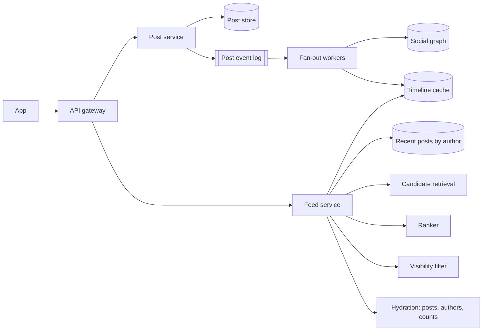
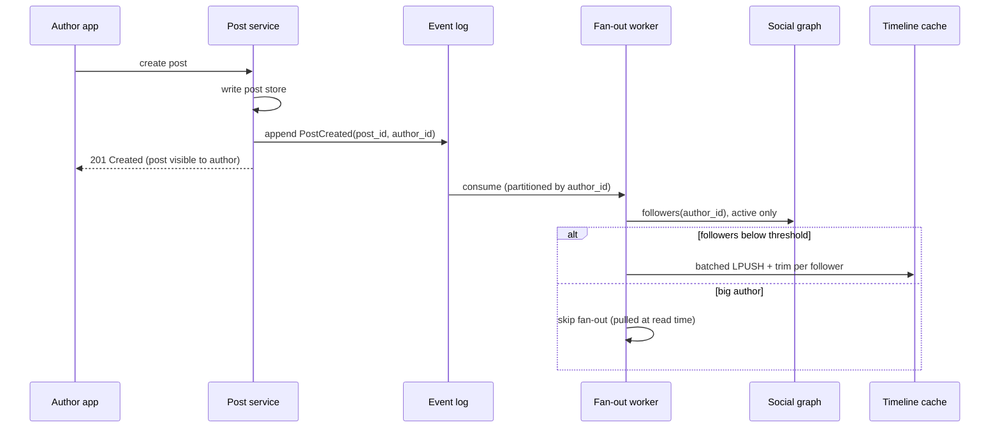
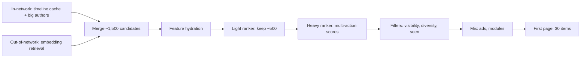

# C02 — News feed / timeline

> **The requirement.** A social app has **200 million daily active users**. Opening the app shows a home feed that
> must load in **< 300 ms at p99**. When someone posts, their followers should see it within **5 s at p95**. Most
> accounts have a few hundred followers; a few thousand have millions, and the largest have tens of millions. The feed
> is **ranked** by predicted interest, mixes posts from people you follow with recommended ones, and must hide posts
> from blocked or muted accounts instantly. It is hard because the work per post is proportional to follower count —
> and follower counts span six orders of magnitude — while the work per feed load is proportional to how much
> ranking you can afford in 300 ms.

Prerequisites: [SYSDESIGN-04 caching](../01-foundations/04-caching.md),
[SYSDESIGN-07 partitioning](../01-foundations/07-partitioning-sharding.md) and
[SYSDESIGN-08 async systems](../01-foundations/08-async-event-driven.md). The ranking half connects to
[SYSDESIGN-24 retrieval](../03-ai-systems/24-retrieval-vector-systems.md) and
[SYSDESIGN-27 ML platforms](../03-ai-systems/27-ml-platforms.md).

## The prompt

"Design Twitter's timeline" or "design the Facebook news feed". The classic answer — *precompute every user's
timeline on write, except for celebrities* — is correct and incomplete. In 2026 a strong answer also explains where
ranking runs, what it costs, and why the industry has partly moved *away* from fully materialized per-user timelines.
Ask early: chronological or ranked? Only followed accounts, or recommendations too? How fresh is fresh?

## CLARIFY: requirements

### Functional

1. **Post**: text plus media references (media storage is out of scope; see
   [C04](C04-video-streaming.md)); delete and edit.
2. **Follow / unfollow** accounts; **block / mute** accounts and keywords.
3. **Home feed**, two modes: **For you** (ranked, in-network + recommended) and **Following** (reverse chronological,
   in-network only). Infinite scroll.
4. A "new posts" indicator when fresh posts arrive while the user is reading.
5. A user always sees their own new post at the top immediately (read-your-writes for the author).

### Non-functional

| Property | Target | Why |
|---|---|---|
| Feed load latency | p99 < 300 ms server-side for the first page | app-open is the product's front door |
| Freshness | p95 < 5 s from post to follower feed eligibility | conversations happen in near real time |
| Availability (feed reads) | 99.95 % | a degraded (less ranked) feed beats an error |
| Visibility correctness | blocks/mutes/deletes effective on the next feed load | safety and legal obligations |
| Cost | bounded cost per 1,000 feed loads | ranking compute is the dominant variable cost |

### Out of scope

Search, notifications, ads auction (the feed *reserves slots* for ads; the auction is another system), media
transcoding, direct messages ([C03](C03-chat-presence.md)).

## QUANTIFY: estimates

All values are **labelled assumptions**; replace them with the interviewer's numbers.

| Quantity | Working | Result |
|---|---|---|
| Feed loads/day | 200 M DAU × 10 sessions | 2 B/day |
| Feed loads/s, average | 2 B / 86,400 | ≈ 23,000 /s |
| Feed loads/s, peak (3×) | | ≈ 70,000 /s |
| Posts/day (1 post per 8 DAU) | 200 M / 8 | 25 M/day ≈ 290 /s avg, ≈ 870 /s peak |
| Registered users / follow edges | 500 M users × 200 follows | 100 B edges |
| Graph storage (16 B per edge, both directions) | 100 B × 16 B × 2 | ≈ 3.2 TB |
| Fan-out inserts if pushing every post to every follower (mean 200) | 25 M × 200 | 5 B/day ≈ 58,000 /s avg, ≈ 175,000 /s peak |
| …only to recently active followers (40 % of followers) | 5 B × 0.4 | 2 B/day |
| Timeline entry (post ID 8 B + author ID 8 B) | | 16 B |
| Timeline cache (500 entries per DAU) | 200 M × 500 × 16 B | 1.6 TB raw; ≈ 4.8 TB with 1.5× overhead and 2 replicas |
| One mega-account post (50 M followers) | 50 M inserts at 1 M inserts/s | ≈ 50 s — misses the 5 s target |
| Ranking work (500 candidates per load) | 70,000 /s × 500 | 35 M candidate scores/s at peak |

**What the numbers say.** Storage is not the problem (3.2 TB of graph and a few TB of RAM is a modest cluster). Two
things are: **write amplification is skewed** — the average post costs 200 inserts, one celebrity post costs 50 M — and
**ranking dominates compute** — 35 M model scores per second at peak is a GPU/accelerator fleet, not a side service.
The rest of the design follows from those two facts.

## SKETCH: high-level design



*Diagram: the app calls an API gateway. Posts go to a post service that writes a post store and an event log; fan-out
workers read the log, look up followers in the social graph and insert into a timeline cache. Feed reads go to a feed
service that reads the timeline cache, a recent-posts-by-author index, and candidate retrieval, then calls a ranker, a
visibility filter and hydration of posts, authors and counts.*

**Why each box is there.**

- **Post event log** — decouples "post accepted" (fast, durable) from "post delivered" (slow, proportional to
  followers). A log rather than a queue so new consumers (search indexing, notifications, ranking features) can replay
  it ([SYSDESIGN-08](../01-foundations/08-async-event-driven.md)).
- **Fan-out workers** — push post IDs into followers' timelines for ordinary authors.
- **Timeline cache** — precomputed in-network candidates per active user, capped length, in memory.
- **Recent posts by author** — the *pull* side: celebrity posts are read from here at feed time instead of being
  pushed.
- **Candidate retrieval** — out-of-network recommendations (embedding retrieval; see Modern twist).
- **Ranker** — orders candidates by predicted engagement; the main compute cost.
- **Visibility filter** — blocks, mutes, deletes, legal withholding, applied at read time so they are instant.
- **Hydration** — turns IDs into renderable posts with batched lookups and caches.

## API and data model

### API

```http
GET /v1/feed?mode=for_you&cursor=<opaque>&limit=30
200 OK
{ "items": [ { "post_id": "1850…", "author": {...}, "text": "...", "media": [...], "reason": "followed" } ],
  "next_cursor": "eyJzbmFwIjoi…", "new_items_hint": false }

POST /v1/posts            { "text": "...", "media_ids": [...] }      → 201 { "post_id": "..." }
DELETE /v1/posts/{id}
POST /v1/follows          { "target_id": "..." }
POST /v1/blocks           { "target_id": "..." }
GET /v1/feed/new_count?since=<cursor>                               → { "count": 12 }
```

The cursor is **opaque** to clients: it encodes the snapshot (which candidate set was ranked), the position, and the
IDs already shown, so pagination is stable while the world changes underneath (deep dive 4).

### Data model

| Store | Key | Value | Engine choice |
|---|---|---|---|
| Post store | `post_id` (time-ordered 64-bit ID) | author, text, media refs, created_at, visibility, edit version | wide-column or sharded relational; partition by `post_id` hash |
| Recent posts by author | `author_id` | last N post IDs | in-memory, small; hot for big accounts |
| Social graph | `(user_id, direction)` | follower / following ID lists | graph or KV store, both directions materialized |
| Timeline cache | `user_id` | capped list of `(post_id, author_id)` | in-memory (Redis-like), 2 replicas |
| Engagement counts | `post_id` | likes, replies, reposts | sharded counters, approximate is fine |
| Block/mute lists | `user_id` | sets | in-memory, replicated to feed service |

Time-ordered post IDs (Snowflake-style; see [C01](C01-url-shortener-rate-limiter.md)) let the timeline sort by ID
without loading posts. Facebook's TAO is the canonical example of a graph store built for this access pattern — a
fixed set of graph queries served at "a billion reads and millions of writes each second" [3] — and its read-heavy
ratio is the general shape of social workloads.

## DEEPEN

### Deep dive 1 — fan-out on write, on read, or both

| Strategy | Write cost per post | Read cost per feed load | Freshness | Breaks when |
|---|---|---|---|---|
| **Push (fan-out on write)** | ∝ followers | 1 timeline read | as fast as workers drain | one author has 50 M followers |
| **Pull (fan-out on read)** | 1 append to author's list | ∝ number followed (merge k lists) | immediate | users follow thousands; 70,000 loads/s × 200 lists |
| **Hybrid** | push for ordinary authors, none for big ones | 1 timeline read + k big-author lists | ≤ 5 s | threshold badly chosen |

The cleanest formulation is in Yahoo's *Feeding Frenzy* paper (SIGMOD 2010): decide push or pull **per
producer/consumer pair**, "based on the ratio between a given producer's update rate … and a given consumer's view
rate" [1]. The intuition: pushing costs one write per producer event; pulling costs one read per consumer view. If a
consumer views their feed far more often than the producer posts, push is cheaper for that pair; if the producer posts
far more often than the consumer looks, pull is cheaper. Real systems simplify this to a **per-author threshold** on
follower count (and sometimes posting rate), because per-pair state is expensive to maintain.

**Placing the threshold.** With a threshold of *T* followers, a feed read must merge the recent posts of every
followed author above *T*. Assume (label it) that the average user follows 15 accounts above *T* = 100,000: the read
path does one timeline read plus 15 reads from the recent-posts-by-author index — and those 15 lists are the hottest,
most cacheable keys in the system (a few thousand big authors, read by everyone). Meanwhile the write path never does
more than 100,000 inserts for one post, which at 1 M inserts/s is 0.1 s. Lower *T* and reads get more expensive; raise
it and the tail of fan-out latency grows. Measure both and tune; the interviewer wants the trade-off and a number, not
the "right" number.

**Two more fan-out savings.**

- **Skip inactive followers.** Pushing to users who have not opened the app in 30 days wastes most inserts (the
  estimate above assumes 40 % of followers are active). Their timeline is *rebuilt on demand* when they return (deep
  dive 2).
- **Push IDs, not content.** Timeline entries are 16 bytes; edits and deletes then need no fan-out, because hydration
  and the visibility filter read the current post at feed time.



*Diagram: the author creates a post; the post service writes the post store, appends an event to the log and returns
201 immediately. A fan-out worker consumes the event, fetches active followers from the social graph and, for
ordinary authors, batch-inserts into each follower's timeline; for big authors it skips fan-out because their posts are
pulled at read time.*

Fan-out workers must be **idempotent**: the log delivers at least once, so inserting the same `post_id` twice must be
harmless (de-duplicate by ID when reading, or use a set-like structure). Partition the log by `author_id` so one
author's posts are processed in order; parallelize a large author's follower list across workers by splitting it into
chunks of, say, 10,000.

### Deep dive 2 — the timeline store

Each active user has a capped list of 500 `(post_id, author_id)` entries: ≈ 8 KB raw. For 200 M DAU that is 1.6 TB;
with data-structure overhead (assume 1.5×) and two replicas, ≈ 4.8 TB of RAM — on the order of 75 nodes with 64 GB of
usable memory each. Partition by `user_id` hash ([SYSDESIGN-07](../01-foundations/07-partitioning-sharding.md)); each
feed load touches one partition.

Why cap at 500? Because nobody scrolls 5,000 posts, and the ranker only needs a few hundred in-network candidates. The
cap also bounds fan-out cost: an insert is a push plus a trim.

**Cache miss = rebuild.** A user returning after a month has no timeline (we skipped them during fan-out, or it was
evicted). The feed service rebuilds: fetch the list of followed authors, read each author's recent posts (from the
author index, falling back to the post store), merge by time, write back the capped list. For a user following 500
accounts that is 500 small reads — tens of milliseconds if batched and parallelized, so the first feed load after a
long absence is slower but still within budget. Treat rebuild as a normal path, not an error: it is also how you
recover after losing a cache node.

**Graph changes.** A new follow should backfill a few recent posts from the new author into the follower's timeline
(cheap, one author); an unfollow is handled lazily by the read path (filter out authors no longer followed) rather than
by deleting entries.

### Deep dive 3 — the ranking pipeline and its budget

A ranked feed is a **funnel** — the candidate-generation-then-ranking split described for YouTube recommendations [2] — and the published feed designs all use one. Meta describes
News Feed ranking as scoring an inventory of "more than 1,000 posts per user, per day, on average", with a lightweight
"pass 0" that selects "approximately 500" posts, a pass that scores each post with multitask neural networks predicting
specific actions (like, comment, share), and a final contextual pass for rules such as diversity; the per-action
predictions are combined linearly into one relevance score [4]. X's open-sourced Home Mixer lists the same stages:
candidate generation from several sources, feature hydration ("Fetch the ~6000 features needed for ranking"), scoring
with an ML model, then filters and heuristics (author diversity, in-network/out-of-network balance, deduplication,
visibility filtering) and mixing in ads and modules [5].



*Diagram: in-network candidates (timeline cache plus big authors) and out-of-network candidates (embedding retrieval)
merge into about 1,500 candidates, go through feature hydration, a light ranker that keeps about 500, a heavy ranker
that predicts multiple actions, filters for visibility, diversity and already-seen posts, mixing with ads and modules,
and produce the first page of 30 items.*

**Latency budget for 300 ms p99** (assumptions; the point is that every stage has a number):

| Stage | Budget |
|---|---|
| Timeline + big-author reads (parallel) | 15 ms |
| Out-of-network retrieval (parallel with above) | 30 ms |
| Feature hydration (batched, cached) | 40 ms |
| Light ranker | 20 ms |
| Heavy ranker (batched on accelerators) | 80 ms |
| Filters, mixing, hydration of the 30 shown items | 40 ms |
| Network, serialization, slack | 75 ms |

**Cost lever: rank once, page many times.** Rank ~500 candidates on the first request, store the ordered list keyed by
the cursor's snapshot ID for a few minutes, and serve pages 2, 3, … from it. Most of the 70,000 /s peak is then
first-page loads, and later pages cost a cache read.

**Degradation.** If the heavy ranker is overloaded or down, fall back to the light ranker, then to reverse-chronological
in-network. The user gets a worse feed, not an error — which is why feed availability (99.95 %) can be higher than
ranker availability. Make the fallback rate an SLI.

### Deep dive 4 — pagination, freshness and visibility

**Cursors, not offsets.** `?page=3` breaks when new posts arrive (items shift and repeat). The cursor names a ranked
snapshot and a position in it; the server also records shown IDs so a re-ranked page never repeats a post. New posts
that arrive meanwhile are surfaced via `new_count` and the "new posts" pill, which starts a *new* snapshot when
tapped ([SYSDESIGN-10](../01-foundations/10-apis-communication.md) covers cursor pagination).

**Read-your-own-post.** Fan-out is asynchronous, so the author's own timeline might not contain the post for a few
seconds. The feed service injects the author's own recent posts (from the author index) at read time — a cheap,
targeted read-your-writes guarantee ([SYSDESIGN-06](../01-foundations/06-replication-consistency.md)).

**Visibility at read time.** Blocks, mutes, deletions and legal withholding are applied by a filter on every feed load,
never by deleting fan-out entries. This makes them effective on the next load (the requirement) and keeps fan-out
idempotent. X's documentation makes the same split explicit: "Ranking decides the order. Visibility filtering decides
whether a post can be shown at all. Different services, different inputs, different rules." [6]

## STRESS: failures, hot spots, scale ×10

| Failure / stress | Symptom | Detection | Mitigation |
|---|---|---|---|
| Fan-out backlog (big news event) | freshness p95 grows to minutes | consumer lag on the event log; post-to-eligibility latency | autoscale workers on lag; temporarily raise the push threshold so more authors are pulled; drop pushes to least-active followers first |
| Mega-account posts during peak | one author's fan-out monopolizes workers | per-author fan-out duration | the threshold sends them to pull; chunked parallel fan-out for authors near the threshold |
| Hot author index key | one cache shard pegged by a celebrity's recent-posts list | per-key QPS | replicate hot keys across shards; in-process cache in feed service (1–2 s TTL) |
| Timeline cache node lost | misses → rebuilds → graph and post-store load spike | miss ratio, rebuild rate | replicas; rate-limit rebuilds and serve a chronological-from-author-index feed meanwhile |
| Ranker overload or GPU loss | p99 over budget | ranker queue time, fallback rate | fall back to light ranker then chronological; shed out-of-network retrieval first |
| Retry storm from clients on slow feed | load doubles while slow | request rate vs unique users | server-side timeout returns a partial (chronological) page instead of an error; client backoff with jitter ([SYSDESIGN-11](../01-foundations/11-reliability-engineering.md)) |
| Stale visibility data | blocked user's post shown | sampled audits of served feeds | block lists replicated with versioning; filter fails closed for safety-critical labels |

**Scale ×10** (2 B DAU-equivalent load: 700,000 feed loads/s peak, 250 M posts/day). Fan-out inserts reach ≈ 20 B/day
to active followers — still fine with more workers and partitions, but timeline RAM grows to ≈ 48 TB, which pushes
toward **storing fewer materialized timelines**: keep them only for the most active users and rebuild or pull for the
rest. Ranking at 350 M candidate scores/s makes the ranker the dominant line item; caching scores (Modern twist) and
better candidate pruning become cost requirements, not optimizations. The social graph (32 TB at ×10 edges) needs a
proper partitioned graph store with a cache in front, TAO-style [3].

## Operate: SLOs, cost, energy

### SLOs

| SLI | SLO |
|---|---|
| Feed first-page latency, server-side | p99 < 300 ms |
| Feed success (2xx, including degraded pages) | 99.95 % / 30 days |
| Freshness: post → eligible in follower feed | p95 < 5 s, p99 < 30 s |
| Degraded-feed rate (ranker fallback) | < 1 % of loads |
| Visibility correctness (audit sample) | 100 % of sampled blocked/deleted posts absent |

### Cost

Model the cost per 1,000 feed loads as **(timeline + hydration reads) + (retrieval) + (ranking)**. With the numbers
above, the storage-side reads are cheap in-memory lookups; ranking 500 candidates through a neural model is the
variable cost that scales with usage. The three biggest levers are therefore all ranking levers: the size of the
candidate set after the light ranker, ranking once per session instead of once per page, and score caching where the
model allows it. Fan-out is the second cost center; skipping inactive followers removes most of it (in our assumptions,
60 % of inserts). See [SYSDESIGN-16](../02-modern-requirements/16-cost-as-requirement.md).

### Energy

The energy story follows the cost story: accelerator time for ranking dominates. Two architecture choices reduce it
without hurting quality much: the light-ranker funnel (most candidates never reach the expensive model) and score
reuse across pages and sessions. Report "accelerator-seconds per 1,000 feed loads" as an efficiency metric alongside
latency ([SYSDESIGN-17](../02-modern-requirements/17-energy-carbon-aware.md)).

## Modern twist

The 2026 feed is an **ML retrieval-and-ranking system with a social graph attached**, and the materialized timeline
is no longer the center.

**Embedding retrieval for out-of-network candidates.** Recommended posts come from approximate nearest-neighbor search
over user and post embeddings (two-tower models), the same machinery as RAG retrieval
([SYSDESIGN-24](../03-ai-systems/24-retrieval-vector-systems.md)). The 2026 open-source release of X's For You feed
(`xai-org/x-algorithm`) shows this concretely: out-of-network posts come from "Phoenix" retrieval (a two-tower model)
and other sources, while in-network posts come from **Thunder**, which "keeps recent posts from the accounts a viewer
follows in memory" [6]. That is a *pull-based in-network source* — an in-memory index of recent posts by author,
queried per request — rather than per-user materialized timelines. As user graphs grow and recommendations take a
larger share of the feed, holding one recent-posts index and pulling at read time can be cheaper than maintaining
hundreds of millions of timelines; the classic push design remains a good answer when the feed is mostly in-network.

**Transformer rankers with cacheable scores.** The same repository describes ranking with a transformer that predicts
probabilities for many actions, combined into one score by explicit weights; during inference "candidates cannot
attend to each other — only to the viewer context", which makes "scores consistent and cacheable" [6]. That is a
systems decision dressed as a modelling one: if a post's score does not depend on which other posts share the batch,
you can cache it and avoid re-scoring on every page. It also uses hash-based embeddings "so there is no vocabulary to
maintain and a new post is representable immediately" [6] — which matters for freshness, because a new post can be
retrieved and ranked seconds after it is created.

**Regulation shapes the API.** In the EU, the Digital Services Act requires very large online platforms that use
recommender systems to offer at least one option "not based on profiling" (Art. 38) [7]. The "Following"
reverse-chronological mode is a natural way to satisfy it — which means the non-ML path is a product requirement with
its own SLO, not just a fallback. Design both modes on the same candidate and visibility infrastructure.

**Feature freshness becomes a data-platform problem.** Thousands of features per candidate (X's Home Mixer README says
~6,000 [5]) must be fetched within tens of milliseconds and must match what the model saw in training; that is a
feature-store and online/offline-skew problem ([SYSDESIGN-27](../03-ai-systems/27-ml-platforms.md)).

## WRAP: interview summary

**A strong 45-minute answer covers, in order:** clarify ranked vs chronological, in-network vs recommended, freshness →
numbers (70,000 loads/s, 200 inserts per average post, 50 M for the largest, TBs of RAM, 35 M scores/s) → sketch with
event log, fan-out workers, timeline cache, author index, ranker and visibility filter → hybrid fan-out with a stated
threshold and the producer/consumer cost argument → timeline store sizing and rebuild-on-miss → ranking funnel with a
latency budget → cursor pagination, read-your-own-post, visibility at read time → failures and ×10 → cost of ranking.

| Level | What "good" looks like |
|---|---|
| Junior | Push vs pull explained; a working data model (posts, follows, timelines); a cache; identifies the celebrity problem |
| Senior | Hybrid fan-out with a threshold and its trade-off; asynchronous, idempotent fan-out over a log; timeline sizing; rebuild on miss; cursor pagination; visibility filtering at read time; ranking funnel with a budget and a fallback |
| Staff | Frames cost around ranking compute and fan-out amplification; explains when per-user timelines stop paying (pull from an in-memory recent-posts index); score caching and candidate isolation as cost levers; regulatory non-profiling mode as a first-class product path; SLOs for freshness and degraded-feed rate |

**Red flags.** "Query all followed users' posts and sort" at 70,000 /s with no caching. Pushing full post content
(edits and deletes then require fan-out). Synchronous fan-out inside the post request. Offset pagination. Deleting
timeline entries to implement blocks. Treating the ranker as a black box that costs nothing. Forgetting that the author
must see their own post.

**Follow-ups.** Lists and groups (more feeds with the same machinery); notifications for big-account posts (a separate
fan-out with rate limits); counting likes at scale (sharded counters, approximate reads); experiment platform for
ranking changes.

## Alternatives considered

| Alternative | Wins when | Why not the default here |
|---|---|---|
| Pure push | small, in-network-only products with bounded follower counts | celebrity posts break freshness and cost |
| Pure pull | users follow few accounts; heavy recommendation share; in-memory recent-post index | merge cost per load grows with follows; needs very fast author index |
| Precompute fully ranked feeds offline | low freshness requirements (daily digests) | ranked order goes stale in minutes; wastes compute on users who never open the app |
| Storing timelines in a disk-based wide-column store | memory cost dominates, latency budget allows ~10 ms reads | viable at ×10; RAM is chosen here for p99 headroom |

## Exercises

See [exercises/C02-news-feed.md](../../exercises/C02-news-feed.md) — fan-out math, threshold placement, timeline
memory sizing, the ranking budget, pagination edge cases, and lab exercises using
[labs/08-async-event-driven](../../labs/08-async-event-driven/) (idempotent consumers and backlogs),
[labs/04-caching](../../labs/04-caching/) and [labs/07-partitioning-sharding](../../labs/07-partitioning-sharding/)
(hot keys).

## References

All accessed 2026-11-19.

1. A. Silberstein, J. Terrace, B. F. Cooper, R. Ramakrishnan, "Feeding Frenzy: Selectively Materializing Users' Event Feeds," SIGMOD 2010. https://sns.cs.princeton.edu/assets/papers/2010-sigmod-silberstein.pdf (DOI 10.1145/1807167.1807257)
2. P. Covington, J. Adams, E. Sargin, "Deep Neural Networks for YouTube Recommendations," RecSys 2016 (two-stage candidate generation + ranking). https://research.google/pubs/deep-neural-networks-for-youtube-recommendations/
3. N. Bronson et al., "TAO: Facebook's Distributed Data Store for the Social Graph," USENIX ATC 2013. https://www.usenix.org/conference/atc13/technical-sessions/presentation/bronson
4. A. Lada, M. Wang, T. Yan, "How machine learning powers Facebook's News Feed ranking algorithm," Engineering at Meta, 2021-01-26. https://engineering.fb.com/2021/01/26/core-infra/news-feed-ranking/
5. X Corp., `twitter/the-algorithm`, Home Mixer README (stages; "~6000 features"). https://github.com/twitter/the-algorithm/blob/main/home-mixer/README.md
6. xAI / X Corp., `xai-org/x-algorithm` README, "X For You Feed Algorithm" (Thunder, Phoenix retrieval and ranking, candidate isolation, hash-based embeddings; notable updates through 2026-10-26). https://github.com/xai-org/x-algorithm
7. Regulation (EU) 2022/2065 (Digital Services Act), Art. 38 "Recommender systems"; obligation also restated in the Commission's answer to parliamentary question E-003424/2023. https://eur-lex.europa.eu/eli/reg/2022/2065/oj and https://www.europarl.europa.eu/doceo/document/E-9-2023-003424-ASW_EN.html
