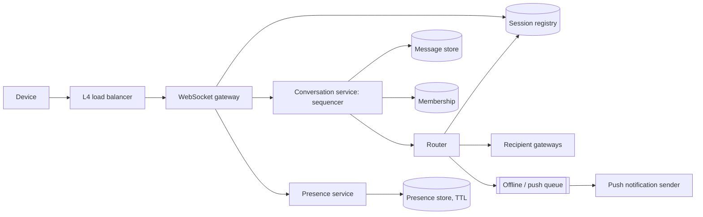
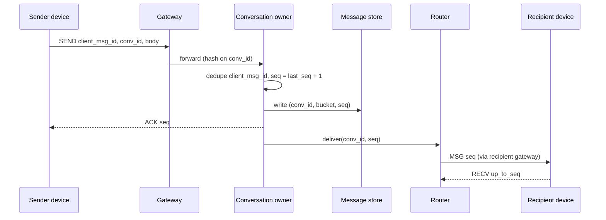

# C03 — Chat & presence

> **The requirement.** A messaging app has **100 million daily active users** on phones, desktops and the web. Users
> chat 1:1 and in groups of up to **1,000 members**. A message sent to an online recipient must arrive on **every one
> of their online devices within 500 ms at p99**; an offline recipient gets it, in order, the next time any device
> connects, plus a push notification. History is kept and scrollable. Users see who is online and who is typing. An
> **end-to-end-encrypted** mode must exist in which the server cannot read messages. It is hard because chat is the
> one mainstream workload where the server holds **tens of millions of long-lived stateful connections**, ordering is
> visible to humans, and every message fans out to a different set of devices.

Prerequisites: [SYSDESIGN-02](../01-foundations/02-anatomy-of-a-request.md) (TLS, connections),
[SYSDESIGN-08](../01-foundations/08-async-event-driven.md) (delivery semantics, idempotency),
[SYSDESIGN-10](../01-foundations/10-apis-communication.md) (WebSockets vs SSE) and
[SYSDESIGN-07](../01-foundations/07-partitioning-sharding.md) (partitioning, consistent hashing).

## The prompt

"Design WhatsApp", "design Slack" or "design Discord" sound similar and are not: WhatsApp-style messaging is typically 1:1
and small groups (a common characterisation, not a measured figure) with mobile-first offline delivery; Slack/Discord are dominated by channels with many members, long
history and presence in big communities. Ask which one, then fix group size, retention and whether E2EE is required —
E2EE changes what the server is allowed to do, so it must be decided before the sketch.

## CLARIFY: requirements

### Functional

1. Send text messages (media by reference; uploads use object storage — see [C04](C04-video-streaming.md)).
2. 1:1 and group conversations (≤ 1,000 members); add/remove members.
3. Real-time delivery to all of a recipient's online devices; offline delivery on reconnect; push notification when
   no device is online.
4. Ordered, scrollable history per conversation; edits and deletes.
5. Delivery and read receipts; typing indicators; presence (online / last seen).
6. Multi-device: up to 5 devices per user, each sees the same history and read state.
7. E2EE mode for 1:1 and groups.

### Non-functional

| Property | Target | Why |
|---|---|---|
| Delivery latency to online device | p99 < 500 ms within a continent | conversation feels live |
| Ordering | all members see a conversation's messages in the same order | humans notice reordering; replies refer to earlier messages |
| Durability | no acknowledged message is lost | "sent" with one tick is a promise |
| Duplicates | the user never sees the same message twice | retries are frequent on mobile networks |
| Availability (send) | 99.95 % | messaging is a daily-habit product |
| Presence freshness | ≤ 60 s for ungraceful disconnects; immediate on clean close | presence is a hint, not a contract; bounded by the 60 s presence TTL (deep dive 4) |

### Out of scope

Voice/video calls (WebRTC media path), message search (mention the E2EE impact later), stories, payments, bots
platform.

## QUANTIFY: estimates

All values are **labelled assumptions**.

| Quantity | Working | Result |
|---|---|---|
| Messages/day | 100 M DAU × 40 sent | 4 B/day |
| Messages/s, average / peak (3×) | 4 B / 86,400 | ≈ 46,000 /s / ≈ 139,000 /s |
| Recipients per message | 70 % 1:1 (1 recipient), 30 % groups of 25 (24 recipients) | 0.7 + 7.2 ≈ 8 |
| Online at peak | 40 % of recipients | ≈ 3.2 online recipients per message |
| Devices per online user | 1.5 | ≈ 4.8 device deliveries per message |
| Device deliveries/s at peak | 139,000 × 4.8 | ≈ 670,000 /s |
| Concurrent connections at peak | 40 M users × 1.5 devices | 60 M WebSocket connections |
| Connections per gateway (conservative) | | 250,000 → ≈ 240 gateways + headroom ≈ 300 |
| Memory per connection (TLS + session state) | 16 KB | ≈ 4 GB per gateway |
| Heartbeats (every 30 s) | 60 M / 30 | 2 M /s fleet-wide ≈ 6,700 /s per gateway |
| Stored message (100 B text + metadata + engine overhead) | ≈ 300 B | 4 B × 300 B ≈ 1.2 TB/day ≈ 440 TB/year ≈ 1.3 PB/year with 3 replicas |

**What the numbers say.** The message *rate* (139,000 /s) is moderate; the hard numbers are **60 M stateful
connections** and **≈ 670,000 device deliveries per second**, each of which must find the right gateway. Storage grows
by about a petabyte a year with replicas, so the store must scale horizontally and be cheap per byte; but the access
pattern is narrow (recent messages of one conversation). For a sense of scale, Discord reported up to 500,000 live
sessions per Erlang VM in 2017 [3]; 250,000 per gateway leaves room for TLS cost, deploy draining and failover.

## SKETCH: high-level design



*Diagram: devices connect through an L4 load balancer to WebSocket gateways, which register sessions in a session
registry. Sends go to a conversation service that assigns sequence numbers, writes the message store and reads
membership, then a router looks up recipients' sessions and forwards to their gateways, or enqueues offline delivery
and push notifications. Gateways also report to a presence service backed by a TTL store.*

**Why each box is there.**

- **L4 load balancer** — WebSockets are long-lived; balance *connections* (TCP/TLS), not requests. Terminate TLS at
  the gateway or a TLS-aware L4 tier ([SYSDESIGN-03](../01-foundations/03-scaling-compute.md)).
- **WebSocket gateway** — holds connections, authenticates devices, speaks a small framed protocol over RFC 6455
  WebSockets [7]. Stateful by necessity, but *only* connection state: no business logic, so it can be restarted and
  scaled independently.
- **Session registry** — `device_id → gateway_id`, so the router knows where to send a message. Soft state, TTL'd,
  rebuilt by reconnects.
- **Conversation service (sequencer)** — one logical owner per conversation that assigns the next sequence number.
  This box exists *because of the ordering requirement* (deep dive 2).
- **Message store** — durable, partitioned by conversation and time (deep dive 3).
- **Router + offline queue + push sender** — delivery is a separate step from storage: store first, then deliver;
  devices that are not connected get a push notification and fetch on reconnect.
- **Presence service** — aggregates heartbeats into coarse online/offline state with TTLs (deep dive 4).

Slack's published real-time architecture has the same split in different words: stateful **gateway servers** holding
WebSocket subscriptions, deployed in multiple regions; stateful **channel servers** owning channels via consistent
hashing; **admin servers** routing between the web app and channel servers; and **presence servers** [4].

## API and data model

### Wire protocol (over one WebSocket per device)

```text
→ HELLO {device_id, auth_token, sync_token: "s-91c…"}                 # one opaque cursor over user_conversations activity
← READY {session_id, sync_token, changed: [{conv_id, last_seq}...] | sync_required: [conv_id...]}
→ SEND  {client_msg_id: "c-7f3a…", conv_id, body | ciphertext}       # client_msg_id = idempotency key
← ACK   {client_msg_id, conv_id, seq: 18452, server_ts}               # "one tick": durable
← MSG   {conv_id, seq: 18453, sender, body | ciphertext, server_ts}
→ RECV  {conv_id, up_to_seq: 18453}                                   # delivery cursor per device
→ READ  {conv_id, up_to_seq: 18453}                                   # read cursor, synced to other devices
→ TYPING {conv_id}            ← TYPING {conv_id, user}                # ephemeral, never stored
← PRESENCE {user, state, last_seen}
```

REST endpoints cover the non-real-time parts: `GET /v1/conversations/{id}/messages?before_seq=…&limit=50` for history,
membership management, and device registration.

### Data model

| Table | Partition key | Clustering | Columns |
|---|---|---|---|
| `messages` | `(conv_id, bucket)` | `seq` descending | sender, client_msg_id, body or ciphertext, server_ts, edited, deleted |
| `conversations` | `conv_id` | — | type, created_at, `last_seq`, settings |
| `members` | `conv_id` | `user_id` | role, joined_seq |
| `user_conversations` | `user_id` | `last_activity` desc | conv_id, unread summary |
| `device_cursors` | `device_id` | `conv_id` | `delivered_seq`, `read_seq` |
| session registry (in memory) | `device_id` | — | gateway_id, connected_at, TTL |

`bucket = floor(seq / 50,000)` (N sized in exercise 5), so one conversation's history is split into bounded
partitions. Because history is paged by `seq`, a `before_seq` request maps to its bucket with no lookup, and `server_ts`
stays a plain column. Discord applied the same principle — its buckets had to be "derivable from the message_id or a
timestamp" [1] — but bucketed by time (deep dive 3).

## DEEPEN

### Deep dive 1 — the connection layer

**One connection per device.** A device opens a WebSocket after login and keeps it while foregrounded; mobile OSes
restrict backgrounded apps — Android's Doze mode suspends network access [12], and iOS may suspend an app in the
background [13] — which is why push notifications exist. On connect the gateway authenticates the token,
writes `device_id → gateway_id` to the session registry with a TTL (say 90 s), and refreshes it with each heartbeat.

**Routing a delivery.** For each recipient device the router reads the registry and sends the message to that gateway
over an internal RPC or pub/sub channel. Two shapes:

| Shape | How | Wins when |
|---|---|---|
| Registry lookup + direct RPC | router asks "where is device X?", calls that gateway | 1:1 and small groups |
| Gateway subscribes to conversation topics | gateway subscribes to topics for conversations its devices care about; router publishes once per conversation | large groups and channels: one publish, many gateways |

Slack's channel servers use the second shape — gateways hold subscriptions, and a message published to a channel
server is pushed to subscribed gateways [4].

**Deploys and failures drain, not drop.** Restarting a gateway disconnects 250,000 devices. If they all reconnect
immediately to the remaining gateways, the handshake load (TLS + auth + resume sync) is a self-inflicted
denial-of-service — the **reconnect storm**. Mitigations: drain gradually (close connections over minutes, not
seconds), send a "reconnect after *t* + random jitter" control frame, cap new-connection admission per gateway, and
make the resume handshake cheap (the client sends one `sync_token`; the server returns only conversations that
changed since it) ([SYSDESIGN-11](../01-foundations/11-reliability-engineering.md)).

### Deep dive 2 — ordering, idempotency and delivery semantics

**Ordering.** Global order across conversations is meaningless and expensive; humans need a **total order per
conversation**. The simplest correct mechanism is a **single sequencer per conversation**: route every send for a
conversation to its owner (consistent hashing on `conv_id`, [SYSDESIGN-07](../01-foundations/07-partitioning-sharding.md)),
which assigns `seq = last_seq + 1`, writes the message, and only then acknowledges. Slack maps each channel to one
channel server by consistent hashing; when a channel server is replaced, a new one is ready "in under 20 seconds" and
affected teams see higher delivery latency during that window [4]. (Slack's post describes channel-server ownership
and failover time, not sequence assignment; the sequencer is our design.) That is the cost of the design: a short
unavailability per conversation on owner failover, in exchange for a simple total order. Make ownership a lease with
fencing tokens so a stale owner cannot assign duplicate sequence numbers after a partition
([SYSDESIGN-09](../01-foundations/09-coordination-consensus.md)).

Alternatives — client timestamps (clocks lie), per-sender order only (replies can appear before what they reply to),
or a consensus log per conversation (correct, but heavyweight for millions of small conversations) — are worse
defaults.

**Idempotent send.** Mobile networks drop ACKs. The client attaches a `client_msg_id` (random UUID) and retries until
it gets an ACK. The sequencer keeps a short-lived map `(conv_id, client_msg_id) → seq`; a retry returns the original
`seq` instead of creating a second message. This is the same idempotency-key pattern as payments
([C06](C06-payments-ledger.md)).

**Delivery semantics.** Delivery to devices is **at least once**: the router may resend after a gateway failure, and a
device may receive a message both live and in a resume sync. Devices de-duplicate by `(conv_id, seq)` and render in
`seq` order, buffering briefly if a gap appears (seq 18,455 arrives before 18,454). If a gap persists, the device asks
for the missing range. "Exactly once" is therefore an *end-to-end* property built from at-least-once transport plus
idempotent receivers ([SYSDESIGN-08](../01-foundations/08-async-event-driven.md)).



*Diagram: the sender's device sends a message with a client message ID; the gateway forwards it to the conversation's
owner, which de-duplicates, assigns the next sequence number, writes the store and acknowledges the sender. It then
hands the message to the router, which delivers it through the recipient's gateway; the recipient acknowledges up to
that sequence number.*

**Receipts are cursors.** Delivery and read receipts are not per-message rows; they are per-device (and per-user)
*cursors* — `delivered_seq` and `read_seq` — so "read up to 18,453" is one write regardless of how many messages it
covers. Group read receipts ("seen by 14") aggregate the members' cursors on demand.

### Deep dive 3 — message storage that survives success

Discord's two published storage posts are the best public case study for this table. In a 2017 post, Discord described moving
messages from MongoDB to Cassandra after reaching about 100 million stored messages (around November 2015), when data
and indexes no longer fit in RAM,
choosing the primary key `((channel_id, bucket), message_id)`: partition by channel plus a time **bucket**,
cluster by a time-sortable Snowflake message ID. Buckets were sized at about 10 days because that kept the largest
channels' partitions comfortably under 100 MB; larger partitions caused garbage-collection pressure [1]. In 2023
Discord described migrating that data (by then trillions of messages) from 177 Cassandra nodes to 72 ScyllaDB nodes,
with p99 historical-fetch latency going from 40–125 ms to about 15 ms and p99 insert latency from 5–70 ms to a steady
5 ms; their Rust-based migrator reached "up to 3.2 million [messages] per second", cutting the estimated migration time
from three months to nine days [2].

Two lessons transfer directly:

1. **Bound partitions.** A busy group conversation accumulates history forever; without a bucket component its
   partition grows without limit and every compaction and repair touches it. The bucket must be derivable from the key
   you page by (here `seq`; for Discord, the message ID or timestamp) so reads can compute which partitions to scan
   ("latest 50 messages" = the bucket of `last_seq`, then the previous one if needed).
2. **Put a data service between the API and the database.** Discord's 2023 design added Rust "data services" that
   expose roughly one gRPC endpoint per query and perform **request coalescing**: if many users request the same rows
   at once (everyone opening a channel after an announcement), the database is queried once and the result shared.
   Requests are routed by consistent hashing on channel ID so coalescing actually happens on one instance [2]. That is
   the stampede fix from [SYSDESIGN-04](../01-foundations/04-caching.md) applied to a hot partition.

The access pattern is overwhelmingly "recent messages of one conversation", so a wide-column store (Cassandra,
ScyllaDB, Bigtable-class) fits; a sharded relational store also works at smaller scale. Keep media out of the table
(store references), and plan tiering: messages older than a year can move to cheaper storage and still be fetched on
scroll-back.

### Deep dive 4 — offline delivery, multi-device and presence

**Offline delivery.** The message store is the inbox. On reconnect the device sends its `sync_token`; the server walks
`user_conversations` activity since that token and returns missed messages for conversations with few gaps and a "sync required" list for conversations with many,
which the client pages through. When the router finds no online device for a recipient, it enqueues a push
notification. Collapse notifications per conversation (one "5 new messages" rather than five pushes) and rate-limit
them; platform push services are a shared external dependency, so treat them like any third-party API with retries,
backoff and a budget.

**Multi-device.** Each device is a first-class recipient with its own delivery cursor; the user's *read* cursor is
synchronized across devices so reading on the laptop clears the phone's badge. In E2EE mode each device has its own
keys, which makes multi-device a cryptographic problem as well (Modern twist).

**Presence.** Naive presence fans out every online/offline change to everyone who might care. With 60 M connected
devices and contact lists of hundreds, that is far more traffic than the messages themselves. Practical rules:

- **Derive presence from the connection, not separate pings.** The gateway already sees heartbeats; it updates a
  presence store entry with a TTL (e.g. 60 s) only on state *changes* and at a coarse refresh interval. A clean close
marks the user offline at once; an ungraceful disconnect shows within the 60 s TTL, which is the freshness target.
- **Subscribe lazily.** A client subscribes to presence only for users currently on screen (the open conversation,
  the visible part of a contact list) and unsubscribes when they scroll away.
- **Degrade in large groups.** Showing live presence of all 1,000 members of a group is rarely worth it; show counts
  or only for recently active members. Discord documented the scaling pain directly: in 2017 a guild process published
  every presence change to every connected session, a single Erlang `send/2` took 30–70 µs, and in a guild with 30,000
  concurrent users one event could take 900 ms to 2.1 s to publish; they built Manifold to spread sends across nodes [3].
- **Typing indicators are ephemeral.** Never store them; send at most one per conversation every few seconds; drop
  them under load first.

## STRESS: failures, hot spots, scale ×10

| Failure / stress | Symptom | Detection (SLI) | Mitigation |
|---|---|---|---|
| Gateway crash | 250,000 devices reconnect at once | connection-rate spike; handshake latency | jittered reconnect, admission control, cheap resume |
| Conversation owner failover | sends to some conversations stall for seconds | per-conversation send latency, ownership changes | leases with fencing; clients keep retrying with the same `client_msg_id` |
| Hot group (1,000 members, everyone active) | one owner and one partition hot; fan-out of 1,000 per message | per-conversation QPS | topic-based fan-out to gateways; coalesced reads; cap message rate per conversation (slow mode) |
| Message store region slow | ACK latency rises; sends time out | store p99, ACK p99 | ACK only after durable write (do not lie with "sent"); shed typing/presence traffic first |
| Push provider degraded | offline users not notified | push error rate | queue with backoff; collapse; do not block the send path on push |
| Session registry lost | router cannot find devices | delivery-miss rate | registry is soft state: gateways re-register on heartbeat; deliveries fall back to "stored, fetched on next sync" |
| Clock skew | `server_ts` out of order | — | order by `seq`, display time is cosmetic |

**Scale ×10** (1 B DAU, ≈ 1.4 M messages/s peak, ≈ 600 M connections). Connection count, not message rate, is the first
wall: ≈ 3,000 gateways in many regions, with users homed to a nearby region and conversations owned in the region of
most of their members ([SYSDESIGN-15](../02-modern-requirements/15-multi-region-edge.md)). Cross-region conversations
pay one inter-region hop for delivery. Storage grows to ≈ 13 PB/year with replicas, making tiered storage for old
buckets a cost requirement. Presence must become more aggressively lazy and approximate.

## Operate: SLOs, cost, energy

### SLOs

| SLI | SLO |
|---|---|
| Send → ACK latency | p99 < 300 ms |
| Send → delivered to online device | p99 < 500 ms within a continent |
| Send success | 99.95 % / 30 days |
| Messages lost after ACK | 0 (audited by end-to-end synthetic conversations) |
| Duplicate renders | 0 in synthetic tests |
| Reconnect success after gateway restart | 99.9 % within 60 s |

Measure delivery latency with **synthetic conversations** between probe devices in each region, because server-side
timings cannot see the last hop.

### Cost

Three cost centers: **connection-holding compute** (≈ 300 gateways at our numbers, sized by connections and TLS, not
CPU-heavy logic), **storage** (≈ 1.3 PB/year with replicas; tier old buckets), and **egress/push**. The levers are
connections per gateway (kernel and TLS tuning, efficient runtimes — Discord's choice of the Erlang VM is a public
example [3]), compression of the wire protocol, and retention/tiering policy. Presence and typing traffic can rival
message traffic if left eager — they are cost items, not free features.

### Energy

Idle connections still cost energy on both ends: heartbeats keep phone radios awake. Longer heartbeat intervals (as
long as NAT and load-balancer idle timeouts allow), batching small frames, and relying on platform push for
backgrounded apps reduce device battery drain as well as server load — energy efficiency here is mostly a
client-protocol decision ([SYSDESIGN-17](../02-modern-requirements/17-energy-carbon-aware.md)).

## Modern twist

### End-to-end encryption with MLS

In 2026 E2EE is a baseline expectation for consumer messaging, and group E2EE now has an IETF standard: **Messaging
Layer Security (MLS), RFC 9420 (July 2023)** provides "efficient asynchronous group key establishment with forward
secrecy (FS) and post-compromise security (PCS)" for groups from two to thousands of members, with key-update costs
that grow logarithmically with group size thanks to its ratchet tree [5]. RFC 9750 (April 2025) describes the
architecture around it: an **Authentication Service** that binds identities to keys and a largely untrusted
**Delivery Service** that stores initial keys (KeyPackages) and routes messages [6]. Adoption is moving from apps to
platforms: the GSMA announced in March 2025 that RCS Universal Profile 3.0 brings E2EE "based on the Messaging Layer
Security (MLS) protocol" for interoperable messaging between providers [9]. Signal's protocol family (X3DH/PQXDH key
agreement, Double Ratchet, Sesame for multi-device sessions, and the post-quantum ML-KEM Braid) remains the other
major reference design [10].

What changes in the system design:

- **The server becomes the Delivery Service.** Our conversation service and router keep their jobs — sequencing,
  storing, routing — but they handle ciphertext. That is why the sketch already separated "store and route" from
  "understand the message".
- **The sequencer is now a protocol requirement.** RFC 9750 notes that MLS mostly tolerates out-of-order delivery,
  with two exceptions: proposals must arrive before the Commit that references them, and the group must agree on a
  single Commit that ends each epoch. It notes that most Delivery Services will use the strongly consistent paradigm,
  in which the DS orders incoming handshake messages and breaks ties between concurrent Commits [6]. Our per-conversation
  owner from deep dive 2 is exactly that "ordering server".
- **New stored state: KeyPackages.** The DS must store one-time KeyPackages per device so offline users can be added
  to groups; running out of them blocks group additions, so monitor the pool and prompt clients to upload more.
- **Server-side features move to the client.** Search, link previews, spam and abuse detection on content can no
  longer run on the server. Plan client-side search indexes, user-initiated reporting (RFC 9750 discusses abuse
  reporting), and metadata-based abuse signals (rates, graph patterns) on the server.
- **Multi-device is membership.** Each device is an MLS member, so adding a laptop is a group operation in every
  conversation the user is in — a fan-out of Commits that must be rate-limited and sequenced.

### AI assistants inside chat

Users now expect summaries of long threads, reply suggestions and translation inside the chat app. Two architectures:

1. **On-device models** — compatible with E2EE by construction; limited by device memory and battery.
2. **Server-side models in confidential computing** — WhatsApp's "Private Processing" (Meta, April 2025) routes
   user-initiated AI requests (for example summarizing unread threads) to a confidential virtual machine, a type of
   trusted execution environment, reached over Oblivious HTTP so the service cannot link requests to the user's IP;
   it uses remote attestation against a third-party log of approved binaries and "does not retain access to messages
   after the session is completed" [8]. Oblivious HTTP is RFC 9458 (January 2024) [11].

For the system designer, an AI assistant in an E2EE app is a **new trust boundary**, not a feature flag: it needs
explicit user initiation, attested and stateless processing, and its own capacity planning (it is an LLM serving
workload — see [C09](C09-llm-chat-service.md) and [SYSDESIGN-28](../03-ai-systems/28-ai-trust-safety-governance.md)).
In non-E2EE workplace chat the assistant can read server-side history, which turns retention, access control and
prompt-injection defenses into chat-system requirements.

## WRAP: interview summary

**A strong 45-minute answer covers, in order:** clarify product shape (WhatsApp vs Slack/Discord), group size, E2EE →
numbers (139,000 msgs/s peak, ≈ 8 recipients, ≈ 670,000 device deliveries/s, 60 M connections, ≈ 1.2 TB/day) → sketch
separating gateways, sequencer, store, router, presence → wire protocol with `client_msg_id`, `seq`, cursors → per-
conversation sequencer via consistent hashing + leases → at-least-once delivery with client dedupe → storage
partitioned by `(conv_id, bucket)` with evidence from Discord → offline sync and push → presence made lazy → failures
(reconnect storms, owner failover) → E2EE impact.

| Level | What "good" looks like |
|---|---|
| Junior | WebSockets justified; message table keyed by conversation; online vs offline delivery; push notifications; basic presence |
| Senior | Session registry and routing; per-conversation ordering with a sequencer; idempotent sends; at-least-once + dedupe; cursor-based receipts; time-bucketed partitions; reconnect-storm mitigations; lazy presence |
| Staff | Connection count as the primary capacity driver; owner failover cost and fencing; hot-conversation strategy; multi-region homing; SLOs measured with synthetic conversations; E2EE as a change of server role (MLS Delivery Service, KeyPackages, client-side search/moderation) and AI-assistant trust boundaries |

**Red flags.** HTTP polling every second for 60 M devices. Ordering by client timestamp. "Exactly-once delivery"
claimed from the transport alone. One unbounded partition per conversation. Storing typing indicators. Fanning out
every presence change to every contact. Saying "E2EE" and then describing server-side search over message text.

**Follow-ups.** Message edits and deletes in E2EE (they are new messages that reference old ones); disappearing
messages (TTL in store plus client enforcement); channels with 100,000 members (broadcast-style topics, slow mode,
presence off); compliance export for enterprise chat (conflicts with E2EE — make it a per-tenant policy).

## Alternatives considered

| Alternative | Wins when | Why not the default here |
|---|---|---|
| Long polling / SSE instead of WebSockets | web-only, server-to-client heavy, proxies hostile to WebSockets | chat is bidirectional and latency-sensitive; SSE needs a second channel for sends |
| MQTT broker as the connection layer | IoT-style devices, constrained networks | viable; you still need sequencing, storage and E2EE above it |
| Consensus log per conversation (Raft group) | small number of very high-value conversations | far too heavy for billions of small conversations |
| Relational store with conversation sharding | early product, moderate history | works; the published scale-ups (Discord) show where time-bucketed wide-column wins |
| Pairwise (per-recipient) encryption for groups | very small groups | cost grows linearly with group size; MLS grows logarithmically [5] |

## Exercises

See [exercises/C03-chat-presence.md](../../exercises/C03-chat-presence.md) — connection and fan-out sizing, the
sequencer and failover, idempotent sends, bucket sizing, presence traffic, MLS impact, and lab exercises using
[labs/08-async-event-driven](../../labs/08-async-event-driven/) (redelivery and idempotent consumers),
[labs/09-coordination-consensus](../../labs/09-coordination-consensus/) (leases and leader failover) and
[labs/07-partitioning-sharding](../../labs/07-partitioning-sharding/) (consistent hashing of conversations).

## References

All accessed 2026-11-19; re-checked 2026-11-20.

1. S. Vishnevskiy, "How Discord Stores Billions of Messages," Discord blog, 2017-01-13. https://discord.com/blog/how-discord-stores-billions-of-messages
2. B. Ingram, "How Discord Stores Trillions of Messages," Discord blog, 2023-03-06. https://discord.com/blog/how-discord-stores-trillions-of-messages
3. S. Vishnevskiy, "How Discord Scaled Elixir to 5,000,000 Concurrent Users," Discord blog, 2017-07-06. https://discord.com/blog/how-discord-scaled-elixir-to-5-000-000-concurrent-users
4. S. Thangudu, "Real-time Messaging," Slack Engineering, 2023-04-11. https://slack.engineering/real-time-messaging/
5. R. Barnes et al., "The Messaging Layer Security (MLS) Protocol," RFC 9420, July 2023. https://www.rfc-editor.org/rfc/rfc9420
6. B. Beurdouche et al., "The Messaging Layer Security (MLS) Architecture," RFC 9750, April 2025 — §5.2 ordering and Delivery Service consistency. https://www.rfc-editor.org/rfc/rfc9750
7. I. Fette, A. Melnikov, "The WebSocket Protocol," RFC 6455, December 2011. https://www.rfc-editor.org/rfc/rfc6455
8. Meta, "Building Private Processing for AI tools on WhatsApp," Engineering at Meta, 2025-04-29. https://engineering.fb.com/2025/04/29/security/whatsapp-private-processing-ai-tools/
9. T. Van Pelt, "RCS Encryption: A Leap Towards Secure and Interoperable Messaging," GSMA Newsroom, 2025-03-14. https://www.gsma.com/newsroom/article/rcs-encryption-a-leap-towards-secure-and-interoperable-messaging/
10. Signal, "Specifications" (XEdDSA, X3DH, PQXDH, Double Ratchet, Sesame, ML-KEM Braid). https://signal.org/docs/
11. M. Thomson, C. A. Wood, "Oblivious HTTP," RFC 9458, January 2024. https://www.rfc-editor.org/rfc/rfc9458
12. Android Developers, "Optimize for Doze and App Standby" (Doze restrictions: "Suspends network access"). https://developer.android.com/training/monitoring-device-state/doze-standby
13. Apple Developer Documentation, "About the background execution sequence" (UIKit; a backgrounded app "may be suspended"). https://developer.apple.com/documentation/uikit/about-the-background-execution-sequence
