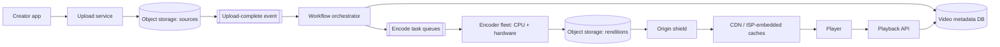
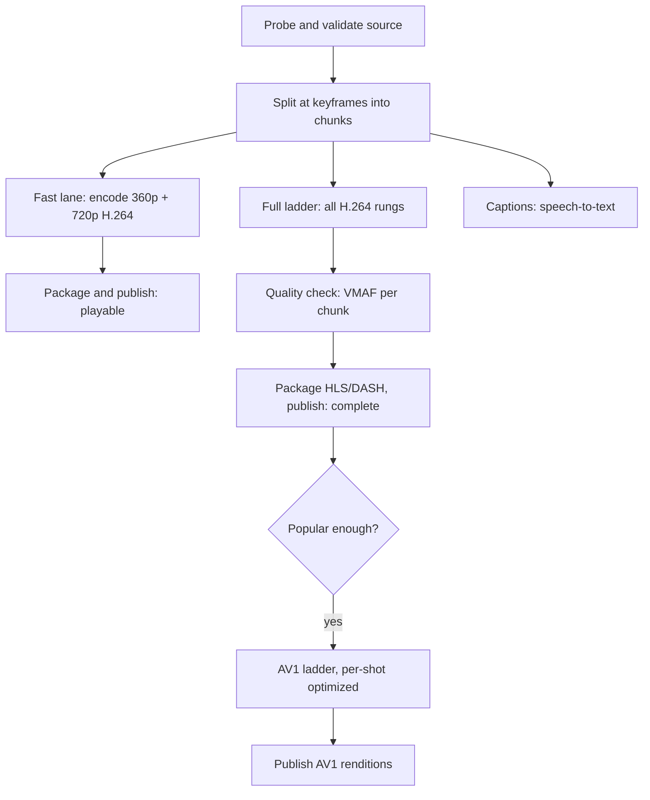

# C04 — Video upload, transcoding & streaming

> **The requirement.** A video platform receives **1 million uploads per day**, from 30-second phone clips to
> two-hour studio masters. A creator expects their video to be **playable within minutes**. Viewers watch
> **100 million hours a day** on phones, TVs and browsers, on networks from fiber to congested mobile; playback must
> **start in under 2 s** and rarely rebuffer. Finance cares about one number above all: the **delivery bill**. It is
> hard because the system has three very different halves — a bursty, failure-prone ingest path, a CPU- or
> accelerator-heavy batch pipeline, and a read path measured in terabits per second — and the cheapest way to make the
> third one affordable is to spend more on the second.

Prerequisites: [SYSDESIGN-02](../01-foundations/02-anatomy-of-a-request.md) (CDN edge),
[SYSDESIGN-08](../01-foundations/08-async-event-driven.md) (workflows, idempotency),
[SYSDESIGN-13](../01-foundations/13-data-at-scale.md) (object storage) and
[SYSDESIGN-16](../02-modern-requirements/16-cost-as-requirement.md) (unit economics).

## The prompt

"Design YouTube" or "design Netflix". They differ: user-generated platforms have enormous upload volume and a long
tail of rarely watched videos; subscription streamers have a small, curated catalog watched millions of times per
title. Ask which, because it decides how much encoding effort each video deserves — the central trade-off of this case.

## CLARIFY: requirements

### Functional

1. **Upload** large files reliably from flaky mobile networks; resume after interruption.
2. **Process**: validate, transcode into multiple resolutions/bitrates and codecs, generate thumbnails and captions.
3. **Publish**: video becomes playable; creator sees processing status.
4. **Play**: adaptive streaming on web, mobile, TV; seek; resume where you left off.
5. **Metadata**: title, description, visibility (public, unlisted, private), view counts.

### Non-functional

| Property | Target | Why |
|---|---|---|
| Time to playable | p95 < 5 min for a 10-minute 1080p upload, measured from upload-complete to first playable rendition | creators publish to an audience waiting now |
| Playback start | p95 < 2 s | viewers abandon slow starts |
| Rebuffering | < 0.5 % of watch time | the dominant quality complaint |
| Upload durability | an acknowledged upload is never lost | creators may delete their local copy |
| Delivery cost | bounded cost per hour watched | the largest line item |
| Accessibility | captions available for published videos | legal requirement in many markets (Modern twist) |

### Out of scope

Live streaming (mention the differences at the end), DRM licence servers, recommendations (see [C02](C02-news-feed.md)
for the ranking pattern), monetization.

## QUANTIFY: estimates

All values are **labelled assumptions** unless cited.

| Quantity | Working | Result |
|---|---|---|
| Source minutes/day | 1 M uploads × 8 min average | 8 M min ≈ 133,000 h/day |
| Source size per upload (10 Mbps average source bitrate) | 480 s × 10 Mbps ÷ 8 | ≈ 600 MB |
| Ingest volume | 1 M × 600 MB | ≈ 600 TB/day |
| Ingest bandwidth, average / peak (2×) | 600 TB × 8 ÷ 86,400 s | ≈ 56 Gbit/s / ≈ 110 Gbit/s |
| H.264 ladder (240p…1080p rungs summing to ≈ 10.6 Mbps) | 480 s × 10.6 Mbps ÷ 8 | ≈ 640 MB per upload ≈ 640 TB/day |
| H.264 transcode compute (assume 1 core-hour per 5 min of source, all rungs; measure on your content) | 8 M min ÷ 5 | 1.6 M core-hours/day ≈ 67,000 cores busy on average; ≈ 134,000 at the 2× ingest peak; excludes fast lane, VMAF QC and AV1 |
| Watch time | 100 M h/day | |
| Average delivered bitrate | 3 Mbps | 100 M h × 3,600 s × 3 Mbps ÷ 8 ≈ 135 PB/day |
| Peak concurrent streams (assume 15 M) | 15 M × 3 Mbps | ≈ 45 Tbit/s |
| Segment requests at peak (4 s segments) | 15 M ÷ 4 s | ≈ 3.75 M requests/s |
| Metadata | 1 M videos × 2 KB | ≈ 2 GB/day (negligible) |

**What the numbers say.** Ingest (≈ 110 Gbit/s peak) and storage (≈ 1.2 PB/day of source plus renditions before
tiering) are large but ordinary for object storage. Compute is big — tens of thousands of cores for software H.264 —
which motivates parallel chunked encoding and hardware encoders. And **delivery dwarfs everything**: 135 PB/day and
45 Tbit/s at peak. A 10 % reduction in average bitrate saves ≈ 4.5 Tbit/s at peak, which pays for a great deal of
encoding compute. That asymmetry is the whole economic logic of modern video encoding.

## SKETCH: high-level design



*Diagram: the creator app uploads through an upload service directly into object storage for sources; an
upload-complete event starts a workflow orchestrator that puts encode tasks on queues for a CPU and hardware encoder
fleet, which writes renditions back to object storage and updates the metadata database. Renditions flow through an
origin shield to CDN and ISP-embedded caches to the player, which gets its manifest URLs from a playback API reading
metadata.*

**Why each box is there.**

- **Upload service** — authenticates and hands out *upload sessions*; the bytes go straight to object storage, never
  through application servers (deep dive 1).
- **Object storage (sources, renditions)** — durable, cheap per byte, and natively parallel for the encoder fleet and
  the CDN origin ([SYSDESIGN-13](../01-foundations/13-data-at-scale.md)).
- **Workflow orchestrator** — a video's processing is a multi-step DAG that must survive worker crashes and be
  resumable and observable; a durable workflow engine, not a chain of queue consumers that lose state
  ([SYSDESIGN-08](../01-foundations/08-async-event-driven.md)).
- **Encoder fleet + task queues** — chunked, parallel, mixed CPU and hardware encoders with priority lanes.
- **Origin shield + CDN / ISP caches** — the only way to serve 45 Tbit/s: most bytes must come from caches close to
  viewers.
- **Playback API** — decides *which* manifest (codecs, resolutions) a device gets and signs URLs; small but central
  to cost and quality.

## API and data model

### API

```http
POST /v1/uploads            { "filename": "trip.mov", "size": 734003200, "sha256": "…" }
201 { "upload_id": "u_9f2…", "protocol": "tus-1.0.0", "location": "https://up.example.com/files/u_9f2…" }

# resumable transfer (tus 1.0.0): HEAD → Upload-Offset; PATCH from that offset
HEAD  /files/u_9f2…         Tus-Resumable: 1.0.0 → 200, Upload-Offset: 268435456, Tus-Resumable: 1.0.0
PATCH /files/u_9f2…         Tus-Resumable: 1.0.0, Upload-Offset: 268435456, Content-Type: application/offset+octet-stream

POST /v1/videos             { "upload_id": "u_9f2…", "title": "...", "visibility": "public" }
GET  /v1/videos/{id}/status → { "state": "processing", "playable": ["h264_360p", "h264_720p"], "eta_s": 140 }
GET  /v1/play/{id}?device=tv&codecs=av1,hevc,avc&drm=none
200 { "manifest": "https://cdn.example.com/v/{id}/av1/master.m3u8?sig=…", "resume_at_s": 312 }
```

The tus protocol (version 1.0.0) defines the resumable mechanics: a `HEAD` returns the server's `Upload-Offset`, and a
`PATCH` must start at exactly that offset or receive `409 Conflict` [8]. The IETF is standardizing the same idea as
"Resumable Uploads for HTTP" (draft-ietf-httpbis-resumable-upload-15, November 2026, still an Internet-Draft) [9].

### Data model

| Entity | Key | Fields |
|---|---|---|
| `videos` | `video_id` | owner, title, visibility, state (`uploading → processing → playable → complete` or `failed`), duration, source object key, content hash |
| `renditions` | `(video_id, codec, height)` | bitrate, object prefix, VMAF score, state |
| `jobs` | `(video_id, step)` | workflow step state, attempts, worker, timestamps |
| `views` / `watch_progress` | `(user_id, video_id)` | last position, updated_at (high write rate, eventually consistent) |
| object layout | `v/{video_id}/{codec}/{height}/seg_{n}.m4s` + playlists | immutable once published, so cacheable forever |

## DEEPEN

### Deep dive 1 — uploads that survive the subway

A 600 MB upload over a mobile connection *will* be interrupted. Requirements: resume from where it stopped, never
store the file twice, never pass bytes through stateless API servers.

**Direct-to-object-storage with parts.** The upload service creates a multipart upload in object storage and hands
the client pre-signed URLs per part. Amazon S3's multipart upload is typical: parts are uploaded independently, in
parallel and in any order; part numbers range from 1 to 10,000 and every part but the last must be 5 MiB to 5 GiB [17]; a failed part is
retried alone; AWS recommends
multipart for objects of 100 MB or more [7]. The client records each part's ETag and calls *complete* at the end. If
the client vanishes, parts linger and are billed until the upload is completed or aborted — so configure a lifecycle
rule to abort incomplete multipart uploads after a few days [7]. An S3 conditional write (`If-None-Match` on
`CompleteMultipartUpload`) prevents a retried completion from overwriting an existing object [7][16].

**Resumable protocol for the client.** Either expose multipart directly (the client tracks parts) or put a tus-style
endpoint in front (the server tracks offsets, the client just asks "where was I?") [8]. The second is simpler for
mobile clients and is the shape the IETF draft standardizes [9].

**Integrity and dedupe.** The client sends a SHA-256 of the file at session creation; the server verifies it after
assembly (current AWS SDKs and the console pick a checksum algorithm by default; for uploads that arrive without one, for
example from older SDKs, S3 applies a full-object CRC-64/NVME, which it also recommends for integrity checks [7]). An identical hash from the same owner returns the existing video rather than processing it again.

**Completion is an event.** "Upload complete" writes the `videos` row as `processing` and emits an event that starts
the workflow — exactly once per upload, enforced by keying the workflow on `video_id`.

### Deep dive 2 — the transcoding workflow



*Diagram: the source is probed and validated, then split at keyframes into chunks. A fast lane encodes 360p and 720p
H.264, packages and publishes so the video is playable. In parallel the full H.264 ladder is encoded, checked with
VMAF per chunk, packaged and published as complete, and captions are generated by speech-to-text. Videos that become
popular enough later get a per-shot-optimized AV1 ladder, which is published as additional renditions.*

**Chunk to parallelize.** Encoding a two-hour master on one machine takes hours; splitting at keyframes (or, better,
at shot boundaries — deep dive 3) into chunks lets hundreds of workers encode in parallel, then concatenates the
outputs. Netflix describes this "chunked" encoding on the cloud — for example a one-hour video as 20 chunks of 3 min,
each encoded independently, so a failed instance re-processes only its chunk and chunks run in parallel [2]. Time-to-playable becomes "time to encode one chunk + overhead", not "time to encode the
video".

**Two lanes.** The fast lane produces a couple of renditions with fast presets so the creator's video is playable in
minutes; the full lane produces the complete ladder with slower, more efficient presets. This is the same "degraded
first, complete later" pattern as the feed fallback in [C02](C02-news-feed.md); the two-lane split is a typical design
choice (ours), not a cited production pipeline.

**Idempotent, durable steps.** Each task is keyed by `(video_id, codec, height, chunk)`, writes its output to a
deterministic object key, and is safe to retry; the orchestrator records step state so a crashed worker's task is
re-run, not lost. Priority lanes keep a viral creator's re-upload from waiting behind a backfill of old videos.

**Hardware encoders change the compute line.** Google reported that its video coding unit (VCU), deployed in its
warehouse-scale video infrastructure, delivered "20-33x improved efficiency over our prior well-tuned non-accelerated
baseline" (ASPLOS 2021) [10]. Meta's first video-transcoding ASIC, MSVP (2023), decodes H.264, HEVC, VP9 and AV1,
encodes H.264 and VP9, draws about 10 W per PCIe module, and was reported at roughly 9× H.264 and 50× VP9 throughput
versus software presets used for comparison [11]. At our 67,000-core software estimate those ratios turn a large
CPU fleet into a modest accelerator fleet — at the cost of hardware lead time and codec support lagging software.

### Deep dive 3 — per-title and per-shot encoding

A **bitrate ladder** is the set of (resolution, bitrate) renditions offered to the player. A fixed ladder treats a
cartoon and a rain-soaked action film the same — too many bits for one, too few for the other.

Netflix's 2015 per-title post made the argument with numbers: with its fixed ladder, the top 1080p rung was
5,800 kbps, which for some noisy content "would still exhibit blockiness" and for simple content like cartoons was
"far more than needed". Per-title encoding chooses each title's ladder from its own rate–quality curve; for *Orange Is the
New Black* the highest-quality 1080p encode dropped to 4,640 kbps, "20% in bitrate savings compared to 5800 kbps", and
for an episode of the animation *BoJack Horseman* 1080p streaming started at 1,540 kbps where the fixed ladder served
480p at 1,750 kbps [1]. In 2018 Netflix extended this to
**per-shot** optimization ("Dynamic Optimizer"): split at shot boundaries, encode each shot at several quality points,
and choose per shot to maximize perceived quality for the bitrate; it reported the dynamic optimizer improving three
codecs by approximately 28–38 % over fixed-QP/CRF encoding, measured with a perceptual metric [2].

Two systems consequences:

1. **More encodes per video.** Building a rate–quality curve means trial encodes at several settings — multiplying
   compute. That is affordable for a title watched millions of times and wasteful for a clip watched 30 times.
2. **A quality metric in the pipeline.** You need an automated perceptual metric to pick ladder points and to QC
   output. Netflix's VMAF is open source and widely used for this [4].

**Popularity-tiered encoding (default here).** Encode every upload with a standard H.264 ladder through the fast and
full lanes; re-encode with per-title/per-shot optimization and an advanced codec only once a video crosses a view
threshold. Decide the threshold with a break-even calculation (exercise 6): extra encode cost once vs delivery savings
per view × expected views.

### Deep dive 4 — adaptive streaming and the CDN

**Segments and manifests.** HTTP Live Streaming (RFC 8216, August 2017, Informational, protocol version 7) defines a
*master playlist* listing variant streams and *media playlists* listing segments; `EXT-X-TARGETDURATION` sets the
maximum segment duration [5]. DASH and CMAF play the same role with a different manifest. The player measures
throughput and buffer level and switches rungs segment by segment — adaptive bitrate (ABR). Because segments are
immutable files at stable URLs, they are perfectly cacheable.

**Start-up in under 2 s.** Budget (assumptions): playback API + manifest fetch 300 ms, first segment at a low rung
from a nearby cache 600 ms, decoder start 200 ms, leaving slack. Tricks: start at a conservative rung and step up,
use short first segments, pre-fetch the manifest when the user hovers or the next episode is near, and keep the
playback API in-region with cached metadata.

**Cache hierarchy.** 3.75 M segment requests/s at peak cannot reach origin. Use edge caches → regional/shield caches →
origin (object storage). The catalog's popularity curve decides hit ratio: popular videos are in every edge; the long
tail lives only at the shield or origin, which is acceptable because its share of bytes is small. Netflix's Open
Connect takes the hierarchy one step further: Open Connect Appliances are embedded inside ISP networks (provided to
qualifying ISPs at no charge; Netflix lists more than 1,000 ISP partners) or placed at internet exchange points, so
most bytes never cross the ISP's upstream links [3]. For a user-generated platform with a much longer tail,
embedded caches still help for the head of the distribution.

**Signed URLs and the playback API.** The playback API returns manifests with short-lived signatures (private
videos, geo restrictions) and chooses codecs per device: an AV1 manifest for devices that decode it efficiently, H.264
for the rest. That decision is where codec investment turns into delivery savings.

## STRESS: failures, hot spots, scale ×10

| Failure / stress | Symptom | Detection | Mitigation |
|---|---|---|---|
| Upload interrupted | partial files, billed orphan parts | incomplete-upload count/age | resumable protocol; lifecycle abort of incomplete multipart uploads |
| Encoder worker crash or preemption (spot) | stuck steps | step age vs expected | durable workflow re-runs idempotent tasks; spot capacity for the full lane only |
| Poison source (corrupt file, odd codec) | repeated failures | attempts per video | quarantine after N attempts, notify creator, keep source |
| Backlog after an event (everyone uploads) | time-to-playable grows | queue age by lane | fast lane prioritized; autoscale; defer AV1/backfill lanes |
| Viral video at premiere | edge miss storm on first segments | origin request rate per object | pre-position popular content in caches; request coalescing at shield |
| CDN or region degraded | rebuffering in a geography | client-side QoE telemetry (start-up time, rebuffer ratio) by ISP/region | multi-CDN steering in the playback API; lower default rung |
| Bad encoder release | visual artifacts | VMAF regression in QC; canary on a sample of videos | canary encodes, automatic rollback, re-encode affected renditions |

**Scale ×10** (10 M uploads/day, 1 B hours/day). Ingest reaches ≈ 1 Tbit/s at peak and ≈ 6 PB/day of sources — source
retention policy becomes a business decision (keep the original in an archive tier, keep only a high-quality
mezzanine, or drop sources for long-tail content after N months). Encoding compute grows 10× and pushes decisively
toward hardware encoders and stricter popularity tiering. Delivery reaches ≈ 450 Tbit/s at peak: only possible with
caches embedded deep in ISP networks and with the most efficient codec each device supports.

## Operate: SLOs, cost, energy

### SLOs

| SLI | SLO |
|---|---|
| Upload success (acknowledged uploads that become playable) | 99.9 % |
| Time to playable (fast lane), 10-min 1080p | p95 < 5 min |
| Playback start-up time (client-measured) | p95 < 2 s |
| Rebuffer ratio (rebuffering time / watch time) | < 0.5 % |
| Playback API availability | 99.95 % |

Video QoE must be measured **on the client** (start-up, rebuffering, bitrate switches, failures), segmented by device,
ISP and region; server logs alone cannot see a stalled player.

### Cost

Cost per hour watched ≈ **(delivery bytes per hour × price per byte) + (encode cost amortized over views) + (storage
amortized over views)**. With our assumptions an hour at 3 Mbps is ≈ 1.35 GB; delivery dominates for anything watched
more than a handful of times, which is why the levers are bitrate (codec, per-title optimization), cache placement
(cheaper bytes inside ISPs) and hit ratio. For the long tail the opposite holds: a video watched 20 times should get
the cheapest possible encode and storage tier. Storage tiering by age and popularity, and deleting fast-lane
renditions once the full ladder exists, are the storage levers ([SYSDESIGN-16](../02-modern-requirements/16-cost-as-requirement.md)).

### Energy

The same asymmetry applies to energy: an encode happens once, delivery and playback happen per view. Fewer bits per
hour reduce network and device energy for every view, and hardware encoders reduce encode energy per minute (MSVP's
≈ 10 W module figure [11] is a useful order-of-magnitude anchor for accelerators). Published estimates of network
energy per gigabyte vary by more than an order of magnitude depending on method and year, so this lesson does not
pick one; if you need a number, cite the study and its boundary ([SYSDESIGN-17](../02-modern-requirements/17-energy-carbon-aware.md)).

## Modern twist

**AV1 is now mainstream at the largest streamers.** Netflix reported in December 2025 (figures are a snapshot of
13 November 2025) that AV1 "powers approximately
30% of all Netflix viewing" and is its second most-used codec; that AV1 sessions "use one-third less bandwidth than both
AVC and HEVC, resulting in 45% fewer buffering interruptions"; that 85 % of its HDR catalog (by view-hours) had
AV1-HDR10+ coverage; that its AV1 film-grain-synthesis stream "reduces the bitrate by 66%" in the example shown; and that
88 % of large-screen devices submitted for certification in 2021–2025 supported AV1 [12]. Film grain synthesis is a
neat systems idea: instead of spending bits encoding noise, the encoder removes grain, sends a compact grain model, and
the decoder re-synthesizes it. Netflix's 2021 TV launch post explains the earlier history: AV1 on Android in February
2020, AV1 on TVs in 2021, with all AV1 streams encoded at 10-bit depth [13]. For our platform, the practical design is
a **codec portfolio**: H.264 for universal reach, AV1 for capable devices on popular content, chosen per device by the
playback API.

**AV2 exists, but you cannot stream it yet.** The Alliance for Open Media announced the AV2 specification in June 2026,
developed under its royalty-free patent policy [14]. Specification is the start of the adoption curve, not the end:
decoders in TVs and phones ship years later, so in 2026 AV2 is a research and pilot topic for the encoding team, not a
production rendition. Note any efficiency claims you see as claims until independent encoder comparisons exist.

**Hardware encoding is spreading at scale.** Google and Meta moved much of their transcoding to custom silicon
[10][11]; cloud GPU and accelerator encoders offer a similar trade to everyone else. Plan for codec
support per hardware generation (MSVP's first generation did not encode AV1 [11]) and keep a software path for new
codecs.

**AI captioning turns accessibility into a pipeline step.** Large speech-recognition models make captions for every
upload affordable; Whisper, for example, was trained on 680,000 hours of multilingual, multitask data [6]. Accuracy
varies by language, audio quality and domain, so treat machine captions as drafts: generate on upload, let creators
correct, and measure error rates per language. In the EU the European Accessibility Act's requirements apply from
28 June 2025, and the services in scope include access to audiovisual media services [15] — check with counsel
what applies to your platform, but design captions as a first-class rendition with its own storage, versioning and
SLO, not an afterthought.

## WRAP: interview summary

**A strong 45-minute answer covers, in order:** clarify UGC vs curated catalog, latency to playable, devices →
numbers (≈ 600 TB/day ingest, ≈ 67,000 cores for software H.264, ≈ 135 PB/day and ≈ 45 Tbit/s delivery) → sketch with
direct-to-storage upload, workflow orchestrator, encoder fleet, renditions, shield, CDN, playback API → resumable
multipart uploads with lifecycle cleanup → chunked parallel DAG with a fast lane and idempotent tasks → ladders, per-
title/per-shot encoding, VMAF, popularity tiering with a break-even → HLS/DASH segments, ABR, cache hierarchy,
ISP-embedded caches → client-side QoE SLOs → cost per hour watched → AV1/AV2, hardware encoders, captions.

| Level | What "good" looks like |
|---|---|
| Junior | Upload to object storage, a transcoding queue, multiple resolutions, CDN delivery, HLS/DASH named correctly |
| Senior | Resumable multipart uploads; chunked parallel encoding with idempotent tasks and a fast lane; bitrate ladder and ABR explained; cache hierarchy and hit-ratio reasoning; client-side QoE metrics |
| Staff | Frames the system around delivery economics; per-title/per-shot encoding and popularity tiering with a break-even; codec portfolio chosen per device; hardware encoders vs software trade-off; source-retention policy; captions/accessibility and legal requirements as first-class |

**Red flags.** Uploading through application servers. One giant encode job per video. A single fixed ladder for all
content with no discussion of cost. "Use a CDN" with no hit-ratio or long-tail reasoning. Measuring playback quality
only on the server. Proposing AV2 renditions for 2026 production devices.

**Follow-ups.** Live streaming (encoding on the critical path, low-latency segments, no time for per-title
optimization); DRM; thumbnails and previews at scale; takedown and copyright matching on upload; view-count
aggregation (sharded counters and stream processing, [SYSDESIGN-20](../02-modern-requirements/20-real-time-streaming.md)).

## Alternatives considered

| Alternative | Wins when | Why not the default here |
|---|---|---|
| Uploads proxied through API servers | small files, strict inspection before storage | wastes bandwidth and memory; the API tier becomes the bottleneck |
| Encode everything with the best codec and per-shot optimization | curated catalogs watched millions of times per title | most UGC videos get few views; encode cost exceeds delivery savings |
| On-the-fly (just-in-time) transcoding at the edge | huge long tail, rarely played renditions | adds latency and compute on the read path; fine for niche renditions only |
| Single CDN | small platforms | no fallback during CDN incidents; weaker price leverage |
| Keep every source forever in hot storage | studio masters | at ×10 that is petabytes per day; use archive tiers and a retention policy |

## Exercises

See [exercises/C04-video-streaming.md](../../exercises/C04-video-streaming.md) — ingest and delivery sizing, multipart
part sizing, the transcoding DAG, ladder design, the AV1 break-even, cache hit ratio and start-up budgets, plus lab
exercises using [labs/08-async-event-driven](../../labs/08-async-event-driven/) (idempotent workers, DLQ for poison
sources), [labs/04-caching](../../labs/04-caching/) (hit ratio vs latency) and
[labs/16-cost-as-requirement](../../labs/16-cost-as-requirement/) (cost model of architectures).

## References

All accessed 2026-11-19; re-checked 2026-11-20. netflixtechblog.com and eur-lex.europa.eu block automated clients,
so refs 1, 2, 12, 13 and 15 were read via the Wayback Machine copies listed.

1. Netflix Technology Blog, "Per-Title Encode Optimization," 2015-12-14. https://netflixtechblog.com/per-title-encode-optimization-7e99442b62a2 (read via https://web.archive.org/web/20170107062725/http://techblog.netflix.com/2015/12/per-title-encode-optimization.html)
2. I. Katsavounidis, "Dynamic optimizer — a perceptual video encoding optimization framework," Netflix Technology Blog, 2018-03-05. https://netflixtechblog.com/dynamic-optimizer-a-perceptual-video-encoding-optimization-framework-e19f1e3a277f (read via https://web.archive.org/web/20241231233211/https://netflixtechblog.com/dynamic-optimizer-a-perceptual-video-encoding-optimization-framework-e19f1e3a277f)
3. Netflix, "Open Connect" (embedded appliances in ISP networks, IXP interconnection; 1,000+ ISP partners). https://openconnect.netflix.com/en/
4. Netflix, VMAF — Video Multi-Method Assessment Fusion (open-source repository). https://github.com/Netflix/vmaf
5. R. Pantos, W. May, "HTTP Live Streaming," RFC 8216, August 2017 (Informational). https://www.rfc-editor.org/rfc/rfc8216
6. A. Radford et al., "Robust Speech Recognition via Large-Scale Weak Supervision," arXiv:2212.04356, 2022 (preprint). https://arxiv.org/abs/2212.04356
7. Amazon Web Services, "Uploading and copying objects using multipart upload in Amazon S3" (part numbers 1–10,000; ≥ 100 MB recommendation; lifecycle abort; checksums; conditional writes). https://docs.aws.amazon.com/AmazonS3/latest/userguide/mpuoverview.html
8. tus.io, "Resumable upload protocol 1.0.0" (2016-03-25). https://tus.io/protocols/resumable-upload
9. IETF httpbis WG, "Resumable Uploads for HTTP," draft-ietf-httpbis-resumable-upload-15, 2026-11-02 (Internet-Draft). https://datatracker.ietf.org/doc/draft-ietf-httpbis-resumable-upload/
10. P. Ranganathan et al., "Warehouse-Scale Video Acceleration: Co-design and Deployment in the Wild," ASPLOS 2021. https://research.google/pubs/warehouse-scale-video-acceleration-co-design-and-deployment-in-the-wild/
11. Meta, "MSVP: Meta's first ASIC for video transcoding," 2023-05-18. https://ai.meta.com/blog/meta-scalable-video-processor-MSVP/
12. Netflix Technology Blog, "AV1 — Now Powering 30% of Netflix Streaming," 2025-12-01 (snapshot 2025-11-13). https://netflixtechblog.com/av1-now-powering-30-of-netflix-streaming-02f592242d80 (read via https://web.archive.org/web/20261024092619/https://netflixtechblog.com/av1-now-powering-30-of-netflix-streaming-02f592242d80)
13. Netflix Technology Blog, "Bringing AV1 Streaming to Netflix Members' TVs," 2021-11-09. https://netflixtechblog.com/bringing-av1-streaming-to-netflix-members-tvs-b7fc88e42320 (read via https://web.archive.org/web/20241231233046/https://netflixtechblog.com/bringing-av1-streaming-to-netflix-members-tvs-b7fc88e42320)
14. Alliance for Open Media, "Alliance for Open Media Releases AV2 Codec," press release, June 2026. https://aomedia.org/press%20releases/Alliance-for-Open-Media-Releases-AV2-Codec/
15. Directive (EU) 2019/882 (European Accessibility Act) — measures apply from 28 June 2025. Art. 2 and recital on services providing access to audiovisual media services. https://eur-lex.europa.eu/legal-content/EN/TXT/HTML/?uri=CELEX:32019L0882 (read via https://web.archive.org/web/20260109005550/https://eur-lex.europa.eu/legal-content/EN/TXT/HTML/?uri=CELEX%3A32019L0882)
16. Amazon Web Services, "Add preconditions to S3 operations with conditional requests" (`If-None-Match` on PutObject, CompleteMultipartUpload, CopyObject). https://docs.aws.amazon.com/AmazonS3/latest/userguide/conditional-writes.html
17. Amazon Web Services, "Amazon S3 multipart upload limits" (part numbers 1–10,000; part size 5 MiB to 5 GiB, no minimum for the last part). https://docs.aws.amazon.com/AmazonS3/latest/userguide/qfacts.html
