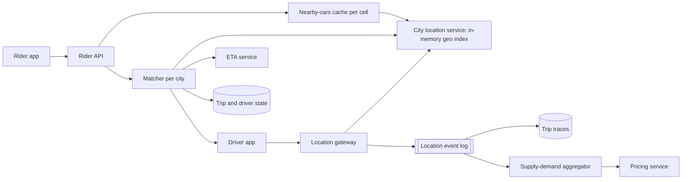
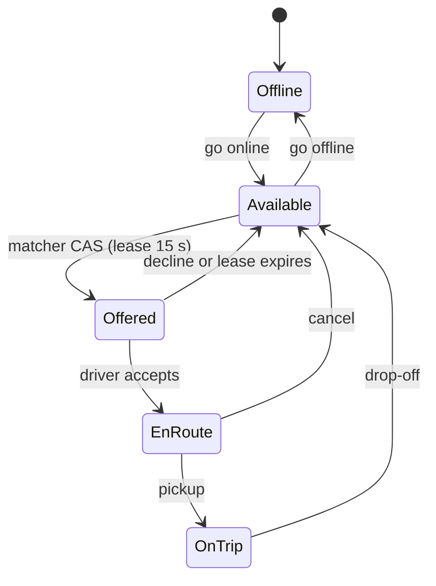

# C05 — Ride-hailing & proximity search

> **The requirement.** A ride-hailing service runs in **600 cities**. At peak **2 million drivers** are online, each
> phone reporting its position **every 4 s**. A rider opening the app sees nearby cars move. When the rider requests a
> ride, the system must pick a driver and send the offer within **2 s at p99**; a driver must **never be assigned two
> rides at once**; and prices must react to local supply and demand within a minute. It is hard because the data
> changes faster than almost any other workload (every row rewrites itself every few seconds), "nearby" is a
> geometric query that ordinary indexes handle badly, and assignment is a distributed mutual-exclusion problem with a
> human in the loop who may never press "accept".

Prerequisites: [SYSDESIGN-07](../01-foundations/07-partitioning-sharding.md) (partitioning, hot keys),
[SYSDESIGN-09](../01-foundations/09-coordination-consensus.md) (leases, fencing) and
[SYSDESIGN-20](../02-modern-requirements/20-real-time-streaming.md) (stream processing).

## The prompt

"Design Uber" (or Lyft, or "nearby friends", or "Yelp"). Separate the two problems hiding in it: **proximity search
over moving points** (drivers, couriers, friends) and **proximity search over static points** (restaurants, shops).
Static points are a classic spatial index that changes rarely; moving points are a high-write, soft-state problem. This
case is mostly the second kind, plus matching.

## CLARIFY: requirements

### Functional

1. Drivers go online/offline and stream location while online.
2. Riders see nearby available cars (approximate positions, refreshed every few seconds).
3. Riders request a ride (pickup, destination, product type); the system offers it to a driver, who accepts or
   declines; on accept, both see each other's live location.
4. Trip lifecycle: en route to pickup, on trip, completed, cancelled; the trip path is recorded for fare and safety.
5. ETAs for pickup and trip; upfront price with dynamic (surge) multipliers per area.

### Non-functional

| Property | Target | Why |
|---|---|---|
| Match latency (request → offer sent) | p99 < 2 s | riders cancel if nothing happens |
| Location freshness in the index | ≤ 5 s old for matching | 4 s update interval + processing |
| No double assignment | 0 drivers with two active offers or trips | safety and trust |
| Availability of matching per city | 99.95 % | an outage strands riders and drivers |
| Blast radius | a failure in one city must not affect others | cities are independent markets |
| Location privacy | precise traces retained only as long as needed | location is sensitive personal data |

### Out of scope

Payments (see [C06](C06-payments-ledger.md)), maps and routing-engine internals, driver onboarding, fraud.

## QUANTIFY: estimates

All values are **labelled assumptions**.

| Quantity | Working | Result |
|---|---|---|
| Location updates | 2 M drivers ÷ 4 s | 500,000 /s at peak |
| Update payload (id, lat, lng, heading, speed, accuracy, ts, status) + framing | ≈ 200 B | ≈ 100 MB/s ingress |
| Driver index in memory | 2 M × 64 B | ≈ 128 MB — fits in one machine's RAM |
| Ride requests | 15 M rides/day × 1.5 (requests that don't complete) ÷ 86,400 | ≈ 260 /s avg; ≈ 1,000 /s peak |
| ETA computations | 1,000 /s × 20 candidates | 20,000 /s |
| "Nearby cars" views | 3 M riders with the app open, refresh every 5 s | ≈ 600,000 /s |
| Trip traces (40 % of online drivers on a trip) | 200,000 /s × 200 B | ≈ 40 MB/s; ≤ 3.5 TB/day (upper bound: peak rate held for 24 h; scale by the average/peak ratio) |
| Largest city (assume 5 % of drivers) | 100,000 drivers | 25,000 updates/s in one city |

**What the numbers say.** The entire live driver index is ≈ 128 MB in our model (our estimate, not a published Uber
figure) — *tiny*. The problem is not size; it is (a) the
**write rate** (500,000 updates/s, each moving a point), (b) the **read fan-in** of map views (600,000 /s, more than
the writes), and (c) **mutual exclusion** in matching. It also says something liberating: the index is soft state.
Every driver re-sends position every 4 s, so a lost index rebuilds itself in about 4 s without any durable
replication.

## SKETCH: high-level design



*Diagram: driver apps send locations to a location gateway, which updates an in-memory geo index in a per-city location
service and appends to a location event log; the log feeds trip-trace storage and a supply–demand aggregator that
drives pricing. Rider apps call a rider API, which serves nearby cars from a per-cell cache built from the location
service, and sends ride requests to a per-city matcher that queries the location service, an ETA service and trip and
driver state, then sends the offer to the driver app.*

**Why each box is there.**

- **Location gateway** — terminates the drivers' persistent connections, authenticates, rate-limits, and routes each
  update to the right city shard.
- **City location service** — the in-memory geo index (deep dive 1, 2). Partitioned **by city** because matching never
  crosses cities, and a bad deploy or hot spot stays local.
- **Location event log** — durable history for trip traces, analytics and pricing, decoupled from the hot index.
- **Nearby-cars cache per cell** — turns 600,000 map refreshes/s into cache reads (deep dive 2).
- **Matcher per city** — candidate selection, ETA ranking and the assignment protocol (deep dive 3).
- **Trip and driver state** — the *durable*, strongly consistent part: who is assigned to whom.
- **Supply–demand aggregator + pricing** — stream processing over cells (deep dive 4).

## API and data model

### APIs

```text
Driver → gateway (persistent connection, every 4 s; batched if the network is poor)
  LOC {driver_id, lat, lng, heading, speed, accuracy_m, ts, status: available|offered|en_route|on_trip}
Gateway → driver
  OFFER {offer_id, trip_id, pickup, eta_s, fare_estimate, expires_at}     # lease: ~15 s to accept
Driver → gateway
  ACCEPT {offer_id}  |  DECLINE {offer_id}
```

```http
GET  /v1/nearby?lat=…&lng=…&product=standard        → [{ "cell": "88…", "approx_lat": …, "approx_lng": …, "heading": … }]
POST /v1/rides  { "pickup": {...}, "dropoff": {...}, "product": "standard", "quote_id": "q_…" }
     Idempotency-Key: …                            → 202 { "ride_id": "...", "state": "matching" }
GET  /v1/rides/{id}                                → state, driver, live driver location, ETA
```

### Data model

| Store | Key | Value | Consistency |
|---|---|---|---|
| Geo index (in memory, per city) | `cell_id → {driver_id}` and `driver_id → (lat, lng, cell, ts, status)` | soft state | rebuilt from updates in ~4 s |
| Driver state | `driver_id` | `status`, `current_offer_id`, `current_trip_id`, `version` | strongly consistent, compare-and-set |
| Trips | `trip_id` | rider, driver, state, pickup, dropoff, price, timestamps | strongly consistent; event-sourced history |
| Trip traces | `(trip_id, ts)` | points | append-only, columnar/time-series; retention-limited |
| Cell aggregates | `(cell_id, minute)` | supply, demand, completed trips | stream-computed |

## DEEPEN

### Deep dive 1 — choosing a spatial index

"Find drivers within 2 km" is a 2-D range query. A B-tree on latitude alone returns a whole band of the planet. The
standard trick is to map 2-D space onto a 1-D key that preserves locality, or to use a tree that partitions space.

| Index | Idea | Strengths | Weaknesses | Examples |
|---|---|---|---|---|
| Geohash | interleave lat/lng bits into a string/integer; prefix = containing cell | trivially stored in any ordered KV; prefix queries | rectangular cells of varying shape; neighbors across cell edges need extra lookups | Redis GEO stores members in a sorted set scored by a 52-bit geohash; `GEOSEARCH` (since 6.2) is O(N + log M) [6] |
| Quadtree | recursively split a square into 4 where density is high | adapts to density (Manhattan vs countryside) | in-memory structure; rebalancing under moving points | textbook structure; no specific production system cited here |
| S2 | project the sphere onto 6 cube faces; order cells along a Hilbert curve; 64-bit cell IDs, levels 0–30 | hierarchical, sphere-aware, good range coverings | square-ish cells; neighbor distances vary | level-30 leaf cells are ≈ 1 cm [4] |
| **H3** | hierarchical **hexagonal** grid on an icosahedron; 16 resolutions; each cell has 7 children (aperture 7) | **one** distance to every neighbor; simple k-ring neighborhoods; good for aggregation and smoothing | 12 pentagons per resolution; children only approximately cover their parent | built at Uber for marketplace analysis such as pricing and dispatch [1][2][3] |

Uber's H3 announcement explains the hexagon choice directly: a hexagon's center is the same distance from all of its
neighbors, whereas squares have two distances and triangles three, which complicates analysis and smoothing across
gradients [1]. The library documentation adds the caveats you must design around: every resolution contains exactly
**12 pentagons** (resolution 0 has 122 base cells, 110 hexagons and 12 pentagons), and while *logical* parent–child
containment in the index is exact, *geographic* containment is approximate [3][7].

**Choosing a resolution.** From the H3 resolution table [2]: resolution 7 cells average 5.16 km² (edge ≈ 1.41 km);
resolution 8, 0.737 km² (edge ≈ 0.53 km); resolution 9, 0.105 km² (edge ≈ 0.20 km). For a regular hexagon the
center-to-center distance is √3 × edge, so at resolution 8 neighbors are ≈ 0.92 km apart. A `gridDisk` of radius *k*
contains up to 3k(k + 1) + 1 cells (derived: 1 + 6 + 12 + … + 6k; fewer near pentagons — the library exposes this
bound as `maxGridDiskSize` [7]). How far a disk reaches depends on direction and on where the pickup sits in its cell.
Typical reach (pickup near its cell centre, along a neighbour direction) is ≈ *k* × spacing; the guaranteed radius in
every direction, with the pickup anywhere in its cell, is ≈ 0.87 × *k* × spacing − edge/2 (the disk is a hexagon of
hexagons, so its narrowest direction is 0.87 of the corner direction). At resolution 8: *k* = 2 (19 cells) reaches
≈ 1.8 km typically but guarantees only ≈ 1.3 km; *k* = 3 (37 cells) guarantees ≈ 2.1 km. So answer "within 2 km" at
resolution 8 with *k* = 3 (resolution 9 would need *k* ≈ 7, 169 cells), then filter candidates by exact distance.

**Default here:** H3 at resolution 8 for matching candidates and resolution 7–8 for pricing aggregates, implemented as
an in-memory map `cell → set(driver)` per city. Any of the four would work for candidate search; H3 wins because the
same cells serve matching, the nearby-cars cache and supply–demand pricing, with uniform neighborhoods.

### Deep dive 2 — ingesting 500,000 moving points per second

Each update does: validate → look up the driver's previous cell → if the cell changed, remove from the old cell's set
and add to the new → overwrite the driver's record. Per city that is a few hash-map operations per update; a single
modern server can handle the largest city's ≈ 25,000 updates/s with large headroom, so the fleet is sized for
availability and isolation, not raw throughput.

**Soft state, by design.** Because drivers re-send every 4 s, the index needs no write-ahead log and no synchronous
replication. If a city's location-service instance dies, a standby instance (already receiving the same updates, or
simply taking over the partition) is complete within one update interval. Durable history goes to the location event
log *in parallel*, not on the matching path.

**Out-of-order and stale updates.** Mobile networks reorder and delay packets. Keep the update with the newest
*device* timestamp per driver (last-writer-wins on `ts`), reject updates far in the future, and treat a driver whose
last update is older than ≈ 15 s as unavailable for matching. Use the reported GPS accuracy: an update with 300 m
accuracy should not move a driver across the city.

**Nearby cars for 600,000 views/s.** Do not run a geo query per refresh. Every 1–2 s, each city's location service
publishes a per-cell snapshot (approximate positions, headings, product types) to a cache; the rider API reads the
rider's cell and its ring of neighbors. The cache absorbs the read fan-in, positions are intentionally approximate
(privacy and bandwidth), and the location service's CPU is spent on matching ([SYSDESIGN-04](../01-foundations/04-caching.md)).

**City boundaries and hot cities.** Pickups near a city border may need drivers from the neighboring shard; let the
matcher query both shards when the k-ring crosses the border. A city too big for one instance can be split into
sub-regions by coarse H3 cell (resolution 4 or 5), keeping the same k-ring logic with cross-shard reads at the edges
([SYSDESIGN-07](../01-foundations/07-partitioning-sharding.md)).

### Deep dive 3 — matching without double assignment



*Diagram: a driver state machine. Offline drivers go online to Available. The matcher moves an Available driver to
Offered with a compare-and-set and a 15-second lease; accepting moves to En route, while declining or lease expiry
returns to Available. En route moves to On trip at pickup or back to Available on cancel; drop-off returns On trip to
Available; Available drivers can go Offline.*

**Candidate selection.** The parameters in this deep dive (20 candidates, a 15 s offer lease, a 1–2 s batching
window) are our design choices, not Uber's published values. For a request at pickup *p*: k-ring around *p*'s cell
(expand *k* until at least 20 candidates or a maximum radius) → filter `status = available`, product type, freshness → keep the 20 closest by
straight-line distance → ask the ETA service for road ETAs → score (ETA, driver rating, acceptance likelihood) → pick
the best.

**The assignment protocol.** The index is soft state; assignment must not be. The matcher performs a
**compare-and-set** on the driver's durable state: `Available (version v) → Offered (offer_id, expires_at)`. Exactly
one matcher wins; others pick the next candidate. The offer is a **lease**: if the driver neither accepts nor declines
within ~15 s, the lease expires and the driver returns to `Available` — no human can hold the system hostage. Accept is
also a compare-and-set (`Offered(offer_id) → EnRoute`), so a late accept after expiry fails cleanly. This is the lease
and fencing pattern from [SYSDESIGN-09](../01-foundations/09-coordination-consensus.md) applied to people.

**Greedy vs batched matching.** Greedy matching (each request takes the best available driver immediately) is simple
and fast but locally optimal: the nearest driver for rider A might be the *only* reasonable driver for rider B. Batched
matching collects requests for a short window (say 1–2 s) and solves an assignment problem over requests × drivers to
minimize total pickup time. It costs up to one window of latency — which the 2 s budget can afford in dense cities —
and buys better global outcomes. Uber's H3 post mentions dispatch decisions such as identifying multiple ride requests
near a driver for pooled rides [1]; the exact algorithms are product-specific, so state the trade-off rather than a
"correct" algorithm.

**Latency budget (assumptions):** candidate lookup 20 ms; ETA for 20 candidates in parallel 100 ms; scoring 20 ms;
CAS 10 ms; batching window ≤ 1,000 ms; offer push to driver 300 ms → about 1.45 s of allocated budget. That leaves
≈ 0.5 s of slack at p99 only if each stage's tail is bounded, because stage p99s do not add; measure end to end.

### Deep dive 4 — ETAs and supply–demand pricing

**ETA.** A routing engine computes travel time by summing segment times along the best path; Uber's DeepETA (2022)
keeps that engine and uses a deep model to "predict the residual between the routing engine ETA and real-world
observed outcomes", with a latency requirement of a few milliseconds; the model has hundreds of millions of parameters
but uses about 0.25 % of them per prediction [5]. The architectural lesson generalizes: put the learned model *on top
of* a physics-like baseline, so the baseline still works if the model is unavailable and the model can be retrained
independently.

**Supply and demand per cell.** Stream the location log and request events into per-cell, per-minute counts
(available drivers, open requests, completed trips) with a stream processor
([SYSDESIGN-20](../02-modern-requirements/20-real-time-streaming.md)). Uber's H3 post describes measuring supply and
demand in hexagons to set prices [1]. Raw per-cell counts are noisy; smooth them by averaging each cell with its
k-ring neighbors — exactly where equal neighbor distances make the math simple. The pricing service reads the
smoothed multiplier for the pickup cell when quoting, and the quote is stored with an ID (`quote_id`) so the price the
rider accepted is the price charged even if the multiplier changes a second later.

## STRESS: failures, hot spots, scale ×10

| Failure / stress | Symptom | Detection | Mitigation |
|---|---|---|---|
| City location-service instance dies | no candidates in that city | candidate-count per request drops to 0 | standby receives updates and takes over; index complete within ~4 s |
| Gateway overload (stadium event) | updates delayed, positions stale | update age distribution | per-driver rate limits; drop intermediate updates (keep newest); shed nearby-cars refresh first |
| Hot cell (airport queue, concert exit) | one cell with thousands of drivers/requests | per-cell request rate | queue-based dispatch for designated zones (airport FIFO); finer resolution there |
| Durable driver-state store slow | CAS latency → match latency | CAS p99 | per-city state partitions; timeouts and retry with a different candidate |
| Driver app offline mid-offer | lease never answered | expired-offer rate | lease expiry returns driver to Available; re-offer to next candidate |
| Clock-skewed devices | updates rejected or misordered | rejected-update rate | server receive-time sanity window; trust per-driver monotonicity |
| Split-brain matcher (two instances think they own a city) | risk of double offers | ownership changes | CAS on durable state prevents double assignment even if two matchers run |

**Scale ×10** (20 M online drivers, 5 M location updates/s). The per-city design scales by adding cities and splitting
big ones into sub-regions; nothing global sits on the hot path. The gateway tier grows linearly with connections. The
nearby-cars cache becomes the largest read system (≈ 6 M reads/s) and should be served from regional caches close to
riders. Trip traces reach up to ≈ 35 TB/day (same upper-bound caveat); retention and downsampling policies (keep full resolution for disputes for a
limited period, then coarsen) become cost *and* privacy requirements.

## Operate: SLOs, cost, energy

### SLOs

| SLI | SLO |
|---|---|
| Request → offer sent | p99 < 2 s per city |
| Matching availability per city | 99.95 % / 30 days |
| Double-assignment incidents | 0 (audited from trip and driver state) |
| Location freshness at match time | p99 < 5 s |
| Price quote honored | 100 % of completed trips charged the accepted quote (or less) |

Alert per city, not globally: a 1 % global error rate can hide a 100 % outage in one city.

### Cost

The live index is cheap (megabytes per city). Cost concentrates in **connections and ingress** (500,000 updates/s of
small messages — favor a compact binary protocol and batching), **ETA inference** (20,000 /s at peak; cache ETAs for
nearby origin–destination cell pairs for a few seconds), **map-view reads** (the per-cell cache), and **trace
storage** (columnar, compressed, retention-limited) ([SYSDESIGN-16](../02-modern-requirements/16-cost-as-requirement.md)).

### Energy

The largest energy consumer in this system is not the data center — it is 2 million phones running GPS and radios all
shift long. Adaptive update intervals (more often near pickup, less often when stationary or on a highway with
predictable motion) and batching updates reduce battery drain and server load together. Make the reporting interval a
server-controlled parameter so it can be tuned without an app release ([SYSDESIGN-17](../02-modern-requirements/17-energy-carbon-aware.md)).

## Modern twist

**H3 as the shared language of the marketplace.** Uber's H3 post describes using hexagons for pricing and dispatch
analysis [1]; we recommend going further and making the cell ID the join key that ties real-time matching, pricing,
forecasting, analytics tables and ML features together. H3's 4.x API
(current documentation shows "Version: 4.x") names the neighborhood operations `gridDisk` and `gridRing` and documents
how they behave near pentagons [3][7]; the C library and its bindings are open source [8]. Storing H3 cell IDs at several resolutions on every event lets a lakehouse
answer "demand by neighborhood by hour" with integer joins instead of geometry, and lets features computed offline
match the cells used online ([SYSDESIGN-27](../03-ai-systems/27-ml-platforms.md)).

**Learned components on top of classical baselines.** ETA (DeepETA's residual over a routing engine [5]), demand
forecasting per cell, acceptance-probability models in matching, and pricing all run as ML services with
millisecond budgets. The design rule from deep dive 4 — baseline plus learned correction, with the baseline as the
fallback — is the 2026 pattern for putting models on a hard real-time path.

**Location privacy is a design constraint.** Precise GPS traces reveal homes, workplaces and routines; under the GDPR
they are personal data — Art. 4(1) lists "location data" among the identifiers that make a person identifiable [9] —
so purpose limitation, minimization and retention limits apply
([SYSDESIGN-19](../02-modern-requirements/19-privacy-compliance-sovereignty.md)). Practical consequences: show riders
approximate driver positions before a match, aggregate analytics to cells rather than points, keep full-resolution
traces only for the period needed for disputes and safety, and make the retention policy executable (TTLs on trace
partitions) rather than a document.

## WRAP: interview summary

**A strong 45-minute answer covers, in order:** clarify moving vs static points, matching rules, pricing → numbers
(500,000 updates/s, 128 MB index, 600,000 map views/s, 1,000 requests/s) and the "soft state" insight → sketch with
gateway, per-city location service, event log, nearby-cars cache, matcher, durable driver state → spatial index
comparison and H3 resolution choice with cell sizes and k-ring counts → ingestion with last-writer-wins and staleness →
matching with candidate selection, ETA, CAS and leases, greedy vs batched → pricing on smoothed cells → per-city SLOs,
failures and ×10.

| Level | What "good" looks like |
|---|---|
| Junior | Explains why a plain lat/lng index is not enough; names geohash or quadtree; drivers send periodic updates; a matcher picks the nearest available driver |
| Senior | Compares index types and picks a resolution with numbers; realizes the index is small, soft state and partitioned by city; caches nearby-car views; prevents double assignment with CAS + lease; handles stale and out-of-order updates |
| Staff | Separates soft (index) from durable (assignment) state explicitly; batched vs greedy matching trade-off; per-city blast radius and SLOs; ETA and pricing as baseline + learned correction; privacy-driven retention; device energy as a design input |

**Red flags.** Storing every location update synchronously in a relational database with a lat/lng index. A global
single index for all cities. "Lock the driver" with no answer to "what if the driver never responds?". Exact driver
positions shown to every rider. Computing road ETAs for hundreds of candidates per request.

**Follow-ups.** Food delivery (three parties, batching orders per courier); pooled rides (matching multiple riders to
one route); "nearby friends" (moving points with privacy controls and mutual consent); scheduled rides (reservation
plus matching later).

## Alternatives considered

| Alternative | Wins when | Why not the default here |
|---|---|---|
| Redis GEO (geohash sorted sets) per city | quick implementation, moderate scale | works well for candidates; less natural for hexagonal aggregation and smoothing used by pricing |
| Database spatial index (R-tree/GiST) for drivers | static or slowly changing points (restaurants) | high update rate on moving points makes durable index maintenance the bottleneck |
| Quadtree per city | strongly varying density, custom logic | equally valid for search; H3 shares cells across matching, caching, pricing and analytics |
| Greedy-only matching | sparse markets, simplest system | loses global efficiency in dense markets where batching is affordable |
| Global matcher | tiny deployments | couples cities' failures and adds latency |

## Exercises

See [exercises/C05-ride-hailing-proximity.md](../../exercises/C05-ride-hailing-proximity.md) — update-rate and
memory sizing, H3 resolution and k-ring math, stale-update handling, the CAS + lease protocol, batched matching,
pricing smoothing, and lab exercises using [labs/09-coordination-consensus](../../labs/09-coordination-consensus/)
(leases and leader failover), [labs/07-partitioning-sharding](../../labs/07-partitioning-sharding/) (hot keys and
partitioning) and [labs/04-caching](../../labs/04-caching/) (read fan-in).

## References

All accessed 2026-11-19; re-checked 2026-11-20 (uber.com and eur-lex.europa.eu block automated clients; refs 1, 5
and 9 were read via the Wayback Machine copies listed).

1. I. Brodsky, "H3: Uber's Hexagonal Hierarchical Spatial Index," Uber Engineering blog, 2018-06-27. https://www.uber.com/blog/h3/ (read via https://web.archive.org/web/20260101053035/https://www.uber.com/en-CA/blog/h3/)
2. H3 project, "Tables of Cell Statistics Across Resolutions." https://h3geo.org/docs/core-library/restable/
3. H3 project, "Overview of the H3 Geospatial Indexing System" (122 base cells; 12 pentagons per resolution; version 4.x) and "Indexing" (aperture 7; exact logical containment). https://h3geo.org/docs/core-library/overview and https://h3geo.org/docs/highlights/indexing/
4. S2 Geometry, "S2 Cells" developer guide (cube faces, Hilbert curve, levels 0–30, 64-bit cell IDs). http://s2geometry.io/devguide/s2cell_hierarchy
5. Uber Engineering, "DeepETA: How Uber Predicts Arrival Times Using Deep Learning," 2022-02-10. https://www.uber.com/blog/deepeta-how-uber-predicts-arrival-times/ (read via https://web.archive.org/web/20260214071427/https://www.uber.com/blog/deepeta-how-uber-predicts-arrival-times/)
6. Redis documentation, "GEOSEARCH" (since 6.2.0; O(N + log M); 52-bit geohash scores). https://redis.io/docs/latest/commands/geosearch/
7. H3 project, "Grid traversal functions" (`gridDisk`, `gridRing`, pentagon behavior). https://h3geo.org/docs/api/traversal
8. Uber, H3 source repository. https://github.com/uber/h3
9. Regulation (EU) 2016/679 (GDPR), Art. 4(1) definition of personal data ("location data" listed among identifiers). https://eur-lex.europa.eu/eli/reg/2016/679/oj (read via https://web.archive.org/web/20241230232003/https://eur-lex.europa.eu/eli/reg/2016/679/oj)
