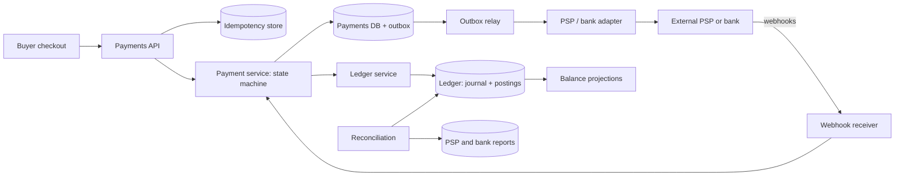
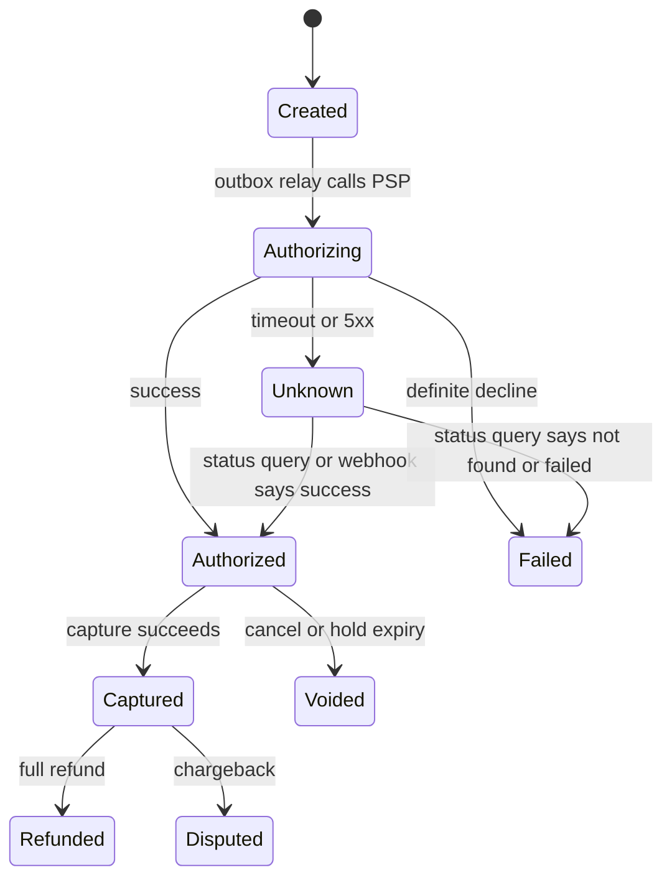

# C06 — Payments & ledger

> **The requirement.** A marketplace takes **10 million payments a day** from buyers by card and by instant bank
> transfer, keeps a platform fee, and pays sellers out. **No buyer may ever be charged twice**, even when networks time
> out, clients retry and providers send duplicate webhooks. Every movement of money must be recorded in a
> **double-entry ledger** that balances to zero and can be audited years later. The books must **reconcile** with the
> payment providers' and banks' reports every day. Instant transfers must work **in seconds, at 3 a.m. on a Sunday**.
> It is hard because the system's most important property — "this happened exactly once" — has to be built on top of
> components (networks, providers, queues) that can only promise "at least once" or "at most once", and because the
> outcome of a call to a provider is sometimes simply *unknown*.

Prerequisites: [SYSDESIGN-05](../01-foundations/05-choosing-storage.md) (transactions, isolation),
[SYSDESIGN-08](../01-foundations/08-async-event-driven.md) (outbox, idempotency, sagas),
[SYSDESIGN-09](../01-foundations/09-coordination-consensus.md) (leases) and
[SYSDESIGN-10](../01-foundations/10-apis-communication.md) (API design).

## The prompt

"Design a payment system" (Stripe-like, or a marketplace's internal payments). Clarify early: are we a payment
provider (we talk to card networks) or a merchant/marketplace (we call providers)? This case is the second — the more
common job — which means our hardest problem is integrating with external systems we cannot make transactional.

## CLARIFY: requirements

### Functional

1. **Pay-in**: authorize and capture a card payment via a payment service provider (PSP); or initiate an instant bank
   transfer (SEPA Instant in the EU, FedNow-connected banks in the US).
2. **Holds**: authorize at checkout, capture at shipment (up to N days later); release on cancel.
3. **Fees and splits**: platform fee per payment; the rest owed to the seller.
4. **Refunds** (full/partial) and **chargebacks** (initiated by the buyer's bank).
5. **Payouts** to sellers on a schedule or on demand.
6. **Ledger**: every money movement recorded as balanced double-entry postings; balances per account; full history.
7. **Reconciliation** against PSP settlement reports and bank statements.

### Non-functional

| Property | Target | Why |
|---|---|---|
| Correctness | zero double charges; ledger always balances | money errors are trust and legal problems |
| Durability | RPO = 0 for ledger and payment state | an acknowledged payment cannot be forgotten |
| Payment API availability | 99.95 % | checkout revenue depends on it |
| Checkout latency | p99 < 3 s end to end including PSP | buyers abandon slow checkouts |
| Instant transfers | funds available to payee within 10 s, 24/7 | regulatory requirement in the EU (Modern twist) |
| Auditability | immutable history, traceable to source events | auditors and regulators |
| Card data scope | no raw card numbers in our systems | PCI DSS scope reduction |

### Out of scope

Fraud models (assume a scoring call), tax calculation, currency conversion beyond storing currency per amount, KYC.

## QUANTIFY: estimates

All values are **labelled assumptions**.

| Quantity | Working | Result |
|---|---|---|
| Payments/s, average | 10 M / 86,400 | ≈ 116 /s |
| Payments/s, peak (10× during sales) | | ≈ 1,200 /s |
| Ledger postings per payment (auth hold, capture, fee, seller payable, payout, ≈ 10 postings) | 10 M × 10 | 100 M postings/day ≈ 1,160 /s avg, ≈ 12,000 /s peak |
| Posting size (IDs, account, amount, currency, entry ID, timestamps, indexes) | ≈ 200 B | 20 GB/day ≈ 7.3 TB/year |
| Retention (assume 10 years; statutory periods vary) | 7.3 TB × 10 | ≈ 73 TB (plus replicas) |
| Idempotency records (1 KB stored response, 7-day retention) | 10 M × 1 KB × 7 | ≈ 70 GB |
| Webhooks received | ≈ 3 per payment | ≈ 30 M/day, duplicates expected |
| Hot account: platform-fee account (assumes every payment carries a fee) | 1 posting per payment | ≈ 1,200 writes/s at peak on one balance |

**What the numbers say.** Volume is modest: ≈ 12,000 postings/s at peak and tens of terabytes over a decade fit a
well-run sharded relational database or a purpose-built ledger. The difficulty is **correctness under failure**, not
throughput. One number deserves attention: the **platform-fee account receives a posting for every payment** — a hot
row that serializes on its balance if you update balances synchronously (deep dive 2).

## SKETCH: high-level design



*Diagram: buyer checkout calls the payments API, which checks an idempotency store and hands off to a payment service
that runs a state machine and writes a payments database with an outbox. An outbox relay drives a PSP/bank adapter that
calls the external provider; provider webhooks come back through a webhook receiver to the payment service. The
payment service records money movements through a ledger service into journal and posting tables, from which balance
projections are derived. Reconciliation compares the ledger with PSP and bank reports.*

**Why each box is there.**

- **Idempotency store** — makes client retries safe (deep dive 1).
- **Payment service (state machine)** — the single place that decides what state a payment is in; every external
  event (PSP response, webhook, timeout) is a transition, not an ad-hoc update.
- **Payments DB + outbox** — state change and "call the PSP" intent commit atomically; the relay performs the call
  afterwards (deep dive 3). This box exists because you cannot put an HTTP call to a PSP inside a database transaction.
- **PSP / bank adapter** — isolates provider APIs, idempotency semantics and error codes behind one interface; also
  where card data is replaced by PSP tokens so raw card numbers never enter our systems.
- **Webhook receiver** — providers report asynchronous outcomes (captures, chargebacks); delivery is at least once
  (Stripe, for example, retries deliveries with exponential backoff for up to three days and tells receivers to track
  event IDs to spot duplicates [13]).
- **Ledger service** — the system of record for money: append-only, double-entry (deep dive 2).
- **Reconciliation** — the independent check that our books match the outside world (deep dive 4).

## API and data model

### Public API

```http
POST /v1/payments
Idempotency-Key: 2c0f7f2e-6a1b-4f3e-9d58-0f3a6c1a9b77
{ "order_id": "o_123", "amount": 4999, "currency": "EUR", "method": {"type": "card", "token": "tok_…"},
  "capture": "manual", "seller_id": "s_88", "platform_fee": 500 }
201 { "payment_id": "pay_…", "state": "authorized" }      # or "requires_action" (3-D Secure, as in Stripe [16]), "failed"
200 (same key, same body)     → the original response, replayed
422 (same key, different body) → error: key reused with different parameters

POST /v1/payments/{id}/capture   { "amount": 4999 }        Idempotency-Key: …
POST /v1/payments/{id}/refunds   { "amount": 1500 }        Idempotency-Key: …
GET  /v1/accounts/{id}/balance   → { "available": …, "pending": …, "as_of_entry": … }
```

Amounts are **integers in minor units** (cents) with an explicit currency — never floating point.

### Data model

| Table | Key | Columns | Notes |
|---|---|---|---|
| `idempotency_keys` | `(merchant_or_user, key)` | request hash, state (`in_progress` / `done`), response code + body, lease expiry, created_at | TTL'd |
| `payments` | `payment_id` | order_id, amount, currency, state, psp_ref, version | state machine; optimistic concurrency on `version` |
| `payment_attempts` | `(payment_id, attempt_no)` | PSP idempotency key, request, outcome (`succeeded` / `failed` / `unknown`) | one row per external call |
| `outbox` | `id` | aggregate_id, type, payload, created_at, published_at | written in the same transaction as `payments` |
| `accounts` | `account_id` | type (asset, liability, revenue, expense), currency, owner, `allow_negative` | ledger chart of accounts |
| `journal_entries` | `entry_id` | external reference (unique), description, effective_at, created_at | immutable |
| `postings` | `(entry_id, line)` | account_id, amount (signed minor units), currency, state (`pending` / `posted`) | Σ amount per entry per currency = 0; immutable |
| `balances` | `account_id` | posted, pending, last_entry_id | projection; rebuildable from postings |

## DEEPEN

### Deep dive 1 — idempotency from client to provider and back

Every network hop in a payment can fail *after* the work was done but *before* the caller heard about it. Idempotency
has to hold on every hop:

| Hop | Duplicate source | Mechanism |
|---|---|---|
| Client → our API | user double-click, mobile retry after timeout | `Idempotency-Key` header, stored response replay |
| Our relay → PSP | relay retry after timeout or crash | PSP idempotency key derived from `payment_id` + attempt |
| PSP → our webhook receiver | provider redelivery | dedupe on provider event ID |
| Payment service → ledger | message redelivery | unique `external reference` on `journal_entries` |

**Semantics worth copying from Stripe.** Stripe's API documentation is precise about the rules: the client generates
the key (V4 UUIDs suggested; keys up to 255 characters); for API v1 Stripe saves "the status code and body of the first
request made with a given idempotency key after endpoint execution begins", and retries return the saved response,
"including `500` errors"; keys can be pruned after at least 24 hours; incoming parameters are compared with the
original and a mismatch is an error; and results are not saved if the request fails validation or conflicts with a
concurrently executing request, so those can be retried [1]. Stripe's engineering post adds the client half: retry with
exponential backoff and jitter so retries do not synchronize into a thundering herd [2]. The HTTP header itself is
being standardized as `Idempotency-Key` (draft-ietf-httpapi-idempotency-key-header-08, October 2026) [10].

**Concurrency: the in-progress state.** Two identical requests can arrive simultaneously. The first inserts the key
row as `in_progress` with a **lease** (expiry); the second sees `in_progress` and gets `409 Conflict` (retry later)
rather than executing in parallel. Airbnb's payments idempotency library ("Orpheus") is built on the same ideas: each
request acquires a database row-level lock on its idempotency key, granting a lease with an expiration; the request is
split into *pre-RPC*, *RPC* and *post-RPC* phases, with database commits kept out of the RPC phase; and errors are
classified as *retryable* or *non-retryable* [3]. If the lease expires (the server crashed mid-request), a retry may
proceed — which is safe only because the *downstream* call is also idempotent.

**Never mint a new downstream key on retry.** The PSP idempotency key for an attempt must be stable across retries of
that attempt. Generating a fresh key because "the last call timed out" is the classic way to charge twice.

### Deep dive 2 — the double-entry ledger

**Model.** Every money movement is a **journal entry** made of **postings** to accounts; the postings of one entry sum
to zero per currency. Square's "Books" service describes the same rule: all transactions ("journal entries") "must
balance to 0", the journal is append-only and serves as an audit trail (only the cached balance row is mutable), and "you can't update the data in place" — you fix
mistakes with correcting entries [4]. TigerBeetle's documentation reduces the model to "two entities (accounts,
transfers) and one invariant", supports two-phase (pending) transfers natively, enforces balance limits inside the
database, and makes transfers immutable; corrections are "more transfers to reverse or adjust" the earlier ones [5][14].

A card payment with a hold, capture and fee, for €49.99 with a €5.00 platform fee (signed minor units; positive =
debit):

| Entry | Account | Amount | Meaning |
|---|---|---|---|
| E1 authorize (pending) | `psp_receivable` | +4,999 | money the PSP will owe us |
| | `buyer_hold:o_123` | −4,999 | held, not yet ours |
| E2 capture (posted) | `buyer_hold:o_123` | +4,999 | release hold |
| | `seller_payable:s_88` | −4,499 | we owe the seller |
| | `platform_fee_revenue` | −500 | our revenue |
| E3 PSP settlement | `bank_cash` | +4,999 − psp_fee | cash arrives |
| | `psp_fees_expense` | +psp_fee | provider fee |
| | `psp_receivable` | −4,999 | receivable cleared |

Each entry sums to zero. We model an authorization as a *pending* receivable to track expected funds; it becomes a
real receivable only at capture. E1 stays *pending* until capture (then it is posted together with E2) or is voided if the
hold is released; `psp_receivable` returns to zero once settled — which is exactly what reconciliation checks.

**Balances are projections.** The truth is the postings; a balance is a cached sum. Keep a `balances` row per account
updated in the same transaction as the postings for accounts that need **synchronous checks** (a seller wallet that
must not go negative, a customer's prepaid balance). For accounts that only accumulate — `platform_fee_revenue`,
receiving a posting for every payment — do **not** lock a single balance row on every write: at ≈ 1,200 writes/s that
row serializes all payments. Options: split the hot account into N sub-accounts (`platform_fee_revenue#0…#31`, summed
on read), or compute its balance asynchronously from the posting stream. Both preserve the ledger; they change only how
the projection is maintained.

**Holds are pending postings.** An authorization reserves funds without moving them; two-phase transfers (pending →
posted or voided) model it directly [5]. Uber's LedgerStore describes why the *index* on such holds must be strongly
consistent: it uses two-phase commit for strongly consistent indexes for cases like credit-card authorization holds,
where a stale read could cause a duplicate charge, and eventually consistent indexes (built in the background) where a
short delay is acceptable, such as payment history pages [6]. That is a useful rule of thumb: **strong consistency where
a stale read moves money; eventual consistency where a stale read only displays it**.

**Storage choice.** A relational database with serializable or carefully designed read-committed transactions, sharded
by account (with cross-shard entries handled via the outbox and a per-entry saga), is the common default; purpose-built
ledgers (TigerBeetle) and immutable ledger services (Square Books, Uber LedgerStore) exist because the access pattern is
specialized ([SYSDESIGN-05](../01-foundations/05-choosing-storage.md)). Whatever you choose, enforce the zero-sum
invariant *in the write path* (constraint or service check), not in a nightly report.

### Deep dive 3 — exactly-once effects with an external provider



*Diagram: a payment state machine. Created moves to Authorizing when the outbox relay calls the PSP. Authorizing moves
to Authorized on success, Failed on a definite decline, or Unknown on timeout or server error. Unknown resolves to
Authorized or Failed after a status query or webhook. Authorized moves to Captured or Voided; Captured can move to
Refunded or Disputed.*

**The outbox.** Within one database transaction the payment service writes the new state (`Authorizing`), the attempt
row with its PSP idempotency key, and an outbox record "call PSP for attempt 1". The relay reads the outbox and makes
the call; if it crashes, it re-reads the outbox and calls again **with the same key**, so the PSP de-duplicates. There
is never a state where we called the PSP but have no record of intending to, or recorded a success we did not get
([SYSDESIGN-08](../01-foundations/08-async-event-driven.md)).

**Unknown is a real state.** A timeout does not mean failure. The payment moves to `Unknown`; a resolver queries the
PSP for the attempt's status (or waits for the webhook) and only then decides. The same `Unknown` pattern applies to capture, refund and
payout attempts — each is an external call with its own `payment_attempts` row and resolver; the diagram shows it
for authorization only, and shows full refunds only (a partial refund keeps the payment `Captured` with a refunded
amount, or adds a `Partially_refunded` state). Show the buyer "processing", not "failed — try again", because a buyer who retries with a new payment is how double charges happen even with perfect
idempotency keys. Use timeouts that are shorter than the client's, so the server can still answer "processing" with
a payment ID the client can poll.

**Webhooks are inputs to the state machine.** De-duplicate by provider event ID, then apply the transition only if
it is valid from the current state (optimistic concurrency on `version`). Out-of-order webhooks (a "captured" arriving
before "authorized") are handled by the state machine, not by arrival order; Stripe's documentation likewise warns
not to use an event's `created` timestamp to determine order [13].

**Ledger postings are idempotent too.** Each transition that moves money writes a journal entry with a unique
external reference (`payment_id:capture:1`); a replayed transition hits the unique constraint and becomes a no-op.

### Deep dive 4 — reconciliation

Internal correctness is necessary and not sufficient: the PSP, the card networks and the bank are separate systems of
record. Daily (or continuous) reconciliation compares three views:

1. **Ledger** — what we think happened (`psp_receivable`, `bank_cash`, fees).
2. **PSP settlement report** — what the provider says it captured, refunded, charged back and paid out, and its fees.
3. **Bank statement** — what cash actually arrived.

Match by provider reference and amount; classify **breaks** (in ledger but not in report, in report but not in
ledger, amount mismatch, timing difference) and route them to a queue for automated fixes (late webhooks) or human
review. Reconciliation should *write* correcting journal entries (never edit history) and should have its own SLO:
"99.9 % of transactions matched within T+1; zero unexplained breaks older than 3 days".

## STRESS: failures, hot spots, scale ×10

| Failure / stress | Symptom | Detection | Mitigation |
|---|---|---|---|
| PSP timeouts spike | many `Unknown` payments | Unknown-state count and age | resolver with status queries; circuit breaker; route new traffic to a secondary PSP only for *new* attempts |
| PSP outage | authorizations fail | PSP error rate | failover to a second PSP for new payments; never re-send an Unknown attempt to a different PSP |
| Duplicate webhooks / replay | double transitions attempted | dedupe hits | event-ID dedupe + state-machine validity checks |
| Hot fee account | lock contention, checkout latency | lock wait time | sub-accounts or async projection (deep dive 2) |
| Relay backlog | payments stuck in `Authorizing` | outbox age | autoscale relay; alert on age; buyer sees "processing" |
| Ledger shard unavailable | entries for some accounts blocked | write errors per shard | payment state still recorded; ledger entries queued via outbox and applied when the shard returns (ledger lags, never diverges) |
| Bug posts unbalanced entry | invariant violation | write-path check rejects it | reject in write path; page; never "fix up" by editing |
| Flash sale | 10× traffic | API rate, PSP rate limits | per-merchant rate limits ([C01](C01-url-shortener-rate-limiter.md)); queue captures (they can wait), not authorizations |

**Scale ×10** (100 M payments/day, ≈ 120,000 postings/s peak). Shard the ledger by account ID; most entries touch a
buyer-side and a seller-side account on different shards, so a cross-shard entry becomes a short saga: write the entry
as `pending` on both shards, then `posted`, with the outbox driving both and the zero-sum check applied per entry.
Hot accounts multiply — use sub-accounts systematically for platform accounts. Reconciliation becomes a streaming job
rather than a nightly batch.

## Operate: SLOs, cost, energy

### SLOs

| SLI | SLO |
|---|---|
| Payment API success (non-5xx) | 99.95 % / 30 days |
| Checkout authorization latency (incl. PSP) | p99 < 3 s |
| Double charges | 0 (audited daily from attempts and settlements) |
| Ledger invariant violations | 0 (write path rejects; daily full check) |
| Unknown payments resolved | 99 % within 15 min, 100 % within 24 h |
| Reconciliation | 99.9 % matched by T+1; no unexplained break older than 3 days |
| Instant transfer: payee funds available | within 10 s (regulatory) |

### Cost

In our judgement (not a measured figure), infrastructure is a small share of payments cost and **provider fees**
(interchange, scheme and PSP fees) dominate; they are a business negotiation. The engineering cost levers are routing (send each payment to the cheapest PSP that meets
the success-rate target, with care for Unknown attempts), authorization success rate (a declined good payment is lost
revenue, not saved cost), and keeping PCI DSS scope small by never handling raw card data (PCI DSS v4.0.1 is the
current standard listed by the PCI Security Standards Council [12]) — scope drives audit cost.

### Energy

Ledger workloads are light; energy is not a primary design driver here. The meaningful lever is avoiding wasteful
retries (jittered backoff, idempotency, circuit breakers) — retry storms against providers burn compute on both sides
and can push a degraded dependency into outage ([SYSDESIGN-11](../01-foundations/11-reliability-engineering.md)).

## Modern twist

**Instant payments make "batch" a legacy word.** Card systems and classic bank transfers let back offices run
overnight batches. Instant credit transfers do not. In the EU, **Regulation (EU) 2024/886** (adopted 13 March 2024)
requires payment providers that offer regular euro credit transfers to also offer instant ones, executed "24 hours a
day and on any calendar day", with funds available to the payee "within 10 seconds"; charges no higher than for
comparable non-instant transfers; a **verification-of-payee** service before the payer authorizes the transfer; and
sanctions screening of customers at least once per calendar day. Euro-area providers had to be able to receive instant
transfers by 9 January 2025 and to send them, with payee verification, by 9 October 2025; providers in non-euro member
states have until 9 January 2027 (receive) and 9 July 2027 (send) [7]. In the US, the Federal Reserve's **FedNow
Service went live on July 20, 2023**, designed for uninterrupted 24x7x365 processing [8].

What this changes in our design:

- **No maintenance window.** The ledger, payment service and reconciliation must run 24/7; schema changes become
  online migrations; "end of day" becomes a reporting cut-off, not a processing pause.
- **Irrevocability moves fraud checks inline.** An instant transfer cannot be pulled back like a card payment can be
  disputed, so fraud scoring and verification of payee sit on the synchronous path, inside a seconds-level budget.
- **Liquidity and limits are real-time.** Treasury needs live positions, not end-of-day files; ledger balances for
  settlement accounts become operational data.
- **Reconciliation goes continuous.** Matching happens per transfer as confirmations arrive, with breaks surfaced in
  minutes.

**The EU payments package is close to law.** The Council and Parliament reached a provisional political agreement on
27 November 2025 on a new Payment Services Regulation and a third Payment Services Directive (PSD3), framed by the
Council as stepping up the fight against fraud and increasing transparency [9]. As of the European Parliament's
legislative-train update of 25 October 2026 the file is "close to adoption": the ECON committee approved the agreed
text on 5 May 2026, and formal adoption and publication in the Official Journal were still pending [11]. Treat the
detailed obligations (for example on fraud liability and data sharing) as subject to the final published text; design
for them by keeping fraud signals, payee verification and audit trails as first-class, queryable data rather than log
lines.

## WRAP: interview summary

**A strong 45-minute answer covers, in order:** clarify merchant vs provider, methods, holds, payouts → numbers
(≈ 1,200 payments/s peak, ≈ 12,000 postings/s, tens of TB over a decade, the hot fee account) → sketch with idempotency
store, state machine, outbox, adapter, webhooks, ledger, reconciliation → idempotency on every hop with Stripe-style
semantics and the in-progress lease → double-entry with a worked entry, immutability, holds as pending postings,
balances as projections, hot-account fix → state machine with `Unknown` and the outbox → reconciliation with breaks →
failures and ×10 (cross-shard entries) → instant payments and regulation.

| Level | What "good" looks like |
|---|---|
| Junior | Idempotency key on payment creation; integer minor units; a payments table with states; calls a PSP; refunds |
| Senior | Idempotency on every hop with concurrency handling; outbox instead of call-in-transaction; explicit Unknown state with resolution; webhook dedupe; double-entry ledger with balanced entries and immutability; reconciliation |
| Staff | Consistency chosen by consequence (strong where stale reads move money); hot-account and cross-shard ledger design; PSP failover rules that cannot double charge; reconciliation SLOs; PCI scope minimization; 24/7 instant-payment implications and regulatory timelines as requirements |

**Red flags.** Floating-point amounts. Updating balances in place without postings. Calling the PSP inside a database
transaction. Treating a timeout as a failure and letting the buyer retry with a new payment. Generating a new PSP
idempotency key on retry. "We'll use exactly-once Kafka" as the whole correctness story. No reconciliation.

**Follow-ups.** Multi-currency (postings per currency; FX as an explicit entry with a rate); wallets and stored value
(balances must never go negative — synchronous checks); split payments to many sellers (one entry, many postings);
chargebacks months later (new entries against old payments); GDPR erasure versus ledger immutability (the right to erasure does not apply where processing is needed to comply
with a legal obligation, GDPR Art. 17(3)(b) [15]; pseudonymize personal data outside the ledger and keep financial
records for the statutory period).

## Alternatives considered

| Alternative | Wins when | Why not the default here |
|---|---|---|
| Single-entry "transactions" table with a balance column | prototypes | no zero-sum invariant; errors are invisible until reconciliation |
| Two-phase commit across our DB and the PSP | not available in practice — PSP APIs are HTTP calls, not XA resource managers (design judgement) | the outbox + idempotency + state machine is the practical equivalent |
| Event sourcing everything | strong audit needs, team experienced with it | the ledger already is an append-only log; full event sourcing adds complexity elsewhere |
| Purpose-built ledger database (e.g. TigerBeetle) | very high posting rates, strict invariants | strong option; a relational design is sufficient at our ≈ 12,000 postings/s |
| Nightly batch reconciliation only | card-only, low volume | instant payments and 24/7 operation need continuous matching |

## Exercises

See [exercises/C06-payments-ledger.md](../../exercises/C06-payments-ledger.md) — volume and hot-account math,
idempotency races, journal-entry construction, the Unknown state, webhook ordering, reconciliation breaks, instant
payments, and lab exercises using [labs/08-async-event-driven](../../labs/08-async-event-driven/) (idempotent consumer
and DLQ), [labs/11-reliability-engineering](../../labs/11-reliability-engineering/) (retries with jitter and circuit
breakers) and [labs/06-replication-consistency](../../labs/06-replication-consistency/) (replica lag and stale reads).

## References

All accessed 2026-11-19; re-checked 2026-11-20.

1. Stripe, "Idempotent requests," API reference. https://docs.stripe.com/api/idempotent_requests
2. B. Leach, "Designing robust and predictable APIs with idempotency," Stripe blog, 2017-02-22. https://stripe.com/blog/idempotency
3. J. Chew, "Avoiding Double Payments in a Distributed Payments System," The Airbnb Tech Blog, 2019-04-16. https://medium.com/airbnb-engineering/avoiding-double-payments-in-a-distributed-payments-system-2981f6b070bb (read via https://web.archive.org/web/20251114215405/https://medium.com/airbnb-engineering/avoiding-double-payments-in-a-distributed-payments-system-2981f6b070bb)
4. Ł. Strzałkowski, "Books, an immutable double-entry accounting database service," Square Developer blog, 2019-10-16. https://developer.squareup.com/blog/books-an-immutable-double-entry-accounting-database-service/
5. TigerBeetle, "Debit / Credit" concepts documentation. https://docs.tigerbeetle.com/concepts/debit-credit/
6. K. Devarajaiah, "How LedgerStore Supports Trillions of Indexes at Uber," Uber Engineering blog, 2024-04-04. https://www.uber.com/us/en/blog/how-ledgerstore-supports-trillions-of-indexes/ (read via https://web.archive.org/web/20260412221006/https://www.uber.com/us/en/blog/how-ledgerstore-supports-trillions-of-indexes/)
7. Regulation (EU) 2024/886 of 13 March 2024 on instant credit transfers in euro (Arts. 5a–5d). https://eur-lex.europa.eu/eli/reg/2024/886/oj/eng (read via https://web.archive.org/web/20251116103636/https://eur-lex.europa.eu/eli/reg/2024/886/oj/eng)
8. Board of Governors of the Federal Reserve System, "FedNow Service" (went live July 20, 2023; 24x7x365). https://www.federalreserve.gov/paymentsystems/fednow_about.htm
9. Council of the EU, "Payment services: Council and Parliament agree to step up the fight against fraud and increase transparency," press release, 2025-11-27 (read via https://web.archive.org/web/20251215082601/https://www.consilium.europa.eu/en/press/press-releases/2025/11/27/payment-services-council-and-parliament-agree-to-step-up-the-fight-against-fraud-and-increase-transparency/). https://www.consilium.europa.eu/en/press/press-releases/2025/11/27/payment-services-council-and-parliament-agree-to-step-up-the-fight-against-fraud-and-increase-transparency/
10. IETF httpapi WG, "The Idempotency-Key HTTP Header Field," draft-ietf-httpapi-idempotency-key-header-08, 2026-10-22 (Internet-Draft). https://datatracker.ietf.org/doc/draft-ietf-httpapi-idempotency-key-header/
11. European Parliament, Legislative Train Schedule, "Revision of EU rules on payment services" (status "close to adoption", updated 2026-10-25). https://www.europarl.europa.eu/legislative-train/theme-an-economy-that-works-for-people/file-revision-of-eu-rules-on-payment-services
12. PCI Security Standards Council, Document Library (landing page listing PCI DSS v4.0.1 among featured documents; the standard's PDF did not download for automated clients). https://www.pcisecuritystandards.org/document_library/
13. Stripe, "Receive Stripe events in your webhook endpoint" (automatic retries with exponential backoff for up to three days; track event IDs to identify duplicates; do not use `created` to order events). https://docs.stripe.com/webhooks
14. TigerBeetle, "Correcting Transfers" recipe ("more transfers to reverse or adjust"). https://docs.tigerbeetle.com/coding/recipes/correcting-transfers/
15. Regulation (EU) 2016/679 (GDPR), Art. 17(3)(b) (erasure does not apply where processing is required by a legal obligation). https://eur-lex.europa.eu/eli/reg/2016/679/oj (read via https://web.archive.org/web/20241230232003/https://eur-lex.europa.eu/eli/reg/2016/679/oj)
16. Stripe, "How PaymentIntents and SetupIntents work" (status `requires_action` when, for example, 3D Secure authentication is needed). https://docs.stripe.com/payments/paymentintents/lifecycle
