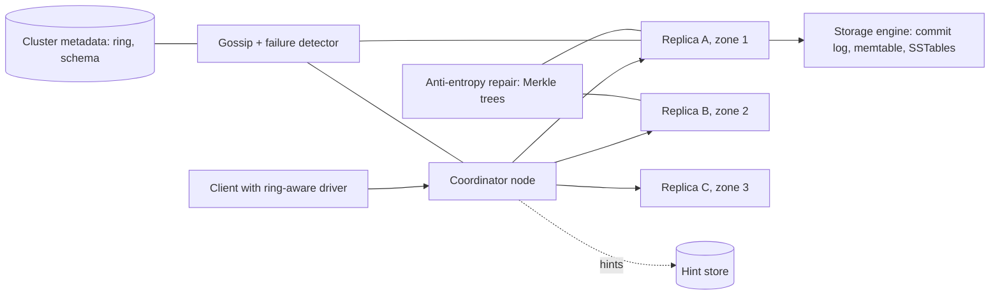
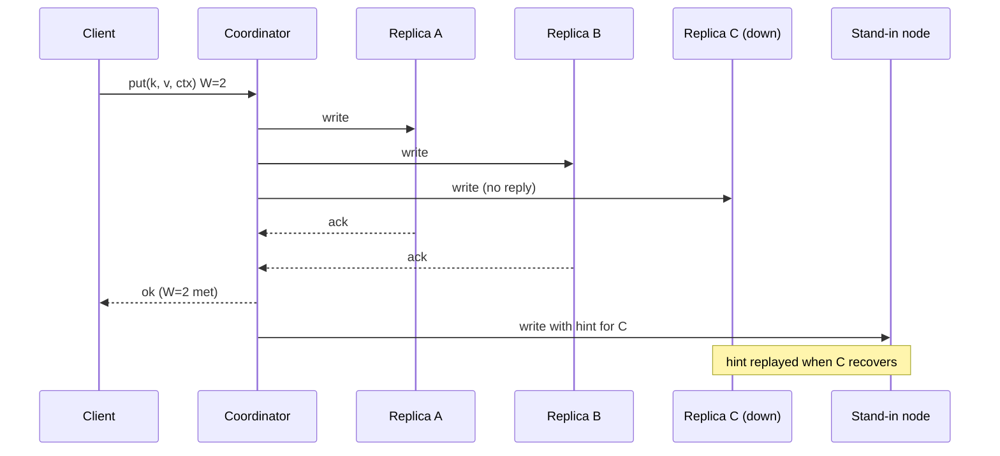

# C07 — Distributed key-value store (Dynamo-style)

> **The requirement.** Internal teams need a key-value store for carts, sessions, user preferences and similar data.
> It must be **always writable** — a customer adding to a cart during a network partition must not see an error. It
> serves **1 million operations per second** (80 % reads), keeps **p99.9 latency under 10 ms** within a region, holds
> **100 TB** across **three availability zones**, and survives the loss of any node — or a whole zone — **without
> losing acknowledged writes**. Different applications want different trade-offs, so consistency must be **tunable per
> request**. It is hard because "always writable" and "never lose a write" pull against "every read sees the latest
> write", and because at 100+ nodes, *something is always failing*.

This case is the systems-design version of Amazon's Dynamo paper (SOSP 2007) [1] and of the stores that followed it,
notably Apache Cassandra [3]. It applies [SYSDESIGN-06](../01-foundations/06-replication-consistency.md)
(replication, quorums, consistency models), [SYSDESIGN-07](../01-foundations/07-partitioning-sharding.md) (consistent
hashing) and [SYSDESIGN-09](../01-foundations/09-coordination-consensus.md) (failure detection, consensus). Lab
[labs/07-partitioning-sharding](../../labs/07-partitioning-sharding/) simulates the ring.

## The prompt

"Design a distributed key-value store" or "design DynamoDB / Cassandra". The interviewer usually wants the Dynamo
toolkit — partitioning, replication, quorums, versioning, failure handling — and to hear what each technique does
*not* guarantee. A 2026 answer should also say that DynamoDB itself does not use the leaderless Dynamo design (Modern
twist), and when you would choose a consensus-based design instead.

## CLARIFY: requirements

### Functional

1. `get(key)` → value(s) + version context; `put(key, value, context)`; `delete(key, context)`.
2. Keys up to 256 B; values up to 1 MB (average ≈ 1 KB).
3. Per-request consistency level (e.g. `ONE`, `QUORUM`, `ALL`).
4. Optional TTL per key.
5. No multi-key transactions or range scans across partitions (single-key operations only).

### Non-functional

| Property | Target | Why |
|---|---|---|
| Write availability | writes accepted even when replicas are unreachable | the Dynamo requirement: carts must always accept writes [1] |
| Latency | p99.9 < 10 ms in-region for 1 KB values | tail latency of a dependency becomes tail latency of every page; Dynamo framed its SLA at the 99.9th percentile [1] |
| Durability | acknowledged writes survive any single node or zone loss — holds for W ≥ 2 on distinct-zone replicas; W = 1 and hint-only acknowledgements trade it away (a per-keyspace choice) | data loss is unacceptable |
| Scalability | add nodes without downtime; incremental data movement | growth is continuous |
| Operability | self-healing for transient failures; explicit operator action for permanent membership changes | avoid flapping membership |

### Out of scope

Secondary indexes, cross-region replication (mention at the end), multi-key ACID transactions (see Modern twist).

## QUANTIFY: estimates

All values are **labelled assumptions**.

| Quantity | Working | Result |
|---|---|---|
| Client ops at peak | 1 M /s: 800,000 reads, 200,000 writes | |
| Replication factor | N = 3 (one replica per zone) | |
| Stored data | 100 TB logical × 3 | 300 TB |
| Disk per node | 4 TB NVMe, keep ≤ 50 % full (LSM compaction headroom, repair, growth) | 2 TB data per node |
| Node count | 300 TB ÷ 2 TB | 150 nodes (50 per zone) |
| Replica writes | 200,000 × 3 | 600,000 /s |
| Replica reads (R = 2) | 800,000 × 2 | 1.6 M /s |
| Per-node replica ops | 2.2 M ÷ 150 | ≈ 14,700 /s per node |
| Write network | 200,000 × 1 KB × 3 | ≈ 600 MB/s cluster-wide |
| Rebuild one failed node, single stream at 200 MB/s | 2 TB ÷ 200 MB/s | ≈ 10,000 s ≈ 2.8 h |
| Same, streaming from 20 peers in parallel (vnodes) | 2 TB ÷ (20 × 200 MB/s) = 500 s | ≈ 8 min only if the receiver can ingest 4 GB/s (≈ 32 Gbit/s); with a 1.5 GB/s ingest cap ≈ 22 min (exercise 2 method) |
| Hints for a node down 1 h (it replicates 3/150 of the writes) | 200,000 × 3/150 × 3,600 × 1 KB | ≈ 14 GB of hints (cluster-wide, spread over the other nodes) |

**What the numbers say.** Per-node load (≈ 15,000 replica ops/s) is comfortable for NVMe-backed LSM nodes, so the
design is driven by **tail latency, failure handling and data movement**, not raw throughput. Two numbers matter most:
rebuild time (hours with one stream, minutes with many — the operational argument for virtual nodes) and hint volume
(tens of GB per hour of outage — why hinted handoff needs a time limit and repair behind it).

## SKETCH: high-level design



*Diagram: a client with a ring-aware driver sends a request to a coordinator node, which forwards it to three replicas
in three zones; each replica writes to a storage engine with a commit log, memtable and SSTables. The coordinator stores
hints for unreachable replicas. Gossip and a failure detector connect the nodes, anti-entropy repair compares Merkle
trees between replicas, and cluster metadata holds the ring and schema.*

**Why each box is there.**

- **Ring-aware driver** — knows the token ring, sends each request to a node that owns the key (saving a hop) and
  retries elsewhere on failure.
- **Coordinator** — any node can coordinate; it computes the preference list, fans the request out to N replicas and
  waits for R or W responses (deep dive 2). No single leader, so no leader failover on the write path.
- **Replicas in three zones** — placement makes zone loss survivable (deep dive 1).
- **Storage engine** — an LSM tree optimized for writes (deep dive 3).
- **Hint store** — keeps writes for replicas that are temporarily down (hinted handoff).
- **Gossip + failure detector** — decentralized membership and liveness (deep dive 4).
- **Anti-entropy repair** — converges replicas that hints and read repair missed.
- **Cluster metadata** — ring ownership and schema; how it is kept consistent is one of the 2026 changes (Modern twist).

## API and data model

```text
GET    /kv/{keyspace}/{key}?consistency=QUORUM
       → 200 { "values": [ {"value": "...", "version": "<opaque context>"} ] }    # >1 value = siblings
PUT    /kv/{keyspace}/{key}?consistency=QUORUM   { "value": "...", "context": "<from last GET>", "ttl_s": 86400 }
DELETE /kv/{keyspace}/{key}?consistency=QUORUM   { "context": "..." }
```

The **context** is the version metadata (a vector clock in Dynamo [1]) that the client returns on write so the store
can tell an update from a concurrent write. Systems that use last-write-wins (Cassandra) instead attach a timestamp to
every mutation [3].

Per replica, data is stored as `partition key → [cells (column, value, timestamp | version, ttl, tombstone flag)]` in
the LSM engine; the partition key's hash decides placement.

## DEEPEN

### Deep dive 1 — partitioning and replica placement

**Consistent hashing.** Hash each key onto a ring; each node owns the ranges between its tokens and its predecessors'.
Adding a node moves only the ranges it takes over, not the whole dataset — the property lab
[labs/07-partitioning-sharding](../../labs/07-partitioning-sharding/) measures against modulo hashing.

**Virtual nodes.** With one token per node, ranges are uneven and a joining node takes data from only one or two
neighbors. Dynamo used *virtual nodes* — many tokens per physical node — and the paper's evaluation compared
partitioning strategies, ending with "Strategy 3": a fixed number of equal-sized partitions (Q/S tokens per node) that
improved load balance and made bootstrapping and archival simpler, at the cost of coordination when membership changes
[1]. Cassandra exposes the same idea as `num_tokens`; its documentation notes that the old default of 256 tokens per node
has been superseded by an allocation algorithm that needs far fewer [3]. The operational payoff is the rebuild number
above: with many small ranges spread over many peers, a replacement node streams from many nodes at once.

**Preference list and zones.** The N replicas for a key are the first N *distinct physical nodes* clockwise from the
key's position, skipping further vnodes of a node already chosen [1]. With zone awareness (Cassandra's
`NetworkTopologyStrategy` places replicas per data center and rack [3]), choose one replica per zone so a zone outage
leaves two of three replicas. Zone awareness is what makes "survive a zone" true; vnodes alone do not.

### Deep dive 2 — quorums, sloppy quorums and versions

**Tunable quorums.** With N replicas, a write waits for W acknowledgements and a read for R responses. If R + W > N,
every read quorum overlaps every write quorum, so a read sees at least one replica with the latest *acknowledged*
write. Dynamo's common configuration was (N, R, W) = (3, 2, 2) [1]. Cassandra exposes the choice per operation as
consistency levels such as `ONE`, `QUORUM` and `LOCAL_QUORUM`, and sends writes to all replicas regardless of the level —
the level only decides how many acknowledgements to wait for [3].

| Setting (N = 3) | Read sees latest acked write? | Survives | Latency |
|---|---|---|---|
| W = 1, R = 1 | no | 2 replicas down for reads and writes | lowest |
| W = 2, R = 2 | yes (strict quorum) | 1 replica down | p99 ≈ second-fastest replica |
| W = 3, R = 1 | yes | writes fail with any replica down | write = slowest replica |
| W = 1, R = 3 | yes | reads fail with any replica down | read = slowest replica |

Quorum overlap is **not linearizability**: concurrent reads during an in-flight write can return different values, and
a failed write that reached only one replica may later surface. Say this explicitly
([SYSDESIGN-06](../01-foundations/06-replication-consistency.md)).

**Sloppy quorum and hinted handoff.** To stay writable when preference-list nodes are down, Dynamo writes to "the first
N healthy nodes" walking the ring; a replica that stands in for a down node stores the write with a *hint* naming the
intended owner and hands it back when the owner recovers [1]. Availability improves — and the overlap guarantee
disappears, because the W nodes that acknowledged may not be among the R nodes a later read contacts. Cassandra treats
hints and read repair as best-effort convergence mechanisms, not guarantees [3]. Bound the hint window: Cassandra stops
generating hints for a replica that has been down longer than `max_hint_window` (default 3 h) [18]; at our rates that is
≈ 14 GB per hour of outage (our estimate), ≈ 43 GB cluster-wide at the default window, and repair must converge
anything beyond it.

**Versions: vector clocks or last-write-wins.** Dynamo captured causality with **vector clocks** — lists of
(node, counter) pairs — so the system can tell whether one version supersedes another or whether they are concurrent
siblings that the application must merge; to bound their size it truncated the oldest pair when the list exceeded a
threshold ("say 10") [1]. In production, divergence was rare: profiling the shopping-cart service for 24 hours, 99.94 % of requests
saw exactly one version, 0.00057 % saw two and 0.00047 % saw three [1]. A shopping cart can merge siblings by union
(at the cost of occasionally resurrecting a removed item). Cassandra chose a simpler model: "every mutation is
timestamped (including deletes)" and the latest timestamp wins, which requires synchronized clocks [3]. LWW silently
drops one of two concurrent writes — fine for "last seen" timestamps, wrong for carts. CRDTs (counters, sets, maps with
merge functions) are the principled middle ground when applications can express their data that way.



*Diagram: the client writes with W = 2; the coordinator sends to replicas A, B and C. A and B acknowledge, so the
coordinator answers OK. Replica C does not reply, so the coordinator also writes to a stand-in node with a hint naming
C, which is replayed when C recovers.*

### Deep dive 3 — the storage engine

Write-optimized stores use a **log-structured merge (LSM) tree** ([SYSDESIGN-05](../01-foundations/05-choosing-storage.md)).
Cassandra's documentation describes the pieces: every write goes to a **commit log** for durability and into a sorted
in-memory **memtable**; full memtables are flushed as immutable **SSTables**; each SSTable has a **Bloom filter** of its
partition keys so reads can skip files that cannot contain the key; and background **compaction** merges SSTables and
drops obsolete data, which is also the source of write amplification [4].

Three operational truths follow:

1. **Durability depends on commit-log sync mode.** In Cassandra's default *periodic* mode writes are acknowledged
   before the commit log is fsynced, so a crash can lose writes since the last sync; *batch* mode waits for fsync [4].
   With W = 2 across zones, losing one replica's unsynced tail is survivable — which is exactly why the durability
   requirement is stated for acknowledged writes *with replication*, not per node.
2. **Reads pay for writes.** A key may live in several SSTables; reads merge them. Compaction strategy (size-tiered vs
   leveled vs time-window) trades write amplification against read amplification and space; the 50 % disk-fill
   assumption in QUANTIFY exists because compaction needs scratch space.
3. **Deletes are writes.** A delete inserts a time-stamped **tombstone**; the data disappears only when compaction
   removes it after `gc_grace_seconds` (default 864,000 s, ten days). If a replica stays down longer than that and then
   rejoins, it can "repair" the deleted data back to the others — a **zombie** [5]. Hence a hard operational rule: run
   full anti-entropy repair on every range more often than the tombstone grace period, and never bring back a node
   that was down longer without wiping it.

### Deep dive 4 — membership, failure detection and anti-entropy

**Gossip.** Each node periodically exchanges membership and state with randomly chosen peers, so membership changes
propagate without a central registry [1][3].

**Failure detection.** Cassandra runs a variant of the **phi accrual failure detector** on every node: instead of a
binary timeout, it computes a suspicion level from the history of heartbeat inter-arrival times and each node decides
independently whether a peer is up or down [3]. Down-from-my-view is a *transient* state used for routing and hints.

**Permanent membership changes are explicit.** Dynamo required an administrator to add or remove nodes, because
transient outages are common and rarely mean a node is gone [1]; Cassandra "will never remove a node from gossip state
without explicit instruction from an operator" [3]. This avoids the worst failure mode of automatic membership:
flapping nodes triggering repeated, expensive data movement.

**Anti-entropy with Merkle trees.** Hints and read repair are opportunistic. To guarantee convergence, replicas
periodically build a **Merkle tree** per key range — leaves are hashes of key ranges, parents hash their children — and
compare roots; only subtrees whose hashes differ are descended, so replicas find divergent keys while transferring little
data [1][3]. Combined with the tombstone rule above, repair frequency is a correctness parameter, not a tuning knob.

**Read repair.** When a read at R > 1 sees divergent replicas, the coordinator writes the newest version back to the
stale ones [1][3] — cheap convergence for hot keys, none for cold ones (repair covers those).

## STRESS: failures, hot spots, scale ×10

| Failure / stress | Symptom | Detection | Mitigation |
|---|---|---|---|
| Single node down | some requests time out on first try | phi detector marks it down; client retries | coordinator skips it; hints; R = W = 2 still met |
| Zone down | one third of replicas gone | zone-level health | one replica per zone keeps 2 of 3; QUORUM still works; hints accumulate — watch hint storage |
| Slow node (GC pause, bad disk) | p99.9 spikes | per-replica latency | speculative retry to another replica after the expected p99; route reads away from consistently slow replicas |
| Hot key (viral item, popular session) | one replica set saturated | per-partition QPS | client-side cache; read from ONE for that keyspace; split value across keys |
| Large partition | slow reads, compaction pain | partition size histograms | bucket the key (key + time window), like chat history in [C03](C03-chat-presence.md) |
| Node down > tombstone grace | zombie data after it rejoins | down-time tracking | wipe and rebootstrap, never rejoin as-is |
| Clock skew with LWW | newer write lost to an "older" one | skew monitoring | NTP discipline; use vector clocks or CRDTs where loss matters |
| Repair falls behind | divergence grows; zombie risk | time since last full repair per range | incremental/sub-range repair schedules; alert on age |

**Scale ×10** (10 M ops/s, 1 PB logical). 1,500 nodes; per-node load unchanged. What breaks first is **metadata and
operations**: gossip of a 1,500-node ring, schema changes propagating through gossip, simultaneous bootstraps, repair
schedules covering hundreds of thousands of ranges. This is exactly where 2026 systems replaced gossip-propagated
metadata with consensus-backed metadata (Modern twist). Cross-region replication, if added, makes `LOCAL_QUORUM` the
default and turns global consistency into an explicit, slower option ([SYSDESIGN-15](../02-modern-requirements/15-multi-region-edge.md)).

## Operate: SLOs, cost, energy

### SLOs

| SLI | SLO |
|---|---|
| Request success at requested consistency | 99.99 % / 30 days |
| Read and write latency, 1 KB, in-region | p99.9 < 10 ms |
| Acknowledged-write loss | 0 (audited with a canary keyspace written and read at QUORUM) |
| Full repair age per range | < 7 days (below the 10-day tombstone grace) |
| Hint backlog | < 1 h of writes per node |

### Cost

Cost scales with **replicated bytes on fast disk** (300 TB on NVMe at 50 % fill = 600 TB of provisioned flash), **cross-zone
traffic** (every write crosses zones twice with one replica per zone; cloud providers often charge for inter-zone
transfer, so W = 2 across zones has a direct bill), and **compaction CPU**. Levers: compression in SSTables, TTLs that
actually expire data, tiering cold data to object storage (Modern twist), and right-sizing N for data that can tolerate
lower durability ([SYSDESIGN-16](../02-modern-requirements/16-cost-as-requirement.md)).

### Energy

Energy follows the same drivers: always-on NVMe nodes with low utilization (the 50 % fill and failure headroom) and
background compaction and repair. Higher density per node and moving cold data to object storage reduce the
always-on footprint; denser nodes, however, lengthen rebuild time — the same trade-off as in QUANTIFY
([SYSDESIGN-17](../02-modern-requirements/17-energy-carbon-aware.md)).

## Modern twist

**DynamoDB is not Dynamo.** The 2022 USENIX ATC paper on Amazon DynamoDB describes a different replication design: each
partition is a replication group that "uses Multi-Paxos for leader election and consensus"; only the leader serves
writes and strongly consistent reads; the leader holds a lease, and a new leader will not serve until the old lease
expires; some replicas are *log replicas* that store only the replicated log, "akin to acceptors in Paxos" [2]. The same
paper reports a peak of 89.2 million requests per second during Prime Day 2021 with single-digit-millisecond
performance [2], and describes global admission control built on token buckets held by request routers [2] (the rate-
limiting pattern from [C01](C01-url-shortener-rate-limiter.md)). The lesson for interviews: leaderless quorums are one
point in the design space, chosen for always-writable semantics; a managed service optimized for predictable latency
and simpler client semantics chose leaders and consensus.

**Raft-based alternatives are the default for new strongly consistent stores.** Raft [6] (or Multi-Paxos) per
partition gives each key range a leader and a replicated log. TiKV splits data into *Regions*, each
replicated as its own Raft group with a leader, with a Placement Driver that schedules replicas and hands out
timestamps, on top of RocksDB [7]. CockroachDB replicates each *range* through its own Raft group and serves reads and
proposes writes through a *leaseholder* co-located with the Raft leader in most cases [8]. ScyllaDB now distributes data
in *tablets* by default, moved and split by a background load balancer and paired with consistent, Raft-based topology
updates [9]. Cassandra itself is moving cluster metadata from gossip to a transactional log: CEP-21 "Transactional
Cluster Metadata" (accepted) replaces gossip for membership and data-placement changes [10]. It ships in the 6.0 line —
the `cassandra-6.0` branch's NEWS.txt describes the new Cluster Metadata Service and its extra upgrade steps [19] —
which as of 2026-11 exists only as pre-releases: 6.0-alpha1 in the ASF release catalog [20] and 6.0-alpha2 (August
2026) on the ASF archive [21], with no 6.0 GA, while 5.0.9 (2026-08-07) is the latest GA release [11]. FoundationDB (SIGMOD 2021)
shows the "unbundled" alternative: separate transaction, log and storage roles providing strictly serializable
transactions over a distributed KV store [12]. Use a consensus-based design when applications need linearizable
single-key operations or multi-key transactions and can accept unavailability of a range during leader failover; use a
Dynamo-style design when the requirement really is "always writable" and the data can be merged.

**Object storage as the bottom tier.** A growing class of 2026 engines puts the durable copy of data in object storage
and treats local disks and memory as caches:

- **SlateDB** is "an OSS embedded key-value database and LSM-engine built on object storage", where "writes can trade
  between API request cost and durability latency" [13].
- **turbopuffer** writes each batch to a WAL file in object storage; its documentation quotes write latency of
  p50 = 165 ms for 500 kB, cold queries of p50 = 874 ms and warm (cached) queries of p50 = 14 ms for 1 M documents
  (vendor-reported) [14].
- **WarpStream** applied the idea to Kafka: stateless agents write directly to S3 and acknowledge only after durable
  persistence; its 2023 launch post reported produce p99 of about 400 ms and end-to-end p99 of about 1 s, in exchange
  for avoiding inter-zone replication traffic (vendor-reported 2023 figures; an update note on the same post now
  advertises produce latency "tunable down to ~33ms median" with a lower-latency tier) [15].
- Two S3 features make this practical: **conditional writes** (`If-None-Match` on PutObject/CompleteMultipartUpload,
  announced August 2024) let concurrent writers coordinate without a separate lock service [16], and **S3 Express One
  Zone** advertises single-digit-millisecond latency and up to 10× faster access than S3 Standard [17].

The trade-off is plain in those numbers: object storage gives cheap, durable, zone-redundant bytes without managing
replication — but with standard object storage, write latency is in the tens to hundreds of milliseconds, not single
digits (lower-latency tiers such as S3 Express One Zone and vendor fast paths narrow the gap). For our 10 ms p99.9
requirement, a Dynamo- or Raft-style hot tier remains necessary; object storage fits as the cold tier (old SSTables,
backups, snapshots) or for workloads whose latency budget is 100 ms+.

## WRAP: interview summary

**A strong 45-minute answer covers, in order:** clarify single-key API, always-writable vs strongly consistent, value
sizes, zones → numbers (150 nodes, ≈ 15,000 replica ops/s per node, rebuild hours vs minutes, hint volume) → sketch
with ring-aware driver, coordinator, three zone-placed replicas, LSM engine, hints, gossip, repair → consistent hashing
with vnodes and zone-aware preference lists → N/R/W table and what quorum overlap does *not* give → sloppy quorum and
hinted handoff and why they break overlap → vector clocks vs LWW, with Dynamo's measured divergence → LSM write path,
tombstones and the repair-before-grace rule → gossip, phi accrual, explicit membership, Merkle repair → failures and ×10
(metadata) → DynamoDB's Multi-Paxos design, Raft-based alternatives, object-storage tiers.

| Level | What "good" looks like |
|---|---|
| Junior | Hash partitioning with consistent hashing; replication factor 3; R + W > N explained; a node failure handled by replicas |
| Senior | Vnodes and zone-aware placement; tunable consistency with latency consequences; sloppy quorum and hinted handoff with their limits; vector clocks vs LWW; LSM engine with Bloom filters and compaction; Merkle-tree repair; tail-latency tactics (speculative retry) |
| Staff | States precisely what each mechanism does not guarantee (quorum ≠ linearizable, hints ≠ overlap, LWW loses writes); repair frequency tied to tombstone grace; rebuild-time and hint-volume math driving vnode and node-size choices; knows DynamoDB uses Multi-Paxos and when to choose Raft/transactions instead; positions object-storage tiering by latency budget |

**Red flags.** "Use consistent hashing" with no replication or failure story. Claiming R + W > N gives strong
consistency. Sloppy quorum presented as a quorum. LWW for data where concurrent writes must both survive. Automatic
permanent removal of nodes on timeout. No mention of tombstones, repair or rebuild time. Calling DynamoDB a leaderless
Dynamo implementation.

**Follow-ups.** Multi-region active-active (per-region quorums, conflict resolution across regions); secondary indexes
(local vs global, consistency); a counter type (CRDT counters vs LWW); range scans (order-preserving partitioning and
its hot-spot risk); backups and point-in-time restore (SSTable snapshots to object storage).

## Alternatives considered

| Alternative | Wins when | Why not the default here |
|---|---|---|
| Leader-based replication per partition (Multi-Paxos/Raft) | linearizable reads/writes, transactions, simpler client semantics | a range is unwritable during leader failover; "always writable" is the stated requirement |
| Single-leader replicated database, sharded (e.g. Vitess-style) | relational features, existing SQL skills | failover and resharding are heavier; not always writable |
| Chain replication | strong consistency with high read throughput from the tail | a chain member failure stalls writes until reconfiguration |
| Pure object-storage engine | cheap durable storage, latency budgets ≥ 100 ms | write latency far above the 10 ms p99.9 target [13][14][15] |
| Fixed hash-mod-N partitioning | static clusters | resizing moves most keys (see lab L07) |

## Exercises

See [exercises/C07-distributed-kv-store.md](../../exercises/C07-distributed-kv-store.md) — capacity and rebuild math,
quorum scenarios, sloppy-quorum anomalies, vector-clock reconciliation, tombstone resurrection, Merkle-tree repair and
lab exercises using [labs/07-partitioning-sharding](../../labs/07-partitioning-sharding/) (ring, vnodes, data movement),
[labs/06-replication-consistency](../../labs/06-replication-consistency/) (replica lag, stale reads, failover) and
[labs/09-coordination-consensus](../../labs/09-coordination-consensus/) (Raft leader election, the leader-based
alternative).

## References

All accessed 2026-11-19; re-checked 2026-11-20.

1. G. DeCandia et al., "Dynamo: Amazon's Highly Available Key-value Store," SOSP 2007. https://www.allthingsdistributed.com/files/amazon-dynamo-sosp2007.pdf
2. M. Elhemali et al., "Amazon DynamoDB: A Scalable, Predictably Performant, and Fully Managed NoSQL Database Service," USENIX ATC 2022. https://www.usenix.org/conference/atc22/presentation/elhemali (PDF: https://www.usenix.org/system/files/atc22-elhemali.pdf)
3. Apache Cassandra documentation, "Dynamo" architecture page (5.0 docs: vnodes, NetworkTopologyStrategy, consistency levels, hints, read repair, Merkle-tree repair, gossip, phi accrual, LWW). https://cassandra.apache.org/doc/latest/cassandra/architecture/dynamo.html
4. Apache Cassandra documentation, "Storage engine" (commit log sync modes, memtables, SSTables, Bloom filters, compaction). https://cassandra.apache.org/doc/latest/cassandra/architecture/storage-engine.html
5. Apache Cassandra documentation, "Tombstones" (gc_grace_seconds default 864,000 s; zombie data). https://cassandra.apache.org/doc/latest/cassandra/managing/operating/compaction/tombstones.html
6. D. Ongaro, J. Ousterhout, "In Search of an Understandable Consensus Algorithm" (Raft), USENIX ATC 2014. https://www.usenix.org/conference/atc14/technical-sessions/presentation/ongaro (project site: https://raft.github.io/)
7. TiKV documentation v7.1, "Architecture overview" (Regions as Raft groups, Placement Driver, RocksDB; `/docs/latest/` redirects to v7.1). https://tikv.org/docs/7.1/reference/architecture/overview/
8. Cockroach Labs, "Replication Layer" (Raft per range, leaseholders, leader leases). https://docs.cockroachlabs.com/docs/stable/architecture/replication-layer
9. ScyllaDB documentation, "Data Distribution with Tablets" (tablets by default; load balancing; Raft-based consistent topology). https://docs.scylladb.com/manual/stable/architecture/tablets.html
10. Apache Cassandra, "CEP-21: Transactional Cluster Metadata" (state: Accepted). https://cwiki.apache.org/confluence/display/CASSANDRA/CEP-21%3A+Transactional+Cluster+Metadata
11. Apache Cassandra, Downloads (latest GA 5.0.9, 2026-08-07). https://cassandra.apache.org/_/download.html
12. J. Zhou et al., "FoundationDB: A Distributed Unbundled Transactional Key Value Store," SIGMOD 2021. https://www.foundationdb.org/files/fdb-paper.pdf
13. SlateDB project home page. https://slatedb.io/ (source: https://github.com/slatedb/slatedb)
14. turbopuffer, "Architecture" documentation (vendor-reported latencies). https://turbopuffer.com/docs/architecture
15. R. Artoul, "Kafka is dead, long live Kafka," WarpStream blog, 2023-07-25 (vendor-reported latencies). https://www.warpstream.com/blog/kafka-is-dead-long-live-kafka
16. Amazon Web Services, "Amazon S3 now supports conditional writes," 2024-08-20. https://aws.amazon.com/about-aws/whats-new/2024/08/amazon-s3-conditional-writes/
17. Amazon Web Services, "Amazon S3 Express One Zone" (single-digit-millisecond latency; up to 10× faster than S3 Standard). https://aws.amazon.com/s3/storage-classes/express-one-zone/
18. Apache Cassandra documentation, "Hints" (`max_hint_window` default 3 h). https://cassandra.apache.org/doc/latest/cassandra/managing/operating/hints.html
19. Apache Cassandra, NEWS.txt on the `cassandra-6.0` branch (Cluster Metadata Service from CEP-21; upgrade steps). https://github.com/apache/cassandra/blob/cassandra-6.0/NEWS.txt
20. ASF Release Catalog, "Apache Cassandra 6.0-alpha1" (archived 21 Mar 2026). https://release-catalog.apache.org/cassandra/6.0-alpha1/index.html
21. Apache Software Foundation, Cassandra distribution archive (directories `6.0-alpha1/` and `6.0-alpha2/`, the latter dated 2026-08-07). https://archive.apache.org/dist/cassandra/
