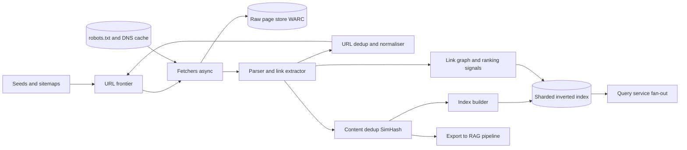
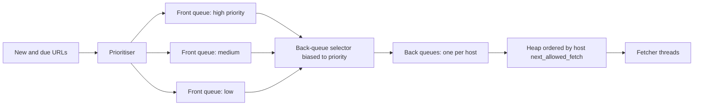

# C08 — Web crawler & search engine

> **The requirement.** Lumen wants its own web index: 5 billion pages, most refreshed within 10 days and news-like
> pages within an hour, served by a search API at 10,000 queries/s with p95 < 300 ms. The same corpus feeds Lumen's
> RAG assistant. The crawler must be **polite** (never overload a site, always obey robots.txt) and must not waste
> bandwidth on duplicates and spider traps. It is hard because the web is adversarial, unbounded and constantly
> changing, while the scarce resources — other people's servers, your bandwidth, and freshness — are all finite.

## The prompt

"Design a web crawler" and "design Google search" are two of the oldest interview questions. A strong answer treats
them as **one pipeline with two very different workloads**: a batch-ish, write-heavy, politeness-bound crawl, and a
read-heavy, latency-bound query path. Between them sits the index build. Much of the interview is about the frontier
(what to fetch next) — the part a naive design gets wrong.

## CLARIFY: requirements

### Functional

1. **Crawl**: start from seed URLs and sitemaps; fetch HTML (and optionally PDF); extract links and text.
2. **Respect** robots.txt and per-host rate limits; identify the crawler with a user agent and contact URL.
3. **Deduplicate** URLs and content (exact and near-duplicate).
4. **Recrawl** pages according to how often they change and how important they are.
5. **Index** text for keyword search; compute link-based and quality signals.
6. **Search API**: query → top-10 results with title, URL, snippet; pagination.
7. **Export** clean text + metadata to the RAG pipeline (chunking and embeddings happen downstream —
   [SYSDESIGN-24](../03-ai-systems/24-retrieval-vector-systems.md)).

### Non-functional

| Property | Target |
|---|---|
| Corpus | 5 B indexed pages (more URLs known than indexed) |
| Freshness | 90 % of pages ≤ 10 days old; "fast" tier ≤ 1 h |
| Politeness | ≤ 1 request/s per host by default; obey robots.txt; back off on errors |
| Query latency | p95 < 300 ms at 10,000 QPS |
| Availability (search) | 99.95 %; the crawler can pause for hours without user impact |
| Index update lag | new content searchable ≤ 1 h for the fast tier, ≤ 24 h otherwise |

### Out of scope

JavaScript rendering at scale (mention it as a separate, expensive pool), image/video search, ads, personalisation,
query autocomplete, a spam-fighting team's classifiers (we only reserve hooks for them).

Ask: *Is this a general web search engine or a vertical one? How fresh? Do we render JavaScript? Is the output for
humans, for an LLM, or both?* The last question is new in 2026 and changes the export format and the legal posture
(see Modern twist).

## QUANTIFY: estimates

All values are **labelled assumptions** unless sourced.

### Crawl rate and bandwidth

| Quantity | Derivation | Value |
|---|---|---|
| Pages refreshed per cycle | 5 B in 10 days | 500 M/day |
| New URLs and fast-tier recrawls | assumption: +60 % | 300 M/day |
| **Fetches/day** | | **≈ 800 M** |
| Average fetch rate | 800 M / 86,400 | ≈ 9,300 pages/s |
| Average stored bytes per page | Common Crawl's June 2026 archive: 2.10 B pages, 354.59 TiB uncompressed [1] → ≈ 185 KB/page (includes WARC headers) | ≈ 185 KB |
| **Download bandwidth** | 9,300 × 185 KB | **≈ 1.7 GB/s ≈ 14 Gbit/s** |

### Politeness determines parallelism

At ≤ 1 request/s per host, 9,300 pages/s requires **at least 9,300 hosts being fetched concurrently**, and many more
hosts in the frontier so that each host's queue is not drained. With an average fetch latency of ≈ 1 s (assumption),
Little's law gives ≈ 9,300 open connections — cheap for asynchronous fetchers (say 30 fetcher nodes × 500
connections each, assumption). The bottleneck is not CPU; it is **how many distinct hosts have work ready**.
Politeness also caps freshness: at 1 request/s, a host with more than 864,000 pages (10 days × 86,400 s) cannot be
fully refreshed within 10 days; it needs a negotiated higher rate, sitemap/`lastmod`-driven partial refresh, or a
longer SLO.

### Storage

| Item | Derivation | Value |
|---|---|---|
| Raw page store per cycle | 5 B × 185 KB | ≈ 925 TB |
| Compressed (assume 5 : 1 for HTML) | | ≈ 185 TB |
| Keep 2 versions (change detection, rollback) | | ≈ 370 TB |
| Extracted text | assume 15 KB/page | ≈ 75 TB |
| Inverted index | assume ≈ 30 % of text size after posting compression | ≈ 25 TB |
| URL table (known URLs) | assume 20 B URLs × 200 B (URL + state) | ≈ 4 TB |
| SimHash fingerprints | 5 B × 8 B | 40 GB |
| Content hashes (SHA-256 prefix, 16 B) | 5 B × 16 B | 80 GB |

### Query path

| Quantity | Assumption | Value |
|---|---|---|
| Peak QPS | given | 10,000 |
| Index shards | 25 TB / ≈ 250 GB per shard (fits in RAM + SSD of one node, assumption) | ≈ 100 shards |
| Fan-out per query | document-partitioned: every shard | 100 sub-queries |
| Replicas per shard | QPS / per-replica capacity (assume 1,000 sub-queries/s) | 10 + headroom → 12 |
| Query nodes | 100 × 12 | ≈ 1,200 |

The tail of a 100-way fan-out is the tail of the slowest shard — the reason for hedged requests and partial results
later ([SYSDESIGN-11](../01-foundations/11-reliability-engineering.md)).

## SKETCH: high-level design



*Diagram: seeds feed the URL frontier; asynchronous fetchers, using a robots.txt and DNS cache, download pages to a
raw page store and pass them to a parser; extracted links go through URL normalisation and dedup back into the
frontier; extracted content goes through SimHash dedup to the index builder, which writes a sharded inverted index;
a link-graph job adds ranking signals; a query service fans out over index shards; deduplicated content is also
exported to the RAG pipeline.*

Why each box is there: the **frontier** decides *what and when* (priority, freshness) and *how fast per host*
(politeness); **fetchers** are dumb and parallel; the **raw store** lets you re-parse without re-fetching (a parser
bug should not cost a re-crawl of the web); **dedup** at two levels saves fetches (URL) and index space (content);
the **index builder** is a batch-plus-incremental job; the **query service** is a classic scatter-gather.

## API and data model

### Internal APIs

```text
Frontier.enqueue(url, priority, earliest_fetch_time, source)       # idempotent on normalised URL
Frontier.lease(fetcher_id, n) -> [FetchTask{url, host, etag, last_modified}]  # lease with timeout
Fetcher.report(task_id, status, http_code, content_ref, headers, latency_ms)
Indexer.upsert(doc_id, fields, signals) / Indexer.delete(doc_id)
```

### Public search API

```http
GET /v1/search?q=raft+consensus&page=1&lang=en
→ 200 {"results":[{"url":"https://example.org/raft","title":"…","snippet":"…","score":12.7}],"next_page":2}
```

### Data model

| Entity | Key | Fields | Store |
|---|---|---|---|
| `url` | hash(normalised URL) | normalised URL, host, state (`new`/`scheduled`/`fetched`/`error`/`blocked`), last_fetch, next_fetch, change_rate estimate, priority, ETag, Last-Modified, content_hash, simhash | wide-column / KV, partitioned by **host** hash |
| `host` | host name | robots.txt body + fetched_at + status, crawl delay we chose, error streak, next_allowed_fetch, IPs (cached DNS) | KV, co-located with frontier shard |
| `page_version` | (url_hash, fetch_time) | pointer into WARC file in object storage, http headers | object storage + index |
| `doc` | doc_id | canonical URL, title, language, text pointer, simhash, quality signals, PageRank | columnar files feeding the index |
| `posting list` | term (per shard) | doc IDs (delta-encoded) + term frequencies (+ positions) | immutable index segments |

Partitioning the URL table and frontier **by host** is the most important key decision: all politeness state for a
host lives on one shard, so no distributed coordination is needed to enforce "one request per second to
example.org" ([SYSDESIGN-07](../01-foundations/07-partitioning-sharding.md)).

## DEEPEN

### Deep dive 1 — politeness, robots.txt and the URL frontier

**robots.txt (RFC 9309).** The Robots Exclusion Protocol was standardised as RFC 9309 in September 2022 [2]. The
rules a crawler must implement:

- **Matching**: groups are selected by **case-insensitive** match on the crawler's product token; within a group the
  **most specific (longest, in octets) match wins**, and when an equivalent `allow` and `disallow` match, `allow`
  should be used [2].
- **Fetch outcomes**: a 4xx ("unavailable") means the crawler **may access any resource**; a 5xx or network error
  ("unreachable") means it **must assume complete disallow**; if unreachable persists for a long time (the RFC's
  example is 30 days) the crawler may treat it as unavailable or keep using a cached copy [2].
- **Redirects**: follow at least five consecutive redirects, even across hosts [2].
- **Caching**: a cached robots.txt should not be used for more than 24 hours, unless the file is unreachable [2].
- **Size**: the parsing limit must be at least 500 KiB [2].
- **Crawl-delay** is **not** part of RFC 9309 [2]; some crawlers honour it as an extension. Treat it as a hint and
  combine it with your own adaptive rate.

The common interview slip is reading robots.txt once and forgetting it; the correct design stores it in the `host`
record with `fetched_at`, refreshes it at least every 24 h (RFC 9309 §2.4), and checks every URL before it is *scheduled* (cheap) and
again before it is *fetched* (because the file may have changed).

**The frontier.** Mercator (Heydon & Najork, 1999) [3] popularised a two-level frontier, described in detail in the
authors' 2001 report [4]:



*Diagram: new and due URLs are prioritised into front queues by importance; a selector biased toward high priority
moves URLs into back queues that each hold a single host; a heap ordered by each host's next allowed fetch time hands
the earliest-eligible host to a fetcher thread.*

- **Front queues** implement *priority* (importance, freshness need).
- **Back queues** implement *politeness*: each holds URLs of exactly one host; a min-heap keyed by
  `next_allowed_fetch` releases a host only when its delay has passed. After a fetch, set
  `next_allowed_fetch = now + max(robots hint, k × last_response_time)` — adaptive delay (Mercator waited 10× the
  last download time [4]): slow servers get slower crawling. Back off exponentially on 429/503.
- **Per-IP politeness** matters too: thousands of hosts on one shared-hosting IP form one server. Group back queues
  by resolved IP (or /24) as well as by host name.
- **DNS** is a hidden bottleneck: thousands of lookups per second against public resolvers is rude and slow. Run a
  local caching resolver tier and store IPs in the `host` record.

The frontier is sharded by host hash across, say, 50 frontier nodes; each owns its hosts' back queues and robots
state, persisted to disk (a frontier is far larger than RAM — billions of URLs). Fetchers lease batches from the
frontier, which tolerates fetcher crashes (leases time out). This is a work-queue-with-leases pattern from
[SYSDESIGN-08](../01-foundations/08-async-event-driven.md), plus a per-key token bucket (one bucket per host) from
[SYSDESIGN-10](../01-foundations/10-apis-communication.md).

### Deep dive 2 — deduplication: URLs, exact content, near duplicates

**URL normalisation** prevents fetching the same page twice under different spellings: lowercase scheme and host,
remove default ports, resolve `.`/`..`, sort or strip known tracking query parameters (`utm_*`), remove fragments,
honour `rel=canonical` as a hint. Then hash the normalised URL; a "seen" check is a lookup in the URL table (or, for
a fast first pass, a Bloom filter — false positives mean an occasional URL is skipped, which a crawler can tolerate).

**Exact duplicates** (mirrors, `http` vs `https`, session IDs) are caught by a content hash over normalised text. Store
the hash; if a new URL's content hash already exists, record it as an alias of the canonical doc instead of indexing
it again.

**Near duplicates** — the same article with a different ad block, date or navigation — defeat exact hashes. **SimHash**
(Charikar, STOC 2002) [5] maps a document's weighted features (e.g. shingles or terms) to an *f*-bit fingerprint such
that similar documents have fingerprints with small Hamming distance:

1. For each feature, hash it to *f* bits; for each bit, add the feature's weight if the bit is 1, subtract if 0.
2. The fingerprint's bit *i* is 1 if the *i*-th sum is positive.

Manku, Jain and Das Sarma (WWW 2007) [6] applied this at Google's crawl scale and reported that for about 8 billion
pages, **64-bit fingerprints with a Hamming-distance threshold of k = 3** worked well. The hard part is the lookup:
"is there any stored fingerprint within 3 bits of this one?" Their solution is to keep several copies of the
fingerprint table, each with bits permuted and sorted, so that a match within distance *k* must agree exactly on some
block of leading bits; you binary-search on that block and check the few candidates. With 5 B pages the base table is
only 40 GB (8 bytes each), so even several permuted copies fit on a handful of machines.

| Technique | Catches | Cost | Notes |
|---|---|---|---|
| URL normalisation + seen-set | spelling variants of the same URL | lookup per extracted link (billions/day) | Bloom filter in front of the URL table |
| Exact content hash | mirrors, duplicated pages | one hash per page | trivial; do it always |
| SimHash (64-bit, k = 3) | boilerplate/date/ads variants | permuted tables, a few probes per page | tune *k* on labelled pairs |
| MinHash + LSH | set-similarity of shingles; tunable thresholds | larger signatures | used to deduplicate LLM training data such as C4 [7] |

### Deep dive 3 — building the inverted index and ranking basics

**Index build.** Parsing produces `(term, doc_id, tf, positions)` tuples. Two classic ways to turn them into posting
lists [8]: sort-based (write runs, external merge sort by term) and single-pass in-memory indexing (SPIMI: build
per-term lists in memory until full, flush a sorted segment, merge segments later). At our scale this is a
MapReduce/Spark-style job ([SYSDESIGN-13](../01-foundations/13-data-at-scale.md)): map emits terms per document,
shuffle by `(shard, term)`, reduce writes immutable, compressed segments (delta-encoded doc IDs with variable-byte or
bit-packed integers).

**Sharding: by document or by term?**

| Partitioning | Query cost | Update cost | Wins when |
|---|---|---|---|
| By document (each shard indexes a subset of docs) | every query hits every shard (fan-out) but each shard does little | add a doc = touch one shard | almost always for web search; balanced load, simple updates |
| By term (each shard owns some terms' full lists) | a query touches only its terms' shards | one doc touches many shards; hot terms make hot shards | rare; very long lists move over the network |

**Freshness in the index** uses a tiered design: a large base index rebuilt periodically (daily/weekly), plus a small
**real-time tier** of recently fetched pages, merged at query time; deletes are tombstones. This is the LSM idea
([SYSDESIGN-05](../01-foundations/05-choosing-storage.md)) applied to search.

**Ranking basics.** A two-stage pipeline:

1. **Candidate retrieval per shard**: BM25 [9] — term-frequency saturation (*k₁*) and document-length normalisation
   (*b*) over IDF-weighted terms — plus static signals (link-based importance, spam score, freshness), using
   dynamic pruning such as WAND, which cut full evaluations by more than 90 % on TREC data [10].
2. **Re-ranking** of the merged top few hundred with a richer model (learned ranking, now often a neural cross-encoder).

**PageRank** (Brin & Page, 1998) [11] is the canonical link-based static signal: a page is important if important pages
link to it, computed by power iteration on the link graph, offline. At 5 B nodes and, say, 50 B edges (assumption) one
iteration is a large but ordinary distributed join; tens of iterations run daily, not per query.

### Deep dive 4 — freshness and recrawl scheduling

Freshness is a budget problem: you have ≈ 800 M fetches/day and 5 B pages. Uniform recrawl (every page every 10 days)
wastes fetches on pages that never change and misses news pages that change hourly. Cho and Garcia-Molina [12] model
page changes as a Poisson process and give estimators for a page's change rate from observed "changed / not changed"
visits — the foundation of most adaptive schedulers.

A practical scheduler:

- Per URL, keep an estimate λ of change rate (from content-hash comparisons over past visits) and an importance score.
- Next-visit interval ≈ f(λ, importance), clamped to [1 h, 60 days]; fast-tier hosts (news, sitemaps with
  `lastmod`) are polled more often.
- Use **conditional GETs** (`If-None-Match` / `If-Modified-Since`): an unchanged page costs a 304 with no body —
  most of the bandwidth saving comes from this.
- Prefer **push** where available: sitemaps' `lastmod`, feeds, and change-notification protocols reduce blind polling.
- A counter-intuitive result from the same authors: to maximise average freshness, a policy proportional to change
  rate can do worse than uniform recrawl, and the optimum visits pages that change *too* often less, because they
  can never be kept fresh anyway [13]. State it as a trade-off that depends on the objective, not a rule.

SLI: **age of the index** — for a sample of URLs, compare live content with the indexed version (staleness rate),
measured continuously.

## STRESS: failures, hot spots, scale ×10

| Problem | Symptom | Detect | Mitigate |
|---|---|---|---|
| Spider traps (infinite calendars, session IDs, faceted URLs) | frontier explodes with one host's URLs | per-host URL count and depth histograms | per-host URL budget, max path depth, parameter pruning, content-dedup feedback (many URLs → one SimHash) |
| A host returns 5xx/429 | errors climb; we look abusive | per-host error streak | exponential back-off; pause host; honour `Retry-After` |
| robots.txt unreachable (5xx) | must assume full disallow [2] | robots fetch status | keep last good copy for the RFC's grace period; alert if a big host |
| DNS resolver overload | fetch latency spikes, timeouts | resolver QPS, SERVFAIL rate | local caching resolvers; TTL-respecting cache in `host` |
| Hot shard on query path | one slow shard sets p99 | per-shard latency | replicas, hedged requests after p95, return partial results with a flag |
| Index build fails mid-way | stale base index | build age SLI | immutable segments; keep serving the previous index; real-time tier covers new pages |
| Duplicate-heavy site farm | index fills with near-copies | SimHash cluster sizes | cluster-level quotas; spam signals |
| Parser bug | garbage text indexed | quality sampling | re-parse from raw store — no refetch needed |

**Scale ×10 (50 B pages, 100,000 QPS).**

- Crawl: ≈ 93,000 pages/s, ≈ 140 Gbit/s — multiple crawl regions near the hosts they fetch (geo-distributed
  fetchers reduce latency and transit cost), each owning a host-hash range.
- Politeness becomes the binding constraint: you need ≈ 10× more *ready* hosts; long-tail hosts dominate, so the
  frontier's priority function, not hardware, decides coverage.
- Storage ≈ 3.7 PB of compressed pages with two versions: tier old versions to cold object storage.
- Index: ≈ 1,000 shards. Fan-out grows with shard count, so 100,000 QPS × 1,000 shards = 10⁸ sub-queries/s; at
  1,000 per replica the naive fleet is ≈ 100,000 nodes (vs 1,200 today). **Tiered indexes** (a small high-quality tier
  answers most queries) and early termination become required, not optional; **two-level aggregation** (rack-level
  aggregators) contains the 1,000-way tail.
- Link-graph jobs (PageRank on hundreds of billions of edges) need incremental or approximate algorithms.

## Operate: SLOs, cost, energy

| SLI | SLO |
|---|---|
| Search latency | p95 < 300 ms, p99 < 800 ms |
| Search availability | 99.95 % (partial results count as success if ≥ 95 % of shards answered) |
| Freshness | ≥ 90 % of sampled pages match live content within 10 days; fast tier ≤ 1 h |
| Politeness | 0 hosts above configured rate; robots.txt violations = 0 (audited from fetch logs) |
| Index update lag | p95 < 1 h (fast tier), < 24 h (base) |

Politeness is an SLO, not a nice-to-have: an impolite crawler gets blocked, and being blocked is a coverage outage.

**Cost** (assumptions; use your provider's prices). The dominant costs are (1) **bandwidth** — ≈ 14 Gbit/s sustained
ingress; ingress is often free in public clouds but transit and NAT gateways are not, so large crawlers run fetchers
where bandwidth is cheap; (2) **storage** ≈ 370 TB of compressed pages + 75 TB of text + index replicas; (3) **query
fleet** ≈ 1,200 nodes, the largest compute line; (4) periodic **index builds and link jobs**. The cheapest optimisation
is not fetching: conditional GETs, recrawl scheduling and URL dedup each cut fetches before anything else costs money.

**Energy.** Per query, the 100-way fan-out means ≈ 100 shard lookups; caching popular queries' results (a large share
of queries repeat — measure it on your logs) removes whole fan-outs. On the crawl side, energy per useful page is
dominated by wasted fetches (duplicates, traps, unchanged pages), so the dedup and scheduling SLIs double as energy
SLIs ([SYSDESIGN-17](../02-modern-requirements/17-energy-carbon-aware.md)). Index builds are batch work and can be
scheduled for low-carbon hours.

## Modern twist

What changes in 2026 (as of 2026-11):

**1. Crawling for LLM training and RAG.** The same crawler now has a second customer: an LLM pipeline that wants
clean, deduplicated, licensed text. Common Crawl publishes monthly archives of about two billion pages each (June 2026:
2.10 B pages, 354.59 TiB uncompressed) [1], and is a common starting point for training corpora. For our RAG export the
requirements differ from search: boilerplate removal and structure (headings, tables) matter more, near-duplicate
removal matters *more* (duplicates bias models and waste embedding cost), and every document needs provenance — URL,
fetch time, robots/AI-preference status at fetch time — so it can be removed later.

**2. AI-crawler controls.** Site owners now distinguish search crawling from AI uses, mostly via robots.txt
product tokens:

| Token | Operator | Purpose (per operator docs) |
|---|---|---|
| `GPTBot` | OpenAI | crawling content that may be used for training generative foundation models [14] |
| `OAI-SearchBot` | OpenAI | surfacing sites in ChatGPT search features [14] |
| `ChatGPT-User` | OpenAI | user-initiated fetches; OpenAI says robots.txt rules may not apply [14] |
| `Google-Extended` | Google | a robots.txt product token only (no separate user agent) controlling use for Gemini training and grounding; does not affect Google Search [15] |
| `ClaudeBot`, `Claude-SearchBot`, `Claude-User` | Anthropic | training, search indexing and user-initiated fetches respectively [16] |
| `CCBot` | Common Crawl | the Common Crawl crawler; blockable via robots.txt [17] |

Design implications: (a) your crawler needs **its own distinct product token per purpose** (search vs AI training),
so site owners can choose; (b) store the robots decision *per purpose* with the fetched page, because a page allowed
for search may be disallowed for training; (c) user-initiated fetches by an agent are a separate, low-rate path, still
rate-limited per host. The IETF **AI Preferences (AIPREF)** working group is standardising a vocabulary for such
preferences and how to attach them (including via robots.txt, which its attachment draft would update); as of 2026-11
the drafts are still Internet-Drafts, not RFCs [18]. Design the policy store so a new signal can be added without
re-crawling.

**3. Hybrid lexical + vector search.** Pure BM25 misses paraphrases; pure dense retrieval misses exact names, codes and
rare terms. The 2026 default is **hybrid**: run BM25 and an ANN search over embeddings in parallel, then fuse. The
simplest robust fusion is **Reciprocal Rank Fusion** (Cormack, Clarke & Büttcher, SIGIR 2009) [19]:
`score(d) = Σ_r 1 / (k + rank_r(d))` with *k* = 60, found near-optimal in the paper's pilot experiments; it needs no
score calibration between systems.
Cost check: embedding 5 B pages × (say) 4 chunks × 768 dimensions × 1 byte (int8) ≈ 15 TB of vectors — affordable,
but ANN indexes at that size need disk-based designs (DiskANN served a billion points from one machine with 64 GB
RAM and an SSD [20]) or quantisation; see
[SYSDESIGN-24](../03-ai-systems/24-retrieval-vector-systems.md). Many deployments keep dense retrieval to the
high-quality tier only.

## WRAP: interview summary

**A strong 45-minute answer:** clarify corpus size, freshness and JS rendering → estimate fetch rate, bandwidth,
storage, and note that politeness turns throughput into "number of ready hosts" → sketch the pipeline (frontier →
fetchers → raw store → parse → dedup → index → query) → deep-dive the frontier (front/back queues, per-host heap,
robots.txt per RFC 9309, DNS cache) → dedup (normalisation, exact hash, SimHash 64-bit/k = 3) → index sharding by
document and scatter-gather with tail-latency mitigation → recrawl policy with conditional GETs → failures (traps,
5xx robots, hot shards) → modern twist (AI-crawler tokens, hybrid search).

| Level | Expectations |
|---|---|
| Junior | BFS crawl with a queue, a seen-set, robots.txt awareness, an inverted index, basic estimates |
| Senior | Mercator-style frontier with per-host politeness, URL normalisation, SimHash near-dup, document-partitioned index with fan-out and replicas, recrawl by change rate, failure handling for traps and robots 5xx |
| Staff | Treats freshness and coverage as budget optimisation, separates search vs AI-training consent and provenance, plans tiered indexes and multi-region crawling, defines politeness and freshness SLOs, reasons about cost per useful page |

**Red flags.** One global FIFO queue (no politeness). Reading robots.txt once forever, or treating a 5xx robots.txt as
"allow all". Dedup only by URL. Term-partitioned index without reasons. "Recrawl everything daily." Ignoring DNS.
Crawling for AI training under the search user agent.

## Alternatives considered

| Alternative | Wins when | Why not the default |
|---|---|---|
| Start from Common Crawl instead of crawling | research, training data, bootstrapping | monthly snapshots are not fresh enough for search; no control over coverage |
| Headless-browser rendering for every page | JS-heavy sites | orders of magnitude more CPU per page; use a separate rendering pool for pages that need it |
| Off-the-shelf search engine (OpenSearch/Elasticsearch) as the index | up to billions of docs with modest QPS | at 5 B docs and 10k QPS you still design sharding, tiers and ranking yourself; fine for vertical search |
| Term-partitioned index | very selective queries, small corpora | hot terms and multi-shard updates (deep dive 3) |
| Dense-only retrieval | semantic queries | misses exact identifiers; hybrid with RRF is safer |

## Exercises

See [exercises/C08-web-crawler-search.md](../../exercises/C08-web-crawler-search.md), including lab-based exercises
using [labs/10-apis-communication](../../labs/10-apis-communication/) (per-host token buckets) and
[labs/24-retrieval-vector-systems](../../labs/24-retrieval-vector-systems/) (hybrid search recall).

## References

All accessed 2026-11-20. Where a DOI landing page blocks automated fetching, the text was checked in the author copy given.

1. Common Crawl, "June 2026 Crawl Archive Now Available" (2.10 B pages, 354.59 TiB uncompressed). https://commoncrawl.org/blog/june-2026-crawl-archive-now-available
2. M. Koster, G. Illyes, H. Zeller, L. Sassman, "Robots Exclusion Protocol," RFC 9309, September 2022. https://www.rfc-editor.org/rfc/rfc9309.html
3. A. Heydon, M. Najork, "Mercator: A scalable, extensible Web crawler," *World Wide Web* 2(4), 1999. https://doi.org/10.1023/A:1019213109274 (unverified as of 2026-11: abstract only; frontier details checked in [4])
4. M. Najork, A. Heydon, "High-Performance Web Crawling," SRC Research Report 173, Compaq Systems Research Center, 2001. https://www.cs.cornell.edu/courses/cs685/2002fa/mercator.pdf
5. M. S. Charikar, "Similarity estimation techniques from rounding algorithms," STOC 2002. https://doi.org/10.1145/509907.509965 (copy: https://www.cs.princeton.edu/courses/archive/spr04/cos598B/bib/CharikarEstim.pdf)
6. G. S. Manku, A. Jain, A. Das Sarma, "Detecting near-duplicates for web crawling," WWW 2007. https://doi.org/10.1145/1242572.1242592 (author copy: https://static.googleusercontent.com/media/research.google.com/en//pubs/archive/33026.pdf)
7. K. Lee et al., "Deduplicating Training Data Makes Language Models Better," ACL 2022. https://aclanthology.org/2022.acl-long.577/
8. C. D. Manning, P. Raghavan, H. Schütze, *Introduction to Information Retrieval*, Cambridge University Press, 2008, ch. 4 "Index construction." https://nlp.stanford.edu/IR-book/ (host unreachable on 2026-11-20; Wayback copy of ch. 4 read)
9. S. Robertson, H. Zaragoza, "The Probabilistic Relevance Framework: BM25 and Beyond," *Foundations and Trends in IR* 3(4), 2009. https://doi.org/10.1561/1500000019 (author copy: https://www.staff.city.ac.uk/~sbrp622/papers/foundations_bm25_review.pdf)
10. A. Z. Broder, D. Carmel, M. Herscovici, A. Soffer, J. Zien, "Efficient query evaluation using a two-level retrieval process," CIKM 2003. https://doi.org/10.1145/956863.956944 (abstract: https://research.ibm.com/publications/efficient-query-evaluation-using-a-two-level-retrieval-process)
11. S. Brin, L. Page, "The anatomy of a large-scale hypertextual Web search engine," *Computer Networks and ISDN Systems* 30, 1998. https://doi.org/10.1016/S0169-7552(98)00110-X (copy: https://snap.stanford.edu/class/cs224w-readings/Brin98Anatomy.pdf)
12. J. Cho, H. Garcia-Molina, "Estimating frequency of change," *ACM Transactions on Internet Technology* 3(3), 2003. https://doi.org/10.1145/857166.857170 (unverified as of 2026-11: no fetchable copy; the Poisson change model is also used in [13])
13. J. Cho, H. Garcia-Molina, "Synchronizing a database to improve freshness," SIGMOD 2000. https://doi.org/10.1145/342009.335391 (copy: https://www.kth.se/social/files/554f1d5bf27654514fd00393/synchronizing-a-database-to-improve-freshness.pdf)
14. OpenAI, "Overview of OpenAI Crawlers." https://developers.openai.com/api/docs/bots
15. Google, "Google's common crawlers" (Google-Extended). https://developers.google.com/crawling/docs/crawlers-fetchers/google-common-crawlers
16. Anthropic, "Does Anthropic crawl data from the web, and how can site owners block the crawler?" https://support.claude.com/en/articles/8896518-does-anthropic-crawl-data-from-the-web-and-how-can-site-owners-block-the-crawler
17. Common Crawl, "CCBot." https://commoncrawl.org/ccbot
18. IETF, AI Preferences (aipref) working group: charter and documents (draft-ietf-aipref-vocab-08, draft-ietf-aipref-attach-05). https://datatracker.ietf.org/wg/aipref/documents/
19. G. V. Cormack, C. L. A. Clarke, S. Büttcher, "Reciprocal rank fusion outperforms Condorcet and individual rank learning methods," SIGIR 2009. https://doi.org/10.1145/1571941.1572114 (author copy: https://cormack.uwaterloo.ca/cormacksigir09-rrf.pdf)
20. S. J. Subramanya et al., "DiskANN: Fast Accurate Billion-point Nearest Neighbor Search on a Single Node," NeurIPS 2019. https://papers.nips.cc/paper_files/paper/2019/hash/09853c7fb1d3f8ee67a61b6bf4a7f8e6-Abstract.html
