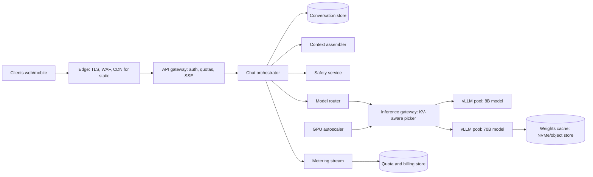
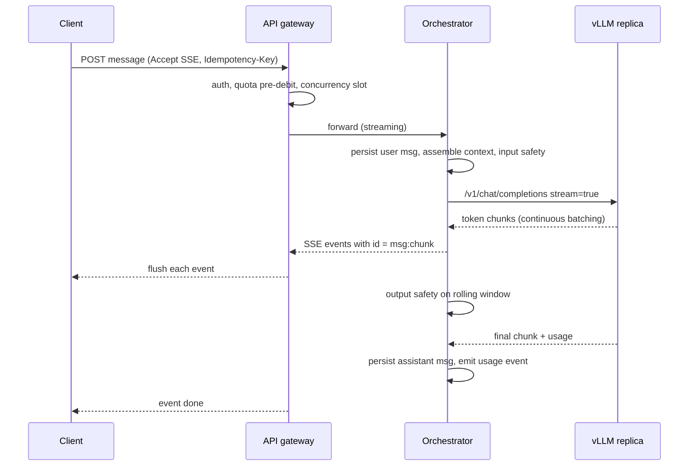

# C09 — ChatGPT-style LLM chat service

> **The requirement.** Lumen Chat must serve 10 million daily active users. Answers stream token by token, the first
> token appears in under 1 s for 95 % of requests, a mid-size and a large model are both offered, free and paid tiers
> have different token allowances, every conversation is kept and can be resumed, EU users' data stays in the EU, and
> finance wants a number: *what does one conversation cost?* It is hard because the expensive resource — GPU memory
> holding model weights and per-request KV cache — is shared across thousands of concurrent streams, and almost every
> classical design choice (load balancing, caching, rate limiting, autoscaling) behaves differently when the unit of
> work is a token rather than a request.

This case ties together [SYSDESIGN-21](../03-ai-systems/21-llm-inference-anatomy.md),
[22](../03-ai-systems/22-serving-llms-at-scale.md), [23](../03-ai-systems/23-gpu-infrastructure.md),
[26](../03-ai-systems/26-llm-gateways-llmops.md) and [10](../01-foundations/10-apis-communication.md). Do it end to
end, with numbers, and most "design an LLM product" interviews become variations.

## The prompt

"Design ChatGPT" usually arrives with no numbers. Turn it into the requirement above, then show where money and
latency go: not the web tier but the GPUs — how many tokens each GPU processes per second while meeting a latency target.

## CLARIFY: requirements

### Functional

1. A user creates a conversation, sends a message and receives a **streamed** reply.
2. Users can list, resume, rename and delete conversations. Resuming continues with the full context.
3. Users pick a model (or "auto"). At least two models: a **mid-size** model (8B-class) and a **large** model
   (70B-class). Assume open-weight models served on our own GPUs with vLLM.
4. **Tiers**: free (small model by default, low daily allowance), plus (large model, higher allowance), and an API/team
   tier with tokens-per-minute (TPM) limits.
5. **Stop generation**: the user can cancel; the GPU must stop spending tokens on that request.
6. **Regenerate** the last answer; **edit** a previous message (creates a branch).
7. **Safety**: unsafe prompts and responses are blocked or redirected; policy events are logged.

### Non-functional

| Property | Target | Why |
|---|---|---|
| TTFT (time to first token) | p95 < 1.0 s, p99 < 2.5 s (warm, typical prompt) | the user sees "thinking" and leaves after a few seconds |
| Streaming rate (TPOT / inter-token latency) | p95 < 50 ms/token (≥ 20 tokens/s), steady | faster than reading speed; jitter feels broken |
| Availability of "send message" | 99.9 % monthly | consumer product; 43 min/month error budget |
| Durability of conversation history | no acknowledged message lost (RPO ≈ 0 within a region) | users expect history like email |
| Data residency | EU accounts: storage **and** inference in EU regions | GDPR transfer rules; enterprise contracts |
| Cost | tracked per conversation and per tier; free tier capped | GPU cost dominates; free users are subsidised |

### Out of scope (say so explicitly)

Model training and fine-tuning; image/voice generation; retrieval over private documents (that is
[C10](./C10-enterprise-rag-assistant.md)); tool-using agents (that is [C11](./C11-coding-agent-platform.md)); payments
(see [C06](./C06-payments-ledger.md)).

Ask aloud: *which models, consumer or API, SLO on first token or stream, own GPUs or a provider?* A hosted
provider turns the GPU problem into a quota-and-cost problem; owning GPUs makes capacity planning the centre.

## QUANTIFY: estimates

All numbers below are **labelled assumptions** unless a source is given. The point is the method; replace the inputs
with yours. Model facts come from the published configuration of Llama 3.3 70B [12]; GPU facts from NVIDIA's H100
data sheet [13].

### Step 1 — users to requests per second

| Quantity | Assumption / derivation | Value |
|---|---|---|
| Daily active users | given | 10 M |
| Conversations per DAU per day | assumption | 3 |
| Turns (user messages) per conversation | assumption | 3.3 |
| Requests (model calls) per day | 10 M × 3 × 3.3 | ≈ 100 M |
| Average requests/s | 100 M / 86,400 | ≈ 1,160 |
| Peak-to-average ratio | assumption (diurnal peak; global users smooth it) | 3× |
| **Peak requests/s** | | **≈ 3,500** |

### Step 2 — requests to tokens per second

A chat request is not "one message": the model re-reads the **whole context** every turn.

| Quantity | Assumption | Value |
|---|---|---|
| System prompt (policy, persona, tool schemas) | assumption | 1,500 tokens |
| Conversation history included (average over turns) | assumption | 2,000 tokens |
| New user message | assumption | 100 tokens |
| **Input tokens per request** | sum | **≈ 3,600** |
| Output tokens per request | assumption | 400 |
| Peak output tokens/s | 3,500 × 400 | **1.4 M tokens/s** |
| Peak input tokens/s (raw) | 3,500 × 3,600 | 12.6 M tokens/s |
| Share of input already in KV cache (system prompt + earlier turns, *if* routing is cache-aware) | assumption | 70 % |
| **Peak input tokens/s needing prefill** | 12.6 M × 0.3 | **≈ 3.8 M tokens/s** |

Input outnumbers output 9 : 1 — long chats are **prefill-heavy**. And the 70 % cache-hit figure is a design
decision: it holds only if a conversation's turns reach a replica that still has its KV blocks (deep dive 2).

### Step 3 — concurrency (Little's law)

Each answer streams for roughly TTFT + 400 tokens × 25 ms/token (assumed typical inter-token latency) ≈ 0.5 s + 10 s
≈ 10.5 s. By Little's law ([SYSDESIGN-01](../00-orientation/01-requirements-to-numbers.md)),

`concurrent streams = arrival rate × time in system = 3,500/s × 10.5 s ≈ 37,000 open streams at peak.`

That number sizes the **gateway tier** (open HTTP connections, memory per connection) and, more importantly, the
**KV cache**: every one of those streams holds KV blocks on some GPU for its whole lifetime.

### Step 4 — KV cache per request

For a decoder-only transformer, KV bytes per token = 2 (K and V) × layers × KV heads × head dim × bytes per element.
Llama 3.3 70B has 80 layers, 8 KV heads (grouped-query attention) and head dim 128 [12]:

`2 × 80 × 8 × 128 × 2 bytes (BF16) = 327,680 B ≈ 320 KiB per token` (160 KiB with an FP8 KV cache).

A 4,000-token request therefore pins ≈ 1.25 GiB of KV in BF16. The 1,500-token system prompt alone is ≈ 470 MiB —
**per sequence, unless it is shared**. With 128 concurrent sequences on one replica that is ≈ 59 GiB of identical
system-prompt KV. Prefix caching collapses that to one copy (deep dive 2). This single calculation is the best
"senior signal" in the whole interview.

### Step 5 — tokens per second per GPU

Decode is **memory-bandwidth bound** ([SYSDESIGN-21](../03-ai-systems/21-llm-inference-anatomy.md)): each step reads
all weights plus the KV of every sequence in the batch, and emits one token per sequence.

Assume the 70B model in FP8 weights (≈ 70 GB) with tensor parallelism across 4 × H100 SXM (80 GB, 3.35 TB/s each
[13]):

- Memory per replica: 320 GB; weights 70 GB; reserve ~10 % for activations and CUDA graphs → ≈ 220 GB for KV.
- At 160 KiB/token (FP8 KV) that is ≈ 1.3 M tokens of KV, i.e. ≈ 335 sequences of 4,000 tokens. Assume the batch
  scheduler keeps **≈ 128 sequences** decoding (headroom for long contexts and prefill bursts).
- Bytes read per decode step ≈ 70 GB (weights) + 128 × 4,000 × 160 KiB (≈ 84 GB of KV) ≈ 154 GB.
- Ideal step time ≈ 154 GB / 13.4 TB/s ≈ 11.5 ms. Assume **50 % of peak bandwidth** achieved in practice → ≈ 23 ms
  per step.
- Per-sequence speed ≈ 43 tokens/s (TPOT ≈ 23 ms — inside the 50 ms SLO); replica output ≈ 128 × 43 ≈ **5,500
  tokens/s ≈ 1,400 output tokens/s per GPU.**

Prefill is **compute bound**: ≈ 2 × parameters FLOPs per token ≈ 140 GFLOP/token for 70B. H100 SXM peaks at ≈ 1,979
dense FP8 TFLOPS (NVIDIA lists 3,958 "with sparsity" [13]; dense is half). Assume 40 % utilisation → ≈ 0.8 PFLOP/s
per GPU → ≈ 5,700 prefill tokens/s per GPU.

These are **roofline-style assumptions, not benchmarks**. Real numbers depend on the vLLM version, kernels, context
mix and quantisation; measure your own with the concurrency sweep in
[labs/22-serving-llms-at-scale](../../labs/22-serving-llms-at-scale/).

### Step 6 — GPU count

If **every** request went to the 70B model:

| Phase | Demand at peak | Per GPU | GPUs |
|---|---|---|---|
| Decode | 1.4 M tokens/s | 1,400 | ≈ 1,000 |
| Prefill (cache-aware routing, 30 % uncached) | 3.8 M tokens/s | 5,700 | ≈ 670 |
| Prefill if routing ignores the cache (100 % uncached) | 12.6 M tokens/s | 5,700 | ≈ 2,200 |

Prefill and decode share GPUs in a colocated deployment, so the honest range is "between the larger term and the
sum": ≈ **1,000–1,700 H100s** with cache-aware routing, and roughly double without it. Now apply **multi-model
routing** (deep dive 3): if 70 % of requests are served by an 8B-class model costing roughly an order of magnitude
less per token (assumption: cost scales roughly with active parameters), the 70B fleet shrinks to ≈ 300–500 GPUs and the
8B fleet needs ≈ 100. Add 25 % headroom for failures and deployments, and a second region per jurisdiction, and a
planning figure of **≈ 600–800 H100-class GPUs at peak** falls out. The ranking of levers matters more than the
exact number: **routing to a smaller model > cache-aware routing > quantisation > anything in the web tier.**

### Step 7 — storage

| Item | Derivation | Value |
|---|---|---|
| Messages/day | 100 M requests × 2 (user + assistant) | 200 M |
| Bytes per message | 400 tokens ≈ 1.6 KB text + metadata; assume 2 KB | 2 KB |
| New history per day | 200 M × 2 KB | ≈ 400 GB/day |
| Per year, before compression/replication | × 365 | ≈ 146 TB |
| With 3× replication | | ≈ 440 TB/year |

History is big but cheap compared with GPUs; it is a classical partitioned-storage problem
([SYSDESIGN-07](../01-foundations/07-partitioning-sharding.md)).

## SKETCH: high-level design



*Diagram: clients reach an edge tier, then an API gateway that authenticates, enforces quotas and holds the SSE
stream; a chat orchestrator loads history from the conversation store, assembles context, calls a safety service and
a model router; the router sends the request to an inference gateway that picks a vLLM replica in the 8B or 70B pool
using KV-cache awareness; replicas load weights from a local weights cache; token usage flows to a metering stream and
quota store; an autoscaler sizes the GPU pools from inference-gateway signals.*

Why each box exists:

- **Edge** terminates TLS near the user and absorbs abuse; it must **not** buffer the stream.
- **API gateway** owns identity, quotas and the long-lived SSE connection; stateless except for sockets.
- **Chat orchestrator** alone understands conversations: persists messages, builds the prompt, relays tokens, emits usage.
- **Model router** picks a *model* (choice, tier, "auto", availability) — a business decision. The **inference
  gateway** picks a *replica* — a cache and load decision. Separate boxes keep product logic out of the scheduler.
- **vLLM pools** run continuous batching with paged KV memory [1][3], one pool per model and region.
- **Metering** is asynchronous: quotas need near-real-time counters, billing exactly-once aggregation
  ([SYSDESIGN-08](../01-foundations/08-async-event-driven.md)).

## API and data model

### Public API (OpenAI-style shape, our own paths)

```http
POST /v1/conversations                       → 201 {conversation_id}
POST /v1/conversations/{cid}/messages
     Idempotency-Key: 7f9c…                  # client-generated, survives retries
     Accept: text/event-stream
     {"content": "…", "model": "auto", "parent_message_id": "m_41", "max_output_tokens": 1024}
  ← 200 Content-Type: text/event-stream
     id: m_42:0
     event: delta
     data: {"message_id":"m_42","delta":"Hello"}

     id: m_42:57
     event: done
     data: {"message_id":"m_42","usage":{"input_tokens":3612,"cached_input_tokens":2950,"output_tokens":388},
            "finish_reason":"stop"}
POST /v1/messages/{mid}/cancel               → 202
GET  /v1/messages/{mid}/stream?from=57       # resume a dropped stream (Last-Event-ID equivalent)
GET  /v1/conversations?cursor=…              # paginated list
```

Server-Sent Events are the natural transport: one-directional, plain HTTP, the `text/event-stream` MIME type, and an
`id` field that the browser echoes as `Last-Event-ID` when it reconnects [5]. WebSockets work too but buy nothing for
a request–stream–done pattern and are harder to route through L7 infrastructure. Cancellation is a separate small
POST (or simply closing the connection, which the gateway must propagate to vLLM so the sequence is aborted and its KV
blocks are freed).

### Data model

| Entity | Key | Fields | Store |
|---|---|---|---|
| `user` | `user_id` | tier, home_region, settings | relational, regional |
| `conversation` | `(user_id, conversation_id)` | title, created_at, model, summary, summary_upto_seq, deleted_at | partitioned by `user_id` |
| `message` | `(conversation_id, seq)` | parent_seq (branches), role, content, model, token counts, safety labels, status (`streaming`/`complete`/`cancelled`/`blocked`) | wide-column or sharded SQL, partition `conversation_id`, clustered by `seq` |
| `stream_buffer` | `message_id` | last N token chunks with chunk index, TTL ≈ 10 min | in-memory KV (Redis-like) |
| `usage_event` | `(user_id, message_id)` | input, cached_input, output tokens, model, region | append-only log → aggregates |
| `quota_counter` | `(user_id or org_id, window)` | tokens used, requests used, concurrent streams | in-memory KV with periodic durable snapshot |

Access patterns drive the keys: "list my conversations" scans one `user_id` partition; "load context" reads the tail
of one `conversation_id` partition in `seq` order. Partitioning by user keeps one user's data in one region, which is
also what residency needs.

## DEEPEN

### Deep dive 1 — the streaming path end to end

**The problem.** A token produced on a GPU in region X must reach a phone within tens of milliseconds, through four or
five hops, any of which may buffer, time out or drop it.



*Diagram: the client posts a message; the gateway authenticates, pre-debits quota and reserves a concurrency slot;
the orchestrator persists the user message, builds context and checks input safety, then calls vLLM with streaming;
token chunks flow back through orchestrator and gateway as SSE events with resumable IDs; output safety runs on a
rolling window; at the end the assistant message and usage are persisted and a done event is sent.*

Rules that make it work:

1. **No buffering anywhere.** Reverse proxies buffer upstream responses by default. NGINX, for example, enables
   `proxy_buffering` by default and lets an upstream disable it per response with `X-Accel-Buffering: no` [6]. Every
   hop — CDN, load balancer, gateway, service mesh sidecar — needs the equivalent setting, and response compression
   must not hold bytes back waiting to fill a block.
2. **Idle timeouts versus slow first tokens.** NGINX's `proxy_read_timeout` defaults to 60 s *between reads* [6].
   That is usually fine for a stream, but a queued request with no output for a long time, or a reasoning model that
   thinks before speaking, can hit it. Send an SSE comment line (`: keep-alive`) periodically — the SSE specification
   itself recommends one about every 15 s for proxies that drop idle connections [5].
3. **Resumability.** Give each event an `id` (`message_id:chunk_index`). The orchestrator writes chunks to a short-TTL
   `stream_buffer`; if the client reconnects with `Last-Event-ID`, the gateway replays from the buffer, then attaches to
   the live stream. Generation continues on the GPU even if the client blips — the reply is persisted either way.
4. **Cancellation propagates.** Closing the client connection or calling `/cancel` must abort the vLLM request;
   otherwise the GPU keeps decoding for nobody. Measure "tokens generated after cancel" as an SLI.
5. **Connections are cheap; slots are not.** 37,000 open streams is modest for an event-driven gateway; GPU batch
   slots are scarce, so the gateway enforces a **per-user concurrent-stream limit** (assume 1 free, 3 plus).
6. **Idempotency.** The `Idempotency-Key` makes "send" safe to retry: a duplicate POST attaches to the existing
   message's stream instead of generating (and billing) a second answer
   ([SYSDESIGN-08](../01-foundations/08-async-event-driven.md)).

### Deep dive 2 — the vLLM fleet: batching, prefix caching and KV-aware routing

**Continuous batching.** Static batching waits for the longest sequence in a batch; iteration-level scheduling
admits and retires sequences at every decode step. Orca introduced iteration-level scheduling (OSDI 2022) [2];
vLLM combines it with **PagedAttention**, which stores KV in fixed-size blocks like virtual-memory pages so memory is
not reserved for the maximum length up front. The PagedAttention paper reports 2–4× throughput over prior systems at
the same latency and "near-zero waste" of KV memory [1]. Our Step 5 assumption of ~128 concurrent sequences per replica
only makes sense with this kind of memory management.

**Chunked prefill.** A 6,000-token prompt arriving mid-stream would stall every decoding user for one long prefill
step. vLLM's V1 engine enables chunked prefill by default where possible: the scheduler batches pending decodes first
and fills the remaining `max_num_batched_tokens` budget with prefill chunks. The docs state the trade-off directly:
smaller budgets give better inter-token latency, larger budgets better TTFT [4]. This is your first tuning knob for the
two SLOs.

**Preemption.** When KV memory runs out, vLLM preempts sequences and, in V1, **recomputes** them later by default
rather than swapping to CPU [4]. Recomputation is invisible to correctness but shows up as TTFT/TPOT spikes —
so watch KV usage, not just GPU utilisation.

**Automatic prefix caching (APC).** vLLM hashes each *full* KV block from its parent block's hash, the block's tokens
and extra keys (LoRA ID, multimodal hashes, an optional cache salt); identical prefixes map to the same blocks, which
are kept and evicted in LRU order [3]. Prefix caching has been on by default since the V1 engine, which the vLLM team
justified by measuring < 1 % throughput loss even at a 0 % hit rate [7]. The docs name multi-round conversation as a
target workload and are explicit that APC reduces only prefill time, not decode time [8]. For chat this is decisive:

- **System prompt**: every request on a replica shares the same 1,500-token prefix → computed once, stored once.
  Keep the system prompt **byte-stable**: putting today's date or the user's name at the top destroys the shared
  prefix for everyone. Put variable content *after* the stable part.
- **Conversation history**: turn *n* has turns 1…n−1 as a prefix. If turn *n* lands on the replica that served turn
  *n−1* and the blocks have not been evicted, only the new message needs prefill.
- **Multi-tenant caution**: shared blocks can leak information through timing. vLLM's per-request `cache_salt`
  limits sharing to requests with the same salt, and its docs warn that non-cryptographic hashes raise collision risk
  across tenants [3]. Salt per enterprise organisation; share the public system prompt freely.

**KV-aware routing.** Round-robin load balancing spreads one conversation's turns across replicas and throws the cache
away. An inference-aware gateway scores replicas on *expected prefix hit* and *load* (queue depth, KV utilisation).
In Kubernetes, the Gateway API Inference Extension defines an `InferencePool` of model-server pods and an endpoint
picker; llm-d's scheduler plugs in scorers such as a prefix-cache scorer and a queue scorer [9][10]. Pure affinity
(hash conversation → replica) is the simple version; it fails when one replica gets hot, so production schedulers
blend affinity with load. llm-d reports large TTFT and throughput gains from prefix-aware routing on high-sharing
workloads and notes the gains shrink when prefixes are rarely shared [10] — vendor-reported, so measure your own.

| Routing policy | Wins when | Costs |
|---|---|---|
| Round-robin / least-connections | stateless, short prompts | discards KV cache; our Step 6 GPU count roughly doubles |
| Consistent hash on conversation ID | few hot users, even load | hot replicas; reshuffles on scale events ([SYSDESIGN-07](../01-foundations/07-partitioning-sharding.md)) |
| Prefix-score + load (endpoint picker) | long shared prefixes, multi-turn chat | extra component; scheduler must track cache state approximately |

**Disaggregated prefill/decode.** Prefill is compute bound and bursty; decode is bandwidth bound and steady. Putting
them on separate GPU pools lets each be sized and parallelised for its own SLO. DistServe (OSDI 2024) reports serving
up to 7.4× more requests or a 12.6× tighter SLO than colocated systems [11]; Splitwise reports 1.4× throughput at 20 %
lower cost by running the phases on different machines [14]. vLLM supports it through KV connectors (NIXL, LMCache,
Mooncake and others) but labels the feature **experimental** and states plainly that it "does not improve throughput"
— its value is controlling TTFT and tail inter-token latency independently [15] (as of 2026-11, vLLM v0.34.0). Use it
when long prompts keep spiking ITL for everyone and chunked prefill cannot fix it; skip it for a first design unless
asked. The cost is moving KV between GPUs: ≈ 1.25 GiB per 4,000-token request in BF16, which needs a fast fabric
(NVLink/RDMA; see [SYSDESIGN-23](../03-ai-systems/23-gpu-infrastructure.md)).

### Deep dive 3 — multi-model routing, quotas and token rate limits

**Model router.** "Auto" mode classifies each request (a small classifier or heuristics: length, language, presence of
code, user tier) and picks the cheapest model expected to answer well. Fallback order matters: if the 70B pool is
saturated, a plus user can be offered the 8B model with a notice rather than an error. This is graceful degradation
([SYSDESIGN-11](../01-foundations/11-reliability-engineering.md)) applied to model quality.

**Why request-count limits are wrong.** One request can cost 100 tokens or 100,000. Limits must be in **tokens**, and
there are three distinct resources to protect:

| Limit | Unit | Enforced at | Protects |
|---|---|---|---|
| Concurrent streams | open generations per user/org | gateway, before admission | GPU batch slots, KV memory |
| Tokens per minute (TPM) | input + output tokens | gateway, token bucket | short-term fleet capacity |
| Daily / monthly allowance | weighted tokens (large model counts more) | quota service | cost per tier |

Output length is unknown at admission, so the gateway **pre-debits** an estimate (input tokens from the model's
tokenizer plus `min(max_output_tokens, typical output)`) and **reconciles** from the final usage event. Debiting the
full `max_output_tokens` rejects too much; debiting zero lets one client open many streams and overrun the bucket. The algorithms are the ones from
[SYSDESIGN-10](../01-foundations/10-apis-communication.md) and [C01](./C01-url-shortener-rate-limiter.md); the twist is
the unit and the late correction. Counters live in a regional in-memory store, updated by the gateway and corrected
from the metering stream; allowances tolerate small overshoot (seconds of lag), billing does not — billing aggregates
the durable usage log with idempotent event IDs.

**Priority.** Under saturation, paid and API traffic go first and free traffic is shed or downgraded, via request
priority classes (e.g. the Inference Extension's `InferenceObjective` [9]). Shed at the gateway: a vLLM preemption has
already spent GPU time.

### Deep dive 4 — conversation storage, context assembly and safety in the stream

**Write path.** The user message is written (status `complete`) before generation starts; the assistant message is
created as `streaming` and finalised at the end. A crash mid-stream leaves a `streaming` row that a sweeper marks
`interrupted` — the UI offers "regenerate". Writing every token to the database is unnecessary; the short-TTL stream
buffer covers reconnection.

**Context assembly** is a token-budget problem. Budget = model context window − system prompt − reserved output.
Fill it newest-first: the new message, then recent turns verbatim; when history exceeds the budget, replace older turns
with a **rolling summary** (stored on the conversation with `summary_upto_seq`), generated asynchronously by the small
model. Two cache-friendliness rules: (1) keep the assembled prompt an **append-only extension** of the previous turn's
prompt as long as possible, so the prefix cache hits; (2) when a summary must replace old turns, do it in large, rare
steps — every rewrite of the head of the prompt invalidates the whole cached prefix.

**Safety in the stream.** Input moderation runs *before* the GPU spends anything; a small classifier adds tens of
milliseconds to TTFT (assumption — measure it). Output moderation is harder: blocking the whole stream until the end
defeats streaming, but checking nothing lets harmful text reach the screen. The common compromise is a **rolling
window**: release tokens to the client with a short hold-back (e.g. one sentence), classify windows asynchronously, and
on a violation stop generation, retract the partial message in the UI and record the event. Classifiers such as Llama
Guard classify both prompts and responses against a risk taxonomy [16]; which classifier, and the thresholds, are
policy decisions owned outside engineering ([SYSDESIGN-28](../03-ai-systems/28-ai-trust-safety-governance.md)). Safety
must fail **closed** for the input check and degrade explicitly for output (e.g. stricter hold-back) — decide and
document it.

## STRESS: failures, hot spots, scale ×10

| Failure | What happens | Detect (SLI) | Mitigate |
|---|---|---|---|
| KV cache exhausted on a replica | preemption and recomputation; TTFT and TPOT spike | `vllm:kv_cache_usage_perc` near 1, rising `vllm:num_requests_waiting` [17] | KV-aware routing away from full replicas; cap `max_num_seqs`; FP8 KV; shed free tier |
| Router ignores cache after a deploy | prefix hit rate collapses; prefill demand ×3 | hit rate from `vllm:prefix_cache_hits` / `vllm:prefix_cache_queries` [17] | alert on hit-rate drop; roll back; warm replicas with the system prompt |
| A GPU or node dies | its in-flight streams stop mid-sentence | stream error rate, `interrupted` messages | client resumes via `Last-Event-ID`; orchestrator re-submits the request to another replica (prefix recomputed); user sees a pause, not an error |
| Retry storm after a regional blip | clients and gateways retry; duplicated generations | duplicate idempotency keys, queue depth | idempotency keys; retry budgets with jitter ([SYSDESIGN-11](../01-foundations/11-reliability-engineering.md)); admission control at the gateway |
| Cold start during a surge | new replicas take minutes; queue grows | time-to-ready per replica, waiting requests | warm pool, predictive scaling, local weight cache (below) |
| Proxy buffering reintroduced | tokens arrive in bursts or all at the end | client-side inter-event gap histogram | synthetic streaming probe through the full path |
| Safety classifier slow or down | TTFT rises or requests fail | classifier latency/error SLI | timeouts; fail closed on input; scale classifier with the fleet |
| One viral prompt / abusive org | hot model pool, everyone's TTFT rises | per-org token rate, queue share | per-org TPM and concurrency caps; priority classes |

**GPU autoscaling and cold starts.** CPU utilisation is meaningless for scaling LLM servers, and GPU utilisation
saturates early. Scale on **queue depth** (`vllm:num_requests_waiting`), **KV-cache utilisation** and TTFT SLO burn
[17]. A cold start is: obtain a GPU node (minutes if the cloud has capacity, never if it does not), pull a multi-GB
container image, load ≈ 70–140 GB of weights, then warm up (CUDA graphs, compilation). Mitigations in order of
leverage: keep **reserved/committed capacity** for the baseline and autoscale only the diurnal top; keep a small
**warm pool**; cache weights on **local NVMe** instead of pulling from object storage; pre-pull images; for
scale-to-zero of rarely used models, vLLM's **sleep mode** releases most GPU memory while the server keeps running —
level 1 offloads weights to CPU memory and discards the KV cache so the engine can wake without a full reload [18].
Scaling *down* must drain: stop routing new requests and let streams finish, otherwise every scale-in event cuts
answers in half.

**Scale ×10 (100 M DAU).** The web tier scales linearly and is not interesting. What breaks:

1. **GPU supply**, not software: ~10× the fleet is thousands of GPUs per region; you need multi-region capacity
   pooling (for non-resident users), committed contracts and more aggressive routing to small models.
2. **Prefix-cache locality across many replicas**: the scheduler's view of which replica holds which prefix becomes
   a distributed-state problem; approximate (hash-of-prefix tables, gossip) is fine, exact is not affordable.
3. **Disaggregation and KV tiering** start to pay: offloading KV to CPU memory or a shared KV store (vLLM's offloading
   and LMCache connectors [15]) extends the effective cache beyond HBM.
4. **Storage**: ≈ 4 PB/year of history with replication — tier old conversations to object storage
   ([SYSDESIGN-13](../01-foundations/13-data-at-scale.md)) and keep only recent ones hot.

**Regional deployment and residency.** Each user has a `home_region` (EU or US in this design). DNS/geo-routing sends
the client to the nearest edge, but the gateway routes the *request* to the user's home region, where the conversation
store, quota counters and GPU pools live. GDPR restricts transfers of personal data to third countries (Chapter V) [19],
and enterprise contracts often demand processing — not just storage — in the EU, so EU traffic **never spills over** to
US GPUs; when EU capacity is short, EU free traffic degrades to the small model instead. Logs, traces and evaluation samples are
personal data too: keep them in-region with retention limits. See [SYSDESIGN-15](../02-modern-requirements/15-multi-region-edge.md) and
[SYSDESIGN-19](../02-modern-requirements/19-privacy-compliance-sovereignty.md).

## Operate: SLOs, cost, energy

### SLOs

| SLI | SLO | Measured at |
|---|---|---|
| TTFT (warm, prompt ≤ 8k tokens) | p95 < 1.0 s, p99 < 2.5 s | gateway (user-visible), also `vllm:time_to_first_token_seconds` |
| Inter-token latency | p95 < 50 ms | client probe + `vllm:inter_token_latency_seconds` |
| Message success rate (done event received, not blocked by policy) | 99.9 % | orchestrator |
| Stream interruption rate | < 0.1 % of messages | orchestrator (`interrupted` status) |
| Prefix-cache hit rate (input tokens) | ≥ 60 % (capacity assumption!) | vLLM counters |
| Tokens generated after cancel | < 1 % of generated tokens | vLLM vs gateway |

The last two are **capacity SLOs**: when they slip, cost rises before users notice. Alert on burn rate
([SYSDESIGN-12](../01-foundations/12-observability.md)).

### Cost per conversation

All inputs are assumptions; the method is the deliverable.

| Input | Assumption |
|---|---|
| H100 cost | $2.50 per GPU-hour (assumed blended committed + on-demand price; check current provider pricing) |
| Fleet at peak | 700 GPUs; average over the day 60 % of peak → 420 GPUs |
| GPU-hours per day | 420 × 24 ≈ 10,100 |
| GPU cost per day | ≈ $25,000 |
| Conversations per day | 30 M |
| Output tokens per day | 100 M × 400 = 40 B |

→ **≈ $0.0008 per conversation** and **≈ $0.63 per million output tokens** (blended, GPU only; add perhaps 10–30 % for
storage, network and the CPU tier — an assumption). The table is more useful as sensitivities: dropping the
prefix-cache hit rate from 70 % to 0 % roughly doubles the 70B fleet; moving 70 % of traffic to the small model cuts it
by more than half; a free-tier user who chats all day costs about as much as dozens of average users, which is why
free allowances exist. See [SYSDESIGN-16](../02-modern-requirements/16-cost-as-requirement.md).

### Energy

Assume 1.0 kW per GPU including its share of host, network and cooling inside the server (H100 SXM TDP is up to
700 W [13]), and a facility PUE of 1.2 (assumption). Then 10,100 GPU-hours/day × 1.0 kW × 1.2 ≈ **12 MWh/day**, or
≈ **0.4 Wh per conversation**. The same levers that cut cost cut energy per conversation: small-model routing, prefix
caching, FP8. Carbon-aware *placement* is limited for interactive chat (latency and residency pin the region), but
**batch** work — summarisation of old conversations, evaluation runs — can be shifted in time
([SYSDESIGN-17](../02-modern-requirements/17-energy-carbon-aware.md)).

## Modern twist

What 2026 changes compared with a 2023 answer (as of 2026-11):

- **The serving engine is a commodity; the scheduler around it is the design.** vLLM releases roughly every two weeks
  (v0.33.0 on 2026-11-02, v0.34.0 on 2026-11-16 [20]); continuous batching, paged KV and prefix caching are table
  stakes. The interesting decisions moved up a layer: KV-aware endpoint pickers, the Kubernetes Gateway API Inference
  Extension, llm-d-style schedulers, KV offloading and disaggregation [9][10][15].
- **Reasoning models** spend many hidden "thinking" tokens before the first visible token. TTFT as the user perceives
  it becomes "time to first visible token", output tokens per request grow, and keep-alive comments on the stream
  become mandatory rather than optional.
- **Regulation as a system requirement.** The EU AI Act's general-purpose AI model obligations have applied since
  2 August 2025, and the 2026 "Digital Omnibus on AI" amendments postponed the stand-alone high-risk obligations to
  December 2027 while leaving the Article 50 transparency duties largely unchanged [21][22]. For a chat product that
  means: tell users they are talking to an AI, label generated content where required, and keep the audit trail —
  which is mostly a logging and data-model requirement ([SYSDESIGN-28](../03-ai-systems/28-ai-trust-safety-governance.md)).

## WRAP: interview summary

**A strong 45-minute answer covers, in order:** clarify tiers, models and SLOs (TTFT and TPOT separately) → convert
DAU to requests/s to tokens/s, noting input ≫ output → KV bytes per token and the system-prompt duplication insight →
GPU count from decode bandwidth and prefill compute, with a range → sketch with model router and inference gateway as
separate boxes → SSE path with no buffering, keep-alives, resumable IDs, cancellation → prefix caching + KV-aware
routing as the main capacity lever → token-based quotas with pre-debit and reconcile → failures (KV exhaustion, cold
starts, node loss mid-stream) and autoscaling on queue depth → cost per conversation and residency.

| Level | What "good" looks like |
|---|---|
| Junior | Correct request flow, SSE vs WebSocket choice explained, conversation data model, a rate limiter, knows GPUs are the cost centre |
| Senior | All of the above plus the token math (requests → tokens/s → GPUs), continuous batching and prefix caching explained, cache-aware routing, token-based quotas, autoscaling signals beyond CPU, mid-stream failure handling |
| Staff | Frames the design around unit economics and supply (committed vs on-demand GPUs, small-model routing policy, free-tier economics), separates business routing from replica scheduling, knows when disaggregation pays, plans residency and model rollout with evals, defines capacity SLOs (cache hit rate) alongside user SLOs |

**Red flags.** "Put it behind a load balancer and autoscale on CPU." Counting requests instead of tokens. No KV-cache
reasoning at all. Assuming one GPU per user or one request per GPU. Buffering the response to run safety on the full
text. Ignoring cancellation. Spilling EU traffic to another region "for availability" after promising residency.

**Follow-ups.** Adding a 400B-class model (multi-node parallelism, own pool); rolling out a model version (shadow
traffic, evals, regional canary); hosted API instead of own GPUs (a quota/budget problem with cross-provider
fallback — [SYSDESIGN-26](../03-ai-systems/26-llm-gateways-llmops.md)).

## Alternatives considered

| Alternative | Wins when | Why not the default here |
|---|---|---|
| Hosted model API instead of own GPUs | small or early product, frontier-quality models needed | provider rate limits and per-token prices dominate at 10 M DAU; residency depends on provider regions |
| WebSockets instead of SSE | bidirectional features (voice, live collaboration) | more complex L7 routing and reconnection; SSE covers request → stream |
| One giant model for everything | simple product | roughly doubles or triples GPU spend vs routing (Step 6) |
| SGLang or TensorRT-LLM instead of vLLM | specific model/hardware wins measured in your benchmark | all three provide continuous batching and prefix reuse (SGLang's RadixAttention [23]); choose by measurement, keep the OpenAI-compatible interface so the engine is replaceable |

## Exercises

See [exercises/C09-llm-chat-service.md](../../exercises/C09-llm-chat-service.md) — the GPU-count drill, streaming
through proxies, quota design, and lab-based exercises using
[labs/22-serving-llms-at-scale](../../labs/22-serving-llms-at-scale/) and
[labs/26-llm-gateways-llmops](../../labs/26-llm-gateways-llmops/).

## References

All accessed 2026-11-19.

1. W. Kwon et al., "Efficient Memory Management for Large Language Model Serving with PagedAttention," SOSP 2023. https://arxiv.org/abs/2309.06180
2. G.-I. Yu, J. S. Jeong et al., "Orca: A Distributed Serving System for Transformer-Based Generative Models," OSDI 2022. https://www.usenix.org/conference/osdi22/presentation/yu
3. vLLM project, "Automatic Prefix Caching" (design doc: block hashing, LRU eviction, cache salt). https://docs.vllm.ai/en/latest/design/prefix_caching.html
4. vLLM project, "Optimization and Tuning" (chunked prefill default in V1, `max_num_batched_tokens`, preemption by recompute). https://docs.vllm.ai/en/latest/configuration/optimization.html
5. WHATWG, HTML Living Standard, §9.2 "Server-sent events." https://html.spec.whatwg.org/multipage/server-sent-events.html
6. NGINX, "Module ngx_http_proxy_module" (`proxy_buffering`, `X-Accel-Buffering`, `proxy_read_timeout`). https://nginx.org/en/docs/http/ngx_http_proxy_module.html
7. vLLM team, "vLLM V1: A Major Upgrade to vLLM's Core Architecture," 2025-01-27 (prefix caching on by default, < 1 % overhead at 0 % hit rate). https://vllm.ai/blog/2025-01-27-v1-alpha-release
8. vLLM project, "Automatic Prefix Caching" (feature guide: target workloads; prefill-only benefit). https://docs.vllm.ai/en/latest/features/automatic_prefix_caching.html
9. Kubernetes SIG Network, Gateway API Inference Extension (InferencePool, endpoint picker). https://gateway-api-inference-extension.sigs.k8s.io/
10. llm-d project, "Intelligent inference scheduling with llm-d" (blog, vendor-reported results). https://llm-d.ai/blog/intelligent-inference-scheduling-with-llm-d 
11. Y. Zhong et al., "DistServe: Disaggregating Prefill and Decoding for Goodput-optimized Large Language Model Serving," OSDI 2024. https://arxiv.org/abs/2401.09670
12. Meta, Llama 3.3 70B Instruct model configuration (80 layers, 8 KV heads, head dim 128), via a public mirror of `config.json`. https://huggingface.co/unsloth/Llama-3.3-70B-Instruct/blob/main/config.json
13. NVIDIA, "H100 Tensor Core GPU" data sheet (80 GB, 3.35 TB/s, FP8 3,958 TFLOPS with sparsity, up to 700 W, SXM). https://www.nvidia.com/en-us/data-center/h100/
14. P. Patel et al., "Splitwise: Efficient Generative LLM Inference Using Phase Splitting," ISCA 2024; preprint arXiv:2311.18677. https://arxiv.org/abs/2311.18677
15. vLLM project, "Disaggregated Prefilling (experimental)" (KV connectors). https://docs.vllm.ai/en/latest/features/disagg_prefill.html
16. H. Inan et al., "Llama Guard: LLM-based Input-Output Safeguard for Human-AI Conversations," arXiv:2312.06674 (preprint), 2023. https://arxiv.org/abs/2312.06674
17. vLLM project, "Metrics" design doc (metric names). https://docs.vllm.ai/en/latest/design/metrics.html
18. vLLM project, "Sleep Mode." https://docs.vllm.ai/en/latest/features/sleep_mode.html
19. Regulation (EU) 2016/679 (GDPR), Chapter V, transfers of personal data to third countries. https://eur-lex.europa.eu/eli/reg/2016/679/oj
20. vLLM releases on PyPI (v0.33.0 uploaded 2026-11-02, v0.34.0 uploaded 2026-11-16). https://pypi.org/project/vllm/#history
21. Regulation (EU) 2024/1689 (AI Act), Art. 113 application dates. https://eur-lex.europa.eu/eli/reg/2024/1689/oj
22. Council of the EU adoption of the Digital Omnibus on AI (June 2026), as summarised by Gibson Dunn, "EU AI Act Omnibus Agreement — Postponed High-Risk Deadlines and Other Key Changes" (secondary source; check the Official Journal text). https://www.gibsondunn.com/eu-ai-act-omnibus-agreement-postponed-high-risk-deadlines-and-other-key-changes/
23. L. Zheng et al., "SGLang: Efficient Execution of Structured Language Model Programs," arXiv:2312.07104 (preprint). https://arxiv.org/abs/2312.07104
