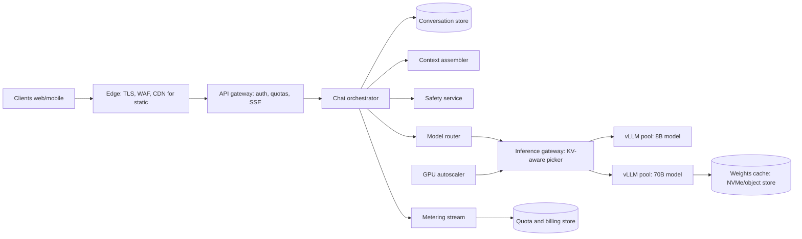
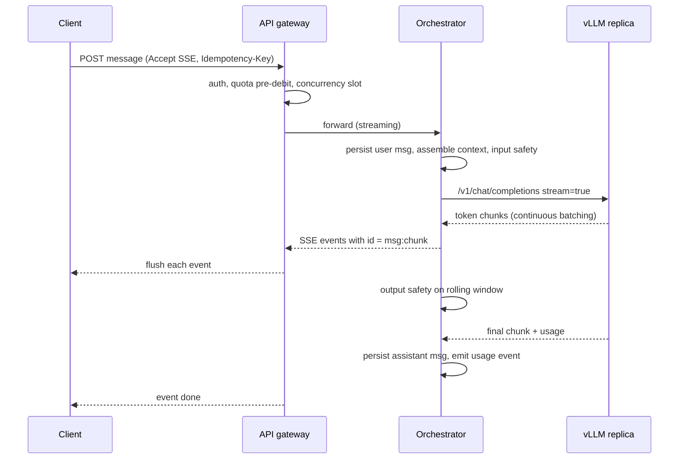

# C09 — ChatGPT-style LLM chat service

> **The requirement.** Lumen Chat must serve 10 million daily active users. Answers stream token by token, the first
> token appears in under 1 s for 95 % of requests, a mid-size and a large model are both offered, free and paid tiers
> have different token allowances, every conversation is kept and can be resumed, EU users' data stays in the EU, and
> finance wants a number: *what does one conversation cost?* It is hard because the expensive resource — GPU memory
> holding model weights and per-request KV cache — is shared across thousands of concurrent streams, and almost every
> classical design choice (load balancing, caching, rate limiting, autoscaling) behaves differently when the unit of
> work is a token rather than a request.

This case ties together [SYSDESIGN-21](../03-ai-systems/21-llm-inference-anatomy.md),
[22](../03-ai-systems/22-serving-llms-at-scale.md), [23](../03-ai-systems/23-gpu-infrastructure.md),
[26](../03-ai-systems/26-llm-gateways-llmops.md) and [10](../01-foundations/10-apis-communication.md); most "design an
LLM product" interviews are variations of it.

## The prompt

"Design ChatGPT" usually arrives with no numbers. Turn it into the requirement above, then show where money and
latency go: not the web tier but the GPUs — how many tokens each GPU processes per second while meeting a latency target.

## CLARIFY: requirements

### Functional

1. Create a conversation, send a message and receive a **streamed** reply; list, resume (with full context), rename
   and delete conversations.
2. Pick a model or "auto": a **mid-size** (8B-class) and a **large** (70B-class) open-weight model, served on our own
   GPUs with vLLM.
3. **Tiers**: free (small model, low daily allowance), plus (large model, higher allowance), and API/team with
   tokens-per-minute (TPM) limits.
4. **Stop generation** (the GPU must stop spending tokens on it), **regenerate** the last answer, **edit** a previous
   message (creates a branch).
5. **Safety**: unsafe prompts and responses are blocked or redirected; policy events are logged.

### Non-functional

| Property | Target | Why |
|---|---|---|
| TTFT (time to first token) | p95 < 1.0 s, p99 < 2.5 s (warm, typical prompt) | users leave after a few seconds of "thinking" |
| Streaming rate (TPOT / inter-token latency) | p95 < 50 ms/token (≥ 20 tokens/s), steady | faster than reading; jitter feels broken |
| Availability of "send message" | 99.9 % monthly | consumer product; 43 min/month error budget |
| Durability of conversation history | no acknowledged message lost (RPO ≈ 0 within a region) | users expect history like email |
| Data residency | EU accounts: storage **and** inference in EU regions | GDPR transfer rules; enterprise contracts |
| Cost | tracked per conversation and tier; free tier capped | GPU cost dominates |

### Out of scope (say so explicitly)

Training; image/voice generation; retrieval over private documents
([C10](./C10-enterprise-rag-assistant.md)); tool-using agents ([C11](./C11-coding-agent-platform.md)); payments
([C06](./C06-payments-ledger.md)).

Ask aloud: *which models, consumer or API, SLO on first token or stream, own GPUs or a provider?* A hosted provider
turns the GPU problem into a quota-and-cost problem.

## QUANTIFY: estimates

All numbers below are **labelled assumptions** unless a source is given; the method is the point. Model facts come
from the published Llama 3.3 70B configuration [1], whose architecture matches the 70B model in the Llama 3 paper
[2]; GPU facts from NVIDIA's H100 data sheet [3].

### Step 1 — users to requests per second

| Quantity | Assumption / derivation | Value |
|---|---|---|
| Daily active users | given | 10 M |
| Conversations per DAU per day | assumption | 3 |
| Turns (user messages) per conversation | assumption | 3.3 |
| Requests (model calls) per day | 10 M × 3 × 3.3 | ≈ 100 M |
| Average requests/s | 100 M / 86,400 | ≈ 1,160 |
| Peak-to-average ratio | assumption (diurnal peak; global users smooth it) | 3× |
| **Peak requests/s** | | **≈ 3,500** |

### Step 2 — requests to tokens per second

The model re-reads the **whole context** every turn.

| Quantity | Assumption | Value |
|---|---|---|
| System prompt (policy, persona, tool schemas) | assumption | 1,500 tokens |
| Conversation history included (average over turns) | assumption | 2,000 tokens |
| New user message | assumption | 100 tokens |
| **Input tokens per request** | sum | **≈ 3,600** |
| Output tokens per request | assumption | 400 |
| Peak output tokens/s | 3,500 × 400 | **1.4 M tokens/s** |
| Peak input tokens/s (raw) | 3,500 × 3,600 | 12.6 M tokens/s |
| Share of input already in KV cache (system prompt + earlier turns, *if* routing is cache-aware) | assumption | 70 % |
| **Peak input tokens/s needing prefill** | 12.6 M × 0.3 | **≈ 3.8 M tokens/s** |

Input outnumbers output 9 : 1 — long chats are **prefill-heavy**. The 70 % cache-hit figure is a design decision: it
holds only if a conversation's turns reach a replica still holding its KV blocks (deep dive 2).

### Step 3 — concurrency (Little's law)

Each answer streams for ≈ TTFT + 400 tokens × 25 ms/token (assumed inter-token latency) ≈ 0.5 s + 10 s ≈ 10.5 s. By
Little's law ([SYSDESIGN-01](../00-orientation/01-requirements-to-numbers.md)),

`concurrent streams = arrival rate × time in system = 3,500/s × 10.5 s ≈ 37,000 open streams at peak.`

That sizes the **gateway tier** and, more importantly, the **KV cache**: every stream holds KV blocks on a GPU
for its whole lifetime.

### Step 4 — KV cache per request

For a decoder-only transformer, KV bytes per token = 2 (K and V) × layers × KV heads × head dim × bytes per element.
Llama 3.3 70B has 80 layers, 8 KV heads (grouped-query attention) and head dim 128 [1][2]:

`2 × 80 × 8 × 128 × 2 bytes (BF16) = 327,680 B ≈ 320 KiB per token` (160 KiB with an FP8 KV cache).

A 4,000-token request therefore pins ≈ 1.2 GiB (1,250 MiB) of BF16 KV. The 1,500-token system prompt alone is
≈ 470 MiB **per sequence, unless it is shared**; with 128 concurrent sequences on one replica that is ≈ 59 GiB of
identical KV. Prefix caching collapses it to one copy (deep dive 2) — the best "senior signal" in the interview.

### Step 5 — tokens per second per GPU

Decode is **memory-bandwidth bound** ([SYSDESIGN-21](../03-ai-systems/21-llm-inference-anatomy.md)): each step reads
all weights plus the KV of every sequence in the batch and emits one token per sequence. Assume the 70B model in FP8
(≈ 70 GB of weights) with tensor parallelism across 4 × H100 SXM (80 GB, 3.35 TB/s each [3]):

- 320 GB per replica − 70 GB weights − ~10 % reserve → ≈ 220 GB of KV ≈ 1.3 M tokens at 160 KiB (≈ 335 sequences of
  4,000 tokens); assume **≈ 128 sequences** decoding, for headroom.
- Bytes per step ≈ 70 GB + 128 × 4,000 × 160 KiB (≈ 84 GB) ≈ 154 GB → ideal 154 GB / 13.4 TB/s ≈ 11.5 ms; at 50 % of
  peak bandwidth ≈ 23 ms per step.
- ≈ 43 tokens/s per sequence (inside the 50 ms SLO); replica ≈ 128 × 43 ≈ **5,500 tokens/s ≈ 1,400 output tokens/s
  per GPU.**

Prefill is **compute bound**: ≈ 2 × parameters ≈ 140 GFLOP/token. The H100 SXM peaks at ≈ 1,979 dense FP8 TFLOPS
(3,958 is the "with sparsity" figure [3]); at 40 % utilisation ≈ 0.8 PFLOP/s → ≈ 5,700 prefill tokens/s per GPU.

These are **roofline assumptions, not benchmarks**: they exclude tensor-parallel all-reduce and attention FLOPs, so
treat them as upper bounds; measure with the concurrency sweep in
[labs/22-serving-llms-at-scale](../../labs/22-serving-llms-at-scale/).

### Step 6 — GPU count

If **every** request went to the 70B model:

| Phase | Demand at peak | Per GPU | GPUs |
|---|---|---|---|
| Decode | 1.4 M tokens/s | 1,400 | ≈ 1,000 |
| Prefill (cache-aware routing, 30 % uncached) | 3.8 M tokens/s | 5,700 | ≈ 670 |
| Prefill if routing ignores the cache (100 % uncached) | 12.6 M tokens/s | 5,700 | ≈ 2,200 |

Colocated phases share GPUs, so the honest range is "between the larger term and the sum": ≈ **1,000–1,700 H100s**
with cache-aware routing, roughly double without. **Multi-model routing** (deep dive 3) changes this most: if 70 % of
requests go to an 8B-class model at about a tenth of the per-token cost (assumption: cost scales with active
parameters), the 70B fleet shrinks to ≈ 300–500 GPUs plus ≈ 100 for 8B. With 25 % headroom and a second region per
jurisdiction, plan for **≈ 600–800 H100-class GPUs at peak**. The ranking of levers matters most: **smaller-model routing > cache-aware routing > quantisation > anything in the web tier.**

### Step 7 — storage

| Item | Derivation | Value |
|---|---|---|
| Messages/day | 100 M requests × 2 (user + assistant) | 200 M |
| Bytes per message | 400 tokens ≈ 1.6 KB text + metadata; assume 2 KB | 2 KB |
| New history per day | 200 M × 2 KB | ≈ 400 GB/day |
| Per year, before compression/replication | × 365 | ≈ 146 TB |
| With 3× replication | | ≈ 440 TB/year |

Cheap next to the GPUs: classical partitioned storage ([SYSDESIGN-07](../01-foundations/07-partitioning-sharding.md)).

## SKETCH: high-level design



*Diagram: clients pass an edge tier and an API gateway (auth, quotas, SSE); a chat orchestrator uses the conversation
store, a context assembler, a safety service and a model router; the router hands requests to a KV-aware inference
gateway that picks a replica in the 8B or 70B vLLM pool, which loads weights from a local cache; usage flows through a
metering stream to the quota store; an autoscaler sizes the pools from gateway signals.*

Why each box exists:

- **Edge**: TLS and abuse absorption; it must **not** buffer the stream.
- **API gateway**: identity, quotas, the long-lived SSE connection.
- **Chat orchestrator**: persists messages, builds the prompt, relays tokens, emits usage.
- **Model router** picks a *model* (a business decision); the **inference gateway** picks a *replica* (a cache and
  load decision). Separate boxes keep product logic out of the scheduler.
- **vLLM pools**: continuous batching with paged KV memory [4][5], one pool per model and region.
- **Metering** is asynchronous: near-real-time quota counters, exactly-once billing aggregation
  ([SYSDESIGN-08](../01-foundations/08-async-event-driven.md)).

## API and data model

### Public API (OpenAI-style shape, our own paths)

```http
POST /v1/conversations                       → 201 {conversation_id}
POST /v1/conversations/{cid}/messages
     Idempotency-Key: 7f9c…                  # client-generated, survives retries
     Accept: text/event-stream
     {"content": "…", "model": "auto", "parent_message_id": "m_41", "max_output_tokens": 1024}
  ← 200 Content-Type: text/event-stream
     id: m_42:0
     event: delta
     data: {"message_id":"m_42","delta":"Hello"}

     id: m_42:57
     event: done
     data: {"message_id":"m_42","usage":{"input_tokens":3612,"cached_input_tokens":2950,"output_tokens":388},
            "finish_reason":"stop"}
POST /v1/messages/{mid}/cancel               → 202
GET  /v1/messages/{mid}/stream?from=57       # resume a dropped stream (Last-Event-ID equivalent)
GET  /v1/conversations?cursor=…              # paginated list
```

Server-Sent Events fit: one-directional, plain HTTP, `text/event-stream`, and an `id` the browser echoes as
`Last-Event-ID` on reconnect [6]. WebSockets buy nothing for request–stream–done and are harder to route through L7
infrastructure. Cancelling (a POST or a closed connection) must reach vLLM so the sequence aborts and frees its KV.

### Data model

| Entity | Key | Fields | Store |
|---|---|---|---|
| `user` | `user_id` | tier, home_region, settings | relational, regional |
| `conversation` | `(user_id, conversation_id)` | title, created_at, model, summary, summary_upto_seq, deleted_at | partitioned by `user_id` |
| `message` | `(conversation_id, seq)` | parent_seq (branches), role, content, model, token counts, safety labels, status (`streaming`/`complete`/`cancelled`/`blocked`) | wide-column or sharded SQL, partition `conversation_id`, clustered by `seq` |
| `stream_buffer` | `message_id` | last N token chunks with chunk index, TTL ≈ 10 min | in-memory KV (Redis-like) |
| `usage_event` | `(user_id, message_id)` | input, cached_input, output tokens, model, region | append-only log → aggregates |
| `quota_counter` | `(user_id or org_id, window)` | tokens used, requests used, concurrent streams | in-memory KV with periodic durable snapshot |

"List my conversations" scans one `user_id` partition; "load context" reads one `conversation_id` tail in `seq`
order; partitioning by user also keeps a user's data in one region.

## DEEPEN

### Deep dive 1 — the streaming path end to end

**The problem.** A token from a GPU must reach a phone within tens of milliseconds through four or five hops, any of
which may buffer, time out or drop it.



*Diagram: the client posts a message; the gateway authenticates, pre-debits quota and reserves a slot; the
orchestrator persists the message, builds context, checks input safety and calls vLLM with streaming; token chunks
return as SSE events with resumable IDs while output safety checks a rolling window; finally the assistant message and
usage are persisted and a done event is sent.*

Rules that make it work:

1. **No buffering anywhere.** NGINX buffers upstream responses by default; `X-Accel-Buffering: no` disables it per
   response [7]. Every hop (CDN, load balancer, gateway, mesh sidecar) needs the equivalent, and compression must not
   hold bytes back.
2. **Idle timeouts.** NGINX's `proxy_read_timeout` defaults to 60 s *between reads* [7]; a long queue wait or a
   reasoning model that thinks before speaking can hit it. Send an SSE comment (`: keep-alive`); the specification
   suggests one about every 15 s for proxies that drop idle connections [6].
3. **Resumability.** Event `id` = `message_id:chunk_index`, chunks kept in the short-TTL `stream_buffer`. On reconnect
   with `Last-Event-ID` the gateway replays, then attaches to the live stream; generation continues meanwhile.
4. **Cancellation propagates** to vLLM, or the GPU decodes for nobody. Measure "tokens generated after cancel".
5. **Connections are cheap; slots are not.** 37,000 streams is modest for an event-driven gateway; GPU batch slots are
   scarce: cap **concurrent streams per user** (assume 1 free, 3 plus).
6. **Idempotency.** A duplicate POST with the same `Idempotency-Key` attaches to the existing stream instead of
   generating (and billing) a second answer ([SYSDESIGN-08](../01-foundations/08-async-event-driven.md)).

### Deep dive 2 — the vLLM fleet: batching, prefix caching and KV-aware routing

**Continuous batching.** Iteration-level scheduling, introduced by Orca (OSDI 2022) [8], admits and retires sequences
at every decode step instead of waiting for a batch's longest sequence. vLLM adds **PagedAttention**: KV lives in
fixed-size blocks like virtual-memory pages, nothing is reserved for the maximum length, and the paper reports 2–4×
throughput at the same latency with "near-zero waste" of KV memory [4]. Step 5's ~128 sequences per replica relies on
this.

**Chunked prefill and preemption.** vLLM V1 enables chunked prefill by default whenever possible: decodes are batched
first and prefill chunks fill the remaining `max_num_batched_tokens`, so a long prompt no longer stalls every decoder. Smaller budgets favour inter-token latency, larger ones TTFT [9] — the first knob for the
two SLOs. When KV memory runs out, V1 preempts sequences and by default **recomputes** them rather than swapping [9]:
correct, but visible as latency spikes, so watch KV usage, not GPU utilisation.

**Automatic prefix caching (APC).** vLLM hashes each *full* KV block from its parent block's hash, its tokens and
extra keys (LoRA ID, multimodal hashes, an optional cache salt); identical prefixes share blocks, evicted in LRU order
[5]. It has been on by default since V1, after the vLLM team measured < 1 % throughput loss at a 0 % hit rate [10];
the docs name multi-round conversation as a target workload and note that APC cuts prefill time only, not decode
[11]. For chat:

- **System prompt**: computed and stored once per replica, if it is **byte-stable**. Today's date or the user's name
  at the top destroys the shared prefix; put variable content after the stable part.
- **History**: turn *n* has turns 1…n−1 as its prefix; on the replica that served turn *n−1*, only the new message
  needs prefill.
- **Multi-tenant caution**: shared blocks can leak through timing. A per-request `cache_salt` limits reuse
  to requests with the same salt; the default block hash has been sha256 since v0.11, and the docs warn that opting
  into the non-cryptographic xxhash raises collision risk [5]. Keep sha256 and salt per enterprise organisation.

**KV-aware routing.** Round-robin spreads a conversation's turns across replicas and discards the cache. An
inference-aware gateway scores replicas on expected prefix hit and load: the Kubernetes Gateway API Inference
Extension defines an `InferencePool` of model-server pods and an endpoint picker, and llm-d's scheduler adds
prefix-cache and queue scorers [12][13]. Pure hash affinity creates hot replicas; schedulers blend affinity with load. llm-d reports large gains on high-sharing workloads, shrinking when prefixes are rarely shared [13]
(vendor-reported: measure).

| Routing policy | Wins when | Costs |
|---|---|---|
| Round-robin / least-connections | stateless, short prompts | discards KV cache; our Step 6 GPU count roughly doubles |
| Consistent hash on conversation ID | few hot users, even load | hot replicas; reshuffles on scale events ([SYSDESIGN-07](../01-foundations/07-partitioning-sharding.md)) |
| Prefix-score + load (endpoint picker) | long shared prefixes, multi-turn chat | extra component; scheduler must track cache state approximately |

**Disaggregated prefill/decode.** Prefill is compute bound and bursty, decode bandwidth bound and steady; separate
GPU pools let each be sized for its own SLO. DistServe (OSDI 2024) reports up to 7.4× more requests or a 12.6×
tighter SLO than colocated systems [14]; Splitwise, 1.4× throughput at 20 % lower cost [15]. vLLM supports it through
KV connectors (NIXL, LMCache, Mooncake and others) but labels it **experimental** and states that it "does not improve
throughput": its value is controlling TTFT and tail inter-token latency independently [16] (as of 2026-11, vLLM
v0.34.0). Use it when long prompts spike ITL despite chunked prefill. The cost is shipping ≈ 1.2 GiB of BF16 KV
per 4,000-token request over a fast fabric (NVLink/RDMA; see [SYSDESIGN-23](../03-ai-systems/23-gpu-infrastructure.md)).

### Deep dive 3 — multi-model routing, quotas and token rate limits

**Model router.** "Auto" classifies each request (small classifier or heuristics: length, language, code, tier) and
picks the cheapest model expected to answer well. If the 70B pool is saturated, a plus user gets the 8B model with a
notice, not an error: graceful degradation ([SYSDESIGN-11](../01-foundations/11-reliability-engineering.md)) of quality.

**Why request-count limits are wrong.** One request can cost 100 tokens or 100,000, so limits are in **tokens**, for
three resources:

| Limit | Unit | Enforced at | Protects |
|---|---|---|---|
| Concurrent streams | open generations per user/org | gateway, before admission | GPU batch slots, KV memory |
| Tokens per minute (TPM) | input + output tokens | gateway, token bucket | short-term fleet capacity |
| Daily / monthly allowance | weighted tokens (large model counts more) | quota service | cost per tier |

Output length is unknown at admission, so the gateway **pre-debits** an estimate (input tokens plus
`min(max_output_tokens, typical output)`) and **reconciles** from the final usage event; debiting the maximum rejects
too much, debiting zero lets one client overrun the bucket with parallel streams. The algorithms are those of
[SYSDESIGN-10](../01-foundations/10-apis-communication.md) and [C01](./C01-url-shortener-rate-limiter.md); only the
unit and the late correction are new. Regional in-memory counters tolerate seconds of overshoot; billing does not, and
aggregates the durable usage log by idempotent event ID.

**Priority.** Under saturation, paid and API traffic go first; free traffic is shed or downgraded by priority class
at the gateway, before a vLLM preemption wastes GPU time.

### Deep dive 4 — conversation storage, context assembly and safety in the stream

**Write path.** The user message is written before generation; the assistant message starts as `streaming` and is
finalised at the end. A sweeper marks crash leftovers `interrupted` (the UI offers "regenerate").

**Context assembly** is a token budget: context window − system prompt − reserved output, filled newest-first. When
history overflows, older turns become a **rolling summary** (`summary_upto_seq`) written asynchronously by the small
model. Keep each prompt an **append-only extension** of the previous one so the prefix cache hits, and rewrite the
summary in large, rare steps: every change to the head of the prompt invalidates the cached prefix.

**Safety in the stream.** Input moderation runs *before* the GPU spends anything (tens of milliseconds of TTFT,
assumption — measure it). For output, the usual compromise is a **rolling window**: release tokens with a short
hold-back (e.g. one sentence), classify windows asynchronously, and on a violation stop generation and retract the
partial message. Classifiers such as Llama Guard handle both prompts and responses [17]; thresholds are policy
decisions ([SYSDESIGN-28](../03-ai-systems/28-ai-trust-safety-governance.md)). Fail **closed** on input; degrade explicitly on
output (e.g. a longer hold-back).

## STRESS: failures, hot spots, scale ×10

| Failure | What happens | Detect (SLI) | Mitigate |
|---|---|---|---|
| KV cache exhausted on a replica | preemption and recompute; TTFT/TPOT spike | `vllm:kv_cache_usage_perc` near 1; rising waiting requests (the `_waiting` variant of `vllm:num_requests_running`) [18] | KV-aware routing; cap `max_num_seqs`; FP8 KV; shed free tier |
| Router ignores cache after a deploy | hit rate collapses; prefill ×3 | `vllm:prefix_cache_hits` / `vllm:prefix_cache_queries` [18] | alert on the drop; roll back; warm replicas with the system prompt |
| A GPU or node dies | in-flight streams stop mid-sentence | stream errors, `interrupted` messages | client resumes via `Last-Event-ID`; orchestrator re-submits elsewhere (prefix recomputed) |
| Retry storm after a regional blip | duplicated generations | duplicate idempotency keys, queue depth | idempotency keys; jittered retry budgets ([SYSDESIGN-11](../01-foundations/11-reliability-engineering.md)); gateway admission control |
| Cold start during a surge | replicas take minutes; queue grows | time-to-ready, waiting requests | warm pool, predictive scaling, local weight cache |
| Proxy buffering reintroduced | tokens arrive in bursts | client inter-event gaps | synthetic streaming probe |
| Safety classifier slow or down | TTFT rises or requests fail | classifier latency/errors | timeouts; fail closed on input; scale with the fleet |
| Viral prompt / abusive org | hot pool, everyone's TTFT rises | per-org token rate, queue share | per-org TPM and concurrency caps; priority classes |

**GPU autoscaling and cold starts.** CPU and GPU utilisation are poor signals: scale on
**waiting requests**, **KV-cache utilisation** and TTFT SLO burn [18]. A cold start means getting a GPU node (minutes,
or never if the cloud has none), pulling a multi-GB image, loading 70–140 GB of weights and warming up. In order of
leverage: **reserved capacity** for the baseline, autoscaling only the diurnal top; a small **warm pool**; weights on
**local NVMe**; pre-pulled images; and for rarely used models vLLM's **sleep mode**, whose level 1 backs the weights
up in CPU memory and discards the KV cache so the engine wakes without a full reload [19]. Scale-in must drain
streams first.

**Scale ×10 (100 M DAU).** What breaks: **GPU supply** (contracts,
cross-region pooling for non-resident users, more small-model routing); **prefix locality** across many replicas,
which needs approximate tracking (hash-of-prefix tables, gossip); cache size, which **KV offloading** to CPU memory or
a shared store (vLLM's offloading and LMCache connectors [16]) extends beyond HBM; and **storage**, ≈ 4 PB/year with
replication, tiered to object storage ([SYSDESIGN-13](../01-foundations/13-data-at-scale.md)).

**Regional deployment and residency.** Each user has a `home_region`. Geo-DNS picks the nearest edge, but the gateway
routes the request to the home region, where history, quota counters and GPU pools live. GDPR restricts transfers of
personal data to third countries (Chapter V) [20] and enterprise contracts often require EU *processing*, so EU
traffic **never spills over** to US GPUs; short of EU capacity, EU free traffic degrades to the small model. Logs,
traces and evaluation samples stay in-region with retention limits
([SYSDESIGN-15](../02-modern-requirements/15-multi-region-edge.md),
[SYSDESIGN-19](../02-modern-requirements/19-privacy-compliance-sovereignty.md)).

## Operate: SLOs, cost, energy

### SLOs

| SLI | SLO | Measured at |
|---|---|---|
| TTFT (warm, prompt ≤ 8k tokens) | p95 < 1.0 s, p99 < 2.5 s | gateway (user-visible), also `vllm:time_to_first_token_seconds` |
| Inter-token latency | p95 < 50 ms | client probe + `vllm:inter_token_latency_seconds` |
| Message success rate (done event received, not blocked by policy) | 99.9 % | orchestrator |
| Stream interruption rate | < 0.1 % of messages | orchestrator (`interrupted` status) |
| Prefix-cache hit rate (input tokens) | ≥ 60 % (capacity assumption!) | vLLM counters |
| Tokens generated after cancel | < 1 % of generated tokens | vLLM vs gateway |

The last two are **capacity SLOs**: when they slip, cost rises before users notice. Alert on burn rate
([SYSDESIGN-12](../01-foundations/12-observability.md)).

### Cost per conversation

All inputs are assumptions; the method is the deliverable.

| Input | Assumption |
|---|---|
| H100 cost | $2.50 per GPU-hour (assumed blended committed + on-demand price; check current provider pricing) |
| Fleet at peak | 700 GPUs; average over the day 60 % of peak → 420 GPUs |
| GPU-hours per day | 420 × 24 ≈ 10,100 |
| GPU cost per day | ≈ $25,000 |
| Conversations per day | 30 M |
| Output tokens per day | 100 M × 400 = 40 B |

→ **≈ $0.0008 per conversation** and **≈ $0.63 per million output tokens** (blended, GPU only; add perhaps 10–30 % for
storage, network and CPU — assumption). Read it as sensitivities: a 0 % prefix-cache hit rate roughly doubles the 70B
fleet; small-model routing halves it; a free user with 100 conversations a day costs ≈ 100 × $0.0008 = $0.08, about
30× an average DAU (3 × $0.0008 ≈ $0.0025) — hence free allowances. See [SYSDESIGN-16](../02-modern-requirements/16-cost-as-requirement.md).

**Energy.** Assume 1.0 kW per GPU all-in (assumption; the H100 SXM alone is up to 700 W TDP [3]) and PUE 1.2
(assumption): 10,100 GPU-hours/day × 1.0 kW × 1.2 ≈ **12 MWh/day**, ≈ **0.4 Wh per conversation**. The cost levers
cut energy too; interactive chat is pinned to its region, but **batch** work (summaries, evaluation) can shift in
time ([SYSDESIGN-17](../02-modern-requirements/17-energy-carbon-aware.md)).

## Modern twist

What 2026 changes compared with a 2023 answer (as of 2026-11):

- **The engine is a commodity; the scheduler around it is the design.** vLLM ships roughly every two weeks (v0.33.0
  on 2026-11-02, v0.34.0 on 2026-11-16 [21]); batching, paged KV and prefix caching are table stakes, and the
  decisions moved up to KV-aware endpoint pickers, llm-d-style schedulers, KV offloading and disaggregation
  [12][13][16].
- **Reasoning models** generate reasoning tokens before the answer (vLLM returns them in a separate `reasoning` field
  [22]). If they are hidden, perceived TTFT becomes "time to first visible token", output per request grows and
  keep-alive comments become mandatory.
- **Regulation as a system requirement.** Under the EU AI Act, general-purpose AI model obligations have applied since
  2 August 2025, and the Article 50 transparency duties since the general application date, 2 August 2026 [23].
  The Digital Omnibus on AI, Regulation (EU) 2026/1744 (in force 27 July 2026), moved the Annex III high-risk
  obligations to 2 December 2027 and gave generative systems already on the market until 2 December 2026 to meet the
  Article 50(2) marking duty [24]. For a chat product: disclose the AI, mark generated content where
  required, keep the audit trail — mostly logging and data-model work
  ([SYSDESIGN-28](../03-ai-systems/28-ai-trust-safety-governance.md)).

## WRAP: interview summary

**A strong 45-minute answer covers, in order:** tiers, models and SLOs (TTFT and TPOT separately) → DAU to tokens/s,
input ≫ output → KV bytes per token and system-prompt duplication → GPU count from decode bandwidth and prefill
compute, as a range → sketch with model router and inference gateway as separate boxes → SSE without buffering, with
keep-alives, resumable IDs, cancellation → prefix caching + KV-aware routing as the main lever → token quotas with
pre-debit and reconcile → failures and autoscaling on queue depth → cost per conversation and residency.

| Level | What "good" looks like |
|---|---|
| Junior | Correct request flow, SSE vs WebSocket, conversation data model, a rate limiter, GPUs as the cost centre |
| Senior | Plus the token math (requests → tokens/s → GPUs), continuous batching and prefix caching, cache-aware routing, token quotas, autoscaling beyond CPU, mid-stream failures |
| Staff | Unit economics and supply (committed GPUs, small-model routing, free-tier economics), business routing vs replica scheduling, when disaggregation pays, residency and evaluated rollouts, capacity SLOs (cache hit rate) beside user SLOs |

**Red flags.** "Load balancer plus CPU autoscaling." Counting requests, not tokens. No KV-cache reasoning. Buffering
the response to run safety on the full text. Ignoring cancellation. Spilling EU traffic abroad "for availability".

**Follow-ups.** A 400B-class model (multi-node, own pool); a model rollout (shadow traffic, evals, regional canary);
a hosted API instead of own GPUs (quotas and cross-provider fallback, [SYSDESIGN-26](../03-ai-systems/26-llm-gateways-llmops.md)).

## Alternatives considered

| Alternative | Wins when | Why not the default here |
|---|---|---|
| Hosted model API instead of own GPUs | small or early product, frontier models needed | rate limits and per-token prices dominate at 10 M DAU; residency depends on provider regions |
| WebSockets instead of SSE | bidirectional features (voice, live collaboration) | more complex L7 routing and reconnection; SSE covers request → stream |
| One giant model for everything | simple product | roughly doubles or triples GPU spend vs routing (Step 6) |
| SGLang or TensorRT-LLM instead of vLLM | specific model/hardware wins measured in your benchmark | all three provide continuous batching and prefix KV reuse (SGLang's RadixAttention [25], TensorRT-LLM's KV cache reuse [26]); choose by measurement, keep the OpenAI-compatible interface so the engine is replaceable |

## Exercises

See [exercises/C09-llm-chat-service.md](../../exercises/C09-llm-chat-service.md), including lab exercises with
[labs/22-serving-llms-at-scale](../../labs/22-serving-llms-at-scale/) and
[labs/26-llm-gateways-llmops](../../labs/26-llm-gateways-llmops/).

## References

All accessed 2026-11-20.

1. Meta, Llama 3.3 70B Instruct `config.json`, via a public mirror (upstream is gated). https://huggingface.co/unsloth/Llama-3.3-70B-Instruct/blob/main/config.json
2. Llama Team, AI @ Meta, "The Llama 3 Herd of Models," arXiv:2407.21783 (preprint), 2024, Table 3. https://arxiv.org/abs/2407.21783
3. NVIDIA, "H100 Tensor Core GPU" data sheet. https://www.nvidia.com/en-us/data-center/h100/
4. W. Kwon et al., "Efficient Memory Management for Large Language Model Serving with PagedAttention," SOSP 2023. https://arxiv.org/abs/2309.06180
5. vLLM, "Automatic Prefix Caching" design doc, v0.34.0. https://docs.vllm.ai/en/v0.34.0/design/prefix_caching/
6. WHATWG, HTML Living Standard, §9.2 "Server-sent events." https://html.spec.whatwg.org/multipage/server-sent-events.html
7. NGINX, "Module ngx_http_proxy_module." https://nginx.org/en/docs/http/ngx_http_proxy_module.html
8. G.-I. Yu, J. S. Jeong et al., "Orca: A Distributed Serving System for Transformer-Based Generative Models," OSDI 2022. https://www.usenix.org/conference/osdi22/presentation/yu
9. vLLM, "Optimization and Tuning," v0.34.0. https://docs.vllm.ai/en/v0.34.0/configuration/optimization/
10. vLLM team, "vLLM V1: A Major Upgrade to vLLM's Core Architecture," 2025-01-27. https://vllm.ai/blog/2025-01-27-v1-alpha-release
11. vLLM, "Automatic Prefix Caching" feature guide, v0.34.0. https://docs.vllm.ai/en/v0.34.0/features/automatic_prefix_caching/
12. Kubernetes SIG Network, Gateway API Inference Extension. https://gateway-api-inference-extension.sigs.k8s.io/
13. llm-d, "Intelligent inference scheduling with llm-d" (blog; vendor-reported). https://llm-d.ai/blog/intelligent-inference-scheduling-with-llm-d
14. Y. Zhong et al., "DistServe: Disaggregating Prefill and Decoding for Goodput-optimized Large Language Model Serving," OSDI 2024. https://arxiv.org/abs/2401.09670
15. P. Patel et al., "Splitwise: Efficient Generative LLM Inference Using Phase Splitting," ISCA 2024; preprint arXiv:2311.18677. https://arxiv.org/abs/2311.18677
16. vLLM, "Disaggregated Prefilling (experimental)," v0.34.0. https://docs.vllm.ai/en/v0.34.0/features/disagg_prefill/
17. H. Inan et al., "Llama Guard: LLM-based Input-Output Safeguard for Human-AI Conversations," arXiv:2312.06674 (preprint), 2023. https://arxiv.org/abs/2312.06674
18. vLLM, "Metrics" design doc, v0.34.0. https://docs.vllm.ai/en/v0.34.0/design/metrics/
19. vLLM, "Sleep Mode," v0.34.0. https://docs.vllm.ai/en/v0.34.0/features/sleep_mode/
20. Regulation (EU) 2016/679 (GDPR), Chapter V. https://eur-lex.europa.eu/eli/reg/2016/679/oj
21. vLLM release history on PyPI. https://pypi.org/project/vllm/#history
22. vLLM, "Reasoning Outputs," v0.34.0. https://docs.vllm.ai/en/v0.34.0/features/reasoning_outputs/
23. Regulation (EU) 2024/1689 (AI Act), Art. 50 and Art. 113. https://eur-lex.europa.eu/eli/reg/2024/1689/oj
24. Regulation (EU) 2026/1744 (Digital Omnibus on AI), OJ L 24.7.2026; Art. 1 amends AI Act Art. 111 and 113, Art. 4 entry into force. https://eur-lex.europa.eu/eli/reg/2026/1744/oj
25. L. Zheng et al., "SGLang: Efficient Execution of Structured Language Model Programs," arXiv:2312.07104 (preprint). https://arxiv.org/abs/2312.07104
26. NVIDIA, TensorRT-LLM docs, "KV cache reuse." https://nvidia.github.io/TensorRT-LLM/advanced/kv-cache-reuse.html
