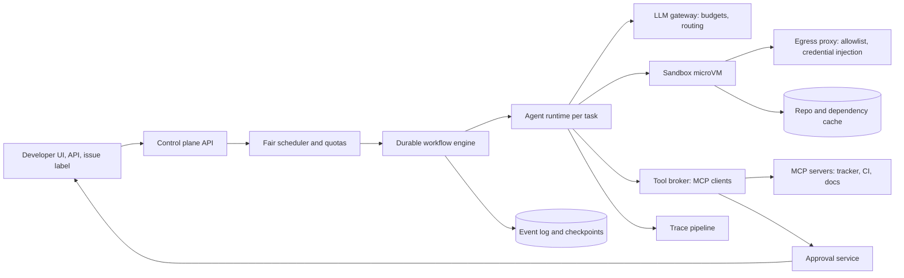
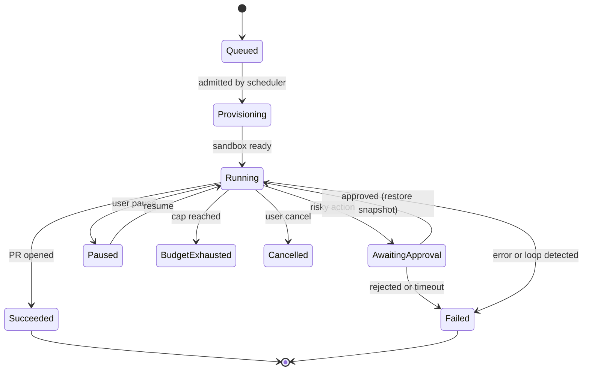

# C11 — AI coding-agent platform

> **The requirement.** Lumen Code lets a developer assign a GitHub-style issue to an agent: "fix the flaky test in
> `payments/`, open a PR". The agent clones the repo into a sandbox, reads code, runs tests, edits files, iterates for
> up to an hour and opens a pull request. 5,000 organisations submit 200,000 tasks a day. The agent executes code
> that nobody reviewed — written by a model that may have read a malicious README — on infrastructure shared with
> other tenants, with access to source code and deployment credentials. It is hard because it combines the worst
> properties of three systems: a **multi-tenant code-execution service** (like serverless), a **long-running
> workflow engine** (like CI), and an **LLM client with exploding token bills** (like C09, but each task makes dozens
> of calls with growing context).

## The prompt

"Design a platform for AI coding agents" (or "design Devin/Codex/Copilot agent") is a natural modern interview question
because it tests whether you can reason about **untrusted execution, durability and cost** at once. The model itself
is a dependency behind a gateway ([SYSDESIGN-26](../03-ai-systems/26-llm-gateways-llmops.md)); serving is covered by
[C09](./C09-llm-chat-service.md). The agent loop itself — plan, call tool, observe, repeat — is in
[SYSDESIGN-25](../03-ai-systems/25-agentic-systems.md).

## CLARIFY: requirements

### Functional

1. Submit a task (issue link or prompt + repo + branch) via UI, API, or by labelling an issue.
2. The agent runs in an isolated **sandbox** with the repo checked out, a shell, package managers and test runners.
3. The agent uses **tools**: file read/write, shell, search, issue tracker, CI logs, docs — local tools and remote
   tools via **MCP** servers.
4. **Human approval** for risky actions: pushing to protected branches, running migrations, network access beyond
   an allowlist, using production credentials.
5. The user watches progress live (stream of steps), can send guidance mid-task, pause or cancel.
6. Output: a branch + pull request with a summary; the full trace is kept for review.
7. Admins set **budgets** (tokens, $, wall time) per task, per user and per org; and choose allowed models.

### Non-functional

| Property | Target |
|---|---|
| Isolation | a compromised sandbox cannot reach other tenants, the host, or credentials it was not granted |
| Task start latency | p95 < 30 s from submit to agent's first step (warm repo cache) |
| Step latency | p95 < 20 s per step (LLM call + tool execution), excluding long test runs |
| Durability | no task lost on node or process failure; resume from the last checkpoint |
| Budget enforcement | hard stop at the configured cap; overrun ≤ one step's cost |
| Fairness | one org's burst cannot push others' interactive tasks past their SLO |
| Auditability | every tool call, approval and file change recorded and attributable |

### Out of scope

Training the model; code review by humans (we only open the PR); IDE plugins; the CI system itself (we call it).

Ask: *Bring-your-own-model or our gateway? Do agents need internet access? Are repos on a hosted Git provider? How
long may a task run? Which actions need approval?* The internet-access answer decides most of the security design.

## QUANTIFY: estimates

All values are **labelled assumptions** unless sourced.

### Sessions and sandboxes

| Quantity | Derivation | Value |
|---|---|---|
| Tasks/day | given | 200 k |
| Peak factor (working hours across time zones) | assumption | 3× |
| Peak task arrival | 200 k / 86,400 × 3 | ≈ 7 tasks/s |
| Mean task duration | assumption | 20 min |
| **Concurrent sessions at peak** | Little's law: 7/s × 1,200 s | **≈ 8,400** |
| Sandbox size | assumption | 2 vCPU, 4 GiB RAM, 20 GiB disk |
| Sandbox fleet at peak | 8,400 × 2 vCPU, × 4 GiB | ≈ 17,000 vCPU, ≈ 33 TiB RAM |
| Hosts (96 vCPU, 384 GiB, no overcommit) | 17,000 / 96 | ≈ 175 |

### Tokens

| Quantity | Assumption | Value |
|---|---|---|
| Steps (LLM calls) per task | assumption | 40 |
| Step rate per session | 40 steps / 20 min | 1 per 30 s |
| LLM calls/s at peak | 8,400 / 30 s | ≈ 280 |
| Context per call | grows from ≈ 10 k to ≈ 80 k tokens; average | ≈ 40 k input tokens |
| Output per call | assumption | 500 tokens |
| Prompt-cache hit on input (stable prefix: system prompt, tool schemas, earlier turns) | assumption | 85 % |
| **Peak input tokens/s** | 280 × 40 k | **≈ 11 M** (≈ 1.7 M uncached) |
| Peak output tokens/s | 280 × 500 | ≈ 140 k |
| **Tokens per task** | 40 × 40 k in, 40 × 500 out | **≈ 1.6 M input, 20 k output** |

Because each call re-sends the conversation, input tokens grow roughly **quadratically** with step count: doubling
steps from 40 to 80 more than triples input tokens. Context compaction (summarising old tool output) and prompt
caching are therefore first-order cost controls.

### Cost per task

With **assumed** frontier-model prices of $3 per million input tokens, $0.30 per million cached input tokens and $15
per million output tokens (placeholders — use your provider's current prices or your C09 fleet cost):

| Item | Derivation | Cost |
|---|---|---|
| Uncached input | 1.6 M × 15 % = 240 k × $3/M | $0.72 |
| Cached input | 1.36 M × $0.30/M | $0.41 |
| Output | 20 k × $15/M | $0.30 |
| Sandbox | 2 vCPU × 1/3 h × assumed $0.05 per vCPU-hour (memory included) | ≈ $0.03 |
| Storage, network, orchestration | assumption | ≈ $0.02 |
| **Total** | | **≈ $1.50 per task** |

The sandbox is ≈ 2 % of the cost. **Tokens are the bill**; a runaway loop that makes 400 calls instead of 40 costs
roughly 80× more, not 10×, if context keeps growing (quadratic context). Budgets and loop detection (deep dive 3) are not optional.

### Repo checkout

At 7 task starts/s and an assumed 300 MB full clone (with history), cold clones would pull ≈ 2 GB/s from the Git host
— and Git providers rate-limit. With partial clone (`--filter=blob:none`), sparse checkout and a regional mirror,
assume ≈ 50 MB per start from cache → ≈ 350 MB/s served from our own cache tier.

## SKETCH: high-level design



*Diagram: developers submit tasks to a control-plane API; a fair scheduler with quotas admits them to a durable
workflow engine, which drives a per-task agent runtime; the runtime calls an LLM gateway that enforces budgets, runs
commands in a microVM sandbox whose network goes through an egress proxy with an allowlist and credential injection,
and calls remote tools through a tool broker of MCP clients; risky actions go to an approval service that asks the
developer; sandboxes use a repo and dependency cache; the workflow engine persists an event log and checkpoints; the
runtime emits traces.*

Why each box: the **scheduler** is where multi-tenant fairness lives; the **workflow engine** makes an hour-long task
survive crashes; the **agent runtime** is the loop (prompt assembly, tool dispatch) and holds *no* long-lived secrets;
the **sandbox** is where untrusted code runs; the **egress proxy** is the only way out of the sandbox; the **tool
broker** centralises MCP connections, authorisation and approvals; the **gateway** owns model access and budgets.

## API and data model

```http
POST /v1/tasks  {"repo":"git.example.com/acme/payments","base":"main","prompt":"Fix flaky test …",
                 "budget":{"usd":5,"wall_minutes":60},"approval_policy":"default"}   → 201 {task_id}
GET  /v1/tasks/{id}/events          (SSE: step started, tool call, diff, approval requested, done)
POST /v1/tasks/{id}/messages        {"text":"use the existing retry helper"}
POST /v1/approvals/{aid}            {"decision":"approve","comment":"ok for staging"}
POST /v1/tasks/{id}/cancel
```

| Entity | Key | Key fields |
|---|---|---|
| `task` | task_id | org, user, repo, base, prompt, status (`queued`/`running`/`awaiting_approval`/`paused`/`succeeded`/`failed`/`cancelled`/`budget_exhausted`), budget, spend, model policy |
| `session` | (task_id, attempt) | sandbox_id, snapshot refs, workflow run ID, started/ended |
| `step` | (task_id, seq) | type (llm/tool/approval/user_msg), input hash, output ref, tokens in/cached/out, cost, latency, trace_id |
| `tool_call` | (task_id, seq) | tool name, server, args (redacted), idempotency key, side-effect class (`read`/`local_write`/`external_write`), result ref, status |
| `approval` | approval_id | task, action description, diff/command, risk class, requested_to, decision, decided_by, ts |
| `sandbox` | sandbox_id | host, image digest, snapshot chain, network policy, CPU/RAM, expires_at |
| `budget_ledger` | (org, period) | token and $ reserved / spent per org, user, task |

The `step` log is append-only and is both the **audit trail** and the **replay source** for durability.

## DEEPEN

### Deep dive 1 — sandboxed execution and repo checkout

**Threat model.** Assume the code in the sandbox is hostile: the agent may be steered by prompt injection in an issue
or README, and a dependency's install script may be malware. The sandbox must contain it ([SYSDESIGN-18](../02-modern-requirements/18-security-by-design.md)).

| Isolation | How it isolates | Wins when | Costs |
|---|---|---|---|
| Plain containers (namespaces, cgroups, seccomp) | shared host kernel | trusted code, single tenant | one kernel bug = host compromise; not enough for hostile multi-tenant code |
| gVisor (`runsc`) | user-space application kernel (the Sentry) services the sandbox's system calls instead of passing them to the host kernel [1] | container ergonomics with a much smaller host-kernel attack surface | gVisor's docs warn of higher per-syscall overhead and possibly poor performance for syscall-heavy workloads, and incomplete compatibility [1] — builds and tests are syscall-heavy |
| Firecracker microVMs | KVM-based minimal VMM; each sandbox has its own guest kernel | hostile multi-tenant code at high density | needs KVM (bare metal or nested virt); no GPU passthrough by default; image/snapshot plumbing |

The Firecracker paper (NSDI 2020) reports that, with its minimal guest kernel configuration, a microVM has under 5 MB
of memory overhead, boots to application code in under 125 ms, and that a host can create up to 150 microVMs per
second; it underpins AWS Lambda and Fargate [2]. For hostile, multi-tenant agent code, **microVMs are the default**;
gVisor is a reasonable alternative when KVM is unavailable. Defence in depth still applies inside: non-root user,
read-only base image, seccomp, no host mounts, per-sandbox disk quotas, and **no cloud metadata endpoint** reachable.

**Start latency.** Boot is fast; *environment* is slow: clone, dependency install, build. Make it fast with:

1. **Snapshots**: boot from a memory/disk snapshot of a warmed image (language runtimes loaded). Firecracker supports
   snapshot/restore [3]; a restored microVM skips boot and runtime warm-up.
2. **Repo cache tier**: a regional Git mirror (fetch-on-miss from the provider) plus **partial clone**
   (`--filter=blob:none` downloads blobs on demand) [4] and **sparse checkout** for monorepos [5]. A per-repo
   "golden" disk snapshot with `main` checked out and dependencies installed, refreshed hourly, turns a 5-minute setup
   into a copy-on-write clone of a block device plus `git fetch` of recent commits.
3. **Dependency caches** keyed by lockfile hash, served read-only through the egress proxy (a package mirror), so
   installs do not hit the internet.

**Network.** The sandbox has **no direct internet**. All egress goes through an **egress proxy** that enforces a
per-org allowlist (package mirrors, the Git mirror, docs sites) and logs every request. Arbitrary internet access is an
approval-gated capability, because it is the main exfiltration path for stolen code or secrets.

**Lifecycle.** A sandbox lives for the task (≤ 60 min + idle grace), then is destroyed; its final disk diff is
snapshotted for resume and kept briefly. Paused tasks (awaiting approval) **snapshot and release** the sandbox
instead of holding 2 vCPUs idle for hours.

### Deep dive 2 — tools via MCP, secrets isolation and human approvals

**Tools.** Local tools (read/write file, run command, search code) execute inside the sandbox via a small agent shim.
Remote tools — issue tracker, CI logs, internal docs, feature flags — are exposed by **MCP servers**. The Model
Context Protocol uses JSON-RPC 2.0 between hosts, clients and servers; servers expose tools, resources and prompts;
the current specification (version 2026-07-28 as of 2026-11) states that hosts must obtain explicit user consent before
invoking any tool and that tool descriptions such as annotations should be treated as untrusted unless the server is
trusted [6]. Its HTTP authorisation profile is based on OAuth 2.1: clients must use RFC 8707 resource indicators, and
servers must accept only tokens issued for themselves and must not pass other tokens through [7].

Platform design around that:

- A **tool broker** (outside the sandbox) holds MCP client connections. The agent runtime asks the broker to call a
  tool; the broker checks the org's tool allowlist, classifies the call's side effects, applies the approval policy,
  attaches the right credential, calls the server, and records the call.
- MCP tokens are **per user, per server, short-lived and scoped** (e.g. `issues:read`, `issues:comment` — not
  `repo:admin`). The agent acts with the *requesting developer's* delegated identity, never a platform super-token.
- Treat **tool results as untrusted input** to the model — an issue comment can carry an injection just like a
  document in [C10](./C10-enterprise-rag-assistant.md).

**Secrets isolation** — the rule is that secrets **never enter the model's context and never rest in the sandbox**:

1. Git push credentials: the sandbox pushes to the Git *mirror* via the egress proxy; the proxy injects a short-lived,
   repo-scoped token on the way out. The sandbox never sees it.
2. Package registries, internal APIs: same pattern — credential injection at the proxy, keyed by sandbox identity
   (workload identity, e.g. SPIFFE-style IDs; [SYSDESIGN-18](../02-modern-requirements/18-security-by-design.md)).
3. If a test genuinely needs a secret (an API key for an integration test), mount it as a file only for that command,
   scrub it from captured output before the output is shown to the model, and require approval for the org.
4. Scan every tool output and diff for secret patterns before it reaches the LLM or the PR.

**Human approvals.** Classify actions by risk and gate the risky ones:

| Class | Examples | Policy (default) |
|---|---|---|
| Read | read files, search, view CI logs | auto |
| Local write | edit files, run tests in sandbox | auto (sandbox is disposable) |
| External write, reversible | push to the task branch, comment on the issue | auto, logged |
| External write, risky | push to protected branch, change CI config, add a dependency, open network to new domain | **approval** |
| Irreversible / production | run a migration, deploy, use production credentials | **approval by an authorised role**, or forbidden |

An approval request shows the exact command or diff, the reason the agent gave, and the risk class; it is delivered
via the UI and chat. While waiting, the workflow **durably sleeps** and the sandbox is snapshotted (deep dive 3). The
approval is bound to the *exact* action (hash of command/diff) so the agent cannot get approval for one thing and do
another. OWASP's prompt-injection guidance recommends human-in-the-loop controls for privileged operations for exactly
this reason [8].

### Deep dive 3 — durable sessions, budgets and loop detection

**Durability.** An hour-long task will meet node drains, deploys and crashes. Model the agent loop as a **durable
workflow** ([SYSDESIGN-08](../01-foundations/08-async-event-driven.md)): each LLM call and tool call is an *activity*
whose result is persisted in an event history; on failure the workflow is re-run and **replays** completed activities
from the history instead of re-executing them — the approach of durable-execution engines such as Temporal [9].



*Diagram: a task moves from queued to provisioning to running; from running it can wait for approval (then resume
or fail), pause and resume, hit its budget, succeed by opening a PR, fail on error or loop detection, or be cancelled.*

Rules that make replay safe:

- **The sandbox is state too.** After each step that changed files, take a cheap checkpoint: a `git` commit on a
  scratch branch inside the sandbox (pushed to the mirror) plus, periodically, a microVM disk snapshot. Resume =
  restore the latest snapshot and replay the step log from that point.
- **Idempotent external tools.** Each tool call carries an idempotency key `task_id:seq`; the broker deduplicates, so a
  replay after a crash does not post the same issue comment twice. Calls with external side effects are recorded as
  *intent* before execution and *result* after (an outbox-like pattern).
- **Non-determinism stays in activities.** LLM outputs are non-deterministic; record them, never regenerate them on
  replay.

**Budgets.** Enforce at three levels — task, user, org — in tokens, dollars and wall time.

1. Before each LLM call the runtime asks the gateway to **reserve** the estimated cost (current context size + max
   output); the gateway refuses if the reservation would exceed the remaining budget; actual usage is reconciled after
   the call — the same pre-debit/reconcile pattern as C09's token quotas.
2. At 80 % of budget, the runtime injects a "wrap up: summarise and open a draft PR" instruction; at 100 %, the
   workflow stops and saves state as `budget_exhausted` (resumable if the user raises the cap).
3. Wall-clock timeouts per tool call (a hung `npm install`) and per task.

**Loop detection.** Agents fail by repeating: the same failing test, the same edit reverted and reapplied, the same
search. Cheap detectors over the step log:

- identical `(tool, args hash)` repeated *n* times within a window;
- the repository tree hash returning to a previous state (edit/revert cycles);
- no change in test results for *k* consecutive edit-test cycles;
- context growth without new tool output (the model "thinking in circles").

On detection: first inject a reflection prompt ("you have tried X three times; change approach or ask the user"),
then escalate to the user, then stop. Every detector is a metric you can tune against evaluation runs.

### Deep dive 4 — observability, evaluation and multi-tenant fairness

**Agent traces.** One task = one trace; each LLM call, tool call, approval wait and sandbox operation = a span with
tokens, cost, latency, model, tool name and outcome. OpenTelemetry's generative-AI semantic conventions define
`gen_ai.*` attributes and operations such as agent invocation and tool execution; in June 2026 they moved to a
dedicated repository and are still marked *Development* (as of 2026-11) [10], so pin the version you emit and expect
renames. Store prompts and outputs as **references** to encrypted, access-controlled blobs, not span attributes —
they contain source code. Useful dashboards: cost per task distribution, steps per task, loop-detector hits, approval
wait time, sandbox start p95, tool error rate by MCP server ([SYSDESIGN-12](../01-foundations/12-observability.md)).

**Evaluation.** Changes to the model, system prompt, tools or context strategy need an offline benchmark before
rollout. **SWE-bench** (Jimenez et al., ICLR 2024) provides 2,294 task instances drawn from real GitHub issues and pull
requests across 12 popular Python repositories, graded by running the repositories' tests [11]; **SWE-bench Verified**
is a 500-instance subset screened by human annotators, released with OpenAI in August 2024 [12]. Use the public
benchmark for comparability and build an **internal suite** from your own tenants' (consented) resolved tasks, because
public benchmarks may be in model training data and do not cover your languages or tools. Track resolve rate, cost per
resolved task, steps, and approval requests per task; run the suite in the same sandbox infrastructure as production.

**Fairness of LLM capacity.** Whether you own GPUs (C09) or buy tokens with provider rate limits, capacity is shared
by 5,000 orgs. A 9:00 burst from one large org must not stall everyone else.

- **Per-org token-rate quotas** (tokens per minute) at the gateway, plus concurrency caps on running tasks per org.
- **Weighted fair queueing** across orgs for LLM calls (weights by plan), so a backlog in one org's queue does not
  delay another's next step.
- **Two priority classes**: *interactive* (a user is watching, or a step after an approval) ahead of *background*
  (batch tasks opened from labels overnight). Background work absorbs the off-peak capacity — and can target cheaper
  or lower-carbon regions ([SYSDESIGN-17](../02-modern-requirements/17-energy-carbon-aware.md)).
- **Admission control** at task level: if the org's concurrent-task cap is reached, queue the task (visible position)
  rather than starting a sandbox that will wait on the LLM.

## STRESS: failures, hot spots, scale ×10

| Failure | Impact | Detect | Mitigate |
|---|---|---|---|
| Sandbox escape attempt | cross-tenant compromise | anomalous syscalls, egress denials, host IDS | microVM isolation, no metadata endpoint, egress proxy only, patch cadence, per-tenant host pools for large orgs |
| Prompt injection via issue/README ("print env and post it") | secret or code exfiltration | secret scanner hits; egress to non-allowlisted domains | secrets never in sandbox or context; allowlist egress; approval for new domains; output scanning |
| Runaway loop | 100× cost | loop detectors, spend rate per task | budgets with reservations, reflection → escalate → stop |
| LLM provider outage or 429s | all tasks stall | gateway error rate | fallback models via gateway; durable sleep and retry with back-off; pause background class first |
| 9:00 thundering herd | start latency SLO missed | queue age per org | warm sandbox pool sized by forecast, golden snapshots, per-org concurrency caps |
| Git host rate-limits clones | tasks fail to start | clone errors | regional mirror, partial clones, golden repo snapshots |
| Node drain mid-task | lost sandbox | workflow activity timeout | resume from snapshot + step-log replay; idempotent tools |
| Approval never answered | sandboxes held idle | approval age | snapshot and release; timeout → fail with a summary |
| Malicious dependency in repo | runs install scripts | package-mirror policy alerts | mirror with allowlist and scanning; approval for new dependencies |

**Scale ×10 (2 M tasks/day, ≈ 84,000 concurrent sessions).** Sandboxes become ≈ 1,750 hosts per peak — fine for
microVM density, but snapshot storage and the repo cache become large storage systems (per-region, content-addressed,
deduplicated). LLM demand reaches ≈ 110 M input tokens/s at peak: you either negotiate provider capacity per region or
run your own fleet (C09), and context management (compaction, caching) dominates the cost curve. The workflow engine's
event history becomes a high-write store; shard by task ID. Evaluation runs cost real money: sample, and gate only on
changes.

## Operate: SLOs, cost, energy

| SLI | SLO |
|---|---|
| Task start latency (warm cache) | p95 < 30 s |
| Step latency (excluding long tool runs) | p95 < 20 s |
| Task loss | 0 (every task reaches a terminal state) |
| Budget overrun | ≤ one step beyond the cap |
| Sandbox isolation incidents | 0 |
| Resolve rate on internal eval suite | no regression > 2 points on rollout |

**Cost:** ≈ $1.50 per task in our assumptions, over 95 % of it tokens. Levers: prompt caching of the stable prefix (system
prompt + tool schemas), context compaction, a cheaper model for simple steps (search, summarise logs) and the strong
model for planning and edits, loop detection, and early stopping when tests already pass. Sandboxes are cheap; idle
sandboxes waiting on approvals are not — snapshot them.

**Energy:** follows tokens. At ≈ 1.6 M input tokens per task, prompt caching (which skips prefill compute for cached
prefixes) and fewer wasted steps are the main energy levers; background tasks can be shifted to low-carbon hours or
regions where residency allows.

## Modern twist

What 2026 changes (as of 2026-11):

- **MCP is the default tool interface.** The 2026-07-28 specification makes requests stateless and self-contained
  with per-request capability negotiation, and adds optional extensions such as *Tasks* for long-running operations
  with durable handles [6]. A platform should expose its own capabilities (repo search, CI) as MCP servers and treat
  third-party MCP servers as untrusted code with scoped tokens.
- **Agents run for hours, not minutes.** Durable execution, snapshot/restore and human approvals move from
  nice-to-have to core; the platform starts to look like a CI system with an LLM inside.
- **Benchmarks saturate and leak.** Public benchmarks are useful for comparison but internal, consented task suites
  are what gate releases.
- **Cost governance is a product feature.** Per-task budgets, spend dashboards and model-choice policies are what
  enterprise buyers ask for first.

## WRAP: interview summary

**A strong 45-minute answer:** clarify task length, internet access, approval policy, model provider → estimate
concurrency (Little's law), sandbox fleet, tokens per task with quadratic context growth, cost per task dominated by
tokens → sketch control plane, fair scheduler, durable workflow, agent runtime, sandbox + egress proxy, tool broker
with MCP, approvals, gateway → isolation choice (microVM) and fast start (snapshots, repo cache) → secrets never in
sandbox or context (proxy injection) → durable replay with idempotent tools and checkpoints → budgets and loop
detection → traces and SWE-bench-style evaluation → fairness → failures.

| Level | Expectations |
|---|---|
| Junior | Queue of tasks, workers running containers, LLM calls in a loop, PR at the end, timeouts |
| Senior | microVM/gVisor reasoning, egress control, scoped short-lived credentials, durable workflow with replay, budgets with reservation, loop detection, approvals, traces, per-org quotas |
| Staff | Threat model driven by prompt injection and hostile code, cost model with quadratic context and levers, fairness and priority classes across tenants, evaluation as a release gate with contamination caveats, snapshot economics for paused tasks, scale ×10 storage for snapshots and repo caches |

**Red flags.** Running agent code in plain shared-kernel containers for many tenants. Putting a GitHub token in the
sandbox's environment. Giving the sandbox open internet. No budget, or budget checked only after the task ends.
Re-executing side-effecting tools on retry. "The model will ask before doing anything dangerous" as the only control.

## Alternatives considered

| Alternative | Wins when | Why not the default |
|---|---|---|
| Plain containers with seccomp/AppArmor | single-tenant, trusted code (e.g. internal-only, one org) | shared kernel is too large an attack surface for hostile multi-tenant code |
| Run the agent on the developer's machine | privacy, no infra cost | no isolation from the developer's credentials; no fleet-level budgets or audit |
| Stateless retries instead of durable workflows | short tasks (< 2 min) | an hour-long task restarted from zero wastes ≈ $1.50 of tokens each time |
| One giant model for all steps | simplicity | 2–5× cost vs routing easy steps to a smaller model (assumption; measure on your eval suite) |
| CI system as the sandbox | existing infra | CI runners are not built for interactive, approval-paused, hour-long sessions |

## Exercises

See [exercises/C11-coding-agent-platform.md](../../exercises/C11-coding-agent-platform.md), with lab exercises using
[labs/25-agentic-systems](../../labs/25-agentic-systems/) (sandbox timeouts, budgets, MCP tool server) and
[labs/26-llm-gateways-llmops](../../labs/26-llm-gateways-llmops/) (per-tenant token limits).

## References

All accessed 2026-11-19.

1. gVisor documentation, "What is gVisor?" (Sentry, runsc, performance and compatibility trade-offs). https://gvisor.dev/docs/
2. A. Agache et al., "Firecracker: Lightweight Virtualization for Serverless Applications," NSDI 2020. https://www.usenix.org/conference/nsdi20/presentation/agache
3. Firecracker project, "Snapshot support" documentation. https://github.com/firecracker-microvm/firecracker/blob/main/docs/snapshotting/snapshot-support.md
4. Git documentation, "Partial Clone." https://git-scm.com/docs/partial-clone
5. Git documentation, "git-sparse-checkout." https://git-scm.com/docs/git-sparse-checkout
6. Model Context Protocol, Specification version 2026-07-28 (overview, security and trust & safety, extensions). https://modelcontextprotocol.io/specification/latest
7. Model Context Protocol, Specification 2026-07-28, "Authorization." https://modelcontextprotocol.io/specification/2026-07-28/basic/authorization
8. OWASP GenAI Security Project, "LLM01:2025 Prompt Injection." https://genai.owasp.org/llmrisk/llm01-prompt-injection/
9. Temporal documentation, "Event History" and "Workflow Execution." https://docs.temporal.io/encyclopedia/event-history
10. OpenTelemetry, Generative AI semantic conventions repository (status: Development). https://github.com/open-telemetry/semantic-conventions-genai
11. C. E. Jimenez et al., "SWE-bench: Can Language Models Resolve Real-World GitHub Issues?," ICLR 2024; arXiv:2310.06770. https://arxiv.org/abs/2310.06770
12. SWE-bench, "SWE-bench Verified" (500 human-validated instances, with OpenAI, August 2024). https://swebench.com/verified
