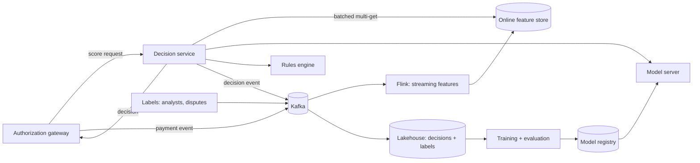
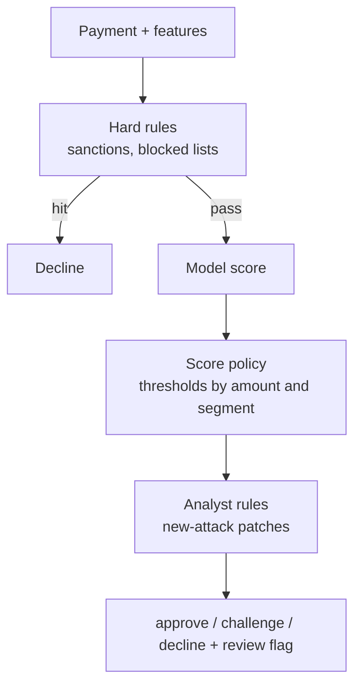

# C12 — Real-time fraud detection (and recommendations)

## The prompt

> "Design the fraud-scoring service for a card payment processor. Every authorization request must get an
> approve / challenge / decline decision before the processor responds to the card network. Fraudsters adapt
> quickly, and labels arrive late. Then: how would the same platform serve real-time recommendations?"

We use a fictional processor, **Lumen Pay** (`pay.example.com`). The architecture borrows its feature and
model lifecycle from [SYSDESIGN-27](../03-ai-systems/27-ml-platforms.md) and its streaming core from
[SYSDESIGN-20](../02-modern-requirements/20-real-time-streaming.md). This case focuses on what fraud makes hard:
**an inline latency budget, an adversary, and labels that arrive weeks after the decision.**

## CLARIFY: requirements (functional / non-functional / out of scope)

**Questions worth asking (and the answers we assume):**

- *Inline or after the fact?* Inline: the decision is part of the authorization response.
- *Decisions?* Approve, challenge (step-up authentication such as 3-D Secure), or decline. Separately, queue
  for analyst review.
- *Who sets the latency budget?* The card network and the issuer set the end-to-end time. We assume our fraud
  service gets **p99 ≤ 100 ms** and set an internal target of **p99 ≤ 50 ms** to leave headroom. *This is an
  assumption, not a network rule.*
- *What does an error cost?* A missed fraud costs the transaction amount plus fees. A false decline costs the
  sale and the customer's trust. The costs are asymmetric and amount-dependent.
- *Labels?* Analysts confirm a few alerts within hours. Most labels come from cardholder disputes, or by default
  after a waiting period with no dispute.

**Functional requirements**

1. Score each payment and return a decision, a score, reason codes, and the model and rule versions used.
2. Maintain real-time features per card, merchant, device, IP and account (velocity, amounts, geography).
3. Let risk analysts author, test, shadow and roll out rules without a deploy.
4. Ship new models through shadow → canary → champion, with instant rollback.
5. Feed analyst outcomes and disputes back as labels.
6. Explain any decision later: features, rule hits, model version, top contributing factors.

**Non-functional requirements**

| Requirement | Target (assumption) |
|---|---|
| Throughput | 3,000 payments/s average, 15,000/s peak |
| Decision latency | p99 ≤ 50 ms internal, ≤ 100 ms contract |
| Availability | 99.99% for the decision API (a fallback decision counts as available) |
| Feature freshness | Velocity features reflect events within ≤ 1 s at p99 |
| Auditability | Every decision reproducible from its log entry |
| Durability | No lost decision-log or label events |

**Out of scope:** the ledger and settlement ([C06](C06-payments-ledger.md)), card-network protocols, KYC
onboarding, and the analyst case-management UI (beyond its feedback events).

## QUANTIFY: estimates

All numbers are labelled assumptions unless sourced.

**Traffic.** 3,000 payments/s × 86,400 s ≈ **260 M payments/day**. Peak 15,000/s (5× average, assumed holiday
peak).

**Event stream.** About 2 KB per enriched payment event: 3,000 × 2 KB = 6 MB/s average, 30 MB/s peak. With
7-day Kafka retention: 6 MB/s × 604,800 s ≈ 3.6 TB, ×3 replication ≈ **11 TB** of broker storage.

**Online feature store.** Entities: 300 M active cards × 60 features, 10 M merchants × 200 features, 500 M
device/IP keys × 20 features, at 8 B per value:
- cards 144 GB, merchants 16 GB, devices/IPs 80 GB → 240 GB raw;
- ×1.5 for keys and overhead ≈ 360 GB; ×3 replicas across zones ≈ **~1.1 TB of RAM** (or SSD-backed KV).

**Feature writes.** Each payment updates about 20 aggregates across its entities: 3,000 × 20 = **60,000
writes/s** average, 300,000/s at peak. Writes, not reads, size the store. That is why streaming aggregation
pre-combines updates before writing (below).

**Feature reads.** One batched multi-get per entity group, about 5 groups per payment: 15,000 × 5 = **75,000
reads/s** at peak.

**Decision log.** About 3 KB per decision (feature snapshot, rule hits, score, reason codes, versions):
260 M × 3 KB ≈ **780 GB/day** uncompressed. Assuming 5× columnar compression, that is about 57 TB/year. This log
*is* the training set. Logging served features eliminates training-serving skew (Zinkevich Rule #29 [1];
[SYSDESIGN-27](../03-ai-systems/27-ml-platforms.md)).

**Analyst capacity.** Assume 150 analysts × 80 cases/day = **12,000 reviews/day**, or about 0.005% of
payments. Review capacity, not the model, sets the review threshold. Dal Pozzolo et al. measure fraud
detection by *alert precision*, the proportion of frauds among the k alerts investigators can actually check
[2].

**Class balance.** Assume a fraud rate of 0.1%: about 260,000 fraudulent payments/day among 260 M. Accuracy is
meaningless here (99.9% by approving everything). Use precision at the alert budget, recall weighted by amount,
and the false-decline rate.

## SKETCH: high-level design (Mermaid)


*Diagram: the authorization gateway asks the decision service for a score. The decision service fetches
features from the online store, calls the model server and the rules engine, and returns a decision. Payment
and decision events go to Kafka. Flink computes streaming features into the online store, and the lakehouse
stores decisions and labels. Training reads the lakehouse and registers models, which the model server loads.*

Why each box is here:

- **Decision service:** one place that owns the latency budget, the fallbacks and the decision log. It
  orchestrates and does no heavy computation.
- **Online feature store:** velocity features must be precomputed. Computing "payments on this card in the last
  10 minutes" at request time would mean a range scan on the hot path.
- **Flink:** event-time windows with watermarks make velocity features correct under out-of-order events [3].
- **Rules engine:** analysts react to a new attack within hours. Retraining takes days.
- **Model server + registry:** versioned models with shadow, canary and rollback via aliases
  ([SYSDESIGN-27](../03-ai-systems/27-ml-platforms.md)).
- **Kafka + lakehouse:** a replayable log of what happened, the source for features, training and audit
  ([SYSDESIGN-08](../01-foundations/08-async-event-driven.md)).

## API and data model

**Decision API (synchronous, internal):**

```http
POST /v1/risk/decisions
Idempotency-Key: 7f3c…               # the authorization attempt ID
{
  "payment_id": "pay_123", "amount_minor": 12999, "currency": "EUR",
  "card_token": "tok_…", "merchant_id": "m_42", "mcc": "5732",
  "device_id": "d_9", "ip": "198.51.100.7", "channel": "ecom",
  "ts": "2026-11-19T10:15:03.120Z"
}
→ 200
{
  "decision": "challenge",                 # approve | challenge | decline
  "score": 0.83,
  "reason_codes": ["VELOCITY_CARD_10M", "NEW_DEVICE", "GEO_MISMATCH"],
  "rule_hits": ["r_1187:challenge"],
  "model": "fraud-gbdt@champion=v57", "rules_version": "2026-11-18.3",
  "fallback": false, "latency_ms": 21
}
```

Idempotency matters because the gateway retries. The same attempt must get the same decision, and it must not
double-count velocity features.

**Payment event (Kafka topic `payments.v1`, key = `card_token`):** payment fields + `event_time` +
`ingest_time`.

**Online feature keys:** `card:{token}`, `merchant:{id}`, `device:{id}`, `ip:{/24 prefix}`. Each value is a small
record of aggregates, for example `{cnt_1m, cnt_10m, cnt_1h, amt_sum_1h, distinct_merchants_24h, last_country,
updated_at}`.

**Decision log (`decisions.v1` → lakehouse table, partitioned by date):**

| Column | Purpose |
|---|---|
| payment_id, ts, decision, score | Join with labels; outcomes |
| features (struct snapshot) | Train on what was served; explain |
| rule_hits, rules_version | Rule performance; audit |
| model_version, shadow_scores (map version → score) | Champion/challenger comparison |
| reason_codes, top_contributions | Explanations |
| fallback flags, latency_ms | Operations |

**Labels (`labels.v1`):** `payment_id, label (fraud | genuine), source (analyst | dispute | default_after_wait),
label_time`. Keeping `label_time` separate from the event time is what lets training be point-in-time correct.

## DEEPEN: 2–4 deep dives

### Deep dive 1 — Streaming velocity features that are correct and cheap

A velocity feature such as `cnt_10m(card)` is a windowed count keyed by card. Design points:

- **Event time, not processing time.** Mobile and offline payments arrive late or out of order. Flink's
  watermarks track event-time progress. By default, elements arriving after the watermark passes the window end
  are dropped. Allowed lateness keeps window state alive so that late elements can still update the result [3].
  Pick allowed lateness from measured lateness percentiles. Route anything later to a side output and into the
  batch backfill.
- **Window shape.** Tumbling windows are cheap but jumpy ("10 minutes" resets at :10). Sliding windows are
  smooth but cost (size ÷ slide) window copies per element [3]. A common compromise: keep per-minute tumbling
  buckets in keyed state and sum the last N buckets at write time, which gives a sliding feel with N small
  updates.
- **Pre-aggregate before writing.** Writing every increment to the online store makes the store's write path
  the bottleneck (300,000/s at peak above). Flink accumulates in state and flushes each key's updated record
  every ~200–500 ms (an assumption to tune against the freshness SLO). Hot keys (a large merchant) collapse to
  one write per flush.
- **Read-your-own-payment.** A burst of card-testing attempts arrives within a second. If a payment's own
  predecessor is not yet in the store, the velocity count lags. Mitigation: the decision service also keeps a
  tiny in-memory recent-events cache per card on the instance that handles that card (consistent-hash routing
  by card token), or the feature includes "events seen by the decision service in the last 5 s".
- **Backfill with the same code.** New features need history for training. Run the same Flink job over the
  Kafka or lakehouse history (bounded mode), then verify on the overlap with the live values. This is the
  "define once, materialize twice" rule from [SYSDESIGN-27](../03-ai-systems/27-ml-platforms.md).

### Deep dive 2 — The latency budget and the fallbacks

**Per-hop p99 budget (internal target 50 ms):**

| Hop | p99 budget | Notes |
|---|---|---|
| Ingress, auth, parse | 3 ms | Same-zone call from the gateway |
| Enrichment (BIN table, geo-IP) | 2 ms | In-process lookup tables, refreshed hourly |
| Feature fetch (5 groups, parallel, batched) | 10 ms | p99 target; hard timeout 12 ms per group bounds the tail, overrun counts against the slack |
| Model inference (GBDT, ~300 features, CPU) | 5 ms | Same host or sidecar, no network hop |
| Shadow models | 0 ms on the critical path | Scored asynchronously after responding |
| Rules evaluation | 2 ms | Compiled rules, in-process |
| Decision log publish | 0 ms on the critical path | Async producer, local buffer |
| **Sum** | **22 ms** | Leaves ~28 ms for tail amplification, GC and retries |

*All figures are assumptions for design, to be validated with load tests.*

**Tail amplification.** If each of 5 parallel feature calls independently exceeds its own p99 1% of the time,
then the chance that at least one exceeds it is 1 − 0.99⁵ ≈ **4.9%**. Your "p99" feature fetch is now a p95.
Mitigations: fewer, batched calls (one multi-get per shard); hedged requests after the p95; and co-locating
feature groups so that most payments need two calls, not five
([SYSDESIGN-11](../01-foundations/11-reliability-engineering.md)).

**Fallbacks (decided in advance, per dependency):**

| Dependency down / slow | Fallback | Rationale |
|---|---|---|
| One feature group | Use defaults plus a `missing_<group>` indicator feature; the model is trained with dropout on that indicator | Degrade gracefully, never silently |
| Online feature store entirely | Rules-only decision on request fields; challenge above an amount threshold | Bounded risk |
| Model server | Rules-only with a conservative profile | Rules are in-process |
| Decision service itself | The gateway applies a static policy (approve below €X, otherwise challenge) | The gateway must never wait forever |

The fallback flag goes into the decision log. Fallback rate is an SLI.

### Deep dive 3 — Rules + ML, shadow and canary

Why both? Dal Pozzolo et al. describe exactly this split in a real fraud-detection system. Investigators keep
adding ad hoc blocking or scoring rules to counter new attacks, and remove rules that cause too many false
alerts. The data-driven model cannot be edited by investigators and is retrained from recent labels, typically
once a day [2].


*Diagram: a payment first passes hard rules such as sanctions and block lists, which decline on a hit. Otherwise
the model scores it, a score policy applies thresholds by amount and segment, and analyst rules can patch the
result, producing approve, challenge or decline plus an optional review flag.*

- **Hard rules** run first: legal and contractual constraints that no model may override.
- **The model** produces a calibrated probability. The **score policy** turns it into an action, with thresholds
  by amount band and segment, because a false decline on €5 and a missed fraud on €5,000 have different costs.
- **Analyst rules** patch new attack patterns quickly, and each rule is tracked for precision and volume.
- Stripe's Radar documents the same building blocks in its product: rules that block, review, allow or request
  3-D Secure, default rules based on its ML risk levels, and the warning that allow rules override other rules
  [4].

**Shadow and gradual rollout.** Radar's documentation describes *traffic allocation* for custom rules. A rule at
5% acts on 5% of matching payments, and 0% is a shadow mode that "evaluates the rule and reports what would have
happened without applying the rule's action". Retries of the same transaction are kept in the same bucket [4].
Apply the same discipline to both rules and models:

1. **Shadow:** score 100% of traffic, act on 0%. Compare score distributions, alert volumes and (later) labels.
2. **Canary:** act on 1–5% of traffic, bucketed by card or customer so that retries are consistent.
3. **Champion/challenger:** promote by moving the registry alias. Keep the old champion warm for instant
   rollback ([SYSDESIGN-27](../03-ai-systems/27-ml-platforms.md)).

Shadow is safe for latency because shadow scores are computed *after* the response, from the same feature
snapshot.

### Deep dive 4 — Labels arrive late, and the model chooses its own training data

**Two kinds of labels.** Dal Pozzolo et al. distinguish investigators' *feedbacks* (few, recent, about the
transactions the system alerted on) from *delayed supervised samples* (the vast majority, available after
several days, "e.g., one month", including disputed transactions and transactions assumed genuine after a
period without dispute) [2]. They show that feedbacks are a biased training set: they over-represent likely
frauds, and their fraud proportion differs from everyday traffic. Their proposed strategy trains separate
classifiers on feedbacks and on delayed samples and then combines them [2].

**Design consequences:**

- **Point-in-time training.** A training example for a payment at time t uses the *logged* features at t. Its
  label is whatever is known at the training cutoff, with label time recorded. Never use "fraud" labels that
  were not knowable at the evaluation date when you backtest.
- **Maturity windows.** Evaluate a model on a week only after that week's labels have matured. Use feedback-based
  metrics for early warning only.
- **Selection bias from blocking.** A declined payment never becomes a dispute, so you never learn whether it
  was fraud. Each retrain then sees fewer examples of what the model blocks. Mitigations: a small,
  **amount-capped exploration slice**, where borderline payments are challenged instead of declined (the
  step-up result is itself a label); and logging the decision probability so that offline evaluation can
  reweight.
- **Adversarial drift.** Fraudsters probe the system (card testing: many small payments) and adapt. Watch
  segment-level score drift daily and rule-hit-rate spikes hourly. Keep analyst rules as the fast loop and daily
  retraining as the slower loop [2].

### Variant — the same skeleton for real-time recommendations

| Aspect | Fraud | Recommendations |
|---|---|---|
| Decision | Approve / challenge / decline one payment | Rank ~50 items out of millions |
| Model shape | One model scores one event (GBDT or NN) | Funnel: candidate generation → ranking [5], often two-tower retrieval [6], plus a common re-ranking stage for diversity (unsourced) |
| Latency budget | p99 ≤ 100 ms (assumed contract) | p99 ~100–200 ms for a page (assumption) |
| Streaming features | Velocity per card, merchant, device | Session features: last N items viewed, dwell, category affinity |
| Labels | Weeks (disputes) | Seconds to minutes (clicks, watches) |
| Feedback loop | Blocked payments never get labels | Unshown items never get clicks (popularity bias) |
| Error cost | Money and customer trust | Engagement, diversity, creator fairness |
| Explanation need | Reason codes for analysts, customers, regulators | "Because you watched…", usually optional |

What changes in the architecture: an ANN index of item embeddings is added on the hot path (two-tower
retrieval, [SYSDESIGN-24](../03-ai-systems/24-retrieval-vector-systems.md)), ranking needs features for
hundreds of candidates per request (batched multi-gets and local item caches), and exploration slots replace
the fraud exploration slice. The streaming feature pipeline, the decision log, shadow/canary rollout and the
registry stay identical. One platform, two products.

## STRESS: failures, hot spots, scale ×10

**Card-testing attack.** 50,000 small payments in about 10 s from a bot farm against one merchant (≈ 5,000/s, a
third of the 15,000/s peak, on one merchant key; an assumed scenario). Velocity features per merchant and IP spike. Flink pre-aggregation keeps the write rate bounded, and an analyst rule
(or an automatic merchant-level rate limit) challenges everything from that merchant until the burst passes.
**Watch for:** the read-your-own-payment lag. With a 200–500 ms flush, roughly 1,000–2,500 attempts can be
scored before the merchant aggregate updates, so the in-instance recent-events cache matters here.

**Hot merchant.** A marketplace makes up 20% of traffic, so `merchant:m_big` is read 3,000 times/s at peak and
updated continuously. Cache the merchant record in-process with a 1 s TTL (merchant-level aggregates tolerate
1 s staleness), and split hot aggregates into sub-keys if writes contend
([SYSDESIGN-07](../01-foundations/07-partitioning-sharding.md)).

**Feature store zone outage.** Replicas in other zones serve reads, with a latency bump. If p99 crosses the
budget, the decision service's per-group timeouts trigger the defaults path. Fallback rate jumps, an alert
fires, and the score policy temporarily lowers the challenge threshold.

**Kafka lag.** Feature freshness degrades silently. Make freshness an explicit SLI: `now − updated_at` for a
sample of keys, plus consumer lag per partition. Above the threshold, add `stale_features=true` as a model input
(trained for it) and tighten rules.

**Bad model promoted.** The decline rate doubles within minutes of an alias move. The canary guardrail (decline
and challenge rates per segment versus champion) auto-reverts the alias.

**Scale ×10 (150,000 payments/s peak).**
- Kafka: partition count ×10, about 300 MB/s peak; still routine for a well-provisioned cluster.
- Online store: about 3 M writes/s raw, which is only viable with pre-aggregation (the flush interval grows) and
  more shards. RAM grows with entities, not with traffic.
- Decision service: stateless, so scale horizontally. The in-instance recent-events cache needs consistent
  routing by card.
- Decision log: 7.8 TB/day uncompressed. Sample the full feature snapshot for genuine low-risk approvals
  (keep 10%) while keeping 100% of declines, challenges and reviews. Record sampling weights so that training
  can correct for them.
- Analysts do not scale ×10, so the alert budget k stays fixed and precision at k becomes more important.

## Operate: SLOs, cost, energy

**SLOs (illustrative):**

| SLI | SLO |
|---|---|
| Decision latency p99 (internal) | ≤ 50 ms, measured at the gateway |
| Decision availability (including fallbacks) | 99.99% |
| Fallback rate | < 0.1% of decisions per 5 min |
| Feature freshness p99 | ≤ 1 s |
| Decision-log completeness | 100% of decisions (dead-letter queue + replay) |
| Model guardrails | Decline-rate change vs 7-day baseline within ±20% per segment |

**Business metrics (watched daily, not paged):** fraud loss in basis points of volume, false-decline rate
(estimated from challenges that pass step-up and from customer complaints), and analyst precision at k.

**Cost per decision (order-of-magnitude reasoning, assumptions only).** For tree-model inference, CPU is cheap.
The bill is dominated by (1) the replicated, RAM-resident online feature store (~1.1 TB of RAM above), (2) the
always-on Flink cluster, and (3) decision-log storage. Divide the monthly platform cost by ~7.8 B
decisions/month (260 M × 30) to get cost per decision, and compare it with fraud loss saved per decision. That
ratio is the business case. The cheapest optimizations are usually log sampling and feature pruning (Sculley's
underutilized features [7]), not faster models.

**Energy.** Tree models on CPU should use a small fraction of the energy of GPU inference per decision
(assumption; measure it). If a deep model (sequence model
over card history) replaces GBDT, re-run the per-decision energy and latency estimate before celebrating the AUC
gain ([SYSDESIGN-17](../02-modern-requirements/17-energy-carbon-aware.md)).

**Explainability and audit.**
- **Reason codes** come from per-decision feature attributions. SHAP assigns each feature a share of a
  prediction using Shapley values [8]. For trees there are fast exact variants, but computing attributions for
  every decision on the hot path is rarely worth it. Compute them **asynchronously** for declines, challenges
  and sampled approvals, from the logged feature snapshot, then map the top features to human-readable codes.
- **Decision reproducibility:** the log entry plus the model version and rules version must reproduce the score
  bit for bit. Test this continuously by replaying a sample.
- **Automated decisions and the law.** GDPR Article 22 gives data subjects the right not to be subject to a
  decision "based solely on automated processing" that produces legal or similarly significant effects, with
  exceptions (for example, necessity for a contract), and in those cases requires safeguards including "the right
  to obtain human intervention" and to contest the decision [9]. Whether a given decline falls under Article 22 is
  a legal question, but the system should support human review and contestation regardless: dispute and review
  workflows, reason codes, and logs. *Not legal advice.*
- **EU AI Act.** Annex III lists creditworthiness and credit-scoring systems as high-risk, "with the exception of
  AI systems used for the purpose of detecting financial fraud" [10]. A pure fraud model is therefore not
  high-risk under that point, but the moment the same platform scores *credit* decisions, the obligations in
  [SYSDESIGN-28](../03-ai-systems/28-ai-trust-safety-governance.md) apply. Timing (as of 2026-11): the Digital Omnibus
  on AI, Regulation (EU) 2026/1744 (in force 27 July 2026), moved the application of the Annex III high-risk
  obligations to 2 December 2027 and left the point 5(b) fraud exception untouched [13]. *Not legal advice.*

## Modern twist

What 2026 changes, compared with a 2016 design:

- **Feature platforms are commodity.** Open-source feature stores (Feast; as of 2026-11 at v0.68.0) provide
  online/offline stores, point-in-time joins and (alpha) stream feature views [11][12]. The design work moves to
  freshness SLOs and correctness under late data rather than building the store.
- **Streaming engines matured.** Flink 2.x (docs for 2.3 at access) provides the event-time windows, watermarks
  and allowed lateness this design relies on [3].
- **Graph and sequence signals.** Shared devices, cards and addresses form an entity graph, and card histories
  are sequences. Precomputing graph-derived features (component size, distance to known fraud) in batch or
  streaming, then serving them like any other feature, keeps them off the hot path. *This is a design pattern,
  not a sourced benchmark.*
- **LLMs assist analysts, not decisions.** Summarizing a case, drafting rule candidates from a fraud pattern, or
  explaining reason codes in plain language are good uses. Putting an LLM in the 50 ms decision path is not.
  Rules that an LLM drafts go through the same shadow → canary path as any other rule. Stripe's rule editor, for
  example, now includes an LLM assistant that drafts Radar rules from natural language, which you then test
  against history [4].
- **Regulation shapes the boundary.** The fraud-detection exception in the AI Act [10] and GDPR Article 22's
  human-intervention safeguard [9] make the review and contestation workflow a first-class part of the system.

## WRAP: interview summary (what a strong 45-min answer covers; levels junior/senior/staff)

**A strong 45-minute answer covers:**

1. Clarifies that the decision is inline, states the latency budget as an assumption, names the three decisions
   (approve, challenge, decline) and the asymmetric error costs.
2. Quantifies payments/s, feature write rate, online-store RAM, decision-log volume and analyst capacity.
3. Sketches decision service → feature store / model / rules → decision, with Kafka → Flink → feature store, and
   decision logs → lakehouse → training → registry.
4. Deepens on two of: velocity features under late events; the per-hop latency budget and fallbacks; rules + ML
   with shadow and canary; label delay and selection bias.
5. Stresses card testing, a hot merchant, a feature-store outage and a bad model, each with a detection signal and
   a fallback.
6. Wraps with SLOs, business metrics, explainability and audit.

**Level expectations:**

| Level | Expected |
|---|---|
| **Junior** | A working pipeline: API → model → decision; knows features must be precomputed; mentions class imbalance and that accuracy is the wrong metric; logs decisions |
| **Senior** | Online/offline feature store with point-in-time training on logged features; Flink windows with watermarks and late data; per-hop latency budget with timeouts and fallbacks; rules + ML hybrid; shadow/canary with consistent bucketing; label delay handled with maturity windows |
| **Staff** | Treats the alert budget and error costs as the objective (precision at k, amount-weighted loss); designs around investigator-feedback bias and model-induced selection bias with exploration slices [2]; tail-amplification math; log sampling with weights at ×10; reproducibility and reason-code pipeline; legal boundaries (GDPR Art. 22, AI Act fraud exception) as system requirements; shows one platform serving both fraud and recommendations |

**Red flags:** computing velocity features with a database range scan per request; ignoring label delay ("we
retrain nightly on yesterday's labels"); no fallback when the feature store is slow; random train/test splits;
explaining with SHAP on the hot path for every request; letting the model override sanctions rules.

## Alternatives considered

| Alternative | Why not chosen (here) | When it wins |
|---|---|---|
| Rules only | Brittle, high false-decline rate, needs constant tuning | Very early stage; tiny volume; explainability-only regimes |
| ML only (no rules engine) | No fast patch path for new attacks; no hard constraints | Never for payments, where hard rules are contractual |
| Request-time feature computation from the transaction DB | Range scans on the hot path; tail latency; load on the OLTP database | Low volume (< 50 payments/s) |
| Asynchronous scoring (approve, then reverse) | Money leaves before the decision | Low-risk flows (wallet top-ups with holds), account-level monitoring |
| Deep sequence model on GPU inline | Latency, cost and energy per decision; harder explanations | When measured loss reduction pays for it; often as a feature producer in batch rather than inline |
| Separate stacks for fraud and recsys | Duplicate streaming, feature and registry infrastructure | Very different latency or compliance regimes |

## Exercises

See [exercises/C12-realtime-fraud-recsys.md](../../exercises/C12-realtime-fraud-recsys.md).

## References

1. M. Zinkevich, "Rules of Machine Learning: Best Practices for ML Engineering," Google for Developers (Rule #29).
   https://developers.google.com/machine-learning/guides/rules-of-ml (accessed 2026-11)
2. A. Dal Pozzolo, G. Boracchi, O. Caelen, C. Alippi, G. Bontempi, "Credit Card Fraud Detection: A Realistic
   Modeling and a Novel Learning Strategy," IEEE Transactions on Neural Networks and Learning Systems 29(8):
   3784–3797, 2018. https://doi.org/10.1109/TNNLS.2017.2736643 (open-access copy:
   https://re.public.polimi.it/bitstream/11311/1044896/1/08038008.pdf) (accessed 2026-11)
3. Apache Flink documentation (v2.3), "Windows." https://nightlies.apache.org/flink/flink-docs-stable/docs/dev/datastream/operators/windows/
   (accessed 2026-11)
4. Stripe documentation, "Radar rules." https://docs.stripe.com/radar/rules (accessed 2026-11)
5. P. Covington, J. Adams, E. Sargin, "Deep Neural Networks for YouTube Recommendations," RecSys 2016.
   https://research.google/pubs/deep-neural-networks-for-youtube-recommendations/ (accessed 2026-11)
6. X. Yi et al., "Sampling-Bias-Corrected Neural Modeling for Large Corpus Item Recommendations," RecSys 2019.
   https://research.google/pubs/sampling-bias-corrected-neural-modeling-for-large-corpus-item-recommendations/
   (accessed 2026-11)
7. D. Sculley et al., "Hidden Technical Debt in Machine Learning Systems," NeurIPS 2015.
   https://papers.nips.cc/paper/5656-hidden-technical-debt-in-machine-learning-systems (accessed 2026-11)
8. S. Lundberg, S.-I. Lee, "A Unified Approach to Interpreting Model Predictions," NIPS 2017; arXiv:1705.07874.
   https://arxiv.org/abs/1705.07874 (accessed 2026-11)
9. Regulation (EU) 2016/679 (GDPR), Article 22. https://eur-lex.europa.eu/eli/reg/2016/679/oj (accessed
   2026-11; Article 22 text checked on EUR-Lex)
10. Regulation (EU) 2024/1689 (AI Act), Annex III, point 5(b). https://eur-lex.europa.eu/eli/reg/2024/1689/oj
    (accessed 2026-11; Annex III text checked on EUR-Lex)
11. Feast documentation, "Point-in-time joins" and "Feature view."
    https://docs.feast.dev/getting-started/concepts/point-in-time-joins ;
    https://docs.feast.dev/getting-started/concepts/feature-view (accessed 2026-11)
12. feast-dev/feast, GitHub releases. https://github.com/feast-dev/feast/releases (accessed 2026-11)
13. Regulation (EU) 2026/1744 (Digital Omnibus on AI), OJ L, 24.7.2026, amending Art. 113 of Regulation (EU)
    2024/1689. https://eur-lex.europa.eu/eli/reg/2026/1744/oj (accessed 2026-11)
