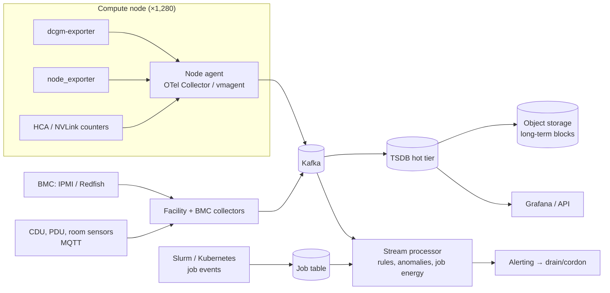
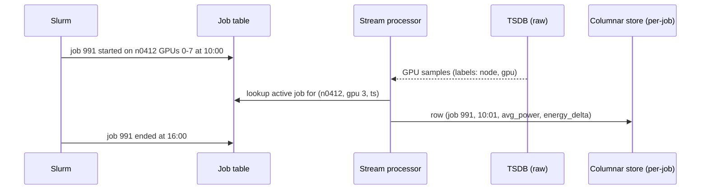
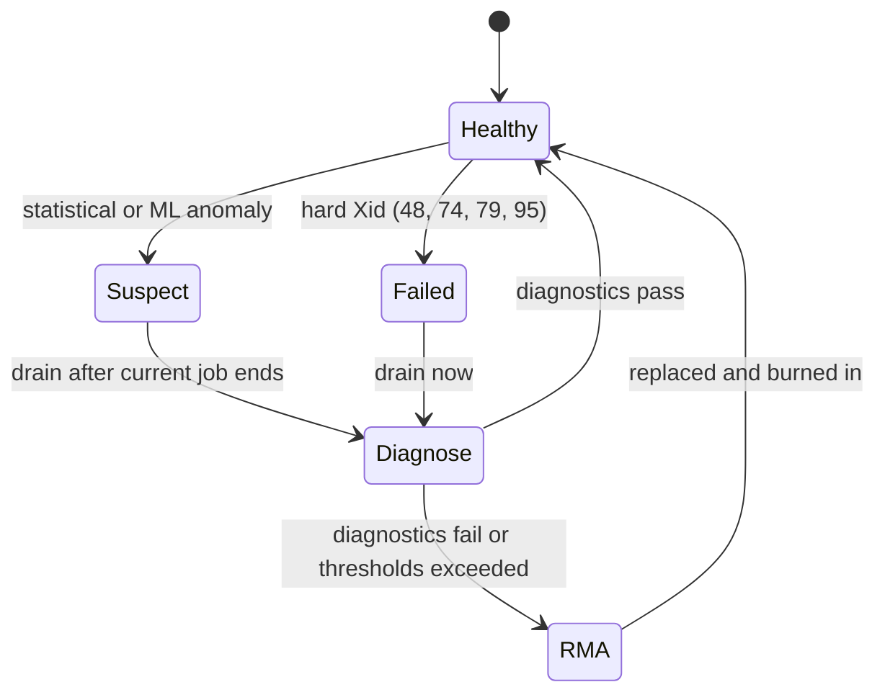

# C13 — Telemetry & observability platform for a GPU/HPC cluster

## The prompt

> "You run a cluster of 10,240 GPUs used for AI training and HPC simulations, scheduled by Slurm and, for some
> partitions, Kubernetes. Design the telemetry platform. Operators want to see every GPU's temperature and power
> at 1 s resolution, catch failing GPUs before they crash multi-day training jobs, and charge each project for
> the energy its jobs used."

This case applies [SYSDESIGN-12](../01-foundations/12-observability.md) to a domain where the *infrastructure*
is the product. The numbers are big but predictable, the time-series cardinality is the main trap, and the
hardest question is not storage but **attribution**: which job, which user, which rack, which cooling loop.

## CLARIFY: requirements (functional / non-functional / out of scope)

**Questions worth asking (and the answers we assume):**

- *Topology?* 1,280 nodes × 8 GPUs = **10,240 GPUs**, InfiniBand fabric, liquid-cooled racks with CDUs
  (coolant distribution units). *Assumption.*
- *Resolution?* GPU power, temperature and utilization at **1 s**. Node and network counters at **10 s**. BMC
  and facility sensors at 10–30 s.
- *Retention?* Raw data for 2 weeks (debugging); 1-minute rollups for 13 months (capacity planning,
  year-over-year); hourly forever (energy reports).
- *Users?* Operators (alerts, dashboards), users (their job's GPU efficiency), management (energy and
  utilization reports), researchers (exporting datasets).
- *Actions?* Drain a node in Slurm or cordon it in Kubernetes automatically on hard-failure signals. Page a
  human otherwise.

**Functional requirements**

1. Collect GPU (DCGM), node (CPU, memory, disk, network), interconnect, BMC (IPMI/Redfish) and facility
   (CDU, PDU, room) telemetry.
2. Ingest scheduler metadata: job ID, user, project, nodes/GPUs, start and end times (Slurm and Kubernetes).
3. Dashboards per cluster, rack, node, GPU and **job**.
4. Alerting and automated remediation (drain/cordon) on hardware faults.
5. Anomaly detection for thermal, power and hardware degradation.
6. Energy accounting per job, user and project.
7. Bulk export for offline analysis.

**Non-functional requirements**

| Requirement | Target (assumption) |
|---|---|
| Ingest | ~0.5 M samples/s sustained (derived below), 2× burst headroom |
| Freshness | Sample visible in queries ≤ 15 s after collection (p99) |
| Query | Cluster-wide 1 h dashboard < 2 s; per-job 7-day view < 5 s |
| Availability | Ingest 99.9%; alerting path independent of the long-term store |
| Overhead on compute nodes | < 1% CPU per node for agents |
| Completeness | ≥ 99.9% of expected samples per day |

**Out of scope:** application traces and profiles inside jobs, scheduler design itself
([SYSDESIGN-23](../03-ai-systems/23-gpu-infrastructure.md)), and the facility BMS (building management
system) beyond reading its data.

## QUANTIFY: estimates

**Series per source** (all counts are design assumptions):

| Source | Entities | Metrics each | Active series | Interval | Samples/s |
|---|---|---|---|---|---|
| GPU (DCGM) | 10,240 GPUs | 40 | 409,600 | 1 s | 409,600 |
| Node (node_exporter) | 1,280 nodes | 500 (per-core CPU, disks, NICs) | 640,000 | 10 s | 64,000 |
| Interconnect (HCA/NVLink counters) | 1,280 nodes | 160 | 204,800 | 10 s | 20,480 |
| BMC (IPMI/Redfish) | 1,280 nodes | 100 | 128,000 | 30 s | ~4,270 |
| Facility (CDU, PDU, room) | — | — | 50,000 | 10 s | 5,000 |
| **Total** | | | **~1.43 M** | | **~503,000** |

**Samples per day:** 503,000 × 86,400 ≈ **43.5 billion**.

**Bytes per sample.** Facebook's Gorilla compressed time series from 16 bytes per point to an average of
**1.37 bytes**, a 12× reduction [1]. Prometheus documents "an average of only 1-2 bytes per sample" and gives the
capacity formula `needed_disk_space = retention_time_seconds * ingested_samples_per_second * bytes_per_sample`
[2].

**Raw storage:**
- 43.5 B × 1.37 B ≈ **60 GB/day**, or 43.5–87 GB/day at Prometheus's 1–2 B.
- 14 days raw ≈ **0.8–1.2 TB** (single copy). A year raw would be ~22 TB at 1.37 B/sample. That is affordable on
  object storage, but slow to query at 1 s.

**Rollups.** 1-minute rollups keeping 5 aggregates (min, max, sum, count, last):
1.43 M series × 1,440 min × 5 ≈ 10.3 B values/day ≈ 14 GB/day ≈ **5 TB/year**. Hourly: about 85 GB/year.

**The cardinality trap (what happens if you add `job_id` as a label).**
Assume 20,000 jobs/day using an average of 16 GPUs each (assumption). Every job creates new GPU series:
20,000 × 16 × 40 = **12.8 M new series per day**, about 9× the cluster's entire steady-state series count,
every day. Index size, memory for the head block and query fan-out all scale with series count, not samples.
**Job IDs must not be labels on high-frequency hardware metrics.** See deep dive 1.

**Network.** At an assumed ~20 bytes per sample on the wire after batching and compression, 503 k samples/s is
about 10 MB/s, trivial for the data center network. It is worth computing to show it is not the bottleneck.

**Jobs metadata.** 20,000 jobs/day × ~2 KB = 40 MB/day. Tiny, but it is the join key for everything.

## SKETCH: high-level design (Mermaid)


*Diagram: on each node, dcgm-exporter, node_exporter and interconnect counters feed a local agent that ships
batches to Kafka. BMC and facility collectors, including MQTT sensors, also publish to Kafka. Kafka feeds the
hot time-series store and a stream processor for rules, anomaly detection and job energy. Scheduler job events
fill a job table that the stream processor joins. The TSDB tiers into object storage, and Grafana and an API
query it. Alerts trigger drains or cordons.*

Why each box is here:

- **dcgm-exporter:** NVIDIA's exporter exposes DCGM fields as Prometheus metrics. Its configuration defaults to
  a **30 s** collection interval (`-c`, in milliseconds) and has an optional Kubernetes mode that maps metrics to
  pods (`-k`, default false) [3]. 1 s resolution is a configuration decision with an overhead cost you must
  measure.
- **Local agent:** batches, relabels and **drops** unneeded series at the edge (cheaper than storing them), and
  buffers during network blips.
- **Kafka:** decouples collection from storage. It lets the alerting path, the stream processor and the TSDB
  consume independently, and allows replay after a storage outage
  ([SYSDESIGN-08](../01-foundations/08-async-event-driven.md)).
- **MQTT for facility and BMC data:** sensors and embedded controllers speak lightweight publish/subscribe
  natively. ExaMon, the monitoring framework deployed at CINECA (below), uses MQTT between its collector plugins
  and brokers [4].
- **Job table:** the scheduler is the source of truth for "who used which GPU when". It is a small relational
  or columnar table, not a metric label.
- **Stream processor:** hardware alerts must not depend on the long-term store's query path.

**Related real-world work (cited neutrally).** Several published HPC monitoring systems follow this shape:

- **LDMS** (Lightweight Distributed Metric Service, Sandia and partners, SC14) targets continuous, low-overhead
  monitoring of large-scale systems and applications [5].
- **ExaMon** (University of Bologna and CINECA). Bartolini et al. describe it as a scalable, holistic monitoring
  framework ingesting about 70 GB/day of telemetry for the entire CINECA datacenter, used to evaluate ML-based job
  scheduling, power prediction and deep-learning anomaly detection [6]. Its architecture uses collector
  *plugins* that publish over MQTT to brokers, with Apache Cassandra plus KairosDB as the time-series back-end [4];
  the open-source code is at `github.com/EEESlab/examon` [7]. The M100 ExaData paper (Borghesi et al., *Scientific
  Data*, 2023) published 2.5 years (2020-03-09 to 2022-09-28) of ExaMon data from the Marconi100 supercomputer:
  980+ compute nodes, 573 metrics across plugins (including IPMI, Ganglia, Nagios, Slurm and a job table), 49.9 TB
  before compression [4]. *Disclosure: the course author is a co-author of the M100 ExaData paper.*

## API and data model

**Metric naming and labels** (Prometheus data model):

```
dcgm_gpu_temp_celsius{cluster="c1", rack="r17", node="n0412", gpu="3", model="H100", uuid="GPU-…"} 61
```

- Labels are **stable hardware identity only**: cluster, rack, node, GPU index, UUID, model.
- Never use job ID, user, step number or request-like values as labels.
- Note on DCGM field names (as of 2026-11): the dcgm-exporter `default-counters.csv` on the main branch uses
  unit-suffixed names such as `DCGM_FI_DEV_GPU_TEMP_CELSIUS`, `DCGM_FI_DEV_BOARD_POWER_WATTS`,
  `DCGM_FI_DEV_GPU_ENERGY_JOULES_TOTAL` (a counter of "GPU energy consumed since the driver was reloaded"),
  `DCGM_FI_DEV_XID_ERROR` ("value of the last XID error encountered") and row-remap counters [8]. Older releases
  and many dashboards use names like `DCGM_FI_DEV_GPU_TEMP` and `DCGM_FI_DEV_POWER_USAGE`. Pin the exporter version
  and alias names in recording rules.

**Job table (relational or ClickHouse):**

| Column | Notes |
|---|---|
| job_id, scheduler (slurm \| k8s), user, project, partition | From Slurm job events / Kubernetes pod metadata |
| start_ts, end_ts | End is null while running |
| allocation: list of (node, gpu_index, gpu_uuid) | Slurm allocation; dcgm-exporter pod mapping on Kubernetes [3] |
| state, exit_code | Correlate failures with hardware events |

**Job-level API (read):**

```http
GET /v1/jobs/{job_id}/telemetry?metric=gpu_power_watts&step=10s
GET /v1/jobs/{job_id}/energy        → {gpu_kwh, node_kwh, facility_kwh, method, coverage_pct}
GET /v1/gpus/{uuid}/health          → {xid_events_7d, row_remap, temp_residual_c, status}
```

**Hardware event log (append-only, separate from metrics):** `ts, node, gpu_uuid, source (dcgm | kernel log |
BMC), code (e.g., Xid 79), payload`. Events are rare, important and need exact timestamps. Store them as events,
not as a gauge that may be sampled past.

## DEEPEN: 2–4 deep dives

### Deep dive 1 — Joining jobs to series without exploding cardinality

The question users ask is "show me *my job's* GPU power". The tempting design adds `job_id` to every GPU series,
and the QUANTIFY section showed that this creates ~12.8 M new series per day.

**Pattern: join at query time on (node, gpu, time interval).**

1. The scheduler emits job start and end events with the allocation. Slurm knows the node and GPU allocation.
   On Kubernetes, dcgm-exporter's pod mapping (`-k`) attaches pod identity to GPU metrics [3]. Use it to fill
   the job table, not as permanent labels on raw series.
2. A job query becomes: look up the allocation → build a selector `node=~"n0412|n0413", gpu=~"0|1|…"` → restrict
   to `[start_ts, end_ts]`.
3. For frequently used per-job aggregates (mean GPU utilization, energy, peak temperature), the **stream
   processor** joins live samples with the job table and writes **one row per job per minute** to a columnar
   store (ClickHouse table keyed by `job_id`). Per-job reporting then never touches the high-cardinality raw
   series.


*Diagram: Slurm records a job start in the job table. The stream processor reads GPU samples labelled only by
node and GPU, looks up which job held that GPU at that time, and writes per-job, per-minute rows to a columnar
store. Slurm later records the job's end.*

Edge cases: GPUs shared through MIG or time-slicing ([SYSDESIGN-23](../03-ai-systems/23-gpu-infrastructure.md))
mean several jobs per physical GPU. Use the MIG instance as the entity, or attribute by share. Jobs that start
and end within one sample interval need event timestamps, not sample timestamps.

### Deep dive 2 — Choosing the time-series store

*(as of 2026-11; capabilities change, so verify before buying)*

| Option | Wins when | Costs | Notes |
|---|---|---|---|
| **Prometheus + Thanos** | You already run Prometheus; want object-storage long-term retention with global query | Many components (sidecar, store, compactor, querier); downsampling adds blocks | Thanos compactor creates 5 m resolution for data older than 40 h and 1 h for 5 m data older than 10 days [9] |
| **Grafana Mimir** | Multi-tenant, horizontally scalable central store | Operating a distributed system; object storage | "Horizontally scalable, highly available, multi-tenant, long-term storage for Prometheus and OpenTelemetry metrics" [10] |
| **VictoriaMetrics** | High ingest per node; simpler ops; Prometheus-compatible | Some features enterprise-only (e.g., downsampling) | Open-source single and cluster versions; accepts OpenTelemetry pushes; downsampling via `-downsampling.period` in Enterprise [11] |
| **ClickHouse** | Per-job analytics, joins with job tables, ad hoc SQL over long history | Not Prometheus-native; you build the rollup logic | TTL can delete, move to colder volumes, or roll up with `GROUP BY` before deleting [12] |
| **TimescaleDB** | Postgres ecosystem; joins with relational metadata; moderate scale | Higher bytes per sample at this ingest rate, unless carefully tuned | Continuous aggregates are hypertables "refreshed automatically in the background" [13] |
| Cassandra + KairosDB | Historical precedent (ExaMon) | Older stack; more tuning | Used by ExaMon at CINECA [4] |

**A defensible choice for this prompt:** a Prometheus-compatible TSDB (Mimir, VictoriaMetrics or Thanos) for
operational metrics and alerting, plus ClickHouse for per-job and per-project analytics and energy. The two
consume the same Kafka topics. The split follows the access patterns: operators need recent, label-selector
queries; accounting needs joins and long ranges.

**Downsampling does not save space by itself.** Thanos's documentation says downsampling "doesn't save you any
space", and can increase storage by about 3× when all resolutions are kept, because it *adds* blocks [9]. The
saving comes from **shorter raw retention** (`--retention.resolution-raw`) once rollups exist. The benefit of
downsampling is query speed over long ranges.

**Retention plan:**

| Tier | Resolution | Retention | Size (from QUANTIFY) | Purpose |
|---|---|---|---|---|
| Hot | raw (1 s / 10 s) | 14 days | ~0.8–1.2 TB | Debugging, incident analysis |
| Warm | 1 min (min/max/sum/count/last) | 13 months | ~5 TB/year | Capacity, trends |
| Cold | 1 h | Indefinite | ~85 GB/year | Energy, reports |
| Events | exact | Indefinite | small | Xid/ECC history per GPU UUID (RMA evidence) |

Keep **max** in rollups: thermal events are spikes, and an average hides them.

### Deep dive 3 — Detecting failing hardware: rules, statistics, ML

**Why it matters (evidence):**
- Meta reports 419 unexpected interruptions in a 54-day window of Llama 3 405B training on up to 16K H100 GPUs.
  About 78% were attributed to confirmed or suspected hardware issues, and GPU issues were 58.7% [14].
- A study of NCSA's Delta (1,056 A100 and H100 GPUs, 2.5 years, 11.7 M GPU hours) found H100 memory had 3.2× lower
  per-GPU mean time between memory errors than A100. GPU errors frequently resulted in job failures, and the
  authors project that about 5% GPU overprovisioning is needed to absorb failures at larger scales [15]
  (preprint).
- Ostrouchov et al.'s survival analysis of Titan's 18,688 GPUs (over 100,000 GPU-years) found that GPU reliability
  depends on heat dissipation, strongly correlated with cooling-architecture details and job scheduling [16].
  Tiwari et al. analyzed GPU errors on the same class of large HPC systems and their implications for system
  design and operation [17].

**Layer 1 — Deterministic rules on hardware events (Xid, ECC, row remapping).** NVIDIA's Xid catalog gives
meanings and actions [18]:

| Xid | Meaning (per NVIDIA catalog) | Automated action |
|---|---|---|
| 13, 31, 43 | Graphics engine exception / GPU memory page fault / GPU stopped processing: usually application faults | Tag the job; no node action; alert if repeated across jobs on the same GPU |
| 48 | Double-bit ECC error (uncorrectable) | Reset GPU; if with Xid 63/64, **drain node** then reset; run diagnostics; RMA flow if thresholds are exceeded |
| 63 / 64 | Row-remapping event / remapping failure | 63: record; 64: reset GPU and investigate |
| 74 | NVLink error | GPU reset or node reboot needed; drain |
| 79 | GPU has fallen off the bus | **Drain**, restart bare metal, check PCIe logs |
| 92 | High single-bit ECC error rate | Watch the trend; ticket if it persists |
| 94 / 95 | Contained / uncontained memory error | 94: restart the affected app, reset when convenient; 95: reset GPU before any app restarts |
| 119 / 120 | GSP RPC timeout / GSP error | Reset GPU; investigate software |

The stream processor turns these into Slurm drain (`scontrol update NodeName=… State=DRAIN Reason=…`) or a
Kubernetes cordon, *after* the running job is checkpointed or has already failed. Rules are cheap, explainable and
catch the majority of hard faults. Keep them in version control with tests.

**Layer 2 — Statistical, peer-relative detection.** Absolute thresholds fail because a GPU at 80 °C may be normal
under full load and abnormal at idle. Compare like with like:

- **Thermal residual:** model a GPU's expected temperature from its power draw and coolant inlet temperature
  (fit per GPU model and rack; linear is a start), then alert on the residual's EWMA. A slowly rising residual at
  constant power suggests degraded thermal contact or coolant flow.
- **Peer comparison within a job:** synchronous training runs the same work on every GPU. One GPU with lower SM
  clock or higher temperature than its peers is a **straggler** that slows the whole job.
- **Rack and loop correlation:** many GPUs in one rack drifting together point to the cooling loop (CDU), not the
  GPUs. Join with facility telemetry before paging the GPU team.

**Layer 3 — Learned models.** Autoencoders or other unsupervised models over multivariate node telemetry flag
unusual combinations that no single rule catches. ExaMon-based work evaluated deep-learning anomaly detection
of compute nodes [6], and the M100 dataset includes Nagios-derived anomaly labels aggregated at 15-minute periods
for such studies [4]. Production advice: use ML detectors to **rank** nodes for human attention and to schedule
diagnostics, not to drain nodes automatically. Their false positives cost GPU-hours.


*Diagram: a healthy node becomes suspect on a statistical or ML anomaly, or failed on a hard Xid. Suspect nodes
drain after the current job ends; failed nodes drain immediately. Both go to diagnostics, which return them to
healthy or send hardware to RMA, after which replaced hardware is burned in and returns to healthy.*

### Deep dive 4 — Job-level energy accounting

**Method 1: GPU energy counters (preferred for GPUs).** `DCGM_FI_DEV_GPU_ENERGY_JOULES_TOTAL` is a counter of
energy since the driver was reloaded [8]. Job GPU energy = Σ over allocated GPUs of (counter at end − counter at
start). This is exact to the counter's accuracy and immune to sampling gaps. Handle counter resets (driver
reloads) the way Prometheus `increase()` does.

**Method 2: integrate power samples.** E = Σ P(tᵢ)·Δt. With 1 s samples the integration error is small. With 30 s
samples, bursty phases (checkpoint I/O, all-reduce stalls) are under-sampled. Record a `coverage_pct` (samples
received vs expected) next to every energy number.

**Shared node power.** CPUs, memory, NICs and fans also draw power, measured by the BMC or RAPL. Slurm's
`acct_gather_energy` plugins read IPMI (BMC), RAPL, GPU or XCC sources, and report consumed energy for nodes
(`scontrol show node`) and jobs (`sacct`) [19]. Attribute shared node power to jobs by GPU share (a job with 4 of
8 GPUs gets 50%), or by CPU-time share for CPU jobs. State the rule in the report.

**Facility overhead.** Multiply IT energy by the measured PUE for that period, or better, attribute the cooling
loop's measured power by the rack heat load.

**Worked example** (all assumptions): a job on 64 GPUs (8 nodes) for 6 h at an average of 550 W per GPU (the
H100 SXM's TDP is 700 W [14]):
- GPU: 64 × 0.55 kW × 6 h = **211 kWh**;
- node non-GPU baseline 2 kW per node: 8 × 2 kW × 6 h = **96 kWh**;
- IT total 307 kWh; × PUE 1.2 → **~369 kWh** at the facility meter.

Report all three numbers. Users can change the first, operators the third. Energy per job connects directly to
carbon-aware scheduling ([SYSDESIGN-17](../02-modern-requirements/17-energy-carbon-aware.md)).

## STRESS: failures, hot spots, scale ×10

**Metrics storm from a misconfigured exporter.** Someone enables a profiling field group with a per-process label
on every node, and active series triple in an hour. Defenses: per-tenant or per-source series limits in the TSDB;
`metric_relabel_configs` drop rules at the agent; an alert on series-growth rate; and cardinality dashboards
(top metrics by series count).

**Kafka or TSDB outage.** Node agents buffer locally for N minutes (memory/disk-bounded). Kafka retention allows
replay into the TSDB after recovery. **The alerting path for hard faults reads Kafka directly**, so it survives a
TSDB outage. Out-of-order ingestion must be enabled in the TSDB for replays.

**Clock skew.** 1 s data with nodes 2 s apart misorders events and breaks job-boundary attribution. Run PTP or
well-monitored NTP, export clock offset as a metric, and alert above 100 ms (an assumption).

**Thermal event at rack scale.** A CDU pump fails and 40 nodes heat up together. Correlation with facility data
must suppress 320 per-GPU pages into one rack-level incident, and drive power capping or job pausing before
hardware protection trips.

**The noisy collector.** 1 s DCGM collection costs CPU on every compute node, multiplied by 1,280. Measure
agent overhead per node against the < 1% budget. Collect the fast set (power, temperature, utilization, clocks) at
1 s and everything else at 10–30 s.

**Scale ×10 (102,400 GPUs, ~5 M samples/s, ~14 M series).**
- Ingest shards horizontally (Kafka partitions by node hash; TSDB ingesters or vminsert scale out).
- Raw storage at ~600 GB/day → cut raw retention to 7 days, or push 1 s data only for a fast subset.
- Query fan-out: cluster-wide panels must read **recording rules** (precomputed rack and cluster aggregates), not
  raw series.
- Federation by site or cluster with a global query layer, and alerting kept local to each cluster.
- Hardware events grow linearly (more GPUs, more Xids). The automation must be good enough that humans only see
  the ambiguous cases.

## Operate: SLOs, cost, energy

**SLOs (illustrative):**

| SLI | SLO |
|---|---|
| Sample completeness (received / expected per day) | ≥ 99.9% |
| Ingest-to-query freshness p99 | ≤ 15 s |
| Hard-fault detection to drain | ≤ 60 s after the Xid event |
| Dashboard query p95 (1 h, cluster) | ≤ 2 s |
| Energy report coverage per job | ≥ 99% of job GPU-seconds covered |

**Meta-monitoring.** The telemetry platform needs its own, independent monitoring (a small Prometheus watching
agents, Kafka lag and TSDB ingest), because "no data" must alert as loudly as bad data.

**Cost.** Storage is modest (~1 TB hot, ~5 TB/year warm). The real costs are (1) TSDB compute and memory, which
scale with **active series**, (2) agent overhead on 1,280 compute nodes (CPU that is not running jobs), and (3)
the engineering time to keep exporters, versions and dashboards consistent. A 1% agent overhead across
1,280 nodes is the equivalent of about 13 whole nodes, roughly 100 GPUs' worth of servers. That is why the edge drop
rules matter.

**Energy.** The telemetry platform is itself a consumer: a few servers for storage and query versus a cluster
that draws megawatts (10,240 GPUs × up to 700 W TDP [14] ≈ 7.2 MW for GPUs alone at TDP). Its main energy value
is **visibility**: per-job energy reports, idle-GPU detection (allocated but at ~0% utilization) and thermal
residuals that point to cooling inefficiency.

## Modern twist

What 2026 changes:

- **AI training made GPU failure an everyday event.** Interruption statistics from very large training runs [14]
  and multi-year GPU resilience studies [15] turned telemetry from "dashboards" into an input to job resilience:
  drain, checkpoint, restart and spare pools ([SYSDESIGN-27](../03-ai-systems/27-ml-platforms.md)).
- **Kubernetes joined Slurm.** dcgm-exporter's pod mapping [3] and Kubernetes metadata mean the job table must
  merge two schedulers' notions of "job".
- **OpenTelemetry as the collection layer.** Prometheus-compatible stores now accept OTLP pushes (for example,
  VictoriaMetrics lists the OpenTelemetry metrics format among its push protocols [11]), and Mimir positions
  itself as storage for both Prometheus and OpenTelemetry metrics [10]. One agent per node can feed several back
  ends.
- **Energy is a reported metric, not a curiosity.** Job-level energy and carbon reporting is becoming an
  expected feature for shared clusters ([SYSDESIGN-17](../02-modern-requirements/17-energy-carbon-aware.md)).
- **Open telemetry datasets enable research.** Public datasets such as M100 ExaData [4] let teams prototype
  anomaly detectors and energy models on real production data before touching their own cluster.

## WRAP: interview summary (what a strong 45-min answer covers; levels junior/senior/staff)

**A strong 45-minute answer covers:**

1. Clarifies topology, resolution per source, retention, users and automated actions.
2. Quantifies series, samples/s, bytes/sample (with a source), storage per tier, and the job-label cardinality
   trap.
3. Sketches node agents → Kafka → TSDB + stream processor, with the job table from the scheduler and alerting
   independent of long-term storage.
4. Deepens on the job-to-series join, the store choice with retention and downsampling, layered anomaly detection
   (Xid rules → statistics → ML), and job energy.
5. Stresses cardinality storms, storage outages, clock skew, rack-level thermal events and ×10 scale.
6. Wraps with SLOs (including completeness and fault-to-drain time), meta-monitoring and cost drivers.

**Level expectations:**

| Level | Expected |
|---|---|
| **Junior** | Prometheus + exporters + Grafana; knows DCGM provides GPU metrics; basic alerting on temperature; storage estimate within an order of magnitude |
| **Senior** | Correct series and samples/s math with a cited bytes-per-sample; refuses `job_id` labels and designs the job join; retention tiers; Xid-based automated drain; knows downsampling does not save space by itself; buffering and replay |
| **Staff** | Separates operational and accounting stores by access pattern; peer-relative and physics-informed anomaly detection with cooling-loop correlation; energy attribution with counters, shared power and PUE plus coverage reporting; agent overhead as a cost in GPU-equivalents; federation and recording rules at ×10; cites failure evidence (Llama 3, Delta, Titan) to justify the investment |

**Red flags:** `job_id` or `user` as labels on 1 s GPU series; computing energy from 30 s power samples without a
coverage figure; alerting that depends on the long-term store; absolute temperature thresholds only; draining
nodes on an ML score alone; no meta-monitoring.

## Alternatives considered

| Alternative | Why not chosen (here) | When it wins |
|---|---|---|
| Single Prometheus server | ~1.4 M series at 1 s and two weeks of retention is beyond a comfortable single instance; no HA or long-term store | Small clusters (tens of nodes) |
| Push everything over MQTT (ExaMon-style) end to end | Excellent for heterogeneous sensors and facility data; less native for Prometheus tooling | Mixed facility + IT telemetry; research platforms [4][6] |
| One store for everything (ClickHouse only) | Fine for analytics; you rebuild PromQL-style alerting and dashboards | Teams strong in SQL, analytics-first use cases |
| Job ID as label with short retention | Still millions of series per day; index churn | Very small clusters with few, long jobs |
| Lower resolution (30 s default) | Misses thermal and power transients; poor energy integration | Capacity planning only |
| Vendor-managed observability SaaS | Egress and per-series cost at 1.4 M series × 1 s; data sovereignty | Small fleets, cloud-only GPU usage |

## Exercises

See [exercises/C13-gpu-cluster-telemetry.md](../../exercises/C13-gpu-cluster-telemetry.md).

## References

1. T. Pelkonen et al., "Gorilla: A Fast, Scalable, In-Memory Time Series Database," PVLDB 8(12), 2015.
   https://www.vldb.org/pvldb/vol8/p1816-teller.pdf (accessed 2026-11)
2. Prometheus documentation (3.16), "Storage." https://prometheus.io/docs/prometheus/latest/storage/
   (accessed 2026-11)
3. NVIDIA, "DCGM Exporter" (GPU telemetry documentation: `-c` collection interval default 30000 ms; `-k`
   Kubernetes pod mapping). https://docs.nvidia.com/datacenter/cloud-native/gpu-telemetry/latest/dcgm-exporter.html
   (accessed 2026-11)
4. A. Borghesi, C. Di Santi, M. Molan, M. Seyedkazemi Ardebili, A. Mauri, M. Guarrasi, et al., "M100 ExaData: a
   data collection campaign on the CINECA's Marconi100 Tier-0 supercomputer," Scientific Data, 2023.
   https://doi.org/10.1038/s41597-023-02174-3 (full text via Europe PMC PMC10193329; accessed 2026-11)
5. A. Agelastos et al., "The Lightweight Distributed Metric Service: A Scalable Infrastructure for Continuous
   Monitoring of Large Scale Computing Systems and Applications," SC14, 2014. https://doi.org/10.1109/SC.2014.18
   (metadata accessed 2026-11)
6. A. Bartolini, F. Beneventi, A. Borghesi, D. Cesarini, A. Libri, L. Benini, et al., "Paving the Way Toward
   Energy-Aware and Automated Datacentre," ICPP Workshops 2019. https://doi.org/10.1145/3339186.3339215
   (abstract accessed 2026-11)
7. EEESlab, "examon" (GitHub repository). https://github.com/EEESlab/examon (accessed 2026-11)
8. NVIDIA, dcgm-exporter `etc/default-counters.csv` (main branch).
   https://github.com/NVIDIA/dcgm-exporter/blob/main/etc/default-counters.csv (accessed 2026-11)
9. Thanos documentation, "Compactor" (downsampling and retention).
   https://thanos.io/tip/components/compact.md/ (accessed 2026-11)
10. Grafana Labs, "Grafana Mimir documentation." https://grafana.com/docs/mimir/latest/ (accessed 2026-11)
11. VictoriaMetrics documentation, "Single-node VictoriaMetrics" (push protocols; Enterprise downsampling).
    https://docs.victoriametrics.com/victoriametrics/single-server-victoriametrics/ (accessed 2026-11)
12. ClickHouse documentation, "Manage data with TTL." https://clickhouse.com/docs/guides/developer/ttl
    (accessed 2026-11)
13. Tiger Data (TimescaleDB) documentation, "About continuous aggregates."
    https://www.tigerdata.com/docs/use-timescale/latest/continuous-aggregates/about-continuous-aggregates
    (accessed 2026-11)
14. Llama Team, AI @ Meta, "The Llama 3 Herd of Models," arXiv:2407.21783, 2024, §3.3 (infrastructure and reliability).
    https://arxiv.org/abs/2407.21783 (accessed 2026-11)
15. S. Cui et al., "Story of Two GPUs: Characterizing the Resilience of Hopper H100 and Ampere A100 GPUs,"
    arXiv:2503.11901, 2025 (preprint; related DOI 10.1145/3712285.3759821). https://arxiv.org/abs/2503.11901
    (accessed 2026-11)
16. G. Ostrouchov, D. Maxwell, R. A. Ashraf, C. Engelmann, M. Shankar, J. H. Rogers, "GPU Lifetimes on Titan
    Supercomputer: Survival Analysis and Reliability," SC20, 2020. https://doi.org/10.1109/SC41405.2020.00045
    (abstract accessed 2026-11)
17. D. Tiwari et al., "Understanding GPU errors on large-scale HPC systems and the implications for system design
    and operation," HPCA 2015. https://doi.org/10.1109/HPCA.2015.7056044 (metadata accessed 2026-11)
18. NVIDIA, "XID Errors: Analyzing Xid Errors with the Xid Catalog."
    https://docs.nvidia.com/deploy/xid-errors/analyzing-xid-catalog.html (accessed 2026-11)
19. SchedMD, "acct_gather.conf" (Slurm energy plugins). https://slurm.schedmd.com/acct_gather.conf.html
    (accessed 2026-11)
