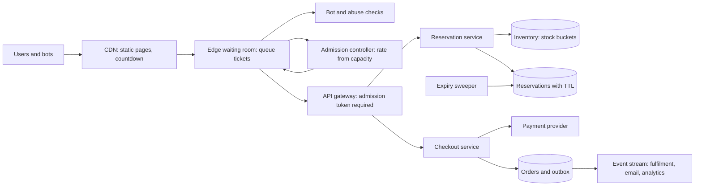
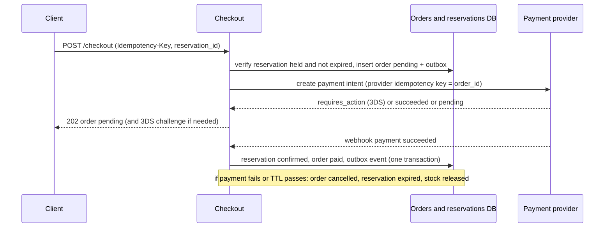

# C14 — Global flash sale

> **The requirement.** Lumen Store will release 100,000 units of a limited console at 12:00:00 UTC. Twenty million
> people have signed up for notifications; many will open the page in the same second, plus an unknown army of bots.
> The business rules are absolute: **never sell unit 100,001**, one unit per customer, and "fair" — not "whoever has
> the fastest script". The rest of the store must stay up. It is hard because the demand is 200× the supply and
> arrives in seconds, every request wants to write to the *same* counter, and the cheapest way to scale reads (caches,
> replicas, async replication) is exactly what breaks a correctness invariant on writes.

## The prompt

"Design Ticketmaster / a flash sale / a limited sneaker drop" is the canonical **contention** interview. Most
answers jump to "use Redis DECR". The real design question is *where the queue lives*: you can make users queue in a
waiting room in front of the system, or let requests queue inside your database as lock waits. Only one of those
fails gracefully. Payments are covered in depth in [C06](./C06-payments-ledger.md); rate limiting in
[C01](./C01-url-shortener-rate-limiter.md).

## CLARIFY: requirements

### Functional

1. Before T0: product page, countdown, sign-in, optional pre-registration.
2. At T0: users join a **waiting room**; they are admitted in a defined order at a controlled rate.
3. An admitted user can **reserve** one unit, then complete **checkout** (address, payment) within a time limit.
4. If they do not pay in time, the unit returns to stock and someone else can buy it.
5. When stock is gone, everyone still waiting is told promptly ("sold out", optionally a waitlist).
6. Purchase limit: one unit per account (and per payment instrument / shipping address).

### Non-functional

| Property | Target | Why |
|---|---|---|
| Oversell | **0 units**, provably | legal and reputational; refunds and apologies at scale |
| Undersell | ≤ 0.5 % of stock unsold at end when demand exceeds supply | failed reservations must return to stock |
| Fairness | admission order follows a published policy (random among on-time arrivals, or FIFO) | bots and refresh-spamming must not win |
| Availability | rest of the store 99.95 % during the event; sale flow degrades, never crashes | blast radius |
| Waiting-room latency | position/status update ≤ 15 s; admission to checkout page < 2 s | users must see progress |
| Checkout latency | p95 < 2 s per step excluding the payment provider | |
| Duplicate charges | 0 | idempotency end to end |

### Out of scope

Shipping and fulfilment, returns, the general catalogue, recommendations. Fraud scoring beyond bot and abuse controls
(see C12 for real-time fraud).

Ask: *How many units, how many people, how fast must it sell? One region's warehouse or global? What does "fair"
mean to the business? Which payment providers and their rate limits?* The fairness definition and the payment
provider's limit are the two numbers that shape the design.

## QUANTIFY: estimates

All values are **labelled assumptions** unless sourced.

### The spike

| Quantity | Assumption / derivation | Value |
|---|---|---|
| Registered interested users | given | 20 M |
| Show up in the first 10 min | assumption | 60 % → 12 M |
| Arrive in the first 60 s | assumption | half of those → 6 M |
| **Human arrival rate at T0** | 6 M / 60 s | **100 k users/s** |
| Requests per page load | assumption: HTML + ≈ 30 static assets | 31 |
| Edge request rate at T0 | 100 k × 31 | ≈ 3.1 M req/s (CDN) |
| Bot multiplier on dynamic "join" calls | assumption | ×5 |
| **Join-queue attempts at T0** | 100 k × 5 | **≈ 500 k req/s** |
| Waiting users | 12 M | |
| Status polls (every 15 s) | 12 M / 15 s | ≈ 800 k req/s |

Two conclusions before any boxes: (1) everything that can be static **must** be served by the CDN, including the
countdown page; (2) the join and poll endpoints need to be handled **at the edge** with signed tokens and no
per-request origin database access — 800 k polls/s to an origin database is a self-inflicted outage.

### Admission rate from downstream capacity

Work backwards from the narrowest pipe — usually the payment provider.

| Quantity | Assumption | Value |
|---|---|---|
| Payment authorisations our provider contract allows | assumption (ask!) | 2,000/s |
| Checkout service capacity (load-tested) | assumption | 5,000 orders/s |
| Fraction of admitted users who complete payment within the window | assumption | 60 % |
| **Safe admission rate** | 2,000 / 0.6 | **≈ 3,300 users/s** (below the checkout limit) |
| Admissions needed to sell out | 100 k / 0.6 | ≈ 167 k |
| Time to admit enough users | 167 k / 3,300 | ≈ 50 s |
| Reservation TTL (pay within) | business choice | 10 min |

So the sale *could* be over in about a minute of admissions plus the payment tail; most of the 12 M people will only
ever see "sold out". Telling them **quickly and honestly** is part of the design.

### Inventory write rate and storage

Reservation attempts ≈ admission rate ≈ 3,300/s, plus releases from expired reservations (≤ 40 % of reservations,
spread over the TTL) and confirmations — a few thousand writes per second, **all touching the same SKU**. Storage is
trivial: 100 k orders, 167 k reservations, 12 M queue entries × ≈ 200 B ≈ 2.4 GB of queue state.

The numbers say this is **not a big-data problem; it is a hot-key and flow-control problem**.

## SKETCH: high-level design



*Diagram: users and bots hit a CDN serving static pages and the countdown, then an edge waiting room that issues
queue tickets and consults bot and abuse checks; an admission controller sets the admission rate from downstream
capacity; admitted users carry an admission token through the API gateway to a reservation service that decrements
stock buckets and records reservations with a TTL; a checkout service charges the payment provider and writes
orders with an outbox that feeds an event stream; an expiry sweeper returns unpaid reservations to stock.*

Why each box: the **waiting room** moves the queue out of your databases and into a place built for millions of
idle clients; the **admission controller** converts downstream capacity into an admission rate; **stock buckets**
spread the hot key; **reservations with TTL** decouple "you have a unit" from "you have paid"; the **outbox** makes
order events reliable ([SYSDESIGN-08](../01-foundations/08-async-event-driven.md)).

## API and data model

```http
POST /v1/sales/{sale_id}/queue          → 200 Set-Cookie: q=<signed ticket {sale, user, joined_at, rand, sig}>
GET  /v1/sales/{sale_id}/queue/status   → {"state":"waiting","ahead_estimate":182000,"poll_after_s":15}
                                        → {"state":"admitted","admission_token":"<signed, exp 2 min>"}
                                        → {"state":"sold_out"}
POST /v1/sales/{sale_id}/reservations   Authorization: admission token; Idempotency-Key: <uuid>
                                        → 201 {"reservation_id":"r_77","expires_at":"…12:10:31Z"} | 409 sold_out
POST /v1/checkout                       Idempotency-Key: <uuid>
     {"reservation_id":"r_77","payment_method":"pm_…","address":{…}}  → 202 {"order_id":"o_51","status":"pending"}
GET  /v1/orders/{order_id}
```

| Entity | Key | Fields | Store |
|---|---|---|---|
| `sale` | sale_id | sku, T0, total_stock, per-customer limit, admission policy, state (`scheduled`/`open`/`sold_out`/`closed`) | SQL |
| `stock_bucket` | (sale_id, bucket_no) | initial, available, version | SQL (strongly consistent), one row per bucket |
| `reservation` | reservation_id; unique (sale_id, user_id) | bucket_no, user_id, status (`held`/`confirmed`/`expired`/`released`), expires_at | SQL, same database as buckets |
| `order` | order_id; unique (sale_id, user_id) | reservation_id, amount, payment_intent_id, status | SQL |
| `idempotency_record` | (scope, key) | request hash, response, created_at | KV/SQL, TTL ≥ 24 h |
| `queue_ticket` | in a signed cookie/token | sale, user/device, joined_at, random draw, signature | stateless at the edge; counters in an edge KV |
| `outbox` | event_id | type, payload, published_at | same SQL transaction as `order` |

The **unique constraint on (sale_id, user_id)** in `reservation` and `order` is the per-customer limit enforced by
the database, not by application code that can race.

## DEEPEN

### Deep dive 1 — inventory consistency under extreme contention

**The invariant.** For each sale: `Σ held + Σ confirmed ≤ total_stock`, at every instant, including during failover.

**Option A — one row, conditional decrement.**

```sql
UPDATE stock SET available = available - 1
 WHERE sale_id = $1 AND available > 0
RETURNING available;          -- 0 rows → sold out
```

Correct by construction under any isolation level that serialises writes to a row (the `WHERE available > 0`
check and the decrement happen atomically on the row). The problem is throughput: every reservation waits for the
same row lock; lock queues grow, connection pools exhaust, and latency explodes exactly at T0. A single hot row is the
hot-key problem from [SYSDESIGN-07](../01-foundations/07-partitioning-sharding.md).

**Option B — stock buckets (sharded counter).** Split 100,000 units into, say, 100 rows of 1,000. A reservation
picks a random bucket with stock (or the bucket derived from the admission token) and runs the same conditional
decrement on *that* row. Each bucket absorbs ≈ 33 writes/s at our admission rate. The invariant still holds because
each bucket's `available` never goes below zero and buckets are disjoint. Costs: near the end some buckets are empty
while others have units, so a failed decrement retries another bucket (bounded tries, then re-read the bucket list);
"sold out" requires all buckets to be empty. Keep the bucket rows and the `reservation` insert in **one
transaction in one database** so the reservation and the decrement commit together.

**Option C — in-memory counter (Redis) as the gate.** A Redis `DECR` or a Lua script is atomic on one node and fast
[1][2]. The trap is failover: Redis replication is asynchronous by default, and even `WAIT` "does not turn a set of
Redis instances into a CP system": acknowledged writes can still be lost during a failover [3]. A lost decrement
after a failover means the new primary believes there is more stock than there is — **oversell**. Use Redis as a
**soft gate** (admission tokens, "probably sold out" fast path) in front of the strongly consistent bucket rows, never
as the source of truth for the invariant.

**Option D — pre-allocate stock to admission tokens.** Only ever admit as many users as there are units (plus a
buffer for expiries), and bind each admission token to a bucket. Contention almost disappears, but expired tokens
must return stock to the admission controller promptly or you undersell.

| Option | Oversell safety | Throughput | Wins when |
|---|---|---|---|
| A single row | yes | low (one lock) | small sales, low concurrency |
| B buckets | yes | high, linear in buckets | default for flash sales |
| C Redis only | **no** under failover | very high | never as the source of truth |
| D pre-allocated tokens + buckets | yes | highest | when the waiting room controls admission tightly |

**Reservations with TTL.** A successful decrement creates `reservation(status=held, expires_at=now+10 min)`. Paying
moves it to `confirmed`. A **sweeper** (or a delayed queue) finds `held` rows past `expires_at`, sets them to
`expired` and increments the bucket — in one transaction, with the status transition guarded
(`WHERE status = 'held'`) so a late payment and the sweeper cannot both win. Releases go back into buckets and the
admission controller admits more users. **Reconciliation** after the sale: count confirmed orders per bucket and
compare with `initial − available − held`; any mismatch is a bug, alert loudly.

**How to argue "zero oversell" in an interview:** the only operation that consumes stock is a conditional decrement
that cannot make `available` negative; every reservation is created in the same transaction as its decrement; every
release is guarded by a state transition; the store is strongly consistent (synchronous replication or a consensus-
replicated SQL database — [SYSDESIGN-06](../01-foundations/06-replication-consistency.md)). Caches and Redis are
optimisations whose failure can cause *undersell or delay*, never *oversell*.

### Deep dive 2 — the virtual waiting room and admission control

**Why a waiting room.** Without it, 500 k join attempts/s hit the origin; the system sheds load randomly (timeouts),
which is unfair, and retries amplify the spike ([SYSDESIGN-11](../01-foundations/11-reliability-engineering.md)). With
it, the queue lives at the edge, where each waiting user costs a cookie and a cheap poll.

**Mechanics.**

1. On join, the edge issues a **signed ticket** (HMAC or signature over sale, user/device, `joined_at`, a random draw).
   The edge can verify it without a database.
2. The **admission controller** publishes a single number per sale per second: the admission threshold (e.g. "all
   tickets with draw rank ≤ N"), computed from downstream health — reservation-service latency, payment-provider
   acceptance rate, checkout error rate. It is a feedback controller: if p95 rises, admit fewer.
3. Polls compare the ticket's rank with the threshold at the edge (an edge KV or config push) and either say
   "waiting, poll again in *n* seconds" (jittered, server-controlled) or issue a short-lived **admission token**
   bound to the user and ticket.
4. The API gateway rejects reservation/checkout calls without a valid admission token. The token is single-use per
   reservation and expires in minutes.

**Fair ordering at T0.** Pure FIFO at T0 rewards whoever's packet arrived first — scripts on low-latency links.
Cloudflare's waiting room, for example, offers both **FIFO** (ordered by entry time) and **Random** (visitors chosen
at random when spots open, with earlier arrivals getting more chances) queueing methods [4]. A common policy for
drops: everyone who joins in a **pre-queue window** (say T0 − 15 min to T0) receives a random rank, admitted in that
order; later arrivals go FIFO after them. This removes the incentive to hammer refresh at 11:59:59.999. Publish the
policy — fairness that users cannot understand is not perceived as fair.

**Hot keys beyond inventory.** The product page, the sale's config, the admission threshold and the "sold out"
flag are read by everyone: serve them from CDN/edge config with short TTLs and **request coalescing**, never from a
single cache key that all origin servers stampede ([SYSDESIGN-04](../01-foundations/04-caching.md)). The sold-out
flag should be **pushed** to the edge (config push or short-TTL object), so 12 M waiting users learn within seconds.

### Deep dive 3 — idempotent checkout and payment integration

**Idempotency end to end.** Users double-click, mobile networks retry, gateways retry on timeout. Every mutating call
carries an `Idempotency-Key`; the server stores `(key → request hash, response)` and returns the stored response for
a repeat. Stripe's API is a well-documented reference: keys up to 255 characters, the first response's status and body
are saved (including 500 errors in API v1), reused keys with different parameters are rejected, and keys may be pruned
after 24 hours [5]. The IETF `Idempotency-Key` HTTP header is still an Internet-Draft (revision 08, October 2026, as of
2026-11) [6] — use the pattern, but do not claim it is an RFC.

**Checkout flow** (a saga, [SYSDESIGN-08](../01-foundations/08-async-event-driven.md)):



*Diagram: the client posts checkout with an idempotency key; checkout verifies the reservation, inserts a pending
order and outbox event, and creates a payment intent at the provider using the order ID as the provider's
idempotency key; the provider answers with a 3DS challenge, success or pending; the client receives 202; a provider
webhook later confirms payment and checkout confirms the reservation and order in one transaction; on failure or TTL
expiry the order is cancelled and stock released.*

Rules:

- **Order ID as the provider's idempotency key**: a retried checkout cannot create a second charge.
- **Webhooks are the truth** for asynchronous outcomes (3-D Secure challenges, bank delays); poll the provider for
  orders stuck in `pending`. Webhooks themselves arrive at least once and out of order — handle them idempotently by
  event ID and state machine.
- **The reservation TTL must exceed the payment timeout.** If a 3DS challenge can take 5 minutes, a 10-minute TTL with
  an extension on `requires_action` avoids releasing a unit that is about to be paid for. If a payment succeeds
  *after* the reservation expired and the unit was resold, you must refund — design so this is rare and automatic.
- **Payment-provider rate limits** cap the sale; the admission controller watches the provider's error/latency and
  backs off before the provider starts rejecting. See [C06](./C06-payments-ledger.md) for ledger-level correctness.

### Deep dive 4 — fairness and bots, pre-scaling, degradation

**Bots.** Assume most traffic at T0 is automated. Layered controls, cheapest first:

1. **Identity before the event**: require a verified account (email/phone, account age, prior purchases) to join;
   optionally a lottery registration in the days before.
2. **At join**: device and behaviour signals, rate limits per account, device, IP range and payment instrument
   ([SYSDESIGN-10](../01-foundations/10-apis-communication.md)); challenges (CAPTCHA or proof-of-work) for suspicious
   sessions — proof-of-work raises cost per attempt without blocking humans outright.
3. **At reservation/order**: the unique `(sale_id, user_id)` constraint, plus limits per payment fingerprint and
   shipping address, enforced in the database.
4. **After the sale**: cancel orders that violate limits (shared addresses, card fingerprints) before shipping.

**Pre-scaling and load testing.** Autoscaling reacts in minutes; the spike arrives in seconds. Pre-scale the edge
(notify the CDN provider), API gateway, reservation and checkout services and database connection pools to the
estimated peak **before T0**, warm caches, and run a **full-scale load test** with recorded traffic shapes (a step
to peak, not a ramp) weeks before. Agree rate limits and capacity with the payment provider in advance.

**Degradation plan** (decided before, executed by flags):

| Trigger | Action |
|---|---|
| Reservation p95 > 1 s | lower admission rate (automatic) |
| Payment provider errors > 2 % | pause admissions; extend reservation TTLs |
| Origin overload | waiting room switches to "hold all" (Cloudflare calls a static-page mode "Reject" [4]); static "please wait" page |
| Rest of store at risk | isolate: separate cluster/cell for the sale; shed recommendations, reviews, personalisation (brownout) |
| Database primary failure | stop admissions until failover completes; never fall back to Redis as source of truth |

## STRESS: failures, hot spots, scale ×10

| Failure | Risk | Detect | Mitigate |
|---|---|---|---|
| Redis primary fails over mid-sale | lost decrements → **oversell** if Redis were the truth | replication offset gap | Redis only as soft gate; SQL buckets are the invariant |
| SQL primary fails over | writes pause; with async replication, committed reservations could be lost | failover alerts | synchronous/consensus replication for the sale DB; reconcile after; pause admissions during failover |
| Retry storm after a brief outage | 10× load on reservation | retry rate, idempotency hits | client back-off with jitter; server-controlled `poll_after`; admission tokens make retries cheap to reject |
| Payment provider slow | reservations expire before payment completes; undersell | payment latency | pause admissions, extend TTLs, second provider for failover |
| Sold-out flag lags | users wait for nothing | time from last unit to edge flag | push the flag to the edge; derive from bucket sum |
| Sweeper falls behind | expired units not returned; undersell | held-past-expiry count | partitioned sweepers; delayed-queue releases |
| Region loss | sale stops for users in that region (or globally if home region) | regional health | see multi-region below |

**Multi-region.** Two models ([SYSDESIGN-15](../02-modern-requirements/15-multi-region-edge.md)):

- **Home region per sale**: the inventory database lives in one region; the waiting room is global at the edge;
  admitted users' reservation calls cross regions (≈ 100–200 ms extra, acceptable for a few calls). Simple, one
  source of truth; region loss pauses the sale (fail over the database with RPO = 0 replication to a second region).
- **Stock allocated per region**: split 100,000 units by expected demand (e.g. 40/35/25 %), each region sells its
  allocation locally; after N minutes, leftover units are rebalanced by moving bucket ownership. Lower latency and no
  single region dependency, but fairness differs by region and rebalancing is a distributed transaction to design
  carefully. Legal/fulfilment constraints (stock physically in regional warehouses) often decide this for you.

**Scale ×10 (200 M interested, 1 M units).** The edge absorbs ≈ 30 M req/s of static and ≈ 8 M polls/s — a CDN
capacity conversation, not an origin one. Admission rate is still capped by payments: at 2,000 authorisations/s,
1 M units take ≈ 8 minutes of payments — negotiate higher provider limits or multiple providers. Buckets scale to
1,000 rows; the reservation database becomes a sharded store keyed by `(sale_id, bucket_no)` while keeping each
bucket's decrement and reservation insert on the same shard.

## Operate: SLOs, cost, energy

| SLI | SLO |
|---|---|
| Oversold units | 0 (reconciliation at close, page on any mismatch) |
| Unsold units at close (when demand > supply) | ≤ 0.5 % |
| Waiting-room status freshness | ≤ 15 s |
| Admission → reservation success | ≥ 99 % while stock remains |
| Checkout p95 (excluding provider) | < 2 s |
| Duplicate charges | 0 |
| Rest-of-store availability during event | 99.95 % |

**Cost.** The expensive parts are **pre-scaled capacity for a short window** (hours of over-provisioning for a
minutes-long event) and **CDN/edge requests** (≈ 3 M req/s at T0). The cheapest path is to make every waiting user
cost as little as possible: static pages, edge-verified tickets, polls with server-controlled intervals of 15–30 s
instead of 1 s (a 15× difference in edge requests). Bots are a cost line too: every bot request you serve is paid for.

**Energy.** Short, sharp events waste energy mostly through idle pre-scaled capacity and bot traffic; scale down
promptly after sell-out (the "sold out" flag is also a scale-in trigger) and block bots at the edge before they reach
compute ([SYSDESIGN-17](../02-modern-requirements/17-energy-carbon-aware.md)).

## Modern twist

What 2026 changes (as of 2026-11):

- **AI agents as shoppers.** Some "bots" are now users' own AI assistants buying on their behalf. Protocols are
  emerging for this: the Agentic Commerce Protocol published by OpenAI and Stripe [7], and Google's Agent Payments
  Protocol (AP2), announced in September 2025, which focuses on authorisation "mandates" that prove the user approved
  a purchase [8]. Design implication: distinguish *authorised agents acting for a verified account* (admit through the
  same queue, same limits, one unit per human) from *unattributed automation* (challenge or block). Per-account
  limits matter more than per-IP limits.
- **Edge compute waiting rooms.** Waiting-room logic increasingly runs in edge functions with edge KV state, so the
  origin sees only admitted users; your admission controller becomes a config publisher.
- **Pre-warmed serverless and cells.** Serverless functions and per-event "cells" (an isolated copy of the sale stack)
  are pre-warmed or given reserved concurrency for T0, limiting blast radius to the sale cell
  ([SYSDESIGN-14](../02-modern-requirements/14-cloud-native-platforms.md)).
- **Idempotency is being standardised.** The IETF `Idempotency-Key` header draft is close to the patterns payment APIs
  already use [6].

## WRAP: interview summary

**A strong 45-minute answer:** clarify units, audience, fairness and payment limits → estimate the T0 spike and show
that static and waiting traffic must stay at the edge → **derive admission rate from payment capacity** → sketch CDN,
edge waiting room, admission controller, reservation service with stock buckets, checkout with payments and outbox →
argue zero oversell (conditional decrement, buckets, same-transaction reservation, guarded release, strongly
consistent store; Redis only as a soft gate) → reservations with TTL and sweeper → idempotent checkout, webhooks,
3DS, TTL vs payment timeout → fairness (random pre-queue) and bots → pre-scaling, degradation, failover → multi-region
choice.

| Level | Expectations |
|---|---|
| Junior | CDN for static, a queue, atomic decrement, payment call, idempotency key mention |
| Senior | Waiting room with signed tickets, admission from downstream capacity, stock buckets, reservations with TTL and release, idempotent saga with webhooks, bot controls, pre-scaling, the Redis-failover oversell risk |
| Staff | Proves the invariant, designs fairness as a published policy, plans degradation and blast-radius isolation (cells), multi-region trade-offs with fulfilment constraints, reconciliation, provider contracts and costs of pre-scaling, agentic shoppers |

**Red flags.** "Redis DECR is the inventory." Autoscaling as the plan for a seconds-long spike. Letting requests queue
in the database. FIFO by millisecond with no anti-bot measures. No reservation expiry (undersell) or expiry without a
guarded transition (double-sell). Retrying payments without an idempotency key.

## Alternatives considered

| Alternative | Wins when | Why not the default |
|---|---|---|
| Lottery before the event (register, draw winners, winners buy) | extreme demand/supply ratios, fairness above all | no "live" experience; still needs checkout idempotency and expiry for non-paying winners |
| Pure database row lock, no waiting room | small audiences | lock queues and timeouts at T0; unfair random failures |
| Redis as inventory source of truth | read-heavy counters where small errors are acceptable | async replication can lose decrements on failover → oversell |
| Pre-orders (unlimited orders, ship later) | made-to-order products | not applicable to fixed stock |
| Auction / dynamic pricing | revenue maximisation | product and brand decision, changes the problem |

## Exercises

See [exercises/C14-global-flash-sale.md](../../exercises/C14-global-flash-sale.md), including lab exercises using
[labs/10-apis-communication](../../labs/10-apis-communication/) (rate limiter),
[labs/04-caching](../../labs/04-caching/) (stampede), [labs/08-async-event-driven](../../labs/08-async-event-driven/)
(idempotent consumer) and [labs/11-reliability-engineering](../../labs/11-reliability-engineering/) (retry storm).

## References

All accessed 2026-11-19.

1. Redis, "DECR" command documentation. https://redis.io/docs/latest/commands/decr/
2. Redis, "Scripting with Lua" (atomic script execution). https://redis.io/docs/latest/develop/programmability/eval-intro/
3. Redis, "Redis replication" (asynchronous by default; `WAIT` does not make Redis CP; acknowledged writes can be lost during failover). https://redis.io/docs/latest/operate/oss_and_stack/management/replication/
4. Cloudflare, "Waiting Room — Queueing methods" (FIFO, Random, Passthrough, Reject). https://developers.cloudflare.com/waiting-room/reference/queueing-methods/
5. Stripe, "Idempotent requests" API reference. https://docs.stripe.com/api/idempotent_requests
6. J. Jena, S. Dalal, D. Tishkin, "The Idempotency-Key HTTP Header Field," draft-ietf-httpapi-idempotency-key-header-08 (Internet-Draft, work in progress), October 2026. https://datatracker.ietf.org/doc/draft-ietf-httpapi-idempotency-key-header/
7. Agentic Commerce Protocol (OpenAI and Stripe), specification site. https://agenticcommerce.dev/
8. Google Cloud, "Announcing Agent Payments Protocol (AP2)," September 2025; protocol site https://ap2-protocol.org/. https://cloud.google.com/blog/products/ai-machine-learning/announcing-agents-to-payments-ap2-protocol
