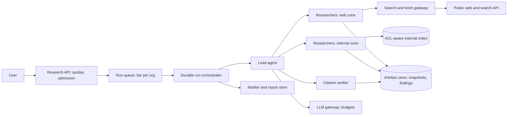
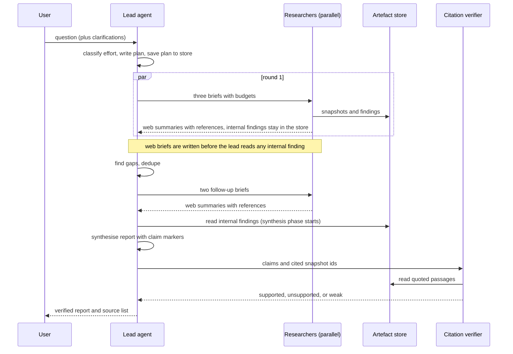

# C16 — Deep-research multi-agent system

> **The requirement.** Lumen Research is a fictional "deep research" mode inside the Lumen assistant. A user asks a
> question that needs many sources ("compare the EU and US rules for AI-generated content labelling and what they mean
> for a video platform"). A lead agent plans, starts several researcher sub-agents that search the web and the
> organisation's internal documents in parallel, merges their findings, writes a report and passes it through a
> citation check. 50,000 reports a day, usually ready in under 10 minutes, never more than $5 each. It is hard because
> the design multiplies the most expensive thing in an AI system (tokens) on purpose, runs for minutes across hundreds
> of model and tool calls where any step can fail, reads untrusted web pages next to private documents, and produces
> an artefact whose main promise, "every claim is sourced", is the easiest one to break silently.

## The prompt

"Design a deep-research agent" is the canonical prompt for **multi-agent** design, because it is the case where
parallel sub-agents have the best published evidence of paying off, and also published evidence of what they cost.
The single-agent loop is in [SYSDESIGN-25](../03-ai-systems/25-agentic-systems.md); orchestration patterns and the
single-versus-multi decision in general are in [SYSDESIGN-29](../03-ai-systems/29-agent-architectures-orchestration.md);
context budgets and memory in [SYSDESIGN-30](../03-ai-systems/30-context-engineering-memory.md). This case applies them
to one product under a cost cap. Retrieval over internal documents with access control is
[C10](./C10-enterprise-rag-assistant.md); polite fetching is [C08](./C08-web-crawler-search.md); budgets and durable
sessions for a single long agent are [C11](./C11-coding-agent-platform.md).

## CLARIFY: requirements

### Functional

1. Submit a question; optionally answer one or two clarifying questions and approve or edit the research plan.
2. The system searches the public web and, if the user's organisation enables it, internal documents the user is
   allowed to read.
3. Progress is visible while the report is produced (plan, sub-topics, sources found); the user can cancel.
4. Output: a structured report in which every factual sentence links to one or more sources, plus a source list
   with fetch dates.
5. The user is notified when an asynchronous report is ready; reports are stored and can be re-run later.
6. Admins set per-user daily quotas and the organisation's monthly research budget.

### Non-functional

| Property | Target (assumption unless stated) |
|---|---|
| Citation accuracy | ≥ 98 % of cited claims supported by the cited source in audit |
| Wall time | p50 < 10 min, p95 < 15 min |
| Cost | hard cap $5 per report; overrun at most one model call |
| Durability | a crash or deploy never restarts a report from zero |
| Data boundaries | internal content goes only to the internal index, the artefact store and model endpoints covered by the organisation's data agreement and region; never into a search query, fetch or web-researcher brief; never mixed into another user's report |
| Politeness | robots rules and per-host rate limits respected for every fetch |
| Freshness | sources fetched during the run; cached pages no older than a stated age |

**Rank them:** citation accuracy > data boundaries > cost cap > wall time > breadth. A fast report with invented
citations is worse than no report, because users trust the footnotes and stop checking.

### Out of scope

Building a web search index (we buy search, see Alternatives). Paywalled content the organisation has not licensed.
Training models. Real-time conversational answers (that is the normal assistant, [C09](./C09-llm-chat-service.md)).

**Ask:** *Is the user waiting, or is this asynchronous? How much is one good report worth to the user? Internal
documents too, or only the web? May the user steer the plan? What is the budget per report and per month?* The value
question matters most. Multi-agent research is only worth its token bill for questions worth several dollars of
compute.

## QUANTIFY: estimates

All values are **labelled assumptions** unless a source is given.

### Shape of one deep run

| Agent | Calls | Mean input per call | Input tokens | Output tokens |
|---|---|---|---|---|
| Lead (plan, two review rounds, synthesis) | 8 | 20 k | 160 k | 10 k (incl. an 8 k-token report) |
| Researchers: 5 sub-agents in two rounds (3, then 2) | 5 × 15 = 75 | 30 k (grows from ≈ 5 k to ≈ 55 k) | 2.25 M | 30 k |
| Citation locator (lead model) | 1–5 | — | 50 k | 2 k |
| **Total per report** | ≈ 88 | | **≈ 2.46 M** | **≈ 42 k** |

Each researcher step is one tool call: about 30 searches and 45 page fetches per report. Fetched pages are cut to
about 3 k tokens before they enter a context; the full text stays in an artefact store.

### Cost per report

Prices are **placeholders** (the same as C11): strong model $3 per million input tokens, $0.30 cached, $3.75 cache
write (the 1.25× premium one provider documents [1]), $15 per million output tokens. Assume 70 % of input is served
from the prompt cache. Researchers call every few seconds, well inside the 5-minute default TTL [1]. (As of 2026-11,
0.1× is that provider's generic read multiplier; it bills reads on some current models at 0.05× or less [1]. At
0.05× that halves only the cache-read part of the first column, about $0.52 of the $4.41 (1.722 M read tokens ×
$0.30/M), saving roughly $0.26 or 6 %; the cache writes at the 1.25× premium ($2.77) stay the larger share of input.
Keep the labelled placeholders for the design.)

| Item | One strong model for every agent | Researchers on a smaller model at one third of the prices |
|---|---|---|
| Lead + citation input (0.21 M) | 0.147 M × $0.30 + 0.063 M × $3.75 = $0.28 | $0.28 |
| Researcher input (2.25 M) | 1.575 M × $0.30 + 0.675 M × $3.75 = $3.00 | 1.575 M × $0.10 + 0.675 M × $1.25 = $1.00 |
| Output (42 k) | 42 k × $15/M = $0.63 | 12 k × $15/M + 30 k × $5/M = $0.33 |
| Claim verification (≈ 150 claims × 2 k tokens, small model at $1/M, uncached) | $0.30 | $0.30 |
| Search (30 queries at a placeholder $5 per 1,000; check your provider) | $0.15 | $0.15 |
| Fetching, storage, orchestration | ≈ $0.05 | ≈ $0.05 |
| **Total** | **≈ $4.4** | **≈ $2.1** |

The claim count is an assumption: an 8 k-token report is about 6,000 words, roughly 250 to 300 sentences, and if
about half of them make a factual claim that is about 150 claims to verify. The researchers' input is about two
thirds of the bill in the first column, so the model chosen for researchers is the largest single lever. Anthropic's
published system used a stronger lead model with smaller researcher models [2]. At 50 k reports a day the difference
is about $220 k versus $106 k per day. Only the second column leaves headroom under the $5 cap once the budget is
split per agent (deep dive 1).

**Do not mix this up with published ratios.** Anthropic reports that in their data agents use about 4× the tokens of
chat interactions and multi-agent systems about 15× [2]. Those are ratios to *their* chat baseline, which the post
does not quantify, so 2.46 M tokens is not "15× a chat turn" of any particular size. Use the ratio as a sanity check
on order of magnitude, and the bottom-up table for the design.

**Effort scaling is the second lever.** The same post's guidance is that simple fact-finding needs one agent with 3–10
tool calls, direct comparisons 2–4 sub-agents with 10–15 calls each, and complex research more than 10 sub-agents
[2]. A single agent making 8 calls at about 15 k input tokens costs about 120 k × (0.3 × $3.75 + 0.7 × $0.30) +
5 k × $15/M ≈ $0.24 under the strong-model prices: about **18× cheaper** than the deep run (≈ $4.4). If half of
all questions are simple and a classifier routes them correctly (assumption), the average report cost falls by almost half.

### Wall time

| Phase | Assumption | Seconds |
|---|---|---|
| Plan (lead call, ≈ 1 k output tokens) | at an assumed 60 output tokens/s plus queueing | ≈ 20 |
| Round 1: 3 researchers in parallel, 15 steps × (3 s model + 4 s tool) on the smaller researcher model | runs until the slowest finishes or a 150 s deadline | 105–150 |
| Lead review | one call | ≈ 15 |
| Round 2: 2 researchers on the gaps | same | 105–150 |
| Synthesis: 8 k-token report at 60 tokens/s | decode-bound | ≈ 135 |
| Citation locate and verify (claims verified in parallel) | | ≈ 40 |
| **Total** | | **≈ 7 min typical, ≈ 8.5 min if both rounds hit the deadline** |

Where the 3 s comes from: researcher output is 30 k tokens over 75 steps, about 400 tokens per step. At an assumed
150 output tokens/s for the smaller researcher model that is about 2.7 s of decode, plus a short prefill for the
uncached part. On the strong model at 60 tokens/s the same step takes about 7 s of decode, a step about 11 to 12 s,
and 15 steps about 175 s: every round would run into the 150 s deadline and return partial findings, for a total of
about 8.5 minutes. So the one-strong-model configuration is slower as well as dearer, unless it takes fewer steps or
a later deadline. One lever the table does not use: Anthropic's speed-up came partly from researchers calling 3 or
more tools in parallel [2], which would shorten the 4 s tool share of each step.

The rounds are sequential because the lead waits for each set of sub-agents. Anthropic describes exactly this
("our lead agents execute subagents synchronously") and names the bottleneck it creates [2]. The synthesis is
long because it is decode-bound: a long report takes minutes to *write* even after all research is done.

### Concurrency and rates

| Quantity | Derivation | Value |
|---|---|---|
| Mean report arrival | 50 k / 86,400 s | 0.58/s |
| Concurrent reports (mean) | Little's law: 0.58/s × 420 s | ≈ 240 |
| Concurrent reports (peak, × 3) | | ≈ 730 |
| Concurrent researcher loops at peak | up to 3 per report | ≈ 2,200 |
| Model calls | 0.58/s × 88, × 3 at peak | ≈ 51/s mean, ≈ 150/s peak |
| Input tokens | 0.58/s × 2.46 M, × 3 at peak | ≈ 1.4 M/s mean, ≈ 4.3 M/s peak (≈ 260 M per minute) |
| Searches | 50 k × 30 | 1.5 M/day, ≈ 52/s at peak |
| Page fetches | 50 k × 45, minus an assumed 30 % shared-cache hit | ≈ 1.6 M origin fetches/day |
| Source snapshots | 45 pages × 50 KB of extracted text × 50 k | ≈ 110 GB/day before deduplication |

Two of these are hard constraints that are not GPUs. **Model rate limits**: about 260 M input tokens per minute at
peak, of which about 77 M (the 30 % not read from the cache) count toward a cache-aware input quota on one
provider's API [13]. Either figure is far above a default provider quota, so capacity must be contracted, or the
service must queue. **Search quotas and
per-host politeness**: 52 searches a second, and many fetches to the same few popular hosts, each of which must be
rate-limited separately ([C08](./C08-web-crawler-search.md)).

## SKETCH: high-level design



*Diagram: users submit questions to a research API that applies quotas and admission control; runs wait in a fair
per-organisation queue for a durable run orchestrator, which drives a lead agent; the lead starts researchers in two
separate zones, web researchers that use a search-and-fetch gateway to the public web and internal researchers that
query an ACL-aware internal index; both write snapshots and findings to an artefact store; the lead calls a citation
verifier that checks claims against stored snapshots; all model calls go through an LLM gateway that enforces
budgets; finished reports go to a report store and the user is notified.*

**Why each box.** **Admission control** exists because each run commits several dollars and hundreds of model calls,
so it is cheaper to refuse or queue at the door than to stall mid-run. The **durable orchestrator** makes a 7-minute,
88-call run survive crashes and deploys. The **lead** plans, delegates, merges and writes; the **researchers** do
breadth in parallel, each with its own clean context. They are split into **zones** so that no single agent context
holds untrusted web content, private documents and an outbound channel at once, and the lead reads internal findings
only after the last web brief is written (deep dive 4). The **search and fetch gateway** is the only path to the web:
it enforces robots rules, per-host rate limits, the fetch cache, the search-API quota and a gate that blocks queries
carrying internal content. The **artefact store** keeps full page snapshots and findings, so contexts hold references, not
pages. The **citation verifier** checks claims against those snapshots. The **gateway** enforces the cost cap per
call.



*Diagram: the lead classifies the question, writes and stores a plan, sends three briefs to researchers in parallel,
which store snapshots and findings and return web summaries with references while internal findings stay in the
store; the lead finds gaps and sends two follow-up briefs, all
web briefs being written before the lead reads any internal finding; the lead then reads the internal findings from
the store, which starts the synthesis phase, and writes the report with claim markers, sends claims with snapshot ids to the verifier, which reads the
passages and labels each claim; the lead returns the verified report.*

## API and data model

```http
POST /v1/research               {"question":"…","mode":"auto","sources":["web","internal"],
                                 "max_cost_usd":5,"plan_review":false}            → 202 {"run_id":"rr_…","eta_s":420}
GET  /v1/research/{id}/events   (SSE: plan, subtask_started, source_found, round_done, verifying, done, stopped)
POST /v1/research/{id}/plan     {"edits":"skip US state laws"}       (only while status = awaiting_plan_review)
POST /v1/research/{id}/cancel
GET  /v1/research/{id}/report   → report with claim ids, citations, coverage notes, cost, sources with fetched_at
```

A researcher **brief** is a typed object, because vague instructions are the failure Anthropic reports first: "Each
subagent needs an objective, an output format, guidance on the tools and sources to use, and clear task boundaries"
[2].

```json
{"subtask_id":"st_2","objective":"EU rules on labelling AI-generated video (AI Act Art. 50, guidelines, codes)",
 "output":{"findings":"list of {claim, source_ref, quote_ref, confidence}","max_tokens":1500},
 "tools":["web.search","web.fetch"],"zone":"web",
 "prefer":["primary legal texts","regulator pages"],"avoid":["content farms","undated pages"],
 "boundaries":"not US law (st_3), not platform policies (st_4)",
 "budget":{"usd":0.65,"steps":15,"deadline_s":150}}
```

| Entity | Key | Key fields |
|---|---|---|
| `run` | run_id | user, org, question, mode, effort class, status, budget, spend, agent version, plan ref |
| `subtask` | (run_id, subtask_id) | brief, zone, model, status (`running`/`done`/`partial`/`timed_out`/`failed`), spend, findings ref |
| `step` | (run_id, subtask_id, seq) | type (llm/search/fetch), input ref, output ref, tokens in/cached/out, cost, latency |
| `source` | content hash | url, canonical url, fetched_at, http status, robots decision, snapshot ref, title, publisher, date if found |
| `claim` | (run_id, claim_id) | sentence span in report, cited source hashes, quote spans, verdict (`supported`/`partial`/`unsupported`), verifier version |
| `budget_ledger` | (org, user, day) | reserved and spent per run, daily and monthly caps |

Sources are keyed by **content hash**, not URL. The same URL can change between two fetches, and a citation must
point to the exact text the verifier read.

## DEEPEN

### Deep dive 1 — Orchestrator-worker, and when multi-agent is worth it

**The published case for.** Anthropic reports that its multi-agent research system, a Claude Opus 4 lead with Claude
Sonnet 4 sub-agents, outperformed a single Claude Opus 4 agent by 90.2 % on its internal research evaluation; that in
its BrowseComp analysis three factors explained 95 % of the performance variance and token usage alone explained 80 %
(the other two being the number of tool calls and the model choice); and that starting 3–5 sub-agents in parallel,
each using 3 or more tools in parallel, cut research time by up to 90 % for complex queries [2]. BrowseComp is a
benchmark of 1,266 hard-to-find questions whose short answers are easy to verify [3]. Read the 80 % carefully:
multi-agent helps largely *because* it lets the system spend more tokens in parallel, across separate context windows.
Quality and cost are coupled, so the right metric is quality per dollar, not quality.

**The published case against.** Cognition's "Don't Build Multi-Agents" (2025) argues two principles: share context,
including full agent traces rather than just messages, and remember that "actions carry implicit decisions, and
conflicting decisions carry bad results" [4]. Its example: one sub-agent builds a background that looks like Super
Mario Bros. while another builds a bird that moves nothing like Flappy Bird's, because neither saw the other's
decisions, and the final agent must combine the two misunderstandings [4]. Its 2026 follow-up narrows this rather
than reversing it: multi-agent systems "work best today when writes stay single-threaded", with read-only sub-agents
such as search the most established pattern, though such sub-agents "mostly resemble tool calls rather than true
multi-agent collaboration" [5]. Anthropic's post agrees on the boundary: domains where all agents need the same context, or
with many dependencies between agents, such as most coding, are a poor fit [2]. A controlled study across 260
configurations and six benchmarks found multi-agent variants ranging from +80.8 % on decomposable financial reasoning
to −70.0 % on sequential planning, relative to a single agent (Kim et al., arXiv preprint v3, 2026) [6]. A failure
taxonomy built from more than 1,600 annotated traces across seven frameworks groups 14 failure modes into system
design issues, inter-agent misalignment and task verification [7]. The general discussion is in
[SYSDESIGN-29](../03-ai-systems/29-agent-architectures-orchestration.md); what follows is specific to research.

**What that means for this design.** Research is the favourable case: the work is breadth-first, read-only and
larger than one context window, and only the lead writes the final artefact. So:

- **Depth 1.** Only the lead can start researchers; researchers cannot spawn. This bounds fan-out and keeps the
  single writer.
- **Typed briefs with boundaries** (the API section) so two researchers do not search the same ground. The lead
  deduplicates follow-up briefs by comparing them with completed ones.
- **Effort scaling before fan-out.** A small classifier (or the lead's first call) chooses *simple* (one agent),
  *comparison* (2–4 researchers) or *deep* (5 researchers). Anthropic's published heuristics are 1 agent, 2–4
  sub-agents, and more than 10 sub-agents for complex research [2]. Our deep class is a cost-driven adaptation: at
  more than 10 researchers the strong-model run would cost about $8, above the $5 cap, and even the tiered run (about
  $3.4) would leave each researcher too small a share for the budget rule below. The cap funds up to about eight
  tiered researchers with headroom; five is the default, and more needs a higher cap. Anthropic lists "spawning 50
  subagents for simple queries" among its early failures [2]; the classifier and a hard cap on researchers per run are
  the fix.
- **Measure, do not assume.** Keep a single-agent baseline on the same evaluation suite and compare quality per
  dollar for each effort class. If the single agent matches the multi-agent run on comparisons, route comparisons to it.

**Hierarchical budgets.** The $5 cap is split before the run starts: 15 % for the lead, 15 % for citation work,
65 % for the researcher pool and a 5 % wrap-up reserve. The pool is divided equally among planned researchers
($0.65 each for five). These shares are designed for the tiered configuration of the cost table (expected
≈ $2.1): a researcher is expected to spend about $0.26 (input $0.20, output $0.03, about six searches $0.03), the lead
about $0.36 of its $0.75 and citation work about $0.40 of its $0.75. In the one-strong-model column a researcher
expects about $0.72 (input $3.00 / 5 = $0.60, output 30 k × $15/M / 5 = $0.09, searches $0.03), more than its whole
share, so the 80 % wrap-up would fire on every typical run. A researcher's expected $0.72 stays below the 80 % mark
only if its share is at least $0.72 / 0.8 = $0.90, so the 65 % pool ($3.25) funds about three strong researchers
(3.25 / 0.90 ≈ 3.6) without wrap-ups firing. The run with five still fits the $5 cap (about $4.4), but every
researcher would be told to wrap up early: the per-agent split under the $5 cap is what forces the tiered design for
deep runs.

Every model call first **reserves** its expected cost at the gateway and reconciles afterwards, as in C11: the part
of the context the previous call cached at the read price, the rest at the write price, plus max output × output
price. A cache miss can then exceed one reservation, which the cost NFR ("overrun at most one model call") allows.
Reserving every call at the uncached price instead strands budget: a strong-model researcher's late call (55 k
context × $3.75/M + 1.5 k × $15/M ≈ $0.23) would be refused once it had spent about $0.42 of $0.65. Search fees are
charged to the researcher that issues them (≈ $0.03 each at the placeholder price). A researcher at 80 % of its
budget receives a "wrap up and return what you have" instruction; at 100 % it is stopped. Its final findings call is
paid from the wrap-up reserve (about $0.05 per researcher, enough for one findings call on the tiered model), so a
stopped researcher still returns its findings, marked `partial`. Unspent researcher budget returns to the pool for
round 2. The lead can never spend the citation share on research, so a report never ships unverified because
research ran long.

### Deep dive 2 — Long runs: durability, caching, failure handling and deploys

**Errors compound.** "Agents are stateful and errors compound," and Anthropic built its system to "resume from where
the agent was when the errors occurred" rather than restart [2]. Restarting a report from zero wastes up to $4 and 7
minutes, so the run is a **durable workflow**: the lead is the workflow, each researcher a child workflow, each model
call, search and fetch an activity whose result is recorded. On a crash the workflow replays and completed activities
are not executed again ([SYSDESIGN-25](../03-ai-systems/25-agentic-systems.md) §7).

**References, not content.** If every activity carried its full context, a researcher call would be about 30 k tokens
× 4 bytes ≈ 120 KB, and 88 calls about 10 MB per run, right at Temporal's 10 MB warning threshold for one event
history (the hard limit is 51,200 events or 50 MB, and one payload is capped at 2 MB) [8]. Put snapshots, findings and
transcripts in the artefact store and pass references, which is also what Anthropic describes: sub-agents "store
their work in external systems, then pass lightweight references back to the coordinator" [2]. Child workflows per
researcher split the history further. The lead's **plan is saved to the store** as soon as it is written. Anthropic
notes that a context over 200,000 tokens is truncated, which is why its lead saves the plan to memory [2]; our lead's
context stays near 20 k, but the saved plan is also what lets a resumed lead continue coherently.

**Stragglers and partial results.** Because rounds are synchronous, one slow researcher delays the whole report. Each
round has a deadline (150 s here). At the deadline, the orchestrator cancels laggards, which return whatever findings
they have, and the lead marks the affected sub-topic as *partial coverage* in the report. A researcher that fails
(tool errors, invalid output) is retried once with the same brief and a fresh context, then marked as a gap. The
report says what it did not cover. Silent gaps are the dangerous failure.

**Four caches, four rules.**

| Cache | Key | Rule |
|---|---|---|
| Provider prompt cache | stable prefix: system prompt, tool definitions, brief template | keep the brief *after* the stable prefix; never put timestamps or run ids at the top; researchers call every few seconds, so the 5-minute TTL holds [1] |
| Fetch cache | normalised URL | respect HTTP caching headers; cap age for news-like hosts; shared across users for public pages only |
| Search-result cache | normalised query + locale | short TTL (minutes to hours); saves quota on popular queries |
| Report cache | — | do not serve one user's report to another: freshness, internal sources and ACLs make it unsafe; offer "re-run with changes" instead |

A pause for human plan review is where the prompt cache breaks: a user who answers after 20 minutes finds the lead's
prefix expired, and the next lead call pays the 1.25× write again [1]. Ask clarifying questions *before* the first
large prompt is built, or accept the small cost.

**Deploys.** Anthropic uses "rainbow deployments to avoid disrupting running agents", sending new traffic to the new
version while old versions keep running [2]. With a durable engine the same idea is version pinning. Temporal's
Worker Versioning (generally available since March 2026) can pin a workflow to the code version it started on, and
Temporal recommends pinning for workflows that finish before the next deploy [9]. A 7-minute run is that case:
pin every run to the agent version (code, prompts, model ids) it started with, drain old workers, and never change
prompts under a running report. Contrast [C17](./C17-workflow-automation-agent.md), where runs last days and pinning
alone is not enough.

### Deep dive 3 — Citations, grounding and evaluation

**A citation is a claim about a stored passage.** The lead writes the report with claim markers: each factual sentence
carries the ids of the sources and quote spans that researchers recorded. Then two checks run.

1. **Locate.** For each claim, find the passage in the cited *snapshot* (by content hash) that supports it. Anthropic's
   system passes the report and documents to a dedicated citation agent that "identif[ies] specific locations for
   citations" [2]. A claim whose cited source was never fetched in this run (a URL the model remembered, not one it read)
   fails here immediately: it is the cheapest hallucination detector there is.
2. **Verify.** A small judge model reads (claim, passage) pairs and labels each `supported`, `partial` or
   `unsupported`. About 150 claims × 2 k tokens is about $0.30 per report (QUANTIFY). Unsupported claims are removed or
   rewritten with a weaker statement; `partial` ones are softened ("one source reports…"). The verdicts are stored
   so audits can sample them.

Store the **snapshot** the verifier read, with fetch time and HTTP status. Pages change and disappear. Without the
snapshot you cannot later show what the source said when the report was written.

**Source quality.** Anthropic reports that early agents "consistently chose SEO-optimized content farms over
authoritative but less highly-ranked sources" [2]. Encode preference in the brief (primary sources, regulators,
papers, official docs) and score sources in the gateway (domain allow and deny lists per topic, presence of a date and
an author, primary versus secondary). Show the score in the source list so the reader can judge.

**Evaluation.** Anthropic's published practice is a single LLM-judge call with a rubric of factual accuracy, citation
accuracy, completeness, source quality and tool efficiency, scoring 0.0–1.0 with a pass/fail grade; starting with about
20 queries representing real usage; and keeping human testers, because "manual testing remains essential" [2]. For
Lumen Research:

- an offline suite of real (consented) questions per effort class, with rubric judging and per-claim citation checks,
  rerun on every change of model, prompt, tool or effort classifier ([SYSDESIGN-32](../03-ai-systems/32-observing-evaluating-agents.md));
- a small set with **known answers** (BrowseComp-style short, verifiable facts) to catch regressions cheaply;
- every result reported as **quality and cost together**, because tokens explain most of the variance [2]. A change
  that raises quality 2 points while doubling cost may be a regression for the product;
- online: user ratings, "report was wrong" flags, the rate of unsupported claims removed by the verifier (a rising
  rate is an early warning that researchers are getting sloppier), and a weekly human audit sample.

### Deep dive 4 — Trust zones, injection and admission

**The research agent reads attacker-controlled text by design.** Every fetched page may contain instructions aimed at
the model ([SYSDESIGN-28](../03-ai-systems/28-ai-trust-safety-governance.md)). Meta's "Agents Rule of Two" (2025) states
the containment rule: until injection can be reliably detected and refused, an agent must satisfy no more than two
of three properties within a session: [A] it processes untrustworthy inputs, [B] it has access to sensitive systems or
private data, [C] it can change state or communicate externally [10]. See
[SYSDESIGN-31](../03-ai-systems/31-securing-agentic-systems.md) for the full treatment.

**A brief is an outbound channel.** Splitting researchers into zones is not enough on its own. Web researchers send
search queries to a third-party API and fetch URLs, which is [C]. Whatever the lead writes into a web brief, or a
web researcher derives from it, can therefore leave the organisation. If the lead has read internal findings and
then writes the round-2 web briefs "to fill the gaps", internal content reaches the outside world through a query
string, and an injected page can steer the lead to do exactly that. So the rule applies to every *context*,
including the ones that write briefs for others, and the lead runs in two phases:

| Component | [A] untrusted input | [B] private data | [C] outbound / state change |
|---|---|---|---|
| Web researcher | yes (pages) | **no**: no internal tools; briefs carry no internal content | yes: queries and fetches leave the boundary |
| Internal researcher | partly (shared documents, forwarded mail, web-derived briefs) | yes (ACL-filtered) | **no** egress |
| Lead, research phase (plan, web rounds) | yes (web summaries) | **no**: internal findings go to the artefact store, not to this context | delegated, through web briefs |
| Lead, synthesis phase | yes | yes (internal findings as cited text) | **no**: issues no web briefs, no tools that send, post or write outside the report store |
| Search and fetch gateway | — | — | brief and query gate (below) |
| Report renderer | — | — | links rewritten through a redirect page that shows the destination first; no auto-loading images |

How it holds. Web briefs and queries are built only from the user's question and the web findings, never after
internal retrieval has entered the context; taint is tracked per context, and once a lead context has read internal
findings, no web brief is issued from it (a gap found during synthesis gets a new web brief only from a fresh,
untainted planning context). Internal researchers may receive web-derived briefs, and the synthesis-phase lead may
still brief them, because they have no egress. The search gateway adds a second line: it checks every outgoing query and URL against the run's internal-finding set
(exact and fuzzy matches of distinctive strings, plus canary tokens planted in internal test documents) and blocks
matches. The price is that web follow-ups cannot be steered by internal findings; when a question needs that, a
human approves the exact brief text, and with it the disclosure. And the user's question itself goes to the search API: if it is
confidential, run internal-only mode.

Two more details. The **synthesis-phase lead holds [A] and [B]**, so it must have no [C]: it cannot fetch, email or
call webhooks, and the report it writes is rendered without auto-loading external resources, because an auto-loaded
image URL is the classic exfiltration channel. A link the user clicks can still carry a query string, which is why
the redirect page shows the destination first. Internal findings enter the lead's context only as cited text, tagged
with their ACL, and the report inherits the strictest ACL of its sources ([C10](./C10-enterprise-rag-assistant.md)).
Finally, "boundary" includes the model provider: internal content goes only to model endpoints covered by the
organisation's data agreement and region.

**Politeness is part of trust.** The fetch gateway obeys robots rules. RFC 9309 says crawlers should not use a cached
robots.txt for more than 24 hours unless it is unreachable, and that these rules "are not a form of access
authorization" [11]: honouring them is about being a good citizen and keeping the service's IP addresses unblocked,
not about security. Per-host concurrency limits and a descriptive user agent follow C08.

**Admission control.** A breaking-news event can send many users to deep mode at once. Each admitted run commits up to
$5 and about 88 model calls over 7 minutes, so admission is decided at the door: per-user daily quota, per-organisation
monthly budget, a fair queue across organisations ([SYSDESIGN-33](../03-ai-systems/33-agent-platform-runtime.md)), and a
global concurrency ceiling derived from contracted model throughput. When the queue is long, give an honest ETA and
offer the cheaper comparison mode now.

## STRESS: failures, hot spots, scale ×10

| Failure | Impact | Detect | Mitigate |
|---|---|---|---|
| Runaway fan-out (dozens of researchers for a simple question) | cost × 10, slow | researchers per run vs effort class | effort classifier; hard cap per class; depth 1 |
| Straggler researcher | report late | round duration | per-round deadline; partial findings; coverage note |
| Search API outage or 429 | researchers stall | search error rate | back-off; second provider; degrade to internal-only with a visible notice |
| Duplicate sub-tasks | wasted tokens, repetitive report | similarity between briefs | typed boundaries; dedupe follow-up briefs |
| Lead context overflow | lost plan, incoherent report | lead context size | bounded summaries; plan saved to store; references not pages |
| Injection in a fetched page | wrong claims; attempted exfiltration | verifier rejections; fetches to odd URLs | trust zones; lead has no outbound tools; verification against snapshots |
| Internal content in a web brief or query | private data sent to a search provider or site | brief and query gate hits; canary tokens | web briefs written before the lead reads internal findings; per-context taint; gateway gate; internal-only mode for confidential questions |
| Invented citation (URL never fetched) | false sourcing | locate step finds no snapshot | reject claim; count per model version |
| Cost overrun | breaks the $5 promise | spend vs reservation | reserve before each call; wrap-up at 80 %; citation reserve ring-fenced |
| Worker crash or deploy mid-run | lost work | activity timeouts | durable replay; version pinning; rainbow-style drain [2][9] |
| Many users choose deep mode at once | model quota exhausted, all runs slow | queue age, gateway 429s | admission control; quotas; ETA; offer cheaper mode |
| Site blocks the fetcher | missing sources | 403/robots denials per host | respect it; record as a coverage gap; never evade blocks |
| Model update lowers citation accuracy | silent quality loss | offline suite; unsupported-claim rate online | eval gate on quality *and* cost; pinned versions; rollback |

**Scale ×10 (500 k reports/day).** Peak input reaches about 43 M tokens/s and 2,600 M tokens per minute, and searches
about 520/s (15 M/day). The binding constraints become contracted model throughput and search quotas. Two
architectural shifts follow. Owning a crawl and index for the most-cited hosts (the C08 machinery) becomes cheaper
than per-query search fees at some volume; compute the break-even from your provider's real price rather than our
placeholder. And the snapshot store (about 1.1 TB/day before deduplication) needs content-addressed storage with
deduplication across users and a retention policy. Effort routing matters more at scale than any infrastructure
change: every question routed to one agent instead of five saves about $4 at the strong-model prices.

## Operate: SLOs, cost, energy

| SLI | SLO (assumption) |
|---|---|
| Report wall time | p50 < 10 min, p95 < 15 min |
| Spend per report | 100 % of runs ≤ cap + one call |
| Cited claims supported in audit | ≥ 98 % |
| Runs lost or restarted from zero | 0 |
| Fetches violating robots or host limits | 0 |
| Effort-class mix | tracked weekly; alert on a jump in "deep" share |

**Cost.** ≈ $4.4 per deep report with one strong model, ≈ $2.1 with smaller researcher models, ≈ $0.24 for a simple
single-agent run, all under placeholder prices. Levers in order: route effort correctly; choose the researcher model on
quality per dollar measured on the suite; keep prompts cache-stable; truncate pages before they enter a context; cap
researchers per class. Report cost per report and per *useful* report (rated helpful, not flagged wrong) to the
product owner.

**Energy.** Follows tokens, and multi-agent multiplies tokens deliberately. At ≈ 2.5 M input tokens per deep report,
prefix caching (which skips prefill for the cached prefix on self-hosted fleets) and routing simple questions away from
deep mode are the main levers. Asynchronous reports can run on capacity in low-carbon regions or hours where data
residency allows ([SYSDESIGN-17](../02-modern-requirements/17-energy-carbon-aware.md)).

## Modern twist

What 2026 changes (as of 2026-11):

- **Research is a product tier, and budgets are product settings.** Anthropic describes the orchestrator-worker
  shape for its Research feature [2]; other assistants' deep modes may differ. Expose effort, sources and the
  cost cap to admins, and report cost per report.
- **The single-versus-multi debate has data.** In 2025 the debate was mostly argument [2][4]; by 2026 there is a
  controlled study [6], a failure taxonomy [7] and a narrower consensus from the sceptics' own follow-up ("writes stay
  single-threaded") [5]. A strong answer states a decision rule, not a preference.
- **Durable execution for agents is documented by engine vendors.** Temporal documents running OpenAI Agents SDK
  agents as durable workflows, where "model calls are executed as Activities" [12], and its Worker Versioning reached general availability in
  2026 [9]. Choose an engine by its limits (history size, payload size) as much as by its API.
- **Tools arrive through MCP.** Expect search, fetch and internal-document tools to be offered as MCP servers (our
  assumption, not a measured trend). Their tool descriptions and results are untrusted input like any web page, and they belong in the zone table above.

## WRAP: interview summary

**A strong 45-minute answer:** clarify sync or async, value per report, sources, steering and cap → quantify tokens
bottom-up (≈ 2.5 M input per deep report), cost (≈ $4 strong model, ≈ $2 tiered), wall time with synchronous rounds
and decode-bound synthesis, concurrency and the non-GPU bottlenecks (model quota, search quota, politeness) → sketch
admission, durable orchestrator, lead, zoned researchers, fetch gateway, artefact store, verifier, gateway → deep dive
on when multi-agent pays (both sides of the evidence, effort scaling, depth 1, hierarchical budgets) → durability with
references, stragglers, caches and deploy pinning → citation verification against snapshots and quality-per-dollar
evaluation → trust zones → failures.

| Level | Expectations |
|---|---|
| Junior | One agent with search and fetch tools in a loop, a max-steps limit, a report with links |
| Senior | Orchestrator-worker with typed briefs and depth 1; parallel rounds; per-run budget with reservations; durable run with resumable state; fetch gateway with robots and rate limits; citations checked against fetched pages; rubric-based offline eval |
| Staff | Quotes the published multipliers correctly and builds a bottom-up cost that does not conflate them; effort routing and researcher-model choice as the main cost levers; states the counter-evidence and a measured single-vs-multi decision; hierarchical budgets with a ring-fenced verification reserve; references not content in the durable history (engine limits); trust-zone table against the Rule of Two, including briefs as a delegated outbound channel; quality per dollar as the release metric; scale ×10 bottlenecks in search and contracted throughput |

**Red flags.** "More agents means better answers" with no cost. Researchers that can spawn researchers without a cap.
Citations generated by the model without checking the fetched text. One agent with web access, internal documents and
an email tool, or a lead that reads internal documents and then writes web-search briefs. Restarting a failed run from zero. Quoting "15× tokens" as if it were a per-report number.

## Alternatives considered

| Alternative | Wins when | Why not the default |
|---|---|---|
| Single agent with a large context and many tool calls | simple and comparison questions; tightly coupled reasoning | weaker breadth on complex questions in the published comparison [2]; we route to it by effort class |
| Fixed pipeline: search → read top N → summarise | predictable cost, simple questions | no adaptivity: cannot follow leads or fill gaps |
| Asynchronous sub-agents (lead does not wait) | very long, very broad runs | more coordination and state complexity; Anthropic names it as a direction, not its current design [2] |
| Own crawl and index | very high volume on a stable set of hosts | large fixed cost; buy search until the break-even (Scale ×10) |
| No verification pass, trust model citations | lowest cost | invented and mismatched citations go to users who trust footnotes |
| Debate among several agents to reach consensus | contested questions | multiplies tokens again; the evidence for it is mixed; a verifier on stored passages is cheaper and checkable |

## Exercises

See [exercises/C16-deep-research-agents.md](../../exercises/C16-deep-research-agents.md). Lab: planned, not built.
Two exercises reuse existing labs: [labs/25-agentic-systems](../../labs/25-agentic-systems/) (budgets, loop detection,
trace) and [labs/26-llm-gateways-llmops](../../labs/26-llm-gateways-llmops/) (per-tenant token limits as admission
control).

## References

All accessed 2026-11-20.

1. Anthropic, "Prompt caching" (as of 2026-11: 5-minute default lifetime refreshed on use, 1-hour option; writes 1.25×
   or 2×; reads 0.1× base input price generically, 0.05× on Claude Opus 5.5 and Sonnet 5.5, 0.025× on the Fable and
   Mythos 5.x models). https://platform.claude.com/docs/en/build-with-claude/prompt-caching
2. Anthropic, "How we built our multi-agent research system," 2025-06-13 (90.2 %; 4× and 15× tokens; 95 % and
   80 % of BrowseComp variance; 3–5 sub-agents, up to 90 % faster; effort-scaling heuristics; 50-sub-agent failure;
   synchronous sub-agents; references to external storage; 200,000-token truncation; citation agent; rubric judge;
   about 20 queries; rainbow deployments). https://www.anthropic.com/research/multi-agent-research-system
3. J. Wei et al., "BrowseComp: A Simple Yet Challenging Benchmark for Browsing Agents," arXiv:2504.12516, 2025
   (preprint; 1,266 questions). https://arxiv.org/abs/2504.12516
4. W. Yan (Cognition), "Don't Build Multi-Agents," 2025-06-12. https://cognition.com/blog/dont-build-multi-agents
5. W. Yan (Cognition), "Multi-Agents: What's Actually Working," 2026-04-22. https://cognition.com/blog/multi-agents-working
6. Y. Kim et al., "Towards a Science of Scaling Agent Systems," arXiv:2512.08296 v3, 2026-04-08 (preprint; 260
   configurations, six benchmarks, +80.8 % to −70.0 %). https://arxiv.org/abs/2512.08296
7. M. Cemri et al., "Why Do Multi-Agent LLM Systems Fail?," arXiv:2503.13657 v3, 2025-10-26 (preprint; 14 failure
   modes, three categories, 1,600+ traces, seven frameworks). https://arxiv.org/abs/2503.13657
8. Temporal documentation, Temporal Cloud limits (2 MB payload; 4 MB gRPC message; history 51,200 events or 50 MB,
   warning at 10,240 events or 10 MB). https://docs.temporal.io/evaluate/cloud/limits ; https://docs.temporal.io/workflow-execution/limits
9. Temporal, "Worker Versioning" documentation (Pinned and Auto-Upgrade behaviours, draining) and "Announcing GA for
   Worker Versioning and Public Preview for Upgrade on Continue-as-New," 2026-03-30. https://docs.temporal.io/worker-versioning ;
   https://temporal.io/blog/ga-worker-versioning-public-preview-upgrade-on-continue-as-new
10. Meta AI, "Agents Rule of Two: A Practical Approach to AI Agent Security," 2025-10-31 ([A], [B], [C]; "no more than two ... within a session"). https://ai.meta.com/blog/practical-ai-agent-security/ (accessed 2026-11-20; the page reads "agents must satisfy no more than two of the following three properties within a session")
11. M. Koster et al., "Robots Exclusion Protocol," RFC 9309, September 2022. https://www.rfc-editor.org/rfc/rfc9309.html
12. Temporal documentation, "OpenAI Agents SDK integration" (Python; "model calls are executed as Activities"). https://docs.temporal.io/develop/python/integrations/openai-agents
13. Anthropic, "Rate limits" (cache-read input tokens do not count toward the input-tokens-per-minute limit; uncached
    input and cache writes do), as of 2026-11. https://platform.claude.com/docs/en/api/rate-limits
