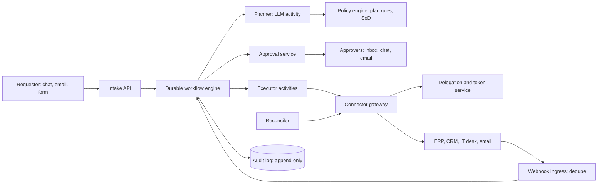
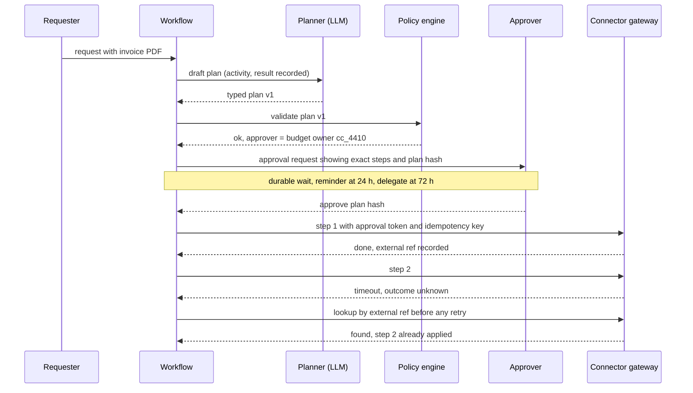
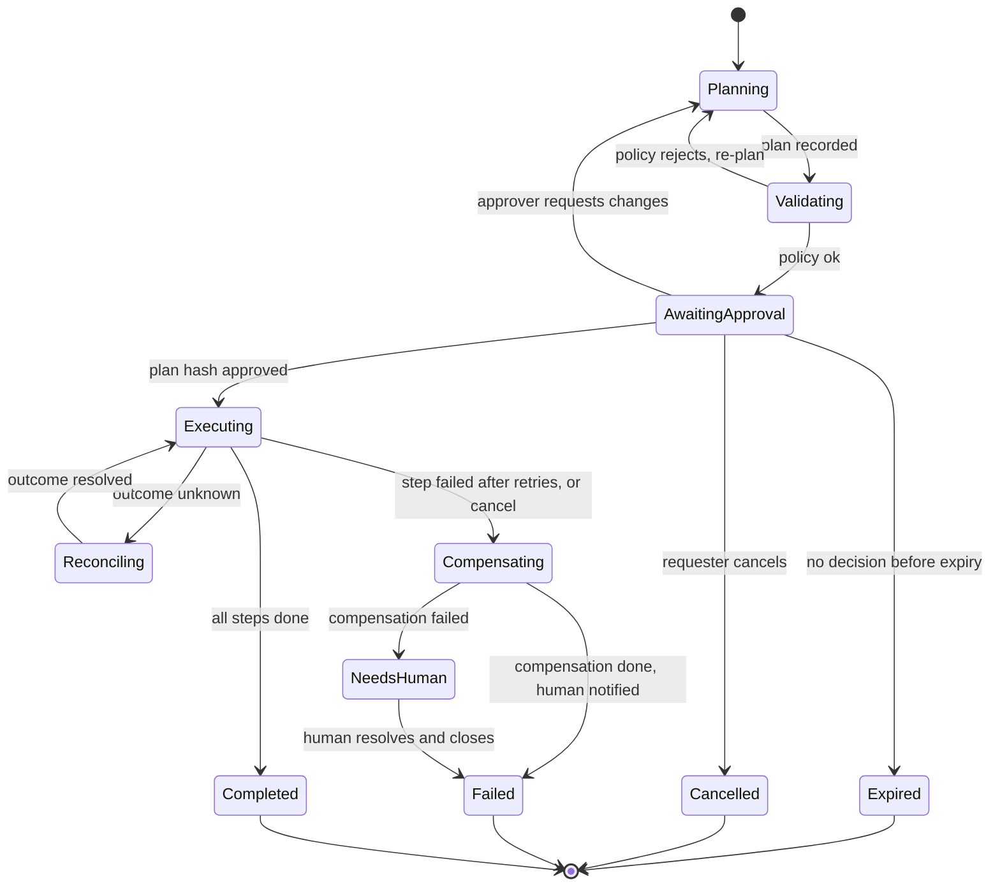

# C17 — Enterprise workflow-automation agent

> **The requirement.** Lumen Flow is a fictional platform. Employees of 500 enterprises ask it, in plain language,
> to do back-office work: "onboard Example GmbH as a supplier and raise a PO for the 18,400 EUR quote in this email",
> "give the new analyst access to the finance dashboards", "cancel the duplicate invoice from last week". The agent
> reads the request and attachments, plans the steps across the company's ERP, CRM, IT-service desk and email,
> asks the right people to approve, waits for them (hours or days), executes, handles failures, and records
> everything for auditors. 20,000 runs start each day and about 40,000 are open at any moment. It is hard because the
> run outlives every process, deploy and token involved; because the systems it changes are other vendors' SaaS
> APIs with their own rate limits and weak idempotency; and because the people who approve must be the right
> people, and provably so, years later.

## The prompt

"Design an agent that automates enterprise workflows with approvals" tests whether you know when **not** to let the
model drive. The agent loop ([SYSDESIGN-25](../03-ai-systems/25-agentic-systems.md)) is a small part of this design. The
larger parts are classical: durable execution and sagas ([SYSDESIGN-08](../01-foundations/08-async-event-driven.md)),
exactly-once effects ([C06](./C06-payments-ledger.md)), identity and delegation ([SYSDESIGN-18](../02-modern-requirements/18-security-by-design.md)),
audit and retention ([SYSDESIGN-19](../02-modern-requirements/19-privacy-compliance-sovereignty.md)). The workflow-versus-agent
choice is in [SYSDESIGN-29](../03-ai-systems/29-agent-architectures-orchestration.md); securing tool access in
[SYSDESIGN-31](../03-ai-systems/31-securing-agentic-systems.md); runtime, tenancy and rollout in
[SYSDESIGN-33](../03-ai-systems/33-agent-platform-runtime.md).

Compared with [C11](./C11-coding-agent-platform.md) (an hour-long task in a sandbox) and
[C15](./C15-support-agent-platform.md) (seconds-long turns), the defining property here is **elapsed time measured in
days with almost no compute in between**, and side effects in systems of record that auditors will inspect.

## CLARIFY: requirements

### Functional

1. **Intake:** requests by chat, email (with attachments: quotes, invoices, forms) or a form; templates for common
   workflows (vendor onboarding, purchase order, access request, invoice exception).
2. **Plan:** the agent proposes a typed, step-by-step plan, shows it to the requester and lets them correct it.
3. **Approve:** each plan routes to approvers determined by policy (budget owner, procurement, security); approvals
   can take days; reminders, delegation and escalation are automatic.
4. **Execute:** steps run against ERP, CRM, IT-service desk, identity provider and email through connectors.
5. **Observe external events:** webhooks (invoice received, ticket closed) wake up waiting runs.
6. **Recover:** failures are retried, compensated or routed to a human; nothing is silently half-done.
7. **Audit:** for every run, show who asked, what the agent proposed, who approved what, what executed, with which
   identity, and the result, for the full retention period.

### Non-functional

| Property | Target (assumption unless stated) |
|---|---|
| Correctness of effects | no duplicate or orphaned side effect; every ambiguous outcome resolved |
| Authorisation | every write executed with a delegated identity, scoped to the step, after the required approval |
| Segregation of duties | requester, approver and executor are distinct principals where policy demands it |
| Durability | no run lost on crash, deploy or region failover |
| Approval to execution | p95 < 5 min, excluding target-system rate limits |
| Audit | complete, tamper-evident, retained for the tenant's policy (assume 10 years) |
| Tenant isolation | no cross-tenant credentials, data or runs |

**Rank them:** correctness of effects > authorisation and segregation of duties > audit > durability > latency > cost.
A run that takes an extra hour is fine; a payment made twice, or approved by the requester themselves, is an audit
finding.

### Out of scope

The ERP and CRM themselves. Free-form autonomous agents with open internet access. Payment rails (we create payment
proposals in the ERP; the ERP's own controls release money). Training models.

**Ask:** *Which systems, and do their APIs support idempotency keys or unique external references? Which steps are
reversible? Who approves what, and what happens when they are away? How long do runs take, and how often do you
deploy? What is the retention requirement for audit? Do any workflows affect employment decisions (access for new
hires, HR changes)?* The idempotency answer drives deep dive 2; the deploy-versus-run-length answer drives deep
dive 4.

## QUANTIFY: estimates

All values are **labelled assumptions** unless a source is given.

### Runs in flight

| Quantity | Derivation | Value |
|---|---|---|
| Runs started/day | given | 20 k |
| Arrival | 20 k / 86,400 s | 0.23/s |
| Mean elapsed time (almost all waiting for humans) | assumption; p99 14 days | 2 days = 172,800 s |
| **Runs in flight** | Little's law: 0.23/s × 172,800 s | **≈ 40 k** |
| Approvals requested | 1.5 per run | 30 k/day |
| Side-effecting calls | 8 per run | 160 k/day ≈ 1.9/s mean |

Forty thousand open runs sound large, but almost all of them are a persisted record waiting on a timer or a signal.
Temporal's documentation, for example, states that timers are persisted, survive worker and service outages, and
that "Workers consume no additional resources while waiting for a Timer to fire" [1]. Waiting costs storage, not
compute.

### LLM work is small

| Quantity | Assumption | Value |
|---|---|---|
| Model calls per run | plan, re-plan after edits, extract fields from 2 attachments, draft 3 messages, summarise for approvers | ≈ 12 |
| Tokens per run | 12 × 6 k input, 12 × 400 output | 72 k input, 4.8 k output |
| Cost per run (C11 placeholder prices; 50 % cached because calls come in bursts separated by long waits) | 36 k × $0.30/M + 36 k × $3.75/M (cache write) + 4.8 k × $15/M | ≈ $0.22 (≈ $0.14 at the Claude Sonnet 5.5 prices used in [SYSDESIGN-33](../03-ai-systems/33-agent-platform-runtime.md)) |
| Platform model bill | 20 k × $0.22 | ≈ $4.4 k/day |

Calls after an approval wait find an expired prompt cache (5 minutes by default, a 1-hour option at a higher write
price [17]), so the cache helps only within a burst; the executor sends the approved plan, not the transcript, so the
re-written prefix is small. The model is cheap compared with the human time it saves and the cost of one wrong
payment. The bottlenecks are elsewhere.

### The target systems are the throughput limit

Assume a tenant's ERP allows 5 requests/s for this integration (check the real limit; vendors publish them per
plan). A large tenant runs 2,000 runs a day; each run makes 8 writes and about 24 reads (lookups before writes,
status checks). Over a day that averages 0.74 requests/s, comfortably inside the limit. But approvals cluster: a
Monday 09:00 approval batch can release 2,000 runs within 30 minutes. 2,000 × 32 = 64,000 calls at 5/s takes
12,800 s, **about 3.6 hours** to drain. Per-tenant, per-connector rate limiting and queueing in the connector gateway
are therefore core, and the approval-to-execution SLO must exclude, or explicitly budget for, target-system limits.

### Partial failure is a normal path

| Quantity | Derivation | Value |
|---|---|---|
| Runs with 3 non-trivially reversible steps, 1 % failure each | 1 − 0.99³ = 2.97 % of 20 k | **≈ 590 runs/day** need compensation or a human |
| Ambiguous outcomes (timeout after the request was sent) | assume 0.1 % of 160 k calls | ≈ 160/day need lookup or reconciliation |

At this volume, "the run failed halfway" is not an exception path for an on-call engineer. It is a designed state
with a queue and an owner.

### History, audit and versions

| Quantity | Derivation | Value |
|---|---|---|
| Workflow history per run | ≈ 80 events (activities scheduled/started/completed, timers, signals) with references ≈ 1–2 KB | ≈ 150 KB; ≈ 6 GB for 40 k open runs |
| Audit events | ≈ 32 connector calls plus plan, policy, approval, model and state-change events, assumed 200 per run × 1 KB × 20 k | ≈ 4 GB/day, ≈ 1.5 TB/year, ≈ 15 TB over 10 years (before replication) |
| Code versions alive at once | daily deploys, p99 run 14 days | up to ≈ 14 |

The last row is the one interviewers probe: runs live longer than code.

## SKETCH: high-level design



*Diagram: requesters submit work through an intake API to a durable workflow engine; the engine calls a planner, an
LLM activity whose plan a policy engine validates for rules and segregation of duties; the approval service asks
approvers through their inbox, chat or email; executor activities perform steps through a connector gateway, which
obtains delegated tokens from a delegation service and calls ERP, CRM, IT desk and email; those systems send
webhooks to a deduplicating ingress that signals the workflow; a reconciler checks ambiguous effects through the
gateway; the engine writes every decision and effect to an append-only audit log.*

**Why each box.** The **workflow engine** is the run: it holds state, timers and signals for days and replays after
crashes. The **planner** is the only place the model decides the shape of the work, and its output is data, not
actions. The **policy engine** turns company rules into deterministic checks on that data. The **approval service**
owns the human side: routing, reminders, delegation, expiry. **Executor activities** are ordinary code that perform
one step each. The **connector gateway** is the only path to SaaS systems; it holds per-tenant credentials (via the
**delegation service**), rate limits, idempotency logic and the approval check for each write. The **webhook
ingress** turns duplicate, unordered external events into clean signals. The **reconciler** settles unknown
outcomes. The **audit log** is separate from the engine's history, because engine retention is short (see deep
dive 3).



*Diagram: the requester submits a request; the workflow asks the planner for a typed plan and records it; the policy
engine validates it and names the approver; the approver sees the exact steps and approves the plan hash after a
durable wait with reminder and delegation; the workflow executes step 1 through the gateway with an approval token
and idempotency key; step 2 times out, so the workflow looks it up by external reference before any retry and finds
it already applied.*

## API and data model

```http
POST /v1/runs                     {"template":"po_from_quote","text":"Raise a PO for this quote…",
                                   "attachments":["att_31"],"on_behalf_of":"u_ana"}          → 202 {"run_id":"run_…"}
GET  /v1/runs/{id}                → status, current plan, pending approvals, steps with external refs
GET  /v1/runs/{id}/plan           → typed plan with plan_hash
POST /v1/runs/{id}/plan/edits     {"text":"split across cost centres 4410 and 4420"}    (before approval only)
POST /v1/approvals/{aid}          {"decision":"approve","plan_hash":"sha256:9c…","comment":"ok"}
POST /v1/delegations              {"from":"u_bo","to":"u_dep","scope":"approve:cc_4410","until":"2026-12-02"}
POST /v1/webhooks/{connector}     (signature verified; dedupe on the provider's event id)
POST /v1/runs/{id}/cancel         → compensation runs for completed compensable steps
GET  /v1/audit?run_id=…           → ordered, hash-linked audit events
```

The planner's output is a **typed plan** over a fixed vocabulary of operations, never free-form actions:

```jsonc
{"plan_id":"pl_77","run_id":"run_5e1","version":1,"requester":"u_ana","on_behalf_of":"u_ana",
 "steps":[
  {"seq":1,"op":"erp.vendor.find_or_create","args":{"tax_id":"<from quote>","name":"Example GmbH"},
   "effect":"external_write_compensable","compensate":"erp.vendor.deactivate"},
  {"seq":2,"op":"erp.po.create","args":{"vendor":"$1.vendor_id","amount":"18400.00 EUR","cost_centre":"4410"},
   "effect":"external_write_compensable","compensate":"erp.po.cancel"},
  {"seq":3,"op":"email.send","args":{"to":"$1.contact_on_file","template":"po_issued","po":"$2.po_number"},
   "effect":"external_irreversible"}],
 "approvals_required":[{"role":"budget_owner:cc_4410","covers":[1,2,3]}],
 "plan_hash":"sha256:9c…"}
```

| Entity | Key | Key fields |
|---|---|---|
| `run` | run_id | tenant, requester, on_behalf_of, template, status, agent_version, code_version, workflow id |
| `plan` | (run_id, version) | steps, plan_hash, policy result, created_by (`agent`/`human`), superseded_by |
| `approval` | approval_id | run, plan_hash, required role, approver, delegated_from, decision, decided_at, expires_at, channel |
| `step` | (run_id, seq) | op, args ref, effect class, idempotency key, external ref, status (`pending`/`running`/`done`/`unknown`/`compensated`/`failed`), attempts |
| `delegation` | delegation_id | from, to, scope, valid_from, valid_until, created_by |
| `connector` | (tenant, system) | capabilities: idempotency header, unique external ref, lookup query, compensation ops; rate limit; credential ref |
| `audit_event` | (tenant, seq) | run, actor (human or agent identity), on_behalf_of, action, payload ref, prev_hash, hash, ts |

## DEEPEN

### Deep dive 1 — Plan, approve, execute on a durable workflow

**Do not let the agent loop drive side effects for days.** An open-ended agent loop that decides each next action
after each approval would re-run model reasoning on new context days later, with a new model version, possibly
after reading a manipulated attachment. Instead, split the run into three phases with different trust:

1. **Plan (model).** The planner reads the request and attachments and emits a typed plan over a fixed operation
   vocabulary. The model is good at the hard part, turning "this quote" into vendor, amount, cost centre and steps.
   Its output is recorded as an activity result, so a replay never asks again.
2. **Validate and approve (deterministic, then human).** The policy engine checks the plan: the operations are
   allowed for this template, the amounts are within the requester's limits, the vendor is not on a block list, bank
   details come only from the vendor master record, and segregation of duties holds (deep dive 3). Approvers see the
   **exact steps and arguments**, not a summary written by the model, and approve the **plan hash**. Any edit creates
   a new plan version and invalidates earlier approvals.
3. **Execute (deterministic).** The executor runs the approved steps in order. The model may still be called inside
   a bounded activity (draft the email body from a template), but it cannot add, remove or reorder steps. If
   execution reveals that the plan is wrong (the vendor already exists with different bank details), the run stops
   and goes back to plan and approve. It never improvises.

This is the "workflow with LLM steps" end of the spectrum in [SYSDESIGN-29](../03-ai-systems/29-agent-architectures-orchestration.md):
agentic where language is ambiguous, deterministic where money and permissions move.

**Waiting for days.** Approvals are **signals** the workflow waits on; reminders and escalations are **durable
timers**: remind at 24 hours, offer the approver's delegate at 72 hours, expire and notify the requester at 7 days
(tenant policy). Temporal persists timers and allows them to last years [1], and in Temporal Cloud (limits as of 2026-11) a single workflow
execution may receive up to 10,000 signals, with at most 2,000 pending activities, signals or child workflows (500 or
fewer recommended) [2]. A run that listens to every ERP event for a vendor would hit those limits; filter events in
the webhook ingress and signal only the runs that wait for them.

**Respect the engine's limits.** Temporal Cloud caps a payload at 2 MB, a gRPC message at 4 MB, and an event history
at 51,200 events or 50 MB, with a warning at 10,240 events or 10 MB [2][3]. Attachments (a 30-page PDF) and model
transcripts therefore live in object storage, and the history records their references and hashes (the claim-check
pattern). A typical run's ≈ 80 events are far from the limit. A **standing** workflow, such as "manage this vendor's
lifecycle for a year", is not, and it should Continue-As-New at natural boundaries (for example monthly), carrying
only its state forward.



*Diagram: a run plans, is validated (or re-planned), waits for approval (or returns to planning on requested changes,
is cancelled by the requester, or expires), executes the approved plan hash, moves to reconciling when an outcome is
unknown and back when it is resolved, compensates when a step fails after retries or the run is cancelled, and then
fails with a human notified, or goes to a human task when a compensation itself fails, or completes.*

### Deep dive 2 — Exactly-once effects across SaaS APIs

The workflow engine guarantees that the **workflow** progresses exactly once. It does not make the **ERP** exactly
once: an activity that times out is retried, and the first attempt may have succeeded. Temporal's documentation
recommends that an activity be idempotent "so retries can be processed without duplicate side effects" [16]; the
effect-level guarantee is your job
([SYSDESIGN-25](../03-ai-systems/25-agentic-systems.md), "Exactly-once effects").

**Classify every connector operation by what the target system offers:**

| Target offers | Technique | Example and caveat |
|---|---|---|
| An idempotency-key header | send a key derived from `(run_id, step_seq)`, never random per attempt | Stripe's API v1 replays the saved response for a repeated key, rejects a reused key with different parameters, and may prune keys once they are at least 24 hours old [4]. A retry after the key is pruned is a *new* request, so retries beyond the key's lifetime need a lookup first |
| A unique business key | put the step key or a natural key in a unique field (external reference, invoice number per vendor) and create-or-get | duplicates are rejected by the target; the second attempt reads the existing record |
| A searchable field, no uniqueness | write a marker (the step key) into a reference or memo field; **look up before every retry**; single-flight the step with a lease | a race remains if two attempts run concurrently, hence the lease |
| Nothing (send email, post a chat message) | at-most-once through an outbox; on timeout the step becomes `unknown`, never auto-retried | a human or a delivery-status check decides; tell the recipient "please ignore duplicates" only as a last resort |

**Intent, then effect, then record.** Before calling the target, the executor records the step's intent (operation,
arguments hash, idempotency key) in the run state; after the call, the external reference and result. A crash between
the two leaves an intent without a result, and recovery begins with a **lookup**, not a retry. This is the same
discipline as the payments ledger ([C06](./C06-payments-ledger.md)), applied to systems you do not control.

**Unknown is a state, not an error.** About 160 calls a day end with "request sent, no answer" (QUANTIFY). The step
moves to `unknown`, the run waits, and the reconciler queries the target by external reference or marker. If it finds
the effect, the step is `done`; if the target confirms absence, the step is retried with the same key; if the target
cannot answer, a human gets a task with the evidence. The model is never asked "did the PO get created?".

**Sagas for multi-system changes.** A run that creates a vendor, then a PO, then emails the vendor spans three systems
with no shared transaction. Garcia-Molina and Salem's sagas (SIGMOD 1987) split a long-lived transaction into steps,
each with a compensating step that semantically undoes it, so that either all steps complete or the completed ones
are compensated [5]. Two design rules matter more than the pattern name:

- **Order the steps so that the irreversible one comes last.** Validate everything that can be validated (vendor
  exists, budget available, approval token valid) before the first irreversible effect. In the plan above, the email
  to the vendor is the pivot: after it, cancelling the PO is a business conversation, not a compensation.
- **Compensation is a new business action, not a rollback.** Cancelling a PO leaves a cancelled PO in the ERP and a
  line in the audit log. Some compensations need their own approval (reversing a posted invoice). Model them as plan
  steps with their own effect class.

**Webhooks are at-least-once and unordered.** Stripe's documentation, for example, says endpoints may receive the same
event more than once, does not guarantee delivery order, and retries for up to three days in live mode [6]. The
webhook ingress verifies the signature, deduplicates on the provider's event id, and signals the run with "something
changed on object X". The run then **reads the current state** from the target rather than trusting the event body,
which makes ordering irrelevant.

### Deep dive 3 — Identity, delegation, segregation of duties and audit

**Whose authority does a step use?** Not the platform's. A service account with ERP admin rights would make every run,
and every prompt injection, as powerful as the most privileged user. Each write runs with a **delegated** token:

- The requester authorises Lumen Flow once per connector (OAuth consent), and the delegation service exchanges that
  grant per step for a short-lived token scoped to the step's operation and object. OAuth 2.0 Token Exchange gives this
  the right semantics: in delegation the actor keeps its own identity, and the token's `act` claim says who acts for
  whom, with nested `act` claims recording a chain [7]. The ERP's own audit then shows "Lumen Flow agent, acting for
  Ana".
- The **approval is a credential too.** When an approver approves a plan hash, the approval service issues a signed
  approval token bound to (run, plan hash, steps covered, expiry). The connector gateway refuses any write whose step is
  not covered by a valid approval token, whatever the workflow asks. A bug or a compromised executor cannot skip the
  human.
- When a connector is an MCP server, the same rules hold in protocol form: tokens must be issued for that server as
  the audience, and servers must not accept or pass on other tokens [8].

**Segregation of duties.** Separation of duties is a standard access-control requirement, for example control AC-5 in
NIST SP 800-53 Rev. 5 [9]. The platform enforces it from the plan, not from UI conventions: the approver of a plan
cannot be its requester, cannot be a delegate whose delegation came from the requester, and can never be the agent.
The policy engine resolves the approver set at validation time and again when the approval arrives (people change
roles in two days). The agent itself is a principal with its own workload identity
([SYSDESIGN-18](../02-modern-requirements/18-security-by-design.md)), so the audit log can always tell a human action
from an agent action.

**Approvers go on holiday.** Delegations are records with scope and validity ("u_dep may approve cost centre 4410
until 2 December"), created by the approver or their manager, never inferred by the agent. The escalation timer offers
the run to an active delegate, then to the next level in the approval chain, then expires it.

**Approval fatigue is a security property.** Anthropic reports that Claude Code users accepted 93 % of manual
permission prompts, and built automation partly because of it; its own deployed classifier still missed 17 % of
real overeager actions in its evaluation (n = 52, one vendor's own evaluation) [10]. Different product, same lesson: an approval that is almost always
"yes" stops being a control. Keep approvals for plans with real risk, batch low-risk ones ("approve these 12 access
requests for your team"), show the exact change and the policy reason, and track **approval rate and time-to-decide
per approver**. A 99 % approval rate with a median of three seconds is a rubber stamp, and auditors will ask about it.

**The audit trail outlives the engine.** Temporal Cloud lets you retain closed workflow histories for 1 to 90 days
[2]; auditors want years. So the audit log is a separate, append-only store:

- one event per decision and effect: request, plan version and hash, policy result with rule ids, approval with
  approver and delegation chain, each connector call with identity, idempotency key, external reference and result,
  model id and prompt version for every LLM activity;
- events are hash-chained per tenant (each carries the previous event's hash) and periodically anchored, so deletion
  or editing is detectable; stored on write-once object storage with the tenant's retention period;
- personal data in payloads is stored by reference with per-subject encryption keys, so an erasure request can be met
  by destroying the key while the audit skeleton stays intact (crypto-shredding, see [SYSDESIGN-19](../02-modern-requirements/19-privacy-compliance-sovereignty.md)).

**Regulatory check.** Most procure-to-pay automation is not a high-risk use under the EU AI Act. Workflows that make or
inform decisions about workers (access, assignments, HR changes) can fall under Annex III point 4 (employment); after
the Digital Omnibus on AI, Annex III high-risk obligations apply from 2 December 2027 [11][12]. Record-keeping and
human oversight then become legal requirements, and the audit design above is most of the system you need.

### Deep dive 4 — Versioning and recovery when runs outlive deploys

With daily deploys and runs that last up to 14 days, up to 14 code versions have runs in flight. Two different things
change, and they need different mechanisms.

**Code versions (the workflow definition).** A durable engine replays history through the current code, so a code
change can break replay of old runs. Pinned, Auto-Upgrade and draining are explained in
[SYSDESIGN-33](../03-ai-systems/33-agent-platform-runtime.md) §10 [13][14]. The case-specific fact: a pinned run that
does a plain Continue-As-New **stays pinned**, because "the Pinned version is inherited across the Continue-As-New
chain" [13]. Temporal says that for the longest-running workflows "neither behavior has offered a clean answer", and
introduces **Upgrade on Continue-as-New** for workflows that already continue-as-new [14]; as of 2026-11 it is in
Public Preview "as an experimental SDK-level option" and must be opted into in workflow code [18]. For Lumen Flow:

- Short templates (access requests that finish within hours): pinned.
- Multi-day runs: pinned, with a Continue-As-New after each approval **that opts into Upgrade on Continue-as-New**,
  so the execute phase starts on the Current (or Ramping) version with only the approved plan as state [18]. Plain
  Continue-As-New would keep the old version. Where a preview feature is unacceptable, use Auto-Upgrade with patching
  and the replay tests below.
- Every deploy runs **replay tests** in CI: recorded histories of real (anonymised) runs are replayed against the new
  workflow code before it ships.

**Agent versions (prompts, model ids, tool schemas, policy).** These change more often than code and should not need a
deploy. Store an `agent_version` on the run at plan time. The plan is produced by that version and approved as data,
so later prompt changes cannot alter an approved run. Bounded LLM activities during execution (drafting an email) use
the run's pinned version too. If a provider retires that model before the run finishes, map it through a tested
fallback table and record the substitution in the audit log.

**Recovery after a bad deploy or an outage.**

- *Target system down mid-saga:* activities retry with exponential back-off up to a step deadline; the run waits
  (timers cost nothing) and then either resumes or compensates. The connector's circuit breaker stops all runs from
  hammering a recovering ERP.
- *A bad release corrupted plans for an hour:* find affected runs by `agent_version` in the run table, suspend them
  with a signal, and re-plan them. Approvals bound to the old plan hashes are void automatically.
- *A credential is revoked* (the requester left the company, so their delegated grant died): runs acting for them
  pause in `needs_owner`, and the tenant admin reassigns them to a new owner, which creates a new delegation and a new
  approval. Do not silently switch to a service account.
- *Region failover:* the engine's state and the audit log replicate to the secondary region; idempotency keys and
  external references make re-execution after failover safe.

## STRESS: failures, hot spots, scale ×10

| Failure | Impact | Detect | Mitigate |
|---|---|---|---|
| Approver absent | runs stall for days | approval age | reminder, delegate, escalate, expire (durable timers) |
| ERP outage mid-saga | half-done runs | connector error rate, steps in `running` | retries with back-off; breaker; compensate past the deadline |
| Monday 09:00 approval burst | 3.6 h backlog for a large tenant | connector queue depth | per-tenant per-connector token buckets; priorities; honest ETA |
| Duplicate or out-of-order webhooks | duplicate signals, wrong state | event-id dedupe hits | dedupe; signal "changed", then read current state |
| Timeout after a write | possible duplicate | steps in `unknown` | lookup before retry; reconciler; human task with evidence |
| Injected instruction in an invoice PDF ("bank details changed, pay to …") | payment to a fraudster | bank details differ from vendor master | bank details only from the master record; any change is its own plan with a separate approver and out-of-band verification |
| Prompt or model change with 40 k runs in flight | changed behaviour mid-run | agent_version mix | agent version pinned per run; plan approved as data |
| Code deploy breaks replay | stuck workflows | replay failures, non-determinism errors | pinned versions; replay tests in CI; draining |
| Standing workflow history grows | termination at 51,200 events or 50 MB [3] | history size per run | references not content; Continue-As-New |
| Requester leaves company | delegated grant revoked | token refresh failures | `needs_owner` state; admin reassignment; new approval |
| Approver rubber-stamps | control fails silently | approval rate, decision time | risk tiers, batching, review of approver metrics |
| Auditor asks for 12 months of evidence | expensive search | — | audit store indexed by tenant, run, actor, object; hash chain proves completeness |

**Scale ×10 (200 k runs/day, 400 k in flight).** In-flight state (≈ 60 GB of histories) and audit (≈ 40 GB/day) remain
modest; shard the engine by tenant and namespace. The model bill (≈ $44 k/day) is still small. Two things break first.
**Target-system limits**: per-tenant ERP quotas do not grow with our traffic, so the connector gateway needs
per-tenant queues, priorities (a payment run before a report run) and, where vendors offer them, bulk APIs.
**Humans**: 300 k approval requests a day is the real ceiling. The answer is not "auto-approve more"; it is policies
that remove approvals where risk is low (pre-approved catalogues, spending thresholds) and batching where it is not,
reviewed by the tenant's control owners.

## Operate: SLOs, cost, energy

| SLI | SLO (assumption) |
|---|---|
| Runs lost | 0 |
| Duplicate side effects found by reconciliation | 0 per month |
| Unknown outcomes resolved | 99 % within 24 h |
| Approval request delivered | p95 < 1 min after validation |
| Approval to execution start | p95 < 5 min (excluding target rate limits, reported separately) |
| Writes without a valid approval token | 0 (gateway refusals are alerts) |
| Audit completeness | every connector call has an audit event (verified daily by joining gateway logs and audit) |

**Cost.** Model ≈ $0.22 per run in our assumptions; workflow-engine actions, storage and connectors add a similar
order of magnitude (check your engine's pricing model; managed engines bill by actions or executions). Human time
dominates: the platform's value is measured in approver minutes and errors avoided, so report per tenant the number of
steps automated, approvals requested per run, median time-to-approve, compensations and unknown outcomes.

**Energy.** Small. Waiting runs consume no worker compute [1], and about 72 k input tokens per run is modest. The main
lever is not calling the model when a template is enough: a request that matches a form-based template needs no
planner call.

## Modern twist

What 2026 changes (as of 2026-11):

- **Durable execution for agents is an off-the-shelf integration.** Temporal documents running OpenAI Agents SDK agents
  as durable workflows: "model calls are executed as Activities", while tools run in the workflow unless backed by an
  activity [15], and its Worker Versioning reached general
  availability in March 2026 [14]. The design question has moved from "can the agent survive a crash?" to "which steps
  should the model decide at all?".
- **SaaS systems arrive as MCP servers.** ERP, CRM and IT-desk vendors increasingly expose operations through MCP. The
  connector gateway becomes an MCP client with audience-bound tokens [8], pinned tool descriptions and the same
  capability matrix (idempotency, lookup, compensation) per tool.
- **Agent identity is a first-class principal.** Token exchange with `act` claims [7] lets target systems record agent
  and human together. Expect auditors to ask for "actions taken by agents" as a separate report.
- **Approval fatigue is now measured.** The 93 % acceptance figure [10] moved approval design from UX polish to a
  control-effectiveness question.

## WRAP: interview summary

**A strong 45-minute answer:** clarify systems and their idempotency, reversibility, approvers and absence, run length
versus deploy frequency, audit retention → quantify ≈ 40 k runs in flight (Little's law on elapsed time), cheap model
work (≈ $0.22/run), target-system rate limits (the 3.6-hour Monday drain), ≈ 590 runs/day needing compensation, ≈ 14
code versions alive → sketch durable engine, planner, policy, approvals, executor, connector gateway, delegation,
webhook ingress, reconciler, audit log → plan, approve (hash-bound), execute deterministically → exactly-once effects
per connector capability, unknown outcomes, sagas with the irreversible step last → delegated identity, approval as a
credential, segregation of duties, audit outliving the engine → versioning and recovery → failures.

| Level | Expectations |
|---|---|
| Junior | A queue and workers that call an LLM, then the APIs; an approval email; logs; retries |
| Senior | Durable workflow with signals and timers; typed plan approved before execution; idempotency keys derived from run and step; webhook dedupe; compensation steps; delegated scoped tokens; requester ≠ approver; separate audit store |
| Staff | Little's law on elapsed time and target-system drain time; connector capability matrix including APIs without idempotency (lookup, marker, unknown state, reconciler); irreversible step last; approval tokens enforced at the gateway; SoD rechecked at decision time; approval-fatigue metrics; engine limits and retention versus audit retention; code versus agent versioning with pinning, Upgrade on Continue-as-New (preview) or Auto-Upgrade with patching, and replay tests; credential revocation and ownership transfer |

**Red flags.** The agent loop re-plans after approval. A service account with ERP admin rights. Random idempotency keys
per attempt. "The workflow engine guarantees exactly once." Audit equals workflow history. Approvals that show the
model's summary instead of the exact change. No answer for runs in flight during a deploy.

## Alternatives considered

| Alternative | Wins when | Why not the default |
|---|---|---|
| Free agent loop with tools and approvals per action | exploratory, low-risk, short tasks | re-planning across days, approvals on actions without a plan context, weaker audit |
| Hand-built BPM workflows, no LLM | stable, high-volume processes | brittle intake of unstructured requests and documents; we keep templates for these and use the planner for the long tail |
| Queue plus database state machine instead of a durable engine | simple flows, team without engine experience | you re-implement timers, retries, signals and replay; acceptable at small scale |
| Two-phase commit across systems | never available across SaaS APIs | the targets do not participate; sagas with compensation are the realistic option |
| Robotic process automation through the UI | systems without APIs | fragile to UI changes; no idempotency at all; use only behind the same plan and approval layer |
| Approve each step separately | very high-risk steps | approval fatigue; approve the plan, and require extra approval only for pivot steps |

## Exercises

See [exercises/C17-workflow-automation-agent.md](../../exercises/C17-workflow-automation-agent.md). Lab: planned, not
built. Two exercises reuse existing labs: [labs/08-async-event-driven](../../labs/08-async-event-driven/) (idempotent
consumer and dead-letter queue for webhook ingress) and [labs/25-agentic-systems](../../labs/25-agentic-systems/)
(approval gate and idempotent side effect across a simulated crash).

## References

All accessed 2026-11-20.

1. Temporal documentation, "Timers" (persisted; survive outages; "Workers consume no additional resources while waiting
   for a Timer to fire"). https://docs.temporal.io/workflow-execution/timers-delays
2. Temporal documentation, Temporal Cloud limits (2 MB payload; 4 MB gRPC message and history transaction; history
   51,200 events or 50 MB, warning at 10,240 or 10 MB; 10,000 signals per execution; 2,000 pending activities, signals,
   child workflows, 500 or fewer recommended; retention 1–90 days, default 30; timers up to 100 years). https://docs.temporal.io/evaluate/cloud/limits
3. Temporal documentation, "Workflow Execution limits" (51,200 events or 50 MB; pending-operation limits). https://docs.temporal.io/workflow-execution/limits
4. Stripe API reference, "Idempotent requests" (replayed responses; parameter comparison; keys may be pruned after at
   least 24 hours, API v1). https://docs.stripe.com/api/idempotent_requests
5. H. Garcia-Molina, K. Salem, "Sagas," Proc. ACM SIGMOD 1987, pp. 249–259. https://doi.org/10.1145/38713.38742
6. Stripe documentation, "Receive Stripe events in your webhook endpoint" (duplicate events, no ordering guarantee,
   retries up to three days in live mode). https://docs.stripe.com/webhooks
7. M. Jones et al., "OAuth 2.0 Token Exchange," RFC 8693, January 2020. https://www.rfc-editor.org/rfc/rfc8693.html
8. Model Context Protocol, Specification 2026-07-28, "Authorization." https://modelcontextprotocol.io/specification/2026-07-28/basic/authorization
9. NIST, SP 800-53 Rev. 5, "Security and Privacy Controls for Information Systems and Organizations," control AC-5
   Separation of Duties. https://csrc.nist.gov/pubs/sp/800/53/r5/upd1/final
10. Anthropic, "How we built Claude Code auto mode," 2026-03-25 (93 % of permission prompts accepted; 17 % false-negative
    rate on real overeager actions; 0.4 % false-positive rate). https://www.anthropic.com/research/claude-code-auto-mode
11. Regulation (EU) 2024/1689 (AI Act), Annex III and Art. 113. https://eur-lex.europa.eu/eli/reg/2024/1689/oj
    (EUR-Lex unverified as of 2026-11: automated access returns an empty challenge page; dates from secondary summaries,
    e.g. https://www.cuatrecasas.com/en/spain/intellectual-property/art/digital-omnibus-ai-has-been-published)
12. Regulation (EU) 2026/1744 (Digital Omnibus on AI), OJ L, 24.7.2026 (Annex III high-risk obligations from
    2 December 2027). https://eur-lex.europa.eu/eli/reg/2026/1744/oj (EUR-Lex unverified as of 2026-11: automated access
    returns an empty challenge page; dates from secondary summaries, e.g.
    https://www.cuatrecasas.com/en/spain/intellectual-property/art/digital-omnibus-ai-has-been-published)
13. Temporal documentation, "Worker Versioning" (Pinned, Auto-Upgrade, draining; the Pinned version is inherited across
    Continue-As-New). https://docs.temporal.io/worker-versioning
14. Temporal, "Announcing GA for Worker Versioning and Public Preview for Upgrade on Continue-as-New," 2026-03-30.
    https://temporal.io/blog/ga-worker-versioning-public-preview-upgrade-on-continue-as-new
15. Temporal documentation, "OpenAI Agents SDK integration" (Python; model calls as Activities, function tools in the
    workflow unless activity-backed). https://docs.temporal.io/develop/python/integrations/openai-agents
16. Temporal documentation, "Activities" (idempotency recommended; automatic retries by Retry Policy). https://docs.temporal.io/activities
17. Anthropic, "Prompt caching" (5-minute default lifetime refreshed on use; 1-hour option).
    https://platform.claude.com/docs/en/build-with-claude/prompt-caching
18. Temporal documentation, "Upgrade on Continue-as-New" (Public Preview, experimental SDK-level option; by default
    pinned workflows stay on their version across Continue-as-New; with the option, the new run starts on the Target
    Version). https://docs.temporal.io/production-deployment/worker-deployments/worker-versioning/upgrade-on-continue-as-new
