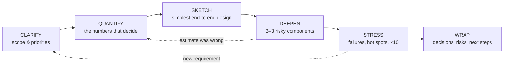
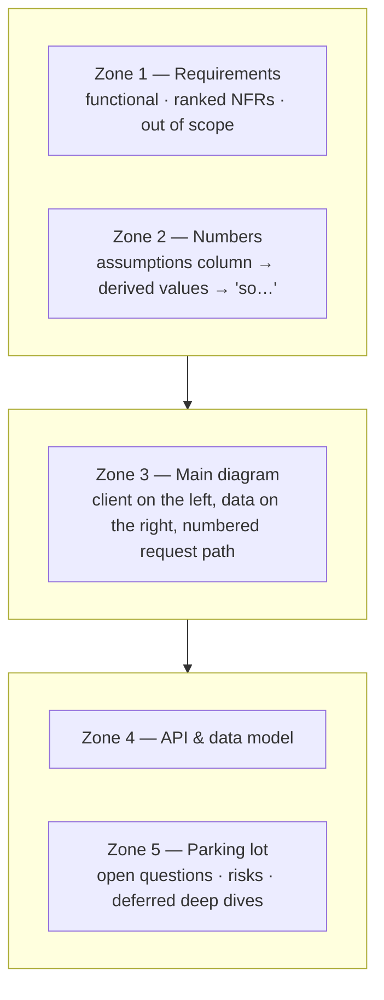
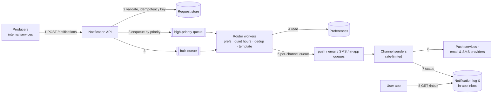

# I01 — The interview playbook

> **The requirement.** In 45 minutes, with a stranger watching, turn a one-line prompt ("design a notification
> service") into a design you can defend with numbers, and leave the interviewer with evidence that you would make
> good decisions on their team. It is hard because the interview tests *judgment under time pressure in a
> conversation*, not knowledge. In this course's experience (an observation, not a sourced statistic), many candidates
> who fail know enough. They spend their minutes in the wrong places, draw boxes without saying why each one exists,
> or never get to failure and cost.

## In one minute

A system design interview is a compressed version of a real design review. You get an ambiguous problem, a peer who
knows more about the problem space than they let on, and a clock. The interviewer is not grading your diagram. They are
collecting **signals**: do you ask the questions that change the design, can you put numbers on the problem, can you
build a simple working design, can you go deep where it matters, do you know how it breaks, and can you explain your
choices? This course gives you one framework for producing those signals in order. There are six steps:
**CLARIFY** the problem, **QUANTIFY** it, **SKETCH** a design that works end to end, **DEEPEN** two or three parts that
carry the risk, **STRESS** the design with failures and growth, and **WRAP** with a summary of decisions and open
risks. Each step has a goal, a time budget, an artifact on the board and a set of things the interviewer is listening
for. The framework helps only if you use it flexibly. When the interviewer pulls you somewhere, follow them and
bring the framework along.

## Why this matters now

Three things about the interview changed between 2016 and 2026, and they affect how you should prepare. Items 1 and 3
are course observations, not sourced statistics; item 2 rests on the SRE Workbook [3].

1. **The question pool moved toward AI-era systems.** Classical prompts (feeds, chat, URL shorteners, rate limiters)
   are still common because they test fundamentals cheaply. Many teams now also ask about LLM serving, retrieval,
   agents and GPU capacity, because that is what they build. This course covers both. The question bank in
   [I03](I03-question-bank-rubrics.md) has a category for each, and [I04](I04-ml-llm-interviews.md) covers ML/LLM
   interviews specifically.
2. **Numbers and cost are expected, not a bonus.** Google's SRE Workbook teaches "non-abstract large system design",
   which turns requirements into concrete estimates of machines, storage and bandwidth. It stresses that "examples of
   sound reasoning and assumption making are more important than any final values" [3]. In GPU-backed systems, cost
   and capacity are often *the* design problem. A candidate who cannot estimate tokens per second cannot reason about
   them.
3. **Memorized answers are easy to detect.** Public prep material converges on the same diagrams for the same
   prompts. Interviewers respond by changing one constraint ("now it must run in the EU only", "now each message costs
   money to send") and watching what happens. The framework here is built for that. You reason from requirements and
   numbers, so a changed constraint changes your design visibly instead of breaking a recited one.

Public interviewer guidance from large employers agrees on the basics. Meta's published preparation guide (updated
2022-10-06, so practice may have changed) describes a 45-minute design interview that "almost never" involves coding.
It suggests starting with requirements (how many users and messages, latency requirements, how data is stored),
outlining the high-level approach and then breaking it into subparts, focusing on "the interesting and hard problems"
because there is not time for every detail, exploring trade-offs, and driving the discussion [1]. Amazon's SDE III preparation page lists the
objectives a design should meet: practicality, accuracy, efficiency, reliability, optimization and scalability. It
also tells candidates to "ask questions to complete and validate your design" [2]. The six steps below put those
expectations into an order you can practice.

## Core ideas [Core]

### 1. What the interviewer is actually doing

Before the framework, understand the other side of the table. A typical interviewer has a prompt they know well,
a rough script of follow-ups, and a rubric with a handful of dimensions. The exact rubric differs by company and is
rarely published; the [I03](I03-question-bank-rubrics.md) rubric is this course's own synthesis. During the hour they
are doing three things:

- **Collecting evidence for each rubric dimension.** They need concrete things to write down later, such as "estimated
  peak QPS correctly and used it to reject a single-node database" or "never discussed what happens when the queue
  backs up". Vague impressions do not survive a hiring committee. Your job is to produce quotable evidence.
- **Probing the edges of your knowledge.** When you say "Kafka", they may ask what happens when a consumer crashes
  mid-batch. They are not trying to catch you out. They want to know whether your knowledge goes one level below the
  name. Expect at least one probe per component you name.
- **Managing time.** If you spend 20 minutes on requirements, they will cut you off, and the cut costs you the
  signals you would have produced later. Interviewers prefer candidates who manage time themselves.

They are **not** checking whether your design matches a reference answer. Two candidates with different designs can
both get a strong-hire recommendation. What matters is whether each choice is justified and whether the candidate knows its
costs.

### 2. The framework at a glance



*Diagram: six steps in sequence, CLARIFY to WRAP. Two dashed back-arrows: STRESS can reopen CLARIFY, and DEEPEN can
send you back to QUANTIFY.*

| Step | Goal (one sentence) | Artifact on the board when the step ends |
|---|---|---|
| **CLARIFY** | Agree what is being built, for whom, and which qualities matter most | 4–7 functional requirements, 3–5 prioritized non-functional requirements, an "out of scope" list |
| **QUANTIFY** | Find the two or three numbers that decide the architecture | Peak QPS (read/write), storage growth, bandwidth or tokens/s, and one "so what" line per number |
| **SKETCH** | Show a simple design that satisfies every functional requirement end to end | One diagram, ≤ 10 boxes, each labeled; the main request path numbered; the API and core data model |
| **DEEPEN** | Go deep where the risk is, and show real expertise | 2–3 zoomed-in sub-diagrams or tables (schema, algorithm, protocol, consistency choice) |
| **STRESS** | Show you know how it breaks and how to operate it | A failure table: failure → detection (SLI) → mitigation; a "×10" bottleneck note; SLOs and cost line |
| **WRAP** | Leave a clear record of decisions and open risks | 3–5 bullets: key decisions with trade-offs, top risks, what you would build next |

The loop-backs are deliberate. Real design work is iterative, and the SRE Workbook's method revisits the design as
each iteration finds weaknesses [3]. In an interview, a loop-back said out loud ("this failure analysis tells me my
estimate of write volume was too optimistic; let me revise it") is a strong signal, not a sign of disorder.

### 3. Time budgets

The clock is the constraint that shapes everything else. These budgets are this course's recommendation, written as
a starting point. Practice with them until they feel natural, then adapt them to the prompt.

**45-minute interview** (about 40 minutes of design; Meta's guide notes that interviewers usually keep the last five
minutes for your questions [1]):

| Phase | Minutes | Cumulative | Notes |
|---|---|---|---|
| Introductions | 1–2 | 2 | Keep your own intro to two sentences |
| CLARIFY | 4–5 | 7 | Stop when the answers stop changing the design |
| QUANTIFY | 3–4 | 11 | Only the numbers that decide something |
| SKETCH | 7–8 | 19 | A working end-to-end design, not a perfect one |
| DEEPEN | 12–14 | 33 | Two deep dives, sometimes one chosen by the interviewer |
| STRESS | 5–6 | 39 | Failures, hot spots, ×10, SLOs, cost |
| WRAP | 1–2 | 41 | Thirty seconds can be enough |
| Your questions | 4–5 | 45 | Prepare two real questions |

**60-minute interview** (about 52–55 minutes of design):

| Phase | Minutes | Cumulative | Notes |
|---|---|---|---|
| Introductions | 2 | 2 | |
| CLARIFY | 5–6 | 8 | Room for one or two "what if" requirements |
| QUANTIFY | 5 | 13 | Add a cost or capacity number |
| SKETCH | 9–10 | 23 | Include the API and data model explicitly |
| DEEPEN | 18–20 | 43 | Three deep dives, or two at greater depth |
| STRESS | 7–8 | 51 | Include a multi-region or disaster-recovery discussion |
| WRAP | 2–3 | 54 | Decisions, risks, roadmap |
| Your questions | 5–6 | 60 | |

Two rules make the budgets work:

- **Announce transitions.** "I think we have enough requirements. Let me put some numbers on this, about three
  minutes." This tells the interviewer you are managing time and lets them redirect you cheaply.
- **Check the clock at the end of SKETCH.** If you are past minute 22 in a 45-minute interview, cut DEEPEN to one deep
  dive and fold the important failures into it. In this course's experience, running out of time before STRESS is a
  common way an otherwise good interview loses the "reliability" and "operations" signals.

### 4. CLARIFY — scope and priorities

**Goal.** Turn a vague prompt into a problem with boundaries. Find the requirements that change the architecture, and
rank the non-functional ones, because you will trade them against each other later.

**Moves.**

1. **Restate the prompt in one sentence**, including who the users are. "So we are building the service that decides
   which Lumen users get which notifications, on which channel, and when. The users are both people receiving
   notifications and internal teams sending them."
2. **Functional requirements: the verbs.** Ask what users and callers must be able to do. Aim for 4–7. Mark 2–3 as
   core and say you will design those first.
3. **Non-functional requirements: the adjectives, ranked.** Latency, availability, consistency, durability, cost,
   privacy, regionality. Do not list them all as "high". Ask: "If I had to choose between X and Y, which would the
   business pick?" This one question separates seniors from juniors more reliably than any other.
4. **Scale anchors.** Users, requests, data size, growth, read/write ratio. You will use them in QUANTIFY. If the
   interviewer says "you decide", pick round numbers, say them out loud, and write them down.
5. **Out of scope.** Name 2–4 things you will not design (billing, admin UI, model training), and ask if that is
   acceptable. It protects your time and shows you see the edges of the problem.

**Questions that usually change the design** (pick the ones that apply; do not run through a checklist):

| Question | Why it matters |
|---|---|
| "Who calls this, and what do they do with the answer?" | Determines sync vs async, API shape and latency budget |
| "Is it read-heavy or write-heavy, and by how much?" | Drives caching, replication and storage-engine choice |
| "What happens if a user sees stale data for N seconds?" | Determines the consistency model you can afford |
| "What is worse: a duplicate or a loss?" | Decides delivery semantics, idempotency, dedup design |
| "Is there a hard latency target, and is it p50 or p99?" | Drives caching, colocation and fan-out choices |
| "Are there legal or residency constraints?" | Can force a per-region architecture from the start |
| "Does cost matter more than latency here?" | Shapes batching, tiering, model choice, spot capacity |
| "How fast must new data become visible?" | Separates batch, micro-batch and streaming designs |

**Phrases that work.**

- "Before I design anything, I want to check which of these qualities wins when they conflict."
- "I'll assume X unless you'd like otherwise. It's the more demanding case, so the design will cover the easier one."
- "I'm going to leave Y out of scope so we have time for the hard part. Shout if you'd rather I include it."

**What interviewers listen for.** Questions whose answers change the design. Ranking non-functional requirements.
Noticing the hidden requirement (for notifications: user preferences and quiet hours; for payments: idempotency;
for LLM chat: cost per conversation). Stopping on time.

**Traps.**

- *The interrogation*: twenty questions, none of which affect the design. Each question should have a "because"
  you could say out loud.
- *Silent assumptions*: designing for global multi-region when the interviewer had a single-country product in mind.
- *Asking permission for everything*: "Is it OK if I use a database?" Make reasonable calls and state them.

### 5. QUANTIFY — the numbers that decide

**Goal.** Put magnitudes on the problem and use them to rule designs in or out. This is not an arithmetic exam. A
number earns its place only when you can follow it with "so …".

**Moves.**

1. **Write your assumptions in a column**, then derive. Interviewers grade the chain of reasoning, and a written
   chain lets them correct one input without discarding your work.
2. **Peak, not average.** Daily volume ÷ 86,400 s gives the average rate; multiply by an assumed peak factor (2–5× for
   consumer diurnal traffic, much higher for scheduled bursts). Say which it is.
3. **Split reads and writes.** They usually scale with different mechanisms.
4. **Size the stateful parts**: storage per year, working set for the cache, connections or streams for long-lived
   protocols (Little's law: concurrency = arrival rate × time in system;
   see [SYSDESIGN-01](../00-orientation/01-requirements-to-numbers.md)).
5. **Draw the conclusion.** "≈ 12,000 writes/s at peak is more than I'd want on a single relational primary, so the
   write path needs partitioning or a log in front of it." Without the conclusion, the numbers produce no signal.

Use the cheat sheets in [I02](I02-numbers-cheat-sheets.md) for constants (seconds per day, latency orders of
magnitude, GPU memory sizes, the KV-cache formula). Round aggressively: 86,400 ≈ 10⁵ is fine when the conclusion does
not depend on a factor of 1.16.

**Phrases that work.**

- "Let me spend three minutes on numbers. I only want the ones that change the design."
- "I'll round to powers of ten. If a conclusion depends on a factor of two, I'll flag it."
- "So what this tells me is …"

**What interviewers listen for.** Stated assumptions. Peak vs average. Correct orders of magnitude, since a
factor-of-1,000 slip is a red flag and a factor of 2 is not. Numbers used later to justify choices. For AI systems,
counting in **tokens** and **GPU memory**, not just requests (see [I04](I04-ml-llm-interviews.md)).

**Traps.**

- *Ten minutes of arithmetic* with no conclusion.
- *Numbers that are never used again.* If you computed storage, mention it when you choose the database.
- *False precision*: "14,467 QPS". Say "≈ 15k".

### 6. SKETCH — the simplest end-to-end design

**Goal.** Show a design that works for all the core functional requirements before optimizing any part. The
interviewer needs to see that you can deliver a whole system. Deep expertise in one component is worth less if the
rest of the system does not exist.

**Moves.**

1. **Start from the client and follow one request** through the system, drawing as you go. Number the steps on the
   arrows (1, 2, 3 …) so you can refer to them later.
2. **Justify each box as you draw it.** One sentence: "A queue here, because sending is slow and spiky, and I don't
   want the producer's latency to depend on SMS providers." This is the "why is this box here?" test. One
   critique of interview prep puts it as: "For every component in the diagram, there should be an answer to: why is
   this here?" [5].
3. **Write the API**: 3–5 endpoints or messages with their key fields. For event-driven parts, the event schema.
4. **Write the core data model**: the 2–4 main entities, their keys, and the access pattern each key serves.
5. **Pick storage by access pattern**, not by brand. "Lookups by user ID plus a time range → a wide-column or
   key-value store partitioned by user ID, clustered by time." Then name an example system if you like.

**Phrases that work.**

- "Let me get something simple working end to end first, then improve the parts that need it."
- "This is deliberately naive in one place. The fan-out step won't survive a big campaign, and I'll come back to it."
- "I'm choosing X for this store because the dominant access pattern is Y."

**What interviewers listen for.** A coherent request path. Reasons for each component. A clean split between
synchronous and asynchronous work. An API that matches the requirements. A data model with keys that match the access
patterns. Awareness of what is naive ("I'll come back to it").

**Traps.**

- *The component zoo*: fifteen boxes in the first five minutes (service mesh, three caches, two queues) with no
  requirement behind them.
- *Deep-diving too early*: designing the consistent-hashing ring before the system has a write path.
- *Brand-name design*: "Kafka, Redis, Cassandra" with no stated reason. Names without reasons invite probing questions
  that you then have to answer under pressure.

### 7. DEEPEN — where the risk is

**Goal.** Show depth in the two or three places where the design is most likely to fail or where the interesting
engineering lives. This is where senior and staff signals are produced.

**Choosing what to deepen.** Use three filters, in order:

1. **Where would a naive design break first?** Usually the component your QUANTIFY numbers stressed (the
   write-heavy store, the fan-out, the GPU tier).
2. **Where is the correctness risk?** Duplicates, ordering, consistency, money, permissions.
3. **What does the interviewer want?** Ask: "I'd like to go deep on fan-out and on deduplication. Is there something
   you'd rather I focus on?" Many interviewers have a deep dive in mind. Offering a choice gives you their preference
   and shows you are steering deliberately.

**What "deep" means.** For each deep dive, go at least two levels below the box name:

| Level | Example (deduplication in a notification service) |
|---|---|
| 0 — box | "A dedup step" |
| 1 — mechanism | "Each notification carries an idempotency key; we keep seen keys in a store with a TTL" |
| 2 — trade-off | "Key = hash(event ID, user, channel). TTL of 24 h bounds memory at ≈ N GB. A false negative after TTL expiry can cause a duplicate, which is acceptable for low-priority notifications" |
| 3 — failure and edge case | "If the dedup store is unavailable we fail open for low priority and fail closed for security alerts; we measure duplicates per million as an SLI" |

Level 2 is the hire bar for senior roles. Level 3 is where strong-hire signals usually come from.

**Phrases that work.**

- "There are three ways to do this. Let me compare them quickly, then pick one."
- "The subtle part is what happens when … Let me walk through that."
- "I'd measure this with … and alert when …"

**What interviewers listen for.** Comparing alternatives before choosing. Correct mechanisms (consistency levels,
delivery semantics, index structures, batching behavior). Edge cases you raise without being asked. Quantified
trade-offs. Willingness to say "I'd measure this before deciding".

**Traps.**

- *Breadth disguised as depth*: touching six components lightly. Two real deep dives beat six shallow ones.
- *Monologue*: ten minutes without checking in. Every 3–4 minutes, check: "Does this level of detail help, or should I
  move on?"

### 8. STRESS — failure, hot spots and growth

**Goal.** Show that you know how the system fails, how you would notice, and what it costs to run. Many candidates
skip this step, and it is where operational experience shows most clearly. One published review of a popular
interview book criticises its thin treatment of message queues: delivery modes, acks and retries, dead-letter queues,
ordering and exactly-once delivery [6].

**Moves** (pick what fits the time):

1. **Walk the request path and break each hop.** For each component: what happens if it is slow, if it is down, or if it
   returns wrong data? Use one table: failure → user impact → detection (an SLI or alert) → mitigation.
2. **Hot spots.** A celebrity user, a viral item, one tenant's huge batch, a scheduled 09:00 burst. Say how load
   concentrates and what spreads it.
3. **×10.** "At ten times the load, the first thing to break is … because …". This tests whether you understand your
   bottleneck, not whether you can draw a bigger diagram.
4. **Overload behavior.** Backpressure, load shedding, graceful degradation: what you drop first and why
   (see [SYSDESIGN-11](../01-foundations/11-reliability-engineering.md)).
5. **Operate.** Two or three SLOs with their SLIs, the deploy and rollback story, and a cost line ("the dominant
   cost is SMS fees, not compute; that is why rate limiting and channel preference matter").

**Phrases that work.**

- "Let me break this design on purpose."
- "The blast radius of that failure is …; I'd contain it with …"
- "I'd rather degrade by … than fail the whole request."
- "The first thing to break at ten times the load is …"

**What interviewers listen for.** Specific failure modes (not "add redundancy"). Detection, not only mitigation.
Retry storms and their fixes (timeouts, jittered backoff, budgets, circuit breakers). Correlated failures (a region, a
dependency, a bad deploy). Cost awareness. For senior and above, SLOs stated as numbers.

**Traps.**

- *"We'll add replicas"* as the answer to every failure.
- *Ignoring dependencies you don't own*: third-party providers, identity, DNS, the GPU supply.
- *No detection*: a mitigation you cannot trigger because nobody knows the failure happened.

### 9. WRAP — leave a record

**Goal.** In under two minutes, summarize what you decided, why, and what remains risky. The interviewer writes
feedback after the interview. A clean summary makes it easy for them to record your best signals accurately.

**Template.**

> "To summarize: we built X. The key decisions were A (because …, at the cost of …) and B (…). The main risks are
> R1 and R2. I'd watch them with these SLIs. With more time I'd look at N1 next, then N2."

**What interviewers listen for.** That you remember your own trade-offs. That you can rank risks. That the "next"
items are real (not "add machine learning").

### 10. Driving versus following

Meta's guide asks candidates to "drive the discussion" [1], and this course recommends the same everywhere. Driving
does not mean ignoring the interviewer. A useful model is **"propose, check, proceed"**:

- **Propose** the next move and why: "Next I'd like to sketch the write path, since it's the hard part."
- **Check** briefly: "Does that work for you?" Then wait a beat. Silence usually means yes.
- **Proceed**, and make your check-ins less frequent as rapport builds.

**When the interviewer redirects, follow at once.** A redirect ("let's talk about how you'd store preferences") is the
interviewer telling you where their rubric still needs evidence. Finish your sentence, park your thread on the board
("parking lot: dedup TTL"), and go. Pushing back is fine when the redirect conflicts with a requirement you agreed on
("happy to; note this changes our latency budget"). Ignoring a redirect is a red flag at every level.

**Reading the interviewer.** Short follow-up questions on one component mean "go deeper here". "Interesting, what
else?" means "you have not hit what I am looking for". Repeated questions about one failure mode mean you have
missed something: say so and reconsider. An interviewer who goes quiet for a long time is often writing notes,
which is usually good.

**Hints.** Treat hints as information. If the interviewer says "what if two workers pick up the same message?", they
are not asking idly. Take the hint, say what you missed ("right, at-least-once delivery means duplicates; I need
idempotent sends"), and fix it. A visible correction usually counts for more than having got it right the first time.

### 11. "I don't know"

You will hit gaps. The question is what you do in the next 30 seconds. Use **bound, reason, commit**:

1. **Bound** what you know: "I haven't operated Cassandra's lightweight transactions in production, so I'm not sure
   of their exact latency."
2. **Reason** from first principles: "They need a consensus round across replicas, so more than one round trip,
   meaning milliseconds within a region rather than microseconds. That's too slow for every write, but fine for a
   rare uniqueness check."
3. **Commit** to a decision and say how you would validate it: "So I'll use them only for username registration and
   benchmark them before launch."

Never bluff a specific fact (a version, a limit, a benchmark number). An interviewer who knows the area will often
notice (course judgment), and a confident wrong fact costs more than an honest bound. For estimates, a bounded range ("somewhere between 1 and 10 ms,
let me use 5") is a correct answer.

If you do not know a technology the interviewer names, say so and ask for its key property: "I don't know that
system. Is it closer to a log or a queue?" Then design with the property.

### 12. Whiteboard and diagram hygiene

An untidy diagram costs time and makes you harder to follow. Use the same board layout every time:



*Diagram: a board split into five zones: requirements and numbers across the top, the main diagram in the middle, and
API/data model plus a parking lot of open questions along the bottom.*

Rules that pay off:

- **Left to right = request direction.** Clients on the left, storage on the right, async workers below the main path.
- **Label every arrow** with what flows and how: `HTTPS`, `gRPC`, `event: NotificationRequested`, `async`. Write the
  step number on the request path.
- **Distinct shapes**: rectangles for services, cylinders (or a `[(DB)]` shape) for stores, a pipe shape for queues and
  logs. Use the same shape for the same kind of component throughout.
- **Never rely on color alone.** Remote whiteboards and screenshots lose it, and some interviewers cannot distinguish
  it. Use labels (`sync`/`async`) or line styles.
- **Do not erase your numbers or requirements.** You will cite them in DEEPEN and WRAP.
- **Name components by responsibility** ("preference service"), not by technology ("the Redis"). Add the technology
  in small text if it matters.
- **Zoom by redrawing**, not by cramming. For a deep dive, draw a separate small diagram next to the main one.

### 13. Trade-off language

The word "trade-off" is cheap. Interviewers listen for trade-offs stated so that they could be wrong, and they hear
the difference. Use the **four-part trade-off sentence**:

> **"I'll choose _X_ because _requirement R_ dominates; it costs us _C_; I would switch to _Y_ if _trigger T_."**

Examples:

- "I'll fan out on write for normal users because read latency dominates and most users have under a thousand
  followers. It costs write amplification. I'd switch to fan-out on read for accounts above about 100k followers,
  where the amplification becomes the bottleneck."
- "I'll accept at-least-once delivery with idempotent consumers, because losing a security alert is worse than
  sending it twice. It costs a dedup store. I'd revisit if duplicate rates measured above our SLI target."
- "I'll serve the 8B model by default and route to the 70B model on low confidence, because cost per answer
  dominates. It costs some answer quality on hard queries. I'd change the routing threshold if offline evals show
  the quality drop exceeds the agreed margin."

The *trigger* is the part candidates most often leave out (course observation). It turns an opinion into an engineering decision that can be
revisited, which is what senior engineers do in real design reviews.

Useful vocabulary for comparing options:

| Instead of … | Say … |
|---|---|
| "X is better" | "X wins when …, Y wins when …; here we have …" |
| "It's scalable" | "It scales horizontally to N because the partition key is …" |
| "It's fast" | "p99 under N ms because the hot path is one cache read and no cross-region call" |
| "It's reliable" | "It survives the loss of one zone with no data loss (RPO 0) and ≈ 1 minute of failover (RTO)" |
| "We'll use microservices" | "This piece is a separate service because it scales, fails or deploys differently" |

### 14. How levels differ

The same prompt is used for different levels. The bar moves in **scope, depth, autonomy and judgment**. The table
below is this course's synthesis; no company publishes a universal definition, and titles map differently between
employers. Use it to calibrate, not as a contract.

| Dimension | Junior (new grad – L3) | Mid (L4) | Senior (L5) | Staff (L6) | Principal (L7+) |
|---|---|---|---|---|---|
| **CLARIFY** | Lists functional requirements, with prompting | Adds key NFRs | Ranks NFRs; finds hidden requirements | Questions the problem itself ("do we need real time?"); frames business constraints | Reframes across systems and teams; names organizational or regulatory constraints |
| **QUANTIFY** | Can do the arithmetic when guided | Peak QPS and storage unprompted | Uses numbers to rule designs in or out | Adds cost and capacity; spots the number that dominates | Ties numbers to business outcomes and multi-year growth |
| **SKETCH** | A working design with some help | Clean end-to-end design | Clean design with every box justified, API and data model | Design shaped by explicit trade-offs; knows which parts are commodity | Chooses what *not* to build; platform or reuse view |
| **DEEPEN** | One component at mechanism level | One or two at mechanism level | Two at trade-off level, with edge cases | Deep where it matters, plus alternatives with switching triggers | Depth plus evolution path and migration from today's system |
| **STRESS** | Basic redundancy | Retries, replicas, caching failures | Failure table, detection, overload behavior, SLOs | Correlated failures, blast radius, cost of reliability | Organizational failure modes, ownership, long-term operability |
| **Driving** | Follows the interviewer | Drives with help | Drives; adapts to redirects | Drives and steers the interviewer toward the important problems | Runs it like a design review they chair |
| **Typical miss** | Freezes on ambiguity | Stays generic under probing | Over-engineers; ignores cost | Too abstract; avoids committing | Too high-level; no concrete numbers |

Two practical consequences:

- **For senior roles and above, the sketch is assumed.** Get through it efficiently and save time for DEEPEN and
  STRESS, where you are differentiated.
- **For staff and principal roles, judgment about what not to build is the signal.** "We don't need a separate stream
  processor; the volume fits one database partitioned by tenant for the next two years" can be the strongest sentence
  of the interview, as long as numbers back it.

### 15. Remote interviews

Most design interviews now happen over video. The framework is the same, but the medium changes a few things.

- **Tooling.** Ask in advance which whiteboard tool is used, and practice in it (drawing speed in an unfamiliar
  tool is a real cost). If you may choose, pick one you can use without thinking. Keep a plain-text fallback ready.
  An indented outline or a Mermaid-style text diagram in a shared document works if the drawing tool fails.
- **Set up before the call.** Stable connection, headset, a second screen if you have one, notifications off, the
  tool logged in. Have water and paper beside you for scratch arithmetic.
- **Narrate the pointer.** The interviewer cannot see where you are looking. "I'm adding a queue between steps 3 and
  4" helps them follow.
- **Leave longer pauses.** Audio latency makes interruptions awkward. Pause after each check-in so the interviewer can
  speak.
- **Write more, speak less.** Requirements and numbers typed into the board are easier to follow on video than spoken
  ones.
- **Camera on, eyes up** when talking, not only on the canvas. It helps the conversation feel like a design review.
- **Use only what is allowed.** If you are unsure whether notes, templates or search are permitted, ask. Using
  undisclosed help is an integrity issue, and interviewers increasingly probe for understanding behind fluent
  answers.

### 16. Common failure patterns and their fixes

| Pattern | What it looks like | Fix |
|---|---|---|
| The recital | A memorized reference design regardless of the stated requirements | Derive each box from a requirement or number; say which |
| The rabbit hole | 20 minutes on one algorithm; no failure discussion | Time-box deep dives; check the clock at the end of SKETCH |
| The fog | "It depends" with no decision | Use the four-part trade-off sentence and commit |
| The zoo | Every technology named, none justified | Fewer boxes; one sentence of "why" per box |
| The silent solver | Long silences while thinking | Think out loud, even in fragments: "I'm weighing A against B …" |
| The arguer | Defends a choice after the interviewer shows its flaw | Acknowledge, update, move on |
| The happy path | Never discusses what breaks | Reserve STRESS time; ask yourself "what if this is down?" for every arrow |

## Worked mock interview: a notification service for Lumen

This is a fully narrated 45-minute mock. **I** is the interviewer and **C** is the candidate. Timestamps are
minutes from the start. Boxes marked **Coach's note** explain why a move works and are not part of the interview. Lumen
is the course's fictional AI-assisted knowledge and chat product. All numbers are labelled assumptions chosen during
the interview.

### 00:00 — Prompt

**I:** Lumen wants a notification service. Teams across the company should be able to notify users about things:
someone shared a document, an AI agent finished a long task, a weekly digest, security alerts. Design it.

**C:** Let me restate to check I've got it. We're building a shared platform service: internal producers send
"notify this user about this event", and the service decides whether, how and when to deliver it, on push, email, SMS
or in-app. So there are two kinds of users: end users who receive notifications, and internal teams who send them.
Is that right?

**I:** Yes.

> **Coach's note.** The restatement names both user groups. Platform-style prompts are easy to misread as "send a
> push notification", and naming the producer side early sets up the API and multi-tenancy questions.

### 00:01 — CLARIFY

**C:** Functional requirements first. I'd propose:

1. Producers submit a notification request: recipient, type, payload, priority.
2. The service applies the user's preferences, such as channels per type, opt-outs and quiet hours.
3. It delivers on push, email, SMS and in-app inbox.
4. Users can read their in-app inbox and mark items read.
5. Producers and support can see delivery status.
6. Scheduled and digest notifications, like the weekly summary.

I'd treat 1–3 as core. Does that match?

**I:** Yes. Add templates and localization, but you don't need to design them in depth.

**C:** Got it, templates as a box. Non-functional. Let me rank rather than list. I think there are really two classes
of traffic. Security alerts and "your agent finished" are **transactional**: they must arrive, and quickly. Digests
and marketing are **bulk**: big, bursty, and tolerant of delay. If I had to choose, I'd say reliability of
transactional delivery beats everything, then not spamming users, then latency, then cost. Is that the right order?

**I:** Mostly. Cost matters more than you think. SMS is expensive.

**C:** Useful. So SMS should be a last-resort channel, controlled by preferences and per-user budgets. Two more
questions. Is a duplicate worse than a loss? I'd guess it depends on type: a duplicate security alert is fine, a lost
one is not, and a duplicate marketing email is an annoyance with compliance risk.

**I:** That's fair.

**C:** And latency: for transactional notifications, is "within a few seconds of the event" the target?

**I:** Say p99 under 5 seconds from request to hand-off to the provider, for high priority.

**C:** Great. Last one: any residency constraints? Lumen has EU customers.

**I:** EU users' data stays in the EU.

**C:** Then I'll design one region's stack and run it in the EU and US, with users homed to a region. Out of scope:
building the push/email/SMS delivery networks themselves (we use Apple's and Google's push services and external
email and SMS providers), the template-authoring UI, and analytics beyond delivery status. OK?

**I:** OK.

> **Coach's note.** Five minutes. The candidate found the requirement that shapes everything: **two traffic classes
> with different priorities**. They also turned the interviewer's hint about cost into a design consequence
> immediately. Residency produced a decision (regional cells) in one sentence and did not start a long tangent.

### 00:06 — QUANTIFY

**C:** Three minutes on numbers. I'll write the assumptions down.

| Assumption | Value |
|---|---|
| Registered users | 50 M |
| Daily active users | 10 M |
| Notification requests per DAU per day (all types) | 10 |
| Share delivered after preferences/dedup | 60 % |
| Average channels per delivered notification | 1.3 |
| Weekly digest | all 50 M users, sent at 09:00 local time |

**C:** So:

- Requests: 10 M × 10 = 100 M/day → 100 M ÷ 86,400 ≈ **1,200/s average**. With a 3× diurnal peak, **≈ 3,500/s**.
- Deliveries: 100 M × 0.6 × 1.3 ≈ **80 M channel sends/day**.
- Digest: 50 M users across, say, 24 time zones, but they're not evenly spread. Assume 20 % of users are in one zone:
  10 M sends due at 09:00 in that zone. If we let it spread over 30 minutes, that's ≈ **5,500/s** of bulk, on top of
  the transactional peak.
- Storage: assume 1 KB per notification record including status, so 100 M/day ≈ **100 GB/day**. With 90 days of
  inbox and status history, ≈ **9 TB** before replication.
- SMS: if even 1 % of deliveries go to SMS, that's 800 k SMS/day. At an assumed few cents each, that's tens of
  thousands of dollars a day. **SMS is the dominant cost, not compute.**

So what: compute is modest, a few thousand requests per second. The design problems are (1) the **bulk burst must not
delay transactional traffic**, (2) **SMS cost control**, and (3) storage that is mostly append-and-read-by-user.

**I:** Good. Why 20 % in one time zone?

**C:** It's a guess. The point is that digests concentrate into bursts. If the real number is higher, the bulk burst
gets bigger, which strengthens the case for isolating it. I'd check the real distribution from user profiles.

> **Coach's note.** Every number ends in a "so what". The SMS line turns the interviewer's cost hint into a
> quantified priority. When challenged on an assumption, the candidate defends the *reasoning* and names how to get
> the real value, which is "bound, reason, commit" in miniature.

### 00:10 — SKETCH

**C:** Let me sketch a simple version end to end, then improve it.



*Diagram: producers call the Notification API, which records the request and enqueues it on a high-priority or bulk
queue. Router workers apply preferences, quiet hours, dedup and templates, then put per-channel messages on channel
queues. Rate-limited channel senders call external providers and write status to a notification log, which also
serves the in-app inbox.*

**C:** Walking through it, with a reason for each box:

1. Producers call `POST /notifications`. It's **asynchronous**: we return `202 Accepted` with a notification ID.
   Producers shouldn't wait on SMS providers.
2. The API validates the request and stores it with the producer's **idempotency key**, so a producer retry doesn't
   create a second notification.
3. It enqueues to one of **two queues by priority**. This is the bulkhead between transactional and bulk traffic. A
   10-million-message digest can't sit in front of a security alert.
4. **Router workers** look up preferences, apply quiet hours, dedup, render the template, and decide channels.
5. They emit one message per channel to **per-channel queues**. Channels fail independently. If the SMS provider is
   down, push should still flow.
6. **Channel senders** call the providers under per-provider rate limits.
7. They record status in a **notification log**, which doubles as the in-app inbox.
8. The app reads the inbox by user.

**C:** API, briefly:

```text
POST /v1/notifications
  { idempotency_key, recipient_user_id, type, priority: high|bulk,
    payload {template_id, vars}, not_before?, expires_at? }
  → 202 { notification_id }

GET  /v1/users/{user_id}/inbox?cursor=…        → in-app items, newest first
POST /v1/users/{user_id}/inbox/{id}:read
GET  /v1/notifications/{id}                     → status per channel
PUT  /v1/users/{user_id}/preferences            → per-type channel settings, quiet hours, timezone
```

**C:** Data model:

| Entity | Key | Access pattern |
|---|---|---|
| NotificationRequest | (producer_id, idempotency_key) | Dedup producer retries |
| Delivery / inbox item | partition: user_id; sort: created_at desc | "Latest N for this user", status updates |
| Preferences | user_id | Point read on every routing decision; small, read-heavy |
| Dedup key | hash(type, entity_id, user_id, channel), TTL | "Have we sent this recently?" |

The log is append-heavy and read by user and time, so a wide-column or key-value store partitioned by user ID fits.
Preferences are small and read on every message, so I'd cache them. I'll come back to dedup: the naive version here
has a race.

**I:** Why not one queue with priorities inside?

**C:** One queue with priority ordering works if the broker supports it, but it shares capacity. A backlog in bulk
still consumes broker resources and consumer attention. Separate queues let me give each its own consumer pool and
scale and alert on them separately. It costs a little operational overhead. I'd merge them only if bulk volume stayed
small, which our digest numbers say it won't.

> **Coach's note.** Minute 18. A complete design, every box justified in one sentence, and the API and data model
> present. The candidate flagged a known weakness ("the naive version has a race"). That buys credibility and sets up
> a deep dive. The answer about separate queues is a four-part trade-off sentence: choice, reason, cost, trigger.

### 00:18 — DEEPEN (choosing)

**C:** I'd like to go deep on two things. First, **deduplication and delivery semantics**, because that's the
correctness risk. Second, **the digest burst and scheduling**, because that's the scale risk. Would you prefer something
else?

**I:** Do dedup first. Then I'm curious about preferences and quiet hours more than the digest.

**C:** Sure. I'll fold the digest into the quiet-hours discussion, since both are about *when* to send.

### 00:19 — DEEPEN 1: deduplication and delivery semantics

**C:** Our queues deliver at least once. A worker can crash after sending and before acknowledging, so the message is
redelivered. There are three places duplicates come from:

1. Producer retries: handled by the idempotency key at the API.
2. Different producers emitting the same logical event, such as two services both notifying "document shared":
   handled by a **semantic dedup key**, hash(type, entity ID, recipient, channel), in a TTL store.
3. Sender redelivery after a crash: the hard one, because the effect, the SMS, is outside our system.

For (3), the standard trick is to make the send idempotent at the boundary. Before calling the provider, the sender
writes a **send record** keyed by (notification_id, channel) with state `SENDING`. After the provider returns, it writes
`SENT` with the provider's message ID. On redelivery:

- `SENT` → acknowledge and skip.
- `SENDING`, older than a timeout → we don't know if the provider got it. For providers that accept a client-supplied
  idempotency key, we retry with the same key and the provider deduplicates. For providers that don't, we choose by
  priority: **retry** for security alerts, because a duplicate beats a loss, and **drop** for bulk, because a duplicate
  digest is worse than a missing one.

**I:** What does the TTL on the semantic dedup store cost you?

**C:** Memory. 80 M sends/day × ≈ 100 bytes per key with overhead ≈ 8 GB/day. With a 24-hour TTL, that's under 10 GB,
which fits in one replicated in-memory cluster. The risk is a duplicate after the TTL expires, which for "document
shared" is harmless. I'd track **duplicates per million sends** as an SLI by sampling provider message IDs.

**I:** What if the dedup store is down?

**C:** Fail **open** for high priority, so alerts still go out at the risk of duplicates. Fail **closed** or delay for
bulk, queuing rather than spamming. That matches the ranking from CLARIFY.

> **Coach's note.** This is a level-3 deep dive: mechanism, quantified cost, edge case (the unknown `SENDING` state),
> failure behavior, and an SLI. The fail-open/fail-closed choice is tied back to the ranked requirements, which is
> the single most persuasive move in a design interview.

### 00:27 — DEEPEN 2: preferences, quiet hours and scheduling

**C:** Preferences are read on every routing decision, about 3,500/s at peak plus digest bursts. The data is small:
50 M users × ≈ 500 bytes ≈ 25 GB. I'd store it in a replicated key-value store and cache it in the routers with a
short TTL, say 60 seconds. The trade-off is that a user who turns off email may get one more email within that
minute. To fix the worst case, the preference service publishes change events and routers invalidate on them, so the
TTL is only a safety net.

Quiet hours turn "send now" into "send at time T". If we just put deferred messages back on the queue, workers keep
re-reading them, which is wasteful. Instead:

- The router writes deferred deliveries to a **scheduled-delivery store** keyed by (send_at bucket, shard). Minute
  buckets are fine.
- A **scheduler** scans the current bucket for its shards and enqueues due messages.
- The digest is the same mechanism. The digest job writes 50 M scheduled entries, bucketed by each user's local
  09:00, and **adds jitter** of up to 30 minutes so the 09:00 bucket is spread out. That turns the ≈ 10 M burst from
  QUANTIFY into ≈ 5,500/s over half an hour instead of millions in one minute.

**I:** What about expiry? An "agent finished" notification at 07:00 after quiet hours might be stale.

**C:** Good point. That's why the API has `expires_at`. The scheduler drops expired items, and the producer chooses
whether it collapses: for "agent finished", I'd collapse multiple pending ones into "3 tasks finished overnight".
Collapse is a router rule keyed by (user, type) while items are pending.

**I:** Security alerts during quiet hours?

**C:** They bypass quiet hours. That's a per-type policy, with security types marked `critical` and not
user-configurable, and it should be audited.

> **Coach's note.** The interviewer redirected away from the candidate's planned digest deep dive. The candidate
> followed at once and then **folded** the digest into the new topic, so its signal was not lost. The collapse
> answer took a hint ("might be stale") and turned it into a feature.

### 00:33 — STRESS

**C:** Let me break it on purpose. Walking the path:

| Failure | Impact | Detection (SLI/alert) | Mitigation |
|---|---|---|---|
| SMS provider outage | SMS backlog; cost if we fail over to a pricier provider | Send success rate per provider; queue age | Circuit breaker per provider; fail over to second provider for high priority only; bulk SMS waits |
| Push service returns errors for some tokens | Wasted sends | Invalid-token rate | Remove invalid device tokens on provider feedback |
| Bulk backlog (digest larger than expected) | Bulk delayed | Bulk queue age vs target | Isolated queue and consumers; transactional unaffected; autoscale bulk senders within provider limits |
| Router bug sends to wrong users | Privacy incident | Canary checks; per-type anomaly on volume | Staged rollout; kill switch per notification type |
| Producer floods (bug loops on "document shared") | Spam, SMS cost spike | Per-producer and per-user rate | **Per-producer quotas** at the API; **per-user caps** per type per hour |
| Region outage | Users homed there get nothing | Regional health checks | Queues and stores replicated within region across zones; cross-region failover for high priority only, respecting residency (EU fails over to another EU region) |

**C:** Hot spots: a viral document shared with 100 k users generates 100 k notifications from one event. The router
handles it as normal fan-out but **collapses** per user ("12 new comments"), and per-producer quotas stop it from
starving others.

At ×10, about 35 k requests/s plus bigger digests, the first thing to break is **provider rate limits and cost**, not
our compute. Routers and senders scale horizontally on queue depth. So at ×10 the work is negotiating provider
capacity, using several providers, and pushing users toward push and in-app channels, which are nearly free.

SLOs: high-priority request-to-provider-handoff **p99 < 5 s, 99.95 % of the time** (monthly); bulk digest **delivered
within 2 h of scheduled time**; duplicate rate below an agreed number per million. Cost: SMS dominates; I'd report
cost per 1,000 notifications per channel to each producer team, which also makes the quotas easier to agree.

**I:** Why 99.95 % and not 99.99 %?

**C:** 99.99 % is about 4 minutes a month of budget. With an external provider in the path we can't control, I'd be
promising something we can't keep. 99.95 % is about 22 minutes, which we can defend with failover. If security
needed more, I'd ask for a dedicated path for those types: two providers, active-active.

> **Coach's note.** A failure table with detection, a hot spot with a fix, a ×10 answer that names the true
> bottleneck (provider limits, not CPU), and SLOs tied to numbers from the nines table in
> [I02](I02-numbers-cheat-sheets.md). The push-back on 99.99 % is reasoned, not stubborn.

### 00:40 — WRAP

**C:** To summarize: an asynchronous notification platform with **two isolated priority lanes**, routing through
preferences, dedup and templates, and **per-channel senders** behind circuit breakers. Key decisions:
**at-least-once delivery with idempotent sends**, because loss is worse than duplication for critical types; a **scheduled
delivery store with jitter** for quiet hours and digests; and **regional cells** for residency. The main risks are
provider limits and SMS cost, and router bugs that cause privacy incidents. I'd watch per-provider success rates, queue age per
lane and per-type volume anomalies. Next I'd design the producer onboarding and quota process, then delivery
analytics.

**I:** Thanks. Questions for me?

> **Coach's note.** Under a minute, and every claim refers to something on the board. The candidate finished at
> minute 41 with time for questions.

### What made this mock a strong hire (and what would have downgraded it)

| Signal | Where it happened | A weaker version |
|---|---|---|
| Found the shaping requirement | Two traffic classes in CLARIFY | One queue; digest delays alerts |
| Numbers with consequences | SMS cost line, digest burst | "About 1,000 QPS, so it's fine" |
| Every box justified | SKETCH narration | Boxes named after technologies |
| Correctness depth | `SENDING` state and per-priority choice | "We use exactly-once delivery" (which the queue cannot provide end to end) |
| Followed the redirect | Preferences instead of digest | Kept talking about the digest |
| Detection, not just mitigation | Failure table with SLIs | "Add replicas" |
| Reasoned SLO | 99.95 % vs 99.99 % | "Five nines" with no budget math |

## Numbers that matter

The framework has its own budget arithmetic, worth knowing by heart:

- **Speaking rate.** Assume (labelled assumption) about 130–150 spoken words per minute in technical conversation.
  A 2-minute WRAP is ≈ 300 words, about the length of the template above. A 5-minute CLARIFY leaves room for about 8–10
  question-and-answer exchanges, so choose questions that matter.
- **Deep-dive budget.** In a 45-minute interview, DEEPEN gets ≈ 13–14 minutes, so two deep dives of ≈ 6–7 minutes each.
  At level 3 depth (mechanism, trade-off, edge case, failure), that's ≈ 90 seconds per level. Practice with a timer.
- **Interviewer airtime.** Plan for the interviewer to speak for a quarter to a third of the time (assumption), with
  questions, redirects and probes. A plan that uses 45 minutes of your own speech will overrun.

## Design choices and trade-offs

| Choice in the interview | Wins when | Costs | Typical trigger to switch |
|---|---|---|---|
| Ask many clarifying questions | Prompt is very open; staff+ level | Time for DEEPEN | Answers stop changing the design |
| Assume and state, few questions | Prompt is concrete; interviewer impatient | Risk of solving the wrong problem | Interviewer corrects an assumption |
| Detailed QUANTIFY | Capacity-dominated problems (storage, GPU, streaming) | Time | Numbers stop changing decisions |
| Short QUANTIFY | Correctness-dominated problems (payments, permissions) | Weaker scale signals | Interviewer asks for numbers |
| Offer the interviewer the deep-dive choice | You are unsure what they want | Less control | You know the domain's risk clearly |
| Pick the deep dive yourself | Risk is obvious from the numbers | May miss the interviewer's agenda | Interviewer redirects |

## Deep dive [Deep]: practicing the framework

Reading a framework does not make you fluent in it. Fluency comes from timed repetition with feedback.

1. **Solo, timed, recorded.** Pick a prompt from [I03](I03-question-bank-rubrics.md), set a 45-minute timer, and
   talk out loud while drawing. Record audio. Afterwards, mark each step's start time on the recording. Most people
   find their SKETCH runs 5–10 minutes over budget on the first attempts.
2. **Score yourself against the step checklist** (below). Track the same three weakest items across sessions.
3. **Paired mocks.** Swap roles with a peer. Being the interviewer teaches you what signals look like from the other
   side faster than anything else. Use the rubric in [I03](I03-question-bank-rubrics.md).
4. **Constraint flips.** Re-run a prompt you know with one constraint changed: EU-only, 10× cheaper, offline-first,
   p99 under 50 ms. This stops memorized answers forming.
5. **Deep-dive drills.** Take one component (a rate limiter, a KV-cache-aware router, an outbox) and practice a
   6-minute level-3 explanation. The chapter "Interview angle" sections in this course give model outlines.

**Step checklist** (use after every mock):

- [ ] CLARIFY: ranked the NFRs; found at least one hidden requirement; listed out of scope; finished by minute 7
- [ ] QUANTIFY: wrote assumptions; computed peak; used at least one number later to justify a decision
- [ ] SKETCH: numbered request path; one-sentence reason per box; API; data model with keys; finished by minute 19
- [ ] DEEPEN: compared alternatives; reached level 2 (trade-off) on at least two components; checked in
- [ ] STRESS: failure table with detection; one hot spot; ×10 bottleneck; SLO with a number; cost line
- [ ] WRAP: decisions with trade-offs; top risks; next steps; under 2 minutes
- [ ] Throughout: followed redirects; no bluffed facts; four-part trade-off sentences

## Frontier [Frontier]

As of 2026-11, three developments affect how system design interviews run. These are observations about practice
across the industry, not sourced statistics:

- **AI-era prompts as standard.** LLM chat, RAG and agent platforms appear alongside classical prompts. They reward the
  same framework but different numbers (tokens, GPU memory, cost per answer). See [I04](I04-ml-llm-interviews.md).
- **Assistant-aware interviewing.** With AI assistants widely available, interviewers put more weight on probing
  follow-ups, changed constraints and "why" questions, which are hard to answer without understanding. The framework's
  emphasis on reasons and triggers is the right preparation.
- **Cost and energy as first-class NFRs.** Expect "what does one request cost?" in GPU-backed designs. See
  [SYSDESIGN-16](../02-modern-requirements/16-cost-as-requirement.md) and
  [SYSDESIGN-17](../02-modern-requirements/17-energy-carbon-aware.md).

## Failure modes and operations

Treat your interview performance like a system with SLIs:

| Interview "SLI" | Healthy | Unhealthy (fix) |
|---|---|---|
| Minute at which SKETCH is complete (45-min) | ≤ 19 | > 22 → shorten CLARIFY, draw less |
| Number of boxes without a stated reason | 0 | > 0 → say "because" for each |
| Numbers used in later decisions | ≥ 2 | 0 → add "so what" after each |
| Deep dives reaching trade-off level | ≥ 2 | < 2 → fewer topics, more depth |
| STRESS reached | always | never → watch the clock at minute 19 |
| Redirects ignored | 0 | > 0 → practice "park and go" |

## Cost and energy

Bring cost and energy into the design discussion with one line each, at the point where they matter:

- **Cost**: name the dominant cost driver (SMS fees, GPU hours, egress, storage) and the lever that controls it.
  [SYSDESIGN-16](../02-modern-requirements/16-cost-as-requirement.md) teaches unit economics.
- **Energy**: for GPU-heavy systems, "efficiency per request" (batching, model size, caching) is also an energy
  lever; see [SYSDESIGN-17](../02-modern-requirements/17-energy-carbon-aware.md).

## Interview angle

This unit *is* the interview angle. A short version of the whole playbook:

1. **CLARIFY**: restate, verbs, ranked adjectives, scale anchors, out of scope (≈ 5 min).
2. **QUANTIFY**: assumptions column, peak, reads vs writes, state, "so what" (≈ 4 min).
3. **SKETCH**: follow one request, justify each box, API, data model (≈ 8 min).
4. **DEEPEN**: 2 deep dives to trade-off level or beyond; offer a choice (≈ 13–14 min).
5. **STRESS**: failure table with detection, hot spot, ×10, SLOs, cost (≈ 6 min).
6. **WRAP**: decisions, risks, next (≈ 1–2 min).

## Common mistakes

- Treating the framework as a script instead of a default route.
- Spending CLARIFY on questions whose answers do not change the design.
- Computing numbers and never using them.
- Drawing every box you know before the system works end to end.
- Saying "exactly-once" without explaining the idempotent effect that makes it true.
- Answering every failure with "add replicas".
- Bluffing a specific fact instead of bounding it.
- Ignoring a redirect.
- Running out of time before STRESS.

## Check yourself

1. In a 45-minute interview, by which minute should SKETCH be complete, and what do you cut if you are late?
2. Write a four-part trade-off sentence for choosing a relational database over a document store for user profiles.
3. What are the three moves of "bound, reason, commit"?
4. Name two differences between a senior-level and a staff-level answer to the same prompt.
5. In the mock, why did the candidate fail open on the dedup store for high-priority notifications?

The full set, with answers, is in [exercises/I01-interview-playbook.md](../../exercises/I01-interview-playbook.md).

## Lab

No lab for this unit. The "lab" is three timed, recorded mock interviews scored with the step checklist above and the
rubric in [I03](I03-question-bank-rubrics.md).

## Further reading

- Meta Careers, *Preparing for your Software Engineering Interview at Meta* [1]: a short official description of the
  design interview and what it assesses.
- Amazon, *SDE III / Sr. SDE Interview Prep* [2]: Amazon's stated design objectives and the expectation that you
  validate your design with questions.
- Google SRE Workbook, *Non-Abstract Large System Design* [3]: the best free source on designing with concrete
  numbers and iterating. It is long, and worth working through.
- J. Dean, *Designs, Lessons and Advice from Building Large Distributed Systems* (LADIS 2009) [4]: the origin of
  "numbers everyone should know" and back-of-the-envelope design comparisons.
- [I02 — Numbers & cheat sheets](I02-numbers-cheat-sheets.md), [I03 — Question bank & rubrics](I03-question-bank-rubrics.md),
  [I04 — ML/LLM interviews](I04-ml-llm-interviews.md): the rest of this track.

## References

1. Meta Careers, *Preparing for your Software Engineering Interview at Meta*, published 2016-06-27, updated
   2022-10-06. https://www.metacareers.com/blog/preparing-for-your-software-engineering-interview-at-meta/ (accessed 2026-11)
   (some automated clients receive HTTP 400; archived copy:
   https://web.archive.org/web/20260610131027/https://www.metacareers.com/blog/preparing-for-your-software-engineering-interview-at-meta/)
2. Amazon, *SDE III/Sr. SDE Interview Prep* (redirects from amazon.jobs to atoz.amazon).
   https://amazon.jobs/content/en/how-we-hire/sde-iii-interview-prep (accessed 2026-11)
3. S. Virji, J. Youngman, H. Robertson, S. Thorne, D. Rensin, Z. Egyed, with R. Bondi, "Non-Abstract Large System
   Design", in *The Site Reliability Workbook*, Google/O'Reilly, 2018, ch. 12. https://sre.google/workbook/non-abstract-design/ (accessed 2026-11)
4. J. Dean, *Designs, Lessons and Advice from Building Large Distributed Systems*, keynote, LADIS 2009.
   https://www.cs.cornell.edu/projects/ladis2009/talks/dean-keynote-ladis2009.pdf (accessed 2026-11)
5. P. Singaraju, *The System Design Interview Gap: What Prep Doesn't Teach*, HackerNoon, 2026-04-02 (opinion piece;
   used for perspective). https://hackernoon.com/the-system-design-interview-gap-what-prep-doesnt-teach (accessed 2026-11)
6. A. A. Balkan, *My review of the System Design book*, 2021-04-29 (opinion; used for perspective).
   https://ahmet.im/blog/system-design-book-review/ (accessed 2026-11)
