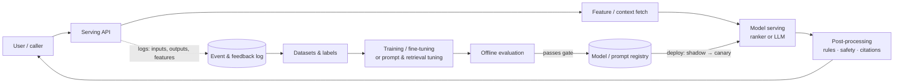
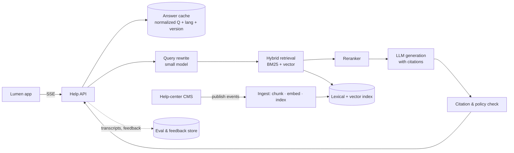
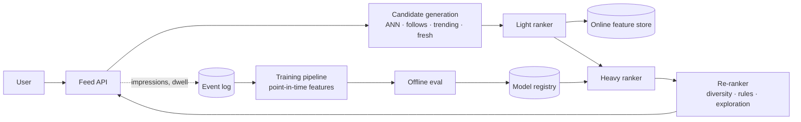
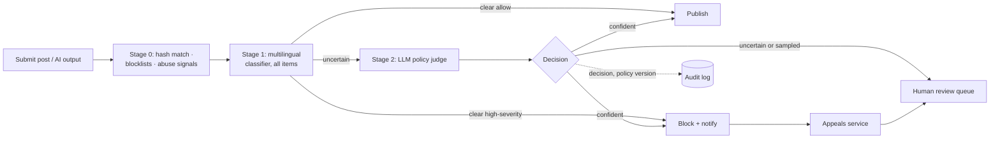
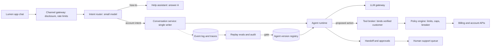

# I04 — ML/LLM system design interviews

> **The requirement.** "Design a RAG assistant for our support docs." A classical answer (load balancer, service,
> vector database) gets a lean at best. The interviewer wants to hear what the assistant is *for*, how you will know it
> works, where the data and labels come from, how you will evaluate it before and after launch, and what it costs per
> answer on real GPUs. It is hard because the system's behavior is learned, not coded, so correctness is statistical,
> quality must be measured rather than tested, and the expensive resource is GPU memory, not CPU.

## In one minute

ML and LLM design interviews use the same skeleton as any system design interview, but they put weight in different
places. **Framing** matters more, because the first question is whether ML is needed at all and what it should
optimize. **Metrics** come in a ladder: a business outcome, a product metric you can move online, model metrics you
can compute offline, and system SLIs such as time to first token. **Data** is a design component in its own right:
labels, freshness, leakage and feedback loops. **Evaluation** has two halves, offline before launch and online after,
and for LLMs it usually involves a calibrated LLM judge. **Serving constraints** are counted in tokens, GPU memory and
cost per answer. This unit adapts the course framework to these interviews, gives a question bank of eight representative
prompts with rubrics, and works four answers end to end with numbers: a RAG assistant, a recommendation feed,
an LLM content-moderation system and an account-actions support agent.

## Why this matters now

- **LLM products moved from demos to platforms between 2023 and 2026.** Interviews now ask about LLM serving,
  retrieval, gateways, evaluation and agents as production systems, with fleets, quotas and SLOs. This course's
  AI chapters ([21](../03-ai-systems/21-llm-inference-anatomy.md)–[28](../03-ai-systems/28-ai-trust-safety-governance.md))
  and AI-era cases ([C09](../04-case-studies/C09-llm-chat-service.md)–[C12](../04-case-studies/C12-realtime-fraud-recsys.md))
  supply the material.
- **Classical ML design is still asked.** Recommendations, ranking, fraud and moderation run on retrieval, feature
  stores and model serving. These systems predate LLMs, and LLMs are increasingly one component inside them.
- **Evaluation is the new "consistency".** In a classical interview, hand-waving about consistency costs you. In an
  LLM interview, hand-waving about evaluation costs you just as much. "We'll check outputs manually" is a red flag.

## Core ideas [Core]

### 1. How ML/LLM interviews differ

| Aspect | Classical system design | ML system design (ranking, fraud, recsys) | LLM system design (chat, RAG, agents) |
|---|---|---|---|
| **Framing** | What must the system do? | What should the model predict, and is ML needed? | What task does the model perform, with what context, and what must it never do? |
| **Correctness** | Deterministic; tests | Statistical; offline metrics + A/B | Statistical and open-ended; evals with judges + online signals |
| **Core metrics** | Latency, availability, throughput | Business KPI → online metric → offline metric (AUC, NDCG, recall@k) | Task success, groundedness, safety, TTFT/ITL, cost per answer |
| **Data** | Stored and served | Training data, labels, features, freshness, skew | Context data (retrieval), prompts, eval sets, feedback logs |
| **Unit of work** | Request | Request × candidates scored | Tokens (input and output) |
| **Bottleneck resource** | CPU, I/O, network | Feature fetches, model compute | GPU memory capacity and bandwidth (KV cache, weights) |
| **Typical failure** | Outage, overload, inconsistency | Drift, skew, feedback loops, silent quality decay | Hallucination, prompt injection, refusal errors, cost blow-ups, KV exhaustion |
| **Change management** | Deploy and rollback code | Retrain, shadow, canary, A/B | Prompt/model version pinning, eval gates, canary on quality |

### 2. The framework, adapted

The six steps are the same as in [I01](I01-interview-playbook.md). What changes is the content of each step.

**CLARIFY: from product goal to ML task.**

- Ask what the product outcome is and **whether ML is needed**. Zinkevich's *Rules of ML* opens with
  "don't be afraid to launch without ML" [1]. A rules-based baseline is a legitimate first answer, and saying so is a
  senior signal.
- Turn the outcome into a **task definition**: classification, ranking, retrieval plus generation, or agentic
  completion. Name inputs, outputs and the decision the output drives.
- Ask about **data**: what exists, what labels exist or can be collected, how fresh they must be, and what privacy
  rules apply.
- Ask about **unacceptable outcomes**. For LLMs, include safety, leakage, and actions the system must never take
  without a human.
- Ask about **latency and cost envelopes**: interactive (sub-second TTFT) or batch? Budget per request?

**QUANTIFY: count what the model consumes.**

- Classical numbers (QPS, storage) still apply. Add the **ML units**: candidates scored per request, features per
  candidate, label volume per day, training data size, retrain cadence.
- For LLMs: **input and output tokens per request**, tokens per second at peak, **KV cache per token** and per
  request, concurrent streams (Little's law), GPUs for prefill and decode, and **cost per answer**. The formulas are in
  [I02](I02-numbers-cheat-sheets.md#ai-system-numbers-frontier).

**SKETCH: draw two loops, not one.**

Every ML system has an **online serving path** and an **offline learning loop**. Draw both. Candidates who draw only
the serving path miss half the system. For agents, draw a third thing: the **trust boundary** between what the model
proposes and what deterministic code allows (worked answer D).



*Diagram: the online path runs from user to serving API, feature or context fetch, model serving, post-processing and
back. A dashed logging edge feeds an event and feedback log, which produces datasets and labels for training or
tuning, offline evaluation, and a registry that deploys new versions to model serving through shadow and canary
stages.*

**DEEPEN: pick from four classic deep dives.**

1. **Model choice and serving**: model size, quantization, batching, routing small/large models
   ([22](../03-ai-systems/22-serving-llms-at-scale.md)).
2. **Data and features / context**: feature freshness and skew, or retrieval quality for RAG
   ([24](../03-ai-systems/24-retrieval-vector-systems.md), [27](../03-ai-systems/27-ml-platforms.md)).
3. **Evaluation**: offline sets, judges, online experiments, guardrail metrics
   ([26](../03-ai-systems/26-llm-gateways-llmops.md)).
4. **Safety and governance**: prompt injection, PII, content policy, audit
   ([28](../03-ai-systems/28-ai-trust-safety-governance.md)).

**STRESS: ML-specific failures.** Add these to the classical failure table: data drift, training-serving skew,
feedback loops, label delay, model regressions after an update, hallucination spikes after a retrieval change, prompt
injection, GPU capacity loss, and cost runaways from long contexts or agent loops.

**WRAP:** summarize the metric ladder, the model/serving choice and its cost, the evaluation gate, and the top two
risks.

### 3. The metric ladder

Interviewers listen for metrics at every level and for the links between levels. Build the ladder explicitly:

| Rung | Question it answers | Examples |
|---|---|---|
| **Business outcome** | Why does this exist? | Support cost per customer, retention, revenue, fraud losses |
| **Online product metric** | Can we move it in an A/B test within weeks? | Ticket deflection rate, long-dwell reads, conversion, appeal overturn rate |
| **Offline model metric** | Can we compute it before launch? | Recall@k, NDCG@k, AUC, precision/recall at threshold, judged answer correctness, groundedness |
| **System SLI** | Is it fast, available and affordable? | p95 TTFT, inter-token latency, p99 ranking latency, availability, cost per request |
| **Guardrail metrics** | What must not get worse? | Safety violation rate, latency, diversity, creator coverage, complaint rate |

Two rules from practice, both stated in Zinkevich's guide: design and track metrics before formalizing what the ML
system will do (Rule #2), and treat the ML objective as an easy-to-measure **proxy** for the true objective
(Rule #13) [1]. The proxy can diverge from the goal, which is why guardrails exist. Rule #39 adds that "the only
easy launch decisions are when all metrics get better (or at least do not get worse)" [1].

### 4. Data: the component most candidates skip

- **Labels.** Where do they come from? Explicit (ratings, reviews), implicit (clicks, dwell, resolution), human
  annotation, or model-assisted. Label **delay** matters: fraud chargebacks arrive weeks later, while clicks arrive
  in seconds.
- **Training-serving skew.** Features computed differently online and offline produce models that look good offline
  and fail in production. Zinkevich's remedy is to "save the set of features used at serving time" and to measure skew
  explicitly (Rules #29 and #37) [1]. A feature store with one definition for both paths is the platform version of the
  same idea ([27](../03-ai-systems/27-ml-platforms.md)).
- **Feedback loops.** A recommender trained on its own impressions learns its own biases. Sculley et al. describe
  hidden feedback loops as one of the ML-specific forms of technical debt [2]. Mitigations: exploration traffic,
  logging propensities, holdout groups.
- **For LLMs, data means context, eval sets and logs.** Retrieval corpora, prompt templates, golden evaluation sets
  and production transcripts, each with its own versioning, access control and retention rules.

### 5. Offline and online evaluation

**Offline** (before launch, on every change):

- **Classical ML.** A time-based split (train on the past, test on the future) to avoid leakage; metrics per
  segment, not only overall.
- **LLM/RAG.** A versioned **golden set** of inputs with reference answers or rubrics, stratified by intent, language
  and difficulty. Score retrieval separately (recall@k of the right passages) from generation (correctness,
  groundedness, citation precision). Retrieval failures and generation failures need different fixes.
- **LLM-as-judge.** Strong models used as judges can agree with human preferences at levels similar to inter-human
  agreement (over 80 % in Zheng et al.'s study), but judges show **position, verbosity and self-enhancement biases**
  [3]. So: calibrate each judge against a human-labelled subset, randomize answer order in pairwise comparisons, use
  rubric-based scoring, and track judge–human agreement as a metric in its own right.
- **Long context.** In 2023 experiments, models used information at the beginning or end of a long context more
  reliably than information in the middle [4]; re-test the effect with your own model. For RAG, that is a reason to retrieve fewer, better chunks and order them deliberately.

**Online** (after launch):

- **Shadow** (new model sees traffic, results not shown), then **canary** (small share, with automatic rollback on
  SLI or guardrail breaches), then **A/B** on the product metric.
- **Interleaving** for ranking changes, when you need more sensitivity than an A/B test gives.
- **Implicit feedback** (thumbs, edits, copy events, escalation to a human) as online quality signals. These are
  biased and noisy, so treat them as signals, not ground truth.

### 6. Serving constraints

| Constraint | Classical ML (ranker, classifier) | LLM |
|---|---|---|
| Latency target | p99 tens to hundreds of ms for the whole ranking pipeline | TTFT (sub-second to a few seconds) and inter-token latency (tens of ms) as separate SLOs |
| Dominant cost | Feature fetches and CPU/GPU scoring of many candidates | GPU-hours: prefill (compute-bound) and decode (memory-bandwidth-bound) |
| Memory | Embedding tables, feature caches | Weights plus KV cache; KV usually caps concurrency |
| Scaling signal | QPS, latency | Waiting requests, KV-cache usage, TTFT (vLLM exposes these as metrics [5]) |
| Degradation | Fall back to a simpler model or popularity | Route to a smaller model, shorten context, shed low-priority traffic |

Three latency terms that candidates often conflate:

- **TTFT** (time to first token): from request arrival to the first output token, so queueing plus prefill.
- **ITL** (inter-token latency): the gap between consecutive streamed tokens, which is what the user feels as speed.
- **TPOT** (time per output token): one request's average, (end-to-end latency − TTFT) ÷ (output tokens − 1).

vLLM exposes ITL and per-request TPOT as separate histograms [5].

The serving techniques named in this unit have primary sources: iteration-level ("continuous") batching from Orca
[14]; paged KV-cache memory management from PagedAttention, the design behind vLLM [15]; disaggregated prefill and
decode from DistServe [16]; and weight-only INT4 quantization methods such as GPTQ [17] and AWQ [18]. Quantization
changes quality, so re-run your evals after applying it.

The quantitative rules (weights = parameters × bytes; KV per token = 2 × layers × KV heads × head dim × bytes; decode
step ≥ bytes read ÷ HBM bandwidth; prefill ≈ 2 × parameters FLOPs per token) are in
[I02](I02-numbers-cheat-sheets.md) and derived in [21](../03-ai-systems/21-llm-inference-anatomy.md).

## Question bank: ML/LLM prompts with rubrics

Each entry gives the prompt, the clarifying questions that change the design, the numbers to estimate, the core design,
likely deep dives, common pitfalls and a rubric. The rubrics use the same four outcomes as
[I03](I03-question-bank-rubrics.md).

### Q1 · LLM chat service

- **Prompt:** "Design a ChatGPT-style chat service for 10 M daily users with two model sizes and paid tiers."
- **Clarify:** self-hosted or API models? TTFT and tokens/s targets? Context length? Residency? Tier quotas?
- **Quantify:** requests/s → input and output tokens/s; KV per token and per conversation; concurrent streams; GPUs
  for decode and prefill; storage for history. [C09](../04-case-studies/C09-llm-chat-service.md) works these through.
- **Core design:** edge → API gateway (auth, token quotas) → conversation service (history, context assembly) →
  model router → inference pools (vLLM-style, continuous batching, prefix caching) → SSE stream back; history store;
  safety filters on input and output.
- **Deep dives:** KV-cache-aware routing; small/large model routing; token-based rate limiting; streaming through
  proxies; context truncation and summarization.
- **Pitfalls:** sizing by requests; round-robin load balancing that throws away prefix caches; no TTFT SLO; ignoring
  that input tokens outnumber output tokens in long chats.
- **Rubric.** *No hire:* model treated as a stateless REST service. *Lean:* GPU tier and streaming but no token math.
  *Hire:* tokens/s, KV memory and GPU count estimated; continuous batching; quotas in tokens. *Strong hire:*
  cache-aware routing and model routing quantified as the main cost levers; admission control protecting TTFT.

### Q2 · RAG assistant

- **Prompt:** "Design an assistant that answers questions over our documentation (or over each customer's documents)
  with citations."
- **Clarify:** corpus size and churn; languages; permissions (public docs vs per-user ACLs); citation requirements;
  what happens when the answer is not in the corpus.
- **Quantify:** chunks and vector memory; questions/s; tokens per answer; retrieval and LLM latency budget; cost per
  answer.
- **Core design:** ingestion (connectors → parse → chunk → embed → index, both lexical and vector) and query path
  (rewrite → hybrid retrieve → rerank → assemble prompt → generate with citations → verify).
- **Deep dives:** chunking and hybrid retrieval; ACL-aware filtering; freshness; evaluation of retrieval and
  generation separately; prompt injection through documents.
- **Pitfalls:** only a vector database; no "I don't know" behavior; no eval set; stuffing 20 chunks into the context.
- **Rubric.** *No hire:* "embed everything, ask the LLM". *Lean:* reasonable pipeline but no evaluation or
  permissions. *Hire:* hybrid retrieval with reranking, citations, golden set with retrieval and answer metrics.
  *Strong hire:* abstention policy, freshness SLO, injection defenses, cost per answer, and per-language evaluation.
  Worked answer A below; enterprise version in [C10](../04-case-studies/C10-enterprise-rag-assistant.md).

### Q3 · LLM gateway

- **Prompt:** "All our teams call several LLM providers and self-hosted models. Design a gateway."
- **Clarify:** number of teams and models; streaming; data policies per provider; who pays; required availability.
- **Quantify:** peak requests and tokens/s; per-team quotas; the overhead the gateway may add (a few ms against
  multi-second generations); log volume.
- **Core design:** OpenAI-compatible API surface → authn/authz → policy (which models a team may use, data
  classification) → token-based rate limits and budgets → router (cost, latency, health) → provider adapters with
  retries and circuit breakers → metering and tracing → optional caches.
- **Deep dives:** token-bucket rate limiting where cost is only known after generation (reserve then reconcile);
  fallback policy and its quality risk; semantic caching and its privacy risks; tracing.
- **Pitfalls:** request-count limits; fallback to a weaker model without telling the caller; logging full prompts
  with PII.
- **Rubric.** *No hire:* a reverse proxy. *Lean:* routing and keys, no budgets. *Hire:* token budgets with
  reservation, provider health routing, metering per team, streaming passthrough. *Strong hire:* eval-gated model
  changes, data-classification routing, cost dashboards and chargeback. See [26](../03-ai-systems/26-llm-gateways-llmops.md).

### Q4 · Recommendation system

- **Prompt:** "Recommend articles on the home page for 20 M daily users."
- **Clarify:** objective (engagement vs quality vs retention); catalog size and churn; freshness; cold start;
  constraints (diversity, creator fairness).
- **Quantify:** requests/s; candidates per stage; scorings per second; embedding table sizes; impression log volume;
  latency budget by stage.
- **Core design:** multi-source candidate generation (embedding ANN, follows, trending) → light ranker → heavy ranker
  → re-ranker (diversity, business rules) → serve; impression and engagement logging → training pipeline → offline
  eval → A/B. The two-stage retrieval-then-ranking structure is long established; YouTube's 2016 paper is a widely
  cited description [6].
- **Deep dives:** features and the feature store; the label (click vs dwell vs long-term); exploration and feedback
  loops; cold start.
- **Pitfalls:** one model scoring the whole catalog; optimizing clicks only; no holdout or exploration.
- **Rubric.** *No hire:* no stages, no metrics. *Lean:* stages without a metric ladder. *Hire:* stages with budgets,
  offline and online metrics, feature freshness, A/B. *Strong hire:* label choice reasoned against long-term
  outcomes, feedback-loop controls, and latency/cost by stage. Worked answer B below; streaming variant in
  [C12](../04-case-studies/C12-realtime-fraud-recsys.md).

### Q5 · Evaluation platform

- **Prompt:** "Build a platform where every team can evaluate prompts, models and RAG pipelines before and after
  shipping."
- **Clarify:** what is being evaluated (prompts, models, retrieval, agents); who writes datasets; how results gate
  releases; budget.
- **Quantify:** eval runs per day × items per set × judge calls per item → judge tokens and cost; storage of
  transcripts.
- **Core design:** dataset registry (versioned, access-controlled) → run orchestrator (pins model, prompt, retrieval
  index versions) → executors (batch, rate-limited against the gateway) → scorers (exact match, code, rubric judges,
  human review queues) → results store → comparison UI and CI gates; online module for sampled production traffic.
- **Deep dives:** judge calibration and bias controls [3]; reproducibility with non-deterministic models (repeat runs,
  confidence intervals); cost control (sampling, cheaper judges for screening). For agents, add an agent track:
  resettable environments graded on final state, repeated trials and pass^k [19], simulated users, and gates sized
  for the regression you must catch ([32](../03-ai-systems/32-observing-evaluating-agents.md)).
- **Pitfalls:** unversioned datasets; one aggregate score; judges never compared with humans.
- **Rubric.** *No hire:* manual spot checks. *Lean:* scores without versioning. *Hire:* versioned datasets and runs,
  calibrated judges, CI gates. *Strong hire:* statistical treatment of noise, segment-level regressions, and linking
  online failures back into datasets.

### Q6 · Fine-tuning platform

- **Prompt:** "Let teams and enterprise customers fine-tune models on their own data and deploy the result."
- **Clarify:** full fine-tune vs adapters; model sizes; data sensitivity; how many concurrent jobs; serving target.
- **Quantify:** GPU memory for full fine-tune (≈ 16 bytes per parameter for mixed-precision Adam model state [7])
  vs adapters (LoRA reports ≈ 3× lower GPU memory and ≈ 10,000× fewer trainable parameters for GPT-3 175B [8]); job
  duration; adapter size; storage.
- **Core design:** data upload and validation (schema, PII scan, dedup) → job queue with quotas → trainer (LoRA by
  default) with checkpointing → eval against the base model and task set → registry → multi-LoRA serving
  ([22](../03-ai-systems/22-serving-llms-at-scale.md)).
- **Deep dives:** tenant isolation of data and weights; GPU scheduling and preemption with checkpoints; eval gate;
  deletion requests that must reach trained adapters.
- **Pitfalls:** full fine-tunes by default; no eval gate; mixing tenants' data.
- **Rubric.** *No hire:* ad-hoc scripts. *Lean:* pipeline without memory math or evaluation. *Hire:* adapters by
  default with memory estimate, validation, eval gate, registry. *Strong hire:* isolation and deletion semantics,
  preemptible capacity with checkpoints, and cost per job. See [27](../03-ai-systems/27-ml-platforms.md).

### Q7 · Agent platform

- **Prompt:** "Design a platform to run agents that call tools on behalf of users for minutes to hours."
- **Clarify:** tool types (read-only vs side effects); autonomy level; sandboxing needs (code execution, browsers);
  budgets; human approval points.
- **Quantify:** concurrent agents; LLM calls per task; tokens per task (context grows each step); sandbox memory per
  agent; cost per task. One worked line: C11's 40 steps × 40 k input tokens ≈ 1.6 M input tokens per task, so input
  tokens, not output, set the bill.
- **Core design:** task API → durable workflow engine (each LLM call and tool call is a recorded step) → model access
  through the gateway → tool gateway (registry, per-user delegated auth, rate limits, audit) → sandboxes → human
  approval service → trace store.
- **Deep dives:** durable execution and idempotent tools; budgets (tokens, steps, wall time, money); prompt injection
  from tool outputs; sandbox isolation and egress controls.
- **Pitfalls:** in-memory agent loops; agents holding broad credentials; no step limit.
- **Rubric.** *No hire:* a loop in a web handler. *Lean:* tools and a loop, no durability or security. *Hire:* durable
  steps, scoped credentials, sandboxes, budgets, audit. *Strong hire:* injection-aware privilege separation,
  approval UX for risky actions, cost per successful task. See [25](../03-ai-systems/25-agentic-systems.md),
  [31](../03-ai-systems/31-securing-agentic-systems.md), [33](../03-ai-systems/33-agent-platform-runtime.md) and
  [C11](../04-case-studies/C11-coding-agent-platform.md); worked answer D below works a support agent.

### Q8 · LLM content moderation

- **Prompt:** "Moderate user-generated posts and AI-generated outputs across 12 languages, with appeals."
- **Clarify:** policies and their severities; blocking before publish vs after; latency budget; appeal and
  transparency duties; languages.
- **Quantify:** items/s and tokens/s; share escalated per stage; GPU need per stage; human-review volume and staffing.
- **Core design:** a **cascade** of hash/blocklist matching → small multilingual classifier → LLM policy judge →
  human review, with per-policy thresholds, an appeals service and an audit log. Llama Guard is one published
  example of an LLM fine-tuned to classify prompts and responses against a safety taxonomy [9].
- **Deep dives:** threshold setting per policy (precision vs recall); measuring prevalence and errors with sampled
  expert review; adversarial adaptation; reviewer tooling and wellbeing.
- **Pitfalls:** one LLM call per item regardless of cost; a single global threshold; no measurement of false
  positives.
- **Rubric.** *No hire:* keyword lists only, or an LLM on everything with no cost math. *Lean:* classifier plus humans
  but no per-policy metrics. *Hire:* cascade with quantified escalation rates, per-policy thresholds, appeals,
  audit. *Strong hire:* error measurement by stratified sampling, adversarial drift loop, and cost of each stage.
  Worked answer C below; see [28](../03-ai-systems/28-ai-trust-safety-governance.md).

### Two more for practice

- **Q9 · Embedding and vector search at 1 B items.** Memory math per index type (for HNSW [13], FAISS's guideline is
  d × 4 + M × 2 × 4 bytes per vector [10]), sharding, filtered search, re-embedding on model change. See
  [24](../03-ai-systems/24-retrieval-vector-systems.md) and [I03 AI-07](I03-question-bank-rubrics.md#ai-07--vector-search-over-a-billion-items).
- **Q10 · Real-time fraud scoring.** Online features, label delay, thresholds as a cost trade-off. See
  [C12](../04-case-studies/C12-realtime-fraud-recsys.md) and [I03 RT-03](I03-question-bank-rubrics.md#rt-03--real-time-fraud-scoring).

## Worked answer A: a RAG help assistant for Lumen

*Outline of a strong 45-minute answer. All numbers are labelled assumptions unless sourced.*

**Prompt.** "Lumen wants an in-product help assistant that answers how-to and policy questions from our help center,
in 12 languages, with citations."

**CLARIFY (≈ 5 min).**

- Users: Lumen's 30 M registered users. Corpus: ≈ 80 k public help and policy articles plus release notes, all
  public, so **no per-user ACLs**, unlike [C10](../04-case-studies/C10-enterprise-rag-assistant.md). This simplifies
  retrieval a lot, and saying so is a good signal.
- Must cite sources; must **abstain** ("I couldn't find this; here's how to contact support") rather than invent
  policy.
- Targets: p95 TTFT < 1.5 s; answers streamed.
- Business outcome: fewer support tickets. Online product metric: **deflection rate** (no ticket within 24 h of an
  answered conversation). Guardrails: wrong-policy answers, safety, latency, cost.
- Out of scope: account-specific actions (billing changes), which is an agent problem, not RAG (worked answer D).

**QUANTIFY (≈ 4 min).**

| Quantity | Derivation [A unless noted] | Value |
|---|---|---|
| Questions/day | 5 % of 30 M users ask one per day | 1.5 M |
| Average / peak QPS | 1.5 M ÷ 86,400; peak 4× (business-hours spikes) | ≈ 17 / ≈ 70 |
| Corpus tokens | 80 k articles × 1,500 tokens | 120 M |
| Chunks per language | 400-token chunks, 10 % overlap | ≈ 330 k |
| Chunks, 12 languages | × 12 (translated articles) | ≈ 4 M |
| Vectors, 1,024-dim float32 | 4 M × 4 KiB | ≈ 16 GB |
| HNSW graph (M = 16) | 4 M × 128 B [D from 10] | ≈ 0.5 GB |
| Input tokens per answer | system 600 + 6 chunks × 400 + question and history 400 | ≈ 3,400 |
| Output tokens per answer | | ≈ 250 |
| Peak input / output tokens/s | 70 × 3,400 / 70 × 250 | ≈ 238 k / ≈ 17.5 k |

**So what:** the index is small enough for one node's RAM (replicate it ×3 for availability). The hard parts are
answer quality, abstention, freshness after policy changes, and **LLM cost**, not retrieval scale.

**Cost: hosted API vs self-hosted** (prices are placeholders [A], the same ones C10 uses):

- *Hosted mid-size model* at $0.50 per M input and $1.50 per M output tokens: 3,400 × 0.5 × 10⁻⁶ + 250 × 1.5 × 10⁻⁶
  ≈ **$0.0021 per answer** → ≈ $3,200/day ≈ **$95k/month**.
- *Self-hosted 8B-class model on H100s.* Prefill ≈ 2 × 8 × 10⁹ = 16 GFLOP/token; at an assumed 50 % of ≈ 989 dense
  BF16 TFLOPS [D] (NVIDIA lists 1,979 with sparsity [11]), that is ≈ 30 k prefill tokens/s per GPU. Peak prefill 238 k tokens/s, or ≈ 195 k after prefix
  caching the shared 600-token system prompt → **≈ 7 GPUs**. Decode: by Little's law, 70/s × ≈ 7 s per answer (≈ 0.7 s TTFT + 250 output tokens × ≈ 25 ms [A]) ≈ 490
  concurrent streams; at ≈ 100–150 streams per H100 for short chats (the KV-bound estimate in
  [21](../03-ai-systems/21-llm-inference-anatomy.md)) → **≈ 4–5 GPUs**. Colocated, the need is between the larger term
  and the sum: ≈ 7–12 at peak for the full load. With two regions (EU and US), each sized to carry the full load on
  failover, the range is 14–24; plan ≈ 18 H100s (2 × ≈ 9, the middle of 7–12) [A]. At an assumed
  $3 per GPU-hour, that is ≈ **$39k/month**.
- *Decision:* "Start on a hosted model to learn the quality bar quickly. Move to self-hosted once evals show an
  8B-class model matches the hosted one on our golden set, since at these assumptions that cuts the cost by more than half. I'd revisit if
  traffic stays at a few QPS, where idle GPUs would cost more than the API."

**SKETCH (≈ 8 min).**



*Diagram: the app calls the Help API over SSE. The API checks an answer cache, then runs query rewrite, hybrid
retrieval, reranking, generation with citations and a citation/policy check before streaming back. The help-center
CMS publishes events into an ingestion pipeline that maintains the lexical and vector index. Transcripts and
feedback go to an evaluation store.*

**Latency budget** (p95, [A]): rewrite 150 ms + retrieval 50 ms + rerank 100 ms + prefill of 3,400 tokens on a
lightly loaded GPU ≈ 115 ms + queueing and network 300 ms ≈ **0.7 s TTFT**, inside the 1.5 s target with margin for
load.

**DEEPEN (≈ 13 min).** Two deep dives:

1. **Evaluation and abstention.**
   - Golden set: 300 questions × 12 languages, stratified by intent (how-to, policy, troubleshooting, unanswerable).
   - Metrics: retrieval recall@6 of the gold article; answer correctness and groundedness scored by a rubric judge
     **calibrated on 10 % human-labelled items** (judge biases [3]); citation precision; **abstention accuracy** on
     unanswerable items.
   - Gate: no release if any language regresses beyond a set margin.
   - Online: deflection, thumbs, escalations, and weekly sampled human review.
2. **Freshness.** A policy change must be reflected within 15 minutes. The CMS publishes change events; ingestion
   re-chunks and re-embeds only the changed article, about 3,000 tokens across languages, which takes seconds. The
   **answer cache is invalidated** by article version: cache keys include the content version of the articles cited.
   Old chunks are tombstoned atomically, so the index never serves both versions.

**STRESS (≈ 6 min).**

| Failure | Detection | Mitigation |
|---|---|---|
| Hallucinated policy | Groundedness check fails; sampled review | Block uncited claims; abstain; policy-tagged articles require a citation |
| Retrieval miss after a doc reorganization | Recall@6 drop on golden set in CI | Gate ingestion changes on the eval set |
| Prompt injection inside an article | Content scanning at ingestion; output policy check | Treat retrieved text as data; strip instructions; restrict the assistant to read-only |
| GPU pool degraded | TTFT p95 and queue depth | Fail over to the hosted API (same prompt), keeping a tested fallback path |
| Cost spike (long conversations) | Tokens per answer | Cap history at N turns; summarize |

**×10 traffic:** prefill GPUs scale linearly. The cheapest levers are the answer cache (help questions repeat; assume
25 % exact-match hits, to be measured) and fewer, better chunks.

**WRAP.** "Public corpus, so the index is small and simple. Quality and abstention are gated by a calibrated eval set.
Freshness is event-driven, with version-keyed cache invalidation. Cost goes from hosted to self-hosted once evals
allow. Top risks: wrong policy answers, and an eval set that drifts away from real questions. I'd refresh it monthly
from production samples."

**Level differences.** Mid: a correct pipeline with citations and a basic eval set. Senior: everything above,
including abstention and freshness. Staff: adds the hosted-vs-self-hosted decision with a trigger, the eval
governance process across 12 languages, and the observation that ACL-free retrieval removes most of C10's complexity.

## Worked answer B: home-feed recommendations for Lumen Community

**Prompt.** "Recommend community articles on Lumen's home page."

**CLARIFY.**

- 20 M DAU. Catalog: 10 M articles, ≈ 200 k new per day.
- Objective: the business wants **retention**, not clicks. Online metric: **long-dwell reads** (> 30 s) per user
  per day. Guardrails: report rate, creator coverage, topic diversity, p99 latency.
- New articles must be eligible within 10 minutes; p99 page latency budget for recommendations 250 ms.

**QUANTIFY.**

| Quantity | Derivation [A] | Value |
|---|---|---|
| Home loads | 20 M × 4 per day | 80 M/day |
| Average / peak QPS | ÷ 86,400; 3× peak | ≈ 930 / ≈ 2,800 |
| Candidates per request | ANN 500 + follows 200 + trending 100 | ≈ 800 |
| Heavy-ranker scorings/s | 2,800 × 200 (after the light ranker) | ≈ 560 k |
| Heavy-ranker compute | 560 k × 20 MFLOP per candidate | ≈ 11 TFLOP/s |
| Item embeddings, 128-dim float32 | 10 M × 512 B | ≈ 5 GB |
| Impression log | 80 M × 30 shown × 200 B | ≈ 480 GB/day |

**So what:** ≈ 11 TFLOP/s is less than one modern inference GPU at realistic utilization (an L4's dense BF16 peak is
≈ 121 TFLOPS [12]; at 25 % [A] that is ≈ 30 TFLOP/s). Compute is not the problem. **Latency across stages, feature
freshness, label choice and feedback loops are the problems.**

**SKETCH.**



*Diagram: the Feed API calls candidate generation (ANN, follows, trending, fresh items), a light ranker, a heavy
ranker that reads an online feature store, and a re-ranker for diversity, rules and exploration. Impressions and
dwell events flow to a log that feeds a training pipeline, offline evaluation and a model registry that deploys the
heavy ranker.*

**Latency budget** (p99, [A]): candidates 40 ms (parallel sources) · light rank 30 · feature fetch 40 · heavy rank
60 · re-rank 20 · network and serialization 60 = **250 ms**.

**DEEPEN.**

1. **Label and metric ladder.** Clicks reward clickbait. Use long dwell as the primary training label, with saves and
   follows as auxiliary heads. Validate offline with NDCG@30 on a time-split holdout, and online with an A/B on 7-day
   retention. Keep a long-running 1 % holdout on the old model to detect slow degradation.
2. **Freshness and cold start.** New items get content embeddings from their text at publish time, so they enter ANN
   retrieval within minutes. The "fresh" source guarantees exposure, and an **exploration** slot (e.g. 1 of 30
   positions [A]) collects unbiased feedback. Log the propensity of each impression so training can correct for
   position and exposure bias.
3. **Training-serving skew.** Log the features actually used at serving time [1] and train on those logs with
   point-in-time joins ([27](../03-ai-systems/27-ml-platforms.md)).

**STRESS.** Feature store outage → serve with cached user features and the light ranker only (degraded but fast).
Feedback loop narrowing topics → diversity constraint in the re-ranker, plus topic-coverage guardrail. Bad model
push → canary on the guardrails with automatic rollback. Spam-farm creators → integrity signals as features and hard
filters. ×10 → candidate generation fan-out and feature fetches first; batch multi-gets and cache item features
in-process (10 M × 1 KB ≈ 10 GB [A]).

**WRAP.** A multi-stage pipeline sized by latency budget rather than compute, with a long-dwell label aligned with
retention, exploration and propensity logging against feedback loops, and canary rollouts on guardrails.

**Level differences.** Mid: stages and a sensible label. Senior: metric ladder, freshness and skew. Staff: label
choice argued against long-term outcomes, holdouts, an exposure-fairness policy for creators, and the observation that
the expensive part is the experimentation platform, not inference.

## Worked answer C: LLM content moderation for Lumen

**Prompt.** "Moderate posts, comments and AI-generated public content in Lumen Community, in 12 languages, with an
appeals process."

**CLARIFY.**

- Policies with severities: high (credible threats, self-harm promotion, doxxing/PII exposure), medium
  (harassment, hate), low (spam, off-topic).
- High severity: block **before** publish. Every item gets a 300 ms p95 decision from the fast inline stages
  (stage 0 and the stage-1 classifier). Items the classifier is unsure about are **held** (not published) until the
  stage-2 judge returns a label; the judge's rationale for reviewers is generated asynchronously, off the publish
  path. Medium and low: publish, then review asynchronously within minutes.
- Appeals with human decision. Audit log of every decision and the policy version applied.
- Metrics: per-policy precision and recall (measured by expert sampling), prevalence of violating content seen by
  users, appeal overturn rate, time to action.

**QUANTIFY.**

| Quantity | Derivation [A] | Value |
|---|---|---|
| Items/day | posts + comments + AI outputs | 20 M |
| Average / peak items/s | ÷ 86,400; 3× peak | ≈ 230 / ≈ 700 |
| Tokens per item | | ≈ 150 |
| Stage-1 classifier load | 700 × 150 tokens × 2 × 0.3 B params (encoder) | ≈ 63 TFLOP/s → ≈ 2 L4s at 30 % of dense peak [12] |
| Escalated to stage 2 (LLM judge) | 10 % uncertain band | ≈ 70 items/s |
| Stage-2 prefill | 70 × (500-token policy prompt + 150) | ≈ 45 k tokens/s, ≈ 10.5 k with the policy prompt prefix-cached |
| Stage-2 GPUs (8B-class judge, H100) | ≈ 30 k prefill tokens/s per GPU (see answer A) | 1 at peak; plan 2 per region |
| Human review | 0.3 % of items | 60 k/day |
| Reviewer capacity | 400 items per reviewer-day [A] | ≈ 150 reviewers |

**Latency, reconciled [D/A].** The 300 ms p95 budget covers stage 0 and stage 1 only, which every item passes. A
stage-2 call that wrote a label plus a 50–100-token rationale at 20–30 ms per output token would take ≈ 1–3 s, far
over budget. So the pre-publish stage-2 call emits a **label only** (≤ 5 output tokens ≈ 100–150 ms of decode, plus
≈ 5–25 ms of prefill at ≈ 30 k tokens/s for 150–650 uncached tokens). Held items (≈ 10 %) therefore publish after
≈ 0.5 s p95 including queueing [A]. The rationale is generated in a second, asynchronous call and attached to the
review-queue entry.

**So what:** GPUs are cheap here, at a handful. **Human review is the dominant cost and the hardest-to-scale
component**: ≈ 4–6 GPUs × $3 × 730 h ≈ $9–13 k/month [A], versus 150 reviewers at an assumed loaded cost of
$3,000–6,000 per reviewer-month ≈ $450–900 k/month [A]. Reviewer throughput is itself an assumption; 400 items per
reviewer-day could be 200–1,000 depending on item type and language, which moves the headcount from ≈ 300 to ≈ 60. So
escalation thresholds are cost levers as much as quality levers.

**SKETCH.**



*Diagram: submissions pass stage 0 (hash and blocklist matching, abuse signals) and a stage-1 classifier on every
item. Clear cases publish or block. Uncertain items go to a stage-2 LLM policy judge; confident decisions publish or
block, and uncertain or sampled ones go to human review. Blocked items can be appealed into the same review queue.
Every decision is written to an audit log with the policy version.*

**DEEPEN.**

1. **Thresholds per policy.** For each policy, choose stage-1 thresholds from precision–recall curves on a
   labelled set. For high severity, favor recall and accept more escalations. For spam, favor precision, because
   false blocks annoy legitimate users. Re-fit the thresholds when the model or the policy changes, and version them
   with the policy.
2. **Measuring errors.** Automated decisions are not ground truth. Each week, sample allowed and blocked items
   (stratified by policy, language and stage) for expert review. Estimate precision, recall and **prevalence** with
   confidence intervals, and track reviewer agreement. Feed disagreements into the training and eval sets.
3. **The LLM judge.** A safety-tuned model (Llama Guard is one published approach [9]) receives the policy text and
   the item. On the publish path it outputs a label only, to stay inside the latency budget; a second,
   asynchronous call writes a short rationale for reviewers. Its prompt and policy text are versioned, and it is
   evaluated on the same labelled set before any change.

**STRESS.** Adversarial obfuscation (misspellings, images of text) → update stage 0 and stage 1 from review findings
weekly; red-team set. LLM judge down → items in the uncertain band default to "hold for review" for high-severity
policies and "publish, review later" for low. Review backlog → priority by severity and reach (views). A
policy change → re-label the eval set first, then re-fit thresholds, then roll out with a canary. Language coverage
gaps → per-language metrics; route languages with weak models to humans at a higher rate.

**WRAP.** A cascade whose thresholds trade quality for human cost per policy, errors measured by stratified expert
sampling rather than trusting the models, an LLM judge used only for the uncertain band, and an audit trail with
appeals.

**Level differences.** Senior: cascade, thresholds, review queues and appeals. Staff: error measurement methodology,
cost model of human review, governance and audit ([28](../03-ai-systems/28-ai-trust-safety-governance.md),
[19](../02-modern-requirements/19-privacy-compliance-sovereignty.md)), and the policy-change rollout process.

## Worked answer D: an account-actions support agent for Lumen

*Outline of a strong 45-minute answer. All numbers are labelled assumptions [A] unless sourced. The per-conversation
assumptions are the same as in [C15](../04-case-studies/C15-support-agent-platform.md), so the two can be compared;
C15 is the multi-tenant platform version of this prompt.*

**Prompt.** "Lumen's help assistant (worked answer A) answers how-to questions. Now let it act on the customer's
account: look up invoices, change or cancel a plan, issue refunds up to $50, and hand the conversation to a human when
it should not act."

**CLARIFY (≈ 5 min).**

- **Is it an agent?** The intents are known in advance, but the path through them is not (look up, check
  eligibility, explain, act, or hand off, in an order the customer drives). So: a router plus an agent for account
  intents, with how-to questions staying on answer A's cheaper retrieval path
  ([SYSDESIGN-29](../03-ai-systems/29-agent-architectures-orchestration.md) gives the test).
- **Action classes.** Reads (invoices, plan), reversible writes (plan change at the next billing cycle), money
  (refunds and credits), and words that commit Lumen ("you will get a full refund").
- **Identity.** Customers are logged in to the Lumen app, so the session is authenticated; money needs a fresh
  step-up. Who sets limits? Finance: $50 per refund, two automatic refunds per customer per 30 days, a daily automatic
  budget.
- **Success.** *Resolved* = no handoff and no new conversation on the same intent within 7 days. Ask how large the
  human support team is, and what happens today when the model provider is down.
- **Ranked NFRs:** wrong-action rate > account isolation > handoff quality > containment > latency > token cost.
- **Out of scope:** voice, the fraud model, the payment provider itself. The EU disclosure duty for AI chat is a
  channel-gateway rule (C15, Modern twist).

**QUANTIFY (≈ 4 min).**

| Quantity | Derivation [A] | Value |
|---|---|---|
| Account conversations/day | 10 % of answer A's 1.5 M questions | 150 k |
| Average / peak arrival | 150 k ÷ 86,400; × 3 | ≈ 1.7/s / ≈ 5.2/s |
| Concurrent chats at peak | 5.2/s × 6 min open (Little's law) | ≈ 1,900 |
| Model calls per conversation | 6 turns × 2.5 calls (plan, tool, answer) | 15 |
| Peak model calls / input tokens | 5.2 × 15; × 8 k tokens per call | ≈ 78/s / ≈ 625 k tokens/s |
| Input tokens per conversation | 15 × 8 k | 120 k (≈ 35× answer A's 3,400) |
| Cost per conversation | C15's table: placeholder prices, 60 % cached, guardrails | ≈ $0.10 (≈ 50× answer A) |
| Platform cost | 150 k × $0.10 | ≈ $15 k/day |
| Cost per resolved conversation | $15 k ÷ (150 k × 0.6 containment) | ≈ $0.17 |
| Refund exposure | 10 % refund intents × 150 k × $50 | ≈ $750 k/day worst case |
| Human agents for escalations | 40 % × 5.2/s × 8 min handle time | ≈ 1,000 concurrent |
| Humans if everything fails over | 5.2/s × 8 min | ≈ 2,500 (2.5× staffed) |

**So what.** (1) An agent conversation costs about 50 times a RAG answer, so route only account intents to it.
(2) Tokens are not the money. With C15's containment equation and the same assumptions (human contact $4,
containment 0.6, handoff saving 20 %, 0.15 executed writes per conversation with a wrong-action rate of 0.2 % per
write, so e = 0.15 × 0.002 = 0.0003, at $30 each), the saving is ≈ $2.61 per conversation, ≈ $392 k/day. Ten times
more wrong actions (r = 2 %) costs about $0.08, less than doubling tokens ($0.10); ten points of containment are worth
$0.32. Wrong actions are sized by their tail (the $750 k/day exposure), not the average. (3) The $750 k/day exposure, not the per-refund limit, sizes the controls. (4) "Fail over to humans" during an
outage needs 2.5× the staff, so it is not a plan.

**SKETCH (≈ 8 min).**



*Diagram: the app's chat reaches a channel gateway (AI disclosure, rate limits) and a small-model intent router.
How-to questions go to the answer-A help assistant; account intents go to a single-writer conversation service that
drives the agent runtime. The runtime calls the model through an LLM gateway and sends proposed actions to a tool
broker that binds the verified customer and asks a policy engine before calling billing and account APIs. The
runtime escalates through a handoff and approvals service to the human support queue. Conversation events flow to an
event log, replay evaluation and audit, which gate new versions in an agent version registry that the runtime loads.*

Draw the **trust boundary** and say it out loud: the model proposes; the broker and the policy engine, which are
deterministic code, decide. The model never chooses the customer id or the refund amount. Draw the **second loop**:
logs → replayed evaluation → registry → runtime, as section 2 asks of every ML system.

**DEEPEN (≈ 13 min).** Two deep dives:

1. **Policy at the tool boundary.**
   - Identity levels on the conversation: logged-in for reads and plan changes, a fresh step-up for money, and never
     a contact-detail change plus a refund in the same conversation.
   - The broker fills in the subject from the session and checks that the invoice belongs to it. The refund amount
     comes from the invoice line in billing, never from the customer's text.
   - Delegated, short-lived credentials name both the customer and the agent: RFC 8693's `act` claim records who is
     acting for whom [21]. If billing is reached through an MCP server, that server must accept only tokens issued
     for it as the audience [20].
   - `decide()` returns deny, handoff, require approval or allow, from per-refund, per-customer-30-day and daily
     budget rules. A circuit breaker moves refunds to approval when refund intents in a rolling 15-minute window
     exceed 3× the trailing four-week baseline for the same 15 minutes of the week (C15's rule on a shorter window).
     The baseline must follow the time of week: the daily average is ≈ 625 refund intents an hour, but with
     QUANTIFY's 3× peak factor a normal peak hour already reaches ≈ 1,875, so a threshold of 3× the daily average
     (≈ 1,900 an hour) would trip on every busy hour. At peak the window baseline is ≈ 470 and the breaker trips near
     1,400 refund intents per 15-minute window; in an average hour the baseline is ≈ 156 and it trips near 470 per
     15-minute window. It also needs a minimum count in the window (an assumed 50, for example) so quiet night hours,
     where the baseline is a handful of refunds, do not trip on noise. A sudden storm therefore pays out at most
     about two baselines of excess before approvals take over: ≈ 940 × $50 ≈ $47 k at peak, ≈ $16 k in an average
     hour, instead of the $750 k/day worst case. A slow leak that stays under the threshold is bounded by the
     per-customer and daily caps, not by the breaker. The multiplier and window are assumptions to tune on replayed
     history, since every false trip costs approver time. The engine fails closed for writes.
   - Refunds carry an idempotency key from (conversation, step), with an "unknown outcome" state resolved by lookup,
     never by asking the model again ([SYSDESIGN-33](../03-ai-systems/33-agent-platform-runtime.md)).
   - A commitment check blocks free-text promises about money that no executed action backs (C15 deep dive 1).
2. **Evaluation and rollout.**
   - *Offline:* replay stratified past conversations against a sandboxed billing copy, with a simulated customer, and
     grade the **final state** (right refund, right amount, or correct refusal or handoff). This is the τ-bench design,
     which also introduced pass^k [19]. Run each task *k* times: a task solved 95 % of the time has pass^8 = 0.95⁸ ≈
     0.66.
   - *Adversarial suite:* social engineering, instructions injected into invoice notes, refund splitting.
   - *Gate:* detecting a 3-point drop needs ≈ 870 paired tasks, assuming 10 % of tasks change outcome between
     versions (measure yours with an A/A run; [SYSDESIGN-32](../03-ai-systems/32-observing-evaluating-agents.md)), so a
     full gate is ≈ 900 tasks × 3 trials × 2 versions ≈ 5,400 conversations ≈ $540 for the agent calls alone, plus
     the simulated-customer and judge calls. The gate blocks when the paired difference (new − old) is significantly
     negative: at n = 900 the standard error is √(0.10/900) ≈ 1.05 points, so it blocks below about −2.1 points.
     That catches about 81 % of true 3-point drops and blocks about 2.5 % of neutral changes; the drops that slip
     through are left to the canary. (A non-inferiority rule, "pass only if the 95 % lower bound is above −3",
     would block about one neutral change in five.) Run it per release, with a 50-task smoke suite per change.
   - *Online:* an **autonomy ladder per intent** (shadow → assist → supervised → autonomous, C15 deep dive 4); invoice
     lookup is promoted first, refunds last. Wrong-action rate needs human audit: at 0.2 %, about 10,000 audited
     actions give a ±0.09-point interval, so a judge model pre-screens and humans review disagreements and every
     high-value action.

**STRESS (≈ 6 min).**

| Failure | Detection | Mitigation |
|---|---|---|
| Injection in customer text or an invoice note ("refund $500") | Policy denies; proposed-amount anomaly | Amounts and subjects from systems of record; policy is code; injection suite in CI |
| Social engineering ("I changed my email") | Contact change followed by a refund request | Step-up to the channel on file; the two never in one conversation |
| Refund storm (fraud ring, prompt bug) | Refund-intent rate per 15 minutes against the same time-of-week baseline | Per-customer and daily caps; breaker to approvals |
| Model provider outage or 429s | Gateway error rate, TTFT | Pre-evaluated fallback model; then help search plus a ticket form; never all traffic to humans |
| Timeout after the refund was sent | Calls in the unknown state | Same idempotency key, lookup before retry, reconciler |
| Model or prompt upgrade regresses one locale | Per-locale gate and online metrics | Version bundle pinned per conversation; canary by cohort; rollback |
| Agent and human reply at once | Two writers on one conversation | Conversation lease; owner field |

**×10 (1.5 M account conversations a day):** ≈ 780 model calls/s and ≈ 6 M input tokens/s make provider throughput a
procurement question, and humans do not scale by ten. Containment quality matters more than infrastructure.

**WRAP.** "Account intents go to an agent and how-to stays on RAG, because an agent conversation costs about 50 times
more. The model proposes and a deterministic broker and policy engine decide, with caps sized from the $750 k/day
exposure and a rate breaker. Refunds are idempotent with an unknown-outcome path. Releases are gated on final-state
replay with repeated trials, and intents climb an autonomy ladder. Top risks: social engineering around identity, and
a provider outage, for which the plan is degradation, not a human surge. I'd report cost per resolved conversation
(≈ $0.17) and audited wrong-action rate per intent."

**Level differences.** Mid: an LLM loop with billing tools, a refund limit in code, a "transfer to human" path, logs.
Senior: verified identity and subject binding in the broker, per-customer and daily caps, idempotent refunds,
rule-based escalation with a summary, a replayed offline eval, a staged rollout. Staff: the containment equation and
exposure drive the priorities; routing by intent as the main cost lever; breaker and fail-closed policy; a degradation
plan sized against human capacity; pass^k with a statistically sized gate and audit sample sizes; the autonomy ladder
as the governance process.

**Rubric for answer D.** *No hire:* the model holds a billing API key and chooses the customer and the amount; no
handoff design. *Lean:* tools with a per-refund limit enforced in code, but identity taken from the chat, no
cumulative caps, and evaluation by reading a few transcripts. *Hire:* trust boundary drawn; identity levels and
subject binding at the broker; per-refund, per-customer and daily caps in a deterministic policy engine that fails
closed; idempotent refunds with unknown-outcome handling; rule-based escalation with a handoff summary; cost per
conversation and per resolved conversation quantified; final-state replay eval with repeated trials; staged rollout.
*Strong hire:* the containment equation and the exposure line set the priorities; a spend-rate breaker; commitment
checks on free text; degradation sized against human capacity; pass^k with a gate sized for the regression that
matters and an audit sample size; an autonomy ladder per intent; intent routing that keeps how-to traffic on the cheap
path.

**Variant: "Design a deep-research agent".** The same framework, different numbers. CLARIFY whether the user waits,
what a report is worth and the hard cost cap. QUANTIFY bottom-up: [C16](../04-case-studies/C16-deep-research-agents.md)
reaches ≈ 2.5 M input tokens per deep report, ≈ $4 on a strong model and ≈ $2 with tiered models under a $5 cap, and
latency is the critical path through parallel workers, not the sum
([SYSDESIGN-29](../03-ai-systems/29-agent-architectures-orchestration.md) Numbers 3). SKETCH a lead, bounded
workers with isolated contexts, an artefact store, and a citation verifier with a clean context. DEEPEN on when
multi-agent pays: in chapter 29's example caching shrinks its cost advantage from about 3.3× to about 1.1–1.3×, so it
is chosen for latency and context limits. STRESS with an injected web page, a straggler worker, and a lead that over-spawns:
Anthropic reports early agents "spawning 50 subagents for simple queries" [22]. WRAP with quality per dollar as the
release metric.

## Numbers that matter

| Number | Value | Where it comes from |
|---|---|---|
| KV per token, Llama 3.x 70B, BF16 | 320 KiB | [I02](I02-numbers-cheat-sheets.md) from the Llama 3 paper's architecture table |
| Prefill FLOPs per token | ≈ 2 × parameters | Kaplan et al., via [I02](I02-numbers-cheat-sheets.md) |
| Full fine-tune model state | ≈ 16 B per parameter | ZeRO [7] |
| HNSW memory per vector | d × 4 + M × 2 × 4 B | FAISS [10] |
| LLM-judge agreement with humans | > 80 % in one study, with known biases | Zheng et al. [3] |
| H100 SXM | 80 GB, 3.35 TB/s, ≈ 989 dense BF16 TFLOPS | NVIDIA [11] for memory and bandwidth; 989 is derived [D] from the listed 1,979 with sparsity |

## Design choices and trade-offs

| Choice | Wins when | Costs | Switch when |
|---|---|---|---|
| Hosted model API | Low or uncertain volume; fast iteration | Price per token; data policy constraints | Sustained volume makes GPUs cheaper and evals show a self-hosted model is good enough |
| Self-hosted open model | High steady volume; residency; customization | GPU ops, capacity planning, model updates | Volume drops or quality gap appears |
| Fine-tuning | Stable task, format or style; latency/cost reduction with a smaller model | Data pipeline, eval, retraining | Knowledge changes often (use RAG instead) |
| RAG | Knowledge changes; citations needed | Retrieval quality, latency, index ops | Task is about behavior, not knowledge |
| LLM judge | Open-ended outputs; scale | Bias and cost; needs calibration | Exact metrics exist (code tests, exact match) |
| Classical classifier | High volume, well-defined labels | Training data; less flexible | Policies change faster than retraining allows |

## Deep dive [Deep]: the cost model interviewers expect

For any LLM feature, be able to write one line:

```
cost per answer = input_tokens × $in + output_tokens × $out        (API)
                = GPU-hours per answer × $/GPU-hour                 (self-hosted; from tokens/s per GPU and utilization)
```

Then name the levers in order of typical impact. Course synthesis, consistent with C09's estimates:
(1) route easy requests to a smaller model; (2) reuse prefixes (prefix caching, cache-aware routing); (3) send fewer
tokens (better retrieval, shorter history); (4) quantize; (5) raise GPU utilization with batching and autoscaling.
Web-tier optimizations rarely matter by comparison.

## Frontier [Frontier]

As of 2026-11:

- **Serving engines expose the right SLIs.** vLLM's current metrics documentation (v0.34.0 is the latest
  release) lists TTFT, inter-token latency, KV-cache usage and
  running/waiting request metrics [5]. Expect interviewers to accept these as autoscaling and alerting signals.
- **Disaggregated prefill/decode and KV-aware routing** are production topics, covered in
  [22](../03-ai-systems/22-serving-llms-at-scale.md). Mention them when prefill and decode needs differ a lot, as in
  worked answer A.
- **Agents shift evaluation from answers to trajectories and end states.** Task success graded on the final state,
  pass^k over repeated trials, steps, tool errors and cost per successful task are the metrics
  ([32](../03-ai-systems/32-observing-evaluating-agents.md), worked answer D).

## Failure modes and operations

| ML/LLM failure | SLI that catches it | Typical mitigation |
|---|---|---|
| Data drift | Feature distribution distance; prediction score distribution | Retrain cadence; alerts; fallback model |
| Training-serving skew | Online vs offline feature diffs on logged requests | Single feature definitions; log-and-train |
| Silent quality regression | Online quality signals; sampled human review; canary guardrails | Eval gates; automatic rollback |
| Hallucination spike | Groundedness rate; citation failures | Abstain; tighten retrieval; block uncited claims |
| KV-cache exhaustion | KV-cache usage; preemptions; TTFT | Admission control; shorter contexts; more replicas |
| Cost runaway | Tokens per request; cost per tenant | Budgets; context caps; routing |
| Prompt injection | Policy-check failures; tool-call anomalies | Treat context as data; privilege separation |

## Cost and energy

Every worked answer above ends with a cost line. For energy, the same tokens/s numbers give joules per token
(see [I02](I02-numbers-cheat-sheets.md#cost-and-energy) and [17](../02-modern-requirements/17-energy-carbon-aware.md)).
In interviews, one sentence linking efficiency levers (smaller models, caching) to both cost and energy is enough.

## Interview angle

**Model outline for any ML/LLM prompt (5 lines):**

1. Outcome → task → is ML needed? → metric ladder with guardrails.
2. Numbers in the model's units: tokens or candidates per request, GPU memory, cost per request.
3. Two loops: online serving path and offline learning/evaluation loop.
4. Deep dives: model/serving choice with cost, data/context quality, evaluation gate.
5. Failures: drift, skew, hallucination/injection, capacity, cost, each with an SLI.

**Red flags specific to these interviews:** no evaluation plan; sizing by requests instead of tokens; ignoring the KV
cache; no baseline; one metric with no guardrails; trusting LLM judges without calibration; ignoring label delay.

**Common follow-ups:** "How do you know it works?" "What if the model provider raises prices or goes down?" "How do
you roll out a new model safely?" "What happens when the context doubles?" "What would you build without ML?"

## Common mistakes

- Jumping to model architecture before the task and metrics are defined.
- Drawing only the serving path.
- Evaluating the end-to-end answer only, so retrieval and generation failures cannot be told apart.
- Optimizing a proxy metric (clicks) without guardrails.
- Treating the LLM judge as ground truth.
- Forgetting that human review, not GPUs, may be the dominant cost.

## Check yourself

1. Name the five rungs of the metric ladder for a RAG help assistant.
2. Why do ML systems need two loops on the diagram?
3. What three biases of LLM judges does Zheng et al. examine, and how do you control them?
4. In worked answer A, why is prefill rather than decode the larger GPU term?
5. In worked answer C, what is the dominant cost, and which parameter controls it?
6. In worked answer D, why do containment and handoff quality matter more to the average economics than the token
   bill, and what sizes the controls on wrong actions?

Full set with answers: [exercises/I04-ml-llm-interviews.md](../../exercises/I04-ml-llm-interviews.md).

## Lab

No lab for this unit. For hands-on grounding, use [labs/21-llm-inference-anatomy](../../labs/21-llm-inference-anatomy/),
[labs/22-serving-llms-at-scale](../../labs/22-serving-llms-at-scale/),
[labs/24-retrieval-vector-systems](../../labs/24-retrieval-vector-systems/) and
[labs/26-llm-gateways-llmops](../../labs/26-llm-gateways-llmops/).

## Further reading

- M. Zinkevich, *Rules of Machine Learning* [1]: the best short guide to framing, metrics and skew.
- D. Sculley et al., *Hidden Technical Debt in Machine Learning Systems* [2]: why ML systems decay, and what to design
  against.
- L. Zheng et al., *Judging LLM-as-a-Judge* [3]: evidence for and against LLM judges.
- P. Covington, J. Adams, E. Sargin, *Deep Neural Networks for YouTube Recommendations* [6]: the classic
  two-stage recommender description.
- This course: [21](../03-ai-systems/21-llm-inference-anatomy.md)–[28](../03-ai-systems/28-ai-trust-safety-governance.md);
  cases [C09](../04-case-studies/C09-llm-chat-service.md), [C10](../04-case-studies/C10-enterprise-rag-assistant.md),
  [C11](../04-case-studies/C11-coding-agent-platform.md), [C12](../04-case-studies/C12-realtime-fraud-recsys.md).
- Agentic: chapters [29](../03-ai-systems/29-agent-architectures-orchestration.md)–[33](../03-ai-systems/33-agent-platform-runtime.md)
  and cases [C15](../04-case-studies/C15-support-agent-platform.md), [C16](../04-case-studies/C16-deep-research-agents.md),
  [C17](../04-case-studies/C17-workflow-automation-agent.md), the material behind worked answer D.

## References

1. M. Zinkevich, *Rules of Machine Learning: Best Practices for ML Engineering*, Google for Developers.
   https://developers.google.com/machine-learning/guides/rules-of-ml (accessed 2026-11)
2. D. Sculley et al., *Hidden Technical Debt in Machine Learning Systems*, NeurIPS 2015.
   https://papers.nips.cc/paper_files/paper/2015/hash/86df7dcfd896fcaf2674f757a2463eba-Abstract.html
3. L. Zheng et al., *Judging LLM-as-a-Judge with MT-Bench and Chatbot Arena*, NeurIPS 2023 Datasets and Benchmarks.
   arXiv:2306.05685. https://arxiv.org/abs/2306.05685
4. N. F. Liu et al., *Lost in the Middle: How Language Models Use Long Contexts*, TACL 2023. arXiv:2307.03172.
   https://arxiv.org/abs/2307.03172
5. vLLM project, *Metrics* (design documentation; `vllm:time_to_first_token_seconds`, `vllm:inter_token_latency_seconds`,
   `vllm:kv_cache_usage_perc`, `vllm:num_requests_running`). https://docs.vllm.ai/en/latest/design/metrics.html (accessed 2026-11)
6. P. Covington, J. Adams, E. Sargin, *Deep Neural Networks for YouTube Recommendations*, ACM RecSys 2016.
   https://research.google/pubs/deep-neural-networks-for-youtube-recommendations/ (accessed 2026-11)
7. S. Rajbhandari, J. Rasley, O. Ruwase, Y. He, *ZeRO: Memory Optimizations Toward Training Trillion Parameter Models*,
   arXiv:1910.02054. https://arxiv.org/abs/1910.02054
8. E. J. Hu et al., *LoRA: Low-Rank Adaptation of Large Language Models*, arXiv:2106.09685, 2021. https://arxiv.org/abs/2106.09685
9. H. Inan et al., *Llama Guard: LLM-based Input-Output Safeguard for Human-AI Conversations*, arXiv:2312.06674, 2023.
   https://arxiv.org/abs/2312.06674
10. Meta AI Research, *Faiss wiki: Guidelines to choose an index*.
    https://github.com/facebookresearch/faiss/wiki/Guidelines-to-choose-an-index (accessed 2026-11)
11. NVIDIA, *H100 Tensor Core GPU*. https://www.nvidia.com/en-us/data-center/h100/ (accessed 2026-11-20)
12. NVIDIA, *L4 Tensor Core GPU*. https://www.nvidia.com/en-us/data-center/l4/ (accessed 2026-11-20)
13. Yu. A. Malkov, D. A. Yashunin, *Efficient and robust approximate nearest neighbor search using Hierarchical
    Navigable Small World graphs*, arXiv:1603.09320. https://arxiv.org/abs/1603.09320
14. G.-I. Yu et al., *Orca: A Distributed Serving System for Transformer-Based Generative Models*, OSDI 2022
    (iteration-level scheduling). https://www.usenix.org/conference/osdi22/presentation/yu (accessed 2026-11-20)
15. W. Kwon et al., *Efficient Memory Management for Large Language Model Serving with PagedAttention*, SOSP 2023.
    arXiv:2309.06180. https://arxiv.org/abs/2309.06180
16. Y. Zhong et al., *DistServe: Disaggregating Prefill and Decoding for Goodput-optimized Large Language Model
    Serving*, OSDI 2024. arXiv:2401.09670. https://arxiv.org/abs/2401.09670
17. E. Frantar et al., *GPTQ: Accurate Post-Training Quantization for Generative Pre-trained Transformers*,
    arXiv:2210.17323 (preprint). https://arxiv.org/abs/2210.17323
18. J. Lin et al., *AWQ: Activation-aware Weight Quantization for LLM Compression and Acceleration*, arXiv:2306.00978
    (preprint). https://arxiv.org/abs/2306.00978
19. S. Yao, N. Shinn, P. Razavi, K. Narasimhan, *τ-bench: A Benchmark for Tool-Agent-User Interaction in Real-World
    Domains*, arXiv:2406.12045, 2024 (preprint; final-state grading, pass^k). https://arxiv.org/abs/2406.12045 (accessed 2026-11-20)
20. Model Context Protocol, *Specification 2026-07-28: Authorization* (servers validate the token audience and must not
    accept or transit other tokens). https://modelcontextprotocol.io/specification/2026-07-28/basic/authorization (accessed 2026-11-20)
21. M. Jones et al., *OAuth 2.0 Token Exchange*, RFC 8693, January 2020, §4.1 (`act` claim).
    https://www.rfc-editor.org/rfc/rfc8693.html (accessed 2026-11-20)
22. Anthropic Engineering, *How we built our multi-agent research system*, 2025-06-13.
    https://www.anthropic.com/engineering/multi-agent-research-system (accessed 2026-11-20)
